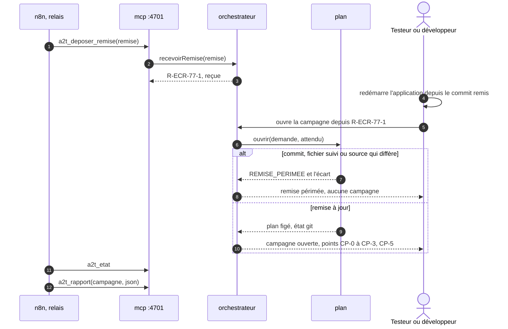

# Module `relais` (D22)

Sans relais, le développeur porte la remise de la tête de développement, Agent2Dev ou un agent qui applique agent-tdd-jira : il redémarre l'application, ouvre la campagne sur la demande et le dossier du plan, puis rapporte le journal de tests à la tête de développement. Le relais n8n, facultatif, porte ces deux objets à sa place : il dépose la remise chez Agent2Test et relève le journal de tests d'une campagne close. Il ne décide rien et n'ouvre aucune campagne. Agent2Test ne dépend jamais de lui (D22.INV-1).

## 1. Activation

Le relais est désactivé par défaut. Pour l'activer, le développeur :

1. porte `"relais": { "actif": true }` dans la configuration humaine, avec un utilisateur `relais` au seul rôle `relais` ;
2. crée son jeton par `scripts/installer.sh --relais`, dans `<secrets>/relais.jeton`, en mode 0600 ;
3. recopie ce jeton dans le magasin d'identifiants de n8n, sous le nom `agent2test-relais`.

Relais désactivé, aucun jeton au rôle `relais` n'est accepté.

Le workflow et la composition de n8n viennent d'Agent2Dev (spécification agent2dev, module `relais`) : n8n écoute sur `127.0.0.1`, sur sa base SQLite, sans télémétrie. n8n ne fait pas partie d'Agent2Test : il est publié sous la Sustainable Use License, qui permet l'usage interne mais n'est pas une licence open source. D18.INV-2 ne porte que sur les dépendances et les images d'Agent2Test.

## 2. Ce que porte le relais



## 3. Remise `agent2test.remise/1` (D22.INV-4)

```json
{
  "format": "agent2test.remise/1",
  "id": "R-ECR-77-1",
  "date": "2026-10-21T16:02:00Z",
  "demande": { "cle": "ECR-77", "texte": "Export des retours d'expérience en CSV" },
  "racine": "/home/fred/projets/ecr",
  "plan": {
    "adaptateur": "agent-tdd-jira",
    "dossier": "docs/demandes/ECR-77",
    "sources": [
      { "chemin": "docs/demandes/ECR-77/us.md", "empreinte": "<sha256>" },
      { "chemin": "docs/demandes/ECR-77/ECR-77.feature", "empreinte": "<sha256>" }
    ]
  },
  "commit": "<sha1 de HEAD>",
  "changements": { "git": "origin/develop...HEAD" },
  "criteres": [
    { "id": "ECR-77-CA01", "statut": "validé" },
    { "id": "ECR-77-CA02", "statut": "validé" },
    { "id": "ECR-77-CA03", "statut": "en attente de Q1" },
    { "id": "ECR-77-CA04", "statut": "validé" }
  ],
  "jouables": ["ECR-77-S01", "ECR-77-S04"],
  "nonJouables": [
    { "scenario": "ECR-77-S02", "motif": "limité au back" },
    { "scenario": "ECR-77-S03", "motif": "en attente de Q1" }
  ],
  "roles": ["LECTEUR"],
  "prealables": []
}
```

- `schemas/remise.json` est fermé : un champ inconnu, absent ou mal formé fait refuser la remise `REMISE_NON_CONFORME`, avec la liste de ses écarts. La remise ne porte aucun contenu de fichier, aucun jeton, aucun secret : des chemins, des empreintes et des identifiants.
- `id` vaut `R-<CLÉ>-<n>`. La même remise déposée deux fois ne crée qu'une remise ; un même identifiant au contenu différent est refusé `REMISE_DIFFERENTE`.
- `racine` est un chemin absolu : la racine du profil d'environnement, ou l'une des racines de `remises.racines` dans la configuration humaine, comme les worktrees du mode parallèle ; sinon, la remise est refusée `RACINE_NON_ADMISE`. `plan.dossier` vaut `docs/demandes/<CLÉ>`, et chaque source est un chemin relatif sous ce dossier, sans `..` ; `plan` applique ensuite son propre confinement (module `plan`).
- `criteres`, `jouables`, `nonJouables`, `roles` et `prealables` sont la prévision de la tête de développement. La vue des remises les montre à côté de ce qu'Agent2Test établit à l'ouverture, écarts signalés ; Agent2Test décide (D3.INV-5).
- Une remise reçue est rangée dans `orchestration.sqlite`, à l'état « reçue », et s'inscrit au journal (`remise.recue`).

## 4. Ouvrir une campagne depuis une remise (D22.INV-3)

1. La remise reste « reçue » tant qu'un testeur ou le développeur ne l'ouvre pas : bouton « ouvrir la campagne » de la vue des remises (module `tableau-de-bord`), ou `a2t_demarrer_campagne({ remise: "R-ECR-77-1" })` avec un jeton humain. Aucun délai ne l'ouvre ; aucune sonde ni session ne se lance avant.
2. Avant le bouton, la vue rappelle de redémarrer l'application sur le Tomcat local depuis le commit remis ; Agent2Test ne la démarre pas (D9.INV-7).
3. À l'ouverture, `plan.ouvrir` reçoit la demande, le dossier, la plage de changements et `attendu : { commit, sources }`. Le `scanner` relève l'état git de la racine, comme pour toute ouverture (module `plan`, section 5). Si `HEAD` n'est pas le commit remis, si un fichier suivi est modifié, ou si l'empreinte d'une source diffère, l'ouverture est refusée `REMISE_PERIMEE`, avec l'écart ; la remise passe à « périmée » (`remise.perimee`), et une nouvelle remise est attendue.
4. Sinon, la campagne s'ouvre comme une campagne ouverte à la main, avec les mêmes points de contrôle ; elle garde l'identifiant de sa remise, et la remise passe à « ouverte » (`remise.ouverte`).

Une campagne ouverte depuis une remise est celle qu'aurait donnée une ouverture à la main sur le même dossier et le même commit : même plan figé, même état git, même sélection.

## 5. Outils du rôle `relais` (D22.INV-2)

| Outil | Rôle |
|---|---|
| `a2t_deposer_remise(remise)` | dépose une remise ; rend `{ id, etat }` |
| `a2t_etat` | lecture : les remises, leur état et, pour chacune, la campagne qui en est issue, son état et sa clôture |
| `a2t_rapport(campagne, "json")` | lecture : le journal de tests d'une campagne issue d'une remise, au format `agent2test.journal-de-tests/1` (module `journal`, section 3) |

- Tout autre outil est refusé à ce rôle `DROIT_INSUFFISANT` : `a2t_demarrer_campagne`, `a2t_tache_suivante`, `a2t_soumettre`, `a2t_decider`, `a2t_suspendre`, `a2t_journal` et `a2t_carte`. Aucune décision, aucune ouverture de campagne, aucun arrêt ni reprise ne passe par le relais.
- `a2t_etat` et `a2t_rapport` ne montrent au relais que les remises et les campagnes qui en sont issues. Un journal de tests relevé avant la clôture porte la mention « provisoire » et aucune empreinte de fin (D10.INV-4) ; la tête de développement le lit comme tel.

## 6. Ce que le relais ne fait jamais

- ouvrir une campagne, la suspendre ou la reprendre ;
- décider un point de contrôle, CP-0 et CP-5 compris, ni CP-4 ;
- lire ou écrire un fichier, du projet de l'application comme d'Agent2Test : il ne voit que les remises, leur état et les journaux de tests de leurs campagnes ;
- recevoir une connexion d'Agent2Test : Agent2Test n'ouvre aucune connexion vers n8n ni vers Agent2Dev (D22.INV-1).

## 7. Pièges connus

- **Remise prise pour un ordre** : un dépôt ne lance rien ; seul un humain ouvre la campagne, après avoir redémarré l'application.
- **Application sur un autre commit** : Agent2Test vérifie la racine, pas l'application en marche ; le rappel avant l'ouverture et la vérification du commit et des fichiers suivis réduisent l'écart, et la sonde reste celle de toute campagne (D9.INV-3).
- **Racine arbitraire** : une remise qui désigne un autre dossier du poste est refusée ; seules les racines admises par un humain sont lues.
- **Relais qui lit tout** : le rôle `relais` ne voit que les remises et les campagnes qui en sont issues.

## 8. Tests (scénarios)

Les tests jouent le relais par un client MCP simulé, au rôle `relais` ; n8n n'est pas nécessaire.

| Scénario | Vérifie | Cas |
|---|---|---|
| RL1 | D22.INV-1 | relais désactivé : une campagne simulée se mène à la main, à l'identique, et un jeton au rôle `relais` est refusé |
| RL2 | D22.INV-1 | relais activé : pendant le dépôt, l'ouverture et une campagne simulée complète, Agent2Test n'ouvre aucune connexion hors de l'application cible et de son fournisseur SSO (`fetch`, `http.request` et `net.connect` interceptés) |
| RL3 | D22.INV-2 | un jeton au rôle `relais` n'obtient de `tools/list` que ses trois outils ; `a2t_demarrer_campagne`, `a2t_decider`, `a2t_suspendre` et `a2t_soumettre` lui sont refusés `DROIT_INSUFFISANT` |
| RL4 | D22.INV-2 | au rôle `relais`, `a2t_rapport` d'une campagne ouverte à la main est refusé ; celui d'une campagne issue d'une remise rend le journal JSON, « provisoire » avant la clôture |
| RL5 | D22.INV-3 | une remise déposée laisse la file et les campagnes inchangées : aucune sonde, aucune session, aucun point ne s'ouvre avant qu'un humain l'ouvre |
| RL6 | D22.INV-3 | à l'ouverture, un commit différent, un fichier suivi modifié ou une source dont l'empreinte diffère rendent la remise « périmée », avec l'écart nommé ; aucune campagne ne s'ouvre |
| RL7 | D22.INV-3 | la remise de l'exemple ECR-77, ouverte sur le commit remis, donne la même campagne qu'une ouverture à la main sur le même dossier : même plan figé, même état git, mêmes jouables |
| RL8 | D22.INV-4 | une remise dont la racine n'est ni celle du profil ni dans `remises.racines`, ou dont une source sort de `docs/demandes/<CLÉ>`, est refusée avec son motif |
| RL9 | D22.INV-4 | une remise à champ inconnu, ou sans `commit`, est refusée `REMISE_NON_CONFORME` avec ses écarts ; la même remise déposée deux fois ne crée qu'une remise ; un même identifiant au contenu différent est refusé `REMISE_DIFFERENTE` |

## 9. Fichiers à produire

- `src/interfaces/mcp/relais.js`
- `schemas/remise.json`
- `test/relais/*.test.js`, `test/fixtures/remises/` (la remise de l'exemple ECR-77 et ses variantes)
