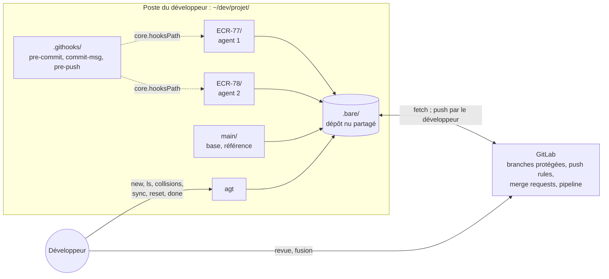

# Agents en parallèle sur GitLab, spécification 1.0.1

Ce document est le point d'entrée de la spécification. Il fixe l'invariant d'organisation, le registre des dimensions, les règles communes et les invariants. Le code de référence, à reproduire à l'identique, et la recette sont dans `modules/`.

L'agent qui travaille dans chaque worktree est celui du skill `agent-tdd-jira`, à partir de la version 1.1.0 : sa dimension D9 décrit son comportement dans un worktree géré par ce kit, et elle inclut ce document comme référentiel. Les garde-fous Git reprennent ceux de l'effecteur de `tension-dashboard-gitlab-agent` 2.2.0.

## 1. Ordre de lecture

1. Ce document, en entier.
2. `manifest.json`.
3. Les modules actifs, dans l'ordre : `isolation`, `hooks`, `orchestration`, `gitlab`, `distribution`, `recette`.
4. `modules/controle-gitlab/SKILL.md` et `modules/tension-depot/SKILL.md` : seulement pour comprendre les points d'extension. Ne pas les implémenter en 1.x.

## 2. Invariant d'organisation

**Une demande Jira = une branche = un worktree = un agent.**

- Chaque agent n'écrit que dans le worktree de sa demande. Le skill de l'agent et les hooks sont posés une seule fois, hors des worktrees.
- Git interdit d'extraire une même branche dans deux worktrees : deux agents ne peuvent pas écrire sur la même branche.
- L'agent commite localement. Il ne pousse pas, ne fusionne pas et n'a aucun accès à GitLab.
- Aucun commit publié n'est réécrit, par personne : rebase tant que la branche est locale, fusion ensuite.
- Seule une merge request revue, puis fusionnée par un humain en merge commit, atteint la branche d'intégration.

## 3. Carte du système

## 4. Cycle 7E

| Phase | Ce qu'elle désigne ici | Modules |
|---|---|---|
| Éléments | demandes Jira (clés), chemins impactés, commits de scénario | `distribution`, `hooks` |
| Espace | dépôt nu partagé, worktrees, branches de demande | `isolation` |
| Engendrent | chemins communs entre demandes, prévus puis constatés, fusions simulées | `distribution` |
| État | état de chaque demande (commits propres, retard, publication) et des hooks | `orchestration` |
| Expression | refus des garde-fous (« REFUS »), sortie d'`agt collisions`, merge request en brouillon | `hooks`, `distribution`, `gitlab` |
| Évolutif | point de retour, sauvegardes `backup/`, synchronisations, archives de `travail/` | `orchestration` |
| Environnement | développeur, GitLab, agents `agent-tdd-jira`, tension au niveau du dépôt (D7) | `gitlab`, `tension-depot` |

Clause de second ordre : les garde-fous façonnent le comportement des agents, et leurs refus sont des informations pour le développeur. Un refus n'est jamais contourné : l'agent s'arrête et le signale (`agent-tdd-jira:D9.INV-4`), le développeur décide. La charge de validation du développeur croît avec le nombre d'agents : c'est elle, et non la machine, qui fixe le nombre de demandes menées de front.

## 5. Registre des dimensions

| ID | Dimension | Introduite | Statut 1.0.0 | Dépend de | Module |
|---|---|---|---|---|---|
| D1 | Isolation : une demande par worktree | 1.0 | active | | `isolation`, `recette` |
| D2 | Garde-fous locaux : hooks communs | 1.0 | active | D1 | `hooks`, `recette` |
| D3 | Orchestration : script `agt` | 1.0 | active | D1, D2 | `orchestration`, `recette` |
| D4 | Garde-fous GitLab | 1.0 | active | D2 | `gitlab`, `recette` |
| D5 | Distribution et synchronisation des demandes | 1.0 | active | D3 | `distribution`, `recette` |
| D6 | Contrôle de la configuration GitLab par l'API, en lecture seule | 1.0 | reserved | D4 | `controle-gitlab` |
| D7 | Tension entre demandes au niveau du dépôt | 1.0 | reserved | D5 | `tension-depot` |

## 6. Contrat de version et points d'extension

La spécification suit le contrat de version de `EVOLUTION.md` du dépôt Agent2Prompt : une version mineure ajoute au moins une dimension ou un point d'extension, un invariant ne s'affaiblit jamais, la version précédente est archivée avant toute publication.

Points d'extension, actifs dès 1.0.0 :

- **E1** : `regles-gitlab.txt` porte les noms d'attributs de l'API GitLab (`branch_name_regex`, `commit_message_regex`, `file_name_regex`, `prevent_secrets`, `deny_delete_tag`). Le contrôle D6 le comparera à `GET /projects/:id/push_rule` sans conversion. Aucune commande d'`agt` n'appelle GitLab en 1.x (D3.INV-5, contrôle W32).
- **E2** : la sortie d'`agt collisions` a un format stable : une ligne `== <CLÉ> × <CLÉ> : <ÉTAT>`, puis un chemin par ligne, précédé de trois espaces et suivi de ` [point chaud]` le cas échéant. D7 la lira sans changer `agt` (contrôle W37).

## 7. Règles globales

- **Code de référence** : les six fichiers du kit (`.githooks/pre-commit`, `.githooks/commit-msg`, `.githooks/pre-push`, `agt`, `regles-gitlab.txt`, `recette.sh`) sont reproduits à l'identique depuis les modules. Une adaptation passe par l'environnement (`AGT_BASE`, `AGT_REMOTE`, `AGT_POINTS_CHAUDS`), jamais par une modification du code.
- **Aucune écriture dans GitLab** : ni le kit, ni l'IA qui l'installe, ni les agents n'écrivent dans GitLab. La configuration de GitLab est faite par un Maintainer, à partir de la fiche du module `gitlab`.
- **Aucun jeton** : aucun jeton GitLab dans un worktree, dans le kit, dans une URL de distant ou dans un journal.
- **Aucune réécriture** : ni `--force`, ni `--force-with-lease`, ni réécriture d'un commit publié.
- **Commandes humaines** : `agt reset`, `agt done --abandon`, `git reset --hard` et la résolution des conflits sont réservés au développeur.
- **Recette avant service** : `recette.sh` passe sans échec avant la mise en service du kit, et après toute modification de l'un de ses fichiers.
- **Langue** : messages, commentaires et documents en français ; commandes et variables telles que définies.

## 8. Cibles techniques

| Élément | Exigence | Vérifié sur |
|---|---|---|
| Git | 2.38 ou plus récent (`merge-tree --write-tree`) | 2.43 |
| Shell | bash 4 ou plus récent (`mapfile`) | bash 5.2 |
| GitLab | toutes éditions pour la protection des branches et la pipeline ; Premium ou Ultimate pour les push rules, les approbations obligatoires et les Code Owners | documentation GitLab |
| Outils facultatifs | `gitleaks` (secrets à l'indexation), `glab` (merge requests), `shellcheck` | |

## 9. Critères d'acceptation

- `recette.sh` : 44 contrôles réussis, aucun échec, sans accès au réseau.
- `shellcheck -S warning` sans avertissement sur les hooks, `agt` et `recette.sh`, si `shellcheck` est disponible.
- Les six fichiers du kit sont identiques aux blocs des modules, octet pour octet.
- `./agt ls` affiche « hooks : actifs » et aucune ALERTE.
- La fiche du module `gitlab` est remplie, édition comprise, et remise au Maintainer.

## 10. Invariants

**D1 : isolation**

- **D1.INV-1** : une demande a un worktree nommé par sa clé Jira, sur une branche `<type>/<CLÉ>-<slug>` conforme aux conventions ; une même branche n'est jamais extraite dans deux worktrees.
- **D1.INV-2** : la branche d'une demande est créée sans branche amont ; son premier push crée la branche distante du même nom.
- **D1.INV-3** : le point de retour `agent/<CLÉ>/start` est posé et le worktree verrouillé avant que l'agent commence.
- **D1.INV-4** : `travail/`, `.skills/`, `*.mht` et `*.mhtml` sont exclus de tous les worktrees par l'exclusion commune (`.bare/info/exclude`), sans modifier le `.gitignore` du projet.

**D2 : hooks**

- **D2.INV-1** : aucun commit sur `main`, `master`, `develop`, `release/*`, en HEAD détachée, ni sur une branche dont la clé n'est pas celle du worktree.
- **D2.INV-2** : tout commit, hors commit de fusion, commence par `<CLÉ> Snn : ` ou `<CLÉ> : `, de sorte que `git log --grep='^<CLÉ> '` retrouve tous les commits de la demande.
- **D2.INV-3** : aucun fichier interdit n'est commité, même forcé dans l'index : `.env`, clés et certificats, `*.mht`, `*.mhtml`, `.skills/`, `travail/`.
- **D2.INV-4** : un worktree ne pousse que vers la branche de sa demande ou une branche `fix/tension-*`, et ne supprime aucune branche distante.
- **D2.INV-5** : aucun push ne réécrit une branche distante, avec ou sans `--force` ou `--force-with-lease`.

**D3 : orchestration**

- **D3.INV-1** : `agt reset` ne réécrit aucun commit publié et crée une sauvegarde `backup/<CLÉ>-<horodatage>` avant toute écriture.
- **D3.INV-2** : `agt sync` refuse un worktree non propre, rebase une branche jamais publiée et fusionne la base dans une branche publiée.
- **D3.INV-3** : `agt done` ne supprime une branche que si elle est contenue dans la base distante, sauf `--abandon` explicite, et archive `travail/` avant de supprimer le worktree.
- **D3.INV-4** : `agt ls` signale des hooks inactifs et toute URL de distant qui contient un identifiant ou un jeton.
- **D3.INV-5** : `agt` n'appelle pas GitLab et ne pousse rien.

**D4 : GitLab**

- **D4.INV-1** : les push rules de `regles-gitlab.txt` acceptent tout ce que les hooks et `agt new` acceptent, refusent les sauvegardes `backup/` et les messages hors format, et reprennent l'expression des fichiers interdits du hook `pre-commit`.
- **D4.INV-2** : une merge request est fusionnée par merge commit, sans squash : les commits de la demande entrent dans la base avec leur SHA.
- **D4.INV-3** : les agents n'ont aucun accès à GitLab : aucun jeton dans le kit, dans un worktree ou dans une URL de distant.

**D5 : distribution**

- **D5.INV-1** : avant le code, `agt collisions` signale les chemins communs aux fiches d'impact (`travail/<CLÉ>/impact.txt`) de deux demandes actives, en marquant les points chauds.
- **D5.INV-2** : pendant la réalisation, `agt collisions` signale les fichiers modifiés en commun par deux demandes, avec le résultat de la fusion simulée, dans le format stable du point E2.
- **D5.INV-3** : une demande empilée part de la branche parente déclarée ; une fois la parente fusionnée par merge commit, elle n'apporte à la base que ses propres commits.

## 11. Journal de révision

**1.0.0** (2026-10-20) : première version. Dimensions D1 à D5 actives, D6 et D7 réservées. Points d'extension E1 et E2. Issue du tutoriel « Agents de code en parallèle » v2, testé sur une copie du dépôt Agent2Prompt. Ajouts par rapport au tutoriel : commit à clé seule hors scénario, prévision des collisions par les fiches d'impact, points chauds, alerte sur un identifiant dans une URL de distant, fichier `regles-gitlab.txt`, recette de 44 contrôles rattachés aux invariants. Archive : `archives/SKILL-v1.0.0.md`.

**1.0.1** (2026-10-21) : correctif. Module `distribution` : le skill Java est cité sous son nouveau nom, `java` (auparavant `expert-java`), le préfixe `expert-` étant retiré de tous les skills du dépôt. Aucune dimension, aucun invariant ni aucun contrôle de la recette modifié.
