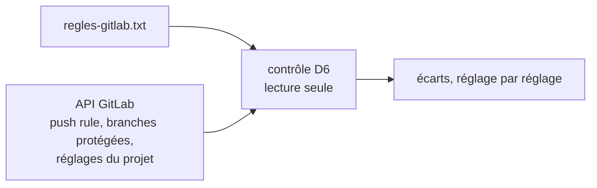

# Module `controle-gitlab` (D6, réservé)

Statut : `reserved`. En 1.x, la configuration GitLab est vérifiée à la main par le Maintainer, à partir de la fiche du module `gitlab`.

## 1. Pourquoi cette dimension existe

La sécurité effective repose sur la configuration de GitLab, qui peut dériver : une push rule supprimée, la méthode de fusion changée, le squash autorisé de nouveau. Un contrôle en lecture seule, rejouable, détecterait ces dérives avant qu'un agent n'en profite.

## 2. Principe prévu

- une commande distincte d'`agt`, avec un jeton en lecture seule fourni par l'environnement, jamais par un fichier du kit ;
- comparaison champ par champ, sans conversion, grâce aux noms d'attributs de l'API (E1) ;
- tests sur des réponses d'API enregistrées, sans réseau ;
- les champs exacts des réglages du projet et des branches protégées seront vérifiés dans la documentation de l'API à l'activation.

## 3. Ce que prépare le point d'extension

| Point | Règle active en 1.x | Rôle à l'activation |
|---|---|---|
| E1 | `regles-gitlab.txt` porte les noms d'attributs de l'API ; aucune commande d'`agt` n'appelle GitLab | comparaison directe avec `GET /projects/:id/push_rule` ; le contrôle reste hors d'`agt` |

## 4. Test d'inertie en 1.x

Contrôle W32 : `agt` ne contient aucun appel à GitLab (`glab`, `curl`, `wget`, `api/v4`) ni aucun `git push`.
