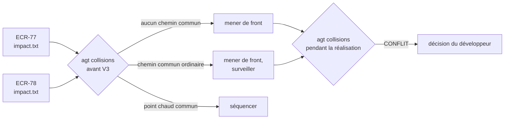

# Module `distribution` (D5)

Phases 7E couvertes : Éléments, Engendrent.

Le parallélisme se décide avant le code. À l'étape d'impact, chaque agent écrit la liste des chemins qu'il va toucher (`agent-tdd-jira:D9.INV-5`). Deux demandes dont les listes partagent un point chaud ne sont pas menées de front.



## 1. Format de `travail/<CLÉ>/impact.txt`

- un chemin relatif à la racine du worktree par ligne, pour chaque fichier cité dans la fiche d'impact, existant ou à créer ;
- lignes vides et lignes commençant par `#` ignorées ; `./` en tête et espaces en fin de ligne retirés ;
- fichier non versionné : `travail/` est exclu (D1.INV-4).

```text
# ECR-77 : chemins impactés, fiche d'impact du 2026-10-20
api/openapi.yaml
src/main/java/fr/exemple/rex/feedback/api/FeedbackController.java
src/app/features/feedback/data-access/feedback.store.ts
```

## 2. Points chauds

| Chemin commun à deux demandes | Risque | Règle |
|---|---|---|
| `api/openapi.yaml` | contrat modifié des deux côtés, clients régénérés en conflit | séquencer. Le contrat passe avant le back et le front (`agent-tdd-jira:D5.INV-5`). Un fichier généré se régénère, il ne se fusionne jamais à la main |
| migrations Flyway (`db/migration/`) | même numéro `V5__` pris deux fois : la numérotation est séquentielle (`java`, module `persistance`) | réserver les numéros à la distribution, fusionner dans leur ordre : Flyway refuse par défaut une migration plus ancienne que la dernière appliquée |
| changelog Liquibase (`db/changelog/`) | lignes `include` ajoutées au même endroit | séquencer, ou fusion manuelle relue |
| configuration de sécurité | classe `sensitive` de `tension-dashboard-gitlab-agent` : toute tension y est critique (`tension-dashboard-gitlab-agent:D1.INV-3`) | séquencer |
| `pom.xml`, `package.json`, `build.gradle` | ajout de dépendance, soumis à validation (`agent-tdd-jira:D5.INV-6`) | séquencer les ajouts ; un lock file se régénère |
| `docs/demandes/<CLÉ>/` | aucun : un dossier par clé | — |

`agt` marque un chemin comme point chaud s'il correspond à l'expression étendue `AGT_POINTS_CHAUDS`. Valeur par défaut :

```text
(^|/)api/openapi\.ya?ml$|(^|/)db/(migration|changelog)/|(^|/)(pom\.xml|package\.json|build\.gradle(\.kts)?)$|[Ss]ecurity
```

## 3. Prévoir, puis constater (D5.INV-1, D5.INV-2)

`./agt collisions` compare les demandes actives deux à deux. Avant le code, il lit leurs fiches d'impact (`PRÉVISION`) ; pendant la réalisation, il compare les fichiers modifiés par leurs branches et simule la fusion. Sortie réelle de la recette, à l'état final :

```text
== ECR-78 × ECR-90 : PRÉVISION
   api/openapi.yaml [point chaud]
== ECR-78 × ECR-90 : CONFLIT
   COLLISION.md
```

| État | Sens |
|---|---|
| `PRÉVISION` | chemins communs aux deux fiches d'impact |
| `fusion propre` | fichiers communs aux deux branches, fusion simulée sans conflit |
| `CONFLIT` | fichiers communs, fusion simulée en conflit |
| `simulation impossible (git 2.38 ou plus récent requis)` | `git merge-tree --write-tree` indisponible |

Ce format est stable (point E2). `tension-dashboard-gitlab-agent` 2.2.0 mesure la tension entre un arbre de travail et sa branche distante, fichier par fichier : il s'applique à chaque worktree séparément. La tension entre deux demandes locales relève du niveau du dépôt, que ce skill réserve à sa version 3.0 ; `agt collisions` en tient lieu, à la demande (dimension réservée D7).

## 4. Synchroniser

- Par le développeur, entre deux scénarios acceptés (V4), worktree propre, jamais pendant que l'agent écrit : `./agt sync <CLÉ>`.
- Branche jamais poussée : rebase sur la base. Branche publiée : fusion de la base, sans réécriture (D3.INV-2).
- L'agent relance ensuite ses suites avant le scénario suivant (`agent-tdd-jira:D9.INV-7`).
- Un conflit est résolu par le développeur ; `agt sync` s'arrête sans rien laisser en cours.

## 5. Demandes empilées (D5.INV-3)

```bash
./agt new ECR-90 rapport feature feature/ECR-77-export-csv   # part de la branche d'ECR-77
# La merge request d'ECR-90 cible feature/ECR-77-export-csv tant qu'ECR-77 n'est pas fusionnée.
# Après la fusion d'ECR-77 par merge commit, un changement de cible suffit, sans rebase :
glab mr update <iid> --target-branch develop
```

Avec le merge commit, les commits d'ECR-77 entrent tels quels dans la base : la merge request d'ECR-90 n'a rien à rebaser. Limiter la pile à deux niveaux. Tant que la branche parente n'est pas fusionnée, `agt ls` et `agt diff` comptent aussi ses commits.

## 6. Contrôle de sortie

- Prévision par les fiches d'impact, points chauds marqués (D5.INV-1) : W35.
- Constat sur les branches, fusion simulée, format stable (D5.INV-2) : W36, W37.
- Demande empilée, puis n'apportant que ses commits après fusion de la parente (D5.INV-3) : W34, W43.
