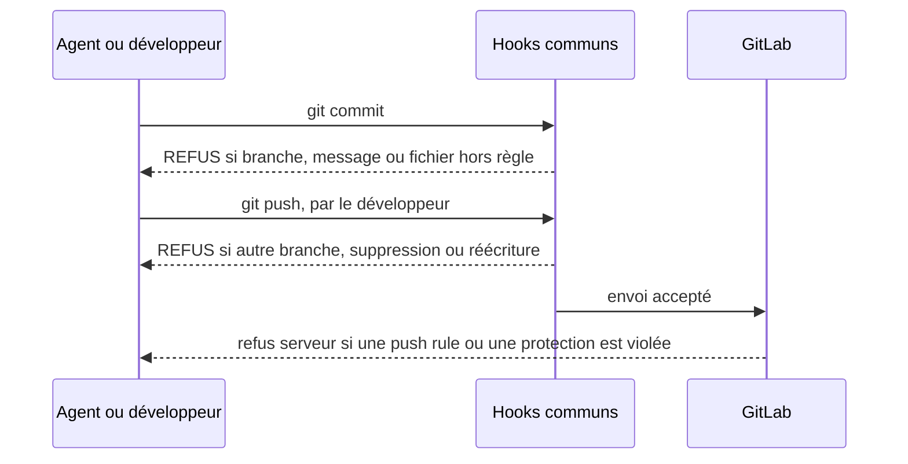

# Module `hooks` (D2)

Phase 7E couverte : Expression, par les refus.

Les hooks sont dans `.githooks/`, à la racine du kit, en lecture seule ; `core.hooksPath` les applique à tous les worktrees. Chacun tire la clé Jira du nom du répertoire du worktree, et chaque refus commence par « REFUS : ». Ils évitent les erreurs ; GitLab empêche les abus (module `gitlab`), car un hook se contourne.



## 1. `.githooks/pre-commit` (D2.INV-1, D2.INV-3)

```bash
#!/usr/bin/env bash
# pre-commit : branche de la demande (D2.INV-1), fichiers interdits (D2.INV-3), secrets
set -euo pipefail
branch=$(git branch --show-current)
cle=$(basename "$(git rev-parse --show-toplevel)")        # le dossier du worktree porte la clé Jira

case "$branch" in
  ''|main|master|develop|release/*) echo "REFUS : commit interdit sur « ${branch:-HEAD détachée} »"; exit 1 ;;
esac
[[ "$branch" == */"$cle"-* ]] || { echo "REFUS : la branche $branch n'appartient pas à $cle"; exit 1; }

# Jamais commités : secrets, demande Jira enregistrée (données personnelles), skill matérialisé, dossier de travail.
# Même expression que file_name_regex dans regles-gitlab.txt.
interdits=$(git diff --cached --name-only --diff-filter=ACMR \
  | grep -E '(^|/)(\.env|id_rsa[^/]*|[^/]*\.(pem|key|p12|jks|mht|mhtml))$|^(\.skills|travail)/' || true)
[[ -z "$interdits" ]] || { echo "REFUS : fichiers interdits indexés :"; echo "$interdits" | sed 's/^/  /'; exit 1; }

# Détection de secrets si gitleaks est installé (detect et protect sont dépréciés depuis la 8.19.0)
if command -v gitleaks >/dev/null; then
  if gitleaks git --help >/dev/null 2>&1; then
    gitleaks git --pre-commit --staged --redact --no-banner
  else
    gitleaks protect --staged --redact --no-banner
  fi
fi
exit 0
```

## 2. `.githooks/commit-msg` (D2.INV-2)

Le format est celui de `agent-tdd-jira` 1.1.0. La matrice de traçabilité de l'agent cherche `^<CLÉ> ` : un commit hors format disparaîtrait de la matrice. Le message de fusion produit par Git (`agt sync` d'une branche publiée) est accepté.

```bash
#!/usr/bin/env bash
# commit-msg (D2.INV-2) : « <CLÉ> Snn : … » pour un scénario, « <CLÉ> : … » hors scénario.
# La matrice de traçabilité du skill agent-tdd-jira retrouve ainsi tous les commits de la demande.
cle=$(basename "$(git rev-parse --show-toplevel)")
git rev-parse -q --verify MERGE_HEAD >/dev/null && exit 0     # fusion de develop : message de Git accepté
head -n1 "$1" | grep -Eq "^${cle}( S[0-9]{2})? : " && exit 0
echo "REFUS : le message doit commencer par « ${cle} Snn : » ou « ${cle} : » (exemple : ${cle} S02 : …)"
exit 1
```

## 3. `.githooks/pre-push` (D2.INV-4, D2.INV-5)

Le hook compare l'ancienne et la nouvelle tête de chaque branche visée : si l'ancienne n'est pas un ancêtre de la nouvelle, l'envoi réécrirait l'historique publié, avec ou sans `--force-with-lease`. Les branches `fix/tension-*` de l'effecteur de `tension-dashboard-gitlab-agent` sont acceptées : cet effecteur a ses propres garde-fous (`tension-dashboard-gitlab-agent:D4.INV-1`, `tension-dashboard-gitlab-agent:D4.INV-3`).

```bash
#!/usr/bin/env bash
# pre-push : branche de la demande ou fix/tension-*, aucune suppression (D2.INV-4), aucune réécriture (D2.INV-5)
set -euo pipefail
cle=$(basename "$(git rev-parse --show-toplevel)")
while read -r _ local_sha remote_ref remote_sha; do
  target=${remote_ref#refs/heads/}
  [[ "$target" == */"$cle"-* || "$target" == fix/tension-* ]] \
    || { echo "REFUS : push vers $target depuis $cle"; exit 1; }
  [[ ! "$local_sha" =~ ^0+$ ]] || { echo "REFUS : suppression de $target"; exit 1; }
  if [[ ! "$remote_sha" =~ ^0+$ ]]; then
    git merge-base --is-ancestor "$remote_sha" "$local_sha" 2>/dev/null \
      || { echo "REFUS : $target serait réécrite, des commits publiés seraient perdus (aucun --force)"; exit 1; }
  fi
done
```

Après écriture : `chmod +x .githooks/*`, puis `chmod -R a-w .githooks`.

## 4. Ce que les hooks ne couvrent pas

- **Contournement.** `--no-verify`, `git -c core.hooksPath=…` ou un `git config` lancé depuis n'importe quel worktree, puisque la configuration est commune. Si l'outil de l'agent accepte des règles de refus de commandes, y interdire : `git push`, `git merge`, `git rebase`, `git switch`, `git config`, `git -c`, `--no-verify`, `--force`, `--force-with-lease`, `reset --hard`, `stash drop`, `stash clear`, `branch -D`, `git worktree`. C'est la liste fermée de l'effecteur de `tension-dashboard-gitlab-agent` (module `effecteur-gitlab`, section 3.1), étendue aux commandes de configuration et de branche ; `agent-tdd-jira` 1.1.0 l'impose à l'agent (`agent-tdd-jira:D9.INV-2`).
- **Désactivation.** `./agt ls` signale par une ALERTE un `core.hooksPath` qui ne pointe plus vers `.githooks/` (D3.INV-4).

## 5. Husky et outils semblables

Un `npm ci` qui lance Husky réécrit `core.hooksPath` dans la configuration commune, donc pour tous les worktrees. Remèdes, au choix : `HUSKY=0` dans l'environnement des agents, ou appeler les hooks de `.githooks/` depuis ceux de Husky. Dans les deux cas, vérifier ensuite avec `./agt ls`.

## 6. Contrôle de sortie

- Aucun commit sur une branche d'intégration ni sur celle d'une autre clé (D2.INV-1) : W15, W16.
- Format traçable, traçabilité complète (D2.INV-2) : W8 à W11.
- Fichiers interdits refusés, `.env.example` accepté (D2.INV-3) : W12 à W14.
- Aucun push vers une autre branche, aucune suppression, `fix/tension-*` accepté (D2.INV-4) : W18 à W20.
- Aucune réécriture d'une branche distante, push sans force après fusion (D2.INV-5) : W21, W22, W26.
