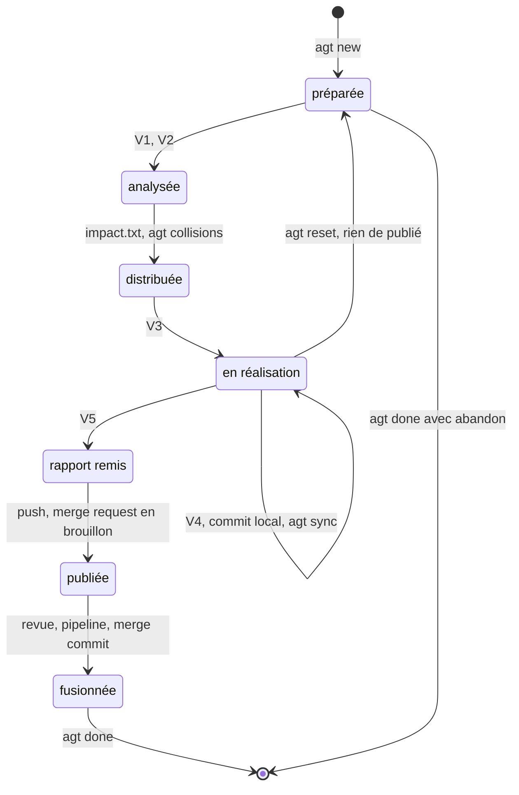

# Module `orchestration` (D3)

Phases 7E couvertes : État, Évolutif.

## 1. Cycle de vie d'une demande



| Étape | Qui | Commande ou action |
|---|---|---|
| Préparer | développeur | `./agt new ECR-77 export-csv`, puis dépôt de `ECR-77/travail/ECR-77.mhtml` |
| Lancer l'agent | développeur | consigne de la section 3, suivie de la transmission `agent-tdd-jira` |
| V1, V2 | agent et développeur | extraction confirmée, scénarios validés |
| Impact | agent | fiche d'impact et `travail/ECR-77/impact.txt` (`agent-tdd-jira:D9.INV-5`) |
| Distribution | développeur | `./agt collisions` : mener de front ou séquencer (module `distribution`) |
| V3, V4 | agent et développeur | variantes, puis un scénario à la fois avec commit local ; `./agt sync ECR-77` entre deux scénarios |
| V5 | agent et développeur | matrice, rapport, projet de commentaire Jira publié par le développeur |
| Publier | développeur | `./agt diff ECR-77`, `git -C ECR-77 push`, merge request en brouillon (section 4) |
| Fusionner | humain | revue, pipeline vert, merge commit (module `gitlab`) |
| Nettoyer | développeur | `./agt done ECR-77` |

## 2. `agt`

À placer à la racine du kit, exécutable (`chmod +x agt`), et à lancer depuis elle.

```bash
#!/usr/bin/env bash
# agt : un worktree par demande Jira, pour les agents agent-tdd-jira. À lancer depuis la racine, à côté de .bare/.
# Réglages par l'environnement uniquement : AGT_BASE, AGT_REMOTE, AGT_POINTS_CHAUDS.
set -euo pipefail
BASE="${AGT_BASE:-develop}"
REMOTE="${AGT_REMOTE:-origin}"
POINTS_CHAUDS="${AGT_POINTS_CHAUDS:-(^|/)api/openapi\.ya?ml$|(^|/)db/(migration|changelog)/|(^|/)(pom\.xml|package\.json|build\.gradle(\.kts)?)$|[Ss]ecurity}"

branche()  { git -C "$1" branch --show-current; }
publiee()  { git rev-parse -q --verify "refs/remotes/$REMOTE/$1" >/dev/null; }
tickets()  { for d in */; do d=${d%/}; [[ -e "$d/.git" && "$d" != main ]] && echo "$d"; done; return 0; }
propre()   { [[ -z "$(git -C "$1" status --porcelain)" ]] || { echo "REFUS : $1 a des modifications non commitées, à traiter d'abord"; exit 1; }; }
chemins()  { grep -vE '^[[:space:]]*(#|$)' "$1" | sed -e 's/[[:space:]]*$//' -e 's#^\./##' | sort -u; }
marquer()  { while IFS= read -r f; do if [[ "$f" =~ $POINTS_CHAUDS ]]; then echo "   $f [point chaud]"; else echo "   $f"; fi; done; }

case "${1:-}" in
  new)      # agt new ECR-77 export-csv [feature|fix|chore|refactor] [base, pour une demande empilée]   (D1.INV-1 à D1.INV-3)
    cle=${2:?clé Jira}; slug=${3:?slug}; type=${4:-feature}; b="$type/$cle-$slug"; from=${5:-$REMOTE/$BASE}
    [[ "$cle" =~ ^[A-Z][A-Z0-9_]+-[0-9]+$ ]] || { echo "REFUS : clé Jira invalide : $cle"; exit 1; }
    [[ "$slug" =~ ^[a-z0-9-]+$ ]] || { echo "REFUS : slug invalide (minuscules, chiffres, tirets) : $slug"; exit 1; }
    [[ "$type" =~ ^(feature|fix|chore|refactor)$ ]] || { echo "REFUS : type invalide (feature, fix, chore, refactor) : $type"; exit 1; }
    git fetch -q "$REMOTE"
    git worktree add -q --no-track -b "$b" "$cle" "$from"   # sans amont : le premier envoi crée la branche du même nom
    git tag "agent/$cle/start" "$b"
    mkdir -p "$cle/travail/$cle"
    git worktree lock "$cle" --reason "agent en cours"
    echo "Prêt : $PWD/$cle (branche $b)."
    echo "Déposer $cle.mhtml dans $cle/travail/, puis lancer l'agent avec ce dossier comme seule zone d'écriture." ;;

  ls)       # hooks, URL des distants, puis état de chaque demande   (D3.INV-4)
    hp=$(git config core.hooksPath || true)
    if [[ "$hp" == "$PWD/.githooks" ]]; then echo "hooks : actifs ($hp)"
    else echo "ALERTE : core.hooksPath = « ${hp:-non défini} », hooks de sécurité inactifs"; fi
    while read -r nom url _; do
      if [[ "$url" =~ ^https?://[^/]*@ ]]; then
        echo "ALERTE : l'URL du distant $nom contient un identifiant ou un jeton ; passer par SSH ou un gestionnaire d'identifiants"
      fi
    done < <(git remote -v | sort -u)
    git fetch -q "$REMOTE" || echo "ALERTE : récupération impossible depuis $REMOTE, état non actualisé"
    for d in $(tickets); do
      b=$(branche "$d")
      printf '%-10s %-36s commits:%-3s retard:%-3s non-commités:%-3s publiée:%s\n' "$d" "$b" \
        "$(git rev-list --count --no-merges "$REMOTE/$BASE..$b")" \
        "$(git rev-list --count "$b..$REMOTE/$BASE")" \
        "$(git -C "$d" status --porcelain | wc -l)" \
        "$(publiee "$b" && echo oui || echo non)"
    done ;;

  diff)     # agt diff ECR-77 : ce que la demande ajoute à la base, hors fusions de la base
    cle=${2:?clé}
    git -C "$cle" diff --stat "$REMOTE/$BASE...HEAD"
    git -C "$cle" log --oneline --no-merges "$REMOTE/$BASE..HEAD" ;;

  collisions)  # avant le code : fiches d'impact (D5.INV-1) ; pendant : branches (D5.INV-2). Format stable (E2)
    git fetch -q "$REMOTE"
    mapfile -t ds < <(tickets)
    trouve=0
    for ((i=0; i<${#ds[@]}; i++)); do for ((j=i+1; j<${#ds[@]}; j++)); do
      a=${ds[i]}; b=${ds[j]}
      fa="$a/travail/$a/impact.txt"; fb="$b/travail/$b/impact.txt"
      if [[ -f "$fa" && -f "$fb" ]]; then
        communs=$(comm -12 <(chemins "$fa") <(chemins "$fb"))
        if [[ -n "$communs" ]]; then trouve=1; echo "== $a × $b : PRÉVISION"; marquer <<<"$communs"; fi
      fi
      ba=$(branche "$a"); bb=$(branche "$b")
      communs=$(comm -12 <(git diff --name-only "$REMOTE/$BASE...$ba" | sort) \
                         <(git diff --name-only "$REMOTE/$BASE...$bb" | sort))
      [[ -n "$communs" ]] || continue
      trouve=1
      rc=0; git merge-tree --write-tree "$ba" "$bb" >/dev/null 2>&1 || rc=$?
      case $rc in
        0) etat="fusion propre" ;;
        1) etat="CONFLIT" ;;
        *) etat="simulation impossible (git 2.38 ou plus récent requis)" ;;
      esac
      echo "== $a × $b : $etat"; marquer <<<"$communs"
    done; done
    [[ $trouve -eq 1 ]] || echo "Aucun fichier en commun entre les demandes actives." ;;

  sync)     # agt sync ECR-77 : entre deux scénarios, jamais pendant que l'agent écrit   (D3.INV-2)
    cle=${2:?clé}; b=$(branche "$cle"); propre "$cle"; git fetch -q "$REMOTE"
    if publiee "$b"; then
      git -C "$cle" merge --no-edit "$REMOTE/$BASE" \
        || { git -C "$cle" merge --abort; echo "ARRÊT : conflit, résolution humaine requise"; exit 1; }
    else
      git -C "$cle" rebase "$REMOTE/$BASE" \
        || { git -C "$cle" rebase --abort; echo "ARRÊT : conflit, résolution humaine requise"; exit 1; }
    fi ;;

  reset)    # commande humaine : abandonner le travail local de l'agent   (D3.INV-1)
    cle=${2:?clé}; b=$(branche "$cle"); propre "$cle"
    for c in $(git rev-list "$REMOTE/$BASE..$b"); do       # commits propres à la demande
      if [[ -n "$(git branch -r --contains "$c")" ]]; then
        echo "REFUS : $c est déjà publié, il ne sera pas réécrit."
        echo "Fermer la MR, puis : agt done $cle --abandon && agt new $cle <slug>-v2"; exit 1
      fi
    done
    git -C "$cle" branch "backup/$cle-$(date +%Y%m%dT%H%M%S)"     # sauvegarde avant toute écriture
    git -C "$cle" reset -q --hard "agent/$cle/start"
    echo "$cle revenu au point de départ ; sauvegarde : $(git -C "$cle" branch --list "backup/$cle-*" | tail -1 | tr -d ' ')" ;;

  done)     # agt done ECR-77 [--abandon] : après fusion de la MR, ou abandon décidé par le développeur   (D3.INV-3)
    cle=${2:?clé}; b=$(branche "$cle"); git fetch -q "$REMOTE"
    if [[ "${3:-}" != --abandon ]] && ! git merge-base --is-ancestor "$b" "$REMOTE/$BASE"; then
      echo "REFUS : $b n'est pas fusionnée dans $REMOTE/$BASE. Abandon volontaire : agt done $cle --abandon"; exit 1
    fi
    if [[ -d "$cle/travail" ]]; then                  # conserver demande.json, impact.txt et l'empreinte de la source
      mkdir -p archives-travail && mv "$cle/travail" "archives-travail/$cle-$(date +%Y%m%dT%H%M%S)"
    fi
    git worktree unlock "$cle" 2>/dev/null || true
    git worktree remove "$cle"
    git branch -q -D "$b"                             # fusion vérifiée ci-dessus, ou abandon explicite
    git tag -d "agent/$cle/start" >/dev/null
    git fetch -q --prune "$REMOTE"
    echo "$cle nettoyé." ;;

  *) echo "usage : agt new <CLÉ> <slug> [feature|fix|chore|refactor] [base] | ls | diff <CLÉ> | collisions | sync <CLÉ> | reset <CLÉ> | done <CLÉ> [--abandon]"; exit 1 ;;
esac
```

| Commande | Effet | Invariants |
|---|---|---|
| `agt new <CLÉ> <slug> [type] [base]` | vérifie clé, slug et type ; worktree, branche sans amont, tag de départ, `travail/`, verrou | D1.INV-1 à D1.INV-3 |
| `agt ls` | hooks, URL des distants, puis par demande : commits propres, retard sur la base, fichiers non commités, publication | D3.INV-4 |
| `agt diff <CLÉ>` | ce que la demande ajoute à la base, hors fusions de la base | |
| `agt collisions` | chemins communs des fiches d'impact, puis fichiers communs des branches avec fusion simulée | D5.INV-1, D5.INV-2 |
| `agt sync <CLÉ>` | refuse un worktree non propre ; rebase si la branche n'est pas publiée, fusion sinon | D3.INV-2 |
| `agt reset <CLÉ>` | refuse si un commit est publié ; sinon sauvegarde, puis retour au point de départ | D3.INV-1 |
| `agt done <CLÉ> [--abandon]` | refuse si la branche n'est pas fusionnée, sauf abandon ; archive `travail/`, supprime worktree, branche et tag | D3.INV-3 |

Exemple de sortie d'`agt ls` :

```text
hooks : actifs (/home/fred/dev/projet/.githooks)
ECR-77     feature/ECR-77-export-csv            commits:2   retard:0   non-commités:0   publiée:oui
ECR-90     feature/ECR-90-rapport               commits:1   retard:1   non-commités:0   publiée:non
```

## 3. Consigne de lancement de l'agent

Elle précède la transmission du skill `agent-tdd-jira` dans la session de l'agent :

```text
Demande ECR-77. Ton dossier de travail est ~/dev/<projet>/ECR-77 : tu n'écris nulle part ailleurs.
Mode parallèle : applique le module parallele (dimension D9) du skill agent-tdd-jira.
Le skill est déjà matérialisé dans ~/dev/<projet>/.skills/agent-tdd-jira/ : vérifie-le avec
sha256sum -c contre la table de la transmission ci-dessous, et ne le réécris pas.
La demande enregistrée est travail/ECR-77.mhtml.
```

## 4. Publier

Le développeur publie, jamais en force. La description de la merge request reprend le rapport V5, que l'agent écrit dans `travail/<CLÉ>/rapport.md`.

```bash
./agt diff ECR-77                            # périmètre conforme à la fiche d'impact ?
git -C ECR-77 push                           # crée origin/feature/ECR-77-export-csv
(cd ECR-77 && glab mr create --draft \
  --target-branch develop \
  --title "ECR-77 : export CSV des retours d'expérience" \
  --description "$(cat travail/ECR-77/rapport.md)" \
  --remove-source-branch)
```

Sans `glab`, la merge request se crée dans l'interface de GitLab, en brouillon, vers la base.

## 5. Annuler sans réécrire

Ces commandes sont réservées au développeur : `reset --hard` est interdit à un agent (module `effecteur-gitlab` de `tension-dashboard-gitlab-agent`, section 3.1).

```bash
# Rien n'est publié : retour au point de départ, après sauvegarde backup/ECR-77-<horodatage>
./agt reset ECR-77

# Seuls les derniers commits ne sont pas publiés : retour à l'état publié
git -C ECR-77 branch "backup/ECR-77-$(date +%Y%m%dT%H%M%S)" && git -C ECR-77 reset --hard "@{u}"

# Des commits sont publiés : aucune réécriture. Fermer la merge request, puis repartir d'une nouvelle branche
./agt done ECR-77 --abandon && ./agt new ECR-77 export-csv-v2
```

## 6. Contrôle de sortie

- `agt reset` refusé si un commit est publié, sauvegarde faite sinon (D3.INV-1) : W23, W28.
- `agt sync` : refus d'un worktree non propre, fusion si publiée, rebase sinon (D3.INV-2) : W24, W25, W27.
- `agt done` : refus avant fusion, archive et suppression après (D3.INV-3) : W33, W42.
- `agt ls` : alertes hooks et jeton, aucune alerte en situation saine (D3.INV-4) : W29 à W31.
- `agt` n'appelle pas GitLab et ne pousse rien (D3.INV-5) : W32.
