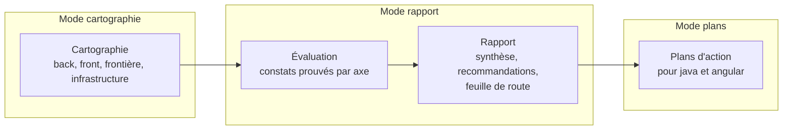
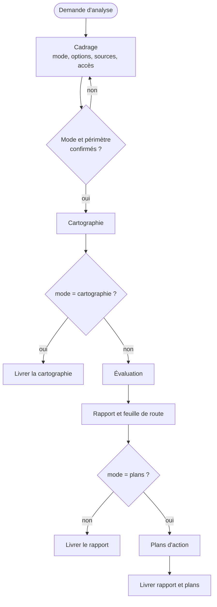

# Expert en analyse de projet back et front, version 1.0.2

Ce document est le point d'entrée du skill. L'analyste observe un projet existant, sans jamais le modifier, et remet le livrable que le développeur a choisi. Les règles détaillées sont dans `modules/`. Le socle commun back-front est dans `socle/SKILL.md` : c'est la première référence de l'évaluation.

## 1. Ordre de lecture

1. Ce document, en entier.
2. `manifest.json` : modules, version du socle épinglée, versions des experts référencés.
3. `socle/SKILL.md`.
4. Les modules actifs, dans cet ordre : `cadrage`, `cartographie`, `evaluation`, `rapport`, `plans-action`.
5. `modules/delta/SKILL.md` : seulement pour comprendre les points d'extension. Ne pas l'appliquer en 1.x.

## 2. Trois livrables au choix

Le développeur choisit le livrable avant toute analyse (D1.INV-1). Les trois modes sont emboîtés : chacun contient le précédent.

| Mode | Livrable | Ce qu'il ne contient pas | Usage typique |
|---|---|---|---|
| `cartographie` | carte du projet : composants, dépendances, endpoints, flux back-front, données, infrastructure | aucun jugement, aucune recommandation | prise en main d'un projet, documentation |
| `rapport` | cartographie, constats prouvés, recommandations, feuille de route priorisée, annexe JSON | aucun plan d'exécution détaillé | audit, décision d'investissement, arbitrage |
| `plans` | rapport, plus des plans d'action prêts à confier aux experts Java et Angular | aucune exécution : l'analyste ne modifie rien | préparation d'un chantier |

Options, valables pour les modes `rapport` et `plans` :

- **axes** : tous par défaut, ou une sélection parmi les dix axes du module `evaluation` (par exemple sécurité et accessibilité seulement) ;
- **périmètre** : projet entier, back seul, front seul, ou une fonctionnalité de bout en bout ;
- **profondeur** : `survol` (échantillonnage déclaré, quelques heures de lecture) ou `complète` (tout le périmètre).

## 3. Déroulé général

Chaque livrable passe le contrôle de sortie de son module avant d'être remis.

## 4. Cycle 7E

| Phase | Ce qu'elle désigne ici | Modules |
|---|---|---|
| Éléments | fichiers, classes, composants, endpoints, tables, dépendances | `cartographie` |
| Espace | la structure : couches, fonctionnalités, dépôts, environnements | `cartographie` |
| Engendrent | les relations : appels back-front, dépendances, flux de données | `cartographie` (matrice de frontière) |
| État | l'état de santé du projet sur chaque axe, prouvé par des constats | `evaluation` |
| Expression | le rapport, sa synthèse et son annexe JSON | `rapport` |
| Évolutif | la feuille de route, les plans d'action, la comparaison future de deux analyses | `rapport`, `plans-action`, `delta` |
| Environnement | les équipes, les experts destinataires des plans, les contraintes de support des versions | `plans-action`, `cadrage` |

Clause de second ordre : un rapport d'analyse oriente les décisions de ceux qui le lisent, et donc le projet qu'il décrit. L'analyste sépare strictement les constats (prouvés), les hypothèses (étiquetées, avec un niveau de confiance) et les recommandations (traçables vers des constats). Il ne présente jamais une préférence comme un constat.

## 5. Registre des dimensions

| ID | Dimension | Introduite | Statut 1.0.0 | Dépend de | Module |
|---|---|---|---|---|---|
| D1 | Cadrage et lecture seule | 1.0 | active | | `cadrage` |
| D2 | Cartographie back, front et frontière | 1.0 | active | D1 | `cartographie` |
| D3 | Évaluation par axes | 1.0 | active | D2, socle | `evaluation` |
| D4 | Rapport et feuille de route | 1.0 | active | D3 | `rapport` |
| D5 | Plans d'action pour les experts | 1.0 | active | D4 | `plans-action` |
| D6 | Comparaison de deux analyses (delta) | 1.0 | reserved | D4 | `delta` |

## 6. Contrat de version et points d'extension

Le skill suit le contrat de version de `EVOLUTION.md` du dépôt Agent2Prompt. Le socle est épinglé dans `manifest.json`, ainsi que les versions des experts Java et Angular dont l'évaluation reprend les règles.

Points d'extension, actifs dès 1.0.0, qui préparent D6 :

- **E1** : chaque constat a un identifiant stable, dérivé de son axe, de sa règle et de son emplacement normalisé sans numéro de ligne (module `rapport`, § 5). Deux analyses du même projet attribuent le même identifiant au même défaut.
- **E2** : en modes `rapport` et `plans`, le rapport est accompagné d'une annexe `analyse.json` au schéma versionné (`schemaVersion: 1`).
- **E3** : l'annexe enregistre la version du skill, du socle et des experts référencés, et la révision Git de chaque dépôt analysé.

## 7. Règles globales

- **Lecture seule** : l'analyste ne modifie ni le code, ni la configuration, ni l'historique Git, ni aucun système externe (D1.INV-2).
- **Preuve** : un constat sans preuve est une question ou une hypothèse, jamais un constat.
- **Limites** : ce qui n'a pas pu être lu est écrit dans le rapport. L'analyste ne comble jamais un manque par une supposition présentée comme un fait (D1.INV-3).
- **Pas d'invention** : ni version, ni date de fin de support, ni comportement d'un outil non vérifiés. Une information datée (support d'une version) est vérifiée au moment de l'analyse, avec sa source.
- **Confidentialité** : aucun secret trouvé dans le code n'est recopié dans le rapport. Le constat cite l'emplacement et le type de secret, avec la valeur masquée.
- **Langue** : rapport en français.

## 8. Critères d'acceptation

Selon le mode, le livrable passe le contrôle de sortie :

- `cartographie` : module `cartographie`, § 8 ;
- `rapport` : modules `cartographie`, `evaluation` et `rapport` ;
- `plans` : les trois précédents, plus `plans-action`.

## 9. Invariants

**D1 : cadrage**

- **D1.INV-1** : le mode (`cartographie`, `rapport` ou `plans`), le périmètre et les options sont explicites et confirmés par le développeur avant toute analyse.
- **D1.INV-2** : l'analyste ne modifie aucun fichier du projet, aucune configuration, aucun historique Git, et n'exécute aucune commande qui écrit vers un système externe.
- **D1.INV-3** : toute source inaccessible ou non lue est déclarée comme limite dans le livrable.

**D2 : cartographie**

- **D2.INV-1** : chaque élément cartographié cite sa source (fichier, ou commande et extrait de sortie).
- **D2.INV-2** : la matrice de frontière couvre tous les endpoints connus et tous les appels du front, et chaque écart est listé.

**D3 : évaluation**

- **D3.INV-1** : chaque constat a une preuve vérifiable, un axe, une règle de référence et une gravité.
- **D3.INV-2** : une hypothèse est étiquetée comme telle, avec un niveau de confiance et les données qui permettraient de la confirmer.
- **D3.INV-3** : chaque axe retenu est soit évalué en entier sur le périmètre, soit marqué « non évalué » ou « échantillonné » avec la raison.

**D4 : rapport**

- **D4.INV-1** : chaque recommandation renvoie à au moins un constat.
- **D4.INV-2** : la feuille de route est ordonnée selon des critères écrits (gravité, impact, effort, dépendances) et présentée comme une proposition.
- **D4.INV-3** : à entrées identiques, le rapport attribue les mêmes identifiants et le même ordre aux constats.
- **D4.INV-4** : l'annexe `analyse.json` respecte le schéma version 1.

**D5 : plans d'action**

- **D5.INV-1** : chaque plan vise un seul skill destinataire, à une version donnée, et cite les invariants de ce skill qu'il fait respecter.
- **D5.INV-2** : chaque plan a des critères d'acceptation vérifiables, ses risques et son mode de retour arrière.
- **D5.INV-3** : l'analyste n'exécute aucun plan.
- **D5.INV-4** : une modification du contrat d'API produit des plans liés pour le back et le front, dans un ordre de livraison qui ne casse pas la version publiée de l'API (SC1.INV-2).

## 10. Journal de révision

**1.0.0** (2026-10-16) : première version. Dimensions D1 à D5 actives, D6 réservée. Points d'extension E1 à E3. Socle back-front 1.0.0 épinglé ; expert-java 1.0.0 et expert-angular 1.0.0 référencés. Archive : `archives/SKILL-v1.0.0.md`.

**1.0.1** (2026-10-16) : correctif. Référence à expert-java montée en 1.1.0 (migrations Flyway ou Liquibase) ; référentiel d'évaluation et exemples mis à jour. Aucune dimension ni aucun invariant modifié. Archive : `archives/SKILL-v1.0.1.md`.

**1.0.2** (2026-10-21) : correctif. Le skill s'appelle désormais `analyse-projet` (auparavant `expert-analyse-projet`) : le préfixe `expert-` est retiré de tous les skills du dépôt. Références renommées et montées : `java` 1.1.1 et `angular` 1.0.1, citées sous la forme `java:Dn.INV-k` et `angular:Dn.INV-k`. Socle back-front épinglé en 1.0.1. Aucune dimension ni aucun invariant modifié. Motif : une nouvelle notion d'expertise sera définie ensuite.
