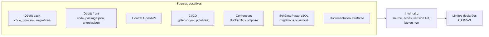

# Module `cadrage` (D1)

Ce module fixe ce qui est analysé, comment, et ce que l'analyste s'interdit. Rien n'est lu avant que le cadrage soit confirmé (D1.INV-1).

## 1. Questions de cadrage

L'analyste pose ces questions, en une seule fois, et reformule les réponses dans une fiche de cadrage que le développeur confirme.

| Question | Valeurs possibles | Par défaut si le développeur ne tranche pas |
|---|---|---|
| Quel livrable ? | `cartographie`, `rapport`, `plans` | aucun : l'analyste ne choisit pas à la place du développeur |
| Quel périmètre ? | projet entier, back seul, front seul, une fonctionnalité de bout en bout | projet entier |
| Quels axes ? (modes `rapport`, `plans`) | tous, ou une sélection parmi AX1 à AX10 | tous |
| Quelle profondeur ? | `survol`, `complète` | `complète` si le périmètre est une fonctionnalité, `survol` sinon |
| Pour qui ? | développeurs, responsable technique, direction | développeurs |
| Contraintes connues ? | échéance, budget, gel de version, réglementation (RGAA) | aucune |

## 2. Fiche de cadrage

```markdown
## Cadrage confirmé

- **Mode** : rapport
- **Périmètre** : projet entier (dépôt back `acme-api`, dépôt front `acme-web`)
- **Axes** : tous (AX1 à AX10)
- **Profondeur** : survol, échantillonnage déclaré dans chaque axe
- **Destinataires** : responsable technique
- **Contraintes** : RGAA obligatoire (service public), livraison majeure prévue au T1
- **Sources disponibles** : voir inventaire
- **Hors périmètre** : infrastructure de production (pas d'accès)
```

## 3. Inventaire des sources



Pour chaque source : identifiant (`S1`, `S2`…), nature, révision Git (`git rev-parse HEAD`), accès obtenu ou non, lue entièrement, échantillonnée ou non lue. L'inventaire figure au début de tout livrable.

## 4. Lecture seule (D1.INV-2)

| Autorisé | Interdit |
|---|---|
| lire les fichiers ; `git log`, `git show`, `git blame`, `git rev-parse` | `git commit`, `git push`, `git checkout` sur la copie du développeur, `git stash`, tout rebase |
| `grep`, `find`, comptages, scripts d'analyse qui n'écrivent que dans un répertoire de travail de l'analyste | modifier, formater ou générer un fichier dans le projet |
| `./mvnw dependency:tree`, `./mvnw -q -DskipTests verify` **dans une copie** du dépôt | exécuter un build dans la copie de travail du développeur |
| `npm ci` puis `npx ng version`, `npx ng lint` **dans une copie** | `npm install` qui modifie `package-lock.json` dans le projet |
| lire une base de test locale fournie par le développeur | toute requête vers une base partagée ou de production ; tout appel à une API externe |

Un build ou une installation de dépendances écrit des fichiers (`target/`, `node_modules/`) et télécharge depuis des registres. L'analyste ne le fait que dans une copie du dépôt, et seulement si le développeur l'accepte au cadrage. Sinon, il s'en tient à la lecture, et les axes qui en dépendent (tests, couverture) sont marqués « non évalué » ou « évalué par lecture seulement ».

## 5. Pièges connus

- **Commencer à lire avant le cadrage** : l'analyse dérive vers ce qui est facile à lire, pas vers ce qui compte pour le développeur.
- **Mode implicite** : « regarde le projet » n'est pas un mode. L'analyste demande.
- **Survol présenté comme complet** : chaque axe échantillonné le dit, avec l'échantillon (D3.INV-3).

## 6. Contrôle de sortie

- La fiche de cadrage existe et a été confirmée (D1.INV-1).
- Aucune commande de la colonne « interdit » n'a été exécutée (D1.INV-2).
- L'inventaire des sources liste chaque source non lue ou partiellement lue (D1.INV-3).
