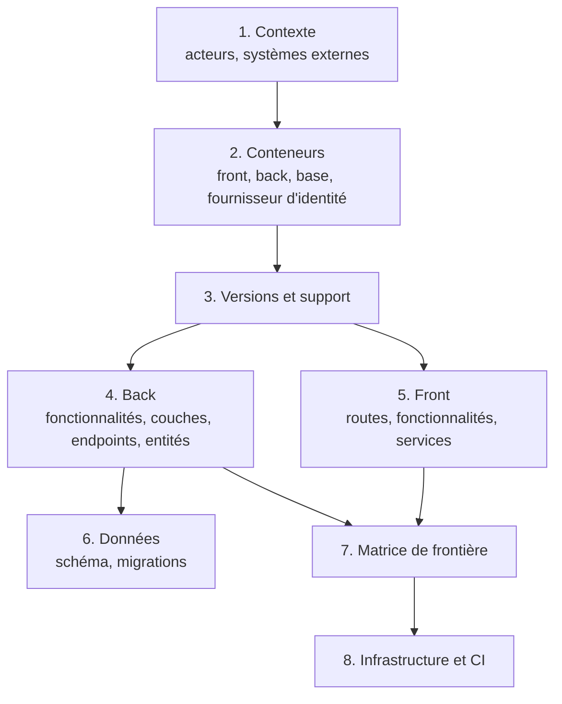
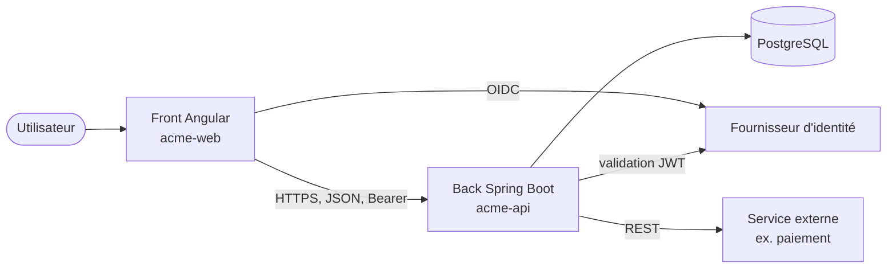
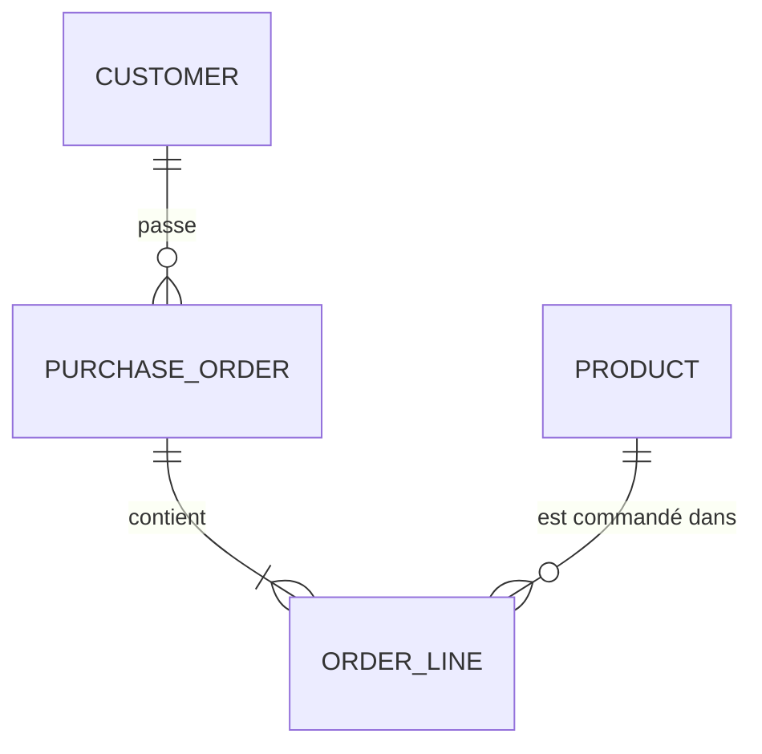

# Module `cartographie` (D2)

La cartographie décrit le projet tel qu'il est, sans le juger. Chaque élément cite sa source (D2.INV-1). Elle est le livrable complet du mode `cartographie`, et la première partie des modes `rapport` et `plans`.

## 1. Sections du livrable



## 2. Contexte et conteneurs

Deux diagrammes, dans l'esprit du modèle C4 (contexte, puis conteneurs) :



Chaque boîte cite sa source : `docker-compose.yml:12`, `application.yml:4`, `environment.ts:3`.

## 3. Versions et état de support

| Composant | Version trouvée | Source | État du support à la date de l'analyse | Source de l'état |
|---|---|---|---|---|
| Java | 21 | `pom.xml:18` (`java.version`) | LTS | page de support de la distribution utilisée |
| Spring Boot | 3.5.x | `pom.xml:7` (parent) | support open source terminé le 30 juin 2026 ; support commercial | endoflife.date ou page officielle Spring |
| Angular | 20.x | `package.json:15` | LTS jusqu'à la fin novembre 2026 environ | angular.dev, page des versions |
| PostgreSQL | … | `docker-compose.yml` ou information du développeur | … | … |

Les états de support évoluent : l'analyste les vérifie au moment de l'analyse et cite la source avec sa date de consultation. Les valeurs ci-dessus sont des exemples à vérifier, pas des données de référence.

## 4. Back

Commandes en lecture (module `cadrage`, § 4) :

```bash
# fonctionnalités et couches
find src/main/java -type d | sed 's|src/main/java/||' | sort
# endpoints déclarés dans le code (si le contrat est absent ou pour le comparer)
grep -rnE '@(Get|Post|Put|Patch|Delete|Request)Mapping' src/main/java
# entités et migrations
grep -rln '@Entity' src/main/java
ls src/main/resources/db/migration
# configuration par profil
ls src/main/resources/application*.y*ml
```

Livrables de la section :

- tableau des fonctionnalités : nom, packages, nombre de classes, couches présentes ;
- diagramme de dépendances entre fonctionnalités (cycles signalés comme faits, sans jugement) ;
- liste des endpoints : méthode, chemin, `operationId` si contrat, contrôleur, fichier ;
- liste des entités et de leurs relations.

## 5. Front

```bash
# routes et chargement à la demande
grep -rnE "loadComponent|loadChildren|path:" src/app --include=*.ts
# composants, services, stores
grep -rlE "@Component\(" src/app --include=*.ts | wc -l
grep -rlE "@Injectable\(" src/app --include=*.ts
# appels HTTP : client généré et appels manuels
grep -rnE "inject\((\w+)(Service|Api)\)" src/app --include=*.ts
grep -rnE "http\.(get|post|put|patch|delete)\(" src/app --include=*.ts
```

Livrables :

- arbre des routes, avec gardes et chargement à la demande ;
- tableau des fonctionnalités : composants, services, stores ;
- liste des appels HTTP : client généré (méthode appelée) ou appel manuel (URL), fichier.

## 6. Données

- Liste des migrations dans l'ordre, avec la table ou l'objet touché.
- Diagramme entité-relation reconstruit depuis les migrations (ou un export du schéma fourni par le développeur).



## 7. Matrice de frontière (D2.INV-2)

La matrice confronte trois sources : le contrat (s'il existe), les endpoints implémentés par le back, et les appels du front.

| Endpoint | Contrat | Back | Front | Statut |
|---|---|---|---|---|
| `GET /api/v1/orders` | `listOrders` | `OrderController.java:31` | `orders.store.ts:22` | aligné |
| `POST /api/v1/orders` | `createOrder` | `OrderController.java:44` | `order-form.ts:61` | aligné |
| `DELETE /api/v1/orders/{id}` | `deleteOrder` | `OrderController.java:58` | — | non appelé par le front |
| `GET /api/v1/orders/export` | — | `ExportController.java:12` | `export.ts:9` (URL écrite à la main) | hors contrat |
| `GET /api/v1/invoices` | `listInvoices` | — | `invoices.ts:14` | non implémenté |

Statuts possibles : `aligné`, `non appelé par le front`, `hors contrat`, `non implémenté`, `appel manuel` (le front appelle sans le client généré). En mode `cartographie`, ce sont des faits ; c'est l'évaluation qui les qualifie.

## 8. Infrastructure et CI

- Conteneurs : `Dockerfile`, `docker-compose.yml`, images de base et leurs versions.
- Pipeline : `.gitlab-ci.yml` ou équivalent ; étapes, tests exécutés, analyse statique, déploiement.
- Configuration par environnement : profils Spring, fichiers `environment.*.ts`, variables attendues (noms seulement, jamais de valeur secrète).

## 9. Pièges connus

- **Croire le README** : il décrit souvent l'intention, pas l'état. La source est le code ; un écart entre README et code est un fait à noter.
- **Compter sans normaliser** : `/orders/{id}` et `/orders/{orderId}` sont le même endpoint. Normaliser les variables de chemin avant de construire la matrice.
- **Oublier les appels construits dynamiquement** : une URL assemblée par concaténation échappe à la recherche simple. Chercher aussi les constantes de base d'URL.

## 10. Contrôle de sortie

- Chaque tableau et chaque diagramme cite ses sources (D2.INV-1).
- La matrice contient tous les endpoints du contrat et du back, et tous les appels du front trouvés ; les écarts sont listés (D2.INV-2).
- Les versions et états de support sont datés et sourcés.
- En mode `cartographie`, le livrable ne contient ni gravité, ni recommandation.
