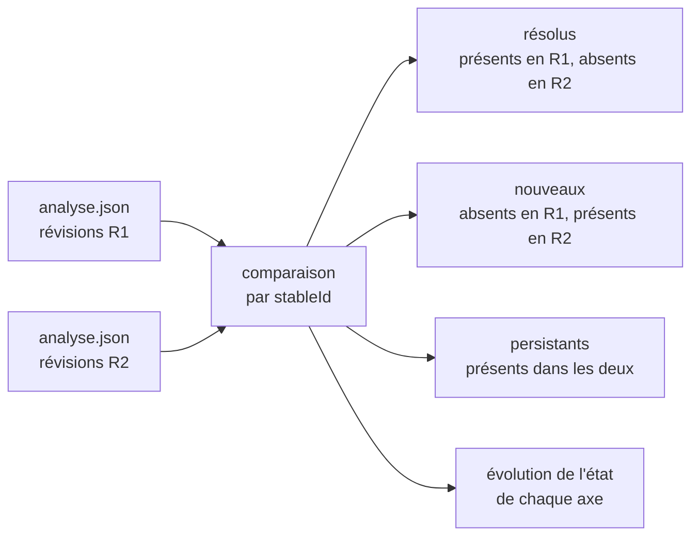

# Module `delta` (D6, réservé)

Statut : `reserved`. L'analyste ne produit pas de comparaison d'analyses en version 1.x.

## 1. Pourquoi cette dimension existe

Une analyse est une photographie. Répétée, elle devient une mesure de l'évolution : les plans exécutés ont-ils résolu les constats visés, et de nouveaux constats sont-ils apparus ? C'est la boucle de rétroaction du système : l'Environnement (les équipes, les experts qui ont exécuté les plans) redevient Élément de l'analyse suivante.

## 2. Principe prévu

## 3. Ce que préparent les points d'extension

| Point | Règle active en 1.x | Rôle dans la comparaison |
|---|---|---|
| E1 | identifiants stables sans numéro de ligne | rapprocher le même constat dans deux analyses |
| E2 | annexe `analyse.json` au schéma versionné | comparer deux analyses par programme |
| E3 | versions du skill, du socle, des experts et révisions Git enregistrées | distinguer un constat résolu d'un constat disparu parce que la règle a changé |

## 4. Contenu prévu à l'activation

- règles de comparaison quand le skill, le socle ou un expert a changé de version entre deux analyses ;
- traitement d'un fichier renommé ou déplacé (l'identifiant stable change) ;
- format du rapport d'évolution et indicateurs de tendance par axe ;
- schéma `analyse.json` version 2 si nécessaire, avec règle de lecture de la version 1.

## 5. Test d'inertie en 1.x

Deux analyses successives du même projet, sans modification entre elles, produisent des annexes dont les ensembles de `stableId` sont identiques (E1, D4.INV-3).
