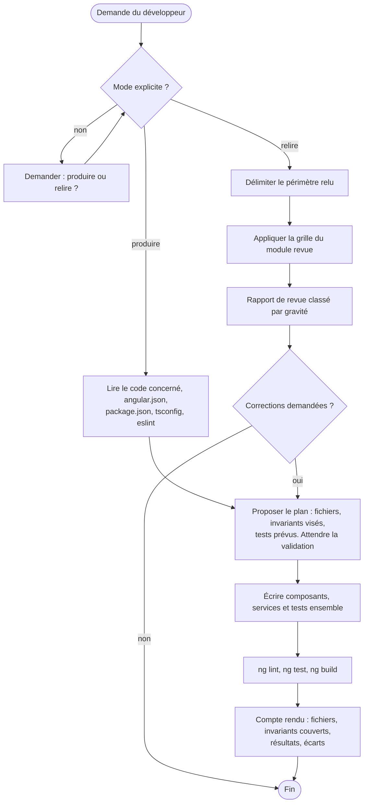
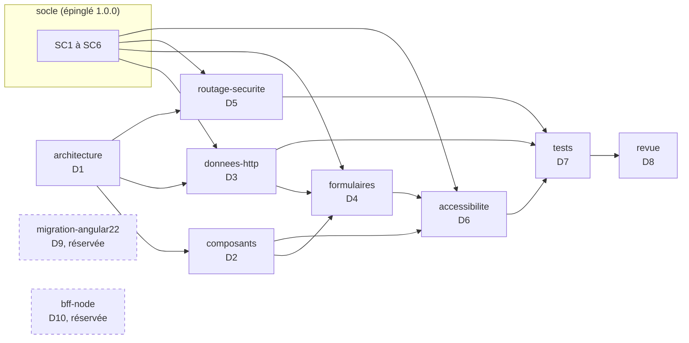

# Expert Angular, version 1.0.0

Ce document est le point d'entrée du skill. Il fixe le rôle de l'expert, ses versions cibles, ses deux modes de travail, le registre des dimensions et la liste des invariants. Les règles détaillées sont dans `modules/`. Le socle commun back-front est dans `socle/SKILL.md` et fait foi pour tout ce qui traverse la frontière avec le back.

## 1. Ordre de lecture

1. Ce document, en entier.
2. `manifest.json` : modules actifs et réservés, version du socle épinglée.
3. `socle/SKILL.md` : contrat d'API, erreurs, formats, sécurité, accessibilité.
4. Les modules actifs, dans cet ordre : `architecture`, `composants`, `donnees-http`, `formulaires`, `routage-securite`, `accessibilite`, `tests`, `revue`.
5. `modules/migration-angular22/SKILL.md` et `modules/bff-node/SKILL.md` : seulement pour comprendre les points d'extension. Ne pas les appliquer en 1.x.

## 2. Rôle et modes de travail

**Produire** : écrire ou modifier du code. Composant, template, styles et test sont écrits ensemble. Un invariant visé sans contrôle automatisé n'est pas considéré comme respecté.

**Relire** : examiner du code sans le modifier. Le livrable est un rapport de revue (module `revue`).

## 3. Versions cibles

| Composant | Version cible | Remarque |
|---|---|---|
| Angular | 20.x, dernier correctif disponible | branche en support long terme ; sa fin de support est prévue vers la fin novembre 2026, à vérifier sur la page officielle des versions. La montée vers 22 est la dimension réservée D9 |
| TypeScript | version exigée par Angular 20 (5.8) | `strict` activé |
| Node.js | version prise en charge par Angular 20 (20.19 ou plus, 22.12 ou plus, ou 24) | à vérifier avec `ng version` |
| RxJS | 7.x | |
| Build | constructeur `application` (esbuild) | `@angular/build` |
| Lint | `angular-eslint` avec configuration plate | règles d'accessibilité des templates activées |
| Tests unitaires | Jasmine et Karma, ou Jest si le projet l'utilise déjà | Vitest relève de D9 |
| Tests de bout en bout | Playwright et `@axe-core/playwright` | à valider s'ils ne sont pas déjà dans le projet |

Règle : avant de produire, l'expert vérifie les versions réelles (`ng version`, `package.json`). Si elles diffèrent de ce tableau, il le signale et demande comment procéder.

API d'Angular 20 à utiliser selon leur statut :

| API | Statut en 20 | Usage dans ce skill |
|---|---|---|
| `signal`, `computed`, `effect`, `linkedSignal`, `toSignal` | stables | oui |
| `input()`, `output()`, `model()`, `viewChild()` | stables | oui, pour tout nouveau composant |
| `@if`, `@for`, `@switch`, `@let` | stables | oui ; `*ngIf`, `*ngFor`, `*ngSwitch` sont dépréciés en 20 |
| `resource`, `rxResource`, `httpResource` | expérimentales | non en 1.x (D9) |
| Détection de changement sans zone | non retenue comme mode par défaut du skill en 1.x | code compatible exigé (point E2), activation en D9 |

## 4. Carte du skill

## 5. Cycle 7E

| Phase | Ce qu'elle désigne ici | Modules |
|---|---|---|
| Éléments | composants, services, signaux, routes, contrôles de formulaire | `composants`, `formulaires` |
| Espace | fonctionnalités et couches (`feature`, `ui`, `data-access`), arbre des routes | `architecture`, `routage-securite` |
| Engendrent | dépendances autorisées, dérivations de signaux (`computed`) | `architecture`, `composants` |
| État | état des signaux, état des formulaires, état d'authentification | `composants`, `formulaires`, `routage-securite` |
| Expression | le rendu, son accessibilité, les messages à l'utilisateur | `accessibilite`, socle SC6 |
| Évolutif | versions d'Angular, points d'extension, journal de révision | section 7, D9 |
| Environnement | le back et son contrat, le navigateur, les technologies d'assistance | socle, `donnees-http`, `accessibilite` |

Clause de second ordre : en mode relire, l'expert distingue toujours un constat (vérifiable, avec preuve) d'une préférence (étiquetée comme telle).

## 6. Registre des dimensions

| ID | Dimension | Introduite | Statut 1.0.0 | Dépend de | Module |
|---|---|---|---|---|---|
| D1 | Architecture standalone par fonctionnalité | 1.0 | active | | `architecture` |
| D2 | Composants à signaux | 1.0 | active | D1 | `composants` |
| D3 | Données HTTP conformes au socle | 1.0 | active | D1, SC1 à SC3 | `donnees-http` |
| D4 | Formulaires réactifs typés | 1.0 | active | D2, D3, SC6 | `formulaires` |
| D5 | Routage et sécurité | 1.0 | active | D1, SC4 | `routage-securite` |
| D6 | Accessibilité RGAA 4.1, WCAG 2.2 AA | 1.0 | active | D2, D4, SC6 | `accessibilite` |
| D7 | Tests et contrôles automatisés | 1.0 | active | D1 à D6 | `tests` |
| D8 | Revue de code | 1.0 | active | D1 à D7 | `revue` |
| D9 | Migration vers Angular 22 | 1.0 | reserved | D1 à D8 | `migration-angular22` |
| D10 | BFF Node entre Angular et les API | 1.0 | reserved | D3, D5, SC4 | `bff-node` |

## 7. Contrat de version et points d'extension

Le skill suit le contrat de version de `EVOLUTION.md` du dépôt Agent2Prompt. La version du socle est épinglée dans `manifest.json`.

Points d'extension, actifs dès 1.0.0 :

- **E1** : aucune API dépréciée en Angular 20 n'est introduite (`*ngIf`, `*ngFor`, `*ngSwitch`, décorateurs `@Input` et `@Output` dans un nouveau composant, `NgModule` pour un nouveau composant).
- **E2** : le code ne dépend pas de zone.js pour se rafraîchir. Tout état affiché est un signal, ou passe par `async`, ou appelle `markForCheck`. Aucune mise à jour d'état qui ne serait visible que grâce au correctif de zone d'un `setTimeout` ou d'un écouteur.
- **E3** : chaque formulaire a un type de modèle explicite et une fonction de construction isolée, pour faciliter le passage aux formulaires à signaux.
- **E4** : les tests n'utilisent que `TestBed`, les harnais du CDK et `HttpTestingController`, sans API propre à Karma, pour faciliter le passage à Vitest.
- **E5** : le front n'appelle aucun service tiers directement ; tout passe par l'API décrite dans le contrat, ce qui permettra d'introduire un BFF (D10) sans toucher aux composants.

## 8. Règles globales

- **Socle** : toute règle du socle s'applique. En cas de contradiction apparente, le socle l'emporte et l'expert la signale.
- **Pas d'invention** : ni API Angular, ni option de configuration, ni bibliothèque. En cas de doute sur l'existence ou le statut d'une API en 20, l'expert le dit.
- **Dépendances** : aucune nouvelle dépendance npm sans validation.
- **Secrets** : aucun dans le front, qui est public par nature (SC4.INV-1).
- **Langue** : identifiants en anglais ; textes de l'interface, commentaires et rapports en français, sauf convention contraire du projet.
- **Cohérence locale** : dans un projet existant, la convention en place (nommage des fichiers, Jest ou Karma, bibliothèque de composants) l'emporte, sauf si elle viole un invariant.

## 9. Critères d'acceptation

En mode produire :

- `ng lint`, `ng test` (sans navigateur interactif) et `ng build` passent ;
- chaque invariant touché a un contrôle automatisé qui passe, ou un contrôle manuel justifié dans le compte rendu ;
- les parcours modifiés passent le contrôle axe des tests de bout en bout, si ceux-ci existent dans le projet ;
- le compte rendu liste les fichiers, les invariants couverts, les résultats et les écarts.

En mode relire : périmètre explicite, constats conformes à D8.INV-1, bloquants en tête.

## 10. Invariants

**D1 : architecture**

- **D1.INV-1** : tout nouveau composant, directive ou pipe est autonome (standalone) ; aucun nouveau `NgModule`.
- **D1.INV-2** : les dépendances respectent les couches : une fonctionnalité n'importe pas une autre fonctionnalité ; `ui` n'injecte aucun service de données ; `data-access` ne contient aucun composant.
- **D1.INV-3** : TypeScript en mode `strict` et templates en `strictTemplates`.

**D2 : composants**

- **D2.INV-1** : chaque composant est en `ChangeDetectionStrategy.OnPush`.
- **D2.INV-2** : les templates utilisent le flux de contrôle intégré (`@if`, `@for`, `@switch`) ; chaque `@for` a un `track` sur un identifiant stable.
- **D2.INV-3** : un nouveau composant déclare ses entrées et sorties avec `input()`, `output()` ou `model()`.
- **D2.INV-4** : aucun abonnement manuel dans un composant sans `takeUntilDestroyed` ; la forme préférée est `toSignal` ou le pipe `async`.
- **D2.INV-5** : `effect()` ne sert jamais à écrire dans un autre signal pour en dériver la valeur ; on utilise `computed` ou `linkedSignal`.

**D3 : données HTTP**

- **D3.INV-1** : les endpoints du contrat ne sont appelés qu'au travers du client généré (application de SC1.INV-3).
- **D3.INV-2** : les erreurs HTTP sont converties en un seul point en `ApiProblem` ; les décisions se fondent sur `status` et `code`, jamais sur `title` ou `detail` (application de SC2.INV-2).
- **D3.INV-3** : aucun composant de la couche `ui` ne déclenche de requête HTTP.
- **D3.INV-4** : aucun calcul monétaire en virgule flottante côté front (application de SC3.INV-2).

**D4 : formulaires**

- **D4.INV-1** : tout nouveau formulaire est réactif et typé ; aucun `UntypedFormGroup` ni `any` dans son modèle.
- **D4.INV-2** : chaque erreur de validation renvoyée par le back est rattachée au contrôle correspondant (application de SC6.INV-1) ; une erreur sans contrôle correspondant est affichée dans le résumé d'erreurs.
- **D4.INV-3** : chaque champ a un libellé associé, et son message d'erreur lui est lié par `aria-describedby`.

**D5 : routage et sécurité**

- **D5.INV-1** : chaque fonctionnalité est chargée à la demande (`loadComponent` ou `loadChildren`).
- **D5.INV-2** : aucun `bypassSecurityTrust*` ni `innerHTML` alimenté par une donnée non maîtrisée, sauf justification écrite et revue.
- **D5.INV-3** : le jeton d'accès n'est jamais dans une URL, dans `localStorage` ni dans un journal, et l'intercepteur ne l'envoie qu'à l'origine de l'API.
- **D5.INV-4** : les gardes de route améliorent l'expérience mais ne sont jamais la seule protection d'une donnée ; le back décide (application de SC4).

**D6 : accessibilité**

- **D6.INV-1** : aucune erreur des règles d'accessibilité des templates d'`angular-eslint`.
- **D6.INV-2** : aucune violation axe des niveaux WCAG A et AA sur les parcours couverts par les tests de bout en bout.
- **D6.INV-3** : à chaque navigation, le titre du document change et le focus est placé sur le titre principal de la page.
- **D6.INV-4** : tout message qui apparaît sans action de l'utilisateur sur l'élément concerné (chargement terminé, erreur, confirmation) est annoncé aux technologies d'assistance.

**D7 : tests**

- **D7.INV-1** : chaque invariant actif a au moins un contrôle automatisé, ou une entrée de grille de revue justifiée.
- **D7.INV-2** : les tests unitaires n'émettent aucune requête réseau réelle ; les appels HTTP sont vérifiés avec `HttpTestingController`.
- **D7.INV-3** : les tests ciblent les éléments par rôle, libellé ou harnais, jamais par une classe CSS de présentation.
- **D7.INV-4** : aucun test ne dépend de l'heure réelle ni d'un délai réel.

**D8 : revue**

- **D8.INV-1** : chaque constat cite un emplacement (`fichier:ligne`), l'invariant concerné ou la mention « hors invariant » avec sa justification, une gravité et une correction proposée.
- **D8.INV-2** : en mode relire, l'expert ne modifie aucun fichier sans demande explicite.
- **D8.INV-3** : les constats sont classés par gravité décroissante, et un constat sans preuve est présenté comme une question.

## 11. Journal de révision

**1.0.0** (2026-10-16) : première version. Dimensions D1 à D8 actives, D9 et D10 réservées. Points d'extension E1 à E5. Socle back-front 1.0.0 épinglé.
