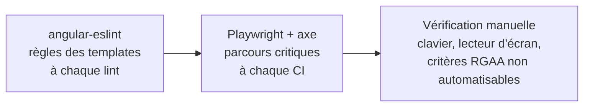

# Module `accessibilite` (D6)

Ce module applique côté Angular la dimension SC6 du socle. Les outils automatiques ne détectent qu'une partie des problèmes d'accessibilité : ils sont nécessaires, pas suffisants. L'expert le rappelle dans chaque compte rendu qui touche l'interface.

## 1. Trois niveaux de contrôle



| Niveau | Ce qu'il détecte | Ce qu'il ne détecte pas |
|---|---|---|
| ESLint (D6.INV-1) | image sans alternative, libellé non associé, clic sans clavier, ARIA invalide | ordre de lecture, pertinence d'un texte, gestion du focus dynamique |
| axe (D6.INV-2) | contrastes calculables, structure ARIA, noms accessibles manquants | qualité d'un libellé, cohérence de la navigation, focus après action |
| Manuel | le reste : clavier complet, lecteur d'écran, zoom à 200 %, cohérence | — |

## 2. Configuration ESLint

```js
// eslint.config.js (extrait)
const tseslint = require('typescript-eslint');
const angular = require('angular-eslint');

module.exports = tseslint.config(
  {
    files: ['**/*.html'],
    extends: [...angular.configs.templateRecommended, ...angular.configs.templateAccessibility],
    rules: {},
  },
);
```

`templateAccessibility` active notamment : `alt-text`, `elements-content`, `label-has-associated-control`, `click-events-have-key-events`, `interactive-supports-focus`, `role-has-required-aria`, `valid-aria`, `table-scope`, `no-autofocus`, `no-positive-tabindex`. Un projet en module ES écrit `import angular from 'angular-eslint'` : l'expert suit la forme du fichier existant.

Les templates en ligne (dans le fichier `.ts`) sont analysés à condition que le processeur de templates en ligne soit activé, ce que fait la configuration générée par `ng add angular-eslint`.

## 3. Titre et focus à chaque navigation (D6.INV-3)

```ts
// core/a11y/app-title.strategy.ts
@Injectable()
export class AppTitleStrategy extends TitleStrategy {
  private readonly title = inject(Title);
  override updateTitle(snapshot: RouterStateSnapshot): void {
    const pageTitle = this.buildTitle(snapshot);
    this.title.setTitle(pageTitle ? `${pageTitle} - Acme` : 'Acme');
  }
}

// core/a11y/focus-on-navigation.ts : appelé une fois dans le composant racine
export function focusMainHeadingOnNavigation(): void {
  const router = inject(Router);
  const injector = inject(Injector);
  router.events.pipe(
    filter((e): e is NavigationEnd => e instanceof NavigationEnd),
    skip(1),                                         // pas au premier chargement
    takeUntilDestroyed(),
  ).subscribe(() => {
    afterNextRender(() => {
      document.querySelector<HTMLElement>('main h1')?.focus();   // chaque h1 de page porte tabindex="-1"
    }, { injector });
  });
}
```

Le titre de page (critère RGAA 8.6) et le focus déplacé indiquent au lecteur d'écran que la page a changé, ce qu'une application monopage ne signale pas d'elle-même.

## 4. Annonces (D6.INV-4)

| Situation | Moyen |
|---|---|
| Message d'erreur bloquant | `role="alert"` sur l'élément inséré (module `donnees-http`, `ProblemMessage`) |
| Information non urgente (chargement terminé, filtre appliqué, élément ajouté) | `LiveAnnouncer` du CDK, politesse `polite` |
| État de chargement | `role="status"` |
| Résumé d'erreurs de formulaire | focus déplacé sur le résumé (module `formulaires`) |

```ts
private readonly announcer = inject(LiveAnnouncer);   // @angular/cdk/a11y

protected onFilterApplied(count: number): void {
  this.announcer.announce(`${count} commandes affichées.`, 'polite');
}
```

`LiveAnnouncer` impose une dépendance à `@angular/cdk`. Si le projet ne l'a pas, une région `aria-live="polite"` permanente dans le composant racine, dont le texte change, produit le même effet.

## 5. Composants personnalisés

Avant de créer un composant interactif (liste déroulante, onglets, modale, menu), vérifier si le projet dispose déjà d'une bibliothèque accessible (Angular Material, CDK, DSFR). Un composant maison doit reproduire le motif ARIA correspondant (WAI-ARIA Authoring Practices) : rôles, états, gestion complète du clavier et du focus.

| Composant | Exigences minimales |
|---|---|
| Modale | `role="dialog"`, `aria-modal="true"`, nom accessible, focus piégé (`cdkTrapFocus`), retour du focus à l'élément d'origine à la fermeture, fermeture par Échap |
| Onglets | `tablist`, `tab`, `tabpanel`, flèches pour changer d'onglet, `aria-selected` |
| Bouton icône | nom accessible (`aria-label` ou texte masqué visuellement), icône `aria-hidden="true"` |
| Lien ou bouton | un lien navigue, un bouton agit ; jamais de `div (click)` |

## 6. Présentation

- Contraste : 4,5:1 pour le texte, 3:1 pour le texte large, les composants d'interface et les indicateurs de focus (WCAG 1.4.3, 1.4.11).
- Aucune information par la couleur seule (SC6.INV-2) : un statut combine couleur, texte et, si besoin, icône.
- Indicateur de focus toujours visible ; jamais `outline: none` sans remplacement.
- Cible tactile d'au moins 24 × 24 pixels CSS (WCAG 2.5.8).
- Contenu utilisable à 200 % de zoom et à 320 pixels de large sans défilement horizontal (WCAG 1.4.10).
- Animations désactivées si `prefers-reduced-motion: reduce`.

## 7. Tests de bout en bout avec axe

```ts
// e2e/orders.spec.ts
import { test, expect } from '@playwright/test';
import AxeBuilder from '@axe-core/playwright';

test('la liste des commandes ne présente aucune violation WCAG A ou AA détectable', async ({ page }) => {
  await page.goto('/orders');
  await expect(page.getByRole('heading', { level: 1, name: 'Mes commandes' })).toBeVisible();
  const results = await new AxeBuilder({ page })
    .withTags(['wcag2a', 'wcag2aa', 'wcag21a', 'wcag21aa', 'wcag22aa'])
    .analyze();
  expect(results.violations).toEqual([]);                // D6.INV-2
});
```

## 8. Pièges connus

- **`aria-label` sur un élément non interactif sans rôle** : souvent ignoré par les lecteurs d'écran.
- **`tabindex` positif** : casse l'ordre de tabulation. Seuls `0` et `-1` sont admis.
- **Message d'erreur injecté sans région live ni déplacement de focus** : invisible pour un utilisateur de lecteur d'écran.
- **Désactivation de règles ESLint d'accessibilité** par commentaire `eslint-disable` : signalée systématiquement en revue, avec sa justification.

## 9. Grille de revue

| Point | Question | Invariant |
|---|---|---|
| AC1 | Le lint d'accessibilité des templates échoue-t-il, ou est-il désactivé localement ? | D6.INV-1 |
| AC2 | Un parcours couvert par les tests de bout en bout présente-t-il une violation axe ? | D6.INV-2 |
| AC3 | Une route est-elle sans `title`, ou la navigation ne déplace-t-elle pas le focus ? | D6.INV-3 |
| AC4 | Un message dynamique apparaît-il sans annonce ? | D6.INV-4 |
| AC5 | Une information est-elle portée par la couleur seule ? | SC6.INV-2 |
| AC6 | Un composant interactif maison ignore-t-il le clavier ou le motif ARIA ? | hors invariant, RGAA thème 7 |
