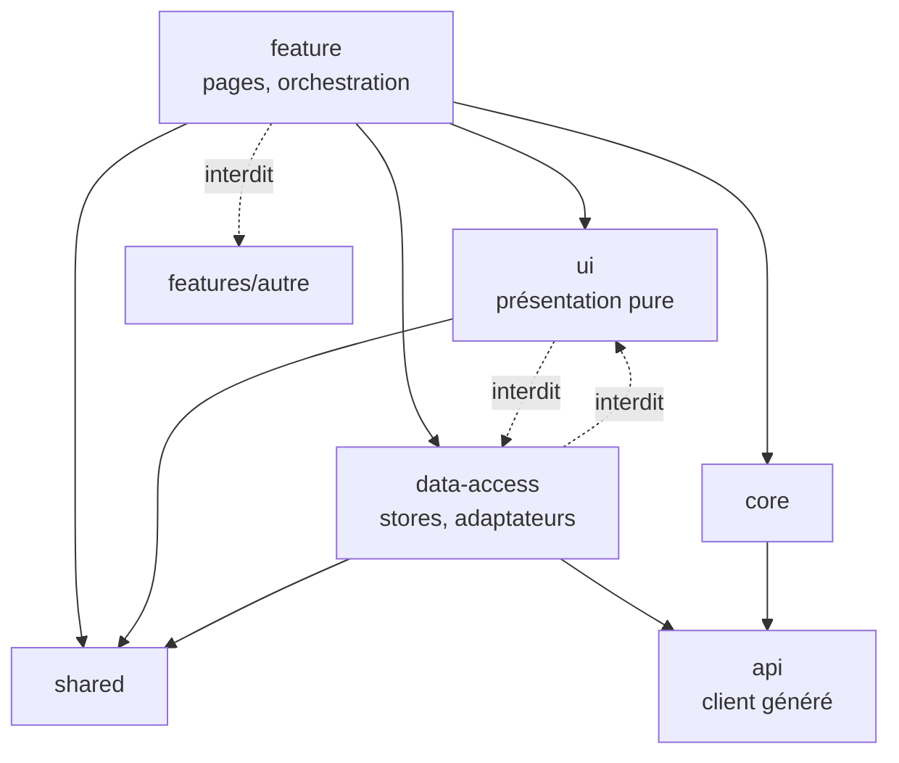

# Module `architecture` (D1)

Ce module fixe où chaque fichier doit se trouver et de quoi il a le droit de dépendre. Les règles de dépendance sont vérifiées par ESLint, pas seulement par la revue.

## 1. Arborescence

```text
src/
├── main.ts                         bootstrapApplication(App, appConfig)
├── app/
│   ├── app.ts                      composant racine
│   ├── app.config.ts               fournisseurs globaux : routeur, HttpClient, intercepteurs
│   ├── app.routes.ts               routes de premier niveau, chargement à la demande
│   ├── core/                       services globaux : authentification, erreurs, titre, focus
│   ├── shared/
│   │   ├── ui/                     composants de présentation réutilisables
│   │   └── util/                   fonctions pures, pipes
│   ├── api/                        client généré depuis le contrat (ne pas modifier à la main)
│   └── features/
│       └── orders/
│           ├── orders.routes.ts
│           ├── feature/            composants de page : orchestrent, injectent les stores
│           ├── ui/                 composants de présentation : entrées, sorties, aucun service de données
│           └── data-access/        stores à signaux, adaptateurs du client généré
└── environments/
```

Angular 20 génère par défaut des noms de fichiers sans suffixe de type (`order-list.ts` plutôt que `order-list.component.ts`). Dans un projet existant, la convention en place est conservée.

## 2. Couches et dépendances



| Couche | Peut importer | N'importe jamais |
|---|---|---|
| `features/x/feature` | `features/x/ui`, `features/x/data-access`, `shared`, `core` | une autre fonctionnalité |
| `features/x/ui` | `shared` | `data-access`, `api`, `core` (sauf jetons purement visuels) |
| `features/x/data-access` | `api`, `shared`, `core` | `ui`, `feature` |
| `shared` | `shared` | `features`, `core`, `api` |
| `core` | `api`, `shared` | `features` |

Une donnée partagée par deux fonctionnalités remonte dans `shared` (si elle est pure) ou `core` (si c'est un service global). Elle ne crée jamais d'import d'une fonctionnalité vers une autre (D1.INV-2).

## 3. Configuration de l'application

```ts
// app.config.ts
export const appConfig: ApplicationConfig = {
  providers: [
    provideZoneChangeDetection({ eventCoalescing: true }),
    provideRouter(routes, withComponentInputBinding()),
    provideHttpClient(withFetch(), withInterceptors([authInterceptor, problemInterceptor])),
    { provide: BASE_PATH, useValue: environment.apiBaseUrl },   // jeton exposé par le client généré
    { provide: TitleStrategy, useClass: AppTitleStrategy },       // D6.INV-3
  ],
};
```

- Pas de `NgModule` pour un nouveau code (D1.INV-1). Les dépendances d'un composant sont dans son tableau `imports`.
- Les services globaux sont `@Injectable({ providedIn: 'root' })`. Un service propre à une fonctionnalité est fourni dans ses routes (`providers` de la route), pour être libéré avec elle.
- Le nom du jeton de configuration de l'URL de base dépend du générateur de client utilisé ; `BASE_PATH` est celui du générateur `typescript-angular` d'openapi-generator.

## 4. TypeScript strict

```json
// tsconfig.json (extraits)
{
  "compilerOptions": {
    "strict": true,
    "noImplicitOverride": true,
    "noPropertyAccessFromIndexSignature": true,
    "noImplicitReturns": true,
    "noFallthroughCasesInSwitch": true
  },
  "angularCompilerOptions": {
    "strictTemplates": true,
    "strictInjectionParameters": true,
    "strictInputAccessModifiers": true
  }
}
```

C'est la configuration créée par `ng new` en mode strict. Dans un projet qui ne l'a pas, activer `strict` peut produire des centaines d'erreurs : l'expert le signale et propose une activation progressive, il ne l'active pas silencieusement.

## 5. Règles ESLint de dépendance

Avec la configuration plate d'ESLint, la règle native `no-restricted-imports` suffit pour les cas principaux :

```js
// eslint.config.js (extrait)
{
  files: ['src/app/features/*/ui/**/*.ts'],
  rules: {
    'no-restricted-imports': ['error', {
      patterns: [
        { group: ['**/data-access/**', '**/api/**'], message: 'D1.INV-2 : la couche ui ne dépend pas des données.' },
      ],
    }],
  },
},
{
  files: ['src/app/features/orders/**/*.ts'],
  rules: {
    'no-restricted-imports': ['error', {
      patterns: [
        { group: ['**/features/!(orders)/**'], message: "D1.INV-2 : une fonctionnalité n'importe pas une autre." },
      ],
    }],
  },
}
```

Le bloc par fonctionnalité est répétitif. Si le projet utilise déjà `eslint-plugin-boundaries` ou les règles de frontières de Nx, l'expert les utilise ; il ne les introduit pas sans validation.

## 6. Pièges connus

- **Importer un fichier d'index (`index.ts`) qui réexporte toute une fonctionnalité** : crée des dépendances cachées et casse le découpage du chargement à la demande.
- **Service `providedIn: 'root'` qui garde l'état d'une page** : l'état survit à la navigation. Préférer un service fourni par la route, ou réinitialiser explicitement.
- **Modifier le client généré à la main** : la modification disparaît à la prochaine génération. Envelopper plutôt dans `data-access`.

## 7. Grille de revue

| Point | Question | Invariant |
|---|---|---|
| A1 | Un nouveau `NgModule` est-il créé ? Un composant n'est-il pas autonome ? | D1.INV-1 |
| A2 | Une fonctionnalité importe-t-elle une autre ? `ui` importe-t-elle `data-access` ou `api` ? | D1.INV-2 |
| A3 | `strict` ou `strictTemplates` sont-ils désactivés ? | D1.INV-3 |
| A4 | Le client généré est-il modifié à la main ? | SC1.INV-3 |
