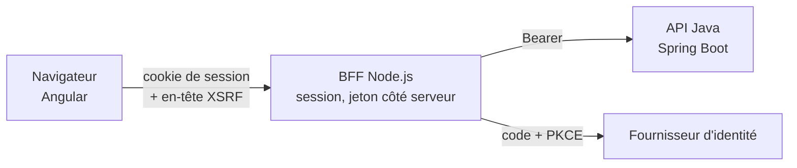

# Module `bff-node` (D10, réservé)

Statut : `reserved`. L'expert ne crée pas de BFF sur la base de ce module.

## 1. Pourquoi cette dimension existe

Dans le système du développeur, Node.js interagit déjà avec Angular. Un BFF en Node.js, placé devant les API Java, permet de :

- garder le jeton d'accès côté serveur et ne donner au navigateur qu'un cookie de session `HttpOnly`, `Secure`, `SameSite` ;
- agréger plusieurs appels d'API en une réponse adaptée à un écran ;
- appliquer une politique de sécurité du contenu et des en-têtes de sécurité au même endroit que le service des fichiers de l'application.

## 2. Architecture visée

## 3. Ce que prépare le point d'extension

**E5** : le front n'appelle aucun service tiers directement ; tout passe par l'API décrite dans le contrat. Le jour où le BFF est introduit, seule l'URL de base du client généré change, et l'intercepteur d'authentification est remplacé par la protection XSRF du module `routage-securite` (§ 4).

## 4. Contenu prévu à l'activation

- contrat entre Angular et le BFF : le contrat OpenAPI du socle, servi par le BFF, ou un contrat propre au BFF ;
- gestion de session, renouvellement du jeton, déconnexion ;
- exigences de sécurité : cookies, CSRF, CORS devenu inutile si le BFF sert l'application sur la même origine ;
- impact sur les invariants D3.INV-1, D5.INV-3 et sur le socle SC4.

## 5. Test d'inertie en 1.x

Aucune requête du front ne vise une autre origine que celle de l'API, hors fournisseur d'identité (E5). Contrôle : recherche des URL absolues dans le code du front, en CI.
