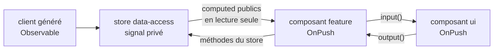

# Module `composants` (D2)

Ce module fixe comment un composant reçoit ses données, dérive son état et se rafraîchit. Le principe : l'état affiché est un signal, la dérivation passe par `computed`, et le composant se rafraîchit parce qu'un signal a changé, pas parce qu'une zone a intercepté un événement (point E2).

## 1. Flux de l'état



## 2. Composant de présentation

```ts
@Component({
  selector: 'app-order-card',
  changeDetection: ChangeDetectionStrategy.OnPush,          // D2.INV-1
  imports: [CurrencyPipe, DatePipe],
  template: `
    <article class="order-card" [attr.aria-labelledby]="titleId()">
      <h3 [id]="titleId()">Commande {{ order().number }}</h3>
      <p>Passée le {{ order().createdAt | date: 'longDate' }}</p>
      <p>Total : {{ order().totalAmount | currency: 'EUR' }}</p>
      @if (cancellable()) {
        <button type="button" (click)="cancel.emit(order().id)">
          Annuler la commande {{ order().number }}
        </button>
      }
    </article>
  `,
})
export class OrderCard {
  readonly order = input.required<OrderSummaryDto>();       // D2.INV-3
  readonly cancel = output<string>();
  readonly titleId = computed(() => `order-${this.order().id}-title`);
  readonly cancellable = computed(() => this.order().status === 'PLACED');
}
```

Remarques :

- `totalAmount` est une chaîne décimale dans le contrat (SC3) : le pipe `currency` l'accepte et la formate sans calcul flottant côté composant.
- Le libellé du bouton contient le numéro de commande : dans une liste, « Annuler » seul serait ambigu pour un lecteur d'écran (module `accessibilite`).

## 3. Store à signaux (couche `data-access`)

```ts
type OrdersState = {
  status: 'idle' | 'loading' | 'loaded' | 'error';
  page: PagedOrderSummaryDto | null;
  error: ApiProblem | null;
};

@Injectable()
export class OrdersStore {
  private readonly api = inject(OrdersService);              // client généré
  private readonly state = signal<OrdersState>({ status: 'idle', page: null, error: null });

  readonly orders = computed(() => this.state().page?.content ?? []);
  readonly totalPages = computed(() => this.state().page?.page.totalPages ?? 0);
  readonly loading = computed(() => this.state().status === 'loading');
  readonly error = computed(() => this.state().error);

  load(pageIndex = 0): void {
    this.state.update(s => ({ ...s, status: 'loading', error: null }));
    this.api.listOrders(pageIndex, 20).subscribe({
      next: page => this.state.set({ status: 'loaded', page, error: null }),
      error: (problem: ApiProblem) => this.state.update(s => ({ ...s, status: 'error', error: problem })),
    });
  }
}
```

- Le signal d'état est privé ; seuls des `computed` sont exposés. Aucun composant ne peut écrire l'état autrement que par les méthodes du store.
- Une requête HTTP se termine d'elle-même : l'abonnement dans le store n'a pas besoin de désinscription. Pour un flux qui ne se termine pas, voir § 5.
- L'erreur reçue est déjà un `ApiProblem`, converti par l'intercepteur (module `donnees-http`).

## 4. Composant de page

```ts
@Component({
  selector: 'app-orders-page',
  changeDetection: ChangeDetectionStrategy.OnPush,
  imports: [OrderCard, ProblemMessage],
  providers: [OrdersStore],                                   // l'état vit avec la page
  template: `
    <h1 tabindex="-1">Mes commandes</h1>
    @let problem = store.error();
    @if (store.loading()) {
      <p role="status">Chargement des commandes…</p>
    } @else if (problem) {
      <app-problem-message [problem]="problem" />
    } @else {
      <ul>
        @for (order of store.orders(); track order.id) {      <!-- D2.INV-2 -->
          <li><app-order-card [order]="order" (cancel)="onCancel($event)" /></li>
        } @empty {
          <li>Vous n'avez aucune commande.</li>
        }
      </ul>
    }
  `,
})
export class OrdersPage {
  protected readonly store = inject(OrdersStore);
  constructor() { this.store.load(); }
  protected onCancel(orderId: string): void { /* délègue au store */ }
}
```

## 5. RxJS et signaux

| Situation | Forme à utiliser |
|---|---|
| Afficher la valeur d'un `Observable` | `toSignal(obs$, { initialValue })` ou pipe `async` |
| Réagir à un flux qui ne se termine pas (WebSocket, `valueChanges`, minuterie) | `obs$.pipe(takeUntilDestroyed()).subscribe(...)` dans le contexte d'injection (D2.INV-4) |
| Valeur dérivée d'autres signaux | `computed` |
| Valeur dérivée, mais modifiable localement (sélection réinitialisée quand la liste change) | `linkedSignal` |
| Effet de bord vers l'extérieur (stockage local, journalisation, API impérative tierce) | `effect` |
| Opérateurs temporels (`debounceTime`, `switchMap`) | RxJS, puis `toSignal` |

```ts
// Recherche avec anti-rebond : RxJS pour le temps, signal pour l'affichage
protected readonly query = new FormControl('', { nonNullable: true });   // lié au champ de recherche du template
protected readonly results = toSignal(
  this.query.valueChanges.pipe(
    debounceTime(300),
    distinctUntilChanged(),
    switchMap(q => this.api.searchProducts(q)),
  ),
  { initialValue: [] as ProductDto[] },
);
```

Interdit (D2.INV-5) :

```ts
// effect qui recopie un signal dans un autre : boucle de mise à jour et état incohérent transitoire
effect(() => this.total.set(this.lines().reduce(...)));

// Correct
readonly total = computed(() => this.lines().reduce(...));
```

## 6. Templates

- Flux de contrôle intégré uniquement (D2.INV-2) ; `track` sur un identifiant stable (`track order.id`), jamais `track $index` pour une liste qui peut être réordonnée ou filtrée.
- `@let` pour nommer une valeur utilisée plusieurs fois dans un template.
- Aucun appel de méthode coûteux dans un template. Lire un signal (`store.orders()`) est un appel de fonction, mais il est mémorisé : c'est autorisé et attendu.
- Pas de `ngClass` ni `ngStyle` dans un nouveau code : liaisons `[class.x]` et `[style.x]`.

## 7. Pièges connus

- **OnPush et objet muté** : modifier une propriété d'un objet passé en entrée ne rafraîchit pas l'enfant. Toujours produire un nouvel objet (`update(s => ({ ...s, ... }))`).
- **`toSignal` hors contexte d'injection** : lève une erreur. L'appeler dans un initialiseur de champ ou le constructeur, ou lui passer un `Injector`.
- **`input.required` lu dans le constructeur** : la valeur n'existe pas encore. La lire dans un `computed`, un template ou après l'initialisation.
- **Mise à jour d'état dans un `setTimeout` sur une propriété ordinaire** : fonctionne grâce à zone.js, mais casse sans zone (point E2). Utiliser un signal.

## 8. Grille de revue

| Point | Question | Invariant |
|---|---|---|
| C1 | Un composant n'est-il pas en `OnPush` ? | D2.INV-1 |
| C2 | `*ngIf`, `*ngFor` ou `*ngSwitch` dans un template ? Un `@for` sans `track` stable ? | D2.INV-2, E1 |
| C3 | Un nouveau composant utilise-t-il `@Input` ou `@Output` ? | D2.INV-3 |
| C4 | Un `subscribe` dans un composant sans `takeUntilDestroyed` sur un flux infini ? | D2.INV-4 |
| C5 | Un `effect` écrit-il dans un signal pour en dériver la valeur ? | D2.INV-5 |
| C6 | Un état affiché n'est-il ni signal, ni `async`, et ne se rafraîchit que grâce à zone.js ? | E2 |
| C7 | Le signal d'état d'un store est-il exposé en écriture ? | hors invariant, encapsulation |
