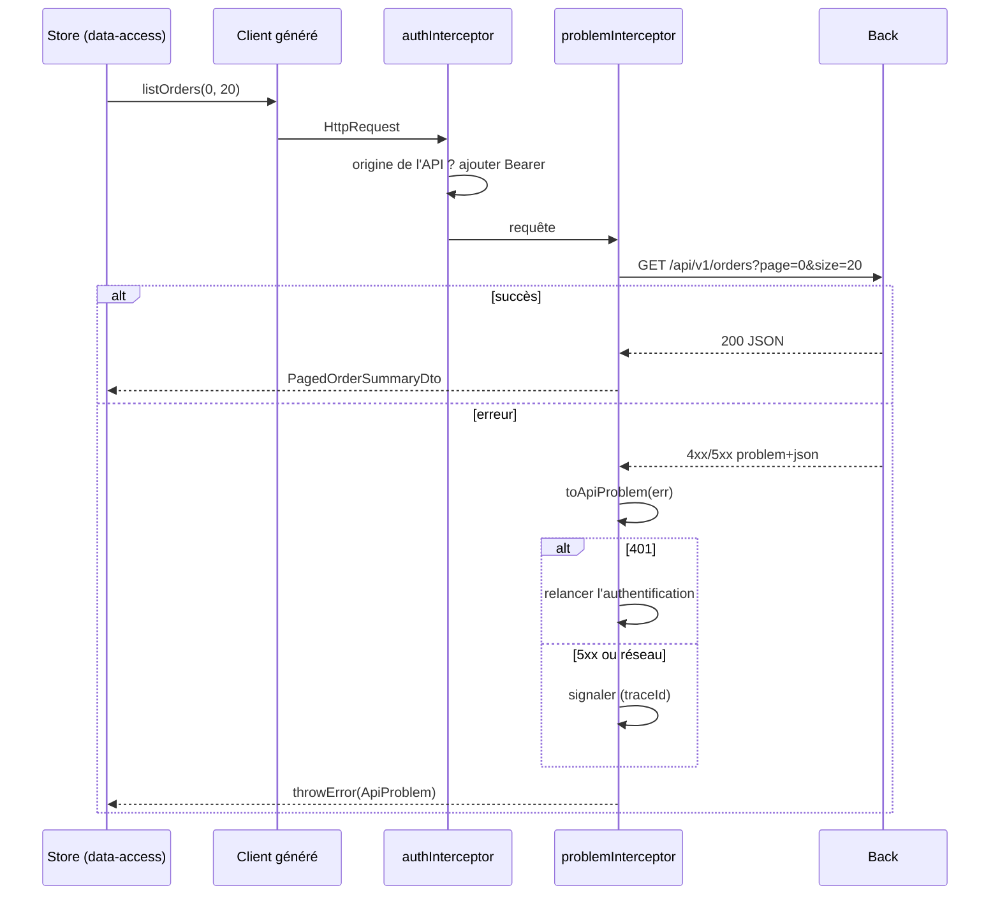

# Module `donnees-http` (D3)

Ce module applique côté Angular les dimensions SC1 à SC3 et SC5 du socle.

## 1. Chaîne d'un appel



## 2. Client généré

- Le client est généré depuis `api/openapi.yaml` au moment du build (script npm `generate:api`, exécuté avant `ng build` et `ng test`). Il n'est jamais modifié à la main.
- Générateur par défaut : openapi-generator, générateur `typescript-angular`. Si le projet en utilise un autre (`ng-openapi-gen`, `orval`), l'expert le conserve.
- Aucune URL `/api/...` écrite à la main dans le code du front (D3.INV-1). Contrôle :

```bash
# hors client généré, aucune URL d'API codée en dur
grep -rnE "['\"\`]/api/" src/app --include=*.ts | grep -v "src/app/api/"
```

## 3. Type `ApiProblem`

```ts
// core/http/api-problem.ts
export interface ApiFieldError { field: string; code: string; message: string; }

export interface ApiProblem {
  status: number;          // 0 pour une erreur réseau
  code: string;            // SC2 : seule base des décisions, avec status
  title?: string;          // texte lisible, jamais utilisé dans la logique (SC2.INV-2)
  detail?: string;
  traceId?: string;
  errors?: ApiFieldError[];
}

export function toApiProblem(err: HttpErrorResponse): ApiProblem {
  const body = err.error;
  if (body && typeof body === 'object' && typeof body.code === 'string') {
    return { ...body, status: err.status } as ApiProblem;
  }
  return {
    status: err.status,
    code: err.status === 0 ? 'NETWORK_ERROR' : 'UNEXPECTED_RESPONSE',
  };
}
```

## 4. Intercepteurs

```ts
// core/http/auth.interceptor.ts
export const authInterceptor: HttpInterceptorFn = (req, next) => {
  const auth = inject(AuthService);
  const apiBase = inject(BASE_PATH);
  const token = auth.accessToken();                         // signal, jeton en mémoire
  if (!token || !isApiUrl(req.url, apiBase)) {
    return next(req);                                       // D5.INV-3 : jamais vers une autre origine
  }
  return next(req.clone({ setHeaders: { Authorization: `Bearer ${token}` } }));
};

function isApiUrl(url: string, apiBase: string): boolean {
  const target = new URL(url, window.location.origin);
  const base = new URL(apiBase, window.location.origin);
  return target.origin === base.origin && target.pathname.startsWith(base.pathname);
}
```

La comparaison porte sur l'origine analysée, pas sur un préfixe de chaîne : `https://api.acme.fr.attaquant.example` commence par `https://api.acme.fr` mais n'a pas la même origine.

```ts
// core/http/problem.interceptor.ts
export const problemInterceptor: HttpInterceptorFn = (req, next) => {
  const auth = inject(AuthService);
  const reporter = inject(ProblemReporter);
  return next(req).pipe(
    catchError((err: unknown) => {
      if (!(err instanceof HttpErrorResponse)) {
        return throwError(() => err);
      }
      const problem = toApiProblem(err);                      // D3.INV-2 : point unique de conversion
      if (problem.status === 401) {
        auth.startLogin();                                    // SC4 : 401, relancer l'authentification
      } else if (problem.status === 0 || problem.status >= 500) {
        reporter.report(problem);                             // message global avec traceId
      }
      // 400, 403, 404, 409, 422 : remontent à l'appelant, qui sait les traiter
      return throwError(() => problem);
    }),
  );
};
```

- Le 403 n'est pas traité globalement : la page concernée affiche un message adapté (« vous n'avez pas accès à cette commande »), sans relancer l'authentification.
- Le 409 `CONCURRENT_MODIFICATION` propose de recharger la donnée : c'est la page qui le gère.

## 5. Affichage d'une erreur

```ts
@Component({
  selector: 'app-problem-message',
  changeDetection: ChangeDetectionStrategy.OnPush,
  template: `
    <div role="alert">
      <p>{{ message() }}</p>
      @if (problem().traceId; as traceId) {
        <p>Référence à communiquer au support : <code>{{ traceId }}</code></p>
      }
    </div>
  `,
})
export class ProblemMessage {
  readonly problem = input.required<ApiProblem>();
  private readonly messages = inject(ProblemMessages);        // table code → message localisé
  readonly message = computed(() => this.messages.forCode(this.problem().code, this.problem().detail));
}
```

`ProblemMessages.forCode` cherche un message localisé par `code`, et n'utilise `detail` qu'en repli (socle SC6). `role="alert"` annonce le message aux technologies d'assistance (D6.INV-4).

## 6. Dates et montants

- Les dates du contrat restent des `string` ISO 8601 dans les DTO. La conversion en `Date` se fait au plus près de l'affichage (pipe `date`), jamais dans le DTO.
- Les montants restent des chaînes décimales. Aucun `parseFloat` suivi d'un calcul (D3.INV-4). Un total se demande au back, ou se calcule avec une bibliothèque décimale si le projet en a déjà une.
- Pour envoyer une date calendaire, utiliser `YYYY-MM-DD` construit à partir des composantes locales, jamais `toISOString()`, qui convertit en UTC et peut décaler d'un jour.

## 7. Pièges connus

- **`HttpClient` et `withFetch`** : `withFetch` est recommandé (et nécessaire pour le rendu côté serveur). Les événements de progression d'envoi ne sont pas disponibles avec `fetch` : si le projet affiche une progression de téléversement, l'expert le signale.
- **Intercepteurs à base de classe** (`HTTP_INTERCEPTORS`) : encore pris en charge, mais tout nouvel intercepteur est fonctionnel (`HttpInterceptorFn`).
- **Abonnement multiple** : un `Observable` HTTP est froid ; deux `subscribe` déclenchent deux requêtes.
- **Erreur absorbée** : un `catchError(() => of([]))` dans un store masque la panne et affiche une liste vide trompeuse. Passer l'état du store en `error`.

## 8. Grille de revue

| Point | Question | Invariant |
|---|---|---|
| H1 | Une URL d'API est-elle écrite à la main hors client généré ? | D3.INV-1, SC1.INV-3 |
| H2 | Une décision repose-t-elle sur `title` ou `detail` ? Les erreurs sont-elles converties en plusieurs endroits ? | D3.INV-2, SC2.INV-2 |
| H3 | Un composant `ui` injecte-t-il le client ou `HttpClient` ? | D3.INV-3 |
| H4 | Un montant est-il converti en nombre pour un calcul ? | D3.INV-4, SC3.INV-2 |
| H5 | Le jeton peut-il partir vers une autre origine que l'API ? | D5.INV-3, SC4.INV-1 |
| H6 | Une erreur est-elle absorbée sans changer l'état affiché ? Le `traceId` n'est-il pas affiché sur une 5xx ? | hors invariant, SC5 |
