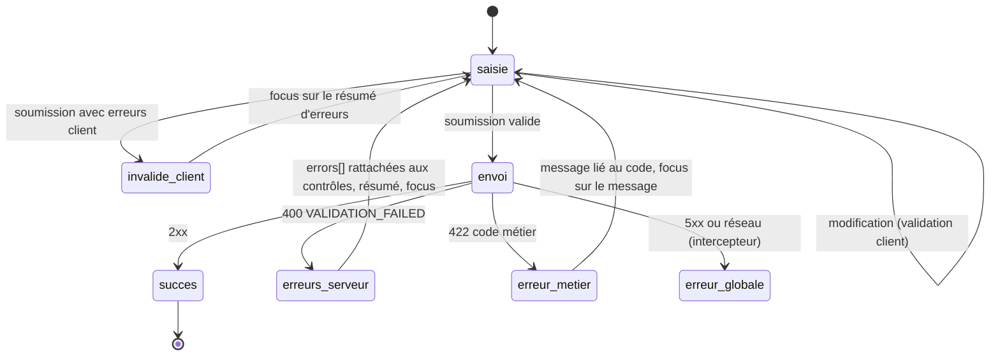

# Module `formulaires` (D4)

Ce module fixe comment un formulaire est typé, validé côté client, puis confronté à la validation du back. La validation du back fait foi ; celle du client améliore l'expérience.

## 1. Cycle d'une soumission



## 2. Modèle typé et construction isolée (point E3)

```ts
// features/orders/data-access/order-form.ts
export type OrderLineForm = FormGroup<{
  productId: FormControl<string>;
  quantity: FormControl<number>;
}>;

export type OrderForm = FormGroup<{
  deliveryDate: FormControl<string>;          // 'YYYY-MM-DD', chaîne comme dans le contrat
  comment: FormControl<string>;
  lines: FormArray<OrderLineForm>;
}>;

export function buildOrderForm(fb: NonNullableFormBuilder): OrderForm {
  return fb.group({
    deliveryDate: fb.control('', Validators.required),
    comment: fb.control('', Validators.maxLength(500)),
    lines: fb.array<OrderLineForm>([], Validators.minLength(1)),
  });
}

export function toCreateOrderRequest(form: OrderForm): CreateOrderRequest {
  const v = form.getRawValue();
  return { deliveryDate: v.deliveryDate, comment: v.comment || undefined, lines: v.lines };
}
```

- `NonNullableFormBuilder` : `reset()` revient à la valeur initiale au lieu de `null`, et les types n'incluent pas `null` (D4.INV-1).
- La construction et la conversion vers la requête sont des fonctions pures, testables sans composant. Le passage futur aux formulaires à signaux ne touchera que ce fichier et le template (point E3).
- Les validateurs client reprennent les contraintes du contrat (obligatoire, longueur, minimum) ; ils ne remplacent pas la validation du back.

## 3. Rattacher les erreurs du back (D4.INV-2)

Le back renvoie `errors[].field` avec la notation `lines[0].quantity` (socle SC2). Le chemin d'un contrôle Angular s'écrit `lines.0.quantity`.

```ts
// shared/util/server-errors.ts
export function applyServerErrors(form: FormGroup, problem: ApiProblem): ApiFieldError[] {
  const unmatched: ApiFieldError[] = [];
  for (const error of problem.errors ?? []) {
    const path = error.field.replace(/\[(\d+)\]/g, '.$1');
    const control = form.get(path);
    if (control) {
      control.setErrors({ ...control.errors, server: { code: error.code, message: error.message } });
      control.markAsTouched();
    } else {
      unmatched.push(error);              // affichées dans le résumé d'erreurs
    }
  }
  return unmatched;
}
```

## 4. Composant de formulaire

```ts
@Component({
  selector: 'app-order-form',
  changeDetection: ChangeDetectionStrategy.OnPush,
  imports: [ReactiveFormsModule, ErrorSummary],
  template: `
    <form [formGroup]="form" (ngSubmit)="submit()" novalidate>
      @if (summary().length > 0) {
        <app-error-summary #summaryRef [errors]="summary()" />
      }

      <div class="field">
        <label for="deliveryDate">Date de livraison souhaitée (obligatoire)</label>
        <input id="deliveryDate" type="date" formControlName="deliveryDate" autocomplete="off"
               [attr.aria-invalid]="showError('deliveryDate')"
               [attr.aria-describedby]="showError('deliveryDate') ? 'deliveryDate-error' : null" />
        @if (showError('deliveryDate')) {
          <p id="deliveryDate-error" class="field-error">{{ errorText('deliveryDate') }}</p>
        }
      </div>

      <button type="submit" [disabled]="sending()">Valider la commande</button>
    </form>
  `,
})
export class OrderFormComponent {
  private readonly fb = inject(NonNullableFormBuilder);
  private readonly injector = inject(Injector);
  private readonly api = inject(OrdersService);
  private readonly messages = inject(ValidationMessages);
  protected readonly form = buildOrderForm(this.fb);
  protected readonly sending = signal(false);
  protected readonly summary = signal<SummaryItem[]>([]);
  private readonly summaryRef = viewChild<ErrorSummary>('summaryRef');
  private readonly submitted = signal(false);

  protected submit(): void {
    this.submitted.set(true);
    if (this.form.invalid) {
      this.form.markAllAsTouched();
      this.showSummary(collectClientErrors(this.form, this.messages), []);
      return;
    }
    this.sending.set(true);
    this.api.createOrder(toCreateOrderRequest(this.form)).subscribe({
      next: () => { /* navigation et annonce de confirmation */ },
      error: (problem: ApiProblem) => {
        this.sending.set(false);
        const unmatched = problem.code === 'VALIDATION_FAILED' ? applyServerErrors(this.form, problem) : [];
        this.showSummary(collectClientErrors(this.form, this.messages), unmatched);   // signal : OnPush se rafraîchit
      },
    });
  }

  private showSummary(fieldErrors: SummaryItem[], unmatched: ApiFieldError[]): void {
    this.summary.set([...fieldErrors, ...unmatched.map(e => ({ fieldId: null, text: e.message }))]);
    afterNextRender(() => this.summaryRef()?.focus(), { injector: this.injector });
  }

  protected showError(name: keyof OrderForm['controls']): boolean {
    const c = this.form.controls[name];
    return c.invalid && (c.touched || this.submitted());
  }
  protected errorText(name: keyof OrderForm['controls']): string {
    return this.messages.forErrors(this.form.controls[name].errors);
  }
}
```

Le résumé d'erreurs (`ErrorSummary`) est un composant de `shared/ui` : un titre (« 2 erreurs empêchent l'envoi »), une liste de liens vers chaque champ (`href="#deliveryDate"`), et une méthode `focus()` qui place le focus sur son titre. C'est la pratique recommandée par le RGAA pour les formulaires longs.

## 5. Accessibilité des champs (D4.INV-3)

| Exigence | Mise en œuvre |
|---|---|
| Libellé associé | `<label for>` relié à l'`id` du champ ; jamais un `placeholder` seul |
| Caractère obligatoire | indiqué dans le libellé en texte (« obligatoire »), pas seulement par un astérisque coloré |
| Message d'erreur lié | `aria-describedby` vers l'`id` du message, `aria-invalid="true"` quand le champ est en erreur |
| Annonce | le résumé d'erreurs reçoit le focus après une soumission en échec |
| Format attendu | précisé dans le libellé ou une aide liée par `aria-describedby` |
| Groupes | `fieldset` et `legend` pour les boutons radio et les groupes de cases |
| Autocomplétion | `autocomplete` renseigné sur les champs de données personnelles (critère WCAG 1.3.5) |

## 6. Pièges connus

- **OnPush et erreurs serveur** : `setErrors` appelé dans un rappel HTTP ne rafraîchit pas un composant OnPush à lui seul. Il faut qu'un signal lu par le template change (ici `summary`), ou appeler `markForCheck`.
- **Erreur serveur qui ne disparaît jamais** : l'erreur `server` posée par `setErrors` est effacée à la prochaine validation du contrôle, c'est-à-dire à la prochaine modification de sa valeur ; ne pas la retirer à la main au risque d'effacer d'autres erreurs.
- **`disabled` sur un contrôle** : un contrôle désactivé disparaît de `value`. Utiliser `getRawValue()` pour construire la requête.
- **Bouton désactivé tant que le formulaire est invalide** : l'utilisateur ne sait pas pourquoi. Laisser le bouton actif et afficher le résumé d'erreurs à la soumission.

## 7. Grille de revue

| Point | Question | Invariant |
|---|---|---|
| F1 | Un nouveau formulaire est-il non typé (`UntypedFormGroup`, `any`) ? | D4.INV-1 |
| F2 | Les `errors[]` du back sont-ils ignorés, ou affichés sans rattachement aux champs ? | D4.INV-2, SC6.INV-1 |
| F3 | Un champ est-il sans libellé associé, ou son erreur sans `aria-describedby` ? | D4.INV-3 |
| F4 | Le modèle du formulaire et sa conversion sont-ils dispersés dans le composant ? | E3 |
| F5 | Le bouton d'envoi est-il désactivé tant que le formulaire est invalide ? | hors invariant, accessibilité |
