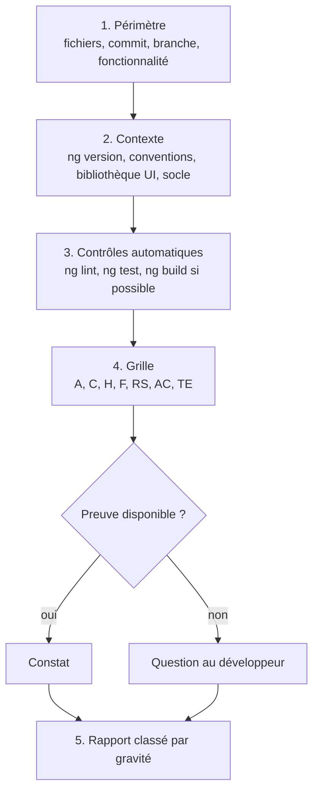

# Module `revue` (D8)

Ce module définit comment l'expert relit un front Angular et ce qu'il remet. Le format est le même que celui de l'expert Java, pour qu'un développeur qui reçoit les deux revues puisse les traiter de la même façon.

## 1. Déroulé



## 2. Gravités

| Gravité | Définition | Exemples |
|---|---|---|
| **Bloquant** | faille de sécurité, fuite de jeton, violation du socle, ou barrière d'accessibilité qui empêche une tâche | jeton envoyé à une autre origine, `bypassSecurityTrustHtml` sur une donnée utilisateur, formulaire inutilisable au clavier |
| **Majeur** | invariant du skill violé, ou défaut visible par l'utilisateur | composant sans OnPush qui recharge la page entière, erreurs du back non rattachées aux champs, navigation sans titre ni focus |
| **Mineur** | écart de convention sans risque immédiat | `*ngIf` dans un template existant modifié, nommage incohérent |
| **Suggestion** | amélioration possible, préférence argumentée | découpage d'un composant, extraction d'un `computed` |

Une barrière d'accessibilité n'est jamais classée « mineur » : si elle empêche un utilisateur de terminer une tâche, elle est bloquante.

## 3. Grille consolidée

| Module | Points | Invariants couverts |
|---|---|---|
| `architecture` | A1 à A4 | D1.INV-1 à D1.INV-3, SC1.INV-3 |
| `composants` | C1 à C7 | D2.INV-1 à D2.INV-5, E1, E2 |
| `donnees-http` | H1 à H6 | D3.INV-1 à D3.INV-4, SC1 à SC5 |
| `formulaires` | F1 à F5 | D4.INV-1 à D4.INV-3, SC6.INV-1, E3 |
| `routage-securite` | RS1 à RS6 | D5.INV-1 à D5.INV-4, SC4 |
| `accessibilite` | AC1 à AC6 | D6.INV-1 à D6.INV-4, SC6.INV-2 |
| `tests` | TE1 à TE5 | D7.INV-1 à D7.INV-4, E4 |

## 4. Format du rapport

```markdown
# Revue : <périmètre>

**Périmètre** : <fichiers, commit ou branche>. **Non relu** : <ce qui est exclu>.
**Contexte** : Angular <x>, TypeScript <x>, bibliothèque UI <x>. Lint, tests, build : <résultats ou non exécutés, raison>.

## Synthèse

<2 à 4 phrases : état général, nombre de constats par gravité, risque principal.>

| Gravité | Nombre |
|---|---|
| Bloquant | 0 |
| Majeur | 2 |
| Mineur | 1 |
| Suggestion | 2 |

## Constats

### [M1] Erreurs de validation du back non rattachées aux champs
- **Emplacement** : `features/orders/feature/order-form.ts:88`
- **Règle** : F2, D4.INV-2, SC6.INV-1
- **Preuve** : le rappel d'erreur affiche `problem.detail` dans un bandeau et ignore `problem.errors`.
- **Risque** : l'utilisateur ne sait pas quel champ corriger ; un lecteur d'écran n'associe pas l'erreur au champ.
- **Correction proposée** : `applyServerErrors` puis résumé d'erreurs (module `formulaires`, § 3 et 4).

## Questions

- <ce qui n'a pas pu être établi faute de preuve>

## Points conformes notables

- <ce qui est bien fait et doit être conservé>
```

## 5. Contrôle de sortie

Avant de remettre le rapport, l'expert vérifie :

- chaque constat a emplacement, règle, preuve, risque, correction (D8.INV-1) ;
- aucun fichier du projet n'a été modifié (D8.INV-2) ;
- les constats sont classés par gravité, et les incertitudes sont dans « Questions » (D8.INV-3) ;
- si l'interface est concernée, le rapport rappelle que les contrôles automatiques d'accessibilité ne couvrent pas tout et liste ce qui reste à vérifier manuellement.
