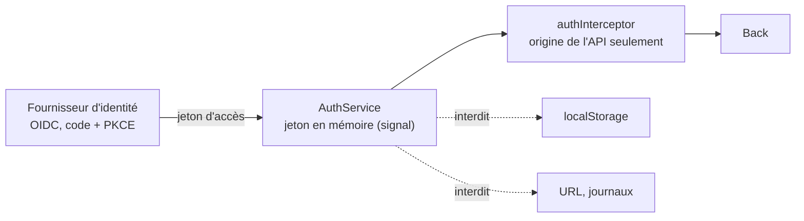

# Module `routage-securite` (D5)

Ce module applique côté Angular la dimension SC4 du socle. Rappel : le front améliore l'expérience, le back protège les données (D5.INV-4).

## 1. Routes

```ts
// app.routes.ts
export const routes: Routes = [
  { path: '', pathMatch: 'full', redirectTo: 'orders' },
  {
    path: 'orders',
    canMatch: [authenticatedGuard],
    loadChildren: () => import('./features/orders/orders.routes').then(m => m.ORDERS_ROUTES),   // D5.INV-1
  },
  {
    path: 'admin',
    canMatch: [roleGuard('ADMIN')],
    loadChildren: () => import('./features/admin/admin.routes').then(m => m.ADMIN_ROUTES),
  },
  { path: '**', title: 'Page introuvable', loadComponent: () => import('./core/not-found/not-found').then(m => m.NotFound) },
];

// features/orders/orders.routes.ts
export const ORDERS_ROUTES: Routes = [
  { path: '', title: 'Mes commandes', component: OrdersPage },
  { path: ':orderId', title: 'Détail de la commande', component: OrderDetailPage },
];
```

- `canMatch` plutôt que `canActivate` pour une zone réservée : le code de la fonctionnalité n'est même pas téléchargé si l'utilisateur n'y a pas droit.
- Chaque route a un `title` (D6.INV-3, module `accessibilite`).
- `withComponentInputBinding()` lie `:orderId` à `readonly orderId = input.required<string>()` du composant de page.

## 2. Gardes fonctionnelles

```ts
export const authenticatedGuard: CanMatchFn = () => {
  const auth = inject(AuthService);
  if (auth.isAuthenticated()) {
    return true;
  }
  auth.startLogin();
  return false;
};

export function roleGuard(role: string): CanMatchFn {
  return () => {
    const auth = inject(AuthService);
    const router = inject(Router);
    return auth.hasRole(role) || router.createUrlTree(['/forbidden']);
  };
}
```

## 3. Jeton d'accès



- Flux OpenID Connect « code d'autorisation avec PKCE ». La bibliothèque OIDC est celle du projet ; l'expert n'en introduit pas une sans validation.
- Le jeton d'accès vit en mémoire. Il n'est jamais placé dans `localStorage` : une faille XSS suffirait à l'exfiltrer (D5.INV-3). Selon la bibliothèque, `sessionStorage` peut être utilisé pour survivre à un rechargement : c'est un compromis à valider avec le développeur, et à écrire dans le compte rendu.
- Le jeton ne part que vers l'origine de l'API (module `donnees-http`, `isApiUrl`).
- Si le projet place un BFF devant l'API, le jeton ne vit plus dans le navigateur : c'est la dimension réservée D10.

## 4. Authentification par cookie et XSRF

Si le back authentifie par cookie de session, `HttpClient` protège contre la falsification de requête :

```ts
provideHttpClient(
  withFetch(),
  withXsrfConfiguration({ cookieName: 'XSRF-TOKEN', headerName: 'X-XSRF-TOKEN' }),
  withInterceptors([problemInterceptor]),
)
```

`HttpClient` n'ajoute l'en-tête XSRF qu'aux requêtes qui modifient l'état (`POST`, `PUT`, `PATCH`, `DELETE`) **et** dont l'URL est relative. Une API appelée par une URL absolue, même sur le même domaine, ne reçoit pas l'en-tête : il faut alors un intercepteur dédié. L'expert vérifie ce point avec le développeur, en cohérence avec la configuration CSRF du back.

## 5. Contenu HTML dynamique

- Angular assainit les liaisons `[innerHTML]`, `[href]` et `[src]`. Lier une donnée à `[innerHTML]` reste à éviter : préférer l'interpolation, qui échappe tout.
- `DomSanitizer.bypassSecurityTrust*` désactive cette protection. Il n'est utilisé que pour un contenu entièrement maîtrisé, avec un commentaire qui en justifie l'origine, et il est systématiquement signalé en revue (D5.INV-2).
- Aucun accès direct au DOM (`document.querySelector`, `ElementRef.nativeElement.innerHTML = ...`) pour insérer du contenu.
- Politique de sécurité du contenu (CSP) : définie par le serveur qui sert l'application. Angular prend en charge un nonce pour ses styles en ligne (`ngCspNonce` sur l'élément racine, ou jeton `CSP_NONCE`). L'expert signale l'absence de CSP comme constat, sans la configurer côté serveur s'il n'en a pas la charge.

## 6. Pièges connus

- **Garde qui masque une donnée** : un utilisateur peut toujours appeler l'API directement. Le back doit refuser (SC4.INV-2).
- **Rôles lus dans un jeton non vérifié côté front** : acceptable pour l'affichage, jamais pour une décision de sécurité.
- **Paramètre de route utilisé tel quel dans une URL d'API** : il passe par le client généré, qui encode les paramètres de chemin.
- **Redirection après connexion vers une URL fournie en paramètre** : vérifier qu'elle est interne (`router.parseUrl` et liste blanche), sinon redirection ouverte.

## 7. Grille de revue

| Point | Question | Invariant |
|---|---|---|
| RS1 | Une fonctionnalité est-elle importée de façon statique dans les routes de premier niveau ? | D5.INV-1 |
| RS2 | `bypassSecurityTrust*` ou `innerHTML` avec une donnée non maîtrisée, sans justification ? | D5.INV-2 |
| RS3 | Le jeton est-il dans `localStorage`, dans une URL, dans un journal, ou envoyé à une autre origine ? | D5.INV-3, SC4.INV-1 |
| RS4 | Une donnée sensible n'est-elle protégée que par une garde ? | D5.INV-4, SC4.INV-2 |
| RS5 | Une redirection après connexion accepte-t-elle une URL externe ? | hors invariant, faille |
| RS6 | Authentification par cookie sans protection XSRF effective ? | hors invariant, faille, bloquant |
