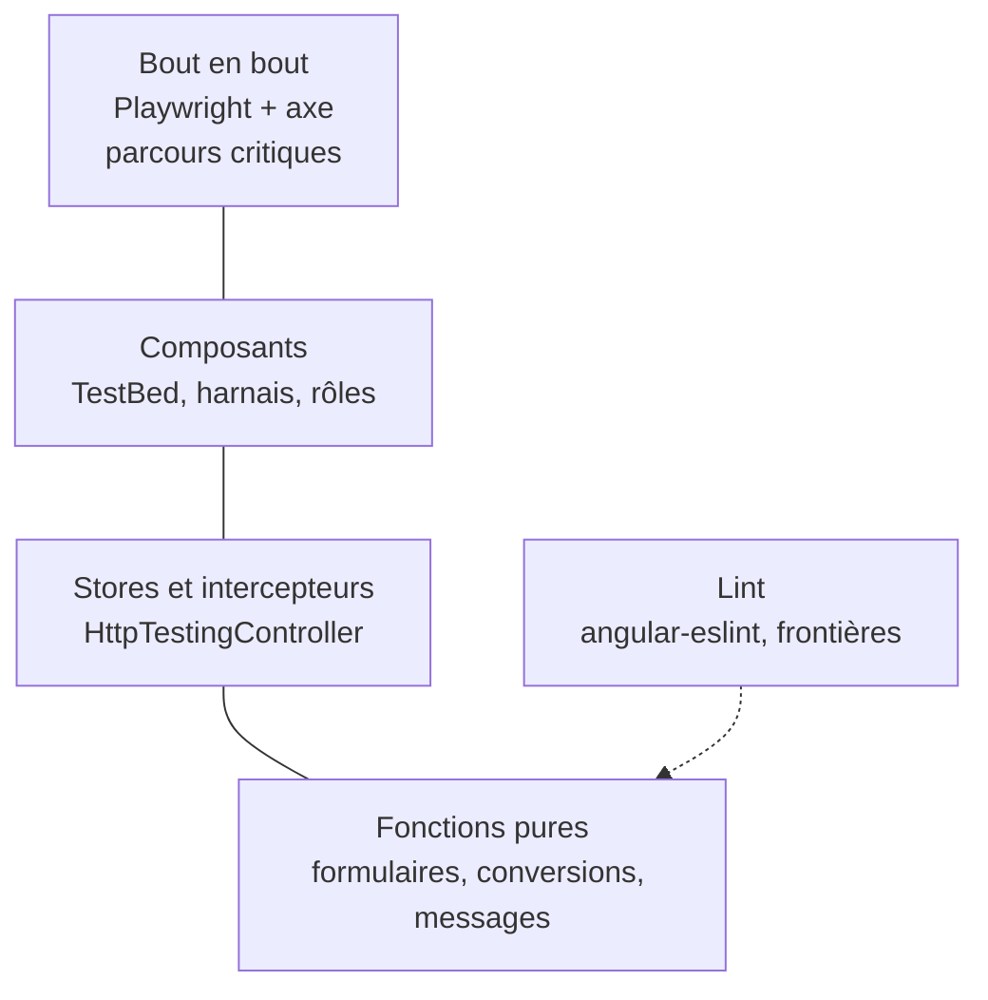

# Module `tests` (D7)

Ce module transforme les invariants du skill en contrôles qui s'exécutent.

## 1. Pyramide



## 2. Fonctions pures

```ts
describe('applyServerErrors', () => {
  it('rattache lines[0].quantity au contrôle lines.0.quantity', () => {
    const form = buildOrderForm(new FormBuilder().nonNullable);
    form.controls.lines.push(new FormGroup({
      productId: new FormControl('p1', { nonNullable: true }),
      quantity: new FormControl(0, { nonNullable: true }),
    }));

    const unmatched = applyServerErrors(form, {
      status: 400, code: 'VALIDATION_FAILED',
      errors: [{ field: 'lines[0].quantity', code: 'MIN', message: 'doit être supérieur ou égal à 1' }],
    });

    expect(unmatched).toEqual([]);
    expect(form.get('lines.0.quantity')?.errors?.['server']?.code).toBe('MIN');   // SC6.INV-1
  });
});
```

## 3. Stores et intercepteurs

```ts
describe('OrdersStore', () => {
  let store: OrdersStore;
  let http: HttpTestingController;

  beforeEach(() => {
    TestBed.configureTestingModule({
      providers: [
        OrdersStore,
        provideHttpClient(withInterceptors([problemInterceptor])),
        provideHttpClientTesting(),                                     // D7.INV-2
        { provide: BASE_PATH, useValue: '' },
        { provide: AuthService, useValue: { startLogin: jasmine.createSpy('startLogin') } },
        { provide: ProblemReporter, useValue: { report: jasmine.createSpy('report') } },
      ],
    });
    store = TestBed.inject(OrdersStore);
    http = TestBed.inject(HttpTestingController);
  });

  afterEach(() => http.verify());

  it("passe en état d'erreur avec le code et le traceId du back", () => {
    store.load();
    http.expectOne(req => req.url.endsWith('/api/v1/orders')).flush(
      { code: 'INTERNAL_ERROR', traceId: 'abc123', status: 500 },
      { status: 500, statusText: 'Internal Server Error' },
    );
    expect(store.error()?.code).toBe('INTERNAL_ERROR');
    expect(store.error()?.traceId).toBe('abc123');
  });
});
```

Avec Jest, `jasmine.createSpy` devient `jest.fn()`. Le reste du test est identique, ce qui est l'objet du point E4.

## 4. Composants

```ts
describe('OrderCard', () => {
  it("propose d'annuler une commande passée, avec un nom de bouton explicite", async () => {
    const order = anOrder({ number: 'C-1042', status: 'PLACED' });   // fabrique de données de test du projet
    const fixture = TestBed.createComponent(OrderCard);
    fixture.componentRef.setInput('order', order);
    fixture.detectChanges();

    const button: HTMLButtonElement = fixture.nativeElement.querySelector('button');
    expect(button.textContent?.trim()).toBe('Annuler la commande C-1042');   // nom accessible

    let emitted: string | undefined;
    fixture.componentInstance.cancel.subscribe(id => (emitted = id));
    button.click();
    expect(emitted).toBe(order.id);
  });
});
```

- `componentRef.setInput` fixe une entrée signal et respecte OnPush.
- Sélection par rôle, texte visible ou libellé (D7.INV-3). Si le projet utilise Angular Material ou le CDK, les harnais (`TestbedHarnessEnvironment.loader(fixture)`) sont préférés aux requêtes DOM.
- Pas de sélection par classe CSS de présentation (`.btn-primary`) : elle change sans que le comportement change.

## 5. Correspondance invariants vers contrôles

| Invariant | Contrôle | Type |
|---|---|---|
| D1.INV-1 | `@angular-eslint/prefer-standalone` | lint |
| D1.INV-2 | `no-restricted-imports` par couche (module `architecture`, § 5) | lint |
| D1.INV-3 | lecture de `tsconfig.json` dans le compte rendu ; `ng build` échoue si les templates sont mal typés | build |
| D2.INV-1 | `@angular-eslint/prefer-on-push-component-change-detection` | lint |
| D2.INV-2 | `@angular-eslint/template/prefer-control-flow` ; revue pour `track` | lint, revue |
| D2.INV-3 | revue (point C3), ou `@angular-eslint/prefer-signals` si la version d'`angular-eslint` la fournit | revue |
| D2.INV-4, D2.INV-5 | revue (points C4, C5) | revue |
| D3.INV-1 | recherche d'URL codées en dur (module `donnees-http`, § 2) en CI | script |
| D3.INV-2 | tests de l'intercepteur sur 400, 401, 403, 500 et erreur réseau | unitaire |
| D3.INV-3 | `no-restricted-imports` sur `ui` | lint |
| D3.INV-4 | revue (point H4) | revue |
| D4.INV-1 | revue ; `strictTemplates` | revue, build |
| D4.INV-2 | test de `applyServerErrors` (§ 2) et test du composant de formulaire avec une réponse 400 | unitaire |
| D4.INV-3 | `label-has-associated-control` ; test de composant vérifiant `aria-describedby` | lint, unitaire |
| D5.INV-1 | revue des routes (point RS1) | revue |
| D5.INV-2 | recherche de `bypassSecurityTrust` et de `innerHTML` en CI ; chaque occurrence doit porter un commentaire de justification | script, revue |
| D5.INV-3 | test de `authInterceptor` : pas d'en-tête vers une origine étrangère | unitaire |
| D6.INV-1 | `templateAccessibility` | lint |
| D6.INV-2 | tests Playwright avec axe | bout en bout |
| D6.INV-3 | test de bout en bout : titre et focus après navigation | bout en bout |
| D6.INV-4 | test de composant : présence de `role="alert"` ou appel à `LiveAnnouncer` | unitaire |
| D7.INV-2 | `http.verify()` dans chaque test HTTP | unitaire |

## 6. Pièges connus

- **`fixture.detectChanges()` oublié après `setInput`** : le template n'est pas encore rendu.
- **`fakeAsync` et `tick`** : dépendent de zone.js. Pour le temps, préférer injecter une horloge ou un ordonnanceur, et tester les fonctions pures (point E2, D7.INV-4).
- **Test qui vérifie un texte issu du back** (`detail`) : fragile. Tester le message produit par le front à partir du `code`.
- **Couverture élevée mais tests sans assertion utile** : un test doit échouer si l'invariant qu'il cite est violé.

## 7. Grille de revue

| Point | Question | Invariant |
|---|---|---|
| TE1 | Un invariant touché par la modification est-il sans contrôle ? | D7.INV-1 |
| TE2 | Un test émet-il une requête réelle, ou oublie-t-il `http.verify()` ? | D7.INV-2 |
| TE3 | Un test sélectionne-t-il par classe CSS de présentation ? | D7.INV-3 |
| TE4 | Un test dépend-il de l'heure réelle ou d'un délai réel ? | D7.INV-4 |
| TE5 | Un test utilise-t-il une API propre à Karma ou à Jasmine au-delà des espions et attentes de base ? | E4 |
