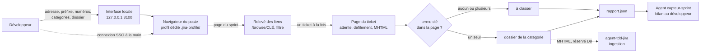

# Capture des tickets d'un sprint Jira, version 1.0.0

Ce document est le point d'entrée du skill. Le skill enregistre en MHTML, comme « Enregistrer sous… » de Chrome, chaque ticket du prochain sprint d'un Jira protégé par un SSO, et le range dans le dossier de sa catégorie (par défaut `ticket avec ia` et `ticket sans ia`). Le développeur se connecte lui-même dans une fenêtre du navigateur de son poste ; le skill ne voit aucun identifiant. Les fichiers produits sont ceux qu'attend l'ingestion d'`agent-tdd-jira`. Les règles détaillées sont dans `modules/`.

## 1. Ordre de lecture

1. Ce document, en entier.
2. `manifest.json` : modules, versions visées, plateformes.
3. Les modules actifs, dans cet ordre : `execution`, `session`, `releve`, `capture`, `classement`, `interface`, `agent`, `export-api`, `recette`.
4. `modules/remise/SKILL.md` et `modules/pilotage/SKILL.md` : seulement pour comprendre les points d'extension. Ne pas les appliquer en 1.x.

## 2. Ce que fait le skill

| Outil | Commande, depuis le dossier du skill | Rôle | Module |
|---|---|---|---|
| Interface de capture | `npm run capture`, puis http://127.0.0.1:3100 | ouvre le sprint, capture les tickets en tâche de fond, affiche l'avancement et le rapport | `interface` |
| Capture en ligne de commande | `npm run capture:cli -- "<page du sprint>" [options]` | la même capture, Entrée dans le terminal remplaçant le bouton | `interface` |
| Module commun | `scripts/jira-capture-core.mjs` | navigateur, relevé, capture, classement, rapport | `execution` |
| Export par l'API | `npm run export`, ou `scripts/jira_sprint_export.py` | tableau et CSV des tickets, quand Jira accepte un mot de passe ou un jeton | `export-api` |
| Recette | `npm test` | 19 scénarios contre un faux Jira local | `recette` |
| Agent | `agent/capteur-sprint.md` | pilote l'interface pour le développeur et rend le bilan | `agent` |



## 3. Ce que produit une capture

Dans le dossier de sortie choisi, directement :

```text
<dossier de sortie>/
  ticket avec ia/ABCDE-3512.mhtml   un fichier par ticket, dans le dossier de sa catégorie
  ticket sans ia/ABCXY-3520.mhtml
  à classer/ABCDE-3530.mhtml        aucun terme clé trouvé dans la page, ou plusieurs
  sprint.mhtml                      la page du sprint, d'où viennent les liens
  rapport.json                      la dernière capture : filtre, catégories, et pour chaque ticket
                                    sa catégorie, l'endroit et l'extrait où le terme a été trouvé, ou son erreur
```

Une nouvelle capture dans le même dossier remplace le fichier de chaque ticket recapturé et retire sa copie d'un autre dossier de catégorie (D5.INV-4). Le dossier de sortie se choisit dans l'interface ; par défaut, c'est `mhtml/` dans le dossier du skill.

## 4. Cycle 7E

| Phase | Ce qu'elle désigne ici | Modules |
|---|---|---|
| Éléments | les tickets : clés, liens, pages, termes clés | `releve`, `classement` |
| Espace | la page du sprint, le profil du navigateur, le dossier de sortie | `session`, `releve`, `execution` |
| Engendrent | les relations : lien vers ticket, ticket vers catégorie, capture vers rapport | `releve`, `classement` |
| État | l'avancement de la capture, la session SSO, le contenu du dossier de sortie | `capture`, `session`, `interface` |
| Expression | les fichiers MHTML, `rapport.json`, la page de l'interface, le bilan de l'agent | `capture`, `classement`, `interface`, `agent` |
| Évolutif | versions du skill, dimensions réservées D9 et D10, points d'extension E1 et E2 | `remise`, `pilotage` |
| Environnement | le Jira et son SSO, le navigateur du poste, le développeur qui se connecte et tranche, les agents qui lisent les captures | `session`, `agent` |

Clause de second ordre : le classement n'est pas neutre. Ce que le skill range dans `ticket avec ia` oriente la façon dont le ticket sera traité ensuite. Le skill ne devine donc jamais une catégorie : un ticket sans terme clé, ou avec plusieurs, va dans `à classer` (D5.INV-3), et le rapport montre l'extrait sur lequel repose chaque classement (D5.INV-6), pour que le développeur puisse le contester. De même, la navigation de Jira peut citer un terme ou un ticket sans rapport avec le sprint : elle n'est lue ni pour relever les tickets (D3.INV-1) ni pour les classer (D5.INV-2).

## 5. Registre des dimensions

| ID | Dimension | Introduite | Statut 1.0.0 | Dépend de | Module |
|---|---|---|---|---|---|
| D1 | Exécution : installation, dépendance, emplacements, réglages | 1.0 | active | | `execution`, `recette` |
| D2 | Session SSO : connexion à la main, profil dédié | 1.0 | active | D1 | `session`, `recette` |
| D3 | Relevé des tickets sur la page du sprint, filtre | 1.0 | active | D2 | `releve`, `recette` |
| D4 | Capture des pages de tickets en MHTML | 1.0 | active | D3 | `capture`, `recette` |
| D5 | Classement par catégorie, dossiers et rapport | 1.0 | active | D4 | `classement`, `recette` |
| D6 | Interfaces : page locale et ligne de commande | 1.0 | active | D3, D4, D5 | `interface`, `recette` |
| D7 | Agent capteur-sprint | 1.0 | active | D5, D6 | `agent` |
| D8 | Export par l'API REST, sans SSO | 1.0 | active | D1 | `export-api`, `recette` |
| D9 | Remise des tickets capturés à agent-tdd-jira | 1.0 | reserved | D5 | `remise` |
| D10 | Pilotage de la capture par un autre outil | 1.0 | reserved | D6 | `pilotage` |

## 6. Contrat de version et points d'extension

Le skill suit le contrat de version de `EVOLUTION.md` du dépôt Agent2Prompt. Il n'a ni base ni journal : le rapport d'une capture est son seul état écrit, et ses champs sont stables (E1).

Points d'extension, actifs depuis la version indiquée :

- **E1** (1.0.0) : `rapport.json` a des champs stables, au niveau de la capture (`date`, `sprintUrl`, `folder`, `filter`, `categories`, `listed`, `selected`, `ignored`, `ignoredSample`, `counts`, `errors`, `aborted`, `tickets`) et de chaque ticket (`key`, `url`, `category`, `found`, `where`, `excerpt`, `file`, `movedFrom`, ou `error`). D9 s'en servira pour remettre les tickets d'une catégorie à agent-tdd-jira sans relire les pages.
- **E2** (1.0.0) : la capture complète est une fonction du module commun, `captureSprintTickets(context, page, options)`, qui signale son avancement par `onProgress` et rend le rapport ; l'interface et la ligne de commande n'en sont que deux appelants. D10 en ajoutera d'autres, par exemple GeminiBoard pour Gemini CLI, sans modifier la capture.

## 7. Règles globales

- **Aucun identifiant** : la connexion se fait à la main, dans une fenêtre visible du navigateur ; aucun outil de capture ne demande, ne lit ni ne stocke d'identifiant (D2.INV-1).
- **Rien n'est deviné** : un ticket n'est classé que sur un terme clé trouvé, seul, dans sa page (D5.INV-3) ; une page qui n'est pas celle du ticket n'est pas capturée (D4.INV-1).
- **Les données du développeur restent chez lui** : captures, exports et session restent dans le dossier du skill ou le dossier choisi, que le `.gitignore` du skill écarte (D1.INV-2) ; l'adresse, le préfixe et les numéros du Jira du développeur ne sont écrits dans aucun fichier du skill (D6.INV-3, D7.INV-3).
- **Local seulement** : les interfaces écoutent sur `127.0.0.1` et contrôlent l'hôte, l'origine et le type de contenu de chaque requête (D6.INV-1).
- **Une dépendance** : Node 20 ou plus récent et `playwright-core` à version exacte, qui pilote le navigateur du poste (D1.INV-1).
- **Langue** : messages, documentation et commentaires en français ; identifiants du code en anglais.

## 8. Critères d'acceptation

- La recette du module `recette` passe en entier : `npm test`, 19 scénarios et 108 contrôles avec Python ; sans Python, R7 est sauté.
- La recette passe en intégration continue sur `ubuntu-latest` et `windows-latest`, avec Node 20 et Node 22, après extraction par la commande du module `execution`, § 8, sous bash et sous CMD, puis `npm ci`.
- Les fichiers tirés des modules ont exactement les empreintes de la table du module `execution`, § 8.
- Les scénarios A1 à A5 du module `agent` sont rejoués avec le développeur avant que l'agent capture un sprint réel.
- Une première capture d'un sprint réel est faite avec le développeur ; chaque ticket à classer ou en erreur est examiné avec lui.

## 9. Invariants

**D1 : exécution**

- **D1.INV-1** : le skill demande Node 20 ou plus récent et une seule dépendance, `playwright-core` à version exacte, qui pilote le navigateur installé sur le poste sans en télécharger ; Python 3 n'est demandé que par le script d'export facultatif.
- **D1.INV-2** : tout ce que le skill écrit par défaut reste dans son dossier : profil (`.jira-profile/`), captures (`mhtml/`) et exports (`exports/`) ; son `.gitignore` les écarte, avec `node_modules/` et tout fichier `.mhtml`.
- **D1.INV-3** : chaque réglage de déploiement se lit dans sa variable `JIRA_CAPTURE_CHANNEL`, `JIRA_CAPTURE_PROFILE` ou `JIRA_CAPTURE_PAGE_TIMEOUT_MS`, ou prend son défaut ; une variable vide vaut absente.

**D2 : session SSO**

- **D2.INV-1** : aucun outil de capture ne demande, ne lit ni ne stocke d'identifiant, de mot de passe ou de jeton : la connexion se fait à la main, dans une fenêtre visible du navigateur.
- **D2.INV-2** : la session vit dans un profil de navigateur dédié, réutilisé d'une ouverture à l'autre : un SSO aux cookies persistants ne redemande pas la connexion.

**D3 : relevé**

- **D3.INV-1** : la page du sprint défile jusqu'à ce qu'aucun ticket nouveau n'apparaisse pendant quatre pas ; les liens `/browse/<CLÉ>` sont relevés à chaque pas, hors navigation (menus, éléments récents), si bien qu'une liste virtualisée ne fait perdre aucun ticket.
- **D3.INV-2** : un ticket est retenu si la partie projet de sa clé commence par le préfixe et si son numéro est entre les bornes, comprises ; un préfixe et des bornes vides retiennent tout ; une valeur invalide est refusée avant toute capture.
- **D3.INV-3** : chaque clé n'est capturée qu'une fois, quelle que soit la forme de ses liens (relatif, absolu, casse) ; les tickets retenus sont capturés un à un, par numéro croissant.

**D4 : capture**

- **D4.INV-1** : une page n'est capturée que si elle est celle du ticket : adresse `…/browse/<CLÉ>` ou titre qui la contient, et clé affichée ; sinon, passé le délai, le ticket est en erreur et rien n'est écrit pour lui.
- **D4.INV-2** : avant la capture, la page du ticket défile tant que son texte s'allonge, puis attend qu'il ne change plus : un contenu chargé à l'affichage figure dans le fichier.
- **D4.INV-3** : chaque fichier est un MHTML de Chrome, au format « Page Web, un seul fichier » d'« Enregistrer sous… », nommé par la clé du ticket.
- **D4.INV-4** : une erreur n'arrête pas la capture ; trois erreurs de suite, ou la fermeture du navigateur, l'arrêtent ; le rapport dit ce qui a été capturé et que la capture s'est arrêtée.

**D5 : classement**

- **D5.INV-1** : la catégorie d'un ticket est le terme clé trouvé dans sa page, sans tenir compte de la casse ni des accents, ses mots séparés par une espace, un tiret, un `_` ou rien, et pris entiers.
- **D5.INV-2** : les textes de la page sont lus dans cet ordre : contenu principal visible, contenu principal avec ses panneaux repliés, page visible hors navigation ; le premier qui contient un terme décide ; la navigation de Jira n'est jamais lue.
- **D5.INV-3** : un seul terme trouvé : le ticket va dans le dossier de sa catégorie ; aucun, ou plusieurs : dans `à classer` ; aucune catégorie n'est jamais devinée.
- **D5.INV-4** : les dossiers de catégorie sont créés directement dans le dossier de sortie choisi ; une nouvelle capture d'un ticket remplace son fichier et retire sa copie d'un autre dossier de catégorie ; un ticket en erreur garde sa capture précédente.
- **D5.INV-5** : une catégorie est un nom de dossier valide sous Windows et sous Linux ; une catégorie en double, ou nommée `à classer`, est refusée.
- **D5.INV-6** : chaque capture écrit `sprint.mhtml`, la page du sprint, et `rapport.json` : filtre, catégories et, pour chaque ticket, sa catégorie, l'endroit et l'extrait où le terme a été trouvé, ou son erreur.

**D6 : interfaces**

- **D6.INV-1** : les interfaces locales écoutent sur `127.0.0.1` seulement ; elles refusent un hôte autre que `127.0.0.1` ou `localhost` et une origine autre que la leur (403), et un corps qui n'est pas du JSON (415).
- **D6.INV-2** : une seule capture à la fois, en tâche de fond ; son avancement et son rapport se lisent par `GET /api/status` ; fermer le navigateur l'arrête.
- **D6.INV-3** : les valeurs saisies dans la page (adresse, préfixe, numéros, catégories, dossier) restent dans le navigateur du développeur, en stockage local ; le serveur ne les écrit que dans le rapport de la capture.
- **D6.INV-4** : après une capture sans erreur, le navigateur se ferme ; après une erreur ou un arrêt, il reste ouvert et revient à la page du sprint, pour une nouvelle tentative.
- **D6.INV-5** : la ligne de commande fait la même capture, avec les mêmes filtre, catégories et dossier de sortie ; elle sort avec le code 2 sur une option invalide, 1 si un ticket est en erreur, 0 sinon.

**D7 : agent capteur-sprint**

- **D7.INV-1** : l'agent ne demande, ne lit ni ne saisit aucun identifiant ; il laisse le développeur se connecter et attend sa confirmation avant de lancer la capture.
- **D7.INV-2** : l'agent rend le bilan du rapport (tickets par catégorie, tickets à classer avec ce qui a été trouvé, erreurs, arrêt) et ne déplace, ne renomme ni ne supprime aucun fichier capturé sans l'accord du développeur.
- **D7.INV-3** : l'agent n'écrit ni l'adresse, ni le préfixe, ni les numéros du Jira du développeur dans un fichier du skill ou d'un dépôt.

**D8 : export par l'API**

- **D8.INV-1** : l'identifiant, le mot de passe ou le jeton ne servent qu'à la requête en cours vers Jira : ils ne sont écrits ni sur le disque, ni dans un journal, ni dans une sortie.
- **D8.INV-2** : le prochain sprint est le sprint futur qui démarre le plus tôt ; la pagination de l'API est suivie jusqu'au dernier élément ; un tableau ambigu est signalé, sans choix arbitraire.
- **D8.INV-3** : l'export donne un ticket par ligne, description au format ADF mise à plat et ticket non assigné nommé comme tel ; le CSV du script Python est en UTF-8 avec BOM et séparateur « ; », pour Excel.

## 10. Filiation

Le skill reprend les outils écrits avec le développeur les 27 et 28 octobre 2026 et déposés d'abord dans le dossier `utils/` du dépôt `geminiboard-cadrage` (pull request n° 10, close sans fusion au profit de ce skill). Le développeur enregistrait jusque-là chaque ticket du sprint à la main, en MHTML, dans deux dossiers.

Étapes, à la demande du développeur :

1. export par l'API REST, en Python, avec un jeton ; puis en Node, avec identifiant et mot de passe : le Jira du développeur passe par un SSO, qui exclut ces deux voies (D8, gardée pour un Jira sans SSO) ;
2. capture en MHTML de la page du sprint, connexion faite à la main dans le navigateur (D2), puis interface locale (D6) ;
3. capture de chaque ticket du sprint, retenu par préfixe de clé et plage de numéros (D3, D4), et classement dans deux dossiers nommés par les termes clés `ticket avec ia` et `ticket sans ia` (D5) ;
4. dossiers de catégorie créés directement dans le chemin choisi dans l'interface, sans sous-dossier daté (D5.INV-4) ; skill et agent rangés dans Agent2Prompt, pour être intégrés ensuite à Gemini CLI depuis GeminiBoard (D10, réservée).

Le préfixe, les numéros et l'adresse du Jira du développeur ne figurent dans aucun fichier du skill : il les saisit dans l'interface, qui les garde dans son navigateur (D6.INV-3).

## 11. Journal de révision

**1.0.0** (2026-10-28) : première version. Dimensions D1 à D8 actives, D9 et D10 réservées. Points d'extension E1 et E2. Module commun, interface, ligne de commande, exports par l'API, recette de 19 scénarios (108 contrôles) contre un faux Jira local et agent `capteur-sprint`, écrits en entier dans les modules `execution`, `interface`, `export-api`, `recette` et `agent`. Tirée des outils du dossier `utils/` de `geminiboard-cadrage` (section 10).
