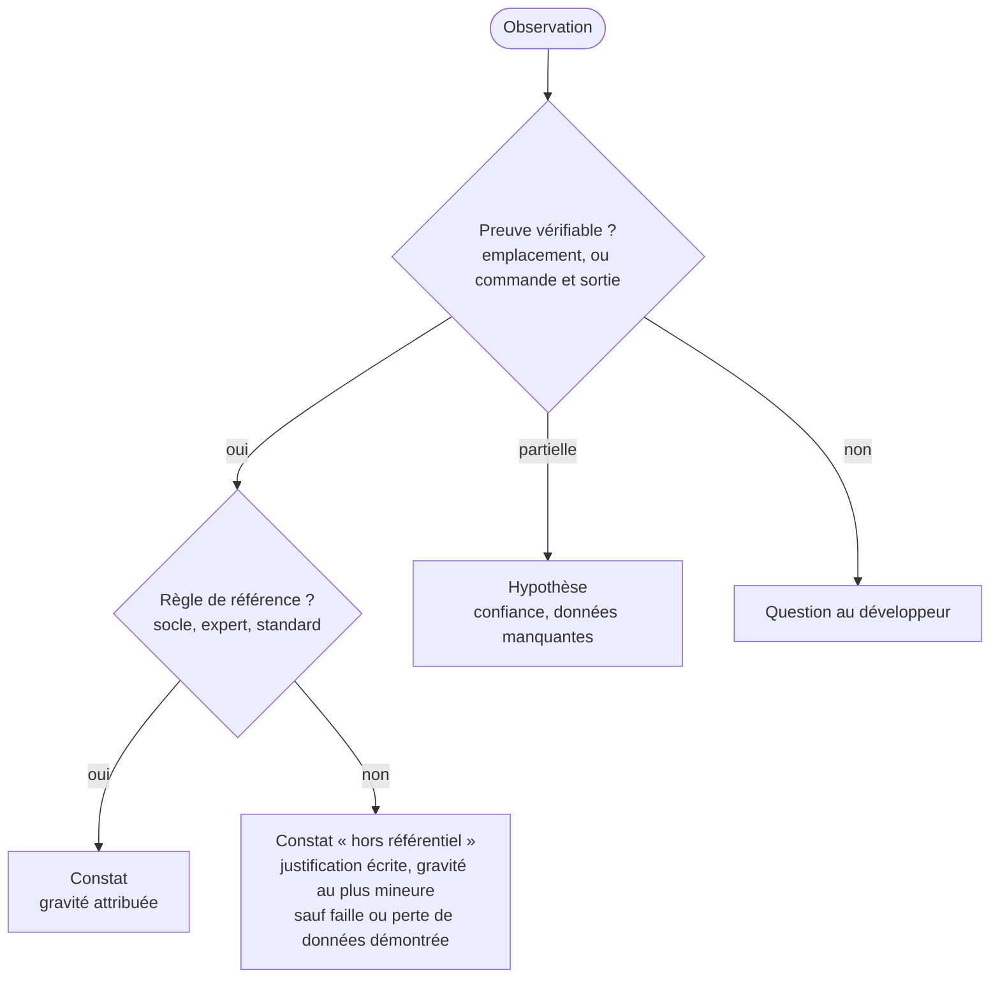

# Module `evaluation` (D3)

L'évaluation transforme la cartographie en constats. Un constat est un fait prouvé, rattaché à une règle. Le reste est une hypothèse ou une question.

## 1. Constat, hypothèse, question



## 2. Format d'un constat

```markdown
#### F07 : open-in-view actif
- **Identifiant stable** : AX7.expert-java:D4.INV-2@back:src/main/resources/application.yml
- **Axe** : AX7 performance
- **Règle** : `expert-java:D4.INV-2` (expert-java 1.1.0)
- **Gravité** : majeur
- **Preuve** : `application.yml` ne définit pas `spring.jpa.open-in-view` ; la valeur par défaut est `true`,
  et le journal de démarrage fourni (S4, ligne 37) contient l'avertissement correspondant.
- **Impact** : connexions JDBC conservées pendant le rendu de la réponse ; requêtes paresseuses cachées.
- **Portée** : tout le back.
```

L'identifiant stable est défini au module `rapport` (§ 5). `F07` est l'identifiant d'affichage, attribué par tri.

## 3. Gravité et confiance

| Gravité | Critère |
|---|---|
| **Bloquant** | faille de sécurité exploitable, perte ou corruption de données possible, barrière d'accessibilité qui empêche une tâche, version sans aucun support (ni open source ni commercial souscrit) exposée sur internet |
| **Majeur** | invariant du socle ou d'un expert violé, défaut visible en production, version dont le support open source a pris fin |
| **Mineur** | écart de convention, dette sans effet immédiat |
| **Info** | fait notable sans défaut (bonne pratique observée, élément à surveiller) |

| Confiance d'une hypothèse | Critère |
|---|---|
| élevée | indices convergents, une seule donnée manque pour conclure |
| moyenne | indices partiels |
| faible | intuition fondée sur un motif fréquent, sans indice direct |

## 4. Les dix axes

| Axe | Ce qui est évalué | Références principales |
|---|---|---|
| **AX1** socle back-front | contrat, erreurs, formats, pagination, sécurité de la frontière, traçabilité | socle SC1 à SC6 |
| **AX2** architecture back | couches, dépendances, cycles, injection | expert-java D1 |
| **AX3** architecture front | standalone, couches, frontières, TypeScript strict | expert-angular D1 |
| **AX4** qualité du code | langage, composants, gestion d'erreurs, lisibilité, duplication | expert-java D2, D3 ; expert-angular D2, D3, D4 |
| **AX5** tests et contrôles | présence, niveau, pertinence, exécution en CI | expert-java D6 ; expert-angular D7 |
| **AX6** sécurité | authentification, autorisation, secrets, injection, XSS, CSRF, CORS, dépendances vulnérables | socle SC4 ; expert-java D5 ; expert-angular D5 |
| **AX7** performance | N+1, pagination, index, taille des bundles, chargement à la demande, détection de changement | expert-java D4 ; expert-angular D2, D5 |
| **AX8** accessibilité | RGAA 4.1, WCAG 2.2 AA : outillage, titres, focus, formulaires, annonces | socle SC6 ; expert-angular D4, D6 |
| **AX9** versions et dette | état de support des versions, dépendances obsolètes, API dépréciées, préparation des migrations | expert-java E1 à E4, D8 ; expert-angular E1 à E5, D9 |
| **AX10** exploitation | journaux, traçabilité, configuration par environnement, conteneurs, CI/CD, migrations en déploiement | socle SC5 ; expert-java D4, D5 |

## 5. État d'un axe

L'état d'un axe découle de ses constats, sans appréciation libre :

| État | Règle |
|---|---|
| **critique** | au moins un constat bloquant |
| **à risque** | au moins un constat majeur, aucun bloquant |
| **à surveiller** | uniquement des constats mineurs |
| **satisfaisant** | aucun constat mineur ou plus grave |
| **non évalué** | axe hors options, ou sources manquantes (raison écrite) |
| **échantillonné** | profondeur `survol` : l'état vaut pour l'échantillon décrit |

Aucune note chiffrée globale : une moyenne masquerait un constat bloquant derrière de bons résultats ailleurs.

## 6. Référentiel des invariants des experts

Extrait des skills référencés dans `manifest.json`. Les identifiants sont préfixés par le nom du skill (`expert-java:D4.INV-2`), comme dans les identifiants stables et l'annexe JSON, pour ne pas les confondre avec les invariants de l'analyste. En cas de doute sur la formulation exacte, la version du skill de l'expert fait foi.

**expert-java 1.1.0**

| ID | Règle |
|---|---|
| expert-java:D1.INV-1 | `domain` et `application` ne dépendent ni de `api` ni de Spring Web |
| expert-java:D1.INV-2 | aucune entité JPA exposée par un contrôleur |
| expert-java:D1.INV-3 | injection par constructeur, aucun `@Autowired` sur un champ |
| expert-java:D1.INV-4 | pas de dépendance cyclique entre fonctionnalités |
| expert-java:D2.INV-1 | DTO d'API en `record` |
| expert-java:D2.INV-2 | `Optional` jamais en champ ni en paramètre |
| expert-java:D2.INV-3 | avec threads virtuels, aucun `synchronized` autour d'une E/S bloquante |
| expert-java:D2.INV-4 | aucune exception avalée |
| expert-java:D3.INV-1 | API conforme au contrat OpenAPI |
| expert-java:D3.INV-2 | entrées validées par Bean Validation |
| expert-java:D3.INV-3 | un seul gestionnaire de Problem Details, avec `code` et `traceId` |
| expert-java:D3.INV-4 | collections paginées avec taille maximale |
| expert-java:D4.INV-1 | schéma par migrations versionnées (Flyway ou Liquibase), `ddl-auto=validate`, migrations jamais modifiées |
| expert-java:D4.INV-2 | `open-in-view` désactivé |
| expert-java:D4.INV-3 | transactions dans la couche `application`, lectures en `readOnly` |
| expert-java:D4.INV-4 | aucune requête construite par concaténation |
| expert-java:D4.INV-5 | tests de persistance sur PostgreSQL, jamais en mémoire |
| expert-java:D4.INV-6 | `@Version` sur les entités modifiées de façon concurrente |
| expert-java:D5.INV-1 | chaîne de sécurité qui refuse par défaut |
| expert-java:D5.INV-2 | 401 et 403 de la chaîne en Problem Details |
| expert-java:D5.INV-3 | Actuator : seuls `health` et `info` publics |
| expert-java:D5.INV-4 | aucun secret ni donnée personnelle non nécessaire dans les journaux |
| expert-java:D6.INV-1 | chaque invariant a un contrôle |
| expert-java:D6.INV-2 | tests unitaires sans contexte Spring |
| expert-java:D6.INV-3 | pas de `@MockBean` ni `@SpyBean` |
| expert-java:D6.INV-4 | tests indépendants de l'heure, de l'ordre et du réseau public |

**expert-angular 1.0.0**

| ID | Règle |
|---|---|
| expert-angular:D1.INV-1 | composants autonomes, aucun nouveau `NgModule` |
| expert-angular:D1.INV-2 | couches respectées, pas d'import entre fonctionnalités |
| expert-angular:D1.INV-3 | `strict` et `strictTemplates` |
| expert-angular:D2.INV-1 | composants en OnPush |
| expert-angular:D2.INV-2 | flux de contrôle intégré, `track` stable |
| expert-angular:D2.INV-3 | `input()`, `output()`, `model()` dans les nouveaux composants |
| expert-angular:D2.INV-4 | aucun abonnement sans `takeUntilDestroyed` sur un flux infini |
| expert-angular:D2.INV-5 | `effect` n'écrit pas dans un signal pour dériver une valeur |
| expert-angular:D3.INV-1 | appels d'API uniquement par le client généré |
| expert-angular:D3.INV-2 | erreurs converties en un point, décisions sur `status` et `code` |
| expert-angular:D3.INV-3 | aucune requête depuis la couche `ui` |
| expert-angular:D3.INV-4 | aucun calcul monétaire flottant |
| expert-angular:D4.INV-1 | formulaires réactifs typés |
| expert-angular:D4.INV-2 | erreurs du back rattachées aux champs |
| expert-angular:D4.INV-3 | libellés associés, erreurs liées par `aria-describedby` |
| expert-angular:D5.INV-1 | fonctionnalités chargées à la demande |
| expert-angular:D5.INV-2 | pas de contournement de l'assainissement sans justification |
| expert-angular:D5.INV-3 | jeton hors URL, hors `localStorage`, envoyé à l'origine de l'API seulement |
| expert-angular:D5.INV-4 | les gardes ne sont jamais la seule protection |
| expert-angular:D6.INV-1 | lint d'accessibilité des templates sans erreur |
| expert-angular:D6.INV-2 | aucune violation axe A et AA sur les parcours testés |
| expert-angular:D6.INV-3 | titre et focus mis à jour à chaque navigation |
| expert-angular:D6.INV-4 | messages dynamiques annoncés |
| expert-angular:D7.INV-1 | chaque invariant a un contrôle |
| expert-angular:D7.INV-2 | aucune requête réseau réelle en test unitaire |
| expert-angular:D7.INV-3 | sélection par rôle, libellé ou harnais |
| expert-angular:D7.INV-4 | tests indépendants de l'heure et des délais réels |

Un projet existant n'a pas été écrit avec ces skills : un écart n'est pas une faute de l'équipe, c'est une distance à la cible. Le rapport le formule ainsi.

## 7. Méthode par axe

Pour chaque axe retenu :

1. lister les règles de référence applicables au périmètre ;
2. pour chaque règle, chercher la preuve de conformité ou d'écart (commande, fichier) ;
3. écrire les constats, puis les hypothèses et les questions ;
4. calculer l'état de l'axe (§ 5) ;
5. noter l'échantillon si la profondeur est `survol`.

## 8. Pièges connus

- **Projeter les règles d'un expert sans nuance** : une règle comme `expert-angular:D2.INV-3` vise les nouveaux composants. Un ancien composant avec `@Input` est une dette (AX9), pas une violation.
- **Gravité gonflée** : « majeur » doit se justifier par le critère du § 3, pas par l'insistance.
- **Outil automatique pris pour preuve complète** : un rapport axe sans violation ne prouve pas la conformité RGAA ; l'axe AX8 le dit.
- **Version de support citée de mémoire** : toujours vérifiée et sourcée au moment de l'analyse.

## 9. Contrôle de sortie

- Chaque constat a preuve, axe, règle et gravité (D3.INV-1).
- Chaque hypothèse a confiance et données manquantes (D3.INV-2).
- Chaque axe retenu a un état, et les axes non évalués ou échantillonnés le disent (D3.INV-3).
