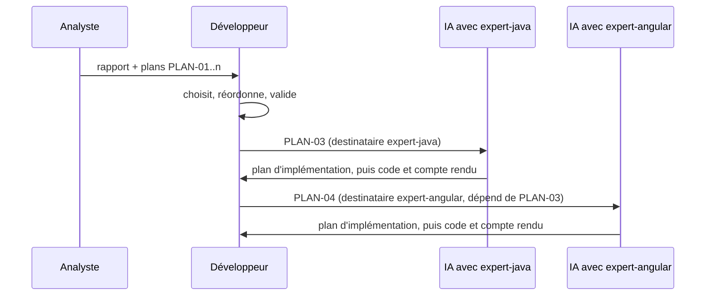
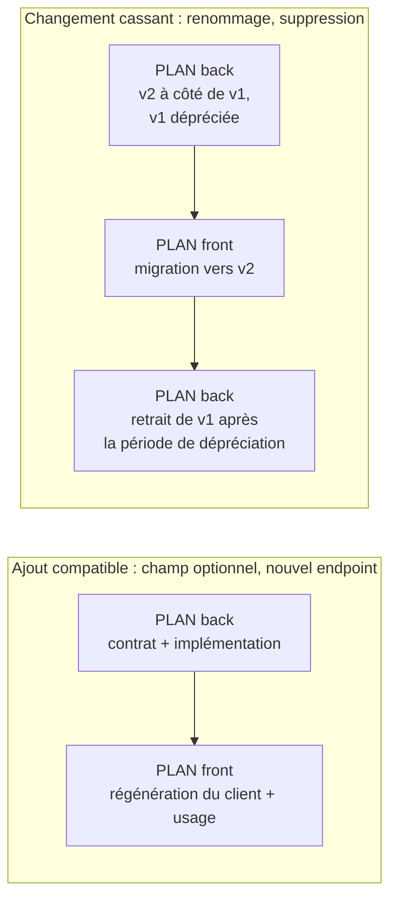

# Module `plans-action` (D5)

En mode `plans`, chaque recommandation de la feuille de route devient un ou plusieurs plans. Un plan est un texte que le développeur peut transmettre tel quel à l'IA qui porte le skill `expert-java` ou `expert-angular`, en mode produire. L'analyste n'exécute aucun plan (D5.INV-3).

## 1. Passage de relais



Le plan ne remplace pas l'étape « proposer le plan, attendre la validation » des experts : il la nourrit. L'expert reste responsable de vérifier le code réel avant d'écrire.

## 2. Format d'un plan

```markdown
### PLAN-03 : Désactiver open-in-view et charger explicitement les relations
- **Destinataire** : expert-java 1.1.0, mode produire
- **Recommandation** : R03 ; **constats** : F07, F12
- **Invariants visés** : `expert-java:D4.INV-2`, `expert-java:D4.INV-3`
- **Dépend de** : PLAN-01 (tests de persistance sur PostgreSQL)
- **Périmètre** : `src/main/resources/application.yml` ; services de `order/application` ;
  dépôts de `order/infrastructure` qui servent les écrans de liste
- **Contexte constaté** : `open-in-view` absent de la configuration (F07) ; boucle de chargement
  paresseux dans `OrderQueries.java#listForCustomer` (F12)
- **Étapes proposées** :
  1. écrire un test qui compte les requêtes du parcours « liste des commandes » (état actuel) ;
  2. définir `spring.jpa.open-in-view: false` ;
  3. corriger chaque `LazyInitializationException` révélée par les tests, par `@EntityGraph`
     ou projection, dans la couche `application` ;
  4. vérifier que le compteur de requêtes du test 1 a diminué.
- **Critères d'acceptation** :
  - le build passe ; aucune `LazyInitializationException` dans les tests ;
  - le test du parcours « liste des commandes » exécute au plus 2 requêtes SQL ;
  - un contrôle vérifie que `spring.jpa.open-in-view` vaut `false` (module `tests` d'expert-java, table des contrôles).
- **Risques** : un écran non couvert par les tests peut échouer à l'exécution ; à vérifier manuellement.
- **Retour arrière** : remettre la propriété à `true` ; les corrections de chargement restent valides.
- **Taille** : M
```

Règles :

- **un seul destinataire** par plan (D5.INV-1). Un chantier qui touche back et front donne deux plans liés ;
- les invariants visés sont ceux du skill destinataire, à la version épinglée dans `manifest.json` ;
- les critères d'acceptation sont vérifiables par une commande ou un test (D5.INV-2) ;
- les étapes sont une proposition : le plan dit « étapes proposées », l'expert peut les adapter en le signalant.

## 3. Changement de contrat (D5.INV-4)

Un changement du contrat OpenAPI touche les deux côtés. L'ordre de livraison doit préserver la compatibilité de la version publiée (socle SC1.INV-2).



Chaque plan lié porte `Dépend de` et `Débloque`, et le rapport présente le groupe dans l'ordre de livraison.

## 4. Inscription dans l'annexe

```json
"plans": [
  {
    "id": "PLAN-03",
    "destinataire": { "skill": "expert-java", "version": "1.1.0", "mode": "produire" },
    "recommandation": "R03",
    "constats": ["F07", "F12"],
    "invariants": ["expert-java:D4.INV-2", "expert-java:D4.INV-3"],
    "dependDe": ["PLAN-01"],
    "debloque": [],
    "taille": "M"
  }
]
```

## 5. Pièges connus

- **Plan qui prescrit le code ligne à ligne** : l'analyste n'a pas l'état exact du code au moment de l'exécution. Il décrit le but, le contexte constaté, les étapes et les critères ; l'expert écrit le code.
- **Plan sans critère vérifiable** : « améliorer la sécurité » n'est pas un critère. « Un appel anonyme sur chaque endpoint protégé reçoit 401 » en est un.
- **Plan à deux destinataires** : interdit ; le scinder.

## 6. Contrôle de sortie

- Chaque plan a un destinataire unique, avec version, et des invariants de ce skill (D5.INV-1).
- Chaque plan a critères d'acceptation vérifiables, risques et retour arrière (D5.INV-2).
- Aucune modification du projet n'a été faite pendant la rédaction des plans (D5.INV-3).
- Chaque changement de contrat a ses plans liés, ordonnés selon le § 3 (D5.INV-4).
- L'annexe `analyse.json` contient tous les plans, avec les mêmes identifiants que le rapport.
