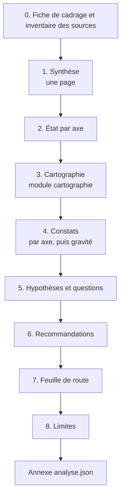
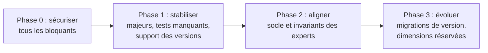

# Module `rapport` (D4)

Le rapport est le livrable du mode `rapport`. Il s'adresse au destinataire choisi au cadrage : la synthèse doit suffire à décider, le reste sert à vérifier.

## 1. Structure



## 2. Synthèse

Une page au plus :

- trois à cinq phrases sur l'état du projet et le risque principal ;
- le tableau d'état par axe ;
- les constats bloquants, nommés un par un ;
- la première phase de la feuille de route.

| Axe | État | Bloquants | Majeurs | Mineurs |
|---|---|---|---|---|
| AX1 socle back-front | à risque | 0 | 2 | 1 |
| AX6 sécurité | critique | 1 | 1 | 0 |
| AX8 accessibilité | à risque | 0 | 3 | 2 |
| AX9 versions et dette | à risque | 0 | 1 | 4 |
| … | … | … | … | … |

## 3. Recommandations (D4.INV-1)

```markdown
#### R03 : Désactiver open-in-view et corriger les chargements qui en dépendaient
- **Constats traités** : F07, F12
- **Effet attendu** : AX7 passe de « à risque » à « à surveiller »
- **Effort** : M
- **Dépend de** : R01 (tests de persistance sur PostgreSQL, pour détecter les régressions)
- **Réversibilité** : élevée (une propriété de configuration)
```

Une recommandation sans constat associé n'est pas admise. Une idée d'amélioration sans constat va dans les « Points conformes notables » ou est écartée.

## 4. Feuille de route (D4.INV-2)

### 4.1 Critères, dans cet ordre

1. **Gravité** du constat le plus grave traité.
2. **Dépendances** : une recommandation qui en débloque d'autres passe avant.
3. **Rapport impact sur effort** : à gravité égale, le plus fort impact pour le plus faible effort d'abord.
4. **Échéances externes** : fin de support d'une version, obligation réglementaire.

Effort exprimé en tailles relatives (`S`, `M`, `L`, `XL`), jamais en jours : l'analyste ne connaît ni l'équipe ni sa vélocité.

### 4.2 Phases



| Phase | Recommandations | Pourquoi dans cet ordre |
|---|---|---|
| 0 | R02 (CORS), R05 (secret dans le dépôt) | bloquants AX6 |
| 1 | R01, R03, R04 | R01 rend R03 sûre ; R04 traite la fin de support |
| … | … | … |

La feuille de route est une proposition : le rapport le dit explicitement, et rappelle les critères pour que le développeur puisse la réordonner en connaissance de cause.

## 5. Identifiants stables et déterminisme (D4.INV-3, point E1)

Identifiant stable d'un constat :

```text
<axe>.<règle>@<dépôt>:<chemin normalisé>[#<symbole>]

AX6.SC4.INV-3@back:src/main/java/com/acme/shared/security/SecurityConfig.java
AX8.expert-angular:D4.INV-3@front:src/app/features/orders/feature/order-form.ts#OrderFormComponent
```

- Pas de numéro de ligne : il change à chaque modification du fichier.
- `#symbole` (classe, méthode, composant) quand un fichier contient plusieurs constats de même règle.
- Un constat qui porte sur tout un dépôt utilise le chemin `*`.

Identifiant d'affichage (`F01`, `F02`…) : attribué après tri des constats par axe, puis gravité décroissante, puis identifiant stable (ordre lexicographique). Même tri pour les recommandations (`R01`…). Deux exécutions sur les mêmes sources produisent donc les mêmes numéros.

## 6. Annexe `analyse.json` (D4.INV-4, points E2 et E3)

```json
{
  "schemaVersion": 1,
  "generatedAt": "2026-10-16T14:00:00Z",
  "skill": { "name": "expert-analyse-projet", "version": "1.0.0" },
  "references": { "socle-back-front": "1.0.0", "expert-java": "1.0.0", "expert-angular": "1.0.0" },
  "cadrage": {
    "mode": "rapport",
    "perimetre": "projet",
    "axes": ["AX1", "AX2", "AX3", "AX4", "AX5", "AX6", "AX7", "AX8", "AX9", "AX10"],
    "profondeur": "survol"
  },
  "sources": [
    { "id": "S1", "nature": "depot", "nom": "acme-api", "revision": "9f2c1e7", "lecture": "complete" },
    { "id": "S2", "nature": "depot", "nom": "acme-web", "revision": "41ab0d3", "lecture": "echantillon" }
  ],
  "axes": [
    { "id": "AX7", "etat": "a_risque", "echantillon": null }
  ],
  "constats": [
    {
      "id": "F07",
      "stableId": "AX7.expert-java:D4.INV-2@back:src/main/resources/application.yml",
      "axe": "AX7",
      "regle": "expert-java:D4.INV-2",
      "gravite": "majeur",
      "preuve": { "source": "S1", "emplacement": "src/main/resources/application.yml", "extrait": "propriété absente" },
      "impact": "Connexions JDBC conservées pendant le rendu ; requêtes paresseuses cachées."
    }
  ],
  "hypotheses": [
    { "id": "H01", "axe": "AX7", "enonce": "…", "confiance": "moyenne", "manque": "journal de requêtes SQL sous charge" }
  ],
  "recommandations": [
    { "id": "R03", "constats": ["F07", "F12"], "effort": "M", "dependDe": ["R01"], "phase": 1 }
  ],
  "plans": []
}
```

Valeurs fermées : `gravite` ∈ `bloquant`, `majeur`, `mineur`, `info` ; `etat` ∈ `critique`, `a_risque`, `a_surveiller`, `satisfaisant`, `non_evalue`, `echantillonne` ; `lecture` ∈ `complete`, `echantillon`, `non_lue` ; `effort` ∈ `S`, `M`, `L`, `XL`. Le champ `plans` est rempli en mode `plans` (module `plans-action`). Les extraits ne contiennent jamais de secret.

## 7. Limites

Section obligatoire : sources non lues, axes non évalués, échantillons, commandes non exécutées et pourquoi. Un lecteur doit savoir ce que le rapport ne couvre pas.

## 8. Contrôle de sortie

- Chaque recommandation renvoie à au moins un constat (D4.INV-1).
- La feuille de route expose ses critères et se présente comme une proposition (D4.INV-2).
- Les identifiants suivent le § 5 ; un second tri des constats ne change rien (D4.INV-3).
- L'annexe est un JSON valide, conforme au § 6, cohérent avec le rapport (mêmes identifiants, mêmes nombres) (D4.INV-4).
- Aucun secret n'apparaît dans le rapport ni l'annexe.
