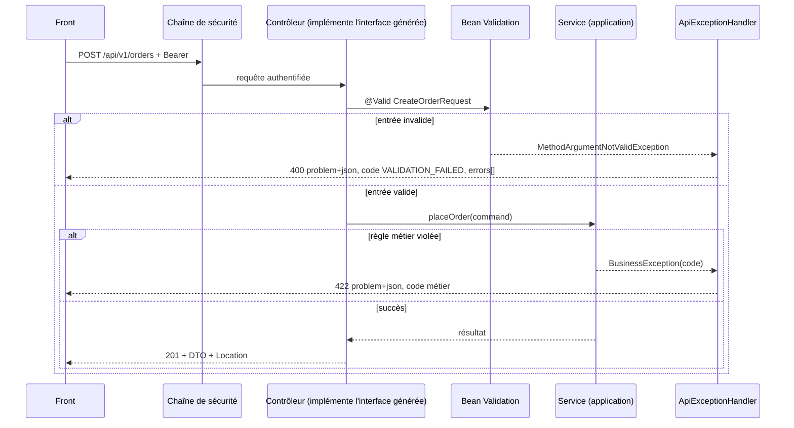

# Module `api-rest` (D3)

Ce module applique côté Spring les dimensions SC1 à SC3 du socle. Il ne redéfinit pas le socle : il dit comment le respecter avec Spring Boot 3.5.

## 1. Chaîne d'une requête



## 2. Contrat d'abord

Le contrat `api/openapi.yaml` est la source de vérité (SC1). Il génère les interfaces Java, que les contrôleurs implémentent. Une divergence de signature devient une erreur de compilation.

```xml
<plugin>
  <groupId>org.openapitools</groupId>
  <artifactId>openapi-generator-maven-plugin</artifactId>
  <version>${openapi-generator.version}</version>   <!-- centralisée, point E4 -->
  <executions>
    <execution>
      <goals><goal>generate</goal></goals>
      <configuration>
        <inputSpec>${project.basedir}/api/openapi.yaml</inputSpec>
        <generatorName>spring</generatorName>
        <apiPackage>com.acme.app.api.generated</apiPackage>
        <modelPackage>com.acme.app.api.generated.model</modelPackage>
        <configOptions>
          <interfaceOnly>true</interfaceOnly>
          <useSpringBoot3>true</useSpringBoot3>
          <useTags>true</useTags>
          <openApiNullable>false</openApiNullable>
        </configOptions>
      </configuration>
    </execution>
  </executions>
</plugin>
```

Remarques :

- les modèles générés sont des classes, pas des records ; D2.INV-1 s'applique aux DTO écrits à la main. Si le projet génère ses modèles, la règle D2.INV-1 est satisfaite par la génération et notée comme telle en revue ;
- si le projet est en « code d'abord » (annotations springdoc, contrat produit par l'application), l'expert ne le convertit pas sans demande. Il applique alors le test de conformité du paragraphe 7, qui compare le contrat produit au fichier du dépôt.

## 3. Contrôleur

```java
@RestController
public class OrderController implements OrdersApi {      // interface générée

    private final PlaceOrderService placeOrder;
    private final OrderQueries queries;

    public OrderController(PlaceOrderService placeOrder, OrderQueries queries) {
        this.placeOrder = placeOrder;
        this.queries = queries;
    }

    @Override
    public ResponseEntity<OrderDto> createOrder(CreateOrderRequest request) {
        OrderView created = placeOrder.handle(OrderMapper.toCommand(request));   // record de la couche application
        URI location = URI.create("/api/v1/orders/" + created.id());
        return ResponseEntity.created(location).body(OrderMapper.toDto(created));
    }
}
```

Règles :

- la couche `application` ne connaît pas les DTO de l'API (D1.INV-1) : elle reçoit une commande et renvoie un record qui lui est propre (`OrderView`) ; `OrderMapper`, dans `api`, fait les deux conversions ;
- un contrôleur ne contient pas de logique métier : il traduit, délègue et répond ;
- pas de `try/catch` dans un contrôleur : les exceptions remontent au gestionnaire unique ;
- statuts : 201 avec `Location` pour une création, 204 pour une suppression ou une action sans corps, 200 sinon.

## 4. Validation

- `@Valid` sur tout corps de requête ; contraintes Bean Validation sur les paramètres de chemin et de requête (le contrôleur porte alors `@Validated`, ou la génération ajoute les annotations).
- Les règles métier qui dépendent de l'état (stock, statut d'une commande) ne sont pas de la validation d'entrée : elles vivent dans `domain` ou `application` et lèvent une `BusinessException` (422).
- Les messages des contraintes sont en français, dans `ValidationMessages.properties`.

## 5. Gestionnaire d'erreurs unique

`spring.mvc.problemdetails.enabled=true` active les Problem Details pour les exceptions standard de Spring MVC. Le gestionnaire du projet les complète avec `code`, `traceId` et `errors[]` (SC2).

```java
@RestControllerAdvice
public class ApiExceptionHandler extends ResponseEntityExceptionHandler {

    private final Tracer tracer;   // Micrometer Tracing

    public ApiExceptionHandler(Tracer tracer) {
        this.tracer = tracer;
    }

    @ExceptionHandler(BusinessException.class)
    ProblemDetail onBusiness(BusinessException ex) {
        HttpStatus status = (ex instanceof NotFoundException) ? HttpStatus.NOT_FOUND
                          : HttpStatus.UNPROCESSABLE_ENTITY;
        return enrich(ProblemDetail.forStatusAndDetail(status, ex.getMessage()), ex.code());
    }

    @ExceptionHandler(ObjectOptimisticLockingFailureException.class)
    ProblemDetail onConcurrency(ObjectOptimisticLockingFailureException ex) {
        return enrich(ProblemDetail.forStatusAndDetail(HttpStatus.CONFLICT,
                "La ressource a été modifiée entre-temps."), "CONCURRENT_MODIFICATION");
    }

    @ExceptionHandler(Exception.class)
    ProblemDetail onUnexpected(Exception ex) {
        log.error("Erreur inattendue", ex);              // la trace complète reste dans le journal
        return enrich(ProblemDetail.forStatusAndDetail(HttpStatus.INTERNAL_SERVER_ERROR,
                "Une erreur inattendue est survenue."), "INTERNAL_ERROR");   // SC2.INV-3
    }

    @Override
    protected ResponseEntity<Object> handleMethodArgumentNotValid(
            MethodArgumentNotValidException ex, HttpHeaders headers,
            HttpStatusCode status, WebRequest request) {
        ProblemDetail problem = enrich(ProblemDetail.forStatusAndDetail(HttpStatus.BAD_REQUEST,
                "La requête contient " + ex.getErrorCount() + " erreur(s)."), "VALIDATION_FAILED");
        problem.setProperty("errors", ex.getFieldErrors().stream()
                .map(e -> Map.of("field", e.getField(),
                                 "code", String.valueOf(e.getCode()).toUpperCase(Locale.ROOT),
                                 "message", String.valueOf(e.getDefaultMessage())))
                .toList());
        return ResponseEntity.badRequest()
                .contentType(MediaType.APPLICATION_PROBLEM_JSON).body(problem);
    }

    private ProblemDetail enrich(ProblemDetail problem, String code) {
        problem.setType(URI.create("https://errors.acme.example/" + code.toLowerCase(Locale.ROOT)));
        problem.setProperty("code", code);
        Span span = tracer.currentSpan();
        problem.setProperty("traceId", span != null ? span.context().traceId() : "inconnu");
        return problem;
    }

    private static final Logger log = LoggerFactory.getLogger(ApiExceptionHandler.class);
}
```

Les autres exceptions standard (`HttpMessageNotReadableException`, `MissingServletRequestParameterException`, etc.) sont produites par `ResponseEntityExceptionHandler`. Pour leur ajouter `code` et `traceId`, surcharger `handleExceptionInternal` et appeler `enrich` sur le `ProblemDetail` du corps.

Les erreurs 401 et 403 levées par la chaîne de sécurité **ne passent pas** par ce gestionnaire : voir le module `securite` (D5.INV-2).

## 6. Pagination

```java
@Configuration
@EnableSpringDataWebSupport(pageSerializationMode = PageSerializationMode.VIA_DTO)
class WebConfig {}
```

```yaml
spring:
  data:
    web:
      pageable:
        max-page-size: 100      # SC3.INV-3
        default-page-size: 20
```

Le mode `VIA_DTO` (Spring Data 3.3 et plus) sérialise un `Page` sous la forme stable `{ "content": [...], "page": { "size", "number", "totalElements", "totalPages" } }`, qui est exactement celle du socle. Sérialiser directement un `PageImpl` donne une structure instable, signalée par un avertissement au démarrage.

Avec des interfaces générées, déclarer dans le contrat un schéma `PagedXxx` conforme au socle et le construire explicitement dans le contrôleur.

## 7. Test de conformité au contrat (D3.INV-1)

En contrat d'abord, la compilation vérifie les signatures. Il reste à vérifier qu'aucun endpoint **non décrit** n'est exposé :

```java
@SpringBootTest
@AutoConfigureMockMvc
class ContractConformanceTest {

    @Autowired RequestMappingHandlerMapping mappings;

    @Test
    void chaqueEndpointExposeFigureDansLeContrat() throws Exception {
        Set<String> contrat = OpenApiPaths.read(Path.of("api/openapi.yaml"));   // "GET /api/v1/orders/{id}"
        Set<String> exposes = mappings.getHandlerMethods().keySet().stream()
                .flatMap(info -> OpenApiPaths.fromMapping(info).stream())
                .filter(p -> p.contains(" /api/"))
                .collect(Collectors.toSet());
        assertThat(exposes).isEqualTo(contrat);
    }
}
```

`OpenApiPaths` est un utilitaire de test du projet (lecture YAML, normalisation des méthodes et des variables de chemin). Le test injecte un champ avec `@Autowired`, ce qui est admis dans les tests : la règle D1.INV-3 est vérifiée sur le code de production uniquement (`ImportOption.DoNotIncludeTests`).

## 8. Pièges connus

- **`@ExceptionHandler(Exception.class)` qui capture `AccessDeniedException`** levée par `@PreAuthorize` : elle deviendrait un 500. Ajouter un gestionnaire explicite pour `AccessDeniedException` (403) et `AuthenticationException` (401), conformes au socle.
- **`ResponseEntity<Map<String, Object>>`** en retour : contourne le contrat. Toujours un DTO typé.
- **Énumérations Java sérialisées par leur `ordinal`** : jamais ; nom en MAJUSCULES (socle SC1).
- **Dates** : `spring.jackson.serialization.write-dates-as-timestamps=false` est le comportement par défaut de Spring Boot ; ne pas le changer (SC3.INV-1).

## 9. Grille de revue

| Point | Question | Invariant |
|---|---|---|
| R1 | Un endpoint est-il absent du contrat, ou un endpoint du contrat non implémenté ? | D3.INV-1, SC1.INV-1 |
| R2 | Un corps de requête est-il reçu sans `@Valid` ? | D3.INV-2 |
| R3 | Une erreur sort-elle sans `code` ou sans `traceId`, ou ailleurs que par le gestionnaire unique ? | D3.INV-3, SC2.INV-1 |
| R4 | Une réponse 500 contient-elle un message technique ? | SC2.INV-3 |
| R5 | Une collection est-elle renvoyée sans pagination ou sans taille maximale ? | D3.INV-4, SC3.INV-3 |
| R6 | Le contrat change-t-il de façon cassante dans `v1` ? | SC1.INV-2 |
