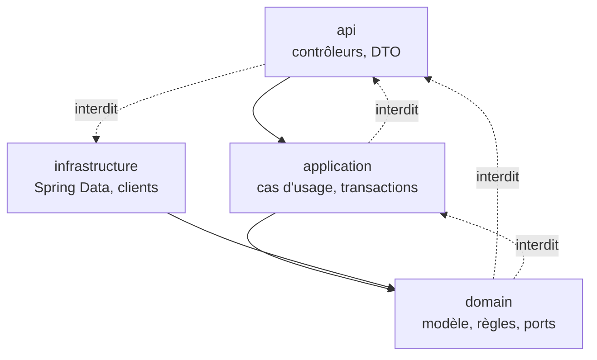

# Module `architecture` (D1)

Ce module fixe où chaque classe doit se trouver et de quoi elle a le droit de dépendre. Les règles sont vérifiées par ArchUnit : une violation fait échouer le build, elle ne dépend pas de la vigilance d'un relecteur.

## 1. Organisation par fonctionnalité, puis par couche

Le code est d'abord découpé par fonctionnalité métier, puis, à l'intérieur de chacune, par couche.

```text
src/main/java/com/acme/app/
├── Application.java
├── shared/                         transverse : configuration, erreurs, sécurité, utilitaires
│   ├── config/                     JacksonConfig (E2), propriétés typées
│   ├── error/                      ApiExceptionHandler (D3), exceptions de base
│   └── security/                   SecurityConfig (D5)
└── order/                          une fonctionnalité métier
    ├── api/                        contrôleurs, DTO (records), mappers DTO ↔ domaine
    ├── application/                services de cas d'usage, frontières transactionnelles
    ├── domain/                     modèle métier, entités, règles, ports (interfaces)
    └── infrastructure/             dépôts Spring Data, clients externes, adaptateurs
```

Dans un projet existant organisé par couche (`controller/`, `service/`, `repository/`), la règle de cohérence locale s'applique : l'expert ne réorganise pas sans demande, mais il applique les mêmes règles de dépendance.

## 2. Règles de dépendance



| Couche | Peut dépendre de | Ne dépend jamais de |
|---|---|---|
| `api` | `application`, `domain` (types de lecture), `shared` | `infrastructure` |
| `application` | `domain`, `shared` | `api`, `org.springframework.web..` |
| `domain` | `shared` (exceptions de base) ; annotations JPA tolérées | `api`, `application`, `infrastructure`, `org.springframework.web..` |
| `infrastructure` | `domain`, `shared` | `api` |

Choix pragmatique : les entités JPA vivent dans `domain` et portent leurs annotations. Séparer un modèle de persistance d'un modèle métier double les classes ; ce n'est justifié que si le domaine est riche et instable, et cela se décide avec le développeur.

Les dépôts Spring Data sont déclarés dans `infrastructure`. Si la couche `application` a besoin d'un accès aux données, elle passe par une interface du `domain` (un port) que le dépôt implémente, ou, dans un projet plus simple, utilise directement l'interface du dépôt : ce second choix est accepté et documenté dans le compte rendu.

## 3. Injection de dépendances

- Injection par constructeur uniquement. Une classe avec un seul constructeur n'a pas besoin d'`@Autowired`.
- Les dépendances sont des champs `private final`.
- Une classe qui reçoit plus de cinq dépendances est un signal de découpage à examiner en revue.

```java
@Service
public class PlaceOrderService {

    private final OrderRepository orders;
    private final Clock clock;

    public PlaceOrderService(OrderRepository orders, Clock clock) {
        this.orders = orders;
        this.clock = clock;
    }
}
```

`Clock` est injecté plutôt qu'appelé statiquement (`Instant.now()`) : les tests fixent l'heure (D6.INV-4).

## 4. Règles ArchUnit

À placer dans `src/test/java/.../ArchitectureTest.java`. ArchUnit n'est pas géré par Spring Boot : sa version est centralisée dans le build (point E4).

```java
@AnalyzeClasses(packages = "com.acme.app", importOptions = ImportOption.DoNotIncludeTests.class)
class ArchitectureTest {

    // D1.INV-1
    @ArchTest
    static final ArchRule domainEtApplicationIndependantsDuWeb = noClasses()
        .that().resideInAnyPackage("..domain..", "..application..")
        .should().dependOnClassesThat()
        .resideInAnyPackage("..api..", "org.springframework.web..");

    // D1.INV-2
    @ArchTest
    static final ArchRule aucuneEntiteDansLesControleurs = noMethods()
        .that().areDeclaredInClassesThat().areAnnotatedWith(RestController.class)
        .should().haveRawReturnType(annotatedWith(Entity.class))
        .orShould().haveRawParameterTypes(DescribedPredicate.describe(
            "un paramètre entité JPA",
            params -> params.stream().anyMatch(p -> p.isAnnotatedWith(Entity.class))));

    // D1.INV-3
    @ArchTest
    static final ArchRule pasDInjectionParChamp = noFields()
        .should().beAnnotatedWith(Autowired.class);

    // D1.INV-4
    @ArchTest
    static final ArchRule fonctionnalitesSansCycle = slices()
        .matching("com.acme.app.(*)..")
        .should().beFreeOfCycles();
}
```

Limite connue de la règle D1.INV-2 : elle ne voit pas une entité enveloppée dans un type générique (`List<Order>`, `ResponseEntity<Order>`). La revue complète ce contrôle (module `revue`, point A2), et le test de conformité au contrat (module `api-rest`) détecte le cas en pratique, car le contrat ne décrit que des DTO.

## 5. Pièges connus

- **Couche `application` qui renvoie des entités au contrôleur** : la conversion en DTO doit se faire avant la sortie de la transaction ou sur des données déjà chargées, sinon une `LazyInitializationException` apparaît (`open-in-view` est désactivé, D4.INV-2).
- **Package `util` fourre-tout** : il finit par dépendre de tout et crée des cycles. Préférer une classe placée dans la fonctionnalité qui l'utilise.
- **Services « God class »** : un service par cas d'usage, ou par agrégat, plutôt qu'un `OrderService` de deux mille lignes.

## 6. Grille de revue (extraits utilisés par le module `revue`)

| Point | Question | Invariant |
|---|---|---|
| A1 | Une classe de `domain` ou `application` importe-t-elle `..api..` ou Spring Web ? | D1.INV-1 |
| A2 | Un contrôleur renvoie-t-il ou reçoit-il une entité, y compris dans un type générique ? | D1.INV-2 |
| A3 | Un champ est-il annoté `@Autowired` ? | D1.INV-3 |
| A4 | Deux fonctionnalités dépendent-elles l'une de l'autre ? | D1.INV-4 |
| A5 | Un service dépasse-t-il cinq dépendances ou plusieurs centaines de lignes ? | hors invariant, signal de découpage |
