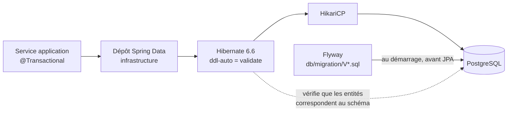
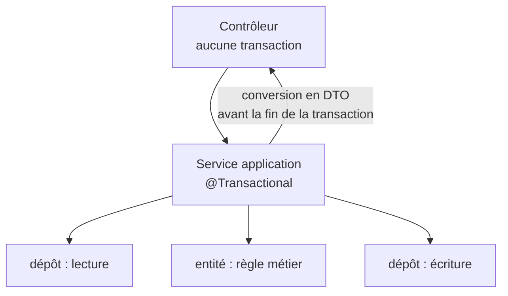

# Module `persistance` (D4)

Ce module fixe comment le back parle à PostgreSQL. Le schéma de la base appartient aux migrations Flyway, jamais à Hibernate.

## 1. Vue d'ensemble



## 2. Configuration minimale

```yaml
spring:
  datasource:
    url: ${DB_URL}
    username: ${DB_USER}
    password: ${DB_PASSWORD}            # jamais en clair dans le dépôt (D5)
  jpa:
    open-in-view: false                 # D4.INV-2
    hibernate:
      ddl-auto: validate                # D4.INV-1
    properties:
      hibernate:
        jdbc:
          time_zone: UTC
  flyway:
    enabled: true
    locations: classpath:db/migration
```

Dépendances : `spring-boot-starter-data-jpa`, `org.postgresql:postgresql`, `org.flywaydb:flyway-core` **et** `org.flywaydb:flyway-database-postgresql` (le support de PostgreSQL est un module séparé depuis Flyway 10).

## 3. Migrations Flyway

```text
src/main/resources/db/migration/
├── V1__create_customer.sql
├── V2__create_purchase_order.sql
├── V3__add_order_status_index.sql
└── V4__add_order_version_column.sql
```

Règles :

- une migration appliquée dans un environnement partagé n'est **jamais** modifiée (D4.INV-1). Une correction est une nouvelle migration. Flyway le contrôle par somme de contrôle ;
- noms de tables et colonnes en `snake_case`, tables au singulier ou au pluriel selon la convention du projet, mais une seule convention ;
- chaque clé étrangère a son index (PostgreSQL ne le crée pas automatiquement) ;
- les migrations longues sur grosse table (`CREATE INDEX`) utilisent `CREATE INDEX CONCURRENTLY`, dans une migration dédiée et non transactionnelle : un fichier de configuration de script placé à côté du script (`V5__add_order_date_index.sql.conf`, contenant `executeInTransaction=false`). Vérifier ce mécanisme dans la documentation de la version de Flyway gérée par le projet ;
- pas de données de test dans `db/migration` : elles vont dans un emplacement réservé aux tests.

```sql
-- V2__create_purchase_order.sql
CREATE TABLE purchase_order (
    id           UUID PRIMARY KEY,
    customer_id  UUID        NOT NULL REFERENCES customer (id),
    status       VARCHAR(32) NOT NULL,
    total_amount NUMERIC(19, 2) NOT NULL,          -- SC3.INV-2 : jamais de flottant
    created_at   TIMESTAMPTZ NOT NULL,             -- SC3.INV-1 : toujours avec fuseau
    version      BIGINT      NOT NULL DEFAULT 0    -- D4.INV-6
);
CREATE INDEX idx_purchase_order_customer ON purchase_order (customer_id);
```

## 4. Correspondance des types

| PostgreSQL | Java | Remarque |
|---|---|---|
| `uuid` | `UUID` | identifiant généré côté application (`UUID.randomUUID()`) ou `@UuidGenerator` |
| `timestamptz` | `Instant` ou `OffsetDateTime` | stocké en UTC ; jamais `timestamp` sans fuseau pour un instant |
| `date` | `LocalDate` | |
| `numeric(p, s)` | `BigDecimal` | précision et échelle explicites |
| `varchar(n)` | `String` ou `enum` avec `@Enumerated(EnumType.STRING)` | jamais `EnumType.ORDINAL` |
| `jsonb` | type dédié ou `Map` avec `@JdbcTypeCode(SqlTypes.JSON)` | Hibernate 6 le gère sans bibliothèque tierce |
| `bigint` | `long` ou `Long` | pour `@Version` |

## 5. Entité

```java
@Entity
@Table(name = "purchase_order")
public class PurchaseOrder {

    @Id
    private UUID id;

    @Column(name = "customer_id", nullable = false)
    private UUID customerId;

    @Enumerated(EnumType.STRING)
    @Column(nullable = false, length = 32)
    private OrderStatus status;

    @Column(name = "total_amount", nullable = false, precision = 19, scale = 2)
    private BigDecimal totalAmount;

    @Column(name = "created_at", nullable = false)
    private Instant createdAt;

    @Version
    private long version;                               // D4.INV-6

    @OneToMany(mappedBy = "order", cascade = CascadeType.ALL, orphanRemoval = true)
    private List<OrderLine> lines = new ArrayList<>();

    protected PurchaseOrder() {}                        // exigé par JPA

    public static PurchaseOrder place(UUID customerId, List<OrderLine> lines, Clock clock) {
        PurchaseOrder order = new PurchaseOrder();
        order.id = UUID.randomUUID();
        order.customerId = customerId;
        order.status = OrderStatus.PLACED;
        order.createdAt = clock.instant();
        lines.forEach(order::addLine);
        order.totalAmount = order.computeTotal();
        return order;
    }

    public void ship() {
        if (status != OrderStatus.PLACED) {
            throw new OrderNotShippableException(id, status);   // 422, code ORDER_NOT_SHIPPABLE
        }
        status = OrderStatus.SHIPPED;
    }
    // addLine, computeTotal, accesseurs en lecture...
}
```

Règles : pas de setters publics sur l'état métier ; les transitions passent par des méthodes qui vérifient les règles. Relations `@ManyToOne` en `FetchType.LAZY` explicitement (la valeur par défaut est `EAGER`).

## 6. Transactions



- `@Transactional` se place sur les services de la couche `application` (D4.INV-3) ; `@Transactional(readOnly = true)` pour les lectures.
- Pas de `@Transactional` sur un contrôleur. Pas d'appel HTTP externe dans une transaction : il garderait une connexion JDBC occupée pendant l'appel.
- Une méthode `@Transactional` appelée depuis la même classe ne crée pas de transaction (proxy Spring contourné).

## 7. Requêtes et N+1

- Lecture d'un agrégat avec ses enfants : `@EntityGraph` ou `JOIN FETCH`.
- Requêtes paramétrées uniquement (D4.INV-4) : paramètres nommés en JPQL, `:param` en SQL natif, jamais de concaténation.
- Pagination avec `JOIN FETCH` sur une collection : Hibernate pagine alors en mémoire et l'annonce par un avertissement ; paginer d'abord les identifiants, puis charger les agrégats.
- Projections (interface ou record) pour les écrans de liste : ne charger que les colonnes affichées.

```java
public interface PurchaseOrderRepository extends JpaRepository<PurchaseOrder, UUID> {

    @EntityGraph(attributePaths = "lines")
    Optional<PurchaseOrder> findWithLinesById(UUID id);

    @Query("""
           select new com.acme.app.order.domain.OrderSummary(o.id, o.status, o.totalAmount, o.createdAt)
           from PurchaseOrder o
           where o.customerId = :customerId
           """)
    Page<OrderSummary> findSummaries(@Param("customerId") UUID customerId, Pageable pageable);
}
```

Pour détecter les N+1 en test, activer `spring.jpa.properties.hibernate.generate_statistics=true` dans un test ciblé et vérifier le nombre de requêtes, ou utiliser une bibliothèque de comptage déjà présente dans le projet.

## 8. Tests de persistance

```java
@DataJpaTest
@AutoConfigureTestDatabase(replace = AutoConfigureTestDatabase.Replace.NONE)
@Testcontainers
class PurchaseOrderRepositoryTest {

    @Container
    @ServiceConnection
    static PostgreSQLContainer<?> postgres = new PostgreSQLContainer<>("postgres:16-alpine");

    @Autowired PurchaseOrderRepository orders;

    @Test
    void chargeLaCommandeAvecSesLignesEnUneRequete() {
        // ... D4, N+1
    }
}
```

- `@ServiceConnection` (Spring Boot 3.1 et plus) configure la source de données à partir du conteneur.
- `@DataJpaTest` exécute les migrations Flyway : le test vérifie donc aussi que les migrations s'appliquent et que `ddl-auto=validate` passe.
- L'image PostgreSQL du test a la même version majeure que la production (D4.INV-5).

## 9. Pièges connus

- **`spring.jpa.open-in-view`** est à `true` par défaut dans Spring Boot, avec un simple avertissement au démarrage. Il doit être désactivé explicitement.
- **`ddl-auto=update`** en dehors d'un prototype : interdit. Le schéma dérive silencieusement des migrations.
- **`saveAll` en boucle sur des milliers d'entités** : activer le traitement par lots (`hibernate.jdbc.batch_size`) et vider le contexte de persistance régulièrement.
- **`@Version` absent** : deux utilisateurs qui modifient la même commande, le dernier écrase le premier sans avertissement.
- **Fuseau horaire** : sans `hibernate.jdbc.time_zone=UTC`, les conversions dépendent du fuseau de la JVM.

## 10. Grille de revue

| Point | Question | Invariant |
|---|---|---|
| P1 | Une migration déjà appliquée est-elle modifiée ? `ddl-auto` est-il autre que `validate` ? | D4.INV-1 |
| P2 | `open-in-view` est-il absent ou à `true` ? | D4.INV-2 |
| P3 | `@Transactional` apparaît-il hors de la couche `application`, ou manque-t-il `readOnly` sur une lecture ? | D4.INV-3 |
| P4 | Une requête est-elle construite par concaténation ? | D4.INV-4 |
| P5 | Un test de dépôt utilise-t-il H2 ou une base en mémoire ? | D4.INV-5 |
| P6 | Une entité modifiée de façon concurrente n'a-t-elle pas de `@Version` ? | D4.INV-6 |
| P7 | Une boucle charge-t-elle une relation paresseuse élément par élément (N+1) ? | hors invariant, performance |
| P8 | Une clé étrangère est-elle sans index ? Un instant en `timestamp` sans fuseau ? Un montant en `double` ? | SC3.INV-1, SC3.INV-2 |
