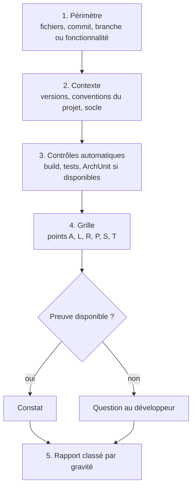

# Module `revue` (D7)

Ce module définit comment l'expert relit du code et ce qu'il remet. Une revue est un livrable : elle doit permettre au développeur de décider sans relire le code lui-même.

## 1. Déroulé



1. **Périmètre** : l'expert écrit ce qu'il relit, et ce qu'il ne relit pas.
2. **Contexte** : versions réelles du projet, conventions en place, présence du contrat OpenAPI.
3. **Contrôles automatiques** : si l'environnement le permet, exécuter le build et les tests. Un échec existant est un constat en soi, signalé avant tout le reste.
4. **Grille** : parcourir les points de la grille consolidée (§ 3). Ne pas inventer de point hors grille sans le marquer « hors invariant ».
5. **Rapport** : format du § 4.

## 2. Gravités

| Gravité | Définition | Exemples |
|---|---|---|
| **Bloquant** | faille de sécurité, perte ou corruption de données possible, violation du socle visible par le front | concaténation SQL, endpoint protégé accessible anonymement, montant en `double`, migration modifiée |
| **Majeur** | invariant du skill violé, ou défaut qui se manifestera en production sous charge | `open-in-view` actif, N+1 sur un écran de liste, `synchronized` autour d'une E/S avec threads virtuels |
| **Mineur** | écart de convention sans risque immédiat | `@MockBean` dans un test, nommage incohérent |
| **Suggestion** | amélioration possible, préférence argumentée | extraction d'une méthode, projection plutôt qu'entité |

Une préférence n'est jamais classée au-dessus de « suggestion ».

## 3. Grille consolidée

| Module | Points | Invariants couverts |
|---|---|---|
| `architecture` | A1 à A5 | D1.INV-1 à D1.INV-4 |
| `langage` | L1 à L5 | D2.INV-1 à D2.INV-4, SC3.INV-2 |
| `api-rest` | R1 à R6 | D3.INV-1 à D3.INV-4, SC1, SC2, SC3 |
| `persistance` | P1 à P8 | D4.INV-1 à D4.INV-6, SC3 |
| `securite` | S1 à S7 | D5.INV-1 à D5.INV-4, SC4 |
| `tests` | T1 à T5 | D6.INV-1 à D6.INV-4 |

Le détail de chaque point est dans son module. L'expert cite le point (`P4`) et l'invariant (`D4.INV-4`) dans chaque constat.

## 4. Format du rapport

```markdown
# Revue : <périmètre>

**Périmètre** : <fichiers, commit ou branche>. **Non relu** : <ce qui est exclu>.
**Contexte** : Java <x>, Spring Boot <x>, PostgreSQL <x>. Build : <passe | échoue | non exécuté, raison>.

## Synthèse

<2 à 4 phrases : état général, nombre de constats par gravité, risque principal.>

| Gravité | Nombre |
|---|---|
| Bloquant | 1 |
| Majeur | 2 |
| Mineur | 3 |
| Suggestion | 1 |

## Constats

### [B1] Requête construite par concaténation
- **Emplacement** : `order/infrastructure/OrderSearch.java:42`
- **Règle** : P4, D4.INV-4
- **Preuve** : `"... where status = '" + status + "'"`
- **Risque** : injection SQL par le paramètre `status`, exposé sans validation.
- **Correction proposée** : paramètre nommé `:status` ; voir le module `persistance`, § 7.

### [M1] ...

## Questions

- <ce que l'expert n'a pas pu établir faute de preuve, formulé comme question>

## Points conformes notables

- <ce qui est bien fait et doit être conservé, en quelques lignes>
```

Les identifiants de constats (`B1`, `M1`, `m1`, `S1`) sont stables dans un même rapport, pour que le développeur puisse répondre « corrige B1 et M2 ».

## 5. Passer de la revue à la correction

- Le développeur choisit les constats à corriger. L'expert repasse en mode produire, propose un plan limité à ces constats, et attend la validation.
- Chaque correction est accompagnée du contrôle qui l'aurait détectée (test ou règle ArchUnit), pour que le défaut ne revienne pas.

## 6. Pièges connus

- **Revue qui réécrit le code** : interdit sans demande (D7.INV-2).
- **Liste plate de 40 remarques** : le développeur ne sait plus quoi faire. Classer, regrouper les constats de même cause, donner le risque principal en synthèse.
- **Constat sans preuve** : « il y a probablement des N+1 » n'est pas un constat. Soit l'expert montre la boucle et la relation paresseuse, soit il pose une question (D7.INV-3).

## 7. Contrôle de sortie

Avant de remettre le rapport, l'expert vérifie :

- chaque constat a emplacement, règle, preuve, risque, correction (D7.INV-1) ;
- aucun fichier du projet n'a été modifié (D7.INV-2) ;
- les constats sont classés par gravité, et les incertitudes sont dans « Questions » (D7.INV-3).
