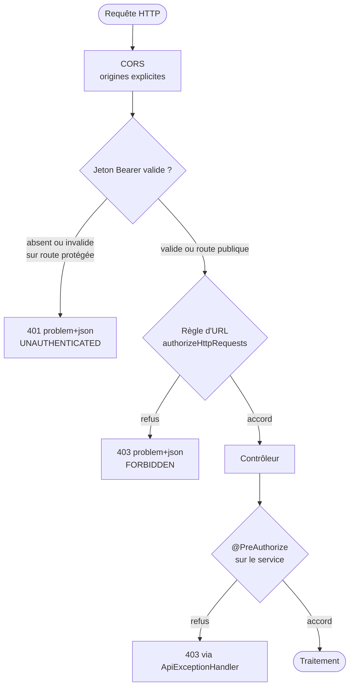

# Module `securite` (D5)

Ce module applique côté Spring la dimension SC4 du socle. L'autorisation est toujours décidée par le back.

## 1. Chaîne de sécurité



## 2. Configuration

```java
@Configuration
@EnableMethodSecurity
public class SecurityConfig {

    @Bean
    SecurityFilterChain api(HttpSecurity http, ProblemAuthenticationEntryPoint entryPoint,
                            ProblemAccessDeniedHandler deniedHandler) throws Exception {
        return http
            .csrf(csrf -> csrf.disable())          // API sans cookie de session ; voir § 4
            .sessionManagement(s -> s.sessionCreationPolicy(SessionCreationPolicy.STATELESS))
            .cors(Customizer.withDefaults())
            .authorizeHttpRequests(auth -> auth
                .requestMatchers("/actuator/health", "/actuator/info").permitAll()   // D5.INV-3
                .requestMatchers(HttpMethod.GET, "/api/v1/catalog/**").permitAll()   // exception publique explicite
                .anyRequest().authenticated())                                        // D5.INV-1
            .oauth2ResourceServer(o -> o
                .jwt(Customizer.withDefaults())
                .authenticationEntryPoint(entryPoint))
            .exceptionHandling(e -> e
                .authenticationEntryPoint(entryPoint)                                 // D5.INV-2
                .accessDeniedHandler(deniedHandler))
            .build();
    }

    @Bean
    CorsConfigurationSource corsConfigurationSource(CorsProperties props) {
        CorsConfiguration cors = new CorsConfiguration();
        cors.setAllowedOrigins(props.allowedOrigins());            // liste explicite, SC4.INV-3
        cors.setAllowedMethods(List.of("GET", "POST", "PUT", "PATCH", "DELETE"));
        cors.setAllowedHeaders(List.of("Authorization", "Content-Type", "traceparent"));
        cors.setExposedHeaders(List.of("Location"));
        UrlBasedCorsConfigurationSource source = new UrlBasedCorsConfigurationSource();
        source.registerCorsConfiguration("/api/**", cors);
        return source;
    }
}
```

```yaml
spring:
  security:
    oauth2:
      resourceserver:
        jwt:
          issuer-uri: ${OIDC_ISSUER_URI}
```

`issuer-uri` permet de découvrir les clés de signature du fournisseur d'identité. Les rôles se lisent dans une revendication du jeton, convertie par un `JwtAuthenticationConverter` adapté au fournisseur (la revendication varie selon Keycloak, Entra ID, etc. : à confirmer avec le développeur).

## 3. Erreurs 401 et 403 conformes au socle

La chaîne de sécurité s'exécute avant Spring MVC : ses erreurs ne passent pas par `@RestControllerAdvice`. Il faut donc produire les Problem Details dans le point d'entrée et le gestionnaire de refus.

```java
@Component
public class ProblemAuthenticationEntryPoint implements AuthenticationEntryPoint {

    private final ProblemWriter writer;   // classe partagée avec ProblemAccessDeniedHandler

    public ProblemAuthenticationEntryPoint(ProblemWriter writer) {
        this.writer = writer;
    }

    @Override
    public void commence(HttpServletRequest request, HttpServletResponse response,
                         AuthenticationException ex) throws IOException {
        writer.write(response, HttpStatus.UNAUTHORIZED, "UNAUTHENTICATED",
                "Authentification requise.", request.getRequestURI());
    }
}
```

`ProblemWriter` construit le même `ProblemDetail` que `ApiExceptionHandler.enrich` (`code`, `traceId`, `type`), le sérialise avec l'`ObjectMapper` de Spring (point E2) et écrit `Content-Type: application/problem+json`. Un seul endroit construit les Problem Details de sécurité.

## 4. Cookies et CSRF

Si le front s'authentifie par cookie de session (par exemple derrière une passerelle qui gère le jeton), désactiver CSRF est une faille. Il faut alors :

- `csrf(c -> c.csrfTokenRepository(CookieCsrfTokenRepository.withHttpOnlyFalse()))` et la gestion de jeton adaptée aux applications monopage décrite dans la documentation Spring Security ;
- côté Angular, `HttpClient` renvoie l'en-tête `X-XSRF-TOKEN` (module `routage-securite` de l'expert Angular).

L'expert demande quel mode d'authentification est utilisé avant de toucher à CSRF.

## 5. Autorisation par méthode

```java
@Service
public class ShipOrderService {

    @Transactional
    @PreAuthorize("hasRole('LOGISTICS')")
    public void ship(UUID orderId) { /* ... */ }
}
```

- Les règles d'URL protègent des zones ; `@PreAuthorize` protège des actions. Les deux se complètent.
- Le contrôle d'appartenance (« cette commande appartient-elle à ce client ? ») se fait dans le service, sur les données chargées, pas seulement sur le rôle.

## 6. Secrets, Actuator et journaux

- Secrets fournis par variables d'environnement ou gestionnaire de secrets ; jamais dans `application.yml` versionné, ni dans un test (D5, SC4.INV-1).
- Actuator : `management.endpoints.web.exposure.include=health,info` ; les autres endpoints sur un port de gestion non exposé, ou authentifiés (D5.INV-3). `health` ne montre pas le détail des composants aux anonymes (`management.endpoint.health.show-details=when-authorized`).
- Journaux : jamais l'en-tête `Authorization`, un jeton, un mot de passe, ni le corps complet d'une requête contenant des données personnelles (D5.INV-4).

## 7. Tests de sécurité

```java
@WebMvcTest(OrderController.class)
@Import({SecurityConfig.class, ProblemAuthenticationEntryPoint.class,
         ProblemAccessDeniedHandler.class, ProblemWriter.class})
class OrderControllerSecurityTest {

    @Autowired MockMvc mvc;
    @MockitoBean PlaceOrderService placeOrder;     // E3
    @MockitoBean OrderQueries queries;
    @MockitoBean JwtDecoder jwtDecoder;            // évite la découverte de l'émetteur réel

    @Test
    void refuseUnAppelAnonymeAvecUnProblemDetail() throws Exception {
        mvc.perform(get("/api/v1/orders/{id}", UUID.randomUUID()))
           .andExpect(status().isUnauthorized())
           .andExpect(content().contentType(MediaType.APPLICATION_PROBLEM_JSON))
           .andExpect(jsonPath("$.code").value("UNAUTHENTICATED"));         // D5.INV-2
    }

    @Test
    void accepteUnAppelAuthentifie() throws Exception {
        mvc.perform(get("/api/v1/orders/{id}", UUID.randomUUID())
                .with(jwt().authorities(new SimpleGrantedAuthority("ROLE_CUSTOMER"))))
           .andExpect(status().isOk());
    }
}
```

`jwt()` vient de `spring-security-test` (`SecurityMockMvcRequestPostProcessors`). Le test exige aussi un bean `Tracer` si `ProblemWriter` en dépend : le fournir par `@MockitoBean` ou par la configuration de test de traçage du projet.

Pour SC4.INV-2, un test paramétré parcourt les endpoints protégés du contrat et vérifie qu'un appel anonyme reçoit 401.

## 8. Pièges connus

- **`WebSecurityConfigurerAdapter`** : supprimé depuis Spring Security 6. Toujours un bean `SecurityFilterChain`.
- **`requestMatchers` trop larges placés avant les plus précis** : l'ordre compte, la première règle qui correspond l'emporte.
- **`permitAll` sur `/error`** oublié : en Spring Boot 3, une erreur interne redirigée vers `/error` peut se transformer en 401. Les Problem Details du gestionnaire unique évitent la plupart de ces cas ; tester une 500 provoquée en appel authentifié.
- **CORS configuré dans Spring MVC seulement** : sans `.cors(...)` dans la chaîne de sécurité, la requête préliminaire `OPTIONS` est refusée avant d'atteindre MVC.

## 9. Grille de revue

| Point | Question | Invariant |
|---|---|---|
| S1 | La chaîne refuse-t-elle par défaut ? Chaque exception publique est-elle explicite et justifiée ? | D5.INV-1, SC4.INV-2 |
| S2 | Les 401 et 403 de la chaîne sont-ils des Problem Details avec `code` et `traceId` ? | D5.INV-2 |
| S3 | Un endpoint Actuator autre que `health` ou `info` est-il public ? | D5.INV-3 |
| S4 | Un secret, un jeton ou une donnée personnelle apparaît-il dans le code, la configuration versionnée ou un journal ? | D5.INV-4, SC4.INV-1 |
| S5 | CORS autorise-t-il `*` avec identifiants, ou une origine non justifiée ? | SC4.INV-3 |
| S6 | CSRF est-il désactivé alors que l'authentification passe par un cookie ? | hors invariant, faille, gravité bloquante |
| S7 | Une action sensible n'est-elle protégée que par une règle d'URL, sans contrôle d'appartenance ? | hors invariant, faille potentielle |
