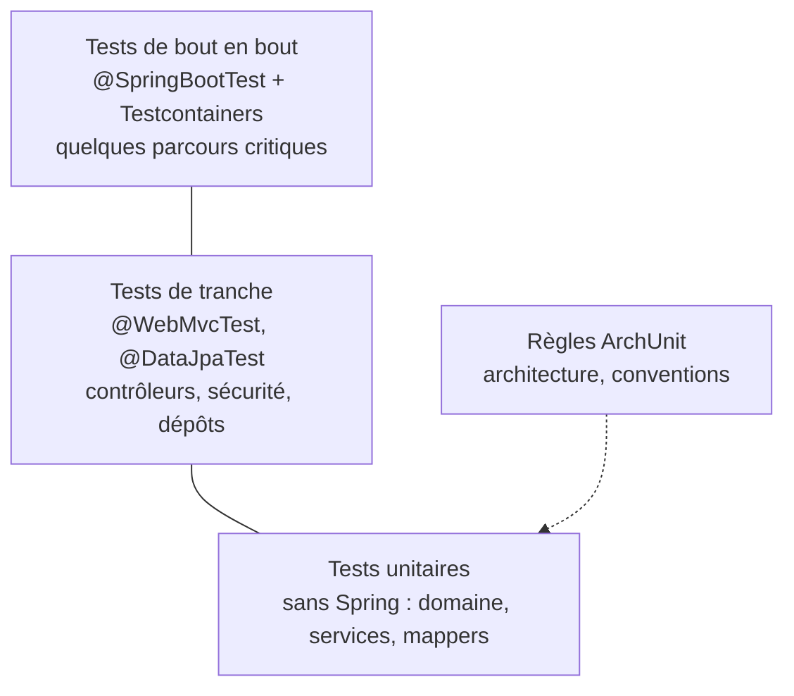

# Module `tests` (D6)

Ce module transforme les invariants du skill en contrôles qui s'exécutent. Il répond à une question : pour chaque règle, qu'est-ce qui échoue si elle est violée ?

## 1. Pyramide



| Niveau | Outil | Démarre Spring ? | Ce qu'il vérifie |
|---|---|---|---|
| Unitaire | JUnit 5, AssertJ, Mockito | non (D6.INV-2) | règles métier, services avec dépendances simulées |
| Tranche web | `@WebMvcTest`, `MockMvc`, `spring-security-test` | partiellement | sérialisation, validation, Problem Details, sécurité |
| Tranche données | `@DataJpaTest`, Testcontainers | partiellement | requêtes, migrations, mapping, N+1 |
| Intégration | `@SpringBootTest`, Testcontainers | entièrement | parcours critiques, conformité au contrat |
| Architecture | ArchUnit | non | règles de dépendance et conventions |

## 2. Test unitaire sans Spring

```java
class PlaceOrderServiceTest {

    private final PurchaseOrderRepository orders = mock(PurchaseOrderRepository.class);
    private final Clock clock = Clock.fixed(Instant.parse("2026-10-16T10:00:00Z"), ZoneOffset.UTC);
    private final PlaceOrderService service = new PlaceOrderService(orders, clock);

    @Test
    void calculeLeTotalEnBigDecimalSansPerteDePrecision() {
        var command = new PlaceOrderCommand(CUSTOMER_ID, List.of(
                new LineCommand(PRODUCT_A, 3, new BigDecimal("19.99"))));

        OrderView result = service.handle(command);

        assertThat(result.totalAmount()).isEqualByComparingTo("59.97");
    }
}
```

`Clock.fixed` rend le test indépendant de l'heure réelle (D6.INV-4). `isEqualByComparingTo` compare la valeur d'un `BigDecimal` sans tenir compte de l'échelle.

## 3. Tranche web

```java
@WebMvcTest(OrderController.class)
@Import({SecurityConfig.class, ApiExceptionHandler.class})
class OrderControllerTest {

    @Autowired MockMvc mvc;
    @MockitoBean PlaceOrderService placeOrder;     // E3, D6.INV-3
    @MockitoBean OrderQueries queries;
    @MockitoBean Tracer tracer;

    @Test
    void renvoieUneErreurDeValidationRattacheeAuChamp() throws Exception {
        mvc.perform(post("/api/v1/orders").with(jwt())
                .contentType(MediaType.APPLICATION_JSON)
                .content("""
                         { "customerId": null, "lines": [] }
                         """))
           .andExpect(status().isBadRequest())
           .andExpect(content().contentType(MediaType.APPLICATION_PROBLEM_JSON))
           .andExpect(jsonPath("$.code").value("VALIDATION_FAILED"))
           .andExpect(jsonPath("$.errors[*].field", hasItems("customerId", "lines")));   // SC6.INV-1, côté back
    }
}
```

`@MockitoBean` vient de `org.springframework.test.context.bean.override.mockito` (Spring Framework 6.2). Il remplace `@MockBean`, déprécié depuis Spring Boot 3.4.

## 4. Correspondance invariants vers contrôles

C'est la table que l'expert complète dans son compte rendu (D6.INV-1). Un invariant sans ligne n'est pas couvert.

| Invariant | Contrôle | Type |
|---|---|---|
| D1.INV-1 à D1.INV-4 | `ArchitectureTest` | ArchUnit |
| D2.INV-1 | règle ArchUnit : classes de `..api..` hors `generated` suffixées `Request` ou `Response` sont des records | ArchUnit |
| D2.INV-2 | règle ArchUnit : aucun champ de type `Optional` ; aucun paramètre `Optional` | ArchUnit |
| D2.INV-3 | revue (point L3) et `-Djdk.tracePinnedThreads=full` dans les tests de charge | revue |
| D2.INV-4 | revue (point L4) ; analyse statique si présente dans le projet | revue |
| D3.INV-1 | `ContractConformanceTest` | intégration |
| D3.INV-2, D3.INV-3 | tests de tranche web sur un cas invalide et un cas métier | tranche web |
| D3.INV-4 | test vérifiant qu'une demande `size=1000` est ramenée au maximum | tranche web |
| D4.INV-1 | `@DataJpaTest` (migrations appliquées, `validate` passe) et sommes de contrôle vérifiées par Flyway ou Liquibase | tranche données |
| D4.INV-2 | test de propriété : `spring.jpa.open-in-view` vaut `false` dans le contexte | intégration |
| D4.INV-3 | règle ArchUnit : `@Transactional` uniquement sur des classes de `..application..` | ArchUnit |
| D4.INV-4 | revue (point P4) | revue |
| D4.INV-5 | règle de build : aucune dépendance H2 ou HSQLDB en portée de test | build |
| D4.INV-6 | test de concurrence : deux mises à jour concurrentes, la seconde reçoit 409 | intégration |
| D5.INV-1 à D5.INV-3 | tests de sécurité (module `securite`, § 7) | tranche web |
| D5.INV-4 | revue (point S4) ; recherche de motifs de secrets en CI si présente | revue |
| D6.INV-3 | règle ArchUnit : aucun usage de `MockBean` ni `SpyBean` dans les tests | ArchUnit sur les tests |
| D6.INV-4 | revue ; `Clock` injecté vérifié par la règle « aucun appel à `Instant.now()` hors `shared.config` » | ArchUnit |

Exemple de règle sur les tests (importer les classes de test pour ce fichier seulement) :

```java
@AnalyzeClasses(packages = "com.acme.app", importOptions = ImportOption.OnlyIncludeTests.class)
class TestConventionsTest {

    @ArchTest   // D6.INV-3
    static final ArchRule pasDeMockBean = noFields()
        .should().beAnnotatedWith("org.springframework.boot.test.mock.mockito.MockBean")
        .orShould().beAnnotatedWith("org.springframework.boot.test.mock.mockito.SpyBean");
}
```

## 5. Testcontainers

- Une seule définition de conteneur PostgreSQL, réutilisée : une classe de configuration de test avec `@Bean @ServiceConnection PostgreSQLContainer<?>`, importée par les tests qui en ont besoin, plutôt qu'un conteneur par classe.
- Version d'image alignée sur la production (D4.INV-5).
- Les tests exigent Docker. Si Docker n'est pas disponible, l'expert le signale ; il ne remplace jamais PostgreSQL par H2 pour faire passer le build.

## 6. Pièges connus

- **`@SpringBootTest` partout** : lent, et masque les dépendances réelles. Réserver aux parcours critiques.
- **Tests qui partagent un état en base** : chaque test prépare et nettoie ses données, ou s'exécute dans une transaction annulée (`@DataJpaTest` le fait par défaut).
- **Assertions sur des messages en français** : fragiles. Tester `code` et `status`, pas `detail` (socle SC2.INV-2, appliqué aussi aux tests).
- **Contexte Spring recréé à chaque classe** : chaque combinaison différente de `@MockitoBean` crée un nouveau contexte. Regrouper les tests de tranche qui partagent la même configuration.

## 7. Grille de revue

| Point | Question | Invariant |
|---|---|---|
| T1 | Un invariant touché par la modification est-il sans contrôle ? | D6.INV-1 |
| T2 | Un test unitaire de domaine ou de service démarre-t-il Spring ? | D6.INV-2 |
| T3 | `@MockBean` ou `@SpyBean` apparaît-il ? | D6.INV-3 |
| T4 | Un test dépend-il de l'heure réelle, de l'ordre d'exécution ou d'un service externe réel ? | D6.INV-4 |
| T5 | Un test vérifie-t-il un texte lisible plutôt qu'un code stable ? | SC2.INV-2 |
