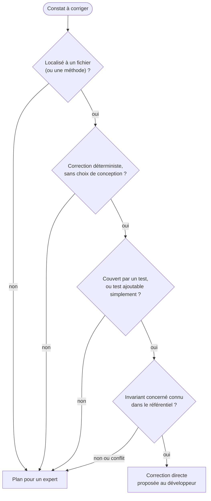
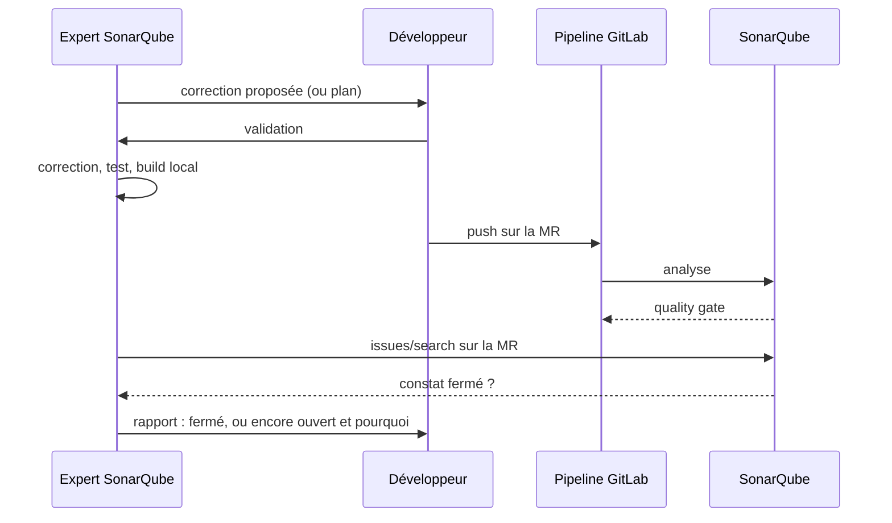

# Module `correction` (D4)

Le développeur choisit, constat par constat ou par lot, entre une correction directe par l'expert SonarQube et un plan confié à l'expert Java ou Angular. L'expert SonarQube propose le mode adapté ; il ne corrige directement que ce qui satisfait D4.INV-1.

## 1. Choisir le mode



| Exemples de correction directe | Exemples de plan |
|---|---|
| injection par champ remplacée par un constructeur (`java:S6813`) | requête construite dynamiquement à refondre en critères typés |
| `Optional.get()` remplacé par `orElseThrow` avec exception métier (`java:S3655`) | duplication entre plusieurs services, à factoriser |
| bloc `catch` vide complété par une traduction en exception métier (`java:S108`) | complexité cognitive d'un service à découper |
| mot de passe en dur remplacé par une propriété externe (`java:S2068`) | composant Angular sans OnPush dont l'état n'est pas en signaux |
| image sans alternative (`Web:ImgWithoutAltCheck`) | révision de la configuration CORS d'un environnement |

## 2. Correction directe

Procédure, dans cet ordre :

1. Proposer : constat (clé, règle, emplacement), correction envisagée, invariant visé dans le référentiel (`expert-java:D1.INV-3`), test qui la couvre. Attendre la validation.
2. Lire le code réel autour du constat, et les conventions du projet.
3. Corriger, en respectant les invariants du référentiel concerné et du socle (D4.INV-2). Une correction qui violerait un autre invariant n'est pas une correction : l'expert passe en plan.
4. Ajouter ou ajuster le test.
5. Exécuter le build et les tests du module concerné.
6. Indiquer comment vérifier la fermeture : le constat disparaît à la prochaine analyse de la MR (D4.INV-4). Si l'analyse est lancée par la CI, l'expert relit l'API après le pipeline.

Exemple (`java:S6813`, `expert-java:D1.INV-3`) :

```java
// Avant
@Service
public class InvoiceService {
    @Autowired
    private InvoiceRepository invoices;
}

// Après
@Service
public class InvoiceService {
    private final InvoiceRepository invoices;

    public InvoiceService(InvoiceRepository invoices) {
        this.invoices = invoices;
    }
}
```

Un lot de corrections directes d'une même règle forme un seul commit, dont le message cite la règle et l'invariant : `fix(sonar): injection par constructeur (java:S6813, expert-java D1.INV-3)`.

## 3. NOSONAR et SuppressWarnings (D4.INV-3)

| Mécanisme | Effet | Politique |
|---|---|---|
| Triage dans SonarQube (faux positif, accepté) | décision visible, commentée, réversible | **préféré** |
| `@SuppressWarnings("java:S1234")` | désactive une règle précise sur un élément | admis avec commentaire citant la règle et la raison |
| `// NOSONAR` | masque **toutes** les règles sur la ligne | à éviter ; admis seulement avec commentaire, et signalé dans le rapport |

```java
// Faux positif java:S2077 : le nom de colonne provient de l'énumération fermée SortField,
// jamais d'une entrée utilisateur. Revue de sécurité du 2026-10-16, validée par <nom>.
@SuppressWarnings("java:S2077")
String orderBy(SortField field) { ... }
```

Un `NOSONAR` sans commentaire trouvé dans le code est un constat à signaler, pas un acquis.

## 4. Plan pour un expert

Format identique à celui de l'expert en analyse de projet, pour que l'expert Java ou Angular le reçoive de la même façon :

```markdown
### PLAN-S07 : Remplacer la recherche dynamique de commandes par des critères typés
- **Émetteur** : expert-sonarqube 1.0.0
- **Destinataire** : expert-java 1.1.0, mode produire
- **Constats SonarQube** : java:S3649 sur `order/infrastructure/OrderSearch.java` (clé AZ3k…), MR !412
- **Invariants visés** : `expert-java:D4.INV-4`, `SC4.INV-1`
- **Contexte constaté** : la clause `where` est assemblée par concaténation à partir des filtres reçus.
- **Étapes proposées** : test reproduisant une entrée malveillante ; critères JPA ou requête paramétrée ;
  suppression de la concaténation ; nouvelle analyse.
- **Critères d'acceptation** : build vert ; test d'injection en échec avant, en succès après ;
  aucun constat java:S3649 ni java:S2077 sur ce fichier à l'analyse suivante.
- **Risques** : changement de comportement des filtres vides, à couvrir par test.
- **Retour arrière** : revert du commit.
- **Taille** : M
```

Règles : un seul destinataire par plan ; invariants du destinataire cités avec leur préfixe ; critères vérifiables, dont la disparition du constat ; l'expert SonarQube n'exécute pas le plan.

## 5. Boucle de vérification



## 6. Pièges connus

- **Corriger le symptôme pour la règle** : renommer une variable ou déplacer une ligne pour que la règle ne la voie plus n'est pas une correction. Le défaut doit disparaître.
- **Correction qui crée un autre constat** : une extraction de méthode peut créer une duplication. La nouvelle analyse le montre ; l'expert le traite avant de clore.
- **Lot trop large** : cent corrections automatiques dans une MR la rendent impossible à relire. Limiter un lot à une règle et à un périmètre relisable.

## 7. Contrôle de sortie

- Chaque correction directe satisfait les critères du § 1 ; les autres sont des plans (D4.INV-1).
- Chaque correction cite l'invariant respecté et ne viole aucun autre invariant du référentiel ou du socle (D4.INV-2).
- Aucun `NOSONAR` ni `@SuppressWarnings` ajouté sans commentaire (D4.INV-3).
- Build et tests verts ; fermeture du constat vérifiée ou explicitement en attente de la prochaine analyse (D4.INV-4).
