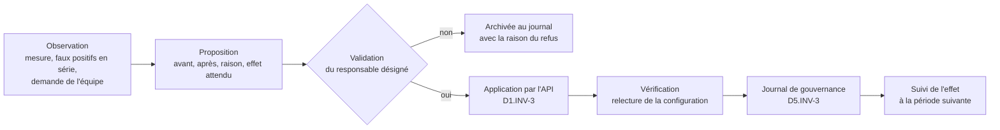
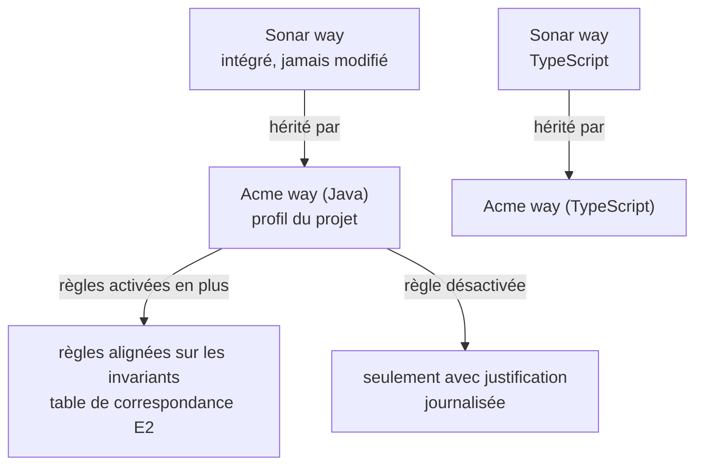

# Module `gouvernance` (D5)

Gouverner, c'est fixer les règles du jeu de la qualité et les faire évoluer sans les tordre. Le principe directeur est celui du nouveau code (« Clean as You Code ») : chaque changement doit être propre, sans exiger de corriger tout l'existant d'un coup.

## 1. Processus de changement



## 2. Quality gate

- Le quality gate intégré « Sonar way » n'est jamais modifié (D5.INV-1). Le projet utilise soit « Sonar way » tel quel, soit une copie nommée (par exemple « Acme way »), modifiée et associée au projet.
- Les conditions portent sur le **nouveau code** (D5.INV-2). L'expert relève la définition actuelle de « Sonar way » sur l'instance (`/api/qualitygates/show?name=Sonar way`) plutôt que de la citer de mémoire : elle porte typiquement sur l'absence de nouvelles issues, la revue des points de sécurité, la couverture et la duplication du nouveau code.
- Une condition sur le code global (« couverture globale ≥ 60 % ») est une décision explicite : elle peut bloquer une MR pour une dette qui n'est pas la sienne.

Exemple de proposition :

```markdown
**Proposition de gouvernance G-04**
- **Objet** : quality gate « Acme way », condition « couverture du nouveau code »
- **Avant** : 80 %   **Après** : 80 % (inchangé) ; ajout « duplication du nouveau code ≤ 3 % »
- **Raison** : 6 MR sur 20 du dernier mois ont introduit plus de 3 % de duplication (mesure : new_duplicated_lines_density, appels listés en annexe).
- **Effet attendu** : MR concernées bloquées jusqu'à factorisation.
- **Appels** : `POST /api/qualitygates/create_condition` (gateName=Acme way, metric=new_duplicated_lines_density, op=GT, error=3)
- **Réversible** : oui, `POST /api/qualitygates/delete_condition`
- **Validation requise** : responsable technique
```

## 3. Définition du nouveau code

| Option | Usage | Remarque |
|---|---|---|
| Version précédente | projets livrés par versions numérotées (`sonar.projectVersion`) | le nouveau code repart à chaque changement de version |
| Nombre de jours | flux continu sans version | 30 jours est un choix courant ; à décider |
| Branche de référence | branches longues comparées à `main` | adapté aux branches de version |

Pour une MR, le nouveau code est le code modifié par la MR, quelle que soit cette définition. Changer la définition du nouveau code change ce que le quality gate de la branche principale évalue : c'est une décision de gouvernance journalisée.

## 4. Profils de règles



- Un profil du projet **hérite** de « Sonar way » (`/api/qualityprofiles/change_parent`) plutôt qu'il ne le copie : il reçoit ainsi les nouvelles règles des mises à jour de l'instance.
- Activer une règle supplémentaire se justifie par un invariant (table de correspondance du module `triage`) ou par des constats répétés.
- Désactiver une règle héritée se justifie par des faux positifs en série documentés (module `triage`, § 6), jamais par le nombre de constats qu'elle produit.
- Changer la gravité d'une règle dans le profil est une décision de gouvernance, pas de triage (module `triage`, § 8).

## 5. Journal de gouvernance (D5.INV-3)

Fichier versionné dans le dépôt du projet, par exemple `docs/sonar/gouvernance.md`. Une entrée par décision, jamais réécrite :

```markdown
## G-04 : duplication du nouveau code dans le quality gate (2026-10-16)
- Statut : appliquée
- Avant : aucune condition de duplication
- Après : new_duplicated_lines_density > 3 % en échec
- Raison : 6 MR sur 20 au-dessus de 3 % sur le dernier mois
- Validée par : <nom, rôle>
- Appliquée par : expert SonarQube, appels POST /api/qualitygates/create_condition
- Vérification : GET /api/qualitygates/show?name=Acme way, condition présente
- Suivi : à réévaluer le 2026-11-16
```

Une décision refusée a aussi son entrée, avec la raison du refus : elle évite de rouvrir la même discussion.

## 6. Effets de second ordre (D5.INV-4)

Un indicateur devenu objectif cesse d'être un bon indicateur : l'équipe optimise l'indicateur, plus la qualité. L'expert surveille et rapporte, à chaque période :

| Signal | Mesure | Lecture |
|---|---|---|
| Faux positifs et acceptations | nombre de transitions `falsepositive` et `accept` sur la période (`issues/search?issueStatuses=FALSE_POSITIVE,ACCEPTED&createdAfter=…` ou historique des changements) | une hausse sans hausse des corrections signale un contournement |
| `NOSONAR` et `@SuppressWarnings` | recherche dans le dépôt | même lecture |
| Exclusions de couverture | `sonar.coverage.exclusions` dans le dépôt et l'historique Git | une exclusion qui grossit masque des zones non testées |
| Relâchement du gate | journal de gouvernance | tout relâchement est une décision séparée, justifiée, jamais faite pour faire passer une analyse précise |

## 7. Pièges connus

- **Modifier « Sonar way »** : impossible ou écrasé selon la version, et la modification serait perdue ou appliquée à tous les projets. Toujours dériver.
- **Gate sur le code global dès le premier jour** : bloque toutes les MR à cause de l'existant ; l'équipe désactive le gate. Commencer par le nouveau code.
- **Copier un profil au lieu d'en hériter** : le profil ne reçoit plus les règles ajoutées par les mises à jour.
- **Permissions** : modifier un gate ou un profil exige des droits d'administration. Si le compte ne les a pas, l'expert prépare la proposition pour un administrateur.

## 8. Contrôle de sortie

- Aucun élément intégré modifié ; les éléments du projet en dérivent (D5.INV-1).
- Les conditions portent sur le nouveau code, sauf décision explicite (D5.INV-2).
- Chaque changement a son entrée au journal (D5.INV-3).
- Aucun relâchement fait pour faire passer une analyse (D5.INV-4).
