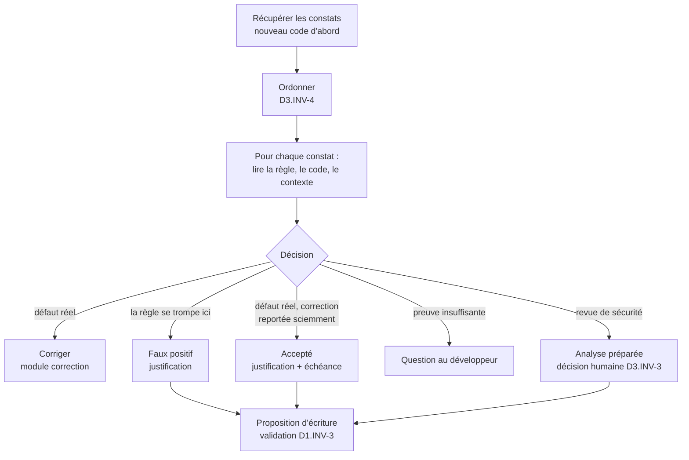
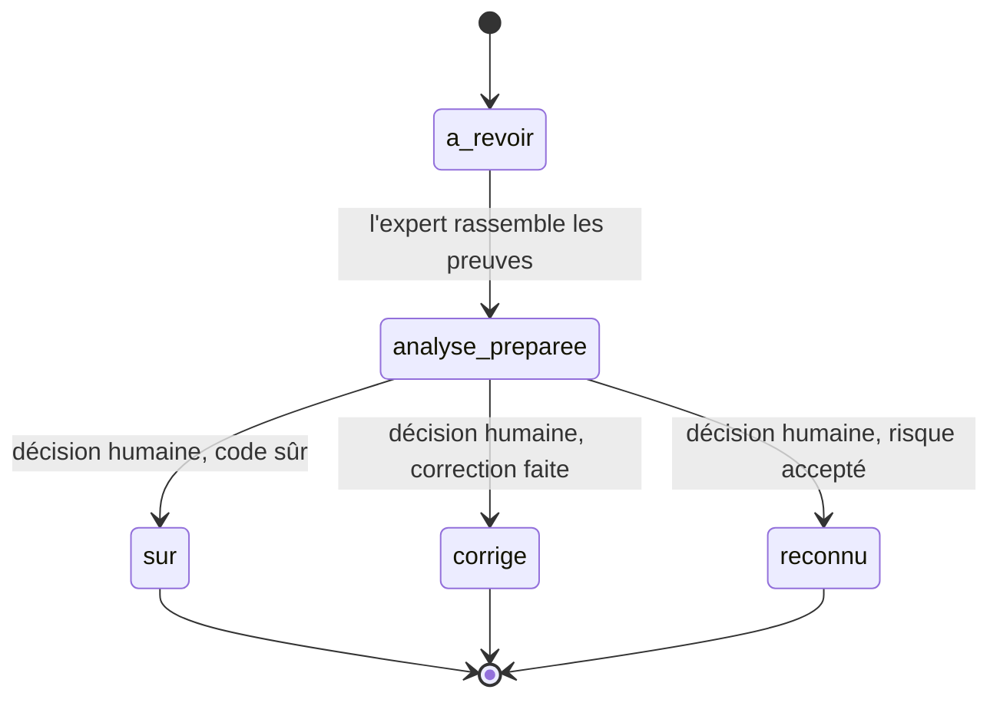

# Module `triage` (D3)

Trier, c'est décider pour chaque constat ce qu'il faut en faire, avec une raison écrite. Le triage n'est pas un moyen de faire passer le quality gate (D3.INV-2) : il distingue les vrais défauts, à corriger, des faux positifs et de la dette sciemment acceptée.

## 1. Déroulé



## 2. Récupérer les constats

```bash
# Issues ouvertes du nouveau code d'une MR, page 1
sonar_get "/api/issues/search?components=acme-api&pullRequest=412&inNewCodePeriod=true&issueStatuses=OPEN,CONFIRMED&ps=500&p=1" \
  | jq '{total: .total, issues: [.issues[] | {key, rule, component, line, message, impacts, severity, type}]}'

# Revues de sécurité à faire (si l'instance expose les Security Hotspots)
sonar_get "/api/hotspots/search?project=acme-api&pullRequest=412&status=TO_REVIEW" \
  | jq '[.hotspots[] | {key, ruleKey, component, line, message, vulnerabilityProbability}]'
```

- Le paramètre `issueStatuses` et les valeurs `OPEN`, `CONFIRMED`, `ACCEPTED`, `FALSE_POSITIVE`, `FIXED` sont ceux des versions récentes. L'expert vérifie les paramètres dans la documentation `/web_api` de l'instance.
- Pagination : `ps` vaut au plus 500 ; au-delà de 10 000 résultats, découper la requête (module `cadrage-acces`, § 4.1).

## 3. Lire un constat selon le mode de l'instance

| Mode | Champs à lire | Exemple |
|---|---|---|
| Multi-qualité (MQR) | `impacts[]` : `softwareQuality` (`SECURITY`, `RELIABILITY`, `MAINTAINABILITY`) et `severity` (`BLOCKER`, `HIGH`, `MEDIUM`, `LOW`, `INFO`) | une même issue peut avoir un impact sur plusieurs qualités |
| Expérience standard | `type` (`VULNERABILITY`, `BUG`, `CODE_SMELL`) et `severity` (`BLOCKER`, `CRITICAL`, `MAJOR`, `MINOR`, `INFO`) | un seul type par issue |

L'expert lit les champs du mode relevé au cadrage (D1.INV-4) et ne mélange pas les deux vocabulaires dans un même rapport.

## 4. Ordre de priorité (D3.INV-4)

1. **Nouveau code** avant le code existant : c'est lui que le quality gate évalue, et c'est le moins coûteux à corriger.
2. **Qualité** : sécurité, puis fiabilité, puis maintenabilité. En mode standard : vulnérabilités et revues de sécurité, puis bugs, puis code smells.
3. **Gravité** décroissante.
4. À égalité, regrouper par règle : vingt occurrences d'une même règle se traitent en une décision et souvent une correction commune.

## 5. Correspondance règles vers invariants (point E2)

Une règle SonarQube recoupe souvent un invariant du socle ou d'un expert. La correspondance donne au constat une portée qui dépasse l'outil : corriger `java:S6813`, c'est respecter `expert-java:D1.INV-3`.

| Règle | Objet | Invariant correspondant |
|---|---|---|
| `java:S3649` | requête exposée à une injection | `expert-java:D4.INV-4` |
| `java:S2077` | requête SQL formatée dynamiquement (revue de sécurité) | `expert-java:D4.INV-4` |
| `java:S6813` | injection de dépendance par champ | `expert-java:D1.INV-3` |
| `java:S3553` | `Optional` en paramètre | `expert-java:D2.INV-2` |
| `java:S3655` | `Optional.get()` sans vérification | `expert-java:D2.INV-2` |
| `java:S108` | bloc vide (dont `catch` vide) | `expert-java:D2.INV-4` |
| `java:S2068`, `typescript:S2068` | mot de passe en dur | `SC4.INV-1` |
| `java:S5122` | configuration CORS permissive | `SC4.INV-3` |
| `Web:ImgWithoutAltCheck` | image sans alternative textuelle | `expert-angular:D6.INV-1` |
| `java:S3776`, `typescript:S3776` | complexité cognitive | hors invariant, maintenabilité |

Cette table est un point de départ. Avant de l'utiliser, l'expert confirme chaque clé et son intitulé sur l'instance (`/api/rules/show?key=…`), puis la versionne dans le dépôt du projet (par exemple `docs/sonar/correspondances.md`), où l'équipe la complète. Une règle sans correspondance reste valable : elle est simplement « hors invariant ».

## 6. Décisions et justifications (D3.INV-1)

| Décision | Quand | Transition | Commentaire obligatoire |
|---|---|---|---|
| Corriger | défaut réel | aucune (le constat se ferme à l'analyse suivante) | non |
| Faux positif | la règle ne s'applique pas à ce code, preuve à l'appui | `falsepositive` | oui : pourquoi la règle se trompe ici |
| Accepté | défaut réel, correction reportée par décision | `accept` | oui : raison, risque, échéance ou condition de reprise |
| Question | preuve insuffisante | aucune | question posée au développeur |

Modèles de commentaires :

```text
Faux positif (expert SonarQube, validé par <nom>) : <règle> signale <ce qu'elle croit voir>.
Ici, <fait vérifiable qui l'exclut, avec fichier:ligne>. Réexaminer si <condition qui rendrait la règle juste>.

Accepté (expert SonarQube, validé par <nom>) : défaut réel, correction reportée.
Raison : <raison>. Risque : <risque>. Reprise : <échéance ou ticket>.
```

Un faux positif en série (même règle, même motif, nombreuses occurrences) peut révéler une règle inadaptée au projet. L'expert le signale à la mission « gouverner » plutôt que de marquer cinquante issues une par une.

## 7. Revues de sécurité (D3.INV-3, point E3)



- Selon la version, la revue porte sur un Security Hotspot (statuts `TO_REVIEW`, puis `REVIEWED` avec une résolution `SAFE`, `FIXED` ou `ACKNOWLEDGED`) ou sur une Security Issue. L'expert traite les deux de la même façon.
- L'expert prépare l'analyse : chemin de la donnée, contrôles existants, exploitabilité, référence à l'invariant concerné. La décision revient à un humain, dont le nom figure dans le commentaire.
- Une revue de sécurité n'est jamais close en lot.

## 8. Pièges connus

- **Accepter pour faire passer le gate** : interdit (D3.INV-2). Si le gate bloque sur un défaut réel, la réponse est la correction ou une décision de gouvernance explicite (module `gouvernance`).
- **Constats apparus après une montée de version** : une règle modifiée par la mise à jour de l'instance peut révéler des constats dans du code inchangé. Ce n'est pas une régression : l'expert le dit dans son rapport.
- **Constat sur du code généré** : c'est un défaut de configuration (D2.INV-1), pas un faux positif. Corriger l'exclusion.
- **Gravité remise en cause** : l'expert peut argumenter qu'une gravité est inadaptée, mais il ne la modifie pas ; il propose un ajustement du profil (module `gouvernance`).

## 9. Contrôle de sortie

- Chaque faux positif et chaque acceptation ont un commentaire de justification (D3.INV-1).
- Aucune gravité ni aucun statut n'a été modifié pour faire passer le gate (D3.INV-2).
- Chaque revue de sécurité close porte une décision humaine nominative (D3.INV-3).
- Le tri respecte l'ordre du § 4 (D3.INV-4).
