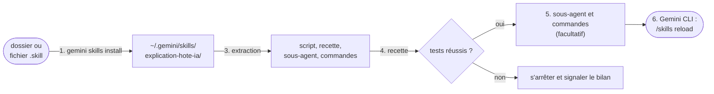

# Mode d'emploi d'explication-hote-ia

Ce mode d'emploi accompagne le skill `explication-hote-ia`, version 1.1.0 : un agent qui explique le fonctionnement de Gemini CLI en vous le montrant sur votre poste. Pendant qu'il explique, il ne modifie rien.

Ce dossier se suffit. Il contient le skill, son script, sa recette et ce mode d'emploi : pour l'installer et vous en servir, il ne faut que Gemini CLI et Node, sans dépôt à cloner ni outil à télécharger. L'installation n'utilise pas le réseau ; ensuite, seul Gemini CLI parle à son modèle, comme il le fait sans le skill.

## Ce qu'il faut

- Gemini CLI, installé et connecté. Le skill est vérifié avec Gemini CLI 0.67.0 ; avec une autre version, l'agent signale ses repères « à revérifier » et lit la documentation de la vôtre.
- Node 20 ou plus récent (`node --version`) ; vérifié jusqu'à Node 26.13.0.
- Linux, WSL2, macOS ou Windows.
- Le dossier `explication-hote-ia/`, ou le fichier `explication-hote-ia.skill` qu'on vous a transmis.

## Installer, une fois



### 1. Installer le skill dans Gemini CLI

Dans un terminal :

```bash
gemini skills install <chemin du dossier explication-hote-ia, ou du fichier .skill>
```

Gemini CLI vous montre le skill qu'il a trouvé et vous demande de confirmer. Il le copie dans `~/.gemini/skills/explication-hote-ia/`, pour tous vos projets, et affiche son emplacement exact (« location »). Pour un seul projet, lancez la commande depuis la racine du projet avec `--scope workspace` : le skill va alors dans `.gemini/skills/` du projet (voir « Dépannage » si git ignore ce dossier).

### 2. Ouvrir un terminal dans le dossier installé

| Terminal | Commande |
|---|---|
| bash ou zsh (Linux, macOS, WSL2) | `cd ~/.gemini/skills/explication-hote-ia` |
| PowerShell | `cd $HOME\.gemini\skills\explication-hote-ia` |
| CMD | `cd /d "%USERPROFILE%\.gemini\skills\explication-hote-ia"` |

Installé pour un projet : `cd .gemini/skills/explication-hote-ia`, depuis la racine du projet.

### 3. Écrire les six fichiers exécutables

Le script, sa recette, le sous-agent et les trois commandes sont écrits en entier dans les modules du skill. Cette commande les recopie à côté, à l'identique, et vérifie l'empreinte de chacun. Elle n'écrit que dans ce dossier et n'utilise pas le réseau. Collez-la telle quelle, dans n'importe lequel de ces terminaux :

<!-- commande : extraction -->
```text
node -e "const fs = require('node:fs'), path = require('node:path'), crypto = require('node:crypto'); const attendu = { 'scripts/instantane-hote.mjs': 'ae296517f6670e0d0499db9c6d03d8550596b6eee4e7be69335c72e359fdd34d', 'tests/instantane-hote.test.mjs': 'c66a1ff94ebe065d9fe0197ccc6af8f9d1d48798c89b53fb903b7de6625e0b17', 'agent/explicateur-hote.md': 'e38d01c3ea9dbb77c414f7c0209974d99183e4c7910c8c8fc821c26af091475e', 'commandes/hote/explique.toml': 'cfd784a3449c1ac6f5914da112b9e0daa79bc1e52cdbc0721a4d94d894dbce6a', 'commandes/hote/carte.toml': 'e2d9ab278eca3c9e22a97b4f10f09bda0455abe021aa9931b8f96cecd8ce042b', 'commandes/hote/pourquoi.toml': '09a0ae500aa33c2587925b379801b84c3886e06a0fa7c7fd5c9dd4fdd8095720' }; const vus = new Set(); let ecarts = 0; for (const module of ['modules/execution/SKILL.md', 'modules/recette/SKILL.md', 'modules/agent/SKILL.md']) { const texte = fs.readFileSync(module, 'utf8').replace(/\r\n/g, '\n'); for (const m of texte.matchAll(/^<\x21-- fichier : (\S+) -->\n\x60{3}[a-z]*\n([\s\S]*?)\n\x60{3}\n/gm)) { const contenu = m[2] + '\n'; fs.mkdirSync(path.dirname(m[1]), { recursive: true }); fs.writeFileSync(m[1], contenu); vus.add(m[1]); const conforme = crypto.createHash('sha256').update(contenu).digest('hex') === attendu[m[1]]; if (conforme === false) ecarts++; console.log((conforme ? 'conforme  ' : 'ECART     ') + m[1]); } } for (const f of Object.keys(attendu)) if (vus.has(f) === false) { ecarts++; console.log('ABSENT    ' + f); } if (ecarts > 0) process.exitCode = 1;"
```

Attendu : six lignes `conforme`. Une ligne `ECART` ou `ABSENT` arrête l'installation : réinstallez le skill (étape 1), puis recommencez.

### 4. Vérifier

```bash
node --test tests/instantane-hote.test.mjs
```

Attendu : 28 tests réussis sous Linux et WSL2 ; 27 réussis et 1 sauté sous Windows et macOS (le test T9 lit `/proc`, propre à Linux). La recette ne lance pas Gemini CLI et n'utilise pas le réseau. En cas d'échec, arrêtez-vous là et transmettez le bilan à qui vous a diffusé le skill.

### 5. Le sous-agent et les commandes (facultatif)

Ils ajoutent les commandes `/hote:explique`, `/hote:carte` et `/hote:pourquoi`, et le sous-agent `explicateur-hote`. Ils s'installent hors du dossier du skill, dans `~/.gemini/agents/` et `~/.gemini/commands/hote/` : seulement si vous le voulez. Depuis le même dossier :

<!-- commande : sous-agent-et-commandes -->
```text
node -e "const fs = require('node:fs'), path = require('node:path'), os = require('node:os'); const gemini = path.join(process.env.GEMINI_CLI_HOME || os.homedir(), '.gemini'); const agent = path.join(gemini, 'agents', 'explicateur-hote.md'), commandes = path.join(gemini, 'commands', 'hote'); if (fs.existsSync(path.join('agent', 'explicateur-hote.md')) === false) { console.error('agent/explicateur-hote.md absent : lancer cette commande depuis le dossier du skill, une fois les six fichiers extraits'); process.exitCode = 1; } else { fs.mkdirSync(path.dirname(agent), { recursive: true }); fs.mkdirSync(commandes, { recursive: true }); fs.writeFileSync(agent, fs.readFileSync(path.join('agent', 'explicateur-hote.md'), 'utf8').split('<DOSSIER_DU_SKILL>').join(process.cwd())); for (const f of ['explique.toml', 'carte.toml', 'pourquoi.toml']) fs.copyFileSync(path.join('commandes', 'hote', f), path.join(commandes, f)); console.log('copie     ' + agent); console.log('copie     ' + commandes); }"
```

Attendu : deux lignes `copie`, chacune avec l'emplacement d'une copie. Le sous-agent installé désigne ce dossier : si vous déplacez ou réinstallez le skill ailleurs, relancez cette commande depuis le nouveau dossier.

### 6. Dans Gemini CLI

Si une session est déjà ouverte, tapez `/skills reload`, puis `/agents reload` et `/commands reload` si vous avez fait l'étape 5 ; sinon, la prochaine session les trouve. `/skills list` doit montrer `explication-hote-ia`.

## Premiers pas

Dans une session interactive, c'est-à-dire Gemini CLI lancé sans `-p`, demandez « explique-moi comment tu fonctionnes », ou tapez `/hote:explique`. Gemini CLI vous demande d'autoriser le skill, puis le petit script de lecture qu'il lance : c'est vous qui décidez.

L'agent propose le parcours découverte, sept questions, une à la fois :

1. Qu'est-ce que c'est, au juste ?
2. Que reçoit le modèle quand je tape une demande ?
3. Que voit-il de mon code ?
4. Comment décide-t-il d'agir ?
5. Peut-il modifier ou casser quelque chose ?
6. Où partent mes données, et que retient-il ?
7. Peut-il se tromper, et comment le vérifier ?

Chacune en trois temps : la réponse simple, ce qu'elle montre sur votre poste, ce que vous gardez en main. Après chaque étape, vous continuez, vous approfondissez ou vous arrêtez.

### Lire une réponse

L'agent dit d'où il tient chaque affirmation :

| Il dit | Cela veut dire |
|---|---|
| « vu sur votre poste » | il vient de l'observer |
| « d'après ce que je vois de mon propre contexte » | il le voit dans ce qu'il a reçu, sans pouvoir le vérifier |
| « d'après la documentation de Gemini CLI 0.67.0 » | la documentation de la version installée le dit |
| « j'en déduis » | il le conclut de ce qu'il a observé |
| « je ne peux pas le savoir d'ici » | aucune source ne le lui dit ; il indique comment le vérifier |

Il ne tire de sa propre impression ni son modèle, ni sa version, ni ses limites. Pour ces questions, il vous demande de lancer une commande de l'interface, comme `/about` ou `/stats model`, et de coller ce qu'elle affiche.

## Utiliser

### Les trois modes

| Mode | Commande, ou demande | Ce que l'agent rend |
|---|---|---|
| expliquer | `/hote:explique [question]` | sans question, le parcours découverte ; avec une question, le mécanisme demandé, puis ce qui en est en place chez vous |
| carte | `/hote:carte`, « qu'est-ce qui est actif ici ? » | réglages et leur couche, confiance du dossier, fichiers de contexte, composants actifs, masqués ou ignorés |
| pourquoi | `/hote:pourquoi <comportement>`, « pourquoi ce skill n'apparaît pas ? » | un diagnostic : chaque hypothèse confirmée ou écartée par une observation nommée, la cause retenue, la correction décrite sans être appliquée |

Pour la carte et le diagnostic, l'agent écrit ses étiquettes sous leur forme courte : `[observé]`, `[déclaré]`, `[documenté]`, `[déduit]`, `[inconnu]`.

### Le sous-agent

Le sous-agent `explicateur-hote` a son propre contexte : il voit votre installation, pas la conversation qui l'appelle. Il sert à la carte et au diagnostic, sans encombrer votre session : « @explicateur-hote fais la carte de cette installation ». Les questions sur la session en cours se posent dans la session principale.

### Voir l'envoi exact

Le texte exact des instructions système que Gemini CLI envoie au modèle s'obtient en l'exportant :

```bash
GEMINI_WRITE_SYSTEM_MD=~/systeme-exporte.md gemini
```

Le fichier est écrit au démarrage ; quittez ensuite avec `/quit`. Donnez un chemin hors du projet, jamais la valeur `1`. Ne versionnez pas le fichier : il contient vos mémoires. Puis : `/hote:explique analyse le prompt exporté ~/systeme-exporte.md`.

### Ce qui sort du poste

Avec les réglages par défaut, Gemini CLI envoie, en plus des requêtes au modèle, des statistiques d'usage à `play.googleapis.com`, même en mode non interactif. En mode interactif, il cherche aussi une mise à jour sur `registry.npmjs.org`. Ces deux sorties continuent même quand l'API du modèle est locale. Ces réglages, dans `~/.gemini/settings.json`, les coupent :

```json
{
  "privacy": { "usageStatisticsEnabled": false },
  "general": { "enableAutoUpdate": false, "enableAutoUpdateNotification": false }
}
```

Derrière un proxy d'entreprise, sous Node 26 (constaté avec Node 26.13.0), la connexion par compte Google passe par le proxy de `HTTPS_PROXY`. En revanche, les requêtes au modèle par clé d'API Gemini, les statistiques d'usage et la recherche de mise à jour partent en direct. Lancer Gemini CLI avec `NODE_USE_ENV_PROXY=1` dans l'environnement les ramène au proxy. Sous Node 22 et 24, tout suit le proxy.

L'agent montre ces réglages chez vous, avec leur couche. Il décrit une modification ; il ne l'applique que si vous le lui demandez explicitement.

### Le script

Depuis la racine de votre projet :

```bash
node ~/.gemini/skills/explication-hote-ia/scripts/instantane-hote.mjs <commande> [--format texte]
```

| Commande | Effet |
|---|---|
| `hote` | famille de l'hôte et nature de la preuve, paquet, version, documentation embarquée, options de lancement sous Linux et WSL |
| `config` | couches de réglages, valeur effective et couche de chaque réglage observé, confiance du dossier, `.env`, variables |
| `contexte` | fichiers de contexte par palier, imports, mémoire privée, trace de la dernière session ; `--prompt-systeme <fichier>` pour un prompt exporté |
| `composants` | skills, sous-agents, commandes, extensions, serveurs MCP, hooks, politiques, fichiers d'exclusion |
| `doc [chemin]` | documentation embarquée : la liste, ou un document |
| `tout` | les quatre premières ensemble |

Codes de sortie : 0 réussite, 1 usage, 2 introuvable, 3 chemin refusé, 4 erreur interne. Le script ne fait que lire : il ne crée aucun fichier, ne lance aucun processus et n'ouvre aucune connexion. Il rend des noms, jamais de valeurs secrètes, et aucun texte de conversation.

### Ce qui ne se négocie pas

- Rien n'est modifié pendant une explication. Une modification de configuration se décrit (fichier, clé, valeur, effet) et ne s'applique que sur votre demande explicite.
- Aucune valeur secrète n'est recopiée, ni dans une réponse, ni dans un fichier.
- Aucune réassurance sans source : une limite ou un risque se dit aussi clairement qu'un garde-fou.
- La documentation de la version installée fait foi ; un repère d'une autre version se signale « à revérifier ».

## Mettre à jour

- **Nouvelle version du skill** : refaites les étapes 1 à 4 avec la nouvelle version ; `gemini skills install` remplace le dossier installé, fichiers extraits compris. Puis l'étape 5, si vous l'aviez faite.
- **Nouvelle version de Gemini CLI** : rien à faire. L'agent observe la version, signale ses repères « à revérifier » et lit la documentation de la version installée.

## Retirer

Cette commande, à lancer de n'importe où, supprime le sous-agent et les trois commandes, s'ils sont installés ; elle écrit `supprime` et l'emplacement de chaque fichier :

<!-- commande : retrait -->
```text
node -e "const fs = require('node:fs'), path = require('node:path'), os = require('node:os'); const gemini = path.join(process.env.GEMINI_CLI_HOME || os.homedir(), '.gemini'); const commandes = path.join(gemini, 'commands', 'hote'); for (const f of [path.join(gemini, 'agents', 'explicateur-hote.md'), ...['explique.toml', 'carte.toml', 'pourquoi.toml'].map((n) => path.join(commandes, n))]) if (fs.existsSync(f)) { fs.rmSync(f); console.log('supprime  ' + f); } if (fs.existsSync(commandes) && fs.readdirSync(commandes).length === 0) fs.rmdirSync(commandes);"
```

Puis, pour le skill lui-même :

```bash
gemini skills uninstall explication-hote-ia
```

Ajoutez `--scope workspace` s'il est installé pour un projet. Le skill n'a rien écrit d'autre hors de son dossier.

## Diffuser le skill

Le skill se diffuse seul, sous l'une de ces formes :

| Forme | Pour qui | Comment |
|---|---|---|
| ce dossier, `explication-hote-ia/` | un développeur sous Gemini CLI | une copie, ou une archive zip à décompresser |
| un fichier `explication-hote-ia.skill` | le même, en un seul fichier | une archive zip du dossier, à l'extension `.skill` (ci-dessous) |
| la transmission texte `explication-hote-ia-1.1.0.md` | l'IA d'un autre outil, qui ne reçoit que du texte | à coller telle quelle : l'IA matérialise le dossier, ce mode d'emploi compris, et suit la consigne écrite en tête |

Pour faire le fichier `.skill`, depuis le dossier qui contient `explication-hote-ia/` :

| Plateforme | Commande |
|---|---|
| Linux | `python3 -m zipfile -c explication-hote-ia.skill explication-hote-ia` |
| macOS, Windows 10 ou plus récent | `tar --format zip -cf explication-hote-ia.skill explication-hote-ia` |

Le dossier contient :

| Élément | Rôle |
|---|---|
| `MODE-EMPLOI.md` | ce mode d'emploi |
| `SKILL.md`, `manifest.json` | le point d'entrée du skill, sa version et la liste de ses modules |
| `modules/` | les règles de l'agent, et le texte des six fichiers exécutables |
| `ENTETE-TRANSMISSION.md` | la consigne de la transmission texte |
| `archives/` | les points d'entrée des versions précédentes |
| `scripts/`, `tests/`, `agent/`, `commandes/` | les six fichiers, une fois extraits (étape 3) |

Le skill est maintenu dans le dépôt Agent2Prompt. Chaque version y est vérifiée avant d'être diffusée : la recette sous Linux et sous Windows, et cette procédure d'installation, rejouée contre le vrai Gemini CLI. Vous n'avez pas besoin de ce dépôt, ni pour installer le skill, ni pour vous en servir.

## Dépannage

| Symptôme | Cause probable | Remède |
|---|---|---|
| `gemini skills install` répond « No valid skills found » | le chemin ne désigne ni le dossier du skill, ni le dossier qui le contient, ni le fichier `.skill` | désigner le dossier qui contient `SKILL.md`, ou le fichier `.skill` |
| `ECART` ou `ABSENT` à l'étape 3 | la commande a été tronquée au collage, ou un module a changé depuis la diffusion | recoller la commande en entier ; sinon, réinstaller (étape 1) |
| l'étape 5 répond « agent/explicateur-hote.md absent » | commande lancée hors du dossier du skill, ou avant l'étape 3 | se placer dans le dossier installé (étape 2), puis faire l'étape 3 |
| `explication-hote-ia` absent de `/skills list` | session ouverte avant l'installation | `/skills reload`, ou une nouvelle session |
| installé pour un projet, l'agent ne lit pas ses modules | git ignore `.gemini/` : les outils de lecture de Gemini CLI ne livrent alors que `SKILL.md` | ajouter à `.geminiignore` les lignes `!/.gemini/`, `!/.gemini/skills/` et `!/.gemini/skills/explication-hote-ia/` ; ou installer pour tous vos projets |
| `/hote:explique` inconnu | commandes non installées (étape 5), ou dossier non fiable : Gemini CLI ignore alors toute commande personnalisée, même celles de l'utilisateur | demander « explique-moi comment tu fonctionnes » ; ou faire l'étape 5, `/commands reload`, et faire confiance au dossier |
| le skill ne s'active pas avec `gemini -p` | mode non interactif : `activate_skill` et `run_shell_command` ne sont pas déclarés au modèle | une session interactive |
| la version rendue n'est pas celle de `/about` | le paquet trouvé par le PATH n'est pas celui qui s'exécute | `--paquet` vers le paquet qui s'exécute |
| `contexte` ne trouve pas le `GEMINI.md` du projet | script lancé hors de la racine du projet | relancer depuis la racine, ou `--racine` |
| la trace de session décrit une autre conversation | plusieurs sessions sur le projet, ou une session sans tour abouti, que Gemini CLI supprime au lancement suivant | comparer `debut` à l'heure de la session ; `/memory list` fait foi |
| le sous-agent dit qu'il ne voit pas la session | normal : son contexte est séparé | poser la question dans la session principale, skill activé |
| la recette saute T9 | Windows ou macOS : T9 lit `/proc` | normal |
