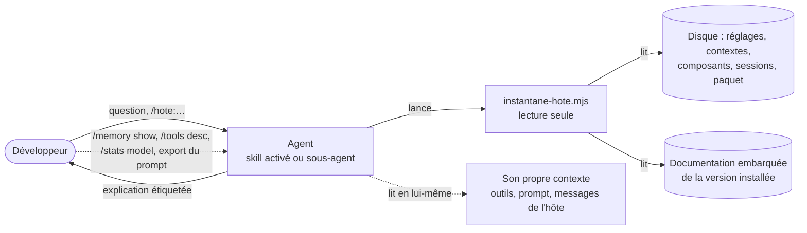
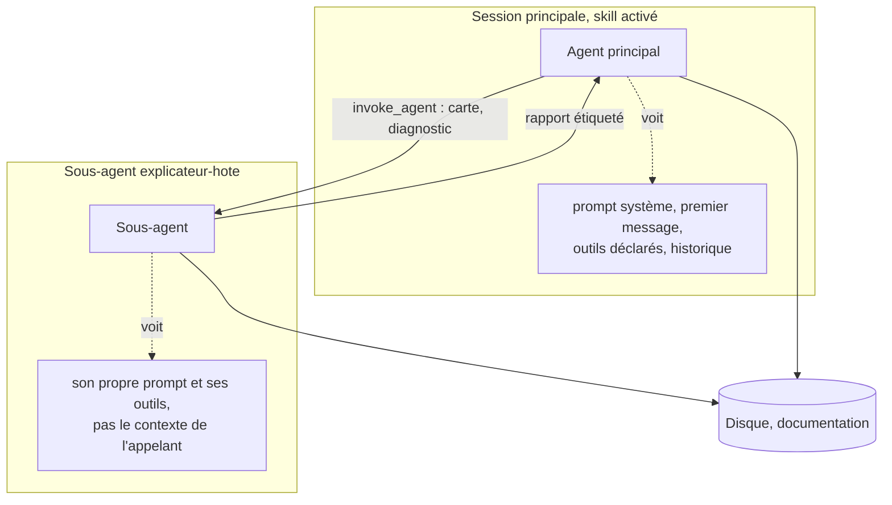

# Explication de l'hôte d'IA, version 1.0.0

Ce document est le point d'entrée du skill. Le skill fait d'un agent l'explicateur de l'outil d'IA qui l'exécute : il dit comment cet hôte fonctionne, en général et dans cette installation, sans rien affirmer qu'il ne puisse rattacher à une source. Gemini CLI est l'hôte reconnu : ses mécanismes sont décrits par des repères vérifiés sur sa version 0.67.0, à confronter à la documentation de la version installée. Tout autre hôte est décrit par ce qui s'en observe, sans lui prêter de nom ni de configuration. Un script Node en lecture seule, `scripts/instantane-hote.mjs`, fait les observations sur le disque ; l'agent `explicateur-hote` et trois commandes de Gemini CLI le mettent en œuvre. Les règles détaillées sont dans `modules/`.

## 1. Ordre de lecture

1. Ce document, en entier.
2. `manifest.json` : modules, version de Node visée, plateformes.
3. Les modules actifs, dans cet ordre : `provenance`, `execution`, `hote`, `configuration`, `contexte`, `composants`, `secrets`, `modele-hote`, `diagnostic`, `agent`, `recette`.
4. `modules/autres-hotes/SKILL.md` et `modules/comparaison/SKILL.md` : seulement pour comprendre les points d'extension. Ne pas les appliquer en 1.x.

## 2. Ce que fait le skill

Trois modes, que l'agent choisit d'après la demande du développeur, ou que les commandes de Gemini CLI imposent :

| Mode | Demande type | Ce que l'agent rend | Commande |
|---|---|---|---|
| expliquer | « comment tu fonctionnes ? », « que reçoit le modèle à chaque tour ? » | l'explication du mécanisme demandé, ou la visite guidée du module `modele-hote`, appliquée à cette installation | `/hote:explique [question]` |
| carte | « qu'est-ce qui est actif ici ? » | la carte de l'installation : réglages et leur couche, confiance, contextes, composants, avec leur provenance | `/hote:carte` |
| pourquoi | « pourquoi ce skill n'apparaît pas ? », « pourquoi ce GEMINI.md n'est pas suivi ? » | un diagnostic : hypothèses de la table du module `diagnostic`, chacune confirmée ou écartée par une observation nommée | `/hote:pourquoi <comportement>` |

Le script fait les observations ; il ne fait que lire (D1.INV-1) :

| Commande | Ce qu'elle observe | Module |
|---|---|---|
| `hote` | qui l'exécute : famille de l'hôte et nature de la preuve, paquet, version, documentation embarquée, options de lancement, plateforme | `hote` |
| `config` | couches de réglages, valeur effective et couche de chaque réglage observé, confiance du dossier, fichier `.env`, variables | `configuration` |
| `contexte` | fichiers de contexte par palier, imports, mémoire privée du projet, trace de la dernière session, prompt système exporté | `contexte` |
| `composants` | skills, sous-agents, commandes, extensions, serveurs MCP, hooks, politiques, fichiers d'exclusion | `composants` |
| `doc [chemin]` | documentation embarquée dans le paquet installé : liste, ou un document | `hote` |
| `tout` | `hote`, `config`, `contexte` et `composants` ensemble | `execution` |

## 3. Trois sources, cinq étiquettes

L'agent sait de l'hôte ce qu'il en observe, et rien d'autre. Ses sources sont trois : son propre contexte (les déclarations d'outils qu'il voit, son prompt système, les messages que l'hôte y pose), le disque lu par le script, et la documentation embarquée dans le paquet installé. Le développeur en apporte une quatrième, les commandes de l'interface de l'hôte, que l'agent ne peut pas lancer. Chaque affirmation sur l'hôte porte l'une de ces cinq étiquettes et sa source (D6.INV-1) :

| Étiquette | Sens | Source citée |
|---|---|---|
| `[observé]` | lu pendant cette session : sortie du script de nature « observé », fichier, sortie d'une commande collée par le développeur | la commande ou le chemin |
| `[déclaré]` | donné à l'agent sans qu'il l'ait vérifié : son propre contexte, une option, une affirmation du développeur | la section, la balise ou la personne |
| `[documenté]` | documentation embarquée de la version installée | la version et le document |
| `[déduit]` | conclusion tirée d'observations citées, nature « déduit » du script comprise | les observations |
| `[inconnu]` | non observable d'ici | le moyen de l'observer, s'il en existe un |

Entre deux sources contradictoires, l'observation de la session l'emporte sur la documentation, qui l'emporte sur la déduction, et la contradiction est dite (D6.INV-3). Le module `provenance` détaille ces règles et les angles morts.

## 4. Deux niveaux d'observation

L'explication d'une session se fait dans cette session (D7.INV-1). Activé dans la session principale, le skill fait de l'agent principal l'explicateur : il voit ce que le modèle de cette session reçoit. Le sous-agent `explicateur-hote` a son propre contexte, son propre prompt système et ses propres outils : il voit l'installation, pas la session qui l'appelle. Il sert à la carte et au diagnostic, sans encombrer la session principale ; à une question sur le contexte de la session, il répond qu'il ne le voit pas.

## 5. Cycle 7E

| Phase | Ce qu'elle désigne ici | Modules |
|---|---|---|
| Éléments | les pièces de l'hôte : réglages, fichiers de contexte, skills, sous-agents, commandes, extensions, serveurs MCP, hooks, politiques, paquet et documentation | `hote`, `configuration`, `contexte`, `composants` |
| Espace | les portées où ces pièces vivent : système, utilisateur, workspace, extension, intégré, et les dossiers de l'hôte | `configuration`, `composants` |
| Engendrent | la composition : couches de réglages, précédence des paliers, masquage entre homonymes, filtrage par la confiance et la politique, assemblage du contexte de chaque tour | `configuration`, `contexte`, `modele-hote` |
| État | l'instantané : la configuration effective à un instant, et le contexte d'une session | `execution`, `contexte` |
| Expression | l'explication, chaque affirmation étiquetée par sa provenance ; la carte ; le diagnostic | `provenance`, `agent`, `diagnostic` |
| Évolutif | les versions de l'hôte : repères datés, documentation de la version installée, schéma de l'instantané, dimensions réservées D10 et D11 | `modele-hote`, `autres-hotes`, `comparaison` |
| Environnement | le développeur, la plateforme, et l'hôte lui-même, dont l'agent fait partie | `hote`, `agent`, `secrets` |

Clause de second ordre : l'explicateur fait partie du système qu'il explique. Son activation ajoute le texte du skill au contexte qu'il décrit ; ses commandes reçoivent l'environnement que l'hôte leur donne, pas celui du développeur ; un sous-agent voit un autre contexte que la session qui l'appelle ; un outil que la politique retire n'existe pas pour lui, et il ne peut pas savoir qu'il lui manque. Le skill en tire ses règles : rien sur soi-même d'après sa propre impression (D6.INV-2), les angles morts nommés (D6.INV-4), l'observation datée et sourcée plutôt que la mémoire du modèle (D6.INV-5).

## 6. Registre des dimensions

| ID | Dimension | Introduite | Statut 1.0.0 | Dépend de | Module |
|---|---|---|---|---|---|
| D1 | Exécution du script : lecture seule, sorties, codes, bornes | 1.0 | active | | `execution`, `recette` |
| D2 | Identification de l'hôte : famille, preuve, paquet, version, documentation, hôte non reconnu | 1.0 | active | D1 | `hote`, `recette` |
| D3 | Configuration observée : couches, valeurs effectives, confiance, `.env`, variables | 1.0 | active | D1, D2 | `configuration`, `recette` |
| D4 | Composants : skills, sous-agents, commandes, extensions, serveurs MCP, hooks, politiques | 1.0 | active | D3 | `composants`, `recette` |
| D5 | Contexte : fichiers par palier, imports, mémoire privée, trace de session, prompt exporté | 1.0 | active | D3 | `contexte`, `recette` |
| D6 | Provenance des affirmations et angles morts | 1.0 | active | | `provenance` |
| D7 | Agent explicateur : niveaux d'observation, modes, protocole, commandes | 1.0 | active | D1 à D6, D8, D9 | `agent` |
| D8 | Secrets et vie privée | 1.0 | active | D1 | `secrets`, `recette` |
| D9 | Modèle de fonctionnement de l'hôte : repères vérifiés, parcours, diagnostics | 1.0 | active | D2, D6 | `modele-hote`, `diagnostic` |
| D10 | Autres hôtes reconnus, chacun par un adaptateur | 1.0 | reserved | D2 à D5 | `autres-hotes` |
| D11 | Comparaison de deux instantanés dans le temps | 1.0 | reserved | D1 | `comparaison` |

## 7. Contrat de version et points d'extension

Le skill suit le contrat de version de `EVOLUTION.md` du dépôt Agent2Prompt. L'instantané est un objet JSON au schéma numéroté (`schema`) : ses clés ne changent de sens qu'avec un nouveau numéro de schéma. Les repères du module `modele-hote` ne sont pas des invariants : ils décrivent une version de l'hôte, portent leur date et leur source, et se révisent à chaque version de l'hôte que la recette des repères contredit (D9.INV-1).

Points d'extension, actifs depuis la version indiquée :

- **E1** (1.0.0) : `hote.famille` vaut `gemini-cli` ou `inconnue`, et un hôte non reconnu est déjà décrit par des candidats déduits (`hote.generique`). D10 ajoutera une famille par adaptateur, avec ses emplacements et ses repères, sans changer les clés des autres commandes.
- **E2** (1.0.0) : chaque objet porte `schema`, `version` et `date`, et la commande `comparer` est réservée : elle sort avec le code 1. D11 comparera deux instantanés enregistrés par le développeur, pour expliquer ce qui a changé entre deux sessions.

## 8. Règles globales

- **Lecture seule** : le script n'écrit, ne crée ni ne supprime aucun fichier, ne lance aucun processus et n'ouvre aucune connexion (D1.INV-1) ; l'agent ne modifie aucun fichier pendant qu'il explique (D7.INV-2).
- **Provenance** : chaque affirmation sur l'hôte porte son étiquette et sa source (D6.INV-1) ; rien sur soi-même d'après sa propre impression (D6.INV-2).
- **Version exacte** : la documentation qui fait foi est celle embarquée dans le paquet installé ; un repère d'une autre version se signale « à revérifier » (D6.INV-5).
- **Secrets** : aucune valeur secrète ne sort, ni du script ni de l'agent ; des noms, jamais des valeurs (D8.INV-1, D8.INV-3) ; aucun texte de conversation ni de fichier de contexte ne sort du script (D8.INV-2).
- **Hôte nommé** : Gemini CLI est le seul hôte que le skill nomme ; tout autre se décrit par ce qui s'en observe (D2.INV-3).
- **Sorties pour un agent** : un JSON sur une ligne par défaut, `--format texte` pour le développeur, des codes de sortie documentés (D1.INV-2), des listes bornées et des troncatures signalées (D1.INV-3).
- **Sans dépendance** : Node 20 ou plus récent, modules natifs, aucune installation (D1.INV-4).
- **Langue** : messages, clés de l'instantané et documentation en français ; noms des réglages, outils, fichiers et commandes de l'hôte tels que l'hôte les écrit.

## 9. Critères d'acceptation

- La recette du module `recette` passe en entier : `node --test tests/instantane-hote.test.mjs`, 28 tests sous Linux et WSL2 ; 27 réussis et 1 sauté (T9, qui lit `/proc`) sous Windows et macOS ; Node 20 ou plus récent.
- La recette passe en intégration continue sur `ubuntu-latest` et `windows-latest`, avec Node 20 et Node 24, après extraction des fichiers par la commande du module `execution`, § 8, sous bash et sous CMD.
- La recette des repères (module `recette`, § 4) tient tous ses constats contre `@google/gemini-cli` 0.67.0, sans qu'aucun appel ne quitte le poste.
- Les six fichiers tirés des modules ont exactement les empreintes de la table du module `execution`, § 8.
- Les scénarios A1 à A10 du module `agent` sont rejoués avec le développeur avant que l'agent serve à d'autres.

## 10. Invariants

**D1 : exécution**

- **D1.INV-1** : le script ne fait que lire : il ne crée, ne modifie ni ne supprime aucun fichier, ne lance aucun processus et n'ouvre aucune connexion ; il n'importe aucun module de processus ni de réseau.
- **D1.INV-2** : une réussite sort avec le code 0 et un objet sur une ligne, qui porte la commande, la version du skill, le numéro de schéma et la date ; un échec sort avec un code documenté (1 usage, 2 introuvable, 3 chemin refusé, 4 erreur interne) et un JSON `{"ok": false, ...}` sur la sortie d'erreur ; une commande réservée sort avec le code 1.
- **D1.INV-3** : toute liste est bornée par `--max` et tout document par `--max-caracteres` ; chaque troncature est signalée dans la sortie.
- **D1.INV-4** : le script et sa recette n'utilisent que les modules natifs de Node 20 ou plus récent ; aucune installation de paquet n'est nécessaire.

**D2 : identification de l'hôte**

- **D2.INV-1** : la famille de l'hôte et son paquet portent la nature de leur preuve : observé (variable `GEMINI_CLI=1` que l'hôte pose dans ses commandes, processus parent), déclaré (option `--paquet`), déduit (première commande `gemini` du PATH) ; une preuve déduite ou déclarée n'est jamais rendue comme observée.
- **D2.INV-2** : la version et la documentation sont celles du paquet trouvé ; `doc` ne rend que des documents Markdown de son dossier de documentation, et refuse tout chemin absolu ou qui en sort.
- **D2.INV-3** : un hôte non reconnu est décrit par des candidats déduits de ce qui s'observe (dossiers cachés de configuration d'agents, fichiers de consignes), sans configuration ni nom prêtés ; sans configuration de Gemini CLI, `config`, `contexte` et `composants` le disent au lieu d'en inventer une.

**D3 : configuration**

- **D3.INV-1** : chaque valeur effective d'un réglage observé porte la couche qui la donne, dans l'ordre de l'hôte (défauts système, utilisateur, workspace, système) ; la couche du workspace est écartée, avec sa raison, si le dossier n'est pas fiable ou si la racine est le dossier d'accueil ; un réglage hors de la liste observée n'est jamais rendu.
- **D3.INV-2** : un fichier de réglages est lu comme l'hôte le lit, commentaires compris ; un fichier illisible est signalé avec sa ligne, sans aucun extrait de son contenu, et les autres couches restent lues.
- **D3.INV-3** : la confiance du dossier s'évalue dans l'ordre de l'hôte : variables d'environnement, réglage `security.folderTrust.enabled`, fichier des dossiers de confiance, où la règle la plus longue l'emporte et `TRUST_PARENT` vaut pour le dossier parent ; ce que le script ne peut pas observer, un IDE compagnon connecté, est dit.
- **D3.INV-4** : le fichier `.env` que l'hôte chargerait est désigné avec les noms de ses variables ; les variables d'environnement observées forment une liste fermée, et les surcharges de réglages par l'environnement sont nommées.

**D4 : composants**

- **D4.INV-1** : skills, sous-agents, commandes, extensions, serveurs MCP, hooks et politiques sont rendus avec leur portée ; entre homonymes, celui qui l'emporte est désigné et chacun des autres marqué masqué ; les écarts d'en-tête sont signalés.
- **D4.INV-2** : un composant que l'hôte ignorerait (dossier non fiable, désactivation, exclusion) est rendu marqué ignoré, avec sa raison, jamais omis.

**D5 : contexte**

- **D5.INV-1** : les fichiers de contexte sont désignés par palier, comme l'hôte les cherche : global, projet de la racine jusqu'au dépôt (marqueurs réglés) dans l'ordre des chemins triés, extensions, et à la demande dans les sous-dossiers, ces derniers en déduits ; sans confiance, aucun fichier du projet n'est annoncé comme chargé.
- **D5.INV-2** : les imports `@chemin` d'un fichier de contexte sont listés avec leur existence, hors blocs de code.
- **D5.INV-3** : la trace de la dernière session ne rend que des chemins, des dates et les balises posées par l'hôte, jamais le texte d'un message ; elle dit qu'elle n'est pas forcément celle de la conversation en cours.
- **D5.INV-4** : un prompt système exporté par le développeur se lit en titres, skills et leurs emplacements, sous-agents, fichiers de contexte chargés et balises ; un fichier absent sort avec le code 2.

**D6 : provenance**

- **D6.INV-1** : toute affirmation de l'agent sur l'hôte porte une étiquette, `[observé]`, `[déclaré]`, `[documenté]`, `[déduit]` ou `[inconnu]`, et sa source.
- **D6.INV-2** : l'agent ne tire jamais de sa propre impression son identité de modèle, sa version, la version de l'hôte, ses réglages ni les limites de son contexte : seulement d'une observation ; quand il parle du modèle, il signale que le routage automatique et les sous-agents peuvent en employer d'autres.
- **D6.INV-3** : entre deux sources contradictoires, l'observation de la session l'emporte sur la documentation, qui l'emporte sur la déduction ; la contradiction est dite avec ses deux sources, jamais tranchée en silence.
- **D6.INV-4** : les angles morts sont nommés : ce qui ne s'observe pas d'ici est rendu `[inconnu]`, avec le moyen de l'observer quand il en existe un.
- **D6.INV-5** : un repère daté d'une autre version de l'hôte que celle observée se signale « à revérifier », et la documentation de la version installée fait foi pour elle.

**D7 : agent**

- **D7.INV-1** : l'explication d'une session, de son contexte et de ses outils, se fait dans cette session, skill activé ; un sous-agent dit qu'il ne voit pas le contexte de la session qui l'appelle et rend ce qu'il peut observer.
- **D7.INV-2** : l'agent ne modifie aucun fichier pendant qu'il explique ; une modification de configuration se décrit (fichier, clé, valeur, effet attendu) et ne s'applique que sur demande explicite du développeur, hors du rôle d'explicateur.
- **D7.INV-3** : avant toute affirmation sur cette installation, l'agent lance l'instantané, en commençant par `hote`, et cite la version observée de l'hôte.

**D8 : secrets et vie privée**

- **D8.INV-1** : aucune valeur secrète ne sort du script : des noms seulement pour les variables, les en-têtes et les clés sensibles ; toute valeur rendue passe par un masquage par motifs, puis toute la sortie une seconde fois.
- **D8.INV-2** : aucun texte de conversation, de prompt de lancement ni de fichier de contexte ne sort du script : des chemins, des tailles, des dates et des balises.
- **D8.INV-3** : l'agent ne recopie jamais une valeur secrète qu'il a vue, dans un fichier ou une sortie ; il dit seulement qu'elle existe et où.

**D9 : modèle de fonctionnement de l'hôte**

- **D9.INV-1** : chaque repère du module `modele-hote` porte la version de l'hôte, la date et la source de sa vérification (document de la version, code relu, essai réel) ; la recette des repères les confronte au Gemini CLI réel de cette version, sans réseau, à chaque modification de la spécification.
- **D9.INV-2** : un diagnostic suit la table du module `diagnostic` : chaque hypothèse se confirme ou s'écarte par une observation nommée, et la cause retenue est étiquetée ; faute d'observation décisive, le diagnostic le dit et propose l'observation qui manque.

## 11. Filiation

Le skill répond à la demande du développeur du 6 novembre 2026 : « un skill pour un agent qui explique le fonctionnement de l'IA dans laquelle on l'exécute, comme par exemple Gemini CLI ». Il suit la règle du dépôt depuis le 2 novembre 2026 : l'IA locale ne lit que des consignes qui la concernent, et aucun autre outil d'IA n'est nommé dans ce qu'elle lit (module `hote`, § 5).

Les repères sont tirés du paquet `@google/gemini-cli` 0.67.0, publié sur npm, le 6 novembre 2026 :

- la documentation embarquée dans le paquet (`bundle/docs/`, 95 documents) ;
- le code du paquet, relu là où la documentation ne suffit pas ou se contredit : assemblage du contexte, chargement de la mémoire, confiance, recherche du fichier `.env`, environnement des commandes, choix du gabarit du prompt système ;
- des sessions réelles de Gemini CLI 0.67.0, dans un accueil isolé, contre une fausse API locale qui garde chaque requête, toute autre sortie notée puis refusée par un proxy témoin : requêtes envoyées au modèle, prompt système exporté par `GEMINI_WRITE_SYSTEM_MD`, transcription de session, hôtes que Gemini CLI cherche à joindre.

Ces lectures ont relevé des écarts entre la documentation et le code de la même version, que l'agent sait dire (module `modele-hote`, § 10). Elles ont aussi montré que, réglé par défaut, Gemini CLI envoie des statistiques d'usage et cherche des mises à jour même quand l'API du modèle est locale (repère H1).

## 12. Journal de révision

**1.0.0** (2026-11-06) : première version. Dimensions D1 à D9 actives, D10 et D11 réservées. Points d'extension E1 et E2. Script `scripts/instantane-hote.mjs` (Node 20, sans dépendance, lecture seule), recette de 28 tests, agent `explicateur-hote` et commandes `/hote:explique`, `/hote:carte`, `/hote:pourquoi`, écrits en entier dans les modules `execution`, `recette` et `agent`. Repères vérifiés sur Gemini CLI 0.67.0, confrontés au Gemini CLI réel par la recette des repères, sans qu'aucun appel ne quitte le poste.
