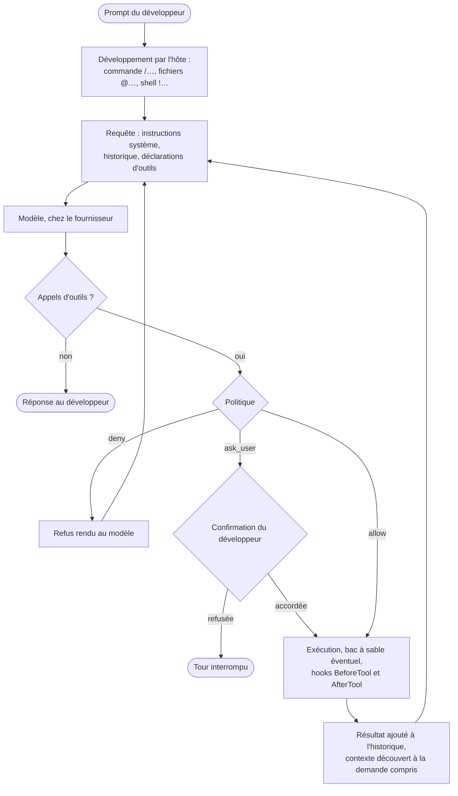

# Module `modele-hote` (D9)

Phase 7E couverte : Engendrent et Évolutif.

## 1. Statut des repères

Les repères H1 à H17 décrivent Gemini CLI 0.67.0. Ils ont été vérifiés le 6 novembre 2026, chacun par sa source : document de la documentation embarquée dans le paquet (chemin relatif à `bundle/docs/`), code du paquet relu, ou essai réel. Un essai réel lance Gemini CLI dans un accueil isolé, avec une clé factice, contre une fausse API sur `127.0.0.1` qui garde chaque requête et répond « clé invalide » : on y lit exactement ce que l'hôte envoie au modèle, ainsi que le prompt exporté et la transcription de la session. Toute autre sortie passe par un proxy témoin local, qui note l'hôte visé et refuse la connexion : aucun appel ne quitte le poste, et ce que l'hôte cherche à joindre devient observable. La recette des repères (module `recette`, § 4) rejoue les essais réels à chaque modification de la spécification (D9.INV-1).

Ils servent à expliquer, pas à remplacer l'observation : pour une autre version, chaque repère se cite « à revérifier » et se relit dans la documentation installée (D6.INV-5). Un hôte non reconnu n'a pas de repères : seuls H1 et H2, donnés pour généraux, décrivent tout agent outillé, sans nom (module `hote`, § 5).

## 2. Harnais, modèle et tour de boucle

**H1 : le harnais et le modèle.** Gemini CLI est un programme Node, le paquet `@google/gemini-cli`, qui tourne sur le poste ; le modèle tourne chez le fournisseur, joint selon le mode d'authentification (`security.auth.selectedType` : compte Google, clé d'API Gemini, Vertex AI). À chaque requête, l'hôte renvoie les instructions système, tout l'historique utile et les déclarations d'outils : le modèle ne garde rien d'une requête à l'autre. Ce qu'une session « sait » est ce que l'hôte lui renvoie ; ce qui survit à la session est ce qui est écrit sur le disque. Chaque requête porte aussi ses réglages de génération (observés par défaut : `temperature` 1, `topP` 0,95, `topK` 64, réflexion du modèle au niveau `HIGH`), que `modelConfigs` peut changer. Source : requêtes capturées, code, `reference/configuration.md`.

Ce qui sort du poste : les requêtes au modèle, et, avec les réglages par défaut, des statistiques d'usage envoyées à `play.googleapis.com`, même en mode non interactif, et, en mode interactif, la recherche d'une mise à jour sur `registry.npmjs.org`. `privacy.usageStatisticsEnabled`, `general.enableAutoUpdate` et `general.enableAutoUpdateNotification` à `false` les coupent ; la télémétrie OpenTelemetry est coupée par défaut (`telemetry.enabled`). Sous Node 22 et 24, toutes ces sorties suivent le proxy de `HTTPS_PROXY`. Sous Node 26 (observé le 7 novembre 2026 avec Node 26.13.0), la connexion par compte Google le suit encore, mais les requêtes au modèle par clé d'API Gemini, les statistiques d'usage et la recherche de mise à jour partent en direct : l'hôte règle son proxy pour une version de la bibliothèque HTTP de Node que le `fetch` intégré de Node 26 n'écoute plus ; `NODE_USE_ENV_PROXY=1`, posée dans l'environnement de l'hôte, les ramène au proxy. Source : essais réels avec un proxy témoin, sous Node 22, 24 et 26.13.0, code, `reference/configuration.md` (« Usage statistics »), `cli/enterprise.md`.

**H2 : le tour de boucle.** Un prompt du développeur est d'abord développé par l'hôte (commande `/…`, fichiers `@…`, shell `!…`), puis envoyé. Le modèle répond par du texte ou par des appels d'outils. Chaque appel passe par la politique : `allow` l'exécute, `deny` le refuse et le refus est rendu au modèle, `ask_user` le soumet au développeur. Le résultat s'ajoute à l'historique, et l'hôte relance le modèle, jusqu'à une réponse sans appel d'outil. La détection de boucles (`model.disableLoopDetection`) et `model.maxSessionTurns` bornent le tour. Source : `reference/tools.md`, `reference/policy-engine.md`, `reference/configuration.md`.

## 3. Contexte et prompt système

**H3 : le contexte de chaque requête.** Instructions système (avec la mémoire globale et l'index privé du projet), premier message de session (avec les fichiers de contexte du projet et des extensions), historique, contexte découvert à la demande dans les résultats d'outils, skill activé, déclarations d'outils : le détail est au module `contexte`, § 1. Source : essais réels (prompt exporté, transcription), code.

**H4 : le gabarit du prompt système.** Le texte des instructions système n'est pas fixe : l'hôte le compose à chaque session selon le modèle (un gabarit récent pour les modèles Gemini 3, l'ancien sinon), le mode d'approbation (`plan`, `yolo`), le mode interactif ou non, le bac à sable, la présence d'un dépôt git, les skills, les sous-agents et les outils actifs. `GEMINI_SYSTEM_MD` le remplace en entier par un fichier, où `${AgentSkills}`, `${SubAgents}` et `${AvailableTools}` réinjectent les sections de l'hôte ; `GEMINI_WRITE_SYSTEM_MD` l'exporte. Le prompt exporté est exactement le texte des instructions système envoyées. Source : code (choix du gabarit), requêtes capturées et prompts exportés (deux gabarits observés selon le modèle résolu, des textes différents en mode interactif et non interactif), `cli/system-prompt.md`.

**H5 : la compression.** Quand l'historique atteint la fraction `model.compressionThreshold` de la fenêtre de contexte (0,5 par défaut), l'hôte le remplace par un résumé ; `/compress` le fait à la main, et le hook `PreCompress` s'exécute avant. Ce que le résumé omet n'existe plus pour le modèle. Source : `reference/configuration.md`, `reference/commands.md`, `hooks/reference.md`.

## 4. Outils, politique, confiance

**H6 : les outils déclarés.** Déclarés au modèle en 0.67.0, réglages par défaut, sans serveur MCP, en mode interactif : `activate_skill`, `ask_user`, `enter_plan_mode`, `glob`, `google_web_search`, `grep_search`, `invoke_agent`, `list_background_processes`, `list_directory`, `read_background_output`, `read_file`, `replace`, `run_shell_command`, `update_topic`, `web_fetch`, `write_file`. La documentation cite aussi `read_many_files` (que l'hôte emploie lui-même pour `@fichier`), `write_todos`, `exit_plan_mode`, `list_mcp_resources`, `read_mcp_resource`, les outils `tracker_*` (expérimentaux) et `complete_task`, propre aux sous-agents, qui ne sont déclarés que dans certaines conditions (réglage, mode plan, serveurs MCP) ; `get_internal_docs` n'est donné qu'au sous-agent `cli_help`. Les outils des serveurs MCP s'ajoutent à la liste ; `tools.core` restreint les outils intégrés à une liste blanche. Source : requêtes capturées, `reference/tools.md`, code.

**H7 : la politique.** Chaque appel d'outil reçoit la décision de la règle de plus haute priorité : `allow`, `deny` ou `ask_user`. Une règle `deny` sans condition sur les arguments retire l'outil des déclarations : le modèle ne sait pas qu'il existe. En mode non interactif, `ask_user` vaut `deny`. Les modes d'approbation `plan`, `default`, `autoEdit` et `yolo` activent des jeux de règles ; une approbation « pour toutes les sessions » vaut pour son mode et les plus permissifs, et s'écrit dans `auto-saved.toml`. Source : `reference/policy-engine.md`, code.

**H8 : la confiance du dossier.** Un dossier non fiable fait tourner l'hôte en mode restreint (module `configuration`, § 4) ; c'est la première chose à vérifier quand un composant du projet ne se manifeste pas. Source : `cli/trusted-folders.md`, code.

**H9 : le bac à sable.** `tools.sandbox`, `GEMINI_SANDBOX` ou `-s` font exécuter les outils dans un conteneur (Docker, Podman) ou, sous macOS, sous `sandbox-exec` ; la variable `SANDBOX` y est posée, et le prompt système le dit (section « Outside of Sandbox » sinon). Source : `cli/sandbox.md`, prompt exporté.

**H10 : l'environnement des commandes.** Une commande lancée par `run_shell_command` reçoit l'environnement de l'hôte, plus `GEMINI_CLI=1`, `TERM=xterm-256color` et `PAGER=cat` ; avec `security.environmentVariableRedaction.enabled`, ou sous GitHub Actions, les variables jugées sensibles en sont retirées. Source : code, `tools/shell.md`, `reference/configuration.md`.

## 5. Composants

**H11 : les skills.** Paliers et alias, divulgation progressive, activation confirmée par le développeur : module `composants`, § 1. Source : `cli/skills.md`, prompt exporté.

**H12 : les sous-agents.** Contexte et outils isolés, pas d'appel entre sous-agents, appel par `invoke_agent` ; `/model` ne change pas leur modèle. Module `composants`, § 2. Source : `core/subagents.md`, `cli/model.md`, prompt exporté.

**H13 : commandes, extensions, serveurs MCP, hooks.** Module `composants`, § 3 à § 6. Source : `cli/custom-commands.md`, `extensions/reference.md`, `tools/mcp-server.md`, `hooks/reference.md`.

## 6. Mémoire, modèle, configuration

**H14 : la mémoire et la persistance.** Aucun outil de mémoire dédié : le modèle retient en écrivant dans les fichiers de contexte ; les sessions s'enregistrent et se reprennent (`/resume`) ; les points de reprise, s'ils sont activés, se restaurent (`/restore`) ; la mémoire automatique, expérimentale, propose sans appliquer. Au lancement, le nettoyage des sessions (`general.sessionRetention`, actif par défaut) supprime celles qui dépassent `maxAge` (30 jours par défaut) ou `maxCount`, et, quel que soit leur âge, celles qui n'ont rien à reprendre, comme une session dont aucun tour n'a abouti. Module `contexte`, § 4. Source : `tools/memory.md`, `cli/session-management.md`, `cli/checkpointing.md`, `cli/auto-memory.md`, prompt exporté, code, essai réel.

**H15 : le modèle et le routage.** Le modèle demandé se choisit dans l'ordre : `-m`, `GEMINI_MODEL`, `model.name`, puis le mode Auto, qui choisit entre un modèle Pro et un modèle Flash selon la tâche. En mode Auto, chaque prompt du développeur part d'abord, avec le premier message de la session, vers un modèle Flash-Lite chargé d'en estimer la complexité, puis vers le modèle retenu. Observé le 6 novembre 2026 contre la fausse API, où ce routeur échoue : `gemini-3.5-flash-lite` pour le routeur, puis `gemini-3.1-pro-preview`, le modèle retenu à défaut ; ce n'est donc pas un choix du routeur. En cas d'échec, l'hôte propose un modèle de repli ; d'autres appels internes emploient d'autres modèles sans le dire ; les sous-agents ont le leur. `/stats model` montre les modèles réellement employés et leurs jetons. Source : requêtes capturées, code, `cli/model.md`, `cli/model-routing.md`.

**H16 : la configuration.** Couches, ordre, variables et options : module `configuration`. Source : `reference/configuration.md`, code.

**H17 : le mode non interactif.** Avec `-p`, l'hôte répond une fois et s'arrête. Il se met aussi dans ce mode quand son entrée ou sa sortie n'est pas un terminal, et quand `CI` ou `GITHUB_ACTIONS` vaut `true`, sauf `GEMINI_CLI_INTEGRATION_TEST=true` : un programme qui lance Gemini CLI sans terminal le met dans ce mode. `ask_user` y vaut `deny`, et les outils qui demanderaient une confirmation ne sont même pas déclarés au modèle : sans règle de politique qui les autorise, il ne reste que `enter_plan_mode`, `glob`, `google_web_search`, `grep_search`, `invoke_agent`, `list_directory`, `read_file` et `update_topic`. Le modèle n'y peut donc ni activer un skill, ni lancer une commande, ni écrire un fichier ; ce skill, qui lance son script, n'y fonctionne pas sans une telle règle. Un dossier non fiable arrête l'hôte net, sauf `--skip-trust` ou `GEMINI_CLI_TRUST_WORKSPACE=true` ; `--output-format json` ou `stream-json` structurent la sortie. Source : requêtes capturées, code, essai réel sous un terminal, `cli/headless.md`, `reference/policy-engine.md`, `cli/trusted-folders.md`.

## 7. Ce qui ne s'observe pas

Les angles morts et leurs moyens d'observation sont au module `provenance`, § 6. Dans une explication, ils se disent à l'endroit où ils limitent la réponse, pas en bloc à la fin.

## 8. Comment citer un repère

« [documenté : repère H7, Gemini CLI 0.67.0, `reference/policy-engine.md`] », complété par l'observation de cette installation quand elle existe : « [observé : composants, politiques] une règle `deny` sur `run_shell_command` au palier administrateur ». Pour une autre version : « [documenté : repère H7 vérifié sur 0.67.0, à revérifier] », puis la lecture du document installé.

## 9. Repères et installation

Un repère dit comment l'hôte fonctionne ; l'instantané dit ce qui est en place ici. Une bonne explication tient les deux : « [documenté : H11] les skills du workspace l'emportent sur ceux de l'utilisateur ; [observé : composants] votre skill `alpha` du workspace masque celui de `~/.gemini/skills/` ».

## 10. Écarts entre la documentation et le code, Gemini CLI 0.67.0

Relevés le 6 novembre 2026, en relisant le code là où la documentation de la même version ne suffisait pas. L'agent les dit avec leurs deux sources (D6.INV-3).

| Sujet | La documentation | Le code et les essais |
|---|---|---|
| fichiers de contexte des sous-dossiers | balayés au démarrage, sous la racine, dans la limite de `context.discoveryMaxDirs` (200) (`reference/configuration.md`) | aucun balayage au démarrage : ces fichiers ne se chargent qu'à la demande, quand un outil touche leur dossier ; `context.discoveryMaxDirs` est lu mais sans effet |
| place du contexte du projet | fourni « dans le prompt système » (`reference/configuration.md`) | dans le premier message de la session ; seuls la mémoire globale et l'index privé du projet sont dans les instructions système |
| appel des sous-agents | chaque sous-agent est un outil de son nom (`core/subagents.md`) | un seul outil, `invoke_agent`, avec le nom du sous-agent en paramètre (prompt exporté) |
| fichier `.env` | la remontée s'arrête à la racine du projet ou à l'accueil (`reference/configuration.md`) | la remontée va jusqu'à la racine du système, puis l'accueil |
| dossier du projet | `~/.gemini/tmp/<project_hash>/` (`reference/configuration.md`, `cli/session-management.md`) | `~/.gemini/tmp/<identifiant>/`, identifiant court tenu par `~/.gemini/projects.json`, les anciens dossiers à empreinte étant migrés |
| `/memory` | `refresh` dans `reference/commands.md`, `reload` dans `cli/gemini-md.md` | `reload`, avec `refresh` pour alias |
| outils | une liste de vingt-six outils intégrés (`reference/tools.md`) | seize déclarés par défaut en mode interactif, huit en mode non interactif ; deux d'entre eux, `list_background_processes` et `read_background_output`, absents de la documentation |
| déclenchement du mode non interactif | sans terminal, ou avec `-p` (`cli/headless.md`) | aussi quand `CI` ou `GITHUB_ACTIONS` vaut `true`, même sous un terminal (code ; essai réel) |
| nettoyage des sessions | `minRetention` (1 jour par défaut) protège toute session plus récente (`cli/session-management.md`) | une session sans contenu à reprendre est supprimée dès le lancement suivant, quel que soit son âge (code ; essai réel) |
| modèles du mode Auto | `gemini-3-pro-preview` et `gemini-3-flash-preview` pour « Auto (Gemini 3) » (`cli/model.md`) | requête principale sur `gemini-3.1-pro-preview`, routeur sur `gemini-3.5-flash-lite` (requêtes capturées) ; seul `/stats model` dit les modèles réellement employés |

## 11. Parcours découverte : ouvrir la boîte noire

Pour `/hote:explique` sans question, « explique-moi comment tu fonctionnes », ou un développeur qui dit ne pas voir ce que fait l'outil. Le parcours s'adresse à qui hésite à se servir de l'IA faute d'en connaître le fonctionnement : il ouvre la boîte, sans chercher à convaincre (D7.INV-5). Pendant le parcours, l'agent ne modifie rien (D7.INV-2) : c'est une première utilisation sans risque.

Sept étapes, une à la fois, chacune en trois temps (D7.INV-4) :

1. **la réponse simple** : quelques phrases, sans jargon ; un terme technique s'explique à sa première apparition ;
2. **montré ici** : sur cette installation, l'observation qui le prouve ;
3. **ce que vous gardez en main** : le geste qui donne la maîtrise.

Les étiquettes s'écrivent en clair (module `provenance`, § 3). Après chaque étape, l'agent demande s'il continue, approfondit ou s'arrête ; approfondir, c'est passer aux repères de l'étape.

| Étape | Question du développeur | La réponse simple | Montré ici | Ce que vous gardez en main | Repères |
|---|---|---|---|---|---|
| 1 | « Qu'est-ce que c'est, au juste ? » | deux pièces : un programme sur votre poste, Gemini CLI, et un modèle de langage chez Google ; le modèle ne fait que produire du texte à partir de ce que le programme lui envoie, et ne garde rien d'une requête à l'autre ; c'est le programme qui lit, cherche, écrit et lance des commandes | `hote` : version, paquet, plateforme | le programme tourne chez vous : vous le lancez, l'arrêtez (`/quit`) et le réglez | H1 |
| 2 | « Que reçoit le modèle quand je tape une demande ? » | à chaque requête, le programme assemble un envoi : des instructions système, vos fichiers `GEMINI.md`, la conversation et la liste des outils ; le modèle ne voit rien d'autre, ni votre écran ni votre disque | `contexte` : fichiers de contexte chargés ; le prompt système exporté par le développeur, lu avec lui section par section (module `contexte`, § 6) | le contenu de vos `GEMINI.md` ; `/memory show` montre ce qui est chargé | H3, H4 |
| 3 | « Que voit-il de mon code ? » | au premier message, les noms des dossiers et des fichiers du workspace, 200 au plus, pas leur contenu ; un fichier n'est lu que par un outil de lecture, ou quand vous le citez (`@fichier`) ; les outils de recherche ignorent ce qu'excluent `.gitignore` et `.geminiignore` | les outils de lecture vus dans son propre contexte ; `contexte` : racine du workspace ; `composants` : fichiers d'exclusion | lancer l'outil depuis le bon dossier ; `.geminiignore` ; citer les fichiers utiles | H3, H6 |
| 4 | « Comment décide-t-il d'agir ? » | une boucle : le modèle propose une action (lire, chercher, écrire, lancer une commande) ; le programme la confronte à ses règles, l'exécute ou vous la demande, puis renvoie le résultat au modèle, qui recommence jusqu'à sa réponse | le schéma du § 2 ; `config` : mode d'approbation ; `composants` : politiques | refuser une action proposée ; interrompre la requête (`Ctrl+C`) ; `/tools desc` liste les outils | H2, H6, H7 |
| 5 | « Peut-il modifier ou casser quelque chose ? » | par défaut, chaque modification de fichier et chaque commande vous est demandée avant de s'exécuter, sauf celles que vous avez approuvées pour la suite ; le mode plan ne fait que lire ; dans un dossier non fiable, ni les réglages, ni les consignes, ni les commandes du projet ne sont chargés, et rien n'est approuvé d'avance ; les points de reprise, s'ils sont activés, permettent de revenir en arrière (`/restore`) | `config` : mode d'approbation, confiance du dossier, points de reprise, bac à sable | lire chaque proposition avant d'accepter ; travailler sous git ; le mode plan ; ne pas tout approuver d'avance | H7, H8, H9, H14 |
| 6 | « Où partent mes données, et que retient-il ? » | ce que contient l'envoi part chez Google à chaque requête ; par défaut s'y ajoutent des statistiques d'usage et, en mode interactif, une recherche de mise à jour ; le modèle ne retient rien : ce qui reste est écrit sur votre poste (`GEMINI.md`, sessions enregistrées) | `config` : mode d'authentification, statistiques d'usage, mise à jour, télémétrie ; `contexte` : mémoire, sessions | ce que vous mettez dans la conversation ; les réglages qui coupent statistiques et mise à jour ; supprimer une session depuis `/resume` | H1, H14 |
| 7 | « Peut-il se tromper, et comment le vérifier ? » | oui : il produit un texte plausible à partir de ce qu'il a reçu, et ne sait de votre projet que ce qu'il a lu ; ce qu'il affirme se vérifie, par les tests, la relecture de ses modifications et la question « d'où tiens-tu ça ? » | les étiquettes de cette explication même ; un angle mort de cette installation (module `provenance`, § 6) | relire et tester ; demander la source ; ne pas lui confier ce que vous ne pouvez pas vérifier | H1, H3 |

Sources des réponses simples, outre les repères : l'arrêt d'une requête par `Ctrl+C` (`reference/keyboard-shortcuts.md`), le mode plan en lecture seule (`cli/plan-mode.md`), les exclusions (`cli/gemini-ignore.md`), et, pour l'étape 7, la documentation elle-même, qui présente la recherche web comme un moyen d'éviter que l'agent n'invente (`cli/tutorials/web-tools.md`). La démonstration de l'étape 7 est l'explication : chacune de ses affirmations porte sa source.

Après le parcours, pour qui veut aller plus loin : ce qui étend l'hôte (H11, H12, H13), quel modèle répond (H15, `/stats model`), le mode non interactif (H17), la carte de l'installation (`/hote:carte`).

## 12. Contrôle de sortie

- Chaque repère cité porte son numéro, sa version et sa source (D9.INV-1).
- Pour une autre version, le repère est signalé « à revérifier » et le document installé relu (D6.INV-5).
- Un écart du § 10 se dit avec ses deux sources (D6.INV-3).
- Chaque étape du parcours découverte donne sa réponse simple, sa démonstration sur cette installation et ce que le développeur garde en main (D7.INV-4).
