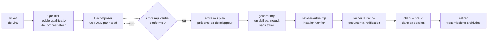

# Générateur de skills de ticket C7E, version 1.0.1

Ce document est le point d'entrée du générateur. Un ticket n'y est plus résolu directement par l'orchestrateur C7E : il l'est par un **arbre de skills de ticket**, un par nœud, produits pour lui sur le même modèle fractal et récursif. Le générateur fait qualifier et décomposer le ticket, vérifie l'arbre, assemble chaque skill depuis les blocs ratifiés du référentiel des méso-contrats, l'installe dans Gemini CLI et le lance ; ensuite, chaque nœud se résout dans sa propre session, par son skill et ses agents. Chaque skill s'observe par rapport aux retours du développeur, ses choix et ses corrections, dans un champ d'observation partagé, et chaque niveau voit le ticket augmenté des observations des autres. Les règles détaillées sont dans `modules/`.

Le générateur dépend de l'orchestrateur C7E, à une version épinglée, et ne le modifie pas. Le skill de ticket tient lieu de fiche de transformation : le module `invariants` de chaque skill fait correspondre chaque invariant de l'orchestrateur qui parle de la fiche à ce qui le tient dans le skill. Le générateur est issu d'un prototype en sept lots ; l'histoire de sa conception est dans `PROTOTYPE.md`, son bilan dans `BILAN.md`, à côté de ce document dans le dépôt, non transmis.

## 1. Ordre de lecture

1. Ce document, en entier.
2. `manifest.json` : modules, et versions des skills du dépôt dont héritent les skills de ticket.
3. Les modules, dans l'ordre du déroulé : `arbre`, `assemblage`, `installation` ; pour suivre un arbre installé, `documents-kits`, `champ` et `vue` ; `mesure` pour mesurer le contexte d'un arbre.
4. Dans le clone du dépôt, pour qualifier un ticket : les modules `qualification` et `referentiel` de l'orchestrateur, `<dépôt>/specs/orchestrateur-c7e/modules/qualification/SKILL.md` et `<dépôt>/specs/orchestrateur-c7e/modules/referentiel/SKILL.md`.

## 2. Ce que fait le générateur

Le partage du travail est strict :

- **Ce que le modèle écrit** : la partie propre au ticket, dans les tickets de l'arbre. La demande, avec ses dix-sept possibilités et leurs sources, qui fixe la composition par la règle de choix du référentiel ; l'objectif et les critères de chaque nœud, et ce que chaque critère soutient chez le parent ; les options des feuilles, prises aux catalogues du référentiel (D1.INV-3, D2.INV-1).
- **Ce que les outils assemblent** : tout le reste. Méso-contrats et options copiés du référentiel puis paramétrés, sections de méthode et invariants de l'orchestrateur mot pour mot, socle et référentiels de la pile, boîte à outils de l'arbre, agents, commandes : du code sur des fichiers, déterministe, sans token consommé (D2.INV-1 à D2.INV-3).

Les outils se lancent depuis le clone du dépôt Agent2Prompt du développeur, `<dépôt>`, avec Node 20 ou plus récent, sans dépendance : `node <dépôt>/specs/generateur-skill-ticket/outils/<outil>.mjs`. Ils lisent les sources dont héritent les skills de ticket dans ce clone, à leurs versions épinglées, archives comprises. La transmission du générateur porte sa consigne et ses modules ; ses outils, sa recette et ses exemples restent dans le dépôt.

## 3. Déroulé

Prérequis : le chemin du clone, `<dépôt>`, que tu demandes au développeur s'il n'est pas connu ; le projet, dossier où Gemini CLI 0.67.0 est lancé, que le développeur a marqué de confiance ; la clé du ticket racine, `<clé>`. Si le projet a sa copie du fichier d'invariants, `docs/c7e/meso-contrats.md`, ou son référentiel, `docs/c7e/referentiel-meso-contrats.toml`, les commandes les prennent par `--invariants-projet` et `--referentiel`.

1. **Qualifier** le ticket racine selon le module `qualification` de l'orchestrateur : demande complète et sourcée, composition donnée par la règle de choix du référentiel, critères vérifiables. Une possibilité dont la réponse changerait la composition ne reste pas `inconnu` : demande au développeur.
2. **Décomposer**, quand la demande touche plusieurs couches ou fonctionnalités qu'un seul skill traiterait mal : un fichier TOML par nœud dans `docs/demandes/<clé>/arbre/`, au format du module `arbre`. Chaque sous-ticket se qualifie comme la racine ; chacun de ses critères soutient un critère de son parent direct ; les options vont sur les feuilles seulement. Un ticket simple reste un seul nœud, racine et feuille.
3. **Vérifier** : `node <dépôt>/specs/generateur-skill-ticket/outils/arbre.mjs verifier docs/demandes/<clé>/arbre`, jusqu'à zéro écart ; chaque écart dit la règle et le nœud. Puis `arbre.mjs plan` sur le même dossier : présente au développeur l'arbre, les méso-contrats, l'ordre de résolution et les critères, et corrige l'arbre s'il le demande.
4. **Générer**, quand il le demande : `node <dépôt>/specs/generateur-skill-ticket/outils/generer.mjs generer docs/demandes/<clé>/arbre --sortie <travail>`, où `<travail>` est un dossier de travail hors du projet. Rien n'est écrit au moindre écart, et aucun skill de l'arbre n'est écrit si l'un d'eux omet ou affaiblit un invariant (D2.INV-2).
5. **Installer**, depuis le projet : `node <dépôt>/specs/generateur-skill-ticket/outils/installer-arbre.mjs installer <travail>/transmissions`, puis `verifier <clé>` : skills découverts, agents chargés. Tout est masqué à Git (D3.INV-2).
6. **Lancer** la racine : `installer-arbre.mjs lancer <clé>`, ou la commande `/ticket:<clé en minuscules>` dans Gemini CLI. Le skill racine prend la suite : il fait rédiger les documents de la clé, présente l'arbre avec eux, et attend la ratification du développeur, qu'il dépose dans le champ d'observation (D3.INV-3). Il indique ensuite le prochain nœud prêt et sa commande ; chaque nœud se lance dans sa propre session.
7. **Suivre et clore** : `installer-arbre.mjs liste` donne l'état de chaque nœud, du champ et de la vue. À la clôture de la racine, kits et remise faits, `installer-arbre.mjs retirer <clé>` archive les transmissions dans `docs/demandes/<clé>/skills/` et retire l'arbre.

Le générateur ne corrige jamais un skill de ticket à la main : une correction passe par l'arbre, puis par une nouvelle génération. Il n'active lui-même aucun skill de ticket : la ratification et la résolution appartiennent aux skills de l'arbre, sous le regard du développeur.

## 4. Outils

| Outil | Commandes | Module |
|---|---|---|
| `arbre.mjs` | `verifier <arbre>`, `plan <arbre>` | `arbre` |
| `generer.mjs` | `generer <arbre> --sortie <dossier>`, `verifier <transmissions>` | `assemblage` |
| `installer-arbre.mjs` | `installer`, `liste`, `verifier`, `lancer`, `retirer` | `installation` |
| `verifier-documents.mjs`, `verifier-kits.mjs` | contrôles des documents de la clé et des kits ; livrés dans le skill racine | `documents-kits` |
| `champ.mjs` | `deposer`, `verifier`, `etat` ; livré dans le skill racine | `champ` |
| `invariants.mjs` | `comparer <skill>` ; livré dans le skill racine | `documents-kits` |
| `vue.mjs` | `generer [--noeud] [--json]`, `verifier` ; livré dans le skill racine | `vue` |
| `mesurer-contexte.mjs` | `mesurer <transmissions>`, `calibrer` | `mesure` |

Options communes : `--referentiel <chemin>` lit le référentiel d'un projet au lieu du modèle de l'orchestrateur ; `--profondeur-max <n>` change le plafond de profondeur ; `--invariants-projet <chemin>` donne la copie du projet du fichier d'invariants. Code de sortie 1 au moindre écart, 2 pour un usage incorrect. Sous Windows, les mêmes commandes passent dans PowerShell ; une extraction en fins de ligne CRLF donne les mêmes skills, octet pour octet.

## 5. Cycle 7E

| Phase | Ce qu'elle désigne ici | Modules |
|---|---|---|
| Éléments | tickets et sous-tickets, possibilités, critères, options | `arbre` |
| Espace | l'arbre, le dossier de la clé `docs/demandes/<clé>/`, le workspace de Gemini CLI | `arbre`, `installation` |
| Engendrent | les soutiens entre critères, les dépendances entre tickets, les héritages de chaque skill | `arbre`, `assemblage` |
| État | l'état de chaque nœud, l'état de chaque critère dans le champ d'observation | `installation`, `champ` |
| Expression | les transmissions des skills, les documents de la clé, les kits, la vue augmentée | `assemblage`, `documents-kits`, `vue` |
| Évolutif | les observations d'ordre 2 et 3, le registre des concepts, les versions du générateur, la mesure du contexte | `champ`, `mesure` |
| Environnement | Gemini CLI, le développeur qui ratifie et corrige, Agent2Test qui reçoit la remise | `installation`, `documents-kits` |

Clause de second ordre : un niveau agit sur la manière d'observer du niveau inférieur, jamais sur son objet. L'ordre 2 propose une adaptation de la méthode, jamais une action sur le code ; toute observation remonte avec sa preuve ; la référence d'une auto-observation est un retour du développeur ou une preuve, jamais l'auto-évaluation seule ; toute adaptation durable passe par le développeur (D5.INV-2, D5.INV-3).

## 6. Registre des dimensions

| ID | Dimension | Introduite | Statut 1.0.0 | Dépend de | Module |
|---|---|---|---|---|---|
| D1 | Arbre de tickets | 1.0 | active | orchestrateur-c7e | `arbre` |
| D2 | Assemblage et transmission des skills de ticket | 1.0 | active | D1 | `assemblage` |
| D3 | Installation et cycle de vie dans Gemini CLI | 1.0 | active | D2 | `installation` |
| D4 | Documents de la clé, sous-agents de rôle et kits | 1.0 | active | D2, D3 | `documents-kits` |
| D5 | Champ d'observation | 1.0 | active | D3 | `champ` |
| D6 | Vue augmentée | 1.0 | active | D4, D5 | `vue` |
| D7 | Contexte chargé | 1.0 | active | D2 | `mesure` |

## 7. Contrat de version et points d'extension

Le générateur suit le contrat de version de `EVOLUTION.md` du dépôt Agent2Prompt. Les skills du dépôt dont héritent les skills de ticket sont référencés dans `manifest.json` à la version qu'épinglent leurs sources : l'orchestrateur épingle le socle back-front, les référentiels Java et Angular et agent-tdd-jira ; agent-tdd-jira épingle Agent2Test ; le générateur épingle analyse-projet et sonarqube. Une nouvelle version de l'un d'eux arrête la génération, jusqu'à ce que le générateur la reprenne dans une version à lui. Chaque skill de ticket cite le générateur et sa version (D2.INV-4) ; les transmissions attendues et les rapports de mesure des exemples se régénèrent quand une source change, et la recette le signale.

Points d'extension, actifs dès 1.0.0 :

- **E1** : fabriques par pile. La fabrique abstraite produit la famille de fichiers d'un nœud et laisse à une fabrique concrète les crochets de la pile : référentiels, agents de couche, commandes de test. La 1.0.0 n'a que la fabrique `java-angular-postgresql` ; une autre pile s'ajoute par une fabrique concrète, sans toucher au Monteur. La fabrique abstraite seule ne produit rien.
- **E2** : exécuteur. La 1.0.0 lance chaque nœud dans Gemini CLI 0.67.0 ; la place d'un autre exécuteur, le binôme Agent2Dev et Agent2Test ou n8n, est réservée : l'installateur n'en accepte aucun autre.
- **E3** : formats propres au générateur. Le champ (`skill-ticket.observation/1`), la vue (`skill-ticket.vue/1`), les kits (`skill-ticket.kit/1`), le rattachement des critères (`skill-ticket.rattachement/1`), le relevé d'installation (`skill-ticket.installation/1`) et la mesure du contexte (`skill-ticket.contexte/1`) sont des formats versionnés, fermés pour ceux qu'on dépose ; ils sont prêts à devenir un socle d'observation partagé, inclus et épinglé comme le socle back-front.

## 8. Règles globales

- **L'orchestrateur ne change pas** : le générateur ne modifie aucune spécification du dépôt. Dans le projet, il n'écrit que les tickets de l'arbre, `docs/demandes/<clé>/arbre/` ; l'installateur y ajoute ce qu'il masque à Git, et les skills de l'arbre ce que leur consigne leur fait écrire.
- **Un skill de ticket est immuable** : il reste identique à sa transmission. Une ambiguïté ou une contradiction dans un skill se signale au développeur ; la correction passe par l'arbre et une nouvelle génération.
- **Le développeur décide** : il valide l'arbre avant la génération, ratifie l'arbre et chaque feuille dans les skills, retient ou refuse chaque proposition d'ordre 2, tranche chaque désaccord. Aucune approbation automatique, aucun dossier rendu de confiance à sa place (D3.INV-4).
- **Sécurité** : aucun jeton, aucune clé n'est demandé au développeur ni affiché, consigné, versionné ou passé en argument ; le jeton SonarQube passe par la seule variable `SONAR_TOKEN`, et rien ne s'écrit vers SonarQube sans sa validation explicite ; la clé de Gemini CLI reste celle de son installation.
- **Git** : les skills de l'arbre commitent sur une seule branche, celle de la clé racine ; aucun d'eux ne pousse, ne fusionne, ne rebase ni ne pose d'étiquette.
- **Langue** : consignes, documents de la clé et remises en français.

## 9. Critères d'acceptation

La recette du générateur, `node --test "specs/generateur-skill-ticket/tests/*.test.mjs"` depuis la racine du dépôt (Node 22 ou plus récent), les vérifie sur deux arbres d'exemple, ABCDE-3620 sur trois niveaux et ABCDE-3512 en un seul ticket :

- **P1** : un arbre conforme passe le vérificateur ; deux parents, un cycle, une dépendance vers un ancêtre, une profondeur au-delà du plafond, une possibilité du parent portée par aucun sous-ticket, une option hors de la composition et un invariant omis sont rejetés.
- **P2** : chaque skill se relit à l'identique depuis sa transmission, et la même entrée redonne les mêmes fichiers ; l'assemblage ne consomme aucun token.
- **P3** : chaque skill reprend tous les invariants dont il hérite, contrôlé automatiquement.
- **P4** : dans Gemini CLI, le skill racine présente l'arbre, les méso-contrats, l'ordre de résolution et les critères, puis attend la ratification avant toute action. Un ticket sans sous-ticket n'a pas d'arbre à ratifier : son skill présente le ticket, son méso-contrat, ses critères et son analyse, faite en lecture seule, puis attend la ratification avant toute modification. La découverte des skills et le chargement des agents se vérifient sans modèle ; la présentation et l'attente se jouent sur le poste du développeur (module `installation`).
- **P5** : sur retours simulés, une correction répétée fait attendre une proposition d'ordre 2 ; un écart dans un sous-ticket menace le critère du parent qu'il soutient ; un désaccord entre nœuds va au registre des écarts.
- **P6** : la vue augmentée montre, pour chaque ancre, des calques et un état conformes au champ.
- **P7** : le contexte chargé pour résoudre une feuille est mesuré et comparé à celui du point d'entrée de l'orchestrateur ; la mesure réelle se fait sur le poste (module `mesure`).
- **P8** : les documents de la clé passent `controler-criteres.mjs` d'agent-tdd-jira sans écart ; chaque critère d'un sous-ticket se rattache à un critère `<CLÉ>-CAnn` et à au moins un scénario.
- **P9** : chaque kit est complet et vérifiable ; la remise est conforme au schéma fermé `agent2test.remise/1`.

Chaque module donne, pour chacun de ses invariants, les tests qui le prouvent.

## 10. Invariants

**D1 : arbre de tickets**

- **D1.INV-1** : un sous-ticket n'a qu'un seul parent ; l'arbre a une seule racine, à laquelle chaque nœud se relie sans cycle de parenté ; sa profondeur ne dépasse pas le plafond, 3 par défaut, réglable dans le référentiel ou par `--profondeur-max`.
- **D1.INV-2** : une dépendance vise un ticket de l'arbre, ni lui-même, ni un ancêtre, ni un descendant ; les dépendances ne forment aucun cycle, ni entre elles, ni avec les clôtures ; l'ordre de résolution place chaque ticket après ceux dont il dépend, et chaque nœud composé après ses sous-tickets.
- **D1.INV-3** : chaque nœud passe les règles de validation du référentiel (demande complète et sourcée, aucune inconnue qui changerait la composition, composition conforme à la règle de choix, options permises par sa composition) ; chaque possibilité à oui d'un nœud composé est portée par au moins un de ses sous-tickets, aucun sous-ticket ne met à oui une possibilité absente de son parent, et un nœud composé ne porte pas d'option.
- **D1.INV-4** : chaque critère d'un sous-ticket soutient un critère de son parent direct, la racine n'en soutient aucun, et chaque critère d'un nœud composé est soutenu par au moins un critère de ses sous-tickets.

**D2 : assemblage et transmission**

- **D2.INV-1** : un skill de ticket s'assemble depuis les blocs ratifiés du référentiel et les sources du dépôt, copiés puis paramétrés ; le modèle n'écrit que la partie propre au ticket, dans les tickets de l'arbre ; l'assemblage est du code, sans token consommé, et un arbre non conforme ne donne aucun skill.
- **D2.INV-2** : chaque skill reprend mot pour mot les invariants de l'orchestrateur et les sections de méthode qu'il déclare, et à l'identique chaque copie dont il hérite, à sa version épinglée ; un invariant omis ou affaibli arrête la génération de tout l'arbre.
- **D2.INV-3** : un skill se relit à l'identique depuis sa transmission, table d'intégrité comprise ; la même entrée redonne les mêmes fichiers, octet pour octet, sans rien tirer au hasard ni dater, quelles que soient les fins de ligne.
- **D2.INV-4** : chaque skill cite le générateur et sa version, sa fabrique et l'orchestrateur dont il est issu ; le Monteur ne remplace qu'un dossier qui contient déjà un skill de ticket généré.

**D3 : installation et cycle de vie**

- **D3.INV-1** : un arbre ne s'installe que complet, chaque transmission vérifiée ; rien n'est écrit au moindre écart ; un fichier modifié depuis l'installation, ou que l'installateur n'a pas écrit, n'est remplacé qu'avec `--forcer`.
- **D3.INV-2** : tout ce que l'installation écrit est relevé et masqué à Git, sauf `--visible` ; le retrait archive les transmissions dans le dossier du ticket et ne laisse rien de l'arbre dans `.gemini` ; ni l'installation ni le retrait ne modifient un fichier suivi par Git.
- **D3.INV-3** : chaque nœud se traite dans sa propre session de Gemini CLI ; l'arbre se ratifie sur sa racine, puis chaque feuille avant sa première action, et un ticket sans sous-ticket une seule fois, sous sa référence ; aucun nœud ne modifie le projet avant sa ratification, le skill tenant lieu de fiche (orchestrateur-c7e:D3.INV-1).
- **D3.INV-4** : le lancement ouvre Gemini CLI en mode interactif sur la phrase qui active le skill du nœud, sans contourner la confiance du dossier ni approuver à la place du développeur ; Gemini CLI 0.67.0 découvre les skills de l'arbre et charge ses agents sans erreur.

**D4 : documents de la clé, sous-agents de rôle et kits**

- **D4.INV-1** : les documents de la clé, `demande.json`, `us.md` et le fichier Gherkin, passent `controler-criteres.mjs` d'agent-tdd-jira et `verifier-documents.mjs` sans écart ; chaque critère de la racine y devient un critère `<CLÉ>-CAnn`, mot pour mot, et chaque critère d'un sous-ticket s'y rattache par ses soutiens et se prouve par au moins un scénario, de sa couche pour une feuille.
- **D4.INV-2** : chaque kit, dev, test et démo, est un manifeste fermé, complet, chaque fichier cité avec son empreinte ; la remise suit le schéma fermé `agent2test.remise/1` ; avec le dépôt, la branche et les commits du kit dev s'y retrouvent.
- **D4.INV-3** : la boîte à outils de l'arbre est sur la racine seule, chaque fichier identique à sa source à sa version épinglée ; chaque sous-agent de rôle travaille dans son propre contexte, l'analyste, le relecteur et la qualité sans outil d'écriture, le rédacteur n'écrivant que dans le dossier de la clé.

**D5 : champ d'observation**

- **D5.INV-1** : un champ par arbre, en ajout seul, au schéma fermé `skill-ticket.observation/1` ; chaque enregistrement porte son numéro, sa date en UTC, jamais antérieure à la précédente, et l'empreinte du précédent ; `champ.mjs` est seul à l'écrire, et un champ altéré refuse tout dépôt.
- **D5.INV-2** : toute observation porte sa preuve ; une correction vise une action antérieure et porte un motif ; seul l'observateur de l'arbre observe à l'ordre 2, et il propose une adaptation de la méthode, jamais une action sur le code.
- **D5.INV-3** : deux corrections au même motif dans l'arbre font attendre une proposition d'ordre 2, qui attend l'examen de l'ordre 3, puis la décision du développeur ; deux propositions refusées sur un motif le mettent en veille ; l'ordre d'observation ne dépasse pas 3, le développeur au-dessus.
- **D5.INV-4** : un écart sur un critère menace, de proche en proche, les critères qu'il soutient, jusqu'au critère d'acceptation de la clé ; des verdicts contraires de deux nœuds sur une même ancre forment un désaccord, que le script inscrit au champ et au registre des écarts du projet, décision au développeur.

**D6 : vue augmentée**

- **D6.INV-1** : la vue se tire du champ et des documents de la clé, sans les réécrire, et ne s'écrit ni ne se corrige à la main ; mêmes champ et documents, même vue, octet pour octet, quelles que soient les fins de ligne ; un champ altéré ne donne pas de vue.
- **D6.INV-2** : chaque ancre porte exactement ce qui l'atteint, et son état est celui que lui donne le champ ; les calques se posent sur l'ancre sans toucher à son état.
- **D6.INV-3** : la page `vue.html` est autonome, sans réseau ni ressource extérieure, lisible au clavier et sans JavaScript, à la structure accessible : langue, titre, niveaux de titre sans saut, commandes libellées, états écrits en toutes lettres.

**D7 : contexte chargé**

- **D7.INV-1** : chaque session de nœud et chaque agent a son propre contexte ; la mesure du contexte de chaque arbre d'exemple, à l'activation et au plus, est déterministe et versionnée, et aucun de ses contextes n'y dépasse, au plus, le point d'entrée de l'orchestrateur pour le même ticket.
- **D7.INV-2** : chaque fichier compté existe, a la taille comptée, et la consigne qui le fait lire le cite ; ce qu'un nœud écrit, le champ et le code des scripts ne se comptent pas ; le point d'entrée de l'orchestrateur se mesure selon son propre ordre de lecture.

## 11. Journal de révision

**1.0.1** (2026-11-09) : correctif, les corrections relevées par le bilan du prototype. Chaque nœud compare le fichier d'invariants du projet à l'état de sa production par empreinte, avec le nouveau script `invariants.mjs` de la boîte à outils de la racine, et ne lit plus que la copie du projet ; chaque agent de couche porte sa part de la consigne au lieu de relire celle du nœud ; les nœuds et les agents de couche lisent le module court `champ-depot` du skill racine, le module `champ` entier restant à la racine et aux observateurs ; le rédacteur est invoqué par son nom d'agent ; P4 précisé pour un ticket sans sous-ticket. La somme des contextes de chaque arbre d'exemple baisse d'au moins 10 % par rapport au lot 7 du prototype. Aucune dimension ni aucun invariant modifié. Archive : `archives/SKILL-v1.0.0.md`.

**1.0.0** (2026-11-09) : première version, issue du prototype « skill de ticket » (lots 1 à 7, décisions ratifiées le 8 novembre 2026, bilan), intégré par une spécification à part, qui dépend de l'orchestrateur sans le modifier. Dimensions D1 à D7 actives ; points d'extension E1 à E3. Références : orchestrateur-c7e 3.5.3, socle-back-front 1.1.0, java 1.1.1, angular 1.0.1, agent-tdd-jira 1.3.4, agent2test 1.3.1, analyse-projet 1.0.2, sonarqube 1.1.0. Chaque skill de ticket cite désormais le générateur et sa version.
