# Générateur de skills de ticket C7E, version 1.4.7

Ce document est le point d'entrée du générateur. Un ticket n'y est plus résolu directement par l'orchestrateur C7E : il l'est par un **arbre de skills de ticket**, un par nœud, produits pour lui sur le même modèle fractal et récursif. Le générateur fait qualifier et décomposer le ticket, vérifie l'arbre, assemble chaque skill depuis les blocs ratifiés du référentiel des méso-contrats, l'installe dans Gemini CLI et le lance ; ensuite, chaque nœud se résout dans sa propre session, par son skill et ses agents. Chaque skill s'observe par rapport aux retours du développeur, ses choix et ses corrections, dans un champ d'observation partagé, et chaque niveau voit le ticket augmenté des observations des autres. L'arbre suit la composition récursive imbriquée (CRI) de la méthode C7E : le ticket et son US au niveau macro, la composition au niveau des méso-contrats, les tâches au niveau des méso-composants, les commits de la branche au niveau micro ; le besoin y descend, les preuves y remontent. Chaque ticket est aussi une recette et un cycle d'apprentissage : le générateur s'observe lui-même, classe ce qu'il apprend par profondeur, et propose ses évolutions au développeur, qui seul les promeut. Ce que les skills et le générateur observent s'exporte enfin, sans texte ni référence en clair, dans l'enveloppe commune du socle d'observation, où d'autres systèmes du dépôt peuvent s'y confronter. Les règles détaillées sont dans `modules/`.

Le générateur dépend de l'orchestrateur C7E, à une version épinglée, et ne le modifie pas. Le skill de ticket tient lieu de fiche de transformation : le module `invariants` de chaque skill fait correspondre chaque invariant de l'orchestrateur qui parle de la fiche à ce qui le tient dans le skill. Le générateur est issu d'un prototype en sept lots ; l'histoire de sa conception est dans `PROTOTYPE.md`, son bilan dans `BILAN.md`, à côté de ce document dans le dépôt, non transmis.

## 1. Ordre de lecture

1. Ce document, en entier.
2. `manifest.json` : modules, versions des skills du dépôt dont héritent les skills de ticket, socle d'observation inclus et socle de l'acceptable référencé.
3. Les modules, dans l'ordre du déroulé : `arbre`, `assemblage`, `installation` ; pour suivre un arbre installé, `documents-kits`, `champ` et `vue` ; `mesure` pour mesurer le contexte d'un arbre ; `apprentissage` pour qualifier un ticket et clore un arbre ; `observation`, puis le socle qu'il applique, `socle-observation/SKILL.md`, pour exporter les observations d'un projet ; `acceptable`, réservé, seulement pour comprendre le point d'extension E5.
4. Dans le clone du dépôt, pour qualifier un ticket : les modules `qualification` et `referentiel` de l'orchestrateur, `<dépôt>/specs/orchestrateur-c7e/modules/qualification/SKILL.md` et `<dépôt>/specs/orchestrateur-c7e/modules/referentiel/SKILL.md`.

## 2. Ce que fait le générateur

```mermaid
flowchart LR
  T["Ticket<br/>clé Jira"] --> Q["Qualifier<br/>module qualification<br/>de l'orchestrateur"]
  Q --> D["Décomposer<br/>un TOML par nœud"]
  D --> V{"arbre.mjs verifier<br/>conforme ?"}
  V -->|non| D
  V -->|oui| P["arbre.mjs plan<br/>présenté au développeur"]
  P --> G["generer.mjs<br/>un skill par nœud,<br/>sans token"]
  G --> I["installer-arbre.mjs<br/>installer, verifier"]
  I --> L["lancer la racine<br/>documents, ratification"]
  L --> N["chaque nœud<br/>dans sa session"]
  N --> C["clore<br/>apprentissage versé<br/>au registre"]
  C --> R["retirer<br/>transmissions archivées"]
  R --> X["observation.mjs exporter<br/>journal d'enveloppes<br/>du socle d'observation"]
```

Le partage du travail est strict :

- **Ce que le modèle écrit** : la partie propre au ticket, dans les tickets de l'arbre. La demande, avec ses dix-sept possibilités et leurs sources, qui fixe la composition par la règle de choix du référentiel ; l'objectif et les critères de chaque nœud, et ce que chaque critère soutient chez le parent ; les options des feuilles, prises aux catalogues du référentiel ; les scénarios de l'US et le plan des commits de chaque tâche, que `arbre.mjs proposer` lui propose (D1.INV-3, D1.INV-5, D2.INV-1).
- **Ce que les outils assemblent** : tout le reste. Méso-contrats et options copiés du référentiel puis paramétrés, sections de méthode et invariants de l'orchestrateur mot pour mot, socle et référentiels de la pile, boîte à outils de l'arbre, agents, commandes : du code sur des fichiers, déterministe, sans token consommé (D2.INV-1 à D2.INV-3).

Les outils se lancent depuis le clone du dépôt Agent2Prompt du développeur, `<dépôt>`, avec Node 20 ou plus récent, sans dépendance : `node <dépôt>/specs/generateur-skill-ticket/outils/<outil>.mjs`. Ils lisent les sources dont héritent les skills de ticket dans ce clone, à leurs versions épinglées, archives comprises. La transmission du générateur porte sa consigne, ses modules et le socle d'observation ; ses outils, sa recette et ses exemples restent dans le dépôt.

## 3. Déroulé

Prérequis : le chemin du clone, `<dépôt>`, que tu demandes au développeur s'il n'est pas connu ; le projet, dossier où Gemini CLI 0.67.0 est lancé, que le développeur a marqué de confiance ; la clé du ticket racine, `<clé>`. Si le projet a sa copie du fichier d'invariants, `docs/c7e/meso-contrats.md`, ou son référentiel, `docs/c7e/referentiel-meso-contrats.toml`, les commandes les prennent par `--invariants-projet` et `--referentiel`.

1. **Qualifier** le ticket racine selon le module `qualification` de l'orchestrateur : demande complète et sourcée, composition donnée par la règle de choix du référentiel, critères vérifiables. Une possibilité dont la réponse changerait la composition ne reste pas `inconnu` : demande au développeur. Chaque écart au référentiel que tu rencontres, possibilité qu'il n'a pas, catégorie dont le nom ne dit pas l'intention, partie du ticket sans couche ni méso-contrat, se note dans le relevé du ticket, à sa profondeur et avec sa preuve : `node <dépôt>/specs/generateur-skill-ticket/outils/apprentissage.mjs noter <clé> …` (module `apprentissage`).
2. **Décomposer**, quand la demande touche plusieurs couches ou fonctionnalités qu'un seul skill traiterait mal : un fichier TOML par nœud dans `docs/demandes/<clé>/arbre/`, au format du module `arbre`. Chaque sous-ticket se qualifie comme la racine ; chacun de ses critères soutient un critère de son parent direct ; les options vont sur les feuilles seulement. Un ticket simple reste un seul nœud, racine et feuille. La racine déclare les scénarios de l'US, chacun avec les couches qu'il touche quand tu les connais ; `arbre.mjs proposer` propose ensuite les commits de chaque tâche, un par scénario et par thème, que tu recopies et ajustes (module `arbre`, section 4).
3. **Vérifier** : `node <dépôt>/specs/generateur-skill-ticket/outils/arbre.mjs verifier docs/demandes/<clé>/arbre`, jusqu'à zéro écart ; chaque écart dit la règle et le nœud. Puis `arbre.mjs plan` sur le même dossier : présente au développeur l'arbre, les méso-contrats, l'ordre de résolution, les critères et le plan des commits, et corrige l'arbre s'il le demande ; un nœud refusé en chemin se note dans le relevé.
4. **Générer**, quand il le demande : `node <dépôt>/specs/generateur-skill-ticket/outils/generer.mjs generer docs/demandes/<clé>/arbre --sortie <travail>`, où `<travail>` est un dossier de travail hors du projet. Rien n'est écrit au moindre écart, et aucun skill de l'arbre n'est écrit si l'un d'eux omet ou affaiblit un invariant (D2.INV-2). Mesure ensuite l'arbre (module `mesure`) et note son coût : `apprentissage.mjs qualifier <clé> --cout <pourcentage> --preuve commande:<commande>`.
5. **Installer**, depuis le projet : `node <dépôt>/specs/generateur-skill-ticket/outils/installer-arbre.mjs installer <travail>/transmissions`, puis `verifier <clé>` : skills découverts, agents chargés. Tout est masqué à Git (D3.INV-2).
6. **Lancer** la racine : `installer-arbre.mjs lancer <clé>`, ou la commande `/ticket:<clé en minuscules>` dans Gemini CLI. Le skill racine prend la suite : il fait rédiger les documents de la clé, présente l'arbre avec eux, et attend la ratification du développeur, qu'il dépose dans le champ d'observation (D3.INV-3). Il indique ensuite le prochain nœud prêt et sa commande ; chaque nœud se lance dans sa propre session.
7. **Suivre et clore** : `installer-arbre.mjs liste` donne l'état de chaque nœud, du champ et de la vue. À la clôture de la racine, nœud composé ou ticket sans sous-ticket, les kits contrôlés et la campagne d'Agent2Test ouverte, le skill racine verse l'apprentissage du ticket au registre du projet et présente au développeur les propositions qu'il en tire ; le développeur versionne ensuite le relevé et le registre (module `apprentissage`). Puis `installer-arbre.mjs retirer <clé>` archive les transmissions dans `docs/demandes/<clé>/skills/` et retire l'arbre.
8. **Exporter**, sur la branche d'intégration du projet, où se rejoignent les branches des tickets : `node <dépôt>/specs/generateur-skill-ticket/outils/observation.mjs exporter --projet .`, depuis le projet. Le champ de chaque ticket et le registre d'apprentissage s'y traduisent, minimisés, dans le journal d'enveloppes du projet, `docs/c7e/observations.jsonl`, que le développeur versionne avec sa tête ; le sel de l'instance reste dans le répertoire Git commun du projet (module `observation`).

Le générateur ne corrige jamais un skill de ticket à la main : une correction passe par l'arbre, puis par une nouvelle génération. Il n'active lui-même aucun skill de ticket : la ratification et la résolution appartiennent aux skills de l'arbre, sous le regard du développeur.

## 4. Outils

| Outil | Commandes | Module |
|---|---|---|
| `arbre.mjs` | `verifier <arbre>`, `plan <arbre>`, `proposer <arbre>` | `arbre` |
| `generer.mjs` | `generer <arbre> --sortie <dossier>`, `verifier <transmissions>` | `assemblage` |
| `installer-arbre.mjs` | `installer`, `liste`, `verifier`, `lancer`, `retirer` | `installation` |
| `verifier-documents.mjs`, `verifier-kits.mjs` | contrôles des documents de la clé et des kits ; livrés dans le skill racine | `documents-kits` |
| `champ.mjs` | `deposer`, `verifier`, `etat` ; livré dans le skill racine | `champ` |
| `invariants.mjs` | `comparer <skill>` ; livré dans le skill racine | `documents-kits` |
| `vue.mjs` | `generer [--noeud] [--json]`, `verifier` ; livré dans le skill racine | `vue` |
| `mesurer-contexte.mjs` | `mesurer <transmissions>`, `calibrer` | `mesure` |
| `apprentissage.mjs` | `noter`, `qualifier`, `clore`, `registre` ; livré dans le skill racine | `apprentissage` |
| `observation.mjs` | `exporter`, `verifier`, `etat` ; jamais livré dans un skill de ticket | `observation` |

Options communes : `--referentiel <chemin>` lit le référentiel d'un projet au lieu du modèle de l'orchestrateur ; `--profondeur-max <n>` change le plafond de profondeur ; `--invariants-projet <chemin>` donne la copie du projet du fichier d'invariants. Code de sortie 1 au moindre écart, 2 pour un usage incorrect. Sous Windows, les mêmes commandes passent dans PowerShell ; une extraction en fins de ligne CRLF donne les mêmes skills, octet pour octet.

## 5. Cycle 7E

| Phase | Ce qu'elle désigne ici | Modules |
|---|---|---|
| Éléments | tickets et sous-tickets, possibilités, critères, options | `arbre` |
| Espace | l'arbre, le dossier de la clé `docs/demandes/<clé>/`, le workspace de Gemini CLI | `arbre`, `installation` |
| Engendrent | les soutiens entre critères, les dépendances entre tickets, les héritages de chaque skill | `arbre`, `assemblage` |
| État | l'état de chaque nœud, l'état de chaque critère dans le champ d'observation | `installation`, `champ` |
| Expression | les transmissions des skills, les documents de la clé, les kits, la vue augmentée | `assemblage`, `documents-kits`, `vue` |
| Évolutif | les observations d'ordre 2 et 3, le registre des concepts, l'apprentissage de chaque ticket et ses propositions, les versions du générateur, la mesure du contexte | `champ`, `apprentissage`, `mesure` |
| Environnement | Gemini CLI, le développeur qui ratifie et corrige, Agent2Test qui reçoit la remise, les autres systèmes du dépôt, à travers le socle d'observation | `installation`, `documents-kits`, `observation` |

Clause de second ordre : un niveau agit sur la manière d'observer du niveau inférieur, jamais sur son objet. L'ordre 2 propose une adaptation de la méthode, jamais une action sur le code ; toute observation remonte avec sa preuve ; la référence d'une auto-observation est un retour du développeur ou une preuve, jamais l'auto-évaluation seule ; toute adaptation durable passe par le développeur (D5.INV-2, D5.INV-3).

## 6. Registre des dimensions

| ID | Dimension | Introduite | Statut 1.4.7 | Dépend de | Module |
|---|---|---|---|---|---|
| D1 | Arbre de tickets | 1.0 | active | orchestrateur-c7e | `arbre` |
| D2 | Assemblage et transmission des skills de ticket | 1.0 | active | D1 | `assemblage` |
| D3 | Installation et cycle de vie dans Gemini CLI | 1.0 | active | D2 | `installation` |
| D4 | Documents de la clé, sous-agents de rôle et kits | 1.0 | active | D2, D3 | `documents-kits` |
| D5 | Champ d'observation | 1.0 | active | D3 | `champ` |
| D6 | Vue augmentée | 1.0 | active | D4, D5 | `vue` |
| D7 | Contexte chargé | 1.0 | active | D2 | `mesure` |
| D8 | Apprentissage permanent | 1.1 | active | D1, D5 | `apprentissage` |
| D9 | Export vers le socle d'observation | 1.2 | active | D5, D8, socle d'observation | `observation` |
| D10 | Acceptable partagé : kits et actions confrontés au noyau du socle de l'acceptable | 1.4 | reserved | D4, D8, socle de l'acceptable | `acceptable` |

## 7. Contrat de version et points d'extension

Le générateur suit le contrat de version de `EVOLUTION.md` du dépôt Agent2Prompt. Les skills du dépôt dont héritent les skills de ticket sont référencés dans `manifest.json` à la version qu'épinglent leurs sources : l'orchestrateur épingle le socle back-front, les référentiels Java et Angular et agent-tdd-jira ; agent-tdd-jira épingle Agent2Test ; le générateur épingle analyse-projet et sonarqube. Le socle d'observation, qu'applique la dimension D9, est inclus dans la transmission du générateur, épinglé dans `manifest.json`, et référencé à la version qu'épingle l'orchestrateur ; les skills de ticket n'en héritent pas. Le socle de l'acceptable est référencé à la version qu'épingle l'orchestrateur, pour la dimension réservée D10 ; les skills de ticket n'en héritent pas non plus. Une nouvelle version de l'un d'eux arrête la génération, jusqu'à ce que le générateur la reprenne dans une version à lui. Chaque skill de ticket cite le générateur et sa version (D2.INV-4) ; les transmissions attendues et les rapports de mesure des exemples se régénèrent quand une source change, et la recette le signale.

Points d'extension, actifs dès 1.0.0 :

- **E1** : fabriques par pile. La fabrique abstraite produit la famille de fichiers d'un nœud et laisse à une fabrique concrète les crochets de la pile : référentiels, agents de couche, commandes de test. La 1.0.0 n'a que la fabrique `java-angular-postgresql` ; une autre pile s'ajoute par une fabrique concrète, sans toucher au Monteur. La fabrique abstraite seule ne produit rien.
- **E2** : exécuteur. La 1.0.0 lance chaque nœud dans Gemini CLI 0.67.0 ; la place d'un autre exécuteur, le binôme Agent2Dev et Agent2Test ou n8n, est réservée : l'installateur n'en accepte aucun autre.
- **E3** : formats propres au générateur. Le champ (`skill-ticket.observation/1`), la vue (`skill-ticket.vue/1`), les kits (`skill-ticket.kit/1`), le rattachement des critères (`skill-ticket.rattachement/1`), le relevé d'installation (`skill-ticket.installation/1`), la mesure du contexte (`skill-ticket.contexte/1`), le relevé d'apprentissage (`generateur.releve/1`) et le registre d'apprentissage (`generateur.apprentissage/1`) sont des formats versionnés, fermés pour ceux qu'on dépose ; le champ et le registre d'apprentissage ont leurs correspondances vers l'enveloppe du socle `socle-observation` (E4).

Point d'extension, actif dès 1.2.0 :

- **E4** : export vers le socle d'observation. Depuis 1.3.0, le champ de chaque ticket et le registre d'apprentissage, où chaque relevé est versé à sa clôture, s'exportent dans l'enveloppe `socle-observation.enveloppe/1` du socle `socle-observation` 1.5.0, selon ses correspondances, sans changer leurs formats (D9). Un nouveau format à exporter s'ajoute par une correspondance du socle, dans une version de celui-ci, sans toucher aux formats du générateur ; aucun skill de ticket ne porte l'outil ni le module `observation`.

Point d'extension, actif dès 1.4.0 :

- **E5** : acceptable partagé. Les kits dev, test et démo du skill racine (D4, `skill-ticket.kit/1`) et les actions des skills de ticket se confronteront, avant leur exécution, au noyau du socle `socle-acceptable` 1.2.0, épinglé ; un refus citera sa règle, et l'écriture passera par les kits, avec retour arrière, selon le contrat des kits du socle (SA8) ; le kit démo, que le skill racine produira, rejoindra ce contrat avec l'activation de D10, et scenario-playwright le jouera. En 1.4, rien n'est appliqué : aucun outil du générateur ne lit le socle, et aucun skill de ticket ne porte le module `acceptable` ni le socle ; une demande qui toucherait l'acceptable partagé reçoit la réponse « dimension D10 réservée ».

## 8. Règles globales

- **L'orchestrateur ne change pas** : le générateur ne modifie aucune spécification du dépôt. Dans le projet, il n'écrit que les tickets de l'arbre, `docs/demandes/<clé>/arbre/` ; l'installateur y ajoute ce qu'il masque à Git, les skills de l'arbre ce que leur consigne leur fait écrire, et l'export le journal d'enveloppes et sa tête (D9.INV-1).
- **Un skill de ticket est immuable** : il reste identique à sa transmission. Une ambiguïté ou une contradiction dans un skill se signale au développeur ; la correction passe par l'arbre et une nouvelle génération.
- **Le développeur décide** : il valide l'arbre avant la génération, ratifie l'arbre et chaque feuille dans les skills, retient ou refuse chaque proposition d'ordre 2 et chaque proposition d'apprentissage, tranche chaque désaccord, et promeut lui-même ce qu'il retient dans le référentiel ou les consignes. Aucune approbation automatique, aucun dossier rendu de confiance à sa place (D3.INV-4).
- **Sécurité** : aucun jeton, aucune clé n'est demandé au développeur ni affiché, consigné, versionné ou passé en argument ; le jeton SonarQube passe par la seule variable `SONAR_TOKEN`, et rien ne s'écrit vers SonarQube sans sa validation explicite ; la clé de Gemini CLI reste celle de son installation ; le sel de l'instance, que tire l'export, reste dans le répertoire Git commun du projet (D9.INV-2).
- **Git** : les skills de l'arbre commitent sur une seule branche, celle de la clé racine ; aucun d'eux ne pousse, ne fusionne, ne rebase ni ne pose d'étiquette.
- **Langue** : consignes, documents de la clé et remises en français.

## 9. Critères d'acceptation

La recette du générateur, `node --test "specs/generateur-skill-ticket/tests/*.test.mjs"` depuis la racine du dépôt (Node 22 ou plus récent), les vérifie sur deux arbres d'exemple, ABCDE-3620 sur trois niveaux et ABCDE-3512 en un seul ticket, figés comme tests de non-régression ; le générateur ne s'y règle pas, il apprend de chaque ticket réel (P11) :

- **P1** : un arbre conforme passe le vérificateur ; deux parents, un cycle, une dépendance vers un ancêtre, une profondeur au-delà du plafond, une possibilité du parent portée par aucun sous-ticket, une option hors de la composition et un invariant omis sont rejetés.
- **P2** : chaque skill se relit à l'identique depuis sa transmission, et la même entrée redonne les mêmes fichiers ; l'assemblage ne consomme aucun token.
- **P3** : chaque skill reprend tous les invariants dont il hérite, contrôlé automatiquement.
- **P4** : dans Gemini CLI, le skill racine présente l'arbre, les méso-contrats, l'ordre de résolution et les critères, puis attend la ratification avant toute action. Un ticket sans sous-ticket n'a pas d'arbre à ratifier : son skill présente le ticket, son méso-contrat, ses critères et son analyse, faite en lecture seule, puis attend la ratification avant toute modification. La découverte des skills et le chargement des agents se vérifient sans modèle ; la présentation et l'attente s'éprouvent sur le poste du développeur, à chaque ticket réel (module `installation`).
- **P5** : sur retours simulés, une correction répétée fait attendre une proposition d'ordre 2 ; un écart dans un sous-ticket menace le critère du parent qu'il soutient ; un désaccord entre nœuds va au registre des écarts.
- **P6** : la vue augmentée montre, pour chaque ancre, des calques et un état conformes au champ.
- **P7** : le contexte chargé pour résoudre une feuille est mesuré et comparé à celui du point d'entrée de l'orchestrateur ; la mesure réelle se fait sur le poste (module `mesure`).
- **P8** : les documents de la clé passent `controler-criteres.mjs` d'agent-tdd-jira sans écart ; chaque critère d'un sous-ticket se rattache à un critère `<CLÉ>-CAnn` et à au moins un scénario.
- **P9** : chaque kit est complet et vérifiable ; la remise est conforme au schéma fermé `agent2test.remise/1`.
- **P10** : l'arbre est le plan des commits de la branche : chaque scénario de l'US est réalisé par un commit planifié d'une tâche qui en soutient les critères, d'un thème de ses couches s'il les dit, chaque commit porte un thème et au plus un scénario, et ses lignes `Tâche`, `Scénario` et `Thème` le relient au plan.
- **P11** : chaque ticket alimente l'apprentissage, qu'il ait des sous-tickets ou non : la descente et la remontée se relèvent par profondeur, chaque entrée avec sa preuve, la remontée de la branche sur les seuls commits du ticket ; un motif relevé dans deux tickets devient une proposition, que le développeur seul retient ou refuse.
- **P12** : les observations d'un projet s'exportent dans l'enveloppe du socle d'observation, sans texte libre ni référence en clair, en ajout seul et chaîné, sans modifier leurs sources ; un enregistrement ne s'exporte qu'une fois, et les mêmes sources, avec le même sel, redonnent le même journal, octet pour octet.

Chaque module donne, pour chacun de ses invariants, les tests qui le prouvent.

## 10. Invariants

**D1 : arbre de tickets**

- **D1.INV-1** : un sous-ticket n'a qu'un seul parent ; l'arbre a une seule racine, à laquelle chaque nœud se relie sans cycle de parenté ; sa profondeur ne dépasse pas le plafond, 3 par défaut, réglable dans le référentiel ou par `--profondeur-max`.
- **D1.INV-2** : une dépendance vise un ticket de l'arbre, ni lui-même, ni un ancêtre, ni un descendant ; les dépendances ne forment aucun cycle, ni entre elles, ni avec les clôtures ; l'ordre de résolution place chaque ticket après ceux dont il dépend, et chaque nœud composé après ses sous-tickets.
- **D1.INV-3** : chaque nœud passe les règles de validation du référentiel (demande complète et sourcée, aucune inconnue qui changerait la composition, composition conforme à la règle de choix, options permises par sa composition) ; chaque possibilité à oui d'un nœud composé est portée par au moins un de ses sous-tickets, aucun sous-ticket ne met à oui une possibilité absente de son parent, et un nœud composé ne porte pas d'option.
- **D1.INV-4** : chaque critère d'un sous-ticket soutient un critère de son parent direct, la racine n'en soutient aucun, et chaque critère d'un nœud composé est soutenu par au moins un critère de ses sous-tickets.
- **D1.INV-5** : seule la racine déclare des scénarios, et seules les tâches des thèmes ; dès qu'une tâche a un plan de commits, la racine déclare les scénarios de l'US, chaque critère de la racine éprouvé par au moins un, chaque scénario avec, s'il les dit, les couches qu'il touche, prises au référentiel ; chaque tâche a au moins un commit planifié, chacun avec un thème et au plus un scénario, déclaré, qui éprouve un critère que la tâche soutient et, pour un thème de couche, touche cette couche s'il dit les siennes, un seul par scénario et par thème ; chaque scénario est réalisé par au moins un commit planifié.

**D2 : assemblage et transmission**

- **D2.INV-1** : un skill de ticket s'assemble depuis les blocs ratifiés du référentiel et les sources du dépôt, copiés puis paramétrés ; le modèle n'écrit que la partie propre au ticket, dans les tickets de l'arbre ; l'assemblage est du code, sans token consommé, et un arbre non conforme ne donne aucun skill.
- **D2.INV-2** : chaque skill reprend mot pour mot les invariants de l'orchestrateur et les sections de méthode qu'il déclare, et à l'identique chaque copie dont il hérite, à sa version épinglée ; un invariant omis ou affaibli arrête la génération de tout l'arbre.
- **D2.INV-3** : un skill se relit à l'identique depuis sa transmission, table d'intégrité comprise ; la même entrée redonne les mêmes fichiers, octet pour octet, sans rien tirer au hasard ni dater, quelles que soient les fins de ligne.
- **D2.INV-4** : chaque skill cite le générateur et sa version, sa fabrique et l'orchestrateur dont il est issu ; le Monteur ne remplace qu'un dossier qui contient déjà un skill de ticket généré.

**D3 : installation et cycle de vie**

- **D3.INV-1** : un arbre ne s'installe que complet, chaque transmission vérifiée ; rien n'est écrit au moindre écart ; un fichier modifié depuis l'installation, ou que l'installateur n'a pas écrit, n'est remplacé qu'avec `--forcer`.
- **D3.INV-2** : tout ce que l'installation écrit est relevé et masqué à Git, sauf `--visible` ; le retrait archive les transmissions dans le dossier du ticket et ne laisse rien de l'arbre dans `.gemini` ; ni l'installation ni le retrait ne modifient un fichier suivi par Git.
- **D3.INV-3** : chaque nœud se traite dans sa propre session de Gemini CLI ; l'arbre se ratifie sur sa racine, puis chaque feuille avant sa première action, et un ticket sans sous-ticket une seule fois, sous sa référence ; aucun nœud ne modifie le projet avant sa ratification, le skill tenant lieu de fiche (orchestrateur-c7e:D3.INV-1).
- **D3.INV-4** : le lancement ouvre Gemini CLI en mode interactif sur la phrase qui active le skill du nœud, sans contourner la confiance du dossier ni approuver à la place du développeur ; Gemini CLI 0.67.0 découvre les skills de l'arbre et charge ses agents sans erreur.

**D4 : documents de la clé, sous-agents de rôle et kits**

- **D4.INV-1** : les documents de la clé, `demande.json`, `us.md` et le fichier Gherkin, passent `controler-criteres.mjs` d'agent-tdd-jira et `verifier-documents.mjs` sans écart ; chaque critère de la racine y devient un critère `<CLÉ>-CAnn`, mot pour mot, et chaque critère d'un sous-ticket s'y rattache par ses soutiens et se prouve par au moins un scénario, de sa couche pour une feuille.
- **D4.INV-2** : chaque kit, dev, test et démo, est un manifeste fermé, complet, chaque fichier cité avec son empreinte ; la remise suit le schéma fermé `agent2test.remise/1` ; avec le dépôt, la branche et les commits du kit dev s'y retrouvent.
- **D4.INV-3** : la boîte à outils de l'arbre est sur la racine seule, chaque fichier identique à sa source à sa version épinglée ; chaque sous-agent de rôle travaille dans son propre contexte, l'analyste, le relecteur et la qualité sans outil d'écriture, le rédacteur n'écrivant que dans le dossier de la clé.

**D5 : champ d'observation**

- **D5.INV-1** : un champ par arbre, en ajout seul, au schéma fermé `skill-ticket.observation/1` ; chaque enregistrement porte son numéro, sa date en UTC, jamais antérieure à la précédente, et l'empreinte du précédent ; `champ.mjs` est seul à l'écrire, et un champ altéré refuse tout dépôt.
- **D5.INV-2** : toute observation porte sa preuve ; une correction vise une action antérieure et porte un motif ; seul l'observateur de l'arbre observe à l'ordre 2, et il propose une adaptation de la méthode, jamais une action sur le code.
- **D5.INV-3** : deux corrections au même motif dans l'arbre font attendre une proposition d'ordre 2, qui attend l'examen de l'ordre 3, puis la décision du développeur ; deux propositions refusées sur un motif le mettent en veille ; l'ordre d'observation ne dépasse pas 3, le développeur au-dessus.
- **D5.INV-4** : un écart sur un critère menace, de proche en proche, les critères qu'il soutient, jusqu'au critère d'acceptation de la clé ; des verdicts contraires de deux nœuds sur une même ancre forment un désaccord, que le script inscrit au champ et au registre des écarts du projet, décision au développeur.

**D6 : vue augmentée**

- **D6.INV-1** : la vue se tire du champ et des documents de la clé, sans les réécrire, et ne s'écrit ni ne se corrige à la main ; mêmes champ et documents, même vue, octet pour octet, quelles que soient les fins de ligne ; un champ altéré ne donne pas de vue.
- **D6.INV-2** : chaque ancre porte exactement ce qui l'atteint, et son état est celui que lui donne le champ ; les calques se posent sur l'ancre sans toucher à son état.
- **D6.INV-3** : la page `vue.html` est autonome, sans réseau ni ressource extérieure, lisible au clavier et sans JavaScript, à la structure accessible : langue, titre, niveaux de titre sans saut, commandes libellées, états écrits en toutes lettres.

**D7 : contexte chargé**

- **D7.INV-1** : chaque session de nœud et chaque agent a son propre contexte ; la mesure du contexte de chaque arbre d'exemple, à l'activation et au plus, est déterministe et versionnée, et aucun de ses contextes n'y dépasse, au plus, le point d'entrée de l'orchestrateur pour le même ticket.
- **D7.INV-2** : chaque fichier compté existe, a la taille comptée, et la consigne qui le fait lire le cite ; ce qu'un nœud écrit, le champ et le code des scripts ne se comptent pas ; le point d'entrée de l'orchestrateur se mesure selon son propre ordre de lecture.

**D8 : apprentissage permanent**

- **D8.INV-1** : chaque entrée du relevé d'un ticket porte sa profondeur CRI, macro, méso-contrats, méso-composants ou micro, sa nature, son motif, sa cible, son sens et sa preuve ; une entrée sans profondeur ou sans preuve est refusée, et rien n'est écrit.
- **D8.INV-2** : rien n'entre dans le référentiel ni dans les consignes sans la décision explicite du développeur : le script ne modifie que le relevé et le registre ; un motif relevé dans deux tickets devient une proposition, retenue ou refusée par le développeur seul, et deux refus le mettent en veille.
- **D8.INV-3** : le registre d'apprentissage du projet est en ajout seul, chaque ligne numérotée et chaînée à l'empreinte de la précédente ; un relevé versé au registre est clos ; un registre altéré se signale, sans versement ni proposition.
- **D8.INV-4** : les arbres d'exemple sont des tests de non-régression, figés ; aucun ne se modifie pour qu'un relevé ou une recette passe.

**D9 : export vers le socle d'observation**

- **D9.INV-1** : l'export lit le champ de chaque ticket du projet et son registre d'apprentissage sans les modifier, ne traduit ni les actions ni aucun texte, et n'écrit dans le projet que le journal d'enveloppes `docs/c7e/observations.jsonl` et sa tête ; chaque enveloppe suit le socle épinglé, à la version du générateur qui l'exporte ; aucun skill de ticket ne porte l'outil ni le module.
- **D9.INV-2** : le sel de l'instance est tiré une seule fois, à la première exportation du projet, de quelque système qu'elle soit, et gardé dans le répertoire Git commun du projet, que partagent ses worktrees et les systèmes qui y exportent ; il n'est jamais versionné, affiché, exporté ni passé en argument ; sans lui, un journal d'enveloppes du projet, celui du générateur ou celui d'un autre système, arrête l'export, comme un sel étranger à l'un d'eux, au lieu qu'un nouveau sel change l'identité de l'instance.
- **D9.INV-3** : l'export est incrémental et idempotent : un enregistrement déjà exporté, reconnu par son format, son journal et son numéro, ne l'est pas une seconde fois, et un export sans enregistrement nouveau laisse le journal et sa tête identiques, octet pour octet ; un enregistrement arrivé après d'autres, plus récents, prend la date de la dernière enveloppe, sans que son journal source change d'ordre.

## 11. Journal de révision

**1.4.7** (2026-11-26) : correctif, jalon J5b du passage du dépôt au troisième ordre (`EVOLUTION.md`, section 10.7), la révision dans l'instance. Socle `socle-observation` 1.5.0, inclus et épinglé : la correspondance des révisions de la constitution du binôme (section 6.8), le sujet `observateur-externe` et l'ancre `constitution` s'y ajoutent, sans rien changer aux correspondances du champ ni du registre d'apprentissage ; E4 et le module `observation` citent la 1.5.0. Références à orchestrateur-c7e 3.8.7, agent-tdd-jira 1.3.11 et agent2test 1.7.0. Aucune section recopiée dans les skills de ticket ne change, seules les versions qu'ils citent ; skills de ticket d'exemple et rapports de contexte régénérés. Aucune dimension ni aucun invariant modifié ; l'outil d'export ne change que son commentaire d'en-tête. Archive : `archives/SKILL-v1.4.6.md`.

**1.4.6** (2026-11-26) : correctif, jalon J5a du passage du dépôt au troisième ordre (`EVOLUTION.md`, section 10), la révision des formes propres. Socle `socle-acceptable` 1.2.0, référencé : son noyau, qui ne change pas, se révise désormais selon `EVOLUTION.md`, section 10.7, une révision n'y faisant qu'ajouter ; D10 reste réservée, et E5 cite la 1.2.0. Références à orchestrateur-c7e 3.8.6, agent-tdd-jira 1.3.10 et agent2test 1.6.2. Aucune section recopiée dans les skills de ticket ne change, seules les versions qu'ils citent ; skills de ticket d'exemple et rapports de contexte régénérés. Aucune dimension ni aucun invariant modifié ; les outils ne changent pas. Archive : `archives/SKILL-v1.4.5.md`.

**1.4.5** (2026-11-25) : correctif, jalon J4 réduit du passage du dépôt au troisième ordre (`EVOLUTION.md`, section 10). Socle `socle-observation` 1.4.0, inclus et référencé à la version qu'épingle l'orchestrateur : il ajoute le champ facultatif `mesure` et la correspondance de la rubrique `points` des livrables d'Agent2Dev, que l'observatoire exporte pour le binôme, sans changer celles du champ et du registre d'apprentissage, ni ses invariants ; l'export du générateur (D9) ne change pas, ni son outil, qui n'émet aucune mesure, et dont seul l'en-tête cite la 1.4.0. Référence à orchestrateur-c7e 3.8.5. Aucune section recopiée dans les skills de ticket ne change, seules les versions qu'ils citent ; skills de ticket d'exemple et rapports de contexte régénérés. Aucune dimension ni aucun invariant modifié. Archive : `archives/SKILL-v1.4.4.md`.

**1.4.4** (2026-11-25) : correctif, jalon J3e du passage du dépôt au troisième ordre (`EVOLUTION.md`, section 10). Socle `socle-observation` 1.3.0, inclus et référencé à la version qu'épingle l'orchestrateur : il ajoute la correspondance des rubriques `kits` du binôme, que l'observatoire exporte pour lui, et la nature d'ancre `kit`, sans changer celles du champ et du registre d'apprentissage, ni ses invariants ; l'export du générateur (D9) ne change pas, ni son outil, dont seul l'en-tête cite la 1.3.0. Références à orchestrateur-c7e 3.8.4, à agent-tdd-jira 1.3.9 et à agent2test 1.6.1, qui consigne le rôle de qui déclare l'application d'un kit test ; D10 reste réservée. Aucune section recopiée dans les skills de ticket ne change, seules les versions qu'ils citent ; skills de ticket d'exemple et rapports de contexte régénérés. Aucune dimension ni aucun invariant modifié. Archive : `archives/SKILL-v1.4.3.md`.

**1.4.3** (2026-11-25) : correctif, jalon J3d du passage du dépôt au troisième ordre (`EVOLUTION.md`, section 10). Référence au socle `socle-acceptable` 1.1.0, qui décrit le contrat des kits (SA8) : un kit confronté au noyau par le système qui le produit, avec son manifeste `socle-acceptable.kit/1`, validé par un humain à son empreinte, appliqué par la fabrication de l'hôte, son application déclarée et consignée. Le kit démo est attribué au skill racine, qui en écrit déjà le manifeste `skill-ticket.kit/1` : il rejoindra le contrat avec l'activation de D10, et scenario-playwright le jouera ; E5 et le module `acceptable` le nomment, et D10 reste réservée : les trois manifestes du skill racine ne changent pas. Références à orchestrateur-c7e 3.8.3, à agent-tdd-jira 1.3.8 et à agent2test 1.6.0, qui remet le kit test. Aucune section recopiée dans les skills de ticket ne change, seules les versions qu'ils citent ; skills de ticket d'exemple et rapports de contexte régénérés. Aucune dimension ni aucun invariant modifié. Archive : `archives/SKILL-v1.4.2.md`.

**1.4.2** (2026-11-25) : correctif, jalon J3c du passage du dépôt au troisième ordre (`EVOLUTION.md`, section 10). Socle `socle-observation` 1.2.0, inclus et référencé à la version qu'épingle l'orchestrateur : il ajoute la correspondance des rubriques `acceptable` du binôme, que l'observatoire exporte pour lui, sans changer celles du champ et du registre d'apprentissage, ni ses invariants ; l'export du générateur (D9) ne change pas. Références à orchestrateur-c7e 3.8.2, à agent-tdd-jira 1.3.7 et à agent2test 1.5.1, dont la rubrique `acceptable` du journal de tests date ses refus ; D10 reste réservée. Aucune section recopiée dans les skills de ticket ne change, seules les versions qu'ils citent ; skills de ticket d'exemple et rapports de contexte régénérés. Aucune dimension ni aucun invariant modifié. Archive : `archives/SKILL-v1.4.1.md`.

**1.4.1** (2026-11-24) : correctif, jalon J3b du passage du dépôt au troisième ordre (`EVOLUTION.md`, section 10). Références à orchestrateur-c7e 3.8.1, au socle `socle-acceptable` 1.0.1, qui interdit toute dérogation à une règle du noyau, à agent-tdd-jira 1.3.6 et à agent2test 1.5.0, dont l'acceptable partagé devient actif ; D10 reste réservée. Aucune section recopiée dans les skills de ticket ne change, seules les versions qu'ils citent ; skills de ticket d'exemple et rapports de contexte régénérés. Aucune dimension ni aucun invariant modifié. Archive : `archives/SKILL-v1.4.0.md`.

**1.4.0** (2026-11-24) : dimension D10 réservée, l'acceptable partagé, jalon J3a du passage du dépôt au troisième ordre (`EVOLUTION.md`, section 10) : les kits dev, test et démo du skill racine et les actions des skills de ticket se confronteront au noyau du socle `socle-acceptable` 1.0.0, référencé par le manifeste à la version qu'épingle l'orchestrateur ; point d'extension E5 ; module `acceptable`. Références à orchestrateur-c7e 3.8.0, qui réserve de même l'acceptable partagé, à agent-tdd-jira 1.3.5 et à agent2test 1.4.0 ; aucune section recopiée dans les skills de ticket ne change, seules les versions qu'ils citent ; skills de ticket d'exemple et rapports de contexte régénérés. Un test de la recette vérifie l'inertie. Aucun invariant ajouté ni modifié. Archive : `archives/SKILL-v1.3.1.md`.

**1.3.1** (2026-11-24) : correctif, jalon J1c du passage du dépôt au troisième ordre (`EVOLUTION.md`, section 10). Référence à orchestrateur-c7e 3.7.0, dont la dimension D12, l'export de ses registres vers le socle d'observation, devient active : les skills de ticket recopient ses trois invariants de plus, `orchestrateur-c7e:D12.INV-1` à `orchestrateur-c7e:D12.INV-3`, et citent sa version ; aucune section de la méthode qu'ils recopient ne change ; skills de ticket d'exemple et rapports de contexte régénérés. Défaut corrigé, que révèle l'arrivée d'un second système qui exporte : l'export du générateur ne regardait que son propre journal pour refuser un sel absent ou étranger ; il regarde désormais tout journal d'enveloppes du projet, comme celui de l'orchestrateur, qui partage le sel de l'instance. D9.INV-2 renforcé en ce sens, avec un test de plus ; trente-deux invariants. Archive : `archives/SKILL-v1.3.0.md`.

**1.3.0** (2026-11-24) : dimension D9 active, l'export vers le socle d'observation, jalon J1b du passage du dépôt au troisième ordre (`EVOLUTION.md`, section 10). Outil `observation.mjs`, lancé depuis le clone : `exporter`, `verifier`, `etat` ; il traduit le champ de chaque ticket et le registre d'apprentissage dans le journal d'enveloppes du projet, `docs/c7e/observations.jsonl`, en ajout seul et chaîné, avec sa tête, sans texte ni référence en clair. Le socle `socle-observation` 1.1.0 est inclus dans la transmission, épinglé, et toujours référencé ; ses sept invariants entrent en vigueur dans le générateur, prouvés par sa recette, avec D9.INV-1 à D9.INV-3 ; critère P12 ; trente-deux invariants. Module `observation` réécrit ; point d'extension E4 à jour. Référence à orchestrateur-c7e 3.6.1, qui suit le socle 1.1.0 ; aucune section recopiée dans les skills de ticket ne change, seules les versions qu'ils citent, et ni l'outil ni le module n'y entrent. Décisions ratifiées avant la rédaction : `source.journal` dans le socle (Q1) ; sel dans le répertoire Git commun du projet (Q2) ; journal versionné avec le projet (Q3) ; commande lancée depuis le clone (Q4). Archive : `archives/SKILL-v1.2.0.md`.

**1.2.0** (2026-11-24) : dimension D9 réservée, l'export vers le socle d'observation, décidé par le développeur pour le passage du dépôt au troisième ordre (`EVOLUTION.md`, section 10) : le champ, le relevé et le registre d'apprentissage pourront s'exporter dans l'enveloppe du socle `socle-observation` 1.0.0, référencé par le manifeste ; point d'extension E4 ; module `observation`. Référence à orchestrateur-c7e 3.6.0, qui réserve de même l'export de ses registres ; aucune section recopiée dans les skills de ticket ne change, seules les versions qu'ils citent. Un test de la recette vérifie l'inertie. Aucun invariant ajouté ni modifié. Archive : `archives/SKILL-v1.1.1.md`.

**1.1.1** (2026-11-17) : correctif, ce qu'a relevé la revérification de la 1.1.0, ratifié par le développeur. Un ticket sans sous-ticket verse aussi son apprentissage à sa clôture, dans sa remise ; la clôture d'apprentissage vient après le contrôle des kits et l'ouverture de la campagne d'Agent2Test, et le développeur versionne ensuite le relevé et le registre. `clore` ne compte que les commits du ticket, et un commit planifié réalisé sur plusieurs slots n'est plus un écart. Un scénario peut dire les couches qu'il touche, `couches` : `arbre.mjs proposer` ne le croise qu'avec les thèmes de ces couches, la vérification refuse un commit d'une autre couche, et `verifier-documents.mjs` contrôle leurs étiquettes dans le fichier Gherkin. Des scénarios hors de la racine, et des thèmes sur un nœud composé, sont refusés au lieu d'être ignorés. D1.INV-5 est remplacé par un invariant plus fort, qui ajoute ces règles sans en retirer aucune. Les protocoles sur le poste de l'installation et de la mesure portent sur le ticket en cours, et non plus sur les arbres d'exemple. Archive : `archives/SKILL-v1.1.0.md`.

**1.1.0** (2026-11-17) : évolution mineure, l'arbre des commits et l'apprentissage permanent, ratifiés par le développeur. L'arbre suit la composition récursive imbriquée de la méthode C7E : la racine déclare les scénarios de l'US, chaque tâche porte ses commits planifiés, un par scénario et par thème, proposés par `arbre.mjs proposer` et ratifiés avec l'arbre (D1.INV-5) ; les commits portent les lignes `Tâche`, `Scénario` et `Thème`, la ligne `Sous-ticket` restant admise pour un arbre produit avant. Nouvelle dimension D8 et module `apprentissage` : relevé de chaque ticket classé par profondeur CRI, versé à la clôture au registre du projet, récurrences proposées au développeur, veille, tendance ; script `apprentissage.mjs` dans la boîte à outils de la racine. Critères P10 et P11. Les arbres d'exemple restent des tests de non-régression, figés. Archive : `archives/SKILL-v1.0.1.md`.

**1.0.1** (2026-11-09) : correctif, les corrections relevées par le bilan du prototype. Chaque nœud compare le fichier d'invariants du projet à l'état de sa production par empreinte, avec le nouveau script `invariants.mjs` de la boîte à outils de la racine, et ne lit plus que la copie du projet ; chaque agent de couche porte sa part de la consigne au lieu de relire celle du nœud ; les nœuds et les agents de couche lisent le module court `champ-depot` du skill racine, le module `champ` entier restant à la racine et aux observateurs ; le rédacteur est invoqué par son nom d'agent ; P4 précisé pour un ticket sans sous-ticket. La somme des contextes de chaque arbre d'exemple baisse d'au moins 10 % par rapport au lot 7 du prototype. Aucune dimension ni aucun invariant modifié. Archive : `archives/SKILL-v1.0.0.md`.

**1.0.0** (2026-11-09) : première version, issue du prototype « skill de ticket » (lots 1 à 7, décisions ratifiées le 8 novembre 2026, bilan), intégré par une spécification à part, qui dépend de l'orchestrateur sans le modifier. Dimensions D1 à D7 actives ; points d'extension E1 à E3. Références : orchestrateur-c7e 3.5.3, socle-back-front 1.1.0, java 1.1.1, angular 1.0.1, agent-tdd-jira 1.3.4, agent2test 1.3.1, analyse-projet 1.0.2, sonarqube 1.1.0. Chaque skill de ticket cite désormais le générateur et sa version.
