# Skill de ticket ABCDE-3620 : skill ticket-abcde-3620 1.0.0, transmission texte

Ce texte contient le skill complet d'un ticket, produit par le générateur C7E. Il n'y a aucune pièce jointe. Le skill est découpé en fichiers, chacun délimité ainsi :

    <<<FICHIER chemin/relatif>>>
    ...contenu exact du fichier...
    <<<FIN chemin/relatif>>>

---

À partir de maintenant, tu coordonnes le ticket ABCDE-3620 avec ce skill. Le skill fait foi. Si tu relèves une ambiguïté ou une contradiction, signale-la au développeur ; ne corrige pas le skill toi-même.

## Étape 0 : matérialiser le skill

Si le développeur a installé le skill avec l'installateur du dépôt Agent2Prompt (`tools/installer.mjs`, ou `installer-arbre.mjs` pour tout l'arbre), cette étape est faite : vérifie seulement les fichiers avec `sha256sum -c integrite.sha256`, depuis le dossier du skill, puis passe à l'étape 1. Sinon, crée le dossier `.gemini/skills/ticket-abcde-3620/`, puis, pour chaque bloc, le fichier de ce chemin avec le contenu exact compris entre les deux lignes délimitrices, qui n'en font pas partie ; ne reformule rien. Vérifie ensuite chaque fichier contre la table d'intégrité en fin de texte.

## Étape 1 : lecture

Lis `SKILL.md` en entier, puis `ticket.toml` et les modules qu'il désigne.

## Étape 2 : travail

Suis `SKILL.md` à partir de sa section 4. Rien n'est modifié avant la ratification (section 6).

<<<FICHIER manifest.json>>>
{
  "name": "ticket-abcde-3620",
  "version": "1.0.0",
  "specSchema": 1,
  "language": "fr",
  "description": "Skill de ticket ABCDE-3620, racine de son arbre (M04, variante de représentation d'une ressource), produit par le générateur C7E. À activer pour rédiger les documents de la clé, présenter l'arbre et le faire ratifier, coordonner ses sous-tickets puis assembler les kits ; rien ne se modifie avant sa ratification.",
  "entry": "SKILL.md",
  "ticket": {
    "reference": "ABCDE-3620",
    "racine": "ABCDE-3620",
    "parent": null,
    "profondeur": 0,
    "nature": "racine",
    "enfants": [
      "ABCDE-3620-1",
      "ABCDE-3620-2"
    ],
    "depend_de": [],
    "composition": {
      "principal": "M04",
      "complements": []
    },
    "referentiel": "3.3.0",
    "dossier": "docs/demandes/ABCDE-3620/",
    "herites": [
      {
        "path": "modules/invariants/SKILL.md",
        "from": "specs/orchestrateur-c7e/SKILL.md",
        "version": "3.5.3",
        "invariants": 33
      },
      {
        "path": "modules/methode/SKILL.md",
        "from": "specs/orchestrateur-c7e/SKILL.md",
        "version": "3.5.3",
        "sections": [
          "6",
          "7.2",
          "11.5"
        ]
      },
      {
        "path": "socle/SKILL.md",
        "from": "specs/socle-back-front/SKILL.md",
        "version": "1.1.0",
        "sha256": "f9456b0bbcdce8cd1ebc06446c3d505829a0354f398f4aa819204e4e9c135f54"
      },
      {
        "path": "projet/meso-contrats.md",
        "from": "specs/orchestrateur-c7e/meso-contrats.md",
        "sha256": "971128d2351d7dce8941a57e3b3875b59cb229c9469eef7c20d74d7561b6ac31"
      },
      {
        "path": "references/agent-tdd-jira.md",
        "from": "specs/agent-tdd-jira/SKILL.md",
        "version": "1.3.4",
        "sha256": "31cc9cfacbbc2643f4b2bf372c98d549a8745f692b3b8ced115d3926c3530495"
      },
      {
        "path": "references/agent-tdd-jira/ingestion-jira.md",
        "from": "specs/agent-tdd-jira/modules/ingestion-jira/SKILL.md",
        "version": "1.3.4",
        "sha256": "0f764ee60e5818cb50f4b076ca2528d46f893b553957b023b1fac7f13386be6a"
      },
      {
        "path": "references/agent-tdd-jira/us-criteres.md",
        "from": "specs/agent-tdd-jira/modules/us-criteres/SKILL.md",
        "version": "1.3.4",
        "sha256": "ed5a9c72063718929b12f68130ce5e477a0624a1f14bcb96df065d633f496acd"
      },
      {
        "path": "references/agent-tdd-jira/analyse-demande.md",
        "from": "specs/agent-tdd-jira/modules/analyse-demande/SKILL.md",
        "version": "1.3.4",
        "sha256": "2b68bd4b7f3d2f27cdb218ac73c75e4628e5a7985c0dcfb0633e084cfc65b32a"
      },
      {
        "path": "references/agent-tdd-jira/cycle-tdd.md",
        "from": "specs/agent-tdd-jira/modules/cycle-tdd/SKILL.md",
        "version": "1.3.4",
        "sha256": "a5ba1475936065ca1fb846506af998343ce55690e4aa798d39c5321d44ef1fcb"
      },
      {
        "path": "references/agent-tdd-jira/tracabilite.md",
        "from": "specs/agent-tdd-jira/modules/tracabilite/SKILL.md",
        "version": "1.3.4",
        "sha256": "2657a6d1187c1b58011abac95b19365a6316629318770cff4006d2b1c9551492"
      },
      {
        "path": "references/agent-tdd-jira/binome-agent2test.md",
        "from": "specs/agent-tdd-jira/modules/binome-agent2test/SKILL.md",
        "version": "1.3.4",
        "sections": [
          "3",
          "4"
        ],
        "sha256": "58f7439cff6baa5c75ff8d8f08371b8f3242ae5c47337d8a852b8e8d488d24e0"
      },
      {
        "path": "references/agent2test/plan.md",
        "from": "specs/agent2test/modules/plan/SKILL.md",
        "version": "1.3.1",
        "sections": [
          "2"
        ],
        "sha256": "b35e133bd2d52f498808d28d21da85a8b8e804f94a23f5029f71c1a2c39a1ea5"
      },
      {
        "path": "references/agent2test/remise.md",
        "from": "specs/agent2test/modules/echange/SKILL.md",
        "version": "1.3.1",
        "sections": [
          "3"
        ],
        "sha256": "582248a0194629adb7befb726be4e53a393e926d52da78022f9d573100fa77b8"
      },
      {
        "path": "references/analyse-projet.md",
        "from": "specs/analyse-projet/SKILL.md",
        "version": "1.0.2",
        "sha256": "abf876a7111f2b8c2bfe3153fb11379cb9132cc9d67f28f13df0032821c6142c"
      },
      {
        "path": "references/analyse-projet/cartographie.md",
        "from": "specs/analyse-projet/modules/cartographie/SKILL.md",
        "version": "1.0.2",
        "sha256": "d69f912a83018be9da1b48a10f2d241c458d22728bf6af04933e4d29dfb71831"
      },
      {
        "path": "references/java/revue.md",
        "from": "specs/java/modules/revue/SKILL.md",
        "version": "1.1.1",
        "sha256": "5d93dc76abbd88d55061b30e098bf0b31f50bfe7cf79cb83a55770dde448d532"
      },
      {
        "path": "references/angular/revue.md",
        "from": "specs/angular/modules/revue/SKILL.md",
        "version": "1.0.1",
        "sha256": "3457bab2b97300707b0bd512833ca97267af999eac43ff5778bc422dc9afedef"
      },
      {
        "path": "references/sonarqube.md",
        "from": "specs/sonarqube/SKILL.md",
        "version": "1.1.0",
        "sha256": "44c1a98fded8a59fa9596ad46ad1c131b063705c3cbda1a2421f95229cf7f67e"
      },
      {
        "path": "references/sonarqube/examen-local.md",
        "from": "specs/sonarqube/modules/examen-local/SKILL.md",
        "version": "1.1.0",
        "sha256": "996465b1319a0fe5e1096bd354077af8d3d358a4d75dddb73e6350c5c9c027b7"
      },
      {
        "path": "outils/extraire-jira.mjs",
        "from": "specs/agent-tdd-jira/modules/ingestion-jira/SKILL.md",
        "version": "1.3.4",
        "bloc": {
          "section": "3",
          "langage": "js"
        },
        "sha256": "7b9806cfda2b1fbe83c7f1faca170992ceb9d52b0bfde1bbbefbf6fbf238d63f"
      },
      {
        "path": "outils/controler-criteres.mjs",
        "from": "specs/agent-tdd-jira/modules/us-criteres/SKILL.md",
        "version": "1.3.4",
        "bloc": {
          "section": "7",
          "langage": "js"
        },
        "sha256": "c2410a4a5d48acd077ae1df9e6e090d278b62927e623b7a9abfabe5dbbd16bc8"
      },
      {
        "path": "outils/verifier-documents.mjs",
        "from": "specs/generateur-skill-ticket/outils/verifier-documents.mjs",
        "sha256": "ead02d42c3c4fa912f355b415e0ebdbee91134650e0ad4f26cbcb854f6c8c940"
      },
      {
        "path": "outils/verifier-kits.mjs",
        "from": "specs/generateur-skill-ticket/outils/verifier-kits.mjs",
        "sha256": "c2794d70b0c63fee8d62bfba1b7ccfb59cd0f99cc92b9f60918f83c7642cacd3"
      },
      {
        "path": "outils/champ.mjs",
        "from": "specs/generateur-skill-ticket/outils/champ.mjs",
        "sha256": "6a8432370146559f705ce84e6954e8c1f452891a1f33a6191ae27977aba231df"
      },
      {
        "path": "outils/vue.mjs",
        "from": "specs/generateur-skill-ticket/outils/vue.mjs",
        "sha256": "1d77807ab1947fe4ae2315337725c3c728cc9dfbbb3a1fff28c453edb655c9d5"
      },
      {
        "path": "outils/invariants.mjs",
        "from": "specs/generateur-skill-ticket/outils/invariants.mjs",
        "sha256": "724a65763146e9ec2fc606dd796d4a802c765951f3e60e59069d38e7b8816437"
      }
    ],
    "genere_par": {
      "generateur": "generateur-skill-ticket",
      "version": "1.0.1",
      "fabrique": "java-angular-postgresql",
      "orchestrateur": "3.5.3"
    }
  },
  "modules": [
    {
      "id": "ticket",
      "path": "ticket.toml",
      "status": "active"
    },
    {
      "id": "meso-contrats",
      "path": "modules/meso-contrats/SKILL.md",
      "status": "active"
    },
    {
      "id": "recette",
      "path": "modules/recette/SKILL.md",
      "status": "active"
    },
    {
      "id": "sous-tickets",
      "path": "modules/sous-tickets/SKILL.md",
      "status": "active"
    },
    {
      "id": "documents",
      "path": "modules/documents/SKILL.md",
      "status": "active"
    },
    {
      "id": "outils-rattachement.json",
      "path": "outils/rattachement.json",
      "status": "active"
    },
    {
      "id": "kits",
      "path": "modules/kits/SKILL.md",
      "status": "active"
    },
    {
      "id": "champ",
      "path": "modules/champ/SKILL.md",
      "status": "active"
    },
    {
      "id": "champ-depot",
      "path": "modules/champ-depot/SKILL.md",
      "status": "active"
    },
    {
      "id": "vue",
      "path": "modules/vue/SKILL.md",
      "status": "active"
    },
    {
      "id": "methode",
      "path": "modules/methode/SKILL.md",
      "status": "active"
    },
    {
      "id": "invariants",
      "path": "modules/invariants/SKILL.md",
      "status": "active"
    },
    {
      "id": "socle",
      "path": "socle/SKILL.md",
      "status": "active"
    },
    {
      "id": "projet-meso-contrats",
      "path": "projet/meso-contrats.md",
      "status": "active"
    },
    {
      "id": "references-agent-tdd-jira",
      "path": "references/agent-tdd-jira.md",
      "status": "active"
    },
    {
      "id": "references-agent-tdd-jira-ingestion-jira",
      "path": "references/agent-tdd-jira/ingestion-jira.md",
      "status": "active"
    },
    {
      "id": "references-agent-tdd-jira-us-criteres",
      "path": "references/agent-tdd-jira/us-criteres.md",
      "status": "active"
    },
    {
      "id": "references-agent-tdd-jira-analyse-demande",
      "path": "references/agent-tdd-jira/analyse-demande.md",
      "status": "active"
    },
    {
      "id": "references-agent-tdd-jira-cycle-tdd",
      "path": "references/agent-tdd-jira/cycle-tdd.md",
      "status": "active"
    },
    {
      "id": "references-agent-tdd-jira-tracabilite",
      "path": "references/agent-tdd-jira/tracabilite.md",
      "status": "active"
    },
    {
      "id": "references-agent-tdd-jira-binome-agent2test",
      "path": "references/agent-tdd-jira/binome-agent2test.md",
      "status": "active"
    },
    {
      "id": "references-agent2test-plan",
      "path": "references/agent2test/plan.md",
      "status": "active"
    },
    {
      "id": "references-agent2test-remise",
      "path": "references/agent2test/remise.md",
      "status": "active"
    },
    {
      "id": "references-analyse-projet",
      "path": "references/analyse-projet.md",
      "status": "active"
    },
    {
      "id": "references-analyse-projet-cartographie",
      "path": "references/analyse-projet/cartographie.md",
      "status": "active"
    },
    {
      "id": "references-java-revue",
      "path": "references/java/revue.md",
      "status": "active"
    },
    {
      "id": "references-angular-revue",
      "path": "references/angular/revue.md",
      "status": "active"
    },
    {
      "id": "references-sonarqube",
      "path": "references/sonarqube.md",
      "status": "active"
    },
    {
      "id": "references-sonarqube-examen-local",
      "path": "references/sonarqube/examen-local.md",
      "status": "active"
    },
    {
      "id": "outils-extraire-jira.mjs",
      "path": "outils/extraire-jira.mjs",
      "status": "active"
    },
    {
      "id": "outils-controler-criteres.mjs",
      "path": "outils/controler-criteres.mjs",
      "status": "active"
    },
    {
      "id": "outils-verifier-documents.mjs",
      "path": "outils/verifier-documents.mjs",
      "status": "active"
    },
    {
      "id": "outils-verifier-kits.mjs",
      "path": "outils/verifier-kits.mjs",
      "status": "active"
    },
    {
      "id": "outils-champ.mjs",
      "path": "outils/champ.mjs",
      "status": "active"
    },
    {
      "id": "outils-vue.mjs",
      "path": "outils/vue.mjs",
      "status": "active"
    },
    {
      "id": "outils-invariants.mjs",
      "path": "outils/invariants.mjs",
      "status": "active"
    },
    {
      "id": "agents-ticket-abcde-3620-redacteur",
      "path": "agents/ticket-abcde-3620-redacteur.md",
      "status": "active"
    },
    {
      "id": "agents-ticket-abcde-3620-analyste",
      "path": "agents/ticket-abcde-3620-analyste.md",
      "status": "active"
    },
    {
      "id": "agents-ticket-abcde-3620-relecteur",
      "path": "agents/ticket-abcde-3620-relecteur.md",
      "status": "active"
    },
    {
      "id": "agents-ticket-abcde-3620-qualite",
      "path": "agents/ticket-abcde-3620-qualite.md",
      "status": "active"
    },
    {
      "id": "commandes-ticket-abcde-3620",
      "path": "commandes/ticket/abcde-3620.toml",
      "status": "active"
    },
    {
      "id": "agents-ticket-abcde-3620-observateur-2",
      "path": "agents/ticket-abcde-3620-observateur-2.md",
      "status": "active"
    },
    {
      "id": "agents-ticket-abcde-3620-observateur-3",
      "path": "agents/ticket-abcde-3620-observateur-3.md",
      "status": "active"
    }
  ]
}
<<<FIN manifest.json>>>

<<<FICHIER SKILL.md>>>
---
name: ticket-abcde-3620
description: Skill de ticket ABCDE-3620, racine de son arbre (M04, variante de représentation d'une ressource), produit par le générateur C7E. À activer pour rédiger les documents de la clé, présenter l'arbre et le faire ratifier, coordonner ses sous-tickets puis assembler les kits ; rien ne se modifie avant sa ratification.
version: 1.0.0
---

# Skill de ticket ABCDE-3620

> Produit par generateur-skill-ticket 1.0.1, fabrique `java-angular-postgresql`, référentiel des méso-contrats 3.3.0, orchestrateur-c7e 3.5.3. Ce skill remplace la fiche de transformation comme objet ratifié avant toute modification ; il reste identique à sa transmission. Si tu y relèves une ambiguïté ou une contradiction, signale-la au développeur ; ne corrige pas le skill toi-même.

## 1. Place dans l'arbre

- Nature : racine ; ce skill coordonne ses sous-tickets et n'agit pas sur le code.
- Boîte à outils de l'arbre : ce skill porte les documents de la clé (module `documents`), les kits (module `kits`), le champ d'observation et ses observateurs d'ordre 2 et 3 (module `champ`), la vue augmentée de l'arbre (module `vue`), les sous-agents de rôle, rédacteur, analyste, relecteur et qualité, que les skills des nœuds invoquent, et leurs références, copiées des skills du dépôt à leur version épinglée (`references/`, `outils/`).
- Sous-tickets : ABCDE-3620-1 (skill `ticket-abcde-3620-1`), ABCDE-3620-2 (skill `ticket-abcde-3620-2`) ; module `sous-tickets`.
- Clé Jira : ABCDE-3620, qui nomme la branche et les commits de tout l'arbre. Dossier du ticket : `docs/demandes/ABCDE-3620/`.
- Session : ce skill travaille dans sa propre session de Gemini CLI, que le développeur lance par la commande `/ticket:abcde-3620` ou par `installer-arbre.mjs lancer ABCDE-3620`.

## 2. Objectif et critères

Commande : variante sans les lignes, résumé à la même URI avec la date-heure de la dernière ligne enregistrée, lignes en temps réel.

Intention : Dériver de la réponse de GET /api/v1/commandes/{id} une variante sans les lignes et, à la même URI, une variante où les lignes sont remplacées par la date-heure de la dernière ligne enregistrée ; tenir à jour en temps réel la liste des lignes, servie par son URI existante.

| Critère | Énoncé | Critère d'acceptation |
|---|---|---|
| C1 | Sans paramètre, GET /api/v1/commandes/{id} renvoie CommandeDto, inchangée. | ABCDE-3620-CA01 |
| C2 | Avec vue=resume, la réponse ne contient pas lignes, et contient lignesDernierEnregistrement au format ISO 8601 avec fuseau. | ABCDE-3620-CA02 |
| C3 | Pour une commande sans ligne, lignesDernierEnregistrement vaut null. | ABCDE-3620-CA03 |
| C4 | La date-heure se calcule en une seule requête, sans charger les lignes. | ABCDE-3620-CA04 |
| C5 | La liste des lignes et la date-heure du résumé se mettent à jour en temps réel à l'écran, annoncées sans déplacer le focus. | ABCDE-3620-CA05 |

## 3. Méso-contrats et options

Composition confirmée : M04 (module `meso-contrats`). Méso-contrats transverses : T01 socle back-front, T02 accessibilité, T03 migration de base sûre.

Ce nœud ne porte pas d'option : ses sous-tickets les portent.

## 4. Au démarrage

1. Vérifie que ce skill est intact : s'il a été installé par l'installateur du dépôt Agent2Prompt, `sha256sum -c integrite.sha256` depuis son dossier.
2. Compare la copie du projet du fichier d'invariants (`docs/c7e/meso-contrats.md` par défaut) à l'état sur lequel ce skill a été produit, par empreinte, sans lire la copie que porte le skill : `node .gemini/skills/ticket-abcde-3620/outils/invariants.mjs comparer ticket-abcde-3620`. Puis lis la copie du projet : elle fait foi. Si le script la dit différente, il donne les sections qui diffèrent : dis-le au développeur avant tout le reste. S'il la dit absente, lis à sa place la copie qu'il désigne, et signale l'absence. Une valeur `ADAPTER` restée telle se signale, jamais devinée (D8.INV-1).
3. Lis ta vue augmentée, `node .gemini/skills/ticket-abcde-3620/outils/vue.mjs generer docs/demandes/ABCDE-3620 --noeud ABCDE-3620` : la vue entière de l'arbre, critères, scénarios et nœud, avec ce que chaque niveau y a déposé, les ratifications, et ce qui est à traiter : critères menacés ou en écart, désaccords, observations attendues. Traite d'abord ce qui t'est attribué, au niveau le plus bas qui peut le traiter (modules `vue` et `champ` du skill racine). Un champ altéré ne donne pas de vue : arrête-toi et montre au développeur ce que dit `node .gemini/skills/ticket-abcde-3620/outils/champ.mjs verifier docs/demandes/ABCDE-3620`.
4. Ce ticket ne dépend d'aucun autre.

## 5. Coordination

Ce nœud ne lit ni ne modifie le code, et n'active pas dans sa session le skill d'un sous-ticket : chaque nœud se traite dans sa propre session, lancée par le développeur. À chaque lancement, ce skill reconnaît où en est l'arbre, d'après sa vue augmentée, `node .gemini/skills/ticket-abcde-3620/outils/vue.mjs generer docs/demandes/ABCDE-3620 --noeud ABCDE-3620`, et les dossiers sous `docs/demandes/ABCDE-3620/` :

1. **Documents à rédiger**, sans `docs/demandes/ABCDE-3620/us.md` : fais rédiger les documents de la clé par le sous-agent `ticket-abcde-3620-redacteur`, puis passe leurs contrôles sans écart (module `documents`, sections 4 et 5) ; ensuite, ratification (section 6).
2. **Arbre non ratifié**, documents écrits, sans « arbre ABCDE-3620 : ratifié » dans la vue : passe à la ratification (section 6).
3. **Sous-tickets en cours** : montre l'état de chacun d'après la vue (ratifications, critères menacés ou en écart, désaccords, attentes) et son dossier (`analyse.md`, `remise.md`), puis le ou les sous-tickets prêts dans l'ordre du module `sous-tickets`, avec leur commande, à lancer dans une nouvelle session. Arrête-toi là.
4. **Tous les sous-tickets clos**, chacun avec sa `remise.md` : passe à la clôture (section 7).

## 6. Ratification

Avant toute autre action, présente au développeur l'arbre complet : les sous-tickets et leurs méso-contrats, l'ordre de résolution et les critères, avec la façon dont chaque critère de la racine est soutenu (modules `sous-tickets` et `recette`), et les documents de la clé, qui se ratifient avec lui (module `documents`, section 6). Génère la vue augmentée de l'arbre, `node .gemini/skills/ticket-abcde-3620/outils/vue.mjs generer docs/demandes/ABCDE-3620`, et invite le développeur à ouvrir `docs/demandes/ABCDE-3620/vue.html` dans son navigateur : les critères d'acceptation, ceux qui les soutiennent et les scénarios qui les prouvent, encore sans calque. **Point de ratification** : rien ne commence avant sa réponse. Une fois les statuts des critères mis à jour et leurs contrôles repassés sans écart, dépose sa décision dans le champ de l'arbre, `node .gemini/skills/ticket-abcde-3620/outils/champ.mjs deposer docs/demandes/ABCDE-3620 retour --noeud ABCDE-3620 --auteur ticket-abcde-3620 --nature ratification --objet "arbre ABCDE-3620" --decision ratifié --par "<nom>" --contenu "<sa réponse>"`, ou `--decision "non ratifié"` avec sa raison dans `--contenu` (module `champ` du skill racine, section 3) ; puis les documents se commitent sur la branche de l'arbre (module `documents`, section 6). Elle couvre l'arbre ; chaque feuille se ratifie encore avant sa première action. Une fois l'arbre ratifié, indique le premier sous-ticket prêt et sa commande, à lancer dans une nouvelle session.

## 7. Clôture

ABCDE-3620 se clôt quand tous ses sous-tickets sont clos et que chacun de ses critères est prouvé par ceux qui le soutiennent (module `recette`). Un critère non prouvé, ou un écart remonté par un sous-ticket, se présente au développeur avec ses preuves ; il ne se tranche pas en silence (D6.INV-3).

Si l'ordre 2 a proposé des adaptations, invoque l'observateur d'ordre 3 de l'arbre, `ticket-abcde-3620-observateur-3`, pour le bilan de clôture : lesquelles ont changé une décision (module `champ`, section 4). Génère la vue augmentée de l'arbre, `node .gemini/skills/ticket-abcde-3620/outils/vue.mjs generer docs/demandes/ABCDE-3620`, et invite le développeur à ouvrir `docs/demandes/ABCDE-3620/vue.html` dans son navigateur : chaque critère d'acceptation avec ses preuves, les désaccords et les décisions. Puis assemble les kits dev, test et démo et la remise à Agent2Test, et contrôle-les sans écart (module `kits`).

## 8. Remise

`docs/demandes/ABCDE-3620/remise.md` : pour chaque critère, les preuves de ceux qui le soutiennent ; les écarts remontés et leurs décisions ; l'état de chaque sous-ticket. Les kits dev, test et démo s'y citent par leur chemin (module `kits`). L'état final du champ, `node .gemini/skills/ticket-abcde-3620/outils/champ.mjs etat docs/demandes/ABCDE-3620`, s'y reporte : critères prouvés, désaccords et leurs décisions au registre des écarts, propositions d'ordre 2 retenues ou refusées ; la vue finale, `docs/demandes/ABCDE-3620/vue.html`, s'y cite par son chemin, à jour (`node .gemini/skills/ticket-abcde-3620/outils/vue.mjs verifier docs/demandes/ABCDE-3620`). Donne au développeur la remise à Agent2Test, qu'il dépose lui-même, le rapport final par critère (`references/agent-tdd-jira/tracabilite.md`, § 4) et le projet de commentaire Jira, qu'il publie lui-même (§ 5) : ce skill n'écrit jamais dans Jira. Le ticket est alors clos ; l'installateur peut retirer l'arbre, en archivant ses skills dans le dossier du ticket.

## 9. Champ d'observation

Le champ de l'arbre, `docs/demandes/ABCDE-3620/champ.jsonl`, reçoit en ajout seul ce que fait chaque niveau : les actions que tu proposes ou réalises, les retours du développeur (ses choix parmi tes propositions, ses corrections sur tes actions, ses ratifications) et les observations, chacune avec sa preuve. Dépose chacun par `node .gemini/skills/ticket-abcde-3620/outils/champ.mjs deposer docs/demandes/ABCDE-3620 <type> …`, jamais à la main (module `champ` du skill racine). La référence de ton observation est un retour du développeur ou une preuve : une auto-évaluation sans preuve ni retour n'est pas une observation.

Après chaque correction du développeur, et à chaque lancement, ta vue augmentée, `node .gemini/skills/ticket-abcde-3620/outils/vue.mjs generer docs/demandes/ABCDE-3620 --noeud ABCDE-3620`, montre les critères menacés, les désaccords et les observations attendues, sur tes ancres et avec ce que les autres niveaux y ont déposé : invoque l'observateur d'ordre 2 ou d'ordre 3 de l'arbre quand il en attend une, puis présente sa proposition au développeur, qui la retient ou la refuse. Les retours orientent le travail ; ils ne lèvent aucun invariant ni aucune preuve.

Le ticket n'est jamais réécrit : ce sont les calques posés sur ses ancres qui changent. Le développeur lit la vue entière de l'arbre dans `docs/demandes/ABCDE-3620/vue.html`, que `node .gemini/skills/ticket-abcde-3620/outils/vue.mjs generer docs/demandes/ABCDE-3620` régénère d'après le champ et les documents de la clé (module `vue` du skill racine).

## 10. Invariants hérités

Le module `invariants` liste ce dont ce skill hérite, sans affaiblissement : le socle back-front, les invariants du projet, les skills de la boîte à outils, cités avec le nom de leur skill et, mot pour mot, les invariants de l'orchestrateur, avec leurs correspondances dans un skill de ticket. La précédence des règles suit le module `methode` (§ 11.5).

## 11. Fichiers

| Fichier | Rôle |
|---|---|
| `manifest.json` | manifeste : identité, place dans l'arbre, provenance des héritages |
| `SKILL.md` | consigne, à lire en premier |
| `ticket.toml` | le ticket : demande, composition, critères, options |
| `modules/meso-contrats/SKILL.md` | méso-contrats de la composition et transverses, copiés du référentiel |
| `modules/recette/SKILL.md` | critères à prouver, preuves et commandes |
| `modules/sous-tickets/SKILL.md` | sous-arbre, ordre de résolution et coordination |
| `modules/documents/SKILL.md` | documents de la clé selon agent-tdd-jira, rattachement des critères, contrôles et ratification |
| `outils/rattachement.json` | rattachement des critères de l'arbre aux critères de la clé, pour les scripts de contrôle, le champ et la vue |
| `modules/kits/SKILL.md` | kits dev, test et démo, remise à Agent2Test, assemblage et contrôle |
| `modules/champ/SKILL.md` | champ d'observation de l'arbre : enregistrements, commandes, ordres, déclencheurs, propagation, désaccords |
| `modules/champ-depot/SKILL.md` | dépôts dans le champ, pour les nœuds et les agents de couche, et suite donnée aux attentes du champ |
| `modules/vue/SKILL.md` | vue augmentée de l'arbre : ancres, piles, calques, états, commandes, lecteurs |
| `modules/methode/SKILL.md` | sections de la méthode de l'orchestrateur, mot pour mot |
| `modules/invariants/SKILL.md` | invariants hérités, correspondances, invariants de l'orchestrateur mot pour mot |
| `socle/SKILL.md` | socle back-front 1.1.0, hérité en entier |
| `projet/meso-contrats.md` | invariants du projet, dans l'état où ce skill a été produit |
| `references/agent-tdd-jira.md` | agent-tdd-jira 1.3.4 : méthode, points de validation et invariants, pour le rédacteur et les agents de couche |
| `references/agent-tdd-jira/ingestion-jira.md` | agent-tdd-jira 1.3.4 : demande.json au schéma version 1, pour le rédacteur |
| `references/agent-tdd-jira/us-criteres.md` | agent-tdd-jira 1.3.4 : US et critères d'acceptation numérotés, us.md, pour le rédacteur |
| `references/agent-tdd-jira/analyse-demande.md` | agent-tdd-jira 1.3.4 : exigences, questions et scénarios Gherkin, pour le rédacteur |
| `references/agent-tdd-jira/cycle-tdd.md` | agent-tdd-jira 1.3.4 : cycle rouge, vert, remanié, pour les agents de couche des feuilles |
| `references/agent-tdd-jira/tracabilite.md` | agent-tdd-jira 1.3.4 : matrice de traçabilité, pour le kit test |
| `references/agent-tdd-jira/binome-agent2test.md` | agent-tdd-jira 1.3.4, extrait (§ 3, § 4) : étiquettes du binôme et remise du plan, pour le rédacteur et la remise à Agent2Test |
| `references/agent2test/plan.md` | agent2test 1.3.1, extrait (§ 2) : jouabilité des scénarios selon Agent2Test, pour la remise |
| `references/agent2test/remise.md` | agent2test 1.3.1, extrait (§ 3) : format agent2test.remise/1, pour la remise |
| `references/analyse-projet.md` | analyse-projet 1.0.2 : règles globales et invariants, pour l'analyste |
| `references/analyse-projet/cartographie.md` | analyse-projet 1.0.2 : cartographie du projet, pour l'analyste |
| `references/java/revue.md` | java 1.1.1 : mode revue du référentiel Java, pour le relecteur |
| `references/angular/revue.md` | angular 1.0.1 : mode revue du référentiel Angular, pour le relecteur |
| `references/sonarqube.md` | sonarqube 1.1.0 : règles globales, jeton et invariants, pour l'agent qualité |
| `references/sonarqube/examen-local.md` | sonarqube 1.1.0 : examen local de la qualité, pour l'agent qualité |
| `outils/extraire-jira.mjs` | agent-tdd-jira 1.3.4, bloc de code du § 3 : script d'extraction d'une capture MHTML de Jira, pour le rédacteur |
| `outils/controler-criteres.mjs` | agent-tdd-jira 1.3.4, bloc de code du § 7 : script de contrôle des US, des critères et des scénarios |
| `outils/verifier-documents.mjs` | generateur-skill-ticket : script de contrôle des documents de la clé contre le rattachement de l'arbre |
| `outils/verifier-kits.mjs` | generateur-skill-ticket : script de contrôle des kits dev, test et démo et de la remise à Agent2Test |
| `outils/champ.mjs` | generateur-skill-ticket : script du champ d'observation : dépôt, vérification et état |
| `outils/vue.mjs` | generateur-skill-ticket : script de la vue augmentée : calques et états de chaque ancre, d'après le champ |
| `outils/invariants.mjs` | generateur-skill-ticket : script qui compare le fichier d'invariants du projet à l'état de production d'un skill, par empreinte, sans lire sa copie |
| `agents/ticket-abcde-3620-redacteur.md` | sous-agent rédacteur de l'arbre, dans son propre contexte ; copié dans `.gemini/agents/` à l'installation |
| `agents/ticket-abcde-3620-analyste.md` | sous-agent analyste de l'arbre, dans son propre contexte, en lecture seule ; copié dans `.gemini/agents/` à l'installation |
| `agents/ticket-abcde-3620-relecteur.md` | sous-agent relecteur de l'arbre, dans son propre contexte, en lecture seule ; copié dans `.gemini/agents/` à l'installation |
| `agents/ticket-abcde-3620-qualite.md` | sous-agent qualité de l'arbre, dans son propre contexte, en lecture seule ; copié dans `.gemini/agents/` à l'installation |
| `commandes/ticket/abcde-3620.toml` | commande `/ticket:abcde-3620` qui lance ce skill ; copiée dans `.gemini/commands/ticket/` à l'installation |
| `agents/ticket-abcde-3620-observateur-2.md` | observateur d'ordre 2 de l'arbre, dans son propre contexte, en lecture seule hors du champ ; copié dans `.gemini/agents/` à l'installation |
| `agents/ticket-abcde-3620-observateur-3.md` | observateur d'ordre 3 de l'arbre, dans son propre contexte, en lecture seule hors du champ ; copié dans `.gemini/agents/` à l'installation |
<<<FIN SKILL.md>>>

<<<FICHIER ticket.toml>>>
# Racine de l'arbre d'essai du prototype « skill de ticket » (lot 1).
# Ticket ABCDE-3620 du référentiel (module referentiel, § 7.2), décomposé en sous-tickets.
# Nœud composé : il ne porte pas d'option ; ses couches requises sont couvertes par ses descendants.

[ticket]
reference = "ABCDE-3620"
referentiel = "3.3.0"
meso_contrat = "M04"
meso_contrat_confirme = true
titre = "Commande : variante sans les lignes, résumé à la même URI avec la date-heure de la dernière ligne enregistrée, lignes en temps réel"

[ticket.demande]
intention = { reponse = "Dériver de la réponse de GET /api/v1/commandes/{id} une variante sans les lignes et, à la même URI, une variante où les lignes sont remplacées par la date-heure de la dernière ligne enregistrée ; tenir à jour en temps réel la liste des lignes, servie par son URI existante", source = "ticket : description" }
maquette = { reponse = "non", source = "ticket : pièces jointes" }
table = { reponse = "inconnu" }
colonne = { reponse = "non", precision = "ligne_commande.enregistree_le existe déjà", source = "développeur : question 3" }
index = { reponse = "inconnu" }
contrainte = { reponse = "inconnu" }
lecture = { reponse = "oui", precision = "date-heure maximale des lignes d'une commande, sans charger les lignes", source = "ticket : description" }
ecriture = { reponse = "inconnu" }
endpoint_nouveau = { reponse = "non", source = "développeur : question 2" }
endpoint_modifie = { reponse = "oui", precision = "GET /api/v1/commandes/{id}, paramètre vue facultatif ; GET /api/v1/commandes/{id}/lignes, en-tête ETag", source = "développeur : question 1 ; ticket : description" }
variante_representation = { reponse = "oui", precision = "champ lignes, une liste de records", source = "ticket : description" }
temps_reel = { reponse = "oui", precision = "liste des lignes, et date-heure du résumé", source = "ticket : description" }
regle = { reponse = "non", source = "développeur : question 5" }
service = { reponse = "non", source = "développeur : question 5" }
ecran_nouveau = { reponse = "non", source = "développeur : question 4" }
ecran_modifie = { reponse = "oui", precision = "liste des lignes et date-heure du dernier enregistrement, annoncées à leur mise à jour", source = "développeur : question 4" }
formulaire = { reponse = "inconnu" }
comportement = { reponse = "oui", precision = "abonnement au canal des lignes, instantané, application des événements", source = "développeur : question 4" }
navigation = { reponse = "inconnu" }

[[ticket.criteres]]
id = "C1"
enonce = "Sans paramètre, GET /api/v1/commandes/{id} renvoie CommandeDto, inchangée."

[[ticket.criteres]]
id = "C2"
enonce = "Avec vue=resume, la réponse ne contient pas lignes, et contient lignesDernierEnregistrement au format ISO 8601 avec fuseau."

[[ticket.criteres]]
id = "C3"
enonce = "Pour une commande sans ligne, lignesDernierEnregistrement vaut null."

[[ticket.criteres]]
id = "C4"
enonce = "La date-heure se calcule en une seule requête, sans charger les lignes."

[[ticket.criteres]]
id = "C5"
enonce = "La liste des lignes et la date-heure du résumé se mettent à jour en temps réel à l'écran, annoncées sans déplacer le focus."
<<<FIN ticket.toml>>>

<<<FICHIER modules/meso-contrats/SKILL.md>>>
---
name: meso-contrats
description: Méso-contrats de ABCDE-3620, copiés du référentiel des méso-contrats 3.3.0 (composition M04), et méso-contrats transverses des couches touchées.
---

# Méso-contrats de ABCDE-3620

Composition confirmée à la qualification : M04. Blocs copiés du référentiel des méso-contrats 3.3.0, sans modification. Si l'analyse montre que la demande sort de ces empreintes, ce skill ne change pas de composition : il remonte au ticket parent, ou au développeur pour la racine (D11.INV-4, D10.INV-5).

## M04, VARIANTE_REPRESENTATION : Variante de représentation d'une ressource (principal)

Tickets qui, depuis l'URI d'une opération existante, dérivent de son type de réponse une variante sans un champ liste ou record, et, à la même URI, une variante où ce champ est remplacé par la date-heure de son dernier enregistrement ; le champ, servi par son URI existante, et la date-heure peuvent être tenus à jour en temps réel. Le front et la base ne sont touchés que si la demande l'exige.

Complexité moyenne : Moyenne. Possibilités requises : variante_representation.

| Couche | Impact | Technologies | Options permises |
|---|---|---|---|
| persistance | optionnel | PostgreSQL, Liquibase | crud, schema |
| backend | requis | Java, API REST, WebSocket STOMP | representations, endpoints, evenements |
| frontend | optionnel | Angular ; style Types et appels d'API | fonctionnalites, elements_graphiques |

## Méso-contrats transverses

Ils s'appliquent d'office aux couches touchées par ses sous-tickets (persistance, backend et frontend).

- **T01, SOCLE_BACK_FRONT** : Socle back-front. Contrat OpenAPI, erreurs RFC 9457, formats, pagination, sécurité OAuth 2.1 et OIDC, traçabilité W3C ; événements temps réel (contrat AsyncAPI, WebSocket STOMP, CloudEvents) dès qu'un canal est touché.
- **T02, ACCESSIBILITE** : Accessibilité. RGAA 4.1 et WCAG 2.2 niveau AA.
- **T03, MIGRATION_SURE** : Migration de base sûre. Un changeset par fichier, un rollback par changeset, migration jouée, annulée et rejouée avant livraison.
<<<FIN modules/meso-contrats/SKILL.md>>>

<<<FICHIER modules/recette/SKILL.md>>>
---
name: recette
description: Recette de ABCDE-3620, critères à prouver, preuve par agrégation des sous-tickets.
---

# Recette de ABCDE-3620

## Critères à prouver

| Critère | Énoncé | Critère d'acceptation |
|---|---|---|
| ABCDE-3620:C1 | Sans paramètre, GET /api/v1/commandes/{id} renvoie CommandeDto, inchangée. | ABCDE-3620-CA01 |
| ABCDE-3620:C2 | Avec vue=resume, la réponse ne contient pas lignes, et contient lignesDernierEnregistrement au format ISO 8601 avec fuseau. | ABCDE-3620-CA02 |
| ABCDE-3620:C3 | Pour une commande sans ligne, lignesDernierEnregistrement vaut null. | ABCDE-3620-CA03 |
| ABCDE-3620:C4 | La date-heure se calcule en une seule requête, sans charger les lignes. | ABCDE-3620-CA04 |
| ABCDE-3620:C5 | La liste des lignes et la date-heure du résumé se mettent à jour en temps réel à l'écran, annoncées sans déplacer le focus. | ABCDE-3620-CA05 |

## Recette par agrégation

Ce nœud n'agit pas sur le code. Chacun de ses critères est prouvé quand les critères qui le soutiennent, dans ses sous-tickets, sont prouvés :

| Critère | Critère d'acceptation | Soutenu par |
|---|---|---|
| ABCDE-3620:C1 | ABCDE-3620-CA01 | ABCDE-3620-1:C1 |
| ABCDE-3620:C2 | ABCDE-3620-CA02 | ABCDE-3620-1:C2 |
| ABCDE-3620:C3 | ABCDE-3620-CA03 | ABCDE-3620-1:C3 |
| ABCDE-3620:C4 | ABCDE-3620-CA04 | ABCDE-3620-1:C4 |
| ABCDE-3620:C5 | ABCDE-3620-CA05 | ABCDE-3620-1:C5, ABCDE-3620-2:C1, ABCDE-3620-2:C2 |

Le bilan va dans `docs/demandes/ABCDE-3620/remise.md` : pour chaque critère, les preuves de ceux qui le soutiennent, avec le dossier du sous-ticket qui les porte.
<<<FIN modules/recette/SKILL.md>>>

<<<FICHIER modules/sous-tickets/SKILL.md>>>
---
name: sous-tickets
description: Coordination des sous-tickets de ABCDE-3620, sous-arbre, ordre de résolution, dépendances et règles de clôture.
---

# Sous-tickets de ABCDE-3620

```text
ABCDE-3620 · M04 · 5 critères
├─ ABCDE-3620-1 · M04 · 5 critères
│  ├─ ABCDE-3620-1.1 · M02 · 2 critères
│  └─ ABCDE-3620-1.2 · M04 · 4 critères · dépend de ABCDE-3620-1.1
└─ ABCDE-3620-2 · M03 · 2 critères · dépend de ABCDE-3620-1.2
```

| Sous-ticket | Skill | Composition | Nature | Dépend de | Dossier |
|---|---|---|---|---|---|
| ABCDE-3620-1 | `ticket-abcde-3620-1` | M04 | composé | — | `docs/demandes/ABCDE-3620/ABCDE-3620-1/` |
| ABCDE-3620-2 | `ticket-abcde-3620-2` | M03 | feuille | ABCDE-3620-1.2 | `docs/demandes/ABCDE-3620/ABCDE-3620-2/` |

## Ordre de résolution

1. ABCDE-3620-1.1 : résoudre, commande `/ticket:abcde-3620-1-1`
2. ABCDE-3620-1.2 : résoudre, commande `/ticket:abcde-3620-1-2`
3. ABCDE-3620-1 : clore, commande `/ticket:abcde-3620-1`
4. ABCDE-3620-2 : résoudre, commande `/ticket:abcde-3620-2`
5. ABCDE-3620 : clore, commande `/ticket:abcde-3620` (ce skill)

## Coordination

1. Chaque nœud se traite dans sa propre session de Gemini CLI, avec son propre contexte, que le développeur lance dans cet ordre : la commande du nœud dans une nouvelle session, ou `installer-arbre.mjs lancer <référence>`. Ce skill n'active pas celui d'un sous-ticket dans sa propre session.
2. Un sous-ticket est prêt quand les tickets dont il dépend sont clos : leur `remise.md` est écrite et leurs critères sont prouvés. Une feuille se ratifie encore avant sa première action.
3. ABCDE-3620 se clôt quand tous ses sous-tickets sont clos et que chacun de ses critères est prouvé par ceux qui le soutiennent (module `recette`) ; le développeur relance alors ce skill pour la clôture.
4. Un écart d'un sous-ticket qui menace un critère de ce nœud remonte jusqu'ici, avec sa preuve ; il s'inscrit au registre des écarts et ne se tranche pas en silence (D6.INV-3).
5. Une demande qui sort des empreintes d'un sous-ticket remonte de même : ce nœud la porte à son parent, ou au développeur s'il est la racine (D11.INV-4).
<<<FIN modules/sous-tickets/SKILL.md>>>

<<<FICHIER modules/documents/SKILL.md>>>
---
name: documents
description: Documents de la clé Jira ABCDE-3620 selon agent-tdd-jira 1.3.4, demande.json, us.md et ABCDE-3620.feature, rédigés par le sous-agent rédacteur avant la ratification de l'arbre, avec le rattachement des critères des sous-tickets et les contrôles par script.
---

# Documents de la clé ABCDE-3620

Avant la ratification de l'arbre, les documents de la clé Jira se rédigent dans `docs/demandes/ABCDE-3620/`, avec la méthode d'agent-tdd-jira 1.3.4, incluse dans ce skill (`references/agent-tdd-jira.md` et `references/agent-tdd-jira/`). Ils sont le plan commun de l'arbre : chaque sous-ticket prouve ses critères par leurs scénarios, et Agent2Test les reçoit tels quels à la remise. Ils se ratifient avec l'arbre, ce qui tient lieu de la validation V2 d'agent-tdd-jira.

## 1. Les trois documents

| Document | Méthode | Contenu |
|---|---|---|
| `demande.json` | `references/agent-tdd-jira/ingestion-jira.md`, § 2 à § 6 | schéma version 1 (§ 4). Si le développeur fournit la capture MHTML du ticket (dossier IA de capture-sprint-jira, ou page enregistrée selon le § 2), le rédacteur l'extrait avec `outils/extraire-jira.mjs`, sans la retoucher (agent-tdd-jira:D1.INV-1) ; sinon il part du ticket racine : `source.fichier` vaut `ticket.toml`, et la limite « capture MHTML absente » s'inscrit dans `limites`. Les commentaires gardent leur ordre ; chaque image de l'objectif d'un sous-ticket figure parmi les pièces. |
| `us.md` | `references/agent-tdd-jira/us-criteres.md`, § 1 à § 4 | au moins une US `ABCDE-3620-USnn` ; chaque critère de la racine repris mot pour mot sous son identifiant (section 2), origine « repris », statut « à valider » jusqu'à la ratification ; les exigences `EX-nn`, rattachées à un critère ou à une question (agent-tdd-jira:D10.INV-4). |
| `ABCDE-3620.feature` | `references/agent-tdd-jira/analyse-demande.md`, § 5 et § 6 ; `references/agent-tdd-jira/binome-agent2test.md`, § 3 | Gherkin en français ; chaque scénario étiqueté `@ABCDE-3620-Snn`, avec le ou les critères qu'il illustre (`@ABCDE-3620-CAnn`), ses couches (`@back`, `@front`) et les étiquettes du binôme avec Agent2Test (`@role-<nom>`, `@batch-<nom>`, `@redemarrage`, `@ecriture-base`). |

Images de l'objectif des feuilles : aucune.

## 2. Critères de la racine

Le k-ième critère de la racine devient `ABCDE-3620-CAkk`, et son énoncé se reprend mot pour mot :

| Critère d'acceptation | Critère | Énoncé |
|---|---|---|
| ABCDE-3620-CA01 | ABCDE-3620:C1 | Sans paramètre, GET /api/v1/commandes/{id} renvoie CommandeDto, inchangée. |
| ABCDE-3620-CA02 | ABCDE-3620:C2 | Avec vue=resume, la réponse ne contient pas lignes, et contient lignesDernierEnregistrement au format ISO 8601 avec fuseau. |
| ABCDE-3620-CA03 | ABCDE-3620:C3 | Pour une commande sans ligne, lignesDernierEnregistrement vaut null. |
| ABCDE-3620-CA04 | ABCDE-3620:C4 | La date-heure se calcule en une seule requête, sans charger les lignes. |
| ABCDE-3620-CA05 | ABCDE-3620:C5 | La liste des lignes et la date-heure du résumé se mettent à jour en temps réel à l'écran, annoncées sans déplacer le focus. |

Les identifiants ne se renumérotent jamais (agent-tdd-jira:D10.INV-1). Un critère proposé par le rédacteur prend le numéro suivant, avec l'origine « proposé », et se ratifie avec l'arbre. Si `controler-criteres.mjs` juge non vérifiable l'énoncé d'un critère de la racine, le rédacteur ne le reformule pas : l'écart remonte au développeur, qui corrige le ticket racine, puis l'arbre se régénère.

## 3. Critères des sous-tickets

Chaque critère d'un sous-ticket se rattache, par la chaîne de ses « soutient », à des critères d'acceptation de la clé. Il se prouve par leurs scénarios ; pour une feuille, par ceux qui portent aussi l'étiquette d'une de ses couches. Chacun a donc au moins un tel scénario.

| Sous-ticket | Critère | Critère d'acceptation | Scénarios attendus |
|---|---|---|---|
| ABCDE-3620-1 | C1 | ABCDE-3620-CA01 | au moins un `@ABCDE-3620-CA01` |
| ABCDE-3620-1 | C2 | ABCDE-3620-CA02 | au moins un `@ABCDE-3620-CA02` |
| ABCDE-3620-1 | C3 | ABCDE-3620-CA03 | au moins un `@ABCDE-3620-CA03` |
| ABCDE-3620-1 | C4 | ABCDE-3620-CA04 | au moins un `@ABCDE-3620-CA04` |
| ABCDE-3620-1 | C5 | ABCDE-3620-CA05 | au moins un `@ABCDE-3620-CA05` |
| ABCDE-3620-1.1 | C1 | ABCDE-3620-CA04 | au moins un `@ABCDE-3620-CA04` avec `@back` |
| ABCDE-3620-1.1 | C2 | ABCDE-3620-CA03 | au moins un `@ABCDE-3620-CA03` avec `@back` |
| ABCDE-3620-1.2 | C1 | ABCDE-3620-CA01 | au moins un `@ABCDE-3620-CA01` avec `@back` |
| ABCDE-3620-1.2 | C2 | ABCDE-3620-CA02 | au moins un `@ABCDE-3620-CA02` avec `@back` |
| ABCDE-3620-1.2 | C3 | ABCDE-3620-CA03 | au moins un `@ABCDE-3620-CA03` avec `@back` |
| ABCDE-3620-1.2 | C4 | ABCDE-3620-CA05 | au moins un `@ABCDE-3620-CA05` avec `@back` |
| ABCDE-3620-2 | C1 | ABCDE-3620-CA05 | au moins un `@ABCDE-3620-CA05` avec `@front` |
| ABCDE-3620-2 | C2 | ABCDE-3620-CA05 | au moins un `@ABCDE-3620-CA05` avec `@front` |

`outils/rattachement.json` porte ces tableaux et les images de l'objectif des feuilles, pour les scripts de contrôle.

## 4. Rédaction, par le sous-agent `ticket-abcde-3620-redacteur`

1. Demande au développeur s'il fournit la capture MHTML du ticket, et son chemin ; sinon, le rédacteur part du ticket racine.
2. Confie la rédaction au sous-agent `ticket-abcde-3620-redacteur`, par l'outil `invoke_agent`, avec ce chemin s'il y en a un. Il écrit les trois documents dans son propre contexte, et seulement eux, puis rend son rapport.
3. Une contradiction entre la description et les commentaires, ou une ambiguïté, devient une question `Qn` (analyse-demande, § 4) : le critère concerné passe « en attente de Qn », et ses scénarios portent `@en-attente`. Rien ne se tranche en silence.

## 5. Contrôles, sans écart

Depuis la racine du projet :

```bash
node .gemini/skills/ticket-abcde-3620/outils/controler-criteres.mjs docs/demandes/ABCDE-3620
node .gemini/skills/ticket-abcde-3620/outils/verifier-documents.mjs docs/demandes/ABCDE-3620 --rattachement .gemini/skills/ticket-abcde-3620/outils/rattachement.json
```

Le premier est le script d'agent-tdd-jira (us-criteres, § 7), à l'identique. Le second vérifie que le premier ne signale aucun écart, que `demande.json` suit le schéma version 1 et porte les images de l'objectif, que les critères de la racine sont repris mot pour mot, et que chaque critère d'un sous-ticket est illustré par un scénario, de sa couche pour une feuille. Un écart se corrige avant la ratification, ou devient une question au développeur.

## 6. Ratification, qui tient lieu de V2

Au point de ratification de l'arbre (section 6 de `SKILL.md`), présente avec lui :

- le résumé de l'extraction, si une capture MHTML a été extraite (ingestion-jira, § 6), qui tient lieu de V1 ;
- le résumé V2 (us-criteres, § 6), le tableau des exigences, les questions et le fichier Gherkin ;
- le rattachement des critères des sous-tickets (section 3).

Après la réponse du développeur :

1. Les statuts passent de « à valider » à « validé », « en attente de Qn » ou « retiré : <raison> », selon sa décision ; la colonne « Scénarios » de `us.md` suit le fichier Gherkin.
2. Les deux contrôles de la section 5 repassent sans écart.
3. La ratification de l'arbre se dépose dans le champ d'observation (module `champ`, section 3).
4. La branche de l'arbre se crée si elle n'existe pas, au format du projet, par défaut `<type>/ABCDE-3620-<slug>` (D4.INV-1) ; les trois documents s'y commitent, et rien d'autre : `ABCDE-3620 : [É6-C7E] docs(demande): US, critères d'acceptation et scénarios ratifiés` (D4.INV-2). Dans un arbre, les documents se commitent à la ratification, et non avec le premier scénario (cycle-tdd, § 7) : toutes les feuilles partent du même plan.

Toute modification ultérieure de `us.md` ou du fichier Gherkin repasse par ce skill et par une nouvelle ratification. Un sous-ticket qui a besoin d'un critère nouveau le remonte ici.
<<<FIN modules/documents/SKILL.md>>>

<<<FICHIER outils/rattachement.json>>>
{
  "format": "skill-ticket.rattachement/1",
  "cle": "ABCDE-3620",
  "criteres": [
    {
      "ca": "ABCDE-3620-CA01",
      "critere": "ABCDE-3620:C1",
      "enonce": "Sans paramètre, GET /api/v1/commandes/{id} renvoie CommandeDto, inchangée."
    },
    {
      "ca": "ABCDE-3620-CA02",
      "critere": "ABCDE-3620:C2",
      "enonce": "Avec vue=resume, la réponse ne contient pas lignes, et contient lignesDernierEnregistrement au format ISO 8601 avec fuseau."
    },
    {
      "ca": "ABCDE-3620-CA03",
      "critere": "ABCDE-3620:C3",
      "enonce": "Pour une commande sans ligne, lignesDernierEnregistrement vaut null."
    },
    {
      "ca": "ABCDE-3620-CA04",
      "critere": "ABCDE-3620:C4",
      "enonce": "La date-heure se calcule en une seule requête, sans charger les lignes."
    },
    {
      "ca": "ABCDE-3620-CA05",
      "critere": "ABCDE-3620:C5",
      "enonce": "La liste des lignes et la date-heure du résumé se mettent à jour en temps réel à l'écran, annoncées sans déplacer le focus."
    }
  ],
  "noeuds": [
    {
      "reference": "ABCDE-3620-1",
      "nature": "composé",
      "dossier": "docs/demandes/ABCDE-3620/ABCDE-3620-1/",
      "etiquettes": [],
      "criteres": [
        {
          "id": "C1",
          "enonce": "Sans paramètre, la réponse de GET /api/v1/commandes/{id} est identique à celle d'avant le ticket.",
          "ca": [
            "ABCDE-3620-CA01"
          ],
          "soutient": [
            "ABCDE-3620:C1"
          ]
        },
        {
          "id": "C2",
          "enonce": "Avec vue=resume, la réponse est un CommandeResumeDto sans lignes, avec lignesDernierEnregistrement.",
          "ca": [
            "ABCDE-3620-CA02"
          ],
          "soutient": [
            "ABCDE-3620:C2"
          ]
        },
        {
          "id": "C3",
          "enonce": "Pour une commande sans ligne, lignesDernierEnregistrement vaut null, documenté au contrat.",
          "ca": [
            "ABCDE-3620-CA03"
          ],
          "soutient": [
            "ABCDE-3620:C3"
          ]
        },
        {
          "id": "C4",
          "enonce": "La date-heure du résumé se calcule en une seule requête, sans charger les lignes.",
          "ca": [
            "ABCDE-3620-CA04"
          ],
          "soutient": [
            "ABCDE-3620:C4"
          ]
        },
        {
          "id": "C5",
          "enonce": "Chaque changement des lignes publie, après commit, un événement qui porte la date-heure recalculée.",
          "ca": [
            "ABCDE-3620-CA05"
          ],
          "soutient": [
            "ABCDE-3620:C5"
          ]
        }
      ],
      "images": []
    },
    {
      "reference": "ABCDE-3620-1.1",
      "nature": "feuille",
      "dossier": "docs/demandes/ABCDE-3620/ABCDE-3620-1.1/",
      "etiquettes": [
        "@back"
      ],
      "criteres": [
        {
          "id": "C1",
          "enonce": "La date-heure maximale des lignes d'une commande se lit en une seule requête, sans charger les lignes.",
          "ca": [
            "ABCDE-3620-CA04"
          ],
          "soutient": [
            "ABCDE-3620-1:C4"
          ]
        },
        {
          "id": "C2",
          "enonce": "Pour une commande sans ligne, l'agrégat renvoie null.",
          "ca": [
            "ABCDE-3620-CA03"
          ],
          "soutient": [
            "ABCDE-3620-1:C3"
          ]
        }
      ],
      "images": []
    },
    {
      "reference": "ABCDE-3620-1.2",
      "nature": "feuille",
      "dossier": "docs/demandes/ABCDE-3620/ABCDE-3620-1.2/",
      "etiquettes": [
        "@back"
      ],
      "criteres": [
        {
          "id": "C1",
          "enonce": "Sans paramètre vue, la réponse de GET /api/v1/commandes/{id} reste CommandeDto, identique.",
          "ca": [
            "ABCDE-3620-CA01"
          ],
          "soutient": [
            "ABCDE-3620-1:C1"
          ]
        },
        {
          "id": "C2",
          "enonce": "Avec vue=resume, la réponse est un CommandeResumeDto sans lignes, avec lignesDernierEnregistrement en ISO 8601 avec fuseau.",
          "ca": [
            "ABCDE-3620-CA02"
          ],
          "soutient": [
            "ABCDE-3620-1:C2"
          ]
        },
        {
          "id": "C3",
          "enonce": "Avec vue=resume, une commande sans ligne donne lignesDernierEnregistrement à null, documenté au contrat.",
          "ca": [
            "ABCDE-3620-CA03"
          ],
          "soutient": [
            "ABCDE-3620-1:C3"
          ]
        },
        {
          "id": "C4",
          "enonce": "Chaque changement des lignes publie, après commit, un événement CloudEvents qui porte la date-heure recalculée.",
          "ca": [
            "ABCDE-3620-CA05"
          ],
          "soutient": [
            "ABCDE-3620-1:C5"
          ]
        }
      ],
      "images": []
    },
    {
      "reference": "ABCDE-3620-2",
      "nature": "feuille",
      "dossier": "docs/demandes/ABCDE-3620/ABCDE-3620-2/",
      "etiquettes": [
        "@front"
      ],
      "criteres": [
        {
          "id": "C1",
          "enonce": "La liste des lignes et la date-heure du résumé se mettent à jour à l'écran sans rechargement ; après une coupure, l'écran reprend par l'instantané et son ETag.",
          "ca": [
            "ABCDE-3620-CA05"
          ],
          "soutient": [
            "ABCDE-3620:C5"
          ]
        },
        {
          "id": "C2",
          "enonce": "Chaque mise à jour est annoncée par une région aria-live polite, sans déplacer le focus.",
          "ca": [
            "ABCDE-3620-CA05"
          ],
          "soutient": [
            "ABCDE-3620:C5"
          ]
        }
      ],
      "images": []
    }
  ]
}
<<<FIN outils/rattachement.json>>>

<<<FICHIER modules/kits/SKILL.md>>>
---
name: kits
description: Kits de l'arbre ABCDE-3620 assemblés à sa clôture par le skill racine, kit dev, kit test et kit démo, et remise à Agent2Test au format agent2test.remise/1, avec leurs manifestes fermés et leur contrôle par script.
---

# Kits de ABCDE-3620

À la clôture de l'arbre, le skill racine assemble trois kits à partir des documents de la clé et des remises des nœuds, puis rédige la remise à Agent2Test. Chaque kit est un manifeste JSON fermé, dans `docs/demandes/ABCDE-3620/kits/`, au format `skill-ticket.kit/1` : un champ inconnu ou absent est un écart. Chaque fichier qu'il cite figure dans sa liste `fichiers`, avec son empreinte sha256 sur le contenu brut, celle que donne `sha256sum`. Les chemins partent de la racine du projet, séparés par `/`.

## 1. Kit dev, `kits/dev.json`

De quoi reprendre le code : la branche de l'arbre, ses commits dans l'ordre de l'historique, la remise de chaque nœud et la remise à Agent2Test.

```json
{
  "format": "skill-ticket.kit/1",
  "kit": "dev",
  "cle": "ABCDE-3620",
  "branche": "<type>/ABCDE-3620-<slug>",
  "commits": [
    {
      "sha": "<sha1>",
      "sous_ticket": "ABCDE-3620",
      "titre": "ABCDE-3620 : [É6-C7E] docs(demande): US, critères d'acceptation et scénarios ratifiés"
    },
    {
      "sha": "<sha1>",
      "sous_ticket": "<feuille>",
      "titre": "ABCDE-3620 Snn : [É<n>-<DOMAINE>] <type>(<portée>): <description>"
    }
  ],
  "remises": [
    "docs/demandes/ABCDE-3620/remise.md",
    "<dossier de chaque sous-ticket>remise.md"
  ],
  "remise_agent2test": "docs/demandes/ABCDE-3620/kits/remise-agent2test.json",
  "fichiers": [
    {
      "chemin": "docs/demandes/ABCDE-3620/<fichier>",
      "sha256": "<sha256>"
    }
  ]
}
```

- `commits` : chaque commit de l'arbre, un slot chacun (D4.INV-2). `sous_ticket` vaut ABCDE-3620 pour un commit de la racine, les documents ; sinon la feuille qui l'a produit, citée par la ligne `Sous-ticket : <référence>` du corps du commit. Chaque feuille a au moins un commit ; le dernier est la tête de la branche.
- `remises` : le `remise.md` de chaque nœud, racine comprise ; chacun figure dans `fichiers`.
- `remise_agent2test` : le chemin de la remise (section 4), qui ne figure pas dans `fichiers` : elle se rédige après ce manifeste.

## 2. Kit test, `kits/test.json`

De quoi rejouer la preuve : le plan, les tests déduits et leurs scénarios, la matrice de traçabilité et l'ouverture de la campagne d'Agent2Test.

```json
{
  "format": "skill-ticket.kit/1",
  "kit": "test",
  "cle": "ABCDE-3620",
  "plan": [
    "docs/demandes/ABCDE-3620/us.md",
    "docs/demandes/ABCDE-3620/ABCDE-3620.feature"
  ],
  "demande": "docs/demandes/ABCDE-3620/demande.json",
  "tests": [
    {
      "chemin": "<fichier de test>",
      "scenarios": [
        "ABCDE-3620-S01"
      ]
    }
  ],
  "matrice": "docs/demandes/ABCDE-3620/kits/matrice.md",
  "campagne": {
    "adaptateur": "agent-tdd-jira",
    "dossier": "docs/demandes/ABCDE-3620"
  },
  "fichiers": [
    {
      "chemin": "docs/demandes/ABCDE-3620/<fichier>",
      "sha256": "<sha256>"
    }
  ]
}
```

- `tests` : les tests relevés dans les remises des feuilles ; chacun porte l'étiquette de son scénario (agent-tdd-jira:D6.INV-2) ; chaque scénario ni `@en-attente` ni `@propose` a au moins un test.
- `matrice` : la matrice de traçabilité (`references/agent-tdd-jira/tracabilite.md`, § 3), construite par recherche (§ 2) ; elle cite chaque scénario.
- `campagne` : l'adaptateur et le dossier avec lesquels le développeur ouvre la campagne d'Agent2Test.

## 3. Kit démo, `kits/demo.json`

De quoi montrer le résultat : un parcours tiré des scénarios, les données et les commandes de lancement, et les captures de l'écran livré, comparées aux images de l'objectif.

```json
{
  "format": "skill-ticket.kit/1",
  "kit": "demo",
  "cle": "ABCDE-3620",
  "parcours": "docs/demandes/ABCDE-3620/kits/demo/parcours.md",
  "scenarios": [
    "ABCDE-3620-Snn"
  ],
  "donnees": [
    "<dossier d'une feuille>demo/<données>"
  ],
  "commandes": [
    "<commande de lancement>"
  ],
  "captures": [
    {
      "scenario": "ABCDE-3620-Snn",
      "capture": "<dossier de la feuille front>captures/ABCDE-3620-Snn.png",
      "image_objectif": null
    }
  ],
  "fichiers": [
    {
      "chemin": "docs/demandes/ABCDE-3620/<fichier>",
      "sha256": "<sha256>"
    }
  ]
}
```

- `scenarios` : ceux que voit une personne, `@front`, qui illustrent un critère validé, ni `@propose` ni `@en-attente` ; le parcours les cite tous, dans l'ordre de la démonstration, avec leurs étapes telles qu'écrites.
- `donnees` et `commandes` : les données à charger, fichiers que les feuilles déposent dans leur dossier, et les commandes de lancement, relevées dans leurs remises.
- `captures` : l'écran livré, capturé par l'agent front de la feuille, et l'image de l'objectif à laquelle il est comparé, ou `null`. Chaque image de l'objectif a sa capture ; les écarts se décrivent dans le parcours. Images de l'objectif de cet arbre : aucune.

## 4. Remise à Agent2Test, `kits/remise-agent2test.json`

Au format fermé `agent2test.remise/1` (`references/agent2test/remise.md`), rédigée en dernier, quand le dernier commit du kit dev est la tête de la branche et qu'aucun fichier suivi n'est modifié (binome-agent2test, § 4) :

- `id` : `R-ABCDE-3620-<n>` ; `date` en UTC ; `racine` : le chemin du projet, affiché et jamais ouvert par Agent2Test ;
- `plan` : adaptateur `agent-tdd-jira`, dossier `docs/demandes/ABCDE-3620`, sources `us.md` et `ABCDE-3620.feature`, avec leur empreinte ;
- `commit` : le dernier commit du kit dev ; `changements.git` : la plage depuis la branche de base ;
- `criteres` : chaque critère non retiré de `us.md`, avec son statut ;
- `jouables`, `nonJouables` avec leur motif, `roles` et `prealables` : la prévision, selon les règles de jouabilité d'Agent2Test (`references/agent2test/plan.md`). Est jouable un scénario sans marque bloquante (`@propose`, `@en-attente`, `@back` sans `@front`, `@redemarrage`, `@ecriture-base`) qui illustre un critère validé ; les rôles sont ceux des étiquettes `@role-<nom>`, les préalables les batchs `@batch-<nom>` des scénarios jouables. Agent2Test décide à l'ouverture.

Ce skill ne transmet pas la remise à Agent2Test : il la donne au développeur, qui la dépose (binome-agent2test, § 4).

## 5. Assemblage et contrôle

1. Relève, dans le `remise.md` de chaque feuille, ses contributions aux kits : commits, tests et leurs scénarios, captures, données et commandes de démonstration.
2. Écris la matrice et le parcours, puis `kits/test.json` et `kits/demo.json`.
3. Écris le `remise.md` de la racine (section 8 de `SKILL.md`), puis `kits/dev.json`.
4. Rédige `kits/remise-agent2test.json`.
5. Contrôle, sans écart, depuis la racine du projet :

```bash
node .gemini/skills/ticket-abcde-3620/outils/verifier-kits.mjs docs/demandes/ABCDE-3620 --rattachement .gemini/skills/ticket-abcde-3620/outils/rattachement.json --depot
```

Le script vérifie chaque manifeste, chaque empreinte, les commits dans le dépôt, la couverture des scénarios par les tests, le parcours et les captures, et la remise contre `us.md`, le fichier Gherkin et le kit dev.

Les kits, comme le champ d'observation, ne se commitent pas avant la campagne d'Agent2Test : le commit remis doit rester la tête de la branche (agent2test, module echange, § 4). Le développeur les commite ensuite, s'il le souhaite.
<<<FIN modules/kits/SKILL.md>>>

<<<FICHIER modules/champ/SKILL.md>>>
---
name: champ
description: Champ d'observation de l'arbre ABCDE-3620 en ajout seul, actions, retours du développeur, observations des ordres 1 à 3 et écarts, avec ses déclencheurs, la propagation des menaces, l'escalade, les désaccords et les observateurs d'ordre 2 et 3.
---

# Champ d'observation de l'arbre ABCDE-3620

Chaque niveau de l'arbre dépose ce qu'il fait et ce qu'il observe dans un champ partagé, `docs/demandes/ABCDE-3620/champ.jsonl` ; tous le lisent, personne ne le réécrit. Le ticket n'est jamais réécrit par ceux qui l'observent : c'est l'état du champ qui évolue. Un enregistrement par ligne, au schéma fermé `skill-ticket.observation/1`, chaque ligne chaînée à l'empreinte de la précédente, `champ.tete` gardant la dernière : une ligne réécrite, insérée ou supprimée se voit. Le script `outils/champ.mjs` dépose, vérifie et lit ; personne n'écrit le champ à la main.

## 1. Enregistrements

| Type | Ce qu'il porte | Qui le dépose |
|---|---|---|
| `action` | une proposition au développeur, avec ses options, ou une réalisation qu'il peut corriger (scénario présenté, commit, modification annoncée), sur une ancre | l'agent ou le skill qui agit |
| `retour` | un choix du développeur parmi les options d'une proposition, ou sa décision sur une proposition d'ordre 2, retenue ou refusée ; une correction, qui vise une action et porte un motif ; une ratification | le skill du nœud, qui parle au développeur |
| `observation` | à l'ordre 1, un verdict, conforme ou écart, sur une ancre ; aux ordres 2 et 3, un verdict sur des enregistrements observés ; toujours avec sa preuve, et son coût s'il est connu | les agents et les skills à l'ordre 1 ; les observateurs de l'arbre aux ordres 2 et 3 |
| `ecart` | un écart à un invariant, ou un désaccord entre nœuds, inscrit aussi au registre des écarts du projet | le skill qui le constate ; `champ.mjs` lui-même pour un désaccord |

Le script pose les champs communs : numéro, date en UTC, empreinte du précédent. Ancres : `noeud`, `critere` (`<référence>:<critère>`), `ca` (critère d'acceptation de la clé), `scenario`, `fichier`, `commit`, `contrat` (élément d'un contrat partagé entre nœuds), `option`. Preuves : `test`, `commande`, `commit`, `fichier`, `enregistrements`, `rapport`, avec un extrait facultatif (`--extrait`). Un motif de correction s'écrit en minuscules et tirets ; deux corrections de même nature portent le même motif, sinon la répétition ne se voit pas.

Un rouge du cycle TDD n'est pas un écart : le critère reste à prouver. Un écart est un résultat contraire à ce qu'un critère, une preuve passée ou un contrat attendaient : une régression, une gate en échec, un constat bloquant de revue, un verdict d'Agent2Test.

## 2. Commandes

Depuis la racine du projet :

```bash
node .gemini/skills/ticket-abcde-3620/outils/champ.mjs etat docs/demandes/ABCDE-3620
node .gemini/skills/ticket-abcde-3620/outils/champ.mjs verifier docs/demandes/ABCDE-3620
node .gemini/skills/ticket-abcde-3620/outils/champ.mjs deposer docs/demandes/ABCDE-3620 action --noeud ABCDE-3620-1.1 --auteur ticket-abcde-3620-1-1-persistance --nature realisation --ancre scenario:ABCDE-3620-S01 --resume "<ce qui est fait>"
node .gemini/skills/ticket-abcde-3620/outils/champ.mjs deposer docs/demandes/ABCDE-3620 retour --noeud ABCDE-3620-1.1 --auteur ticket-abcde-3620-1-1 --nature correction --vise <n de l'action> --motif <motif> --par "<nom>" --contenu "<la correction demandée>"
node .gemini/skills/ticket-abcde-3620/outils/champ.mjs deposer docs/demandes/ABCDE-3620 observation --noeud ABCDE-3620-1.1 --auteur ticket-abcde-3620-1-1-persistance --ordre 1 --verdict ecart --ancre critere:ABCDE-3620-1.1:C1 --ecart "<l'écart>" --preuve test:<fichier de test>
node .gemini/skills/ticket-abcde-3620/outils/champ.mjs deposer docs/demandes/ABCDE-3620 ecart --noeud ABCDE-3620-1.1 --auteur ticket-abcde-3620-1-1 --ancre critere:ABCDE-3620-1.1:C1 --invariant "<invariant concerné>" --constat "<l'écart constaté>"
```

Un dépôt refusé n'écrit rien et dit pourquoi ; un champ altéré refuse tout dépôt, et `verifier` dit où. `deposer` annonce les observations que son enregistrement fait attendre. Le registre des écarts est `docs/c7e/registre-ecarts.md` ; si le fichier d'invariants du projet en fixe un autre emplacement, chaque commande prend `--registre <chemin>`.

## 3. Ratifications

La ratification se dépose comme un retour de nature ratification, par le skill du nœud, avec le nom et la réponse du développeur : objet `arbre ABCDE-3620` sur la racine, la référence de la feuille sur une feuille ; décision `ratifié`, ou `non ratifié` avec sa raison. La dernière décision sur un objet fait foi ; `etat` la montre, et l'installateur la lit.

```bash
node .gemini/skills/ticket-abcde-3620/outils/champ.mjs deposer docs/demandes/ABCDE-3620 retour --noeud ABCDE-3620 --auteur ticket-abcde-3620 --nature ratification --objet "arbre ABCDE-3620" --decision ratifié --par "<nom>" --contenu "<sa réponse>"
node .gemini/skills/ticket-abcde-3620/outils/champ.mjs deposer docs/demandes/ABCDE-3620 retour --noeud ABCDE-3620-1.1 --auteur ticket-abcde-3620-1-1 --nature ratification --objet "ABCDE-3620-1.1" --decision ratifié --par "<nom>" --contenu "<sa réponse>"
```

## 4. Ordres d'observation

| Ordre | Qui | Observe | Produit |
|---|---|---|---|
| 1 | les agents de couche et les skills, d'après leurs preuves et les rapports des sous-agents de rôle | le logiciel et le résultat des actions | un verdict conforme ou écart sur une ancre ; la correction d'un écart est un commit de rétroaction qui cite l'observation (D6.INV-1) |
| 2 | `ticket-abcde-3620-observateur-2` | les observations d'ordre 1 et les retours du développeur | une adaptation de la manière de travailler, jamais une action sur le code ; retenue par le développeur, elle devient une entrée `proposed` du registre des concepts du projet, `docs/c7e/concepts.json`, qui cite l'observation (D6.INV-1, D6.INV-2) |
| 3 | `ticket-abcde-3620-observateur-3` | l'ordre 2 | l'examen d'une proposition, fondée ou infondée ; la mise en veille d'un motif ; le bilan de clôture : quelles propositions ont changé une décision |
| humain | le développeur | tout | il ratifie, choisit, corrige, retient ou refuse une proposition, décide des écarts ; lui seul promeut une entrée du registre des concepts (D6.INV-2) |

Les observateurs d'ordre 2 et 3 travaillent chacun dans leur propre contexte ; ils agissent sur la manière d'observer du niveau qu'ils observent, jamais sur son objet. La boucle de second ordre et le registre des concepts sont ceux de l'orchestrateur (module `methode`, § 6 et § 7.2).

## 5. Déclencheurs

Le script décide quand, les observateurs formulent quoi. `etat` liste les observations attendues ; `deposer` les annonce dès qu'elles naissent.

| Déclencheur | Attente | Suite |
|---|---|---|
| deux corrections au même motif, dans tout l'arbre, qu'aucune observation d'ordre 2 ne couvre encore | ordre 2 sur ce motif | invoquer `ticket-abcde-3620-observateur-2` par l'outil `invoke_agent` ; il dépose sa proposition, ou un verdict conforme si aucune manière de travailler n'est en cause |
| une proposition d'ordre 2 ni examinée ni décidée | ordre 3 sur cette proposition | invoquer `ticket-abcde-3620-observateur-3`, qui la juge fondée ou infondée |
| une proposition examinée, sans décision | décision du développeur | la lui présenter avec l'examen, puis déposer son choix, retenue ou refusée ; retenue, le skill du nœud l'inscrit au registre des concepts comme entrée `proposed` qui cite l'observation, commitée à part (orchestrateur, § 6) |
| deux propositions refusées sur un motif, sans proposition retenue depuis | mise en veille du motif | invoquer `ticket-abcde-3620-observateur-3`, qui met le motif en veille : l'ordre 2 ne s'y éveille plus |

Récursion bornée : l'ordre 3 ne s'éveille que sur ces attentes et pour le bilan de clôture de la racine.

## 6. Propagation et escalade

Chaque critère de l'arbre prend un état : en écart, si le dernier verdict d'ordre 1 d'un nœud sur ce critère est un écart ; menacé, si un critère qui le soutient est en écart ou menacé, de proche en proche jusqu'au critère d'acceptation de la clé ; prouvé, si un verdict conforme le prouve, ou si tous les critères qui le soutiennent sont prouvés ; à prouver, sinon. Les critères d'acceptation de la clé sont ceux de la racine (`outils/rattachement.json`).

Un écart se traite au niveau le plus bas qui le peut : la feuille dont le critère est en écart le corrige à l'ordre 1, par un commit de rétroaction qui cite l'observation, puis dépose un verdict conforme ; un nœud composé dont un critère est menacé le voit à son lancement et coordonne ; une répétition de corrections passe à l'ordre 2, puis à l'ordre 3 ; un écart à un invariant et un désaccord vont au développeur, par le registre des écarts (D6.INV-3). Un critère encore en écart ou menacé à la remise d'un nœud se présente au développeur avec ses preuves.

## 7. Désaccords entre nœuds

Deux nœuds dont les derniers verdicts d'ordre 1 sur une même ancre sont contraires, l'un conforme, l'autre écart, sont en désaccord. Le script l'inscrit d'office : un enregistrement `ecart` qui cite les deux observations, et une ligne au registre des écarts du projet, décision laissée au développeur. Une nouvelle observation qui départage les nœuds lève le désaccord dans l'état du champ ; la ligne du registre reste, avec la décision du développeur.

## 8. Ce qui ne se fait pas

- Écrire, réécrire ou supprimer une ligne du champ à la main.
- Commiter le champ avant la campagne d'Agent2Test : comme les kits, il reste hors des commits de l'arbre, pour que le commit remis reste la tête de la branche.
- Promouvoir, modifier ou retirer une entrée du registre des concepts, ou décider d'un écart : seul le développeur le fait (D6.INV-2, D6.INV-3).
- Agir sur le code depuis l'ordre 2 ou 3 : une adaptation de la méthode n'est pas une correction du logiciel.
<<<FIN modules/champ/SKILL.md>>>

<<<FICHIER modules/champ-depot/SKILL.md>>>
---
name: champ-depot
description: Dépôts dans le champ d'observation de l'arbre ABCDE-3620 pour les nœuds et les agents de couche, actions, retours du développeur, observations d'ordre 1, écarts et ratifications, et la suite à donner aux attentes du champ.
---

# Déposer dans le champ de l'arbre ABCDE-3620

Le champ de l'arbre, `docs/demandes/ABCDE-3620/champ.jsonl`, reçoit en ajout seul ce que fait et observe chaque niveau ; seul `champ.mjs` l'écrit. Ce module dit ce que déposent les nœuds et les agents de couche. Le module `champ`, que lisent la racine et les observateurs, dit le reste : ordres 2 et 3, déclencheurs, propagation des menaces, désaccords.

## 1. Ce que tu déposes

| Type | Ce qu'il porte | Qui le dépose |
|---|---|---|
| `action` | une proposition au développeur, avec ses options, ou une réalisation qu'il peut corriger : scénario présenté, commit, modification annoncée | l'agent ou le skill qui agit |
| `retour` | le choix du développeur parmi les options d'une proposition, ou sa décision sur une proposition d'ordre 2 ; sa correction, qui vise une action et porte un motif ; sa ratification | le skill du nœud, au nom du développeur |
| `observation`, ordre 1 | un verdict, conforme ou écart, sur une ancre, avec sa preuve, et son coût s'il est connu | les agents de couche et les skills |
| `ecart` | un écart à un invariant, inscrit aussi au registre des écarts du projet | le skill qui le constate |

Ancres : `noeud`, `critere` (`<référence>:<critère>`), `ca` (critère d'acceptation de la clé), `scenario`, `fichier`, `commit`, `contrat`, `option`. Preuves : `test`, `commande`, `commit`, `fichier`, `enregistrements`, `rapport`.

## 2. Commandes

Depuis la racine du projet :

```bash
node .gemini/skills/ticket-abcde-3620/outils/champ.mjs etat docs/demandes/ABCDE-3620
node .gemini/skills/ticket-abcde-3620/outils/champ.mjs deposer docs/demandes/ABCDE-3620 action --noeud ABCDE-3620-1.1 --auteur ticket-abcde-3620-1-1-persistance --nature realisation --ancre scenario:ABCDE-3620-S01 --resume "<ce qui est fait>"
node .gemini/skills/ticket-abcde-3620/outils/champ.mjs deposer docs/demandes/ABCDE-3620 retour --noeud ABCDE-3620-1.1 --auteur ticket-abcde-3620-1-1 --nature correction --vise <n de l'action> --motif <motif> --par "<nom>" --contenu "<la correction demandée>"
node .gemini/skills/ticket-abcde-3620/outils/champ.mjs deposer docs/demandes/ABCDE-3620 observation --noeud ABCDE-3620-1.1 --auteur ticket-abcde-3620-1-1-persistance --ordre 1 --verdict ecart --ancre critere:ABCDE-3620-1.1:C1 --ecart "<l'écart>" --preuve test:<fichier de test>
node .gemini/skills/ticket-abcde-3620/outils/champ.mjs deposer docs/demandes/ABCDE-3620 ecart --noeud ABCDE-3620-1.1 --auteur ticket-abcde-3620-1-1 --ancre critere:ABCDE-3620-1.1:C1 --invariant "<invariant concerné>" --constat "<l'écart constaté>"
node .gemini/skills/ticket-abcde-3620/outils/champ.mjs deposer docs/demandes/ABCDE-3620 retour --noeud ABCDE-3620-1.1 --auteur ticket-abcde-3620-1-1 --nature ratification --objet "ABCDE-3620-1.1" --decision ratifié --par "<nom>" --contenu "<sa réponse>"
```

## 3. Règles

- Toute observation porte sa preuve ; sa référence est un retour du développeur ou une preuve, jamais une auto-évaluation.
- Une correction vise une action antérieure, par son numéro, et porte un motif, en minuscules et tirets, que choisit le skill qui la dépose : deux corrections au même motif, dans tout l'arbre, font attendre l'ordre 2.
- Un rouge du cycle TDD n'est pas un écart : le critère reste à prouver.
- Un dépôt refusé n'écrit rien et dit pourquoi ; un champ altéré refuse tout dépôt : montre au développeur ce que dit `node .gemini/skills/ticket-abcde-3620/outils/champ.mjs verifier docs/demandes/ABCDE-3620`.
- Le champ ne s'écrit jamais à la main, et ne se commite pas avant la campagne d'Agent2Test.
- Les ordres 2 et 3 appartiennent aux observateurs de l'arbre : ni un nœud ni un agent de couche n'y observe.

## 4. Attentes du champ

Ta vue augmentée (module `vue`) montre ce qui est attendu sur tes ancres ; le skill du nœud y donne suite, au niveau le plus bas qui le peut :

- une observation d'ordre 2 attendue sur un motif : invoque `ticket-abcde-3620-observateur-2` par l'outil `invoke_agent` ;
- une observation d'ordre 3 attendue sur une proposition : invoque `ticket-abcde-3620-observateur-3` ;
- une décision attendue du développeur : présente-lui la proposition avec son examen, puis dépose son choix, `node .gemini/skills/ticket-abcde-3620/outils/champ.mjs deposer docs/demandes/ABCDE-3620 retour --noeud ABCDE-3620-1.1 --auteur ticket-abcde-3620-1-1 --nature choix --vise <n de la proposition> --decision retenue --par "<nom>" --contenu "<sa réponse>"`, ou `--decision refusée` ; retenue, inscris-la au registre des concepts du projet comme entrée `proposed` qui cite l'observation, commitée à part ;
- un critère en écart : corrige-le à l'ordre 1, par un commit de rétroaction qui cite l'observation, puis dépose un verdict conforme ; un critère menacé ou un désaccord : montre-le au développeur, qui décide.
<<<FIN modules/champ-depot/SKILL.md>>>

<<<FICHIER modules/vue/SKILL.md>>>
---
name: vue
description: Vue augmentée de l'arbre ABCDE-3620, dont les ancres du ticket, jamais réécrit, portent les calques de ce que le champ d'observation en dit (ordre 1, 2, 3 et humain) et un état qui résume leur pile ; vue entière pour le développeur, vue d'un nœud pour sa session.
---

# Vue augmentée de l'arbre ABCDE-3620

Chaque niveau voit le ticket augmenté des observations des autres niveaux. Le ticket n'est jamais réécrit par ceux qui l'observent : ses ancres restent celles de ses documents, et les calques posés sur elles changent avec le champ d'observation (module `champ`). La vue se tire du champ et des documents de la clé par `outils/vue.mjs` ; elle ne s'écrit ni ne se corrige à la main.

## 1. Ancres

| Ancre | D'où elle vient |
|---|---|
| critère d'acceptation | `docs/demandes/ABCDE-3620/us.md` (énoncé et statut), rattaché au critère de la racine qui le porte (`outils/rattachement.json`) |
| critère d'un nœud | le rattachement, avec son énoncé et le critère du parent qu'il soutient |
| scénario | `docs/demandes/ABCDE-3620/ABCDE-3620.feature`, avec ses étiquettes ; il se range sous les critères d'acceptation qu'il prouve |
| nœud | l'arbre : la racine, les nœuds composés, les feuilles |
| née du champ | une ancre que seul le champ connaît : contrat partagé entre nœuds, fichier, commit, option |

## 2. Piles

La pile d'une ancre réunit les enregistrements qui l'atteignent. Une action, une observation d'ordre 1 et un écart atteignent leur ancre ; une correction atteint celle de l'action qu'elle vise, un choix celle de la proposition qu'il tranche ; une observation d'ordre 2 ou 3 atteint son ancre, s'il y en a une, et celles des enregistrements qu'elle observe ; une ratification atteint son nœud. Un enregistrement figure dans la pile de chaque ancre qu'il atteint, et seulement là.

## 3. Calques

| Calque | Ce qu'il porte |
|---|---|
| ordre 1 | les actions, les verdicts et les écarts des agents et des skills |
| ordre 2 | les propositions de l'observateur d'ordre 2 de l'arbre |
| ordre 3 | les examens, les veilles et le bilan de l'observateur d'ordre 3 |
| humain | les retours du développeur, dans ses mots : choix, corrections, ratifications |

Chaque enregistrement y garde son numéro, sa date, son nœud, son auteur et sa preuve. Masquer un calque ne change pas l'état de l'ancre.

## 4. États et marques

| Ancre | État, qui résume sa pile |
|---|---|
| critère | celui que lui donne le champ : en écart, menacé, prouvé, à prouver (module `champ`, section 6) |
| contrat, fichier, commit, option | en désaccord, en écart, conforme ou non observée, d'après les derniers verdicts d'ordre 1 de chaque nœud |
| scénario | à réaliser, réalisé, ou à reprendre quand sa dernière action a été corrigée ; en écart ou en désaccord d'après les verdicts |
| nœud | ratifié, non ratifié ou à ratifier ; un nœud composé n'a pas de ratification propre |

Des marques s'y ajoutent : un désaccord sur un critère, une observation attendue (ordre 2, ordre 3, décision du développeur, mise en veille), un motif en veille. « À traiter » vient en tête de la vue : désaccords, écarts, menaces, puis observations attendues.

## 5. Commandes

Depuis la racine du projet :

```bash
node .gemini/skills/ticket-abcde-3620/outils/vue.mjs generer docs/demandes/ABCDE-3620
node .gemini/skills/ticket-abcde-3620/outils/vue.mjs generer docs/demandes/ABCDE-3620 --noeud ABCDE-3620-1.1
node .gemini/skills/ticket-abcde-3620/outils/vue.mjs generer docs/demandes/ABCDE-3620 --json
node .gemini/skills/ticket-abcde-3620/outils/vue.mjs verifier docs/demandes/ABCDE-3620
```

`generer` écrit `docs/demandes/ABCDE-3620/vue.html`, pour le développeur, et `docs/demandes/ABCDE-3620/vue.md`. Avec `--noeud`, il écrit sur la sortie la vue de ce nœud, sans rien écrire : ses critères avec ceux qui les soutiennent, les scénarios qui les prouvent, son nœud, et les autres ancres où il a déposé, avec ce que les autres niveaux y ont mis ; la vue du nœud racine est la vue entière. `--json` donne le modèle de la vue. `verifier` dit si les vues écrites sont à jour, périmées ou modifiées. Un champ altéré ne donne pas de vue : `node .gemini/skills/ticket-abcde-3620/outils/champ.mjs verifier docs/demandes/ABCDE-3620` dit où. Même champ et mêmes documents : même vue, octet pour octet.

## 6. Lecteurs

- Le skill de chaque nœud lit sa vue à chaque lancement, et après chaque correction du développeur.
- Les observateurs d'ordre 2 et 3 lisent la vue entière, `node .gemini/skills/ticket-abcde-3620/outils/vue.mjs generer docs/demandes/ABCDE-3620 --noeud ABCDE-3620`.
- Le skill racine présente la vue entière au développeur à la ratification de l'arbre et à la clôture, et la cite dans sa remise.
- Le développeur ouvre `vue.html` dans son navigateur quand il veut : calques à afficher ou masquer, filtre par nœud, états écrits en toutes lettres ; la page se lit au clavier et sans JavaScript.

## 7. Ce qui ne se fait pas

- Écrire ou corriger la vue à la main : elle se régénère, et `verifier` signale une vue modifiée ou périmée.
- Commiter la vue : comme le champ et les kits, elle reste hors des commits de l'arbre.
- Réécrire le ticket pour qu'il dise ce que la vue montre : les documents de la clé ne changent que par le skill racine, avec le développeur.
<<<FIN modules/vue/SKILL.md>>>

<<<FICHIER modules/methode/SKILL.md>>>
---
name: methode
description: Sections de la méthode de l'orchestrateur C7E 3.5.3 dont le skill de ticket ABCDE-3620 a besoin, recopiées mot pour mot (§ 6, § 7.2, § 11.5).
---

# Méthode C7E pour ABCDE-3620

Sections recopiées mot pour mot de l'orchestrateur C7E 3.5.3 : § 6, § 7.2, § 11.5. La fiche dont elles parlent est ce skill, avec son analyse et sa remise (module `invariants`, correspondances). Un renvoi à un paragraphe absent de ce module est informatif.

## 6. Boucle cybernétique de second ordre

1. **Capturer** : en É6 et É7, mesurer l'écart entre l'objectif (d=0) et le résultat (d=3).
2. **Corriger, au premier ordre** : traduire l'écart en correction du logiciel, au niveau de sa cause (par exemple une latence méso corrigée par un index au niveau micro, en É1) ; commit de rétroaction qui cite son observation (§ 4).
3. **Questionner, au second ordre** : chercher ce que la méthode n'a pas vu : concept absent, paramètre mal réglé, risque non déduit.
4. **Proposer** : inscrire l'adaptation comme entrée `proposed` du registre des concepts (§ 7.2), avec l'observation qui la fonde (D6.INV-1).
5. **Capitaliser** : inscrire l'observation dans la base de connaissances (§ 11.2) : conventions, dépendances, échecs récurrents, stratégies efficaces.
6. **Configurer le ticket suivant** : pour un ticket, l'IA règle les poids et les paramètres de sa configuration (mode hybride) et les inscrit dans sa fiche ; les valeurs par défaut et la bibliothèque ne changent que par le registre (D6.INV-2).

**Principe de résonance** : *« L'état des sources infinies se transmet à qui entre en résonance avec elles »* ; chaque état émergent peut devenir la source du niveau suivant, et qui le reçoit devient source à son tour. Au premier ordre, une dégradation mesurée au niveau Macro (SLA) se trace jusqu'à sa cause Micro et s'y corrige, sans casser les niveaux intermédiaires. Au second ordre, l'observation capitalisée d'un ticket devient la source des tickets suivants, et le retour de l'Environnement (É7) devient les Éléments (É1) du cycle suivant.

### 7.2 Registre des concepts et second ordre borné

| Statut | Signification | Droits |
|---|---|---|
| `validated` | promu par une revue humaine documentée | utilisable sur tout ticket |
| `experimental` | en cours de mesure | utilisable avec mention dans la fiche, hors chemin critique (criticité « critique » du fichier d'invariants) |
| `proposed` | soumis par l'IA ou par un humain | inutilisable avant sa promotion |

Promotion `proposed → experimental → validated` par revue humaine documentée : nom du relecteur, date et motif, inscrits dans l'entrée. L'IA ajoute des entrées `proposed` ; elle ne promeut, ne modifie ni ne retire aucune entrée (D6.INV-2). **La capacité de second ordre est bornée par ce registre.**

Registre de départ, `docs/c7e/concepts.json` (§ 11.2). Les quatre concepts du § 2 y sont `validated` par la ratification de cette version de la spécification, revue documentée dans le journal des modifications du dépôt Agent2Prompt :

```json
{
  "schemaVersion": 1,
  "concepts": [
    {
      "id": "C_METHODE_001",
      "name": "Composition récursive imbriquée (CRI)",
      "version": "1.0.0",
      "status": "validated",
      "invariants": ["toute contrainte descend de d=0 à d=3 sans perte", "toute observation remonte de d=3 à d=0 avec sa preuve"],
      "inputs": { "ticket": "objectif et critères d'acceptation", "architecture": "code réel du projet" },
      "parameters": { "max_depth": 3, "self_similarity": true },
      "activation_rules": ["toujours actif"],
      "operations": ["décliner l'objectif en contrats (d=1)", "décliner les contrats en composants (d=2)", "décliner les composants en atomes (d=3)"],
      "outputs": { "fiche": "cartographie d'impact par profondeur et par slot" },
      "evaluation": { "indicateur": "R", "mesure": "dépendances couvertes / dépendances identifiées" },
      "feedback": { "enabled": true, "adaptation": true }
    },
    {
      "id": "C_CYBERNETIQUE_001",
      "name": "Cybernétique de second ordre",
      "version": "1.0.0",
      "status": "validated",
      "invariants": ["l'observateur fait partie de la boucle", "aucune adaptation de la méthode sans entrée proposed promue par un humain"],
      "inputs": { "observations": "écarts mesurés en É6 et É7" },
      "parameters": { "observer_included": true, "resonance_loop": true },
      "activation_rules": ["toujours actif"],
      "operations": ["capturer l'écart", "corriger au premier ordre", "questionner la méthode", "proposer une entrée du registre", "capitaliser"],
      "outputs": { "fiche": "boucle de second ordre", "registre": "entrées proposed" },
      "evaluation": { "indicateur": "A", "mesure": "jugement du développeur sur la pertinence de la configuration" },
      "feedback": { "enabled": true, "adaptation": true }
    },
    {
      "id": "C_AGILE_001",
      "name": "Ingénierie agile (domaine)",
      "version": "1.0.0",
      "status": "validated",
      "invariants": ["chaque test proposé prouve un critère d'acceptation ou un risque"],
      "inputs": { "ticket": "US et critères d'acceptation numérotés" },
      "parameters": { "framework": "Scrum ou Kanban, celui de l'équipe", "granularity": "ticket ou US", "stack_adapters": ["postgres", "liquibase", "spring", "angular"] },
      "activation_rules": ["toujours actif"],
      "operations": ["numéroter les critères", "déduire les tests des critères et des risques"],
      "outputs": { "fiche": "critères, tests déduits, dossier de preuves" },
      "evaluation": { "indicateur": "Q", "mesure": "conventions respectées et cas limites couverts" },
      "feedback": { "enabled": true, "adaptation": true }
    },
    {
      "id": "C_PEDAGOGIE_001",
      "name": "Modélisation pédagogique",
      "version": "1.0.0",
      "status": "validated",
      "invariants": ["chaque décision de la fiche cite sa preuve"],
      "inputs": { "fiche": "décisions et preuves" },
      "parameters": { "rigor": 0.95, "format": "synoptique, puis code" },
      "activation_rules": ["toujours actif"],
      "operations": ["synthèse d'une page au plus avant le détail", "relier chaque décision à sa preuve"],
      "outputs": { "fiche": "restitution structurée et auditable" },
      "evaluation": { "indicateur": "T", "mesure": "décisions prouvées / décisions" },
      "feedback": { "enabled": true, "adaptation": true }
    }
  ]
}
```

### 11.5 Précédence des règles

1. Le socle, pour tout ce qui traverse la frontière back-front.
2. Les invariants des référentiels Java et Angular, pour tout code produit.
3. Le fichier d'invariants du projet, qui les précise sans les contredire (D8.INV-2).
4. La méthode de ce skill.
5. Les paramètres opérationnels que règle l'IA.

Une contradiction entre deux niveaux se signale et s'inscrit au registre des écarts ; elle ne se tranche pas en silence (D6.INV-3).
<<<FIN modules/methode/SKILL.md>>>

<<<FICHIER modules/invariants/SKILL.md>>>
---
name: invariants
description: Invariants dont hérite le skill de ticket ABCDE-3620, sans affaiblissement, avec ceux de l'orchestrateur C7E 3.5.3 recopiés mot pour mot et leurs correspondances dans un skill de ticket.
---

# Invariants hérités par ABCDE-3620

Ce skill hérite, sans affaiblissement :

- du socle back-front 1.1.0, inclus en entier dans `socle/SKILL.md` ;
- des invariants du projet : sa copie du fichier d'invariants, comparée au démarrage à `projet/meso-contrats.md` ;
- des skills dont les sous-agents de rôle appliquent la méthode, recopiés dans `references/` et `outils/` à leur version épinglée (agent-tdd-jira 1.3.4, agent2test 1.3.1, java 1.1.1, angular 1.0.1, analyse-projet 1.0.2, sonarqube 1.1.0) : leurs invariants s'appliquent au travail fait avec eux, cités avec le nom de leur skill (`agent-tdd-jira:D10.INV-1`) ;
- des invariants de l'orchestrateur C7E 3.5.3, ci-dessous, mot pour mot.

Un invariant ne s'affaiblit jamais. Une contradiction entre deux niveaux suit la précédence du module `methode` (§ 11.5) ; un écart s'inscrit au registre des écarts, avec sa décision (D6.INV-3).

## Correspondances

Les invariants de l'orchestrateur parlent de sa fiche de transformation. Dans un skill de ticket, ils s'appliquent ainsi :

| Dans l'orchestrateur | Dans ce skill de ticket |
|---|---|
| la fiche de transformation, première partie, présentée avant toute modification | ce skill, avec la copie de travail de `ticket.toml` et `analyse.md` que produit son analyse, dans `docs/demandes/ABCDE-3620/` |
| la validation de la fiche (D3.INV-1) | la ratification de ce skill et de son analyse (section 6 de `SKILL.md`) |
| la fiche complète à la remise (D3.INV-3) | `docs/demandes/ABCDE-3620/remise.md` ; le skill reste identique à sa transmission |
| `docs/demandes/<CLÉ>/` | `docs/demandes/ABCDE-3620/` |
| la clé du ticket, qui nomme sa branche et ses commits (D4.INV-1, D4.INV-2) | la clé Jira du ticket racine, ABCDE-3620 : une seule branche pour tout l'arbre |
| le choix du développeur qui active le skill (D2.INV-3) | le lancement de ce skill par le développeur, dans sa propre session : la commande `/ticket:abcde-3620`, ou `installer-arbre.mjs lancer ABCDE-3620` |
| le registre des écarts et le registre des concepts (D6.INV-1 à D6.INV-3) | `docs/c7e/registre-ecarts.md` et `docs/c7e/concepts.json` du projet, alimentés depuis le champ d'observation de l'arbre (module `champ` du skill racine) ; l'IA y ajoute, le développeur décide et promeut |
| la qualification et la confirmation de la composition (D10.INV-1, D11) | faites avant la génération de ce skill ; si l'analyse montre que la demande sort des empreintes, ce skill remonte au parent, sans changer de composition (D11.INV-4) |
| un paragraphe de l'orchestrateur (§ n) | le texte recopié dans le module `methode` s'il y figure ; sinon un renvoi informatif |

## Invariants de l'orchestrateur C7E 3.5.3

- **D1.INV-1** : chaque modification du ticket est rattachée à un slot (É1 à É7) et à une profondeur (d=0 à d=3), dans la fiche et dans le message de son commit.
- **D1.INV-2** : les slots É1 à É7 portent les sept termes de l'Axiome 7E, dans leur ordre ; É0, l'Outillage, est une précondition hors axiome, qui ne livre rien.
- **D2.INV-1** : la fiche déclare le mode, les concepts activés avec leurs poids et leurs paramètres, la profondeur et le niveau de preuve, et justifie cette configuration par la criticité du ticket, selon la grille du fichier d'invariants du projet.
- **D2.INV-2** : dans tous les modes, les invariants du projet, du socle et des référentiels s'appliquent ; un mode ne règle que des paramètres opérationnels.
- **D2.INV-3** : le skill ne s'applique qu'au choix du développeur : en chargement permanent, par l'import de son fichier de démarrage ; en chargement au choix, par sa réponse au menu ou par la commande `/c7e`. Sans ce choix, l'IA n'applique aucune règle du skill et ne l'active pas d'elle-même.
- **D3.INV-1** : aucune modification du code, du schéma ni de la configuration du projet avant que le développeur ait validé la fiche : objectif, critères, invariants, configuration, cartographie d'impact, stratégie et tests déduits.
- **D3.INV-2** : les contrats de niveau d=1, schéma exposé (É1) et contrat OpenAPI (É3), sont validés avant toute implémentation de niveau d=2 ou d=3.
- **D3.INV-3** : à la remise, la fiche est complète (modifications, dossier de preuves, écarts, boucle, capitalisation, indicateurs) et rangée à son emplacement.
- **D4.INV-1** : un ticket a une seule branche, au format du projet, par défaut `<type>/<CLÉ>-<slug>` (agents-paralleles-gitlab:D1.INV-1) ; aucune branche par slot.
- **D4.INV-2** : chaque commit commence par `<CLÉ> : ` ou `<CLÉ> Snn : ` (agents-paralleles-gitlab:D2.INV-2), suivi de l'étiquette `[É<n>-<DOMAINE>]` de son unique slot.
- **D4.INV-3** : l'IA ne pousse pas, ne fusionne pas, ne rebase pas, ne réécrit pas l'historique et ne pose aucun tag ; un refus d'un hook l'arrête et se cite au développeur, sans contournement.
- **D5.INV-1** : chaque test proposé pour le ticket prouve un critère d'acceptation numéroté (agent-tdd-jira:D10.INV-1) ou un risque de la cartographie ; le dossier de preuves relie chaque test à son critère ou à son risque, et à son résultat.
- **D5.INV-2** : les tests sont déduits des risques avant toute modification ; aucun test existant n'est supprimé ni affaibli sans l'accord du développeur.
- **D5.INV-3** : la remise n'a lieu qu'après les gates de la profondeur visée, au niveau de preuve de la criticité : build et tests ciblés à chaque commit ; conformité du contrat, migrations jouées, annulées et rejouées, intégration et sécurité avant la remise.
- **D6.INV-1** : une correction du logiciel tirée d'une observation (premier ordre) est un commit de rétroaction qui cite cette observation ; une adaptation de la méthode (second ordre) est une entrée `proposed` du registre des concepts, qui cite l'observation qui la fonde.
- **D6.INV-2** : l'IA ne promeut, ne modifie ni ne retire aucune entrée du registre des concepts, et ne modifie jamais le fichier d'invariants du projet ; seul le développeur le fait, par une revue documentée.
- **D6.INV-3** : tout écart à un invariant s'inscrit au registre des écarts, avec sa décision (respecter, ou dérogation validée par un nom) ; aucun écart n'est corrigé ni toléré en silence.
- **D7.INV-1** : aucune valeur de la méthode n'est annoncée comme acquise sans campagne de mesure ; d'ici là, toute valeur annoncée est étiquetée « hypothèse ».
- **D7.INV-2** : chaque indicateur Q, R, T, C et A se calcule selon sa définition, entre 0 et 1, et les poids ω somment à 1.
- **D8.INV-1** : la copie du projet du fichier d'invariants est lue avant chaque ticket ; une valeur `ADAPTER` restée telle est signalée au développeur avant la fiche, jamais devinée.
- **D8.INV-2** : le fichier d'invariants précise le socle et les référentiels sans les contredire ; une contradiction se signale et s'inscrit au registre des écarts, et le socle l'emporte jusqu'à la décision du développeur.
- **D10.INV-1** : chaque ticket est classé dans un méso-contrat principal du référentiel du projet et, si le principal ne porte pas toute sa demande, dans des compléments, que le développeur confirme ensemble à la qualification (D11) ; l'IA propose ensuite les options dans `ticket.toml`, que le développeur valide avec la fiche ; une possibilité qu'aucune catégorie ne porte, ou un ticket sans principal possible, se signale, sans catégorie inventée.
- **D10.INV-2** : chaque option choisie est rattachée à un méso-contrat de la composition et respecte son empreinte : elle figure parmi les options permises de sa couche dans ce méso-contrat, et aucune n'est rattachée à un méso-contrat sur une couche où il est à l'impact `aucun` ; chaque couche à l'impact `requis` du principal porte au moins une option qui lui est rattachée, et chaque complément au moins une ; les méso-contrats transverses des couches touchées par la composition s'appliquent d'office.
- **D10.INV-3** : chaque option retenue apporte aux tests déduits les preuves que le référentiel lui associe, reliées à un critère ou à un risque.
- **D10.INV-4** : une option front qui désigne une image PNG de l'objectif et en demande l'analyse donne lieu à `analyse-image.md`, rédigée avant la fiche et validée avec elle ; chaque élément de l'image y est rattaché à une option ou posé en question, et les tailles et couleurs lues sur l'image y sont des estimations.
- **D10.INV-5** : `ticket.toml` épingle la version du référentiel qu'il suit ; l'IA ne modifie jamais le référentiel du projet : une catégorie ou une option nouvelle se propose au développeur, qui seul l'ajoute.
- **D10.INV-6** : une variante de représentation laisse la réponse actuelle de l'opération inchangée pour toute requête qui ne la sélectionne pas ; le champ retiré est absent de la variante, et non pas `null` ; la date-heure qui le résume suit le format Instant du socle et se calcule en base sans charger les éléments ; le remplacement de la réponse actuelle n'est retenu que pour une opération dont la version d'API n'est pas publiée, sinon il est refusé avec la règle du socle (SC1.INV-2).
- **D11.INV-1** : à l'ouverture d'un ticket, la qualification précède toute autre étape : l'IA range la demande du ticket dans le modèle générique de la demande du référentiel, combinaison de possibilités de modification de l'application, et en déduit la composition de méso-contrats par la règle de choix, avant de lire le code, de cartographier l'impact ou de rédiger la fiche.
- **D11.INV-2** : l'intention et chaque possibilité de la demande remplie portent leur réponse, `oui`, `non` ou `inconnu` pour une possibilité, et la source de toute réponse autre qu'`inconnu`, dans le ticket ou dans une réponse du développeur ; rien n'est rempli par supposition ; une possibilité `inconnu` dont la réponse changerait la composition ou ses options, ou une égalité entre principaux ou entre ensembles de compléments, devient une question au développeur, posée avec les autres.
- **D11.INV-3** : la composition proposée, principal et compléments, justifiée par les empreintes, est confirmée par le développeur avant toute autre étape ; une composition imposée par le développeur vaut confirmation si elle porte la demande remplie selon la règle de choix.
- **D11.INV-4** : `ticket.toml` garde la demande remplie, avec ses sources, et la composition confirmée ; si l'analyse montre ensuite que la demande sort des empreintes, l'IA revient à la qualification et fait confirmer une autre composition, sans en changer d'elle-même.
- **D11.INV-5** : les possibilités du modèle se fondent sur l'analyse de l'application : à l'installation, l'IA propose celles qui s'appliquent, avec leurs repères, celles à retirer et celles qui manquent, rattachées à une couche et à une option ; le développeur seul les écrit dans le référentiel.
- **D11.INV-6** : chaque complément se justifie par au moins une possibilité à `oui` que le principal ne porte pas ; les compléments sont en plus petit nombre possible, et la qualification nomme pour chacun les possibilités qui le justifient ; un ticket que le principal porte en entier n'a aucun complément.
<<<FIN modules/invariants/SKILL.md>>>

<<<FICHIER socle/SKILL.md>>>
---
name: socle-back-front
description: Socle commun aux experts Java, Angular et analyse de projet. Il fixe le contrat entre back et front (OpenAPI, erreurs RFC 9457, formats de données, pagination, sécurité, traçabilité, accessibilité, événements temps réel par WebSocket STOMP décrits en AsyncAPI). À lire avant de produire, relire ou analyser du code qui traverse la frontière back-front.
version: 1.1.0
---

# Socle commun back-front, version 1.1.0

Ce socle définit ce que le back et le front doivent respecter **ensemble**. Il est inclus à l'identique dans chaque skill qui en dépend (`java`, `angular`, `analyse-projet`, `sonarqube`, `agent-tdd-jira`, `orchestrateur-c7e`), à une version épinglée. Un skill ne redéfinit jamais une règle du socle : il peut seulement la préciser pour sa technologie.

Les identifiants du socle commencent par `SC` (`SC2.INV-1`), pour ne jamais se confondre avec ceux d'un skill, qui commencent par `D` suivi du numéro de dimension.

## 1. Vue d'ensemble

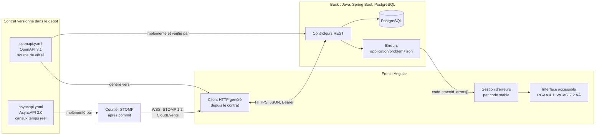

## 2. Registre des dimensions du socle

| ID | Dimension | Statut 1.1.0 |
|---|---|---|
| SC1 | Contrat d'API OpenAPI | active |
| SC2 | Erreurs RFC 9457 | active |
| SC3 | Formats de données et pagination | active |
| SC4 | Sécurité de la frontière | active |
| SC5 | Traçabilité | active |
| SC6 | Accessibilité et messages | active |
| SC7 | Événements temps réel vers le front (WebSocket STOMP) ; SSE et messages entre services réservés | active |

## 3. SC1 : contrat d'API

### 3.1 Règles

- Le contrat est un fichier **OpenAPI 3.1** versionné dans le dépôt (par défaut `api/openapi.yaml`). Il est la source de vérité de la frontière.
- Le back l'implémente. Un test du back compare le contrat exposé par l'application (par exemple via springdoc) au fichier du dépôt, et échoue en cas d'écart.
- Le front ne code jamais un appel HTTP à la main pour un endpoint du contrat. Il utilise le client généré depuis le contrat, et la génération fait partie du build.
- Préfixe de version dans l'URL : `/api/v1/...`. Ressources au pluriel, en kebab-case : `/api/v1/purchase-orders/{id}`.
- Propriétés JSON en camelCase. Valeurs d'énumération en MAJUSCULES_SOULIGNÉES (`IN_PROGRESS`).
- Chaque opération a un `operationId` unique et stable : il devient le nom de méthode du client généré.

### 3.2 Compatibilité

| Changement | Autorisé dans `v1` publiée ? |
|---|---|
| Ajouter un endpoint | oui |
| Ajouter un champ optionnel en réponse | oui |
| Ajouter un paramètre optionnel en entrée | oui |
| Ajouter une valeur d'énumération en réponse | non, sauf si le contrat déclare l'énumération extensible et que le front gère une valeur inconnue |
| Renommer ou supprimer un champ, un endpoint, une valeur | non : nouvelle version `v2` |
| Rendre obligatoire un champ d'entrée | non : nouvelle version `v2` |
| Changer le type ou le format d'un champ | non : nouvelle version `v2` |

Un endpoint retiré passe d'abord par l'état déprécié (`deprecated: true` dans le contrat, en-tête `Deprecation` en réponse) pendant au moins une version de livraison.

### 3.3 Invariants

- **SC1.INV-1** : tout endpoint exposé par le back figure dans le contrat, et tout endpoint du contrat est implémenté. Contrôle : test de conformité du contrat côté back.
- **SC1.INV-2** : aucun changement cassant n'est introduit dans une version d'API publiée. Contrôle : comparaison du contrat avec sa version précédente (outil de diff OpenAPI en CI, ou revue).
- **SC1.INV-3** : le front n'appelle les endpoints du contrat qu'au travers du client généré. Contrôle : recherche d'URL `/api/` codées en dur dans le front, hors client généré.

## 4. SC2 : erreurs

### 4.1 Format

Toute réponse d'erreur 4xx ou 5xx a le type `application/problem+json` (RFC 9457), avec les membres standard et trois extensions :

```json
{
  "type": "https://errors.example.org/validation",
  "title": "Requête invalide",
  "status": 400,
  "detail": "La commande contient 2 erreurs.",
  "instance": "/api/v1/purchase-orders",
  "code": "VALIDATION_FAILED",
  "traceId": "4bf92f3577b34da6a3ce929d0e0e4736",
  "errors": [
    { "field": "lines[0].quantity", "code": "MIN", "message": "doit être supérieur ou égal à 1" },
    { "field": "deliveryDate", "code": "FUTURE", "message": "doit être une date future" }
  ]
}
```

| Membre | Rôle | Stabilité |
|---|---|---|
| `type` | URI qui identifie la catégorie d'erreur | stable |
| `title`, `detail` | texte lisible, destiné à un humain | **non stable** : ne jamais s'en servir dans la logique |
| `status` | code HTTP | stable |
| `code` | code machine de l'erreur, en MAJUSCULES | stable, fait partie du contrat |
| `traceId` | identifiant de trace (SC5) | présent sur toute erreur |
| `errors[]` | erreurs de validation champ par champ | présent pour les erreurs de validation |

### 4.2 Codes HTTP

| Situation | Statut | `code` (exemples) |
|---|---|---|
| Corps ou paramètres invalides | 400 | `VALIDATION_FAILED`, `MALFORMED_REQUEST` |
| Non authentifié | 401 | `UNAUTHENTICATED` |
| Authentifié mais non autorisé | 403 | `FORBIDDEN` |
| Ressource absente | 404 | `NOT_FOUND` |
| Conflit de version (verrou optimiste) | 409 | `CONCURRENT_MODIFICATION` |
| Règle métier violée | 422 | code métier propre, par exemple `ORDER_ALREADY_SHIPPED` |
| Erreur inattendue | 500 | `INTERNAL_ERROR`, sans détail technique |

### 4.3 Invariants

- **SC2.INV-1** : toute réponse 4xx ou 5xx du back est en `application/problem+json`, avec `code` et `traceId`. Contrôle : tests d'API sur un cas de chaque statut.
- **SC2.INV-2** : le front ne fonde aucune décision sur `title` ou `detail`. Il décide sur `status` et `code`. Contrôle : revue et tests du gestionnaire d'erreurs.
- **SC2.INV-3** : une erreur 500 ne révèle ni trace de pile, ni requête SQL, ni nom de classe. Contrôle : test d'API provoquant une exception non gérée.

## 5. SC3 : formats de données et pagination

| Donnée | Format JSON | Côté Java | Côté TypeScript |
|---|---|---|---|
| Instant | chaîne ISO 8601 avec fuseau, `2026-10-16T10:15:30Z` | `Instant` ou `OffsetDateTime` | `string`, converti en `Date` au plus près de l'affichage |
| Date calendaire | `2026-10-16` | `LocalDate` | `string` |
| Montant | chaîne décimale `"1234.50"` ou entier en unités mineures, au choix du contrat, jamais flottant | `BigDecimal` ou `long` | `string` ou `number` entier |
| Identifiant | chaîne opaque (UUID recommandé) | `UUID` | `string` |
| Énumération | chaîne en MAJUSCULES | `enum` | union de littéraux générée |
| Absence de valeur | champ absent ou `null`, défini par le contrat pour chaque champ | `Optional` en retour de méthode seulement | `T \| null` ou `T \| undefined`, selon le contrat |

Pagination :

- requête : `?page=0&size=20&sort=createdAt,desc` (pages numérotées à partir de 0, `size` borné côté back, 100 au maximum par défaut) ;
- réponse :

```json
{
  "content": [ { "id": "..." } ],
  "page": { "size": 20, "number": 0, "totalElements": 134, "totalPages": 7 }
}
```

Invariants :

- **SC3.INV-1** : aucune date-heure ne circule sans fuseau. Contrôle : schéma du contrat (`format: date-time`) et tests de sérialisation.
- **SC3.INV-2** : aucun montant n'est représenté en virgule flottante, ni en JSON, ni en Java, ni en base. Contrôle : revue du contrat et recherche de `double`, `float` sur les champs monétaires.
- **SC3.INV-3** : toute liste potentiellement non bornée est paginée, avec une taille maximale imposée par le back. Contrôle : revue des endpoints de collection.

## 6. SC4 : sécurité de la frontière

- Authentification par jeton porteur (`Authorization: Bearer ...`) émis par un fournisseur d'identité OAuth 2.1 / OpenID Connect ; le back est un serveur de ressources qui valide le jeton. Si le projet utilise des cookies de session, la protection CSRF est obligatoire des deux côtés.
- Le front ne contient aucun secret : ni clé d'API privée, ni secret client. Toute configuration du front est publique par nature.
- Aucun jeton ni donnée personnelle dans une URL (paramètre de requête ou chemin), car les URL finissent dans les journaux.
- CORS : liste explicite d'origines par environnement. Jamais `*` quand les identifiants sont autorisés.
- 401 signifie « pas ou plus authentifié » : le front relance l'authentification. 403 signifie « authentifié mais refusé » : le front informe, sans relancer.
- L'autorisation est toujours vérifiée par le back. Masquer un bouton dans le front n'est pas une mesure de sécurité.

Invariants :

- **SC4.INV-1** : aucun secret ni jeton dans le code du front, dans une URL ou dans un journal. Contrôle : recherche de motifs de secrets et revue de la configuration de journalisation.
- **SC4.INV-2** : chaque endpoint non public est protégé par une règle d'autorisation côté back. Contrôle : test d'accès anonyme refusé sur chaque endpoint protégé.
- **SC4.INV-3** : CORS n'autorise jamais `*` avec identifiants. Contrôle : revue de la configuration CORS par environnement.

## 7. SC5 : traçabilité

- Le back propage le contexte W3C Trace Context (`traceparent`) et attache l'identifiant de trace à chaque ligne de journal.
- Chaque Problem Details porte `traceId` (SC2). Le front l'affiche dans le message d'erreur, sous une forme copiable, pour que l'utilisateur puisse le transmettre au support.
- Les journaux ne contiennent ni jeton, ni mot de passe, ni donnée personnelle non nécessaire.

Invariant :

- **SC5.INV-1** : toute erreur 5xx est journalisée côté back avec son `traceId`, et le même `traceId` est renvoyé au front. Contrôle : test d'API et vérification du journal capturé.

## 8. SC6 : accessibilité et messages

- Le front respecte le RGAA 4.1 et le WCAG 2.2 niveau AA.
- Les messages affichés à l'utilisateur sont localisés côté front à partir de `code` et, pour la validation, de `errors[].code`. Le `detail` du back sert de repli seulement.
- Une erreur de validation est associée au champ concerné (programmatiquement, pas seulement visuellement) et annoncée aux technologies d'assistance.
- Le back accepte l'en-tête `Accept-Language` et rédige `title` et `detail` en français par défaut.

Invariants :

- **SC6.INV-1** : chaque erreur de validation renvoyée par le back est rattachée au champ correspondant dans le formulaire du front. Contrôle : test de composant avec une réponse 400 simulée.
- **SC6.INV-2** : aucune information n'est transmise par la couleur seule. Contrôle : revue RGAA (critère 3.1) et tests automatisés d'accessibilité.

## 9. SC7 : événements temps réel

Active depuis 1.1.0, pour un seul usage : tenir le front à jour des changements d'une ressource, par WebSocket et STOMP 1.2. Le serveur publie, le client s'abonne. Les autres canaux asynchrones (SSE, messages entre services, commandes envoyées par le client sur le canal) restent réservés : un skill qui en introduit un le signale comme écart au socle.

### 9.1 Contrat

- Les canaux sont décrits dans un fichier **AsyncAPI 3.0** versionné dans le dépôt (par défaut `api/asyncapi.yaml`), à côté du contrat OpenAPI. Les schémas des données y sont des références aux schémas du contrat OpenAPI : le front réutilise les types générés.
- Point de connexion : `/api/ws`. Destinations : `/topic/v1/<ressources>/{id}/<sous-ressource>`, en kebab-case, versionnées comme l'API REST et soumises aux mêmes règles de compatibilité (§ 3.2).
- Chaque canal a son **instantané** : l'opération REST qui renvoie l'état courant de la ressource. Sa réponse porte l'en-tête `ETag`, égal à la dernière séquence publiée sur le canal (`"42"`).

### 9.2 Enveloppe d'événement

Chaque message est un événement **CloudEvents 1.0**, au format JSON structuré :

```json
{
  "specversion": "1.0",
  "id": "5f1c0e7a-2b8d-4f0e-9a51-1d2c3b4a5e6f",
  "source": "/api/v1/commandes/7d0e…/lignes",
  "type": "ligne-commande.creee.v1",
  "subject": "7d0e…",
  "time": "2026-11-01T21:30:12Z",
  "sequence": "43",
  "traceparent": "00-4bf92f3577b34da6a3ce929d0e0e4736-00f067aa0ba902b7-01",
  "datacontenttype": "application/json",
  "data": { }
}
```

- `type` : `<ressource>.<évènement>.v<n>`, en minuscules, l'évènement au participe passé (`creee`, `modifiee`, `supprimee`).
- `time` : instant ISO 8601 avec fuseau (SC3).
- `sequence` : extension CloudEvents, entier croissant par canal, sérialisé en chaîne.
- `traceparent` : extension CloudEvents de traçage distribué, contexte W3C de la transaction qui a produit l'événement (SC5).
- `data` : schéma déclaré au contrat AsyncAPI ; pour une suppression, l'identifiant seul.

### 9.3 Publication

- Un événement n'est publié qu'après la validation de la transaction qui l'a produit (côté Spring : écouteur `@TransactionalEventListener` en phase `AFTER_COMMIT`). Une transaction annulée ne publie rien.
- Courtier : le courtier simple en mémoire pour une seule instance du back ; au-delà, un relais vers un courtier STOMP externe (RabbitMQ par exemple). Le fichier d'invariants du projet dit lequel.

### 9.4 Côté client : abonnement et reprise

- Le client se connecte, **s'abonne d'abord**, puis lit l'instantané ; il ignore tout événement de séquence inférieure ou égale à l'`ETag` de l'instantané, et applique les autres dans l'ordre des séquences.
- Un trou dans les séquences (événement manquant) ou une reconnexion déclenche une nouvelle lecture de l'instantané.
- Battements STOMP à 10 secondes dans les deux sens ; reconnexion avec attente exponentielle de 1 à 30 secondes, avec un aléa.
- Sur une collection paginée (SC3), le client applique l'événement aux pages chargées si l'élément y tombe selon le tri ; sinon il signale qu'il y a du nouveau, sans recharger de lui-même.

### 9.5 Sécurité, erreurs et accessibilité

- Connexion en `wss://` seulement, depuis une origine de la liste explicite (SC4) ; jamais `*`.
- Le jeton porteur passe dans l'en-tête `Authorization` de la trame STOMP `CONNECT`, jamais dans l'URL de connexion (SC4.INV-1). À son expiration, le serveur ferme la session ; le client se reconnecte avec un jeton renouvelé.
- Chaque `SUBSCRIBE` vérifie le droit de lecture de la ressource, avec la même règle que son opération REST de lecture.
- Un refus ou une erreur se rend par une trame STOMP `ERROR`, dont le corps est un Problem Details (`application/problem+json`, SC2) avec `status`, `code` et `traceId`.
- Une mise à jour reçue en temps réel est annoncée aux technologies d'assistance par une région `aria-live="polite"`, sans déplacer le focus ; plusieurs mises à jour rapprochées s'annoncent en un seul message (SC6).

### 9.6 Invariants

- **SC7.INV-1** : tout canal temps réel figure au contrat AsyncAPI du dépôt, avec son instantané REST ; aucun autre canal asynchrone n'est introduit sans être signalé comme écart au socle. Contrôle : test qui compare les destinations publiées par l'application au contrat.
- **SC7.INV-2** : chaque événement suit l'enveloppe CloudEvents du socle : `time` avec fuseau, `sequence` croissante par canal, `traceparent`, `data` conforme au schéma du contrat. Contrôle : test de sérialisation et validation contre le contrat.
- **SC7.INV-3** : un événement n'est publié qu'après la validation de la transaction qui l'a produit. Contrôle : test d'intégration où la transaction est annulée et aucun message n'est reçu.
- **SC7.INV-4** : le client reste juste après une déconnexion, un doublon ou un trou : abonnement avant l'instantané, événements de séquence inférieure ou égale à l'`ETag` ignorés, instantané relu à chaque trou ou reconnexion. Contrôle : test du service client avec déconnexion, doublon et trou simulés.
- **SC7.INV-5** : aucun jeton dans l'URL de connexion ; chaque abonnement vérifie le droit de lecture de la ressource ; origines explicites. Contrôle : test d'abonnement refusé (`ERROR` avec un Problem Details 403) et test de connexion depuis une origine non autorisée.
- **SC7.INV-6** : toute mise à jour reçue en temps réel est annoncée par une région `aria-live="polite"`, sans déplacer le focus. Contrôle : test de composant et revue RGAA (critère 7.5).

## 10. Règles d'évolution du socle

- Le socle suit le contrat de version de `EVOLUTION.md` à la racine du dépôt.
- Un skill épingle une version du socle dans son `manifest.json` (champ `shared`). L'outil d'assemblage refuse une transmission si la version épinglée ne correspond pas au socle du dépôt.
- Un changement cassant du socle (invariant renforcé, format modifié) passe en version majeure. Chaque skill dépendant décide alors explicitement de monter de version.

## 11. Journal de révision

**1.0.0** (2026-10-16) : première version. Dimensions SC1 à SC6 actives, SC7 réservée. Archive : `archives/SKILL-v1.0.0.md`.

**1.0.1** (2026-10-21) : correctif. Les skills qui incluent le socle sont désignés sans le préfixe `expert-`, retiré de tous les skills du dépôt : `java`, `angular`, `analyse-projet`, auxquels s'ajoutent `sonarqube` et `agent-tdd-jira`, qui l'incluent aussi et manquaient à la liste. Aucune dimension ni aucun invariant modifié. Motif : une nouvelle notion d'expertise sera définie ensuite.

**1.1.0** (2026-11-01) : dimension SC7 active, les événements temps réel vers le front, à la demande du développeur pour la catégorie M04 de `orchestrateur-c7e` (une liste servie par son URI existante, tenue à jour en temps réel). WebSocket et STOMP 1.2, contrat AsyncAPI 3.0 dont les schémas renvoient au contrat OpenAPI, enveloppe CloudEvents 1.0 avec `sequence` et `traceparent`, publication après commit, reprise par instantané REST et `ETag`, sécurité de la connexion et de chaque abonnement, erreurs en Problem Details, annonce `aria-live`. SSE, messages entre services et commandes du client restent réservés. Invariants SC7.INV-1 à SC7.INV-6 ; aucun invariant de SC1 à SC6 modifié. `orchestrateur-c7e` ajouté à la liste des skills qui incluent le socle. Archive : `archives/SKILL-v1.0.1.md`.
<<<FIN socle/SKILL.md>>>

<<<FICHIER projet/meso-contrats.md>>>
---
name: meso-contrats
description: Modèle des invariants du projet pour l'orchestrateur C7E (persistance PostgreSQL et Liquibase, contrats d'interface REST conformes au socle, back Spring Boot, front Angular, performance, sécurité, Git, niveau de preuve par criticité, exclusions, modèle du registre des écarts), pré-rempli pour l'adaptateur par défaut. À copier dans le projet et à remplir par le développeur ; l'IA le lit avant chaque ticket et ne le modifie jamais.
dimensions: [D8]
status: active
role: invariants du projet, fixés par le développeur ; l'IA règle les paramètres opérationnels, jamais ces invariants
stack: [PostgreSQL 15+, Liquibase 4.x, Java 21, Spring Boot 3.5, Angular 20]
---

# Invariants du projet (meso-contrats)

> Copie du projet : `docs/c7e/meso-contrats.md` ⚠️ ADAPTER (emplacement). Le développeur la remplit et la tient à jour ; l'IA la lit avant chaque ticket et ne la modifie jamais (D6.INV-2, D8.INV-1).
> ⚠️ ADAPTER : valeur à remplacer par la norme exacte du projet. Une valeur ADAPTER restée telle est signalée avant la fiche, jamais devinée (D8.INV-1).
> Tout écart constaté par l'IA s'inscrit au registre des écarts, fichier distinct (section 7) ; il n'est jamais corrigé ni toléré en silence (D6.INV-3).
> Ces invariants valent dans tous les modes de modulation (D2.INV-2). Ils précisent le socle back-front et les référentiels Java et Angular, sans les contredire : en cas de contradiction, le socle l'emporte et l'écart s'inscrit au registre (D8.INV-2).
> Chaque section porte le slot de l'Axiome 7E qu'elle contraint (D1.INV-1, D1.INV-2) ; aucune modification du projet n'a lieu avant la validation de la fiche (D3.INV-1).

## 1. Contrats de persistance (É1) : PostgreSQL et Liquibase

### Changesets

- Fichier : `db/changelog/<aaaa><mm><jj>-<hh><mm>-<slug>.yaml`, sous `src/main/resources`, inclus par le changelog maître (`db/changelog/db.changelog-master.yaml`, chemin par défaut de Spring Boot) ⚠️ ADAPTER.
  Ex. : `db/changelog/20261030-1430-add-colonne-mode-chargement.yaml`
- Un changeset par fichier, dont l'`id` est le nom du fichier sans extension. Une migration en plusieurs étapes prend un fichier par étape.
- `author` : trigramme du développeur qui valide (ex. `jdu`) ⚠️ ADAPTER.
- Un changeset appliqué n'est jamais modifié : on en ajoute un autre (java:D4.INV-1).

### Colonnes

- snake_case : `date_creation`, `mode_chargement` ; jamais de camelCase en base.
- Types :
  - `timestamptz`, jamais `timestamp` ; `Instant` ou `OffsetDateTime` côté Java, chaîne ISO 8601 avec fuseau en JSON (SC3.INV-1) ;
  - `numeric(p,s)` pour les montants, jamais `float` ni `double` (SC3.INV-2) ;
  - `varchar(n)`, avec n justifié.
- NULL interdit par défaut ; une colonne nullable se justifie dans le `comment` du changeset.
- Contraintes nommées : `pk_<table>`, `fk_<table>_<colonne>`, `uq_<table>_<colonne>`, `idx_<table>_<colonne>`, en 63 octets au plus : PostgreSQL tronque un nom plus long, au risque de collision.

### Règles de migration

- Bloc `rollback` explicite sur tout changeset (clé `rollback:` en YAML), même quand Liquibase sait le déduire. `runOnChange` n'est pas un retour arrière : il rejoue un changeset dont le contenu a changé, ce qu'interdit la règle « jamais modifié ».
- Idempotence : `preConditions` avec `onFail: MARK_RAN` quand l'objet peut déjà exister.
- Retour arrière vérifié avant la remise : `update-testing-rollback` (déployer, annuler, redéployer) sur une copie de la base de référence.
- Données historiques : une colonne NOT NULL ajoutée à une table non vide exige :
  - soit un DEFAULT constant, qui ne réécrit pas la table depuis PostgreSQL 11 ;
  - soit un rattrapage en trois changesets : colonne nullable, rattrapage, contrainte NOT NULL. Avec une valeur de rattrapage constante, deux suffisent : `addNotNullConstraint` avec `defaultNullValue` remplit les NULL avant de poser la contrainte.
- ⚠️ ADAPTER (seuil) : tables de plus d'un million de lignes.
  - Migration en heures creuses, après confirmation du développeur.
  - Index par `CREATE INDEX CONCURRENTLY`, que PostgreSQL refuse dans une transaction : un changeset `sql` qui ne contient que cette instruction, avec `runInTransaction: false`, et `DROP INDEX CONCURRENTLY` en retour arrière. Une construction interrompue laisse un index invalide, à supprimer avant de rejouer.
  - `SET NOT NULL` relit toute la table sous verrou exclusif : poser d'abord `CHECK (<colonne> IS NOT NULL) NOT VALID`, la valider (`VALIDATE CONSTRAINT`), puis `SET NOT NULL`, que PostgreSQL 12 et plus récents appliquent alors sans relire la table.

```yaml
databaseChangeLog:
  - changeSet:
      id: 20261030-1500-idx-donnee-mode-chargement
      author: jdu
      runInTransaction: false
      comment: index construit sans bloquer les écritures (table de plus d'un million de lignes)
      changes:
        - sql:
            sql: CREATE INDEX CONCURRENTLY idx_donnee_mode_chargement ON donnee (mode_chargement)
      rollback:
        - sql:
            sql: DROP INDEX CONCURRENTLY IF EXISTS idx_donnee_mode_chargement
```

## 2. Contrats d'interface (É3) : REST conformes au socle

Le socle (`socle/SKILL.md`, SC1 à SC7) fait foi pour la frontière ; cette section n'en retient que les valeurs du projet.

### Endpoints

- Contrat : `api/openapi.yaml`, OpenAPI 3.1, source de vérité ⚠️ ADAPTER (chemin).
- Ressources au pluriel, en kebab-case, sans verbe : `GET /api/v1/donnees`. Préfixe de version `/api/v1/` ⚠️ ADAPTER (en-tête de version si la norme du projet diffère).
- Action métier sans ressource naturelle : méthode personnalisée `POST /api/v1/donnees:recharger` (convention AIP-136), seule exception au nom sans verbe ⚠️ ADAPTER (sinon, sous-ressource nommée : `POST /api/v1/donnees/rechargements`).
- Pagination de toute collection (SC3.INV-3) :
  - requête `?page=0&size=20&sort=dateCreation,desc`, taille bornée par le back ;
  - réponse `{ "content": [...], "page": { "size": 20, "number": 0, "totalElements": 134, "totalPages": 7 } }`, la forme de `PagedModel` de Spring Data (`@EnableSpringDataWebSupport(pageSerializationMode = VIA_DTO)`) ;
  - jamais un `Page` ou un `PageImpl` sérialisé tel quel : Spring Data n'en garantit pas la forme.
- Filtres : paramètres de requête, dates ISO 8601 : `?statut=ACTIF&dateDebut=2026-01-01`.

### Erreurs : RFC 9457 (`application/problem+json`)

La RFC 9457 remplace la RFC 7807. Format du socle (SC2), avec ses trois extensions `code`, `traceId` et, pour la validation, `errors[]` :

```json
{
  "type": "https://errors.example.org/ressource-introuvable",
  "title": "Ressource introuvable",
  "status": 404,
  "detail": "Aucune donnée avec l'identifiant 42",
  "instance": "/api/v1/donnees/42",
  "code": "DONNEE_NOT_FOUND",
  "traceId": "4bf92f3577b34da6a3ce929d0e0e4736"
}
```

- `code` : constante en MAJUSCULES_SOULIGNÉES, stable, partie du contrat ; le front décide sur `status` et `code`, jamais sur `title` ni `detail` (SC2.INV-2).
- Statuts du socle (SC2) :
  - 400 entrée invalide, `VALIDATION_FAILED`, avec `errors[]` : `field`, `code`, `message` ;
  - 401 non authentifié ; 403 authentifié sans le droit ; 404 ressource absente ;
  - 409 conflit de version ; 422 règle métier violée ;
  - 500 sans détail technique (SC2.INV-3).
- ⚠️ ADAPTER : `type`, l'URI de la documentation des erreurs du projet. Une extension propre au projet (par exemple `timestamp`) s'ajoute aux trois du socle, sans en retirer aucune.

### Événements temps réel (SC7), si un ticket en touche

- Contrat : `api/asyncapi.yaml`, AsyncAPI 3.0, dont les schémas renvoient à ceux du contrat OpenAPI ⚠️ ADAPTER (chemin).
- Point de connexion `/api/ws`, STOMP 1.2 ; destinations `/topic/v1/<ressources>/{id}/<sous-ressource>` ; événements CloudEvents 1.0 publiés après commit (SC7.INV-3).
- Courtier ⚠️ ADAPTER : `simple`, en mémoire, si le back tourne en une seule instance ; sinon `relais`, vers un courtier STOMP externe (lequel).
- Front : client STOMP enveloppé dans un service de données, état en signals ; jamais d'abonnement dans un composant de présentation (angular:D3.INV-3).

### Gate É3 (bloquante)

- Contrat écrit et validé avant toute implémentation de niveau d=2 (D3.INV-2), contrat AsyncAPI compris quand un canal temps réel est touché.
- ⚠️ ADAPTER : relecteur du contrat, le tech lead, avant le code de niveau d=2.
- Le code ne contredit pas le contrat : test de conformité côté back (SC1.INV-1) et comparaison avec la version publiée du contrat (SC1.INV-2), en gate Méso → Macro.

## 3. Contrats back (É2, É4) : Spring Boot

### Couches

```
Controller (@RestController) → Service (@Service) → Repository (Spring Data JPA)
```

Ce sont les couches `api`, `application` et `infrastructure` du référentiel Java, autour du `domain` ; dans un projet organisé en `controller/`, `service/`, `repository/`, la convention en place est gardée.

- Controller : aucune logique métier, aucun accès direct au Repository, aucune entité JPA en paramètre ni en retour (java:D1.INV-2).
- Service : frontières transactionnelles dans la couche application, `@Transactional` sur méthode publique, `readOnly = true` pour les lectures (java:D4.INV-3) ; `spring.jpa.open-in-view=false` (java:D4.INV-2).
- Repository : interface Spring Data JPA ; requêtes dérivées de préférence, `@Query` documentée sinon ; jamais de concaténation avec une donnée d'entrée (java:D4.INV-4).
- Injection par constructeur (java:D1.INV-3).

### DTO : jamais d'entité exposée

- Requête `XxxRequest`, validée par Bean Validation (`@NotBlank`, `@Size(max = …)`, `@Pattern`) avant la couche application, avec des messages explicites (java:D3.INV-2).
- Réponse `XxxResponse` : `record` immuable (java:D2.INV-1).
- Mapping : MapStruct ⚠️ ADAPTER (dépendance à valider), ou mapping explicite.

### Erreurs

- Exceptions métier typées, `DonneeNotFoundException`, `AccesRefuseException`…, qui étendent une `BusinessException` portant un `ErrorCode`.
- Un seul `@RestControllerAdvice` les traduit en Problem Details, avec `code` et `traceId` (java:D3.INV-3).
- Aucun `catch` muet (java:D2.INV-4) ; toute exception non gérée est journalisée avec le `traceId` du contexte W3C Trace Context (SC5.INV-1).

## 4. Contrats front (É5) : Angular

### Structure

- Composants autonomes, aucun nouveau `NgModule` (angular:D1.INV-1).
- `ChangeDetectionStrategy.OnPush` (angular:D2.INV-1) ; flux de contrôle `@if`, `@for` avec `track`, `@switch` (angular:D2.INV-2) ; entrées et sorties par `input()` et `output()` (angular:D2.INV-3).
- Nommage des fichiers : celui du projet, un fichier par classe. Un projet créé en Angular 20 suit son guide de style : `donnees-list.ts` pour la classe `DonneesList`, `donnees-list.spec.ts` pour son test. Un projet plus ancien garde `donnees-list.component.ts`.

### État ⚠️ ADAPTER (si NgRx est imposé)

- État local du composant en `signal()`.
- État serveur détenu par le service de données, exposé au composant en signal (`toSignal`) ou en observable lu par `async` ; jamais d'abonnement manuel sans `takeUntilDestroyed` (angular:D2.INV-4). `resource` et `httpResource`, expérimentales en Angular 20, ne sont pas utilisées.
- États d'interface OBLIGATOIRES sur toute donnée asynchrone : `loading`, `success`, `error`, `empty`, en union discriminée lue par `@switch` ; jamais de booléens `isLoading` et `isError` entremêlés.

### Interactions

- Appels à l'API par le client généré depuis le contrat (SC1.INV-3, angular:D3.INV-1), enveloppé dans un service de données ; aucun composant de présentation ne déclenche de requête (angular:D3.INV-3) ; jamais d'`HttpClient` dans un composant.
- Recherche : `switchMap`, anti-rebond de 300 ms.
- Envoi : `exhaustMap`, qui ignore les clics tant que la requête est en cours. Le bouton reste focalisable (`aria-disabled="true"`) et l'attente est annoncée (angular:D6.INV-4), plutôt qu'un `disabled` qui ferait perdre le focus.
- Erreur de l'API : état d'erreur, message localisé depuis `code` (SC6), `traceId` affiché sous une forme copiable (SC5), annonce aux technologies d'assistance (angular:D6.INV-4) ; jamais `error.message` brut.

### Accessibilité

- RGAA 4.1 et WCAG 2.2 niveau AA (SC6).
- Chaque champ a son libellé, et son message d'erreur lui est lié (angular:D4.INV-3) ; aucune information par la couleur seule (SC6.INV-2).

## 5. Invariants transverses (d=0 → d=3)

### Performance et SLA ⚠️ ADAPTER (valeurs)

- Endpoints de lecture : p95 < 300 ms ; d'écriture : p95 < 500 ms.
- Requête SQL à plus de trois jointures, ou sans index : plan analysé par `EXPLAIN`. `EXPLAIN ANALYZE` exécute la requête : seulement pour une lecture, jamais en production.
- N+1 constaté : `@EntityGraph` ou `JOIN FETCH` obligatoire.

### Sécurité (SC4)

- Jeton porteur émis par le fournisseur d'identité OAuth 2.1 ou OpenID Connect, validé par le back en serveur de ressources ⚠️ ADAPTER (SSO du projet). Avec des cookies de session, protection CSRF des deux côtés.
- Autorisation vérifiée par le back : chaîne de sécurité qui refuse par défaut (java:D5.INV-1), `@PreAuthorize("hasRole('…')")` sur les endpoints, avec `@EnableMethodSecurity`. Le front n'est jamais une barrière de sécurité.
- Aucun jeton, mot de passe ni donnée personnelle dans un journal, une URL ou un DTO de réponse sans masquage (SC4.INV-1, java:D5.INV-4).
- Requêtes paramétrées (JPA, Criteria), jamais de concaténation SQL (java:D4.INV-4).

### Git (SKILL, § 4)

- Une branche par ticket, au format du projet ; par défaut celui du kit : `<type>/<CLÉ>-<slug>`, par exemple `feature/ABCDE-3512-chargement-a-la-demande` (D4.INV-1) ⚠️ ADAPTER.
- Commit : `<CLÉ> : [É<n>-<DOM>] <type>(<portée>): <description>`, types `feat|fix|refactor|test|chore|docs` (D4.INV-2).
- Rétroaction : `<CLÉ> : [É<n>-<DOM>] fix(<portée>): … après l'observation É6 …`, l'observation citée dans le corps (D6.INV-1).
- Tag de livraison : posé par le développeur, `vX.Y.Z` par défaut ⚠️ ADAPTER. L'IA ne pousse, ne fusionne ni ne pose de tag (D4.INV-3).

### Niveau de preuve par criticité ⚠️ ADAPTER (grille)

| Criticité | Tests requis | Revue |
|---|---|---|
| Triviale (une couche, pas de base) | Unitaires ciblés | Auto-contrôle de l'IA, puis validation du développeur |
| Standard (plusieurs couches) | Unitaires, intégration, contrat | Pair |
| Critique (authentification, paiement, batch) | En plus : bout en bout, scénario de retour arrière de la base | Tech lead obligatoire |

La criticité retenue fixe la configuration du ticket (D2.INV-1) et le niveau de preuve de son dossier (D5.INV-3). Chaque test requis prouve un critère d'acceptation ou un risque (D5.INV-1) ; aucun test existant n'est supprimé ni affaibli sans accord (D5.INV-2).

## 6. Exclusions et périmètre ⚠️ ADAPTER (à remplir par projet)

- Zones hors périmètre, à ne pas modifier sans accord : …
- Dépendances interdites ou à valider : … Toute nouvelle dépendance se valide avec le développeur.
- Environnements : dev → recette → prod, promotion par merge request uniquement. L'IA ne déploie dans aucun environnement.
- Emplacements des fichiers C7E, si l'équipe ne versionne pas `docs/c7e/` : … La fiche d'un ticket se range à `docs/demandes/<CLÉ>/fiche-transformation.md` par défaut (D3.INV-3).

## 7. Registre des écarts : modèle

Fichier `docs/c7e/registre-ecarts.md` ⚠️ ADAPTER (emplacement), créé à l'installation à partir de ce modèle. L'IA y ajoute une ligne par écart ; le développeur en remplit la décision (D6.INV-3).

```markdown
# Registre des écarts

| Date | Ticket | Invariant concerné | Écart constaté | Décision (respecter, ou dérogation validée par) |
|---|---|---|---|---|
| 2026-10-30 | EX-001 | meso-contrats, § 1, rollback | changeset généré sans rollback | respecter : corrigé avant commit |
```
<<<FIN projet/meso-contrats.md>>>

<<<FICHIER references/agent-tdd-jira.md>>>
---
name: agent-tdd-jira
description: Agent de développement TDD qui part d'une demande Jira enregistrée en MHTML, l'analyse avec ses commentaires, établit les US et leurs critères d'acceptation numérotés, décline chaque critère en scénarios Gherkin, propose au développeur des variantes de réalisation back Java et front Angular pour chaque scénario, puis réalise les scénarios choisis un par un en cycle rouge, vert, remanié, avec traçabilité de la demande jusqu'aux commits ; en binôme avec Agent2Test, il reçoit un verdict d'acceptation par critère et corrige en TDD les défauts applicatifs confirmés ; en mode parallèle, il travaille dans un worktree géré par le kit agents-paralleles-gitlab.
version: 1.3.4
---

# Agent de développement TDD à partir d'une demande Jira, version 1.3.4

Ce document est le point d'entrée du skill. Il fixe le parcours de l'agent, ses points de validation, le registre des dimensions et les invariants. Les règles détaillées sont dans `modules/`.

Fichiers inclus à des versions épinglées (voir `manifest.json`) :

- `socle/SKILL.md` : socle commun back-front (contrat d'API, erreurs, formats, sécurité, accessibilité) ;
- `references/java.md` et `references/angular.md` : points d'entrée des experts Java et Angular. Ce sont des **référentiels** : l'agent y lit les versions cibles et les invariants que tout code produit doit respecter, sans adopter leur mode de travail.
- `references/agents-paralleles-gitlab.md` : point d'entrée du kit de travail en parallèle, une demande par worktree. C'est aussi un référentiel : en mode parallèle (D9), l'agent y lit les règles du worktree géré, sans installer ni modifier le kit.

## 1. Ordre de lecture

1. Ce document, en entier.
2. `manifest.json`.
3. `socle/SKILL.md`, puis les sections « Versions cibles » et « Invariants » des référentiels Java et Angular.
4. Les modules actifs, dans l'ordre du parcours : `ingestion-jira`, `us-criteres`, `analyse-demande`, `impact`, `variantes`, `cycle-tdd`, `tracabilite`.
5. En mode parallèle seulement : les sections « Invariant d'organisation » et « Invariants » de `references/agents-paralleles-gitlab.md`, puis `modules/parallele/SKILL.md`, qui s'ajoute aux autres modules.
6. En binôme avec Agent2Test : `modules/binome-agent2test/SKILL.md`, qui s'ajoute aux autres modules.
7. `modules/connecteur-jira/SKILL.md` : seulement pour comprendre le point d'extension E1. Ne pas l'appliquer en 1.x.

## 2. Parcours et points de validation

L'agent avance par étapes. Chaque point de validation `V` attend une réponse explicite du développeur ; sans elle, l'agent ne passe pas à l'étape suivante.

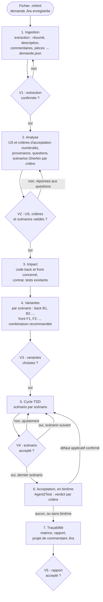

| Point | Ce que le développeur valide | Module |
|---|---|---|
| V1 | la demande extraite est complète et fidèle | `ingestion-jira` |
| V2 | les US et leurs critères d'acceptation, les scénarios de chaque critère, les réponses aux questions, ce que l'agent propose | `us-criteres`, `analyse-demande` |
| V3 | une variante back et une variante front par scénario | `variantes` |
| V4 | chaque scénario réalisé (rouge, vert, remanié) avant le suivant | `cycle-tdd` |
| V5 | la matrice de traçabilité et le rapport final, avec le verdict d'acceptation de chaque critère en binôme | `tracabilite`, `binome-agent2test` |

## 3. Cibles techniques

Les versions cibles sont celles des référentiels : Java 21, Spring Boot 3.5, PostgreSQL avec migrations Flyway ou Liquibase (référentiel java 1.1.1), Angular 20 (référentiel angular 1.0.1). Avant d'écrire du code, l'agent relève les versions réelles du projet ; si elles diffèrent, il le signale et demande comment procéder.

| Couche | Tests écrits par l'agent | Outils |
|---|---|---|
| Back, domaine et cas d'usage | tests unitaires sans Spring | JUnit 5, AssertJ, Mockito |
| Back, API | tests de tranche web | `@WebMvcTest`, MockMvc, `spring-security-test` |
| Back, persistance | tests de tranche données sur PostgreSQL | `@DataJpaTest`, Testcontainers |
| Front, stores et services | tests avec `HttpTestingController` | outil de tests unitaires du projet (Jasmine et Karma, ou Jest) |
| Front, composants | tests de composants | `TestBed`, harnais du CDK si présents |

Les tests de bout en bout et d'acceptation sont ceux d'Agent2Test, projet séparé de l'application, en binôme (D7) : l'agent n'en écrit pas.

## 4. Cycle 7E

| Phase | Ce qu'elle désigne ici | Modules |
|---|---|---|
| Éléments | phrases de la demande, commentaires, pièces, US, critères d'acceptation, scénarios | `ingestion-jira`, `us-criteres`, `analyse-demande` |
| Espace | code back et front concerné, contrat d'API | `impact` |
| Engendrent | variantes de réalisation et leurs combinaisons | `variantes` |
| État | état de chaque critère (à valider, validé, en attente, retiré) et de chaque scénario (proposé, validé, rouge, vert, remanié, accepté) ; en binôme, verdict d'acceptation de chaque critère | `us-criteres`, `cycle-tdd`, `binome-agent2test` |
| Expression | fichier des US et critères (`us.md`), fichier Gherkin, tests, code, matrice, projet de commentaire Jira | `us-criteres`, `analyse-demande`, `cycle-tdd`, `tracabilite` |
| Évolutif | commits successifs, réponses aux questions, versions du skill | `cycle-tdd`, `tracabilite` |
| Environnement | développeur, auteur de la demande, experts de référence, Agent2Test, agents des autres demandes et garde-fous du kit en mode parallèle | `tracabilite`, `parallele`, `binome-agent2test` |

Clause de second ordre : l'agent interprète une demande écrite par d'autres. Ses critères d'acceptation, et les scénarios qui les illustrent, deviennent la définition de « terminé ». Il distingue donc ce que dit la demande (avec sa provenance), ce qu'il en déduit (critère d'acceptation ou scénario proposé, à valider), et ce qu'il ignore (question). Il ne tranche jamais seul une contradiction entre la description et un commentaire.

## 5. Registre des dimensions

| ID | Dimension | Introduite | Statut 1.3.4 | Dépend de | Module |
|---|---|---|---|---|---|
| D1 | Ingestion d'une demande Jira en MHTML | 1.0 | active | | `ingestion-jira` |
| D2 | Analyse et scénarios Gherkin | 1.0 | active | D1, D10 | `analyse-demande` |
| D3 | Analyse d'impact back et front | 1.0 | active | D2 | `impact` |
| D4 | Variantes de réalisation back et front | 1.0 | active | D3, référentiels, socle | `variantes` |
| D5 | Cycle TDD scénario par scénario | 1.0 | active | D4, référentiels | `cycle-tdd` |
| D6 | Traçabilité et rapport | 1.0 | active | D1 à D5, D10 | `tracabilite` |
| D7 | Binôme avec Agent2Test (tests de bout en bout et d'acceptation) | 1.0 | active | D2, D5, D6, D10 | `binome-agent2test` |
| D8 | Connecteur Jira (API ou MCP) à la place du MHTML | 1.0 | reserved | D1 | `connecteur-jira` |
| D9 | Travail dans un worktree géré, en parallèle d'autres demandes | 1.1 | active | D1, D3, D5, D6, référentiel du kit | `parallele` |
| D10 | US et critères d'acceptation numérotés | 1.2 | active | D1 | `us-criteres` |

## 6. Contrat de version et points d'extension

Le skill suit le contrat de version de `EVOLUTION.md` du dépôt Agent2Prompt. Le socle et les référentiels sont épinglés dans `manifest.json`.

Points d'extension, actifs dès 1.0.0 :

- **E1** : l'analyse ne lit que `demande.json` (schéma version 1), jamais le MHTML directement. Un connecteur Jira (D8) remplacera l'ingestion sans toucher aux modules suivants.
- **E2** : chaque scénario porte une étiquette stable `@<CLÉ>-Snn` (par exemple `@ECR-77-S03`), jamais renumérotée. Agent2Test s'en sert pour rattacher ses parcours et ses verdicts (D7).
- **E3** : chaque test écrit par l'agent porte l'étiquette de son scénario (`@Tag` et `@DisplayName` en JUnit, libellé du `describe` côté front), ce qui permet de sélectionner les tests d'un scénario et de construire la matrice par recherche.

Point d'extension ajouté en 1.2.0 :

- **E4** : chaque critère d'acceptation porte une étiquette stable `@<CLÉ>-CAnn`, reprise par les scénarios qui l'illustrent. Les tests d'acceptation d'Agent2Test s'y rattachent, et son journal de tests donne un verdict par critère (D7).

## 7. Règles globales

- **Demande en lecture seule** : le fichier MHTML n'est jamais modifié ; l'agent n'écrit jamais dans Jira (D1.INV-1, D6.INV-3).
- **Pas d'invention** : ce que la demande ne dit pas devient une question, un critère d'acceptation proposé ou un scénario proposé, jamais une règle implicite.
- **Socle et référentiels** : tout code produit respecte le socle et les invariants de l'expert concerné. Une variante qui en violerait un est signalée et jamais recommandée.
- **Dépendances** : aucune nouvelle dépendance (back ou front), ni outil d'exécution Gherkin, sans validation.
- **Secrets et données** : la demande peut contenir des noms de personnes et des données métier ; l'agent ne les recopie que dans les artefacts du projet qui en ont besoin (scénarios, rapport), jamais dans le code ni dans les tests, où il utilise des données fictives.
- **Langue** : scénarios Gherkin en français (`# language: fr`), identifiants de code en anglais, rapports en français.
- **Binôme** : avec Agent2Test, l'agent remet le plan validé, lit le journal de tests et corrige en TDD les défauts applicatifs confirmés. Il ne démarre, n'arrête ni ne déploie l'application et ne lance aucun batch : le développeur s'en charge, et enchaîne les deux têtes à la main ; un échange par dossiers, quand la tête de développement le prévoit, peut porter la remise et le journal de tests à sa place, sans rien décider (D7.INV-4).
- **Mode parallèle** : quand la consigne de lancement annonce un worktree géré par le kit `agents-paralleles-gitlab`, le module `parallele` s'ajoute aux autres. Ses règles sont plus strictes, jamais plus souples : l'agent ne pousse plus du tout, même sur demande (D9.INV-2).

## 8. Critères d'acceptation

- `demande.json` produit et confirmé (V1), limites déclarées.
- US et critères d'acceptation numérotés, sourcés ou marqués « proposé », validés avec les scénarios (V2) ; chaque critère décliné en au moins un scénario ; script `controler-criteres.mjs` sans écart (D10).
- Fichier Gherkin validé (V2), chaque scénario étiqueté et sourcé.
- Variantes choisies et consignées (V3).
- Pour chaque scénario réalisé : test rouge observé pour la bonne raison, test vert, remaniement, suites back et front vertes, scénario accepté (V4).
- Matrice de traçabilité complète et rapport final (V5), avec projet de commentaire Jira.
- En binôme : chaque critère d'acceptation porte le verdict d'Agent2Test valable pour le plan et le code courants, établi par le script `lire-acceptation.mjs`, ou « non joué » avec sa raison ; chaque défaut applicatif confirmé est corrigé en cycle TDD (D7).
- En mode parallèle : `travail/<CLÉ>/impact.txt` et `travail/<CLÉ>/rapport.md` produits, chaque commit au format de la demande, aucun refus de garde-fou contourné (D9).

## 9. Invariants

**D1 : ingestion**

- **D1.INV-1** : le fichier MHTML n'est jamais modifié ; l'extraction travaille en lecture seule et enregistre l'empreinte sha256 de la source.
- **D1.INV-2** : le résumé de l'extraction (clé, titre, description, nombre de commentaires, pièces, limites) est confirmé par le développeur avant toute analyse.
- **D1.INV-3** : toute partie non extraite ou incertaine (commentaires repliés, pièces absentes, page non reconnue) est déclarée comme limite.

**D2 : analyse**

- **D2.INV-1** : chaque scénario cite sa provenance : passage de la description, commentaire (auteur, date) ou réponse du développeur.
- **D2.INV-2** : une contradiction ou une ambiguïté entre la description et les commentaires devient une question ; elle n'est jamais tranchée par l'agent.
- **D2.INV-3** : chaque scénario est écrit en Gherkin français, porte une étiquette unique `@<CLÉ>-Snn` et au moins une étape `Alors` vérifiable.
- **D2.INV-4** : un scénario que la demande n'énonce pas explicitement (cas d'erreur, limite) porte l'étiquette `@propose` et n'est utilisé qu'après validation.
- **D2.INV-5** : les scénarios sont validés par le développeur avant l'étude des variantes.

**D3 : impact**

- **D3.INV-1** : l'analyse d'impact ne modifie rien et cite le fichier de chaque élément impacté.
- **D3.INV-2** : l'impact sur le contrat d'API est qualifié pour chaque scénario : aucun, compatible ou cassant.

**D4 : variantes**

- **D4.INV-1** : pour chaque scénario, l'agent propose des variantes back et front (au moins deux par couche concernée, ou une seule avec la justification de son unicité), ou justifie qu'une couche n'est pas concernée.
- **D4.INV-2** : chaque variante indique les invariants des référentiels et du socle qu'elle engage ; une variante qui en viole un est signalée et n'est jamais recommandée.
- **D4.INV-3** : le choix du développeur est consigné avant toute écriture de code.
- **D4.INV-4** : la combinaison back et front retenue est compatible avec le contrat publié (SC1.INV-2).

**D5 : cycle TDD**

- **D5.INV-1** : aucun code de production n'est écrit pour un scénario avant qu'un test étiqueté de ce scénario ait échoué pour la raison attendue.
- **D5.INV-2** : la phase verte se limite au code nécessaire pour faire passer le test, et la suite de tests du module concerné reste verte.
- **D5.INV-3** : le remaniement ne change pas le comportement, garde toutes les suites vertes et applique les invariants des référentiels.
- **D5.INV-4** : un seul scénario est réalisé à la fois, et le suivant ne commence qu'après acceptation du précédent.
- **D5.INV-5** : quand un scénario touche le contrat d'API, l'ordre est : contrat, puis back, puis front.
- **D5.INV-6** : aucune dépendance nouvelle n'est ajoutée sans validation.

**D6 : traçabilité**

- **D6.INV-1** : la matrice relie chaque exigence de la demande à au moins un scénario, chaque scénario validé à au moins un test et à un commit, ou à un statut explicite « non réalisé » avec sa raison.
- **D6.INV-2** : chaque test écrit par l'agent porte l'étiquette de son scénario.
- **D6.INV-3** : l'agent n'écrit jamais dans Jira ; il fournit un projet de commentaire que le développeur publie lui-même.
- **D6.INV-4** : le rapport final liste les écarts à la demande, les questions restées ouvertes et le résultat des suites de tests back et front.

**D7 : binôme avec Agent2Test**

- **D7.INV-1** : le plan remis à Agent2Test est `us.md` et le fichier Gherkin validés à V2 et commités, tels quels ; l'agent n'écrit ni parcours ni fichier d'Agent2Test.
- **D7.INV-2** : chaque défaut applicatif confirmé en CP-3 par Agent2Test rouvre le scénario qu'il vise en cycle TDD : un test rouge, étiqueté avec ce scénario, reproduit le défaut avant tout code de production.
- **D7.INV-3** : la matrice et le rapport final donnent, pour chaque critère d'acceptation, le verdict d'Agent2Test valable pour le plan et le code courants (conforme, non conforme, non vérifié avec son motif), ou « non joué » avec sa raison.
- **D7.INV-4** : l'agent ne démarre, n'arrête ni ne déploie l'application et ne lance aucun batch ; il ne réécrit ni ne conteste lui-même un verdict d'Agent2Test : un désaccord est remonté au développeur.
- **D7.INV-5** : un scénario qui exige un rôle de l'application porte `@role-<nom>`, directement ou par sa fonctionnalité ; un batch Java, `@batch-<nom>` ; un redémarrage de l'application ou une écriture directe en base, `@redemarrage` ou `@ecriture-base`.

**D9 : travail en parallèle**

- **D9.INV-1** : en mode parallèle, l'agent n'écrit que dans le worktree de sa demande ; ses fichiers de travail (demande enregistrée, `demande.json`, images, script d'extraction, `impact.txt`, `rapport.md`) vont dans `travail/`.
- **D9.INV-2** : en mode parallèle, l'agent ne pousse pas, ne fusionne pas, ne rebase pas et ne change pas de branche ; il n'emploie ni `--no-verify`, ni `--force`, ni `--force-with-lease`, ni `git config`, ni `git -c`, ni `reset --hard`, ni `stash drop`, ni `stash clear`, ni `branch -D`, ni `git worktree`.
- **D9.INV-3** : en mode parallèle, chaque commit commence par `<CLÉ> Snn : ` pour un scénario, ou `<CLÉ> : ` hors scénario.
- **D9.INV-4** : un refus d'un garde-fou du kit arrête l'action en cours ; l'agent le cite au développeur et ne le contourne jamais.
- **D9.INV-5** : à l'étape d'impact, l'agent écrit les chemins impactés dans `travail/<CLÉ>/impact.txt`, un chemin relatif par ligne, et signale dans la fiche ceux qui relèvent d'un point chaud.
- **D9.INV-6** : le skill partagé est vérifié avec la table d'intégrité de la transmission et n'est jamais réécrit.
- **D9.INV-7** : après une synchronisation annoncée par le développeur, l'agent relance les suites back et front avant le scénario suivant et signale toute régression.

**D10 : US et critères d'acceptation**

- **D10.INV-1** : chaque US porte un identifiant stable `<CLÉ>-USnn` et chaque critère d'acceptation un identifiant stable `<CLÉ>-CAnn`, attribués une fois pour toutes et jamais renumérotés ; un critère appartient à une seule US.
- **D10.INV-2** : chaque US et chaque critère d'acceptation cite sa provenance (champ du ticket, passage de la description, commentaire avec auteur et date) ; ce que le ticket n'énonce pas est marqué « proposé » et n'est utilisé qu'après validation à V2.
- **D10.INV-3** : chaque critère d'acceptation énonce un résultat observable et vérifiable ; un critère ambigu, invérifiable ou contredit par un commentaire devient une question, jamais une interprétation de l'agent.
- **D10.INV-4** : chaque exigence de la demande est rattachée à au moins un critère d'acceptation, ou à une question.
- **D10.INV-5** : chaque critère d'acceptation validé est décliné en au moins un scénario Gherkin, et chaque scénario porte l'étiquette `@<CLÉ>-CAnn` d'au moins un critère qu'il illustre.
- **D10.INV-6** : un critère d'acceptation n'entre en réalisation (choix des variantes V3, cycle TDD V4) que s'il est validé, décliné en scénarios validés, et qu'aucune question ouverte ne le concerne.
- **D10.INV-7** : la matrice de traçabilité relie chaque US à ses critères d'acceptation, et chaque critère à ses scénarios, tests et commits, ou à un statut « non réalisé » avec sa raison ; le rapport final donne l'état de chaque critère.

## 10. Journal de révision

**1.0.0** (2026-10-16) : première version. Dimensions D1 à D6 actives, D7 et D8 réservées. Points d'extension E1 à E3. Socle back-front 1.0.0, expert-java 1.1.0 et expert-angular 1.0.0 inclus et épinglés. Archive : `archives/SKILL-v1.0.0.md`.

**1.1.0** (2026-10-20) : dimension D9 active, travail dans un worktree géré par le kit `agents-paralleles-gitlab` 1.0.0, en parallèle d'autres demandes ; module `parallele`. Le point d'entrée du kit est inclus et épinglé comme référentiel (`references/agents-paralleles-gitlab.md`). Aucun invariant existant n'est modifié. En mode parallèle, la règle « jamais de push sans demande explicite » (`cycle-tdd`, section 7) devient « jamais de push » (D9.INV-2), plus forte ; un commit hors scénario porte la clé seule (D9.INV-3). Motif : mener plusieurs demandes de front sans qu'un agent puisse abîmer le travail d'un autre. Archive : `archives/SKILL-v1.1.0.md`.

**1.2.0** (2026-10-21) : dimension D10 active, US et critères d'acceptation numérotés ; module `us-criteres`. Règle « CA puis Gherkin, toujours » : l'analyse établit d'abord les US et leurs critères d'acceptation (repris du ticket avec leur provenance, ou proposés), y rattache les exigences, puis décline chaque critère en scénarios Gherkin. Chaque critère porte un identifiant stable `<CLÉ>-CAnn`, repris en étiquette par ses scénarios (point d'extension E4) ; le fichier `docs/demandes/<CLÉ>/us.md` les consigne ; la validation V2 porte sur les US, les critères et les scénarios ; la matrice et le rapport final donnent l'état de chaque critère. D2 et D6 dépendent désormais de D10. Aucun invariant existant n'est modifié ; D10.INV-1 à D10.INV-7 s'ajoutent. Motif : rendre explicite la définition de « terminé » de l'auteur de la demande, et préparer les tests d'acceptation du binôme avec Agent2Test (D7), un verdict par critère. Archive : `archives/SKILL-v1.2.0.md`.

**1.2.1** (2026-10-21) : correctif. Référentiels renommés, le préfixe `expert-` étant retiré de tous les skills du dépôt : `references/java.md` (java 1.1.1) et `references/angular.md` (angular 1.0.1), cités sous la forme `java:Dn.INV-k` et `angular:Dn.INV-k`. Épinglages montés : socle back-front 1.0.1, agents-paralleles-gitlab 1.0.1. Aucune dimension ni aucun invariant modifié. Motif : une nouvelle notion d'expertise sera définie ensuite. Archive : `archives/SKILL-v1.2.1.md`.

**1.2.2** (2026-10-21) : correctif. Script de contrôle `controler-criteres.mjs` (module `us-criteres`, section 7), en Node sans dépendance : il confronte `us.md` et le fichier Gherkin et signale chaque écart avec son invariant (D10.INV-1 à D10.INV-7, D2.INV-3) ; avec `--depuis`, il vérifie qu'aucun identifiant n'a été renuméroté depuis une révision git. L'agent le lance avant V2 et avant V5. `us.md` gagne une section « Exigences », qui consigne le rattachement de chaque exigence, et le statut d'un CA retiré s'écrit « retiré : <raison> ». Aucune dimension ni aucun invariant modifié : le script rend vérifiables des invariants existants. Archive : `archives/SKILL-v1.2.2.md`.

**1.3.0** (2026-10-21) : dimension D7 active, binôme avec Agent2Test (spécification `agent2test` 1.0.0), en local et enchaîné à la main par le développeur ; module `binome-agent2test`. Après le dernier scénario accepté, le plan validé (`us.md` et fichier Gherkin) part à Agent2Test ; son journal de tests revient avec un verdict par critère ; le script `lire-acceptation.mjs` (module `binome-agent2test`, section 6) en tire le verdict de chaque critère, s'il vaut pour le plan et le code courants ; chaque défaut applicatif confirmé en CP-3 rouvre son scénario en cycle TDD ; la matrice et le rapport final portent le verdict d'acceptation de chaque critère, et le projet de commentaire Jira le résumé. Étiquettes du binôme dans le fichier Gherkin : `@role-<nom>`, `@batch-<nom>`, `@redemarrage`, `@ecriture-base`, et au choix du développeur `@criticite-*` et `@socle` ; une étiquette de la fonctionnalité vaut pour chacun de ses scénarios. L'exemple ECR-77 porte `@role-LECTEUR`. D7 dépend aussi de D6 et D10. Invariants D7.INV-1 à D7.INV-5 ; aucun invariant existant modifié. Motif : fermer la boucle du ticket aux tests d'acceptation, Agent2Dev appliquant ce skill comme méthode.

**1.3.1** (2026-10-22) : correctif. Référence à agent2test 1.1.0, dont les données passent en SQLite et qui accepte un relais n8n facultatif. Le module `binome-agent2test` le mentionne : un relais, comme celui qu'Agent2Dev propose, peut porter la remise à Agent2Test et le journal de tests à l'agent, à la place du développeur, sans rien décider ; le développeur redémarre toujours l'application et ouvre la campagne lui-même ; en mode parallèle, le journal transmis se range dans `travail/<CLÉ>/acceptation/`, comme un journal déposé. Aucune dimension ni aucun invariant modifié ; `lire-acceptation.mjs` inchangé. Archive : `archives/SKILL-v1.3.0.md`.

**1.3.2** (2026-10-24) : correctif. Référence à agent2test 1.2.0, dont les données tiennent dans un fichier SQLite unique, ouvert par un agent médiateur, et qui remplace le relais n8n par un échange par dossiers facultatif. Le module `binome-agent2test` parle désormais d'échange : quand la tête de développement le prévoit, comme Agent2Dev, la remise et le journal de tests passent par des dossiers d'échange, chaque tête écrivant dans sa propre boîte de sortie et lisant celle de l'autre, sans aucune connexion ni décision ; le développeur redémarre toujours l'application et ouvre la campagne lui-même ; en mode parallèle, le journal relevé se range dans `travail/<CLÉ>/acceptation/`, comme un journal déposé. Aucune dimension ni aucun invariant modifié ; `lire-acceptation.mjs` inchangé. Archive : `archives/SKILL-v1.3.1.md`.

**1.3.3** (2026-11-06) : correctif. Référence à agent2test 1.3.0, dont le navigateur joue une personne qui regarde la page et rend, pour chaque étape `verifier`, un témoignage : ce qu'il a vu, ce qu'il n'a pas vu, canal par canal (`agent2test:D25.INV-7`). Le module `binome-agent2test` s'en sert pour reproduire un défaut confirmé : le test rouge part aussi de ce témoignage. Le journal de tests garde son format `agent2test.journal-de-tests/1`, augmenté du seul champ `scenarios[].etapes[].temoignage` ; `lire-acceptation.mjs` inchangé, ses sorties sur le journal d'exemple aussi. Aucune dimension ni aucun invariant modifié. Archive : `archives/SKILL-v1.3.2.md`.

**1.3.4** (2026-11-07) : correctif. Référence à agent2test 1.3.1, dont seule la version recommandée de Node change : Node 26.13.0, version du poste de la mission, à la place de Node 24 ; le journal de tests et son format `agent2test.journal-de-tests/1` sont identiques. Le module `binome-agent2test` cite la 1.3.1. Aucune dimension ni aucun invariant modifié ; `lire-acceptation.mjs` inchangé. Archive : `archives/SKILL-v1.3.3.md`.
<<<FIN references/agent-tdd-jira.md>>>

<<<FICHIER references/agent-tdd-jira/ingestion-jira.md>>>
---
name: ingestion-jira
description: Ingestion d'une demande Jira enregistrée en MHTML depuis Jira Cloud ou Jira Data Center (préparation de l'enregistrement, script Node d'extraction sans dépendance, décodage MIME, quoted-printable et base64, résumé, description, commentaires, pièces, demande.json au schéma version 1, limites, confirmation V1). À lire en premier, avant toute analyse.
dimensions: [D1]
status: active
---

# Module `ingestion-jira` (D1)

L'agent ne lit pas Jira : il lit une page Jira enregistrée par le développeur. Ce module transforme ce fichier en `demande.json`, seule entrée des étapes suivantes (point E1), puis fait confirmer le résultat (V1).

## 1. Chaîne d'ingestion

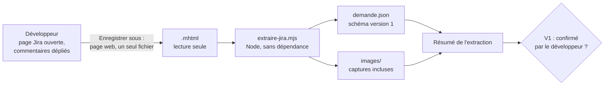

## 2. Enregistrer la page (consigne pour le développeur)

1. Ouvrir la demande dans Jira, en vue complète (pas dans un panneau latéral).
2. Afficher **tous** les commentaires : dans Jira Cloud et Data Center, les commentaires anciens sont souvent repliés derrière un lien du type « afficher plus » ou « voir les commentaires plus anciens ». Les déplier, sinon ils ne seront pas dans le fichier.
3. Dans Chrome ou Edge : « Enregistrer sous… », type « Page Web, un seul fichier (*.mhtml) ». Firefox n'enregistre pas en MHTML sans extension.
4. Donner le fichier à l'agent sans le retoucher.

## 3. Script d'extraction

L'agent écrit ce script dans son dossier de travail (par exemple `outils/extraire-jira.mjs`), à l'identique, puis l'exécute. Il n'a besoin que de Node.js 20 ou plus récent.

```bash
node outils/extraire-jira.mjs ECR-77.mhtml --sortie travail/ECR-77/demande.json --images travail/ECR-77/images
```

```js
#!/usr/bin/env node
// Extraction d'une demande Jira enregistrée au format MHTML (« Enregistrer sous… », page complète).
// Usage : node extraire-jira.mjs <demande.mhtml> [--sortie demande.json] [--images dossier]
// Node 20 ou plus récent, modules natifs uniquement. Le fichier source n'est jamais modifié.
import { createHash } from 'node:crypto';
import { mkdirSync, readFileSync, writeFileSync } from 'node:fs';
import { basename, join } from 'node:path';

const args = process.argv.slice(2);
if (args.length === 0 || args[0].startsWith('--')) {
  console.error('Usage : node extraire-jira.mjs <demande.mhtml> [--sortie demande.json] [--images dossier]');
  process.exit(1);
}
const option = (nom) => { const i = args.indexOf(nom); return i >= 0 ? args[i + 1] : undefined; };
const source = args[0];
const sortie = option('--sortie') ?? 'demande.json';
const dossierImages = option('--images');

// 1. Lecture binaire : chaque octet devient un caractère, rien n'est perdu avant décodage.
const brut = readFileSync(source);
const texteBrut = brut.toString('latin1');

// 2. En-têtes MIME (avec lignes repliées) et frontière.
function lireEntetes(bloc) {
  const entetes = {};
  const deplie = bloc.replace(/\r?\n[ \t]+/g, ' ');
  for (const ligne of deplie.split(/\r?\n/)) {
    const m = /^([\w-]+):\s*(.*)$/.exec(ligne);
    if (m) entetes[m[1].toLowerCase()] = m[2].trim();
  }
  return entetes;
}
function separerEntetes(texte) {
  const m = /\r?\n\r?\n/.exec(texte);
  if (!m) return [texte, ''];
  return [texte.slice(0, m.index), texte.slice(m.index + m[0].length)];
}
const [blocEntetes] = separerEntetes(texteBrut);
const entetesRacine = lireEntetes(blocEntetes);
const frontiere = /boundary="?([^";]+)"?/i.exec(entetesRacine['content-type'] ?? '')?.[1];
if (!frontiere) {
  console.error("Frontière MIME introuvable : le fichier n'est pas un MHTML multipart.");
  process.exit(2);
}

// 3. Découpage des parties et décodage.
function decoderQuotedPrintable(texte) {
  const sansCoupures = texte.replace(/=\r?\n/g, '');
  const octets = [];
  for (let i = 0; i < sansCoupures.length; i++) {
    const c = sansCoupures[i];
    if (c === '=' && /^[0-9A-Fa-f]{2}$/.test(sansCoupures.slice(i + 1, i + 3))) {
      octets.push(parseInt(sansCoupures.slice(i + 1, i + 3), 16));
      i += 2;
    } else {
      octets.push(c.charCodeAt(0) & 0xff);
    }
  }
  return Buffer.from(octets);
}
function decoderCorps(corps, encodage) {
  switch ((encodage ?? '').toLowerCase()) {
    case 'quoted-printable': return decoderQuotedPrintable(corps);
    case 'base64': return Buffer.from(corps.replace(/\s+/g, ''), 'base64');
    default: return Buffer.from(corps, 'latin1');
  }
}
const parties = texteBrut
  .split(`--${frontiere}`)
  .slice(1)
  .filter((p) => !p.startsWith('--'))
  .map((p) => {
    const [bloc, corps] = separerEntetes(p.replace(/^\r?\n/, ''));
    const entetes = lireEntetes(bloc);
    const type = (entetes['content-type'] ?? '').split(';')[0].trim().toLowerCase();
    const charset = /charset="?([^";]+)"?/i.exec(entetes['content-type'] ?? '')?.[1]?.toLowerCase() ?? 'utf-8';
    const octets = decoderCorps(corps.replace(/\r?\n$/, ''), entetes['content-transfer-encoding']);
    return { type, charset, emplacement: entetes['content-location'] ?? '', octets };
  });

const pageHtml = parties.find((p) => p.type === 'text/html');
if (!pageHtml) {
  console.error('Aucune partie text/html dans le fichier.');
  process.exit(3);
}
const html = pageHtml.octets.toString(pageHtml.charset.includes('8859') ? 'latin1' : 'utf8');

// 4. Outils HTML : bloc équilibré à partir d'un attribut, conversion en texte.
function blocDepuis(htmlSource, indexAttribut) {
  const debut = htmlSource.lastIndexOf('<', indexAttribut);
  const nom = /^<([a-zA-Z0-9]+)/.exec(htmlSource.slice(debut))?.[1]?.toLowerCase();
  if (!nom) return '';
  const motif = new RegExp(`<(/?)${nom}\\b[^>]*?(/?)>`, 'gi');
  motif.lastIndex = debut;
  let profondeur = 0;
  let m;
  while ((m = motif.exec(htmlSource))) {
    if (m[2] === '/') continue;                       // balise auto-fermante
    profondeur += m[1] === '/' ? -1 : 1;
    if (profondeur === 0) return htmlSource.slice(debut, m.index + m[0].length);
  }
  return htmlSource.slice(debut);
}
function blocsParAttribut(htmlSource, motifAttribut) {
  const blocs = [];
  const re = new RegExp(motifAttribut, 'g');
  let m;
  let finPrecedente = -1;
  while ((m = re.exec(htmlSource))) {
    if (m.index < finPrecedente) continue;            // bloc imbriqué dans le précédent
    const bloc = blocDepuis(htmlSource, m.index);
    blocs.push({ bloc, correspondance: m });
    finPrecedente = htmlSource.lastIndexOf('<', m.index) + bloc.length;
  }
  return blocs;
}
const ENTITES = { amp: '&', lt: '<', gt: '>', quot: '"', apos: "'", nbsp: ' ', eacute: 'é', egrave: 'è', agrave: 'à', ccedil: 'ç', rsquo: '’', laquo: '«', raquo: '»', hellip: '…' };
function enTexte(fragment) {
  return fragment
    .replace(/\r/g, '')
    .replace(/<(script|style|svg|noscript)\b[\s\S]*?<\/\1>/gi, '')
    .replace(/<br\s*\/?>/gi, '\n')
    .replace(/<li\b[^>]*>/gi, '\n- ')
    .replace(/<\/(p|div|h[1-6]|li|tr|pre|blockquote|table|ul|ol)>/gi, '\n')
    .replace(/<\/t[dh]>/gi, ' | ')
    .replace(/<[^>]+>/g, '')
    .replace(/&#(\d+);/g, (_, n) => String.fromCodePoint(Number(n)))
    .replace(/&#x([0-9a-f]+);/gi, (_, n) => String.fromCodePoint(parseInt(n, 16)))
    .replace(/&([a-z]+);/gi, (e, n) => ENTITES[n.toLowerCase()] ?? e)
    .replace(/[ \t ]+/g, ' ')
    .replace(/ *\n */g, '\n')
    .replace(/\n{3,}/g, '\n\n')
    .trim();
}
const premier = (motif) => { const b = blocsParAttribut(html, motif)[0]; return b ? enTexte(b.bloc) : null; };

// 5. Champs de la demande, selon les marqueurs connus de Jira Cloud et de Jira Data Center.
const titrePage = enTexte(/<title[^>]*>([\s\S]*?)<\/title>/i.exec(html)?.[1] ?? '');
const cle = /\b([A-Z][A-Z0-9_]+-\d+)\b/.exec(titrePage)?.[1] ?? /\b([A-Z][A-Z0-9_]+-\d+)\b/.exec(html)?.[1] ?? null;
const marqueursCloud = /data-testid="issue\.views\./.test(html);
const marqueursDc = /id="(summary-val|description-val)"/.test(html);
const variante = marqueursCloud ? 'cloud' : marqueursDc ? 'datacenter' : 'inconnue';
const limites = [];

let resume = null;
let description = null;
let commentaires = [];
if (variante === 'cloud') {
  resume = premier('data-testid="issue\\.views\\.issue-base\\.foundation\\.summary\\.heading"');
  description = premier('data-testid="issue\\.views\\.field\\.rich-text\\.description"');
  commentaires = blocsParAttribut(html, 'data-testid="issue-comment-base\\.ui\\.comment\\.ak-comment\\.(\\d+)"')
    .map(({ bloc, correspondance }) => ({
      id: correspondance[1],
      auteur: enTexte(/data-testid="[^"]*author[^"]*"[^>]*>([\s\S]*?)<\//.exec(bloc)?.[1] ?? '') || null,
      date: /<time[^>]*datetime="([^"]+)"/.exec(bloc)?.[1] ?? null,
      texte: enTexte(bloc),
    }));
} else if (variante === 'datacenter') {
  resume = premier('id="summary-val"');
  description = premier('id="description-val"');
  commentaires = blocsParAttribut(html, 'id="comment-(\\d+)"')
    .map(({ bloc, correspondance }) => ({
      id: correspondance[1],
      auteur: enTexte(/class="[^"]*user-hover[^"]*"[^>]*>([\s\S]*?)<\/a>/.exec(bloc)?.[1] ?? '') || null,
      date: /<time[^>]*datetime="([^"]+)"/.exec(bloc)?.[1] ?? null,
      texte: enTexte(/class="[^"]*action-body[^"]*"[^>]*>([\s\S]*?)<\/div>/.exec(bloc)?.[1] ?? bloc),
    }));
} else {
  limites.push("Page non reconnue comme Jira Cloud ni Jira Data Center : seuls le titre et le texte intégral sont fournis.");
}
if (variante !== 'inconnue') {
  if (!resume) limites.push('Résumé non trouvé par les marqueurs connus : le lire dans le texte intégral.');
  if (!description) limites.push('Description non trouvée par les marqueurs connus : la lire dans le texte intégral.');
  if (commentaires.length === 0) limites.push("Aucun commentaire détecté : vérifier dans le texte intégral qu'il n'y en a vraiment aucun.");
}
if (/(Show more|Afficher plus|more comments|autres commentaires)/i.test(enTexte(html))) {
  limites.push("La page contient un lien « afficher plus » : des commentaires peuvent manquer à l'enregistrement. Les déplier avant d'enregistrer la page.");
}

// 6. Pièces (images et autres ressources) incluses dans le MHTML.
const pieces = parties
  .filter((p) => p !== pageHtml && !['text/css', 'text/javascript', 'application/javascript'].includes(p.type))
  .map((p, i) => {
    const piece = { type: p.type, emplacement: p.emplacement, taille: p.octets.length };
    if (dossierImages && p.type.startsWith('image/')) {
      mkdirSync(dossierImages, { recursive: true });
      const extension = p.type.split('/')[1].replace('svg+xml', 'svg').replace('jpeg', 'jpg');
      piece.fichier = join(dossierImages, `piece-${String(i + 1).padStart(3, '0')}.${extension}`);
      writeFileSync(piece.fichier, p.octets);
    }
    return piece;
  });

const resultat = {
  schemaVersion: 1,
  source: {
    fichier: basename(source),
    sha256: createHash('sha256').update(brut).digest('hex'),
    extraitLe: new Date().toISOString(),
  },
  jira: { variante, cle, titrePage, url: pageHtml.emplacement || null },
  resume,
  description,
  commentaires,
  pieces,
  limites,
  texteIntegral: enTexte(html),
};
writeFileSync(sortie, JSON.stringify(resultat, null, 2) + '\n', 'utf8');
console.log(`${sortie} : ${cle ?? 'clé inconnue'} (${variante}), description ${description ? 'trouvée' : 'absente'}, ` +
  `${commentaires.length} commentaire(s), ${pieces.length} pièce(s), ${limites.length} limite(s)`);
```

Ce que fait le script :

| Étape | Détail |
|---|---|
| Lecture | octets bruts, sans altération ; empreinte sha256 enregistrée (D1.INV-1) |
| MIME | en-têtes repliés, frontière du `multipart/related`, découpage des parties |
| Décodage | quoted-printable (coupures douces, octets UTF-8), base64, jeu de caractères de la partie |
| Variante | Jira Cloud (marqueurs `data-testid="issue.views…"`) ou Data Center (`summary-val`, `description-val`, `comment-…`) |
| Champs | clé (titre de la page), résumé, description, commentaires (identifiant, auteur, date, texte) |
| Pièces | images et autres ressources incluses ; images enregistrées si `--images` est fourni |
| Texte intégral | toute la page convertie en texte, scripts et styles retirés : filet de sécurité quand un marqueur a changé |
| Limites | champs non trouvés, page non reconnue, liens « afficher plus » détectés |

Les marqueurs HTML de Jira changent d'une version à l'autre. Le script cherche les marqueurs connus, et fournit toujours le texte intégral. Quand un champ n'est pas trouvé, l'agent le cherche dans le texte intégral et le signale comme limite, au lieu de conclure que le champ est vide.

## 4. Schéma de `demande.json` (version 1, point E1)

```json
{
  "schemaVersion": 1,
  "source": { "fichier": "ECR-77.mhtml", "sha256": "…", "extraitLe": "2026-10-16T19:20:00.000Z" },
  "jira": { "variante": "datacenter", "cle": "ECR-77", "titrePage": "[ECR-77] Export des retours d'expérience en CSV - Jira", "url": "https://jira.exemple/browse/ECR-77" },
  "resume": "Export des retours d'expérience en CSV",
  "description": "Ajouter un bouton d'export CSV sur la liste filtrée.\nEncodage UTF-8 avec BOM, séparateur point-virgule.",
  "commentaires": [
    { "id": "50001", "auteur": "Jeanne Dupont", "date": "2026-10-10T08:00:00+0200", "texte": "Limiter l'export à 10 000 lignes." }
  ],
  "pieces": [ { "type": "image/png", "emplacement": "https://…/capture.png", "taille": 18342, "fichier": "images/piece-002.png" } ],
  "limites": [],
  "texteIntegral": "…"
}
```

Les étapes suivantes ne lisent que ce fichier. Une correction manuelle (champ non trouvé, commentaire manquant fourni par le développeur) s'ajoute dans `demande.json` avec la mention de sa provenance, sans toucher au MHTML.

## 5. Images et pièces jointes

- Les captures d'écran collées dans la description ou les commentaires sont généralement incluses dans le MHTML : l'agent les regarde (s'il en a la capacité) et cite ce qu'il en retient, avec le nom du fichier.
- Les pièces jointes téléchargeables (PDF, tableurs) ne sont **pas** dans le MHTML : seule leur mention l'est. L'agent les liste comme limite et demande au développeur de les fournir si elles portent des exigences.

## 6. Résumé à confirmer (V1, D1.INV-2)

```markdown
## Extraction de ECR-77 (Jira Data Center)

- **Titre** : Export des retours d'expérience en CSV
- **Description** : 2 phrases, 0 tableau, 0 image
- **Commentaires** : 1 (Jeanne Dupont, 2026-10-10)
- **Pièces** : 1 image incluse (images/piece-002.png) ; pièces jointes mentionnées non incluses : aucune
- **Limites** : aucune
- **Empreinte de la source** : sha256 …

Cette extraction est-elle complète et fidèle à la demande ?
```

## 7. Pièges connus

- **Commentaires repliés** : la cause la plus fréquente d'une demande incomplète. Le script signale les liens « afficher plus » qu'il détecte, mais le libellé dépend de la langue et de la version de Jira : la question V1 reste indispensable.
- **Champs personnalisés** (critères d'acceptation, version cible, composant) : ils ne sont pas extraits nommément. L'agent les cherche dans le texte intégral et les ajoute à `demande.json` sous `champsComplementaires`, avec leur libellé.
- **Panneau latéral ou vue de tableau** : une page enregistrée depuis un tableau de bord ne contient qu'une partie de la demande. Demander la vue complète.
- **Fichier `.mht` ou `.mhtml` mal nommé** : le script vérifie la structure MIME, pas l'extension.

## 8. Contrôle de sortie

- La source est intacte, et son empreinte figure dans `demande.json` (D1.INV-1).
- Le résumé a été confirmé (D1.INV-2).
- Les limites sont listées, y compris les pièces non incluses (D1.INV-3).
<<<FIN references/agent-tdd-jira/ingestion-jira.md>>>

<<<FICHIER references/agent-tdd-jira/us-criteres.md>>>
---
name: us-criteres
description: US et critères d'acceptation numérotés à partir de demande.json (reprise des US et des critères du ticket ou proposition marquée, identifiants stables CLÉ-USnn et CLÉ-CAnn, provenance, critères vérifiables, exigences rattachées, fichier us.md, déclinaison de chaque critère en scénarios Gherkin, critère prêt pour la réalisation, script de contrôle controler-criteres.mjs, validation V2). À lire après l'ingestion, avant l'analyse.
dimensions: [D10]
status: active
---

# Module `us-criteres` (D10)

Les critères d'acceptation (CA) sont la définition de « terminé » vue par l'auteur de la demande. L'agent les établit avant les scénarios : chaque scénario Gherkin illustre un ou plusieurs CA, et un test d'acceptation vérifiera un CA (point E4).

Chaîne tracée : demande → US → CA → scénarios Gherkin → tests → commits.

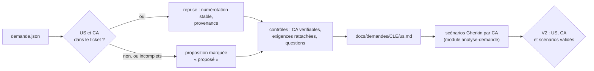

## 1. Trouver les US et les CA dans la demande

Sources dans `demande.json` :

| Source | Indices |
|---|---|
| champs complémentaires (`champsComplementaires`) | libellés « Critères d'acceptation », « Acceptance criteria », « User story » |
| description | « En tant que … je veux … afin de … » ; titres « Critères d'acceptation », « CA », « AC » et listes numérotées sous ces titres ; « Étant donné, Quand, Alors » ou « Given, When, Then » |
| commentaires | ajout ou correction d'un CA par l'auteur ou par le PO, lus dans l'ordre chronologique (module `analyse-demande`, section 3) |

Un CA repris garde sa formulation. Sa numérotation d'origine (« US2, CA1 ») est conservée comme provenance.

Si le ticket ne contient ni US ni CA, l'agent propose une US à partir de la description et des CA à partir des exigences, tous marqués « proposé » (D10.INV-2).

## 2. Identifiants (D10.INV-1)

- US : `<CLÉ>-USnn` ; CA : `<CLÉ>-CAnn`. L'agent les numérote dans l'ordre d'apparition, sur toute la demande.
- Un CA appartient à une seule US.
- Jamais renumérotés : un CA retiré garde son numéro, avec le statut « retiré : <raison> » ; un CA ajouté prend le numéro suivant.
- Les scénarios reprennent l'identifiant en étiquette : `@ECR-77-CA02`.

## 3. Fichier `docs/demandes/<CLÉ>/us.md`

Versionné avec les autres fichiers de la demande, et commité avec le premier scénario (module `cycle-tdd`, section 7). Exemple, après la validation V2 :

```markdown
# ECR-77 : US et critères d'acceptation

## ECR-77-US01 : exporter la liste des retours d'expérience

En tant qu'utilisateur de la liste des retours d'expérience, je veux exporter la liste filtrée en CSV, afin de l'exploiter dans un tableur.
Provenance : description.

| CA | Énoncé | Origine | Provenance | Statut | Scénarios |
|---|---|---|---|---|---|
| ECR-77-CA01 | le fichier contient la ligne d'en-tête et exactement les lignes de la liste filtrée | repris | description, phrase 1 | validé | S01 |
| ECR-77-CA02 | le fichier est encodé en UTF-8 avec BOM, colonnes séparées par des points-virgules | repris | description, phrase 2 | validé | S02 |
| ECR-77-CA03 | l'export est limité à 10 000 lignes | repris | commentaire 50001, Jeanne Dupont, 2026-10-10 | en attente de Q1 | S03 |
| ECR-77-CA04 | quand la liste filtrée est vide, le bouton d'export est désactivé et son motif est annoncé | proposé | réponse du développeur, V2 | validé | S04 |

## Exigences

| ID | Exigence | Provenance | CA |
|---|---|---|---|
| EX-01 | un bouton exporte la liste filtrée en CSV | description, phrase 1 | ECR-77-CA01 |
| EX-02 | encodage UTF-8 avec BOM | description, phrase 2 | ECR-77-CA02 |
| EX-03 | séparateur point-virgule | description, phrase 2 | ECR-77-CA02 |
| EX-04 | export limité à 10 000 lignes | commentaire 50001, Jeanne Dupont, 2026-10-10 | ECR-77-CA03 |
```

Statuts d'un CA : `à valider`, `validé`, `en attente de Qn`, `retiré : <raison>`. La colonne « Scénarios » liste les scénarios qui portent l'étiquette du CA.

La section « Exigences » consigne le tableau des exigences de l'analyse (module `analyse-demande`, section 2) et leur rattachement : un ou plusieurs CA, ou une question `Qn` (D10.INV-4).

## 4. Contrôles avant V2 (D10.INV-2 à D10.INV-4)

Le script de la section 7 automatise la plupart de ces contrôles ; la reformulation d'un CA et les questions restent du ressort de l'agent.

| Contrôle | Si le contrôle échoue |
|---|---|
| chaque CA énonce un résultat observable : un état, une valeur, un message, un fichier | reformulation proposée, ou question |
| aucun CA n'est contredit par un commentaire | question (D2.INV-2) |
| chaque exigence `EX-nn` est rattachée à au moins un CA | CA proposé, ou question |
| chaque US a au moins un CA | CA proposé |
| chaque US ou CA absent du ticket est marqué « proposé » | correction avant V2 |

## 5. Déclinaison en scénarios (D10.INV-5)

Chaque CA validé est illustré par au moins un scénario Gherkin, écrit selon le module `analyse-demande`, section 5. Chaque scénario porte, en plus de sa propre étiquette, celle du ou des CA qu'il illustre :

```gherkin
  # CA : ECR-77-CA02 ; source : EX-02, EX-03 (description, phrase 2)
  @ECR-77-S02 @ECR-77-CA02 @back
  Scénario: Encodage et séparateur du fichier
    Quand je demande l'export CSV de la liste
    Alors le fichier commence par la marque d'ordre des octets UTF-8
    Et les colonnes sont séparées par des points-virgules
```

Les tests restent étiquetés avec leur scénario (point E3) : le lien vers le CA passe par le fichier Gherkin.

## 6. Prêt pour la réalisation (D10.INV-6)

Un CA entre en réalisation (V3, puis V4) quand il est validé, qu'il est décliné en scénarios validés et qu'aucune question ouverte ne le concerne. Sinon, ses scénarios restent « non réalisé : en attente de Qn » dans la matrice (module `tracabilite`), et les autres CA avancent.

Présentation au point V2, avec le tableau des exigences, les questions et le fichier Gherkin (module `analyse-demande`, section 7) :

```markdown
## V2 : US, critères d'acceptation et scénarios

- **US** : 1 (ECR-77-US01)
- **CA** : 4, dont 1 proposé (CA04)
- **Exigences** : EX-01 à EX-04, toutes rattachées à un CA
- **Questions** : Q1, qui concerne CA03
- **Prêts pour la réalisation** : CA01, CA02, CA04 ; CA03 en attente de Q1

Valider les US, les critères d'acceptation et les scénarios ?
```

## 7. Contrôler par script

L'agent écrit ce script dans son dossier de travail (par exemple `outils/controler-criteres.mjs`), à l'identique, et le lance :

- avant de présenter V2, puis après chaque modification de `us.md` ou du fichier Gherkin ; la deuxième ligne de sa sortie donne les CA prêts pour la réalisation (section 6) ;
- avant V5, avec `--depuis` sur le commit qui a ajouté `us.md`, pour vérifier qu'aucun identifiant n'a été renuméroté depuis.

Un écart se corrige avant de continuer, ou devient une question au développeur. Le script ne modifie aucun fichier. Il n'a besoin que de Node.js 20 ou plus récent, et de git pour `--depuis`.

```bash
node outils/controler-criteres.mjs docs/demandes/ECR-77
node outils/controler-criteres.mjs docs/demandes/ECR-77 --depuis "$(git log --diff-filter=A --format=%h -- docs/demandes/ECR-77/us.md | tail -n 1)"
```

```js
#!/usr/bin/env node
// Contrôle des US et des critères d'acceptation d'une demande (dimension D10 du skill agent-tdd-jira).
// Usage : node controler-criteres.mjs <dossier de la demande> [--depuis <révision git>]
//   <dossier>  par exemple docs/demandes/ECR-77, qui contient us.md et ECR-77.feature ;
//   --depuis   compare aussi les identifiants à ceux de us.md dans une révision git antérieure.
// Node 20 ou plus récent, modules natifs uniquement. Le script ne modifie aucun fichier.
import { execFileSync } from 'node:child_process';
import { existsSync, readFileSync } from 'node:fs';
import { basename, join, relative, resolve, sep } from 'node:path';

const args = process.argv.slice(2);
const option = (nom) => { const i = args.indexOf(nom); return i >= 0 ? args[i + 1] : undefined; };
const dossier = args[0];
if (!dossier || dossier.startsWith('--')) {
  console.error('Usage : node controler-criteres.mjs <dossier de la demande> [--depuis <révision git>]');
  process.exit(2);
}
const cle = basename(resolve(dossier));
if (!/^[A-Z][A-Z0-9_]+-\d+$/.test(cle)) {
  console.error(`Le dossier doit porter la clé de la demande (par exemple docs/demandes/ECR-77) : ${cle}`);
  process.exit(2);
}
const cheminUs = join(dossier, 'us.md');
const cheminFeature = join(dossier, `${cle}.feature`);
for (const chemin of [cheminUs, cheminFeature]) {
  if (!existsSync(chemin)) { console.error(`Fichier absent : ${chemin}`); process.exit(2); }
}

const ecarts = [];
const ecart = (invariant, message) => ecarts.push(`${invariant} : ${message}`);
const numero = (id) => Number(/(\d+)$/.exec(id)[1]);
const court = (id) => id.slice(cle.length + 1);
const liste = (valeur) => valeur.split(/[,;]\s*/).map((v) => v.trim()).filter((v) => v && v !== '—');
const ID_US = new RegExp(`^${cle}-US\\d{2,}$`);
const ID_CA = new RegExp(`^${cle}-CA\\d{2,}$`);
const ETIQUETTE_S = new RegExp(`^@${cle}-S\\d{2,}$`);
const ETIQUETTE_CA = new RegExp(`^@${cle}-CA\\d{2,}$`);
const STATUT = /^(à valider|validé|en attente de Q\d+(, Q\d+)*|retiré : \S.*)$/;
const VAGUE = /\b(fonctionne(nt)? correctement|correctement|rapidement|facilement|intuiti(f|ve)s?|conviviale?s?|ergonomiques?|optimale?s?|optimaux)\b/i;
const vague = (texte) => VAGUE.test(texte) || (/\brapides?\b/i.test(texte) && !/\d/.test(texte));

// Tableaux Markdown d'un texte : en-têtes et lignes, indexées par en-tête.
function tableaux(texte) {
  const resultat = [];
  const lignes = texte.split('\n');
  const cellules = (ligne) => ligne.split('|').slice(1, -1).map((c) => c.trim());
  for (let i = 0; i < lignes.length; i++) {
    if (!lignes[i].startsWith('|') || !/^\|[\s|:-]+\|$/.test(lignes[i + 1] ?? '')) continue;
    const entetes = cellules(lignes[i]);
    const rangs = [];
    let j = i + 2;
    for (; j < lignes.length && lignes[j].startsWith('|'); j++) {
      const c = cellules(lignes[j]);
      rangs.push(Object.fromEntries(entetes.map((e, k) => [e, c[k] ?? ''])));
    }
    resultat.push({ entetes, rangs });
    i = j - 1;
  }
  return resultat;
}

// us.md : une section « ## <CLÉ>-USnn : titre » par US, avec sa ligne « Provenance : » et son
// tableau de critères ; une section « ## Exigences » avec le rattachement de chaque exigence.
function lireUs(texte) {
  const us = new Map();
  const criteres = new Map();
  const doublons = [];
  const exigences = [];
  for (const section of texte.split(/^(?=## )/m)) {
    const titre = /^## (.+?)\s*$/m.exec(section)?.[1] ?? '';
    const idUs = /^(\S+) : /.exec(titre)?.[1];
    if (idUs && ID_US.test(idUs)) {
      if (us.has(idUs)) doublons.push(idUs);
      us.set(idUs, { provenance: /^Provenance\s*:\s*(.*)$/m.exec(section)?.[1].trim() ?? '' });
      for (const tableau of tableaux(section)) {
        if (tableau.entetes[0] !== 'CA') continue;
        for (const r of tableau.rangs) {
          if (criteres.has(r.CA)) doublons.push(r.CA);
          criteres.set(r.CA, {
            us: idUs, enonce: r['Énoncé'] ?? '', origine: r.Origine ?? '', provenance: r.Provenance ?? '',
            statut: r.Statut ?? '', scenarios: r['Scénarios'] ?? '',
          });
        }
      }
    } else if (/^Exigences\b/.test(titre)) {
      for (const tableau of tableaux(section)) exigences.push(...tableau.rangs);
    }
  }
  return { us, criteres, doublons, exigences };
}

// Fichier Gherkin : chaque scénario avec ses étiquettes et ses étapes.
function lireFeature(texte) {
  const scenarios = [];
  let etiquettes = [];
  let courant = null;
  texte.split('\n').forEach((brute, i) => {
    const ligne = brute.trim();
    if (ligne.startsWith('@')) { etiquettes.push(...ligne.split(/\s+/).filter((e) => e.startsWith('@'))); return; }
    if (ligne === '' || ligne.startsWith('#')) return;
    const m = /^(Scénario|Exemple|Plan du [sS]cénario)\s*:\s*(.*)$/.exec(ligne);
    if (m) {
      courant = { ligne: i + 1, titre: m[2], etiquettes, alors: [] };
      scenarios.push(courant);
    } else if (/^(Fonctionnalité|Règle|Contexte|Exemples)\s*:/.test(ligne)) {
      courant = null;
    } else if (courant && /^Alors\b/.test(ligne)) {
      courant.alors.push(ligne);
    }
    etiquettes = [];
  });
  return scenarios;
}

const { us, criteres, doublons, exigences } = lireUs(readFileSync(cheminUs, 'utf8'));
const scenarios = lireFeature(readFileSync(cheminFeature, 'utf8'));

// D10.INV-1 : identifiants.
if (us.size === 0) ecart('D10.INV-1', `aucune US ${cle}-USnn dans us.md`);
for (const id of new Set(doublons)) ecart('D10.INV-1', `${id} est défini plusieurs fois dans us.md`);
for (const id of criteres.keys()) if (!ID_CA.test(id)) ecart('D10.INV-1', `identifiant de critère mal formé : ${id} (attendu ${cle}-CAnn)`);

// D10.INV-2, D10.INV-3 : provenance, origine, énoncé vérifiable ; statuts connus.
for (const [id, u] of us) if (!u.provenance) ecart('D10.INV-2', `${id} sans ligne « Provenance : »`);
for (const [id, c] of criteres) {
  if (!['repris', 'proposé'].includes(c.origine)) ecart('D10.INV-2', `${id} : origine « ${c.origine} », attendu « repris » ou « proposé »`);
  if (!c.provenance || c.provenance === '—') ecart('D10.INV-2', `${id} sans provenance`);
  if (!c.enonce) ecart('D10.INV-3', `${id} sans énoncé`);
  else if (vague(c.enonce)) ecart('D10.INV-3', `${id} : énoncé non vérifiable (« ${c.enonce} ») ; le reformuler en résultat observable, ou poser une question`);
  if (!STATUT.test(c.statut)) ecart('D10.INV-6', `${id} : statut « ${c.statut} » inconnu (à valider, validé, en attente de Qn, retiré : raison)`);
}

// D10.INV-4 : chaque exigence est rattachée à un critère de us.md ou à une question.
if (exigences.length === 0) ecart('D10.INV-4', 'section « Exigences » absente ou vide dans us.md');
for (const e of exigences) {
  const liens = liste(e.CA ?? '');
  if (liens.length === 0) ecart('D10.INV-4', `${e.ID} n'est rattachée à aucun critère ni à aucune question`);
  for (const l of liens) if (!criteres.has(l) && !/^Q\d+$/.test(l)) ecart('D10.INV-4', `${e.ID} cite ${l}, absent de us.md`);
}

// D2.INV-3 et D10.INV-5 : une étiquette de scénario, au moins une étiquette de critère, une étape Alors.
const parId = new Map();
const parCritere = new Map();
for (const s of scenarios) {
  const ids = s.etiquettes.filter((e) => ETIQUETTE_S.test(e)).map((e) => e.slice(1));
  s.id = ids[0];
  const nom = s.id ?? `scénario ligne ${s.ligne} (« ${s.titre} »)`;
  if (ids.length !== 1) ecart('D2.INV-3', `${nom} : ${ids.length} étiquette(s) @${cle}-Snn, une seule attendue`);
  if (s.id && parId.has(s.id)) ecart('D2.INV-3', `${s.id} étiquette deux scénarios (lignes ${parId.get(s.id).ligne} et ${s.ligne})`);
  if (s.id) parId.set(s.id, s);
  if (s.alors.length === 0) ecart('D2.INV-3', `${nom} sans étape Alors`);
  for (const a of s.alors) if (vague(a)) ecart('D2.INV-3', `${nom} : étape non vérifiable (« ${a} »)`);
  const cas = s.etiquettes.filter((e) => ETIQUETTE_CA.test(e)).map((e) => e.slice(1));
  if (cas.length === 0) ecart('D10.INV-5', `${nom} n'illustre aucun critère : étiquette @${cle}-CAnn absente`);
  for (const c of cas) {
    if (!criteres.has(c)) ecart('D10.INV-5', `${nom} cite ${c}, absent de us.md`);
    else if (criteres.get(c).statut.startsWith('retiré')) ecart('D10.INV-5', `${nom} illustre ${c}, retiré`);
    if (!parCritere.has(c)) parCritere.set(c, []);
    parCritere.get(c).push(s);
  }
}

// D10.INV-5 à D10.INV-7 : couverture, colonne « Scénarios » de us.md, critères en attente, critères prêts.
const prets = [];
const enAttente = [];
for (const [id, c] of criteres) {
  const lies = parCritere.get(id) ?? [];
  if (c.statut === 'validé' && lies.length === 0) ecart('D10.INV-5', `${id} est validé mais aucun scénario ne l'illustre`);
  if (!c.statut.startsWith('retiré')) {
    const annonces = liste(c.scenarios).map((s) => (s.startsWith(`${cle}-`) ? s : `${cle}-${s}`)).sort();
    const trouves = lies.map((s) => s.id).filter(Boolean).sort();
    if (annonces.join(',') !== trouves.join(',')) {
      const annonce = annonces.length ? `us.md annonce ${annonces.map(court).join(', ')}` : "us.md n'annonce aucun scénario";
      const donne = trouves.length ? `le fichier Gherkin donne ${trouves.map(court).join(', ')}` : "le fichier Gherkin n'en donne aucun";
      ecart('D10.INV-7', `${id} : ${annonce}, ${donne}`);
    }
  }
  if (c.statut.startsWith('en attente')) {
    enAttente.push(`${court(id)} (${c.statut.slice('en attente de '.length)})`);
    for (const s of lies) if (!s.etiquettes.includes('@en-attente')) ecart('D10.INV-6', `${s.id ?? `ligne ${s.ligne}`} illustre ${id}, ${c.statut}, sans l'étiquette @en-attente`);
  }
  if (c.statut === 'validé' && lies.length > 0 && lies.every((s) => !s.etiquettes.includes('@en-attente') && !s.etiquettes.includes('@propose'))) {
    prets.push(court(id));
  }
}

// D10.INV-1, avec --depuis : aucun identifiant disparu ni déplacé, un nouveau critère prend le numéro suivant.
const depuis = option('--depuis');
if (depuis) {
  let ancien = null;
  try {
    const chemin = relative(process.cwd(), resolve(cheminUs)).split(sep).join('/');
    ancien = execFileSync('git', ['show', `${depuis}:./${chemin}`], { encoding: 'utf8', stdio: ['ignore', 'pipe', 'ignore'] });
  } catch {
    ancien = null;
  }
  if (ancien === null) {
    console.log(`info  us.md absent de la révision ${depuis} : pas de comparaison`);
  } else {
    const avant = lireUs(ancien);
    for (const id of avant.us.keys()) if (!us.has(id)) ecart('D10.INV-1', `${id} existait dans ${depuis} et a disparu`);
    for (const [id, c] of avant.criteres) {
      if (!criteres.has(id)) ecart('D10.INV-1', `${id} existait dans ${depuis} et a disparu : un critère retiré garde son numéro, au statut « retiré : raison »`);
      else if (criteres.get(id).us !== c.us) ecart('D10.INV-1', `${id} est passé de ${c.us} à ${criteres.get(id).us}`);
    }
    const dernier = Math.max(0, ...[...avant.criteres.keys()].filter((id) => ID_CA.test(id)).map(numero));
    for (const id of criteres.keys()) {
      if (!avant.criteres.has(id) && ID_CA.test(id) && numero(id) <= dernier) {
        ecart('D10.INV-1', `${id} est nouveau mais ne prend pas le numéro suivant (dernier numéro dans ${depuis} : CA${String(dernier).padStart(2, '0')})`);
      }
    }
  }
}

const compte = (filtre) => [...criteres.values()].filter(filtre).length;
console.log(`${cle} : ${us.size} US, ${criteres.size} critères (${compte((c) => c.statut === 'validé')} validés, ` +
  `${compte((c) => c.statut.startsWith('en attente'))} en attente, ${compte((c) => c.statut === 'à valider')} à valider, ` +
  `${compte((c) => c.statut.startsWith('retiré'))} retirés), ${scenarios.length} scénarios, ${exigences.length} exigences`);
console.log(`prêts pour la réalisation : ${prets.join(', ') || 'aucun'}${enAttente.length ? ` ; en attente : ${enAttente.join(', ')}` : ''}`);
for (const e of ecarts) console.log(`ÉCART  ${e}`);
console.log(ecarts.length ? `${ecarts.length} écart(s)` : 'aucun écart');
process.exit(ecarts.length ? 1 : 0);
```

Sortie sur l'exemple de la section 3 :

```text
ECR-77 : 1 US, 4 critères (3 validés, 1 en attente, 0 à valider, 0 retirés), 4 scénarios, 4 exigences
prêts pour la réalisation : CA01, CA02, CA04 ; en attente : CA03 (Q1)
aucun écart
```

Ce que contrôle le script :

| Contrôle | Invariant |
|---|---|
| identifiants `<CLÉ>-USnn` et `<CLÉ>-CAnn` bien formés et uniques, chaque CA dans une seule US ; avec `--depuis`, aucun identifiant disparu ni changé d'US, et un CA nouveau prend le numéro suivant | D10.INV-1 |
| provenance de chaque US et de chaque CA ; origine `repris` ou `proposé` | D10.INV-2 |
| énoncé présent, sans formulation invérifiable (« correctement », « facilement », « rapide » sans seuil…) | D10.INV-3 |
| chaque exigence rattachée à un CA de `us.md` ou à une question `Qn` | D10.INV-4 |
| chaque CA validé illustré par au moins un scénario ; chaque scénario étiqueté d'au moins un CA existant et non retiré | D10.INV-5 |
| statut connu ; scénarios d'un CA en attente étiquetés `@en-attente` ; CA prêts : validés, illustrés par des scénarios sans `@en-attente` ni `@propose` | D10.INV-6 |
| colonne « Scénarios » de `us.md` identique aux étiquettes du fichier Gherkin | D10.INV-7 |
| une étiquette `@<CLÉ>-Snn` par scénario, unique dans le fichier ; au moins une étape `Alors`, sans formulation invérifiable | D2.INV-3 |

## 8. Pièges connus

- **CA technique** : « l'API renvoie 200 » n'est pas un CA de l'auteur de la demande. Le reformuler en résultat observable ; la règle technique relève de la variante (module `variantes`).
- **Scénario déguisé en CA** : un « Étant donné, Quand, Alors » dans le ticket est déjà un exemple. En tirer le CA, c'est-à-dire la règle, et garder l'exemple comme scénario, avec la même provenance.
- **Renumérotation** : jamais, même après un retrait (D10.INV-1).
- **US sans bénéfice** : si le « afin de » manque, l'agent pose la question au lieu de l'inventer.

## 9. Contrôle de sortie

- Identifiants d'US et de CA stables, chaque CA dans une seule US (D10.INV-1).
- Provenance, ou marque « proposé », pour chaque US et chaque CA (D10.INV-2).
- CA vérifiables ; ambiguïtés et contradictions transformées en questions (D10.INV-3).
- Chaque exigence rattachée à un CA ou à une question (D10.INV-4).
- Chaque CA validé décliné en scénarios ; chaque scénario étiqueté d'au moins un CA (D10.INV-5).
- CA prêts pour la réalisation identifiés à V2 (D10.INV-6).
- Matrice et rapport final par CA, construits dans le module `tracabilite` (D10.INV-7).
- `controler-criteres.mjs` sans écart avant V2, puis avant V5 avec `--depuis` (section 7).
<<<FIN references/agent-tdd-jira/us-criteres.md>>>

<<<FICHIER references/agent-tdd-jira/analyse-demande.md>>>
---
name: analyse-demande
description: Analyse d'une demande Jira à partir de demande.json (exigences numérotées avec provenance et rattachées aux critères d'acceptation, lecture chronologique des commentaires, contradictions et ambiguïtés transformées en questions, scénarios Gherkin en français par critère, étiquetés @CLÉ-Snn et @CLÉ-CAnn, étiquettes de prérequis du binôme avec Agent2Test, scénarios proposés @propose, validation V2). À lire après le module us-criteres, avant l'impact.
dimensions: [D2]
status: active
---

# Module `analyse-demande` (D2)

L'analyse transforme une demande écrite en scénarios vérifiables. Elle se fait en quatre temps : établir les US et leurs critères d'acceptation (module `us-criteres`), relever les exigences et les rattacher aux critères, confronter description et commentaires, écrire les scénarios de chaque critère.

## 1. Déroulé

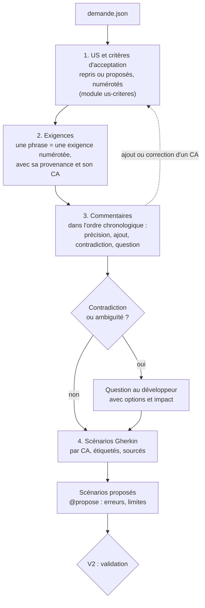

## 2. Exigences (D2.INV-1)

Chaque phrase porteuse d'une règle devient une exigence numérotée, avec sa provenance exacte, et se rattache à au moins un critère d'acceptation, ou à une question (D10.INV-4) :

| ID | Exigence | Provenance | CA |
|---|---|---|---|
| EX-01 | un bouton exporte la liste filtrée en CSV | description, phrase 1 | ECR-77-CA01 |
| EX-02 | encodage UTF-8 avec BOM | description, phrase 2 | ECR-77-CA02 |
| EX-03 | séparateur point-virgule | description, phrase 2 | ECR-77-CA02 |
| EX-04 | export limité à 10 000 lignes | commentaire 50001, Jeanne Dupont, 2026-10-10 | ECR-77-CA03 |

Une capture d'écran qui porte une exigence (maquette, message attendu) est une provenance au même titre qu'une phrase : `pièce images/piece-002.png`.

Le tableau est consigné dans la section « Exigences » de `us.md` (module `us-criteres`, section 3).

## 3. Lire les commentaires

Les commentaires se lisent dans l'ordre chronologique. Chacun est classé :

| Nature | Effet | Exemple |
|---|---|---|
| Précision | affine une exigence existante | « le brouillon d'un autre module ne bloque pas celui-ci » |
| Ajout | crée une exigence | « limiter l'export à 10 000 lignes » |
| Contradiction | contredit la description ou un autre commentaire | description : « tous les rôles » ; commentaire : « réservé aux administrateurs » |
| Question non résolue | question posée dans Jira sans réponse visible | « et si le brouillon ne contient que des espaces ? » |
| Hors sujet | sans effet sur le besoin | échanges de planification |

Une contradiction n'est jamais tranchée par l'agent, même si le commentaire est plus récent ou que son auteur semble avoir autorité (D2.INV-2). Elle devient une question.

## 4. Questions

```markdown
### Q1 : comportement au-delà de 10 000 lignes (EX-04)
- **Constat** : le commentaire 50001 limite l'export à 10 000 lignes sans dire ce qui se passe au-delà.
- **Options** :
  - A. exporter les 10 000 premières lignes et prévenir l'utilisateur ;
  - B. refuser l'export et demander d'affiner le filtre ;
  - C. autre règle, à préciser.
- **Impact** : le scénario ECR-77-S03 reste en attente ; A et B n'ont pas les mêmes variantes back.
```

Une question non tranchée au moment de V2 laisse les scénarios qui en dépendent en attente ; les autres peuvent avancer.

## 5. Scénarios Gherkin (D2.INV-3)

Fichier par demande, en français, versionné dans le dépôt du projet (par exemple `docs/demandes/ECR-77/ECR-77.feature`) :

```gherkin
# language: fr
@ECR-77 @role-LECTEUR
Fonctionnalité: Export des retours d'expérience en CSV
  En tant qu'utilisateur de la liste des retours d'expérience
  Je veux exporter la liste filtrée en CSV
  Afin de l'exploiter dans un tableur

  Contexte:
    Étant donné que je suis connecté avec le rôle "LECTEUR"
    Et que la liste filtrée affiche 3 retours d'expérience

  # CA : ECR-77-CA01 ; source : EX-01 (description, phrase 1)
  @ECR-77-S01 @ECR-77-CA01 @back @front
  Scénario: Exporter la liste filtrée
    Quand je demande l'export CSV de la liste
    Alors je reçois un fichier "retours-experience.csv"
    Et il contient 1 ligne d'en-tête et 3 lignes de données

  # CA : ECR-77-CA02 ; source : EX-02, EX-03 (description, phrase 2)
  @ECR-77-S02 @ECR-77-CA02 @back
  Scénario: Encodage et séparateur du fichier
    Quand je demande l'export CSV de la liste
    Alors le fichier commence par la marque d'ordre des octets UTF-8
    Et les colonnes sont séparées par des points-virgules

  # CA : ECR-77-CA03 ; source : EX-04 (commentaire 50001, Jeanne Dupont, 2026-10-10) ; en attente de Q1
  @ECR-77-S03 @ECR-77-CA03 @back @front @en-attente
  Scénario: Liste au-delà de la limite d'export
    Étant donné que la liste filtrée compte 10 001 retours d'expérience
    Quand je demande l'export CSV de la liste
    Alors <comportement selon la réponse à Q1>

  # CA : ECR-77-CA04 ; proposé par l'agent : cas non énoncé par la demande
  @ECR-77-S04 @ECR-77-CA04 @back @front @propose
  Scénario: Liste filtrée vide
    Étant donné que la liste filtrée ne compte aucun retour d'expérience
    Quand je consulte la liste
    Alors le bouton d'export est désactivé et son motif est annoncé
```

Règles d'écriture :

- une étiquette `@<CLÉ>-Snn` par scénario, attribuée une fois pour toutes : un scénario supprimé laisse son numéro inutilisé (point E2) ;
- une ou plusieurs étiquettes `@<CLÉ>-CAnn` : les critères d'acceptation que le scénario illustre, rappelés dans le commentaire de provenance (D10.INV-5, point E4) ;
- étiquettes de couche `@back`, `@front` ; étiquettes d'état `@en-attente` (question ouverte) et `@propose` (scénario déduit par l'agent, D2.INV-4) ;
- étiquettes de prérequis, lues par Agent2Test : `@role-<nom>` pour un rôle de l'application, `@batch-<nom>` pour un batch Java à lancer avant le scénario, `@redemarrage` ou `@ecriture-base` ; au choix du développeur, `@criticite-haute`, `@criticite-moyenne`, `@criticite-basse` et `@socle` (module `binome-agent2test`, section 3, D7.INV-5). Une étiquette de la ligne `Fonctionnalité:` vaut pour chacun de ses scénarios : dans l'exemple, `@role-LECTEUR` traduit le Contexte ;
- la provenance en commentaire juste au-dessus des étiquettes (D2.INV-1) ;
- chaque `Alors` est vérifiable par un test : pas de « fonctionne correctement », pas de « est rapide » sans seuil ;
- les étapes décrivent le comportement observable, pas l'implémentation (« je demande l'export », pas « j'appelle GET /api/v1/… ») ;
- `Plan du scénario` et `Exemples` pour une même règle sur plusieurs valeurs (bornes, rôles).

Le fichier Gherkin est une spécification. L'agent n'introduit pas d'outil d'exécution Gherkin (Cucumber ou autre) sans validation : les tests sont des tests JUnit et front classiques, étiquetés avec le scénario (point E3).

## 6. Scénarios proposés (D2.INV-4)

L'agent propose les cas que la demande n'énonce pas mais que le code devra traiter : liste vide, droit insuffisant, erreur du serveur, bornes, concurrence. Chaque proposition :

- porte `@propose` et la mention « Proposé par l'agent » ;
- illustre un critère d'acceptation existant, ou un critère proposé avec elle et marqué « proposé » dans `us.md` : pas de scénario sans critère (D10.INV-2, D10.INV-5) ;
- est validée, modifiée ou écartée par le développeur à V2 ;
- une fois validée, perd `@propose` et prend « Source : réponse du développeur, V2 ».

## 7. Validation V2 (D2.INV-5)

L'agent présente : les US et les critères d'acceptation (`us.md`, module `us-criteres`, section 6), le tableau des exigences, les questions, le fichier Gherkin, et la couverture (chaque exigence a au moins un CA, chaque CA au moins un scénario), établie par le script de contrôle (module `us-criteres`, section 7). Il attend :

- une réponse à chaque question, ou l'accord pour laisser les scénarios concernés en attente ;
- l'acceptation, la modification ou le rejet de chaque critère d'acceptation et de chaque scénario proposés ;
- la validation de l'ensemble.

## 8. Pièges connus

- **Reformuler la demande en mieux** : l'agent écrit ce qui est demandé, pas ce qu'il aurait conçu. Une amélioration se propose en `@propose`.
- **Scénario technique** : « la table est indexée » n'est pas un scénario de demande. C'est un choix de variante (module `variantes`).
- **Commentaire ignoré parce que plus ancien** : un commentaire ancien reste valable tant qu'aucun autre ne le contredit.
- **Exigence sans scénario** : chaque exigence apparaît dans au moins un scénario, ou dans une question.

## 9. Contrôle de sortie

- Chaque scénario cite sa provenance (D2.INV-1).
- Chaque contradiction ou ambiguïté est une question (D2.INV-2).
- Chaque scénario est en Gherkin français, étiqueté, avec un `Alors` vérifiable (D2.INV-3).
- Les scénarios déduits portent `@propose` (D2.INV-4).
- Chaque exigence est rattachée à un CA ou à une question (D10.INV-4) ; chaque scénario porte l'étiquette d'au moins un CA (D10.INV-5).
- Chaque scénario qui exige un rôle, un batch, un redémarrage ou une écriture en base porte son étiquette de prérequis, directement ou par sa fonctionnalité (D7.INV-5).
- V2 obtenue avant l'étude des variantes (D2.INV-5).
<<<FIN references/agent-tdd-jira/analyse-demande.md>>>

<<<FICHIER references/agent-tdd-jira/cycle-tdd.md>>>
---
name: cycle-tdd
description: Réalisation d'un scénario Gherkin en cycle TDD rouge, vert, remanié, côté back Java et front Angular (test étiqueté écrit d'abord, échec pour la bonne raison, code minimal, remaniement selon les invariants des référentiels, ordre contrat puis back puis front, suites complètes, commit, acceptation V4). À lire avant d'écrire le moindre code.
dimensions: [D5]
status: active
---

# Module `cycle-tdd` (D5)

Un scénario à la fois (D5.INV-4). Pour chaque scénario, et pour chaque couche concernée, l'agent écrit d'abord un test qui échoue pour la raison attendue, puis le code minimal qui le fait passer, puis il remanie. Le développeur accepte le scénario avant que le suivant commence.

## 1. Cycle d'un scénario

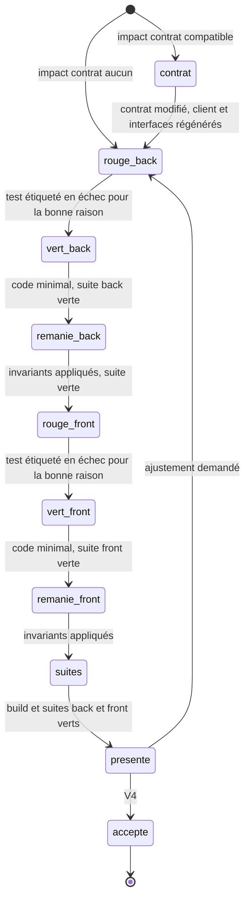

Un scénario `@back` seul s'arrête après `remanie_back` ; un scénario `@front` seul commence à `rouge_front`.

## 2. Ordre des couches (D5.INV-5)

Quand le scénario modifie le contrat : d'abord le contrat (`api/openapi.yaml`), puis la régénération des interfaces back et du client front, puis le back, puis le front. Le front teste contre le contrat (réponses simulées par `HttpTestingController`), jamais contre un back en cours d'écriture.

## 3. Rouge (D5.INV-1)

1. Écrire le test, étiqueté avec le scénario (D6.INV-2, point E3).
2. L'exécuter seul.
3. Vérifier qu'il échoue **pour la raison attendue** : une assertion du scénario, pas une erreur de configuration.

Une erreur de compilation (classe absente) est une étape, pas un rouge valable : l'agent crée la signature minimale (méthode qui renvoie une valeur vide), relance, et obtient l'échec d'assertion. Le rapport de la phase cite le message d'échec.

Back, test unitaire :

```java
@Test
@Tag("ECR-77-S02")
@DisplayName("ECR-77-S02 : le fichier commence par le BOM UTF-8 et sépare les colonnes par des points-virgules")
void exportCommenceParLeBomEtUtiliseLePointVirgule() {
    byte[] csv = FeedbackCsv.write(List.of(new FeedbackRow("REX-1", "Fuite vanne")));

    assertThat(csv).startsWith((byte) 0xEF, (byte) 0xBB, (byte) 0xBF);
    assertThat(new String(csv, StandardCharsets.UTF_8)).contains("REX-1;Fuite vanne");
}
```

```bash
./mvnw -q test -Dtest=FeedbackCsvTest          # rouge attendu : « Expecting actual … to start with … »
./mvnw -q test -Dgroups=ECR-77-S02             # tous les tests du scénario (étiquette JUnit)
```

Front, test du store :

```ts
describe('ECR-77-S01 : exporter la liste filtrée', () => {
  it("transmet le fichier reçu au service de téléchargement", () => {
    store.exportCsv();
    const req = http.expectOne(r => r.url.endsWith('/api/v1/feedbacks/export'));
    expect(req.request.method).toBe('GET');
    req.flush(new Blob(['id;titre\n'], { type: 'text/csv' }));
    expect(download.save).toHaveBeenCalledWith(jasmine.any(Blob), 'retours-experience.csv');
  });
});
```

```bash
npx ng test --no-watch --include='**/feedback.store.spec.ts'
```

## 4. Vert (D5.INV-2)

- Le code minimal qui fait passer le test, rien de plus : pas de cas non demandé par un scénario, pas d'abstraction anticipée.
- Puis la suite complète du module (back : `./mvnw verify` ; front : `npx ng test --no-watch` et `npx ng lint`). Une régression ailleurs n'est pas « hors sujet » : l'agent la traite ou la signale avant d'aller plus loin.

## 5. Remanié (D5.INV-3)

C'est à cette phase que le code rejoint les référentiels :

| Côté | Exemples de remaniement attendus |
|---|---|
| Back | DTO en `record` (`java:D2.INV-1`), injection par constructeur (`java:D1.INV-3`), transaction `readOnly` dans la couche application (`java:D4.INV-3`), erreurs par le gestionnaire unique (`java:D3.INV-3`) |
| Front | `OnPush` (`angular:D2.INV-1`), état en signaux, client généré (`angular:D3.INV-1`), annonce accessible (`angular:D6.INV-4`) |

Règles : comportement inchangé ; suites vertes après chaque modification ; pas de remaniement d'un code qui n'est pas touché par le scénario, sauf demande.

## 6. Présenter le scénario (V4)

```markdown
## @ECR-77-S02 : encodage et séparateur du fichier

- **Critère d'acceptation** : ECR-77-CA02
- **Variante** : B1 (front non concerné)
- **Rouge** : `FeedbackCsvTest.exportCommenceParLeBomEtUtiliseLePointVirgule` en échec :
  « Expecting actual: [] to start with: [-17, -69, -65] »
- **Vert** : `FeedbackCsv.write` écrit le BOM puis les lignes séparées par « ; »
- **Remanié** : constantes extraites, `FeedbackRow` en record ; suite verte
- **Suites** : back `./mvnw verify` vert (412 tests) ; front non concerné
- **Fichiers** : FeedbackCsv.java, FeedbackRow.java, FeedbackCsvTest.java
- **Commit proposé** : « ECR-77 S02 : BOM UTF-8 et séparateur point-virgule »

Accepter ce scénario et passer au suivant ?
```

## 7. Commits

- Au moins un commit par scénario accepté, dont le message commence par la clé et le numéro du scénario (`ECR-77 S02 : …`). Si le développeur préfère un commit par phase (rouge, vert, remanié), l'agent suit sa préférence.
- L'agent commite localement après V4 si le développeur l'accepte ; il ne pousse jamais sans demande explicite.
- Les fichiers de la demande (`us.md`, `.feature`, `suivi.md`) sont commités avec le premier scénario.
- En binôme, un défaut applicatif confirmé par Agent2Test rouvre son scénario pour un cycle de correction aux mêmes phases (module `binome-agent2test`, section 7) ; son commit cite la campagne : `ECR-77 S04 : correction, … (Agent2Test C-20261021-001)`.

## 8. Pièges connus

- **Test écrit après le code** : interdit (D5.INV-1). Si du code existe déjà pour le scénario, l'agent écrit le test, le voit passer, puis le casse volontairement (en commentant une ligne du code) pour vérifier qu'il échouerait : ce contrôle remplace le rouge, et il est mentionné tel quel dans le rapport.
- **Test qui passe du premier coup** : soit le comportement existe déjà, soit le test ne teste rien. L'agent l'analyse et le dit.
- **`fit`, `fdescribe`, `@Disabled` oubliés** : jamais dans un commit.
- **Gros pas** : si le vert demande plus de quelques dizaines de lignes, le scénario est trop gros ou le test trop large ; l'agent propose de le découper.
- **Données réelles dans les tests** : noms et données de la demande remplacés par des données fictives.

## 9. Contrôle de sortie

- Un test étiqueté a échoué pour la bonne raison avant tout code de production (D5.INV-1).
- Code minimal et suite du module verte (D5.INV-2).
- Remaniement sans changement de comportement, invariants appliqués, suites vertes (D5.INV-3).
- Scénario accepté avant le suivant (D5.INV-4).
- Ordre contrat, back, front respecté si le contrat change (D5.INV-5).
- Aucune dépendance nouvelle sans validation (D5.INV-6).
<<<FIN references/agent-tdd-jira/cycle-tdd.md>>>

<<<FICHIER references/agent-tdd-jira/tracabilite.md>>>
---
name: tracabilite
description: Traçabilité d'une demande Jira jusqu'au code (matrice US, critères d'acceptation, exigences, scénarios, tests, commits, statuts, construction par recherche des étiquettes, verdict d'acceptation d'Agent2Test par critère en binôme, rapport final par critère, écarts, questions ouvertes, projet de commentaire Jira à publier par le développeur, V5). À lire à la fin de chaque scénario et en fin de demande.
dimensions: [D6]
status: active
---

# Module `tracabilite` (D6)

La traçabilité répond à une question : chaque élément de la demande est-il réalisé, testé et livré, et où ? Elle se construit au fil des scénarios et se remet en fin de demande.

## 1. Chaîne tracée

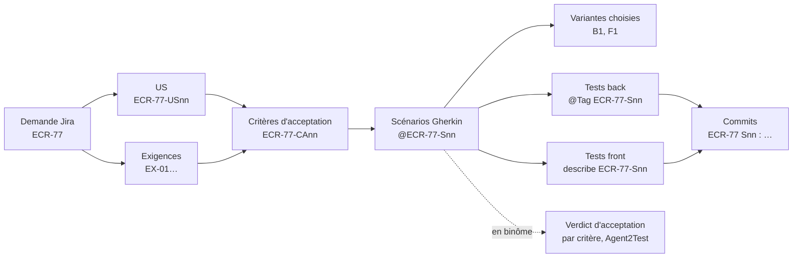

## 2. Construire la matrice par recherche (point E3)

```bash
# critères d'acceptation de chaque scénario (étiquettes du fichier Gherkin)
grep -n '@ECR-77-S' docs/demandes/ECR-77/ECR-77.feature
# tests back étiquetés
grep -rn '@Tag("ECR-77-S' src/test/java
# tests front étiquetés
grep -rn "describe('ECR-77-S" src/app --include=*.spec.ts
# commits de la demande
git log --oneline --grep='^ECR-77 '
# US, critères et scénarios cohérents, aucun identifiant renuméroté depuis l'ajout de us.md (module us-criteres, section 7)
node outils/controler-criteres.mjs docs/demandes/ECR-77 --depuis "$(git log --diff-filter=A --format=%h -- docs/demandes/ECR-77/us.md | tail -n 1)"
# en binôme : verdict d'acceptation de chaque critère, d'après le journal de la dernière campagne (module binome-agent2test, section 6)
node outils/lire-acceptation.mjs docs/demandes/ECR-77 ../agent2test/rapports/C-20261021-002/journal-de-tests.json
```

## 3. Matrice (D6.INV-1, D6.INV-2, D10.INV-7, D7.INV-3)

| US | CA | Exigences | Scénario | Variante | Tests back | Tests front | Commit | Statut | Acceptation |
|---|---|---|---|---|---|---|---|---|---|
| ECR-77-US01 | ECR-77-CA01 | EX-01 | @ECR-77-S01 | B1 + F1 | `FeedbackExportControllerTest#exporteLaListeFiltree` | `feedback.store.spec.ts` › ECR-77-S01 | `a1b2c3d` | réalisé | conforme |
| ECR-77-US01 | ECR-77-CA02 | EX-02, EX-03 | @ECR-77-S02 | B1 | `FeedbackCsvTest#exportCommenceParLeBomEtUtiliseLePointVirgule` | non concerné | `d4e5f6a` | réalisé | non vérifié (non jouable : limité au back) |
| ECR-77-US01 | ECR-77-CA03 | EX-04 | @ECR-77-S03 | — | — | — | — | non réalisé : en attente de Q1 | non vérifié (non jouable : en attente de Q1) |
| ECR-77-US01 | ECR-77-CA04 (proposé, validé) | — | @ECR-77-S04 | B1 + F1 | `…` | `feedback-list.spec.ts` › ECR-77-S04 | `b7c8d9e`, `f0a1b2c` | réalisé, corrigé après la campagne C-20261021-001 | conforme |

Une exigence sans CA ni scénario, un CA sans scénario, ou un scénario validé sans test ni statut, rend la matrice incomplète : l'agent ne remet pas le rapport dans cet état. Un CA est réalisé quand tous ses scénarios le sont.

La colonne « Acceptation » reprend, telle quelle, la ligne du critère dans la sortie de `lire-acceptation.mjs` : le verdict d'Agent2Test quand il vaut pour le plan et le code courants, sinon « non joué » avec sa raison (D7.INV-3). Sans binôme, elle porte « non joué (pas de campagne Agent2Test) ». Un critère « non vérifié » côté Agent2Test peut être réalisé et couvert par les tests de l'agent, comme CA02 : les deux colonnes se lisent ensemble.

## 4. Rapport final (D6.INV-4)

```markdown
# ECR-77 : rapport de réalisation

- **Demande** : ECR-77, extraite le 2026-10-16 (sha256 …), 1 commentaire
- **Critères d'acceptation** : 4 pour 1 US, dont 1 proposé et validé ; 3 réalisés (CA01, CA02, CA04), 1 en attente (CA03, Q1)
- **Scénarios** : 4 dont 1 proposé et validé ; 3 réalisés, 1 en attente
- **Suites** : back `./mvnw verify` vert (415 tests) ; front `ng test` vert (238 tests), `ng lint` sans erreur
- **Acceptation** : campagne C-20261021-002 d'Agent2Test, sur le commit f0a1b2c ; 2 conformes (CA01, CA04), 2 non vérifiés (CA02 limité au back, CA03 en attente de Q1) ; 1 défaut applicatif confirmé par la campagne C-20261021-001 (CA04) et corrigé
- **Écarts à la demande** : aucun
- **Écarts aux référentiels** : aucun
- **Questions ouvertes** : Q1 (au-delà de 10 000 lignes) — S03 non réalisé
- **Matrice** : voir ci-dessus
```

## 5. Projet de commentaire Jira (D6.INV-3)

L'agent n'écrit jamais dans Jira. Il rédige un texte que le développeur publie lui-même :

```text
Réalisation ECR-77 (branche feature/ECR-77-export-csv)

Critères d'acceptation remplis :
- CA01 Exporter la liste filtrée : bouton d'export, fichier retours-experience.csv
- CA02 Encodage : UTF-8 avec BOM, séparateur point-virgule
- CA04 (ajouté et validé) Liste vide : bouton désactivé, motif annoncé

En attente :
- CA03 Au-delà de 10 000 lignes : quel comportement attendu ?
  A. exporter les 10 000 premières lignes et prévenir l'utilisateur
  B. refuser l'export et demander d'affiner le filtre

Acceptation par Agent2Test : CA01 et CA04 conformes ; CA02 vérifié par les tests du back ;
CA03 en attente de la réponse.

Tests : back et front verts. Commits : a1b2c3d, d4e5f6a, b7c8d9e, f0a1b2c.
```

## 6. Pièges connus

- **Matrice reconstruite de mémoire** : elle se construit par recherche (§ 2), sinon un test non étiqueté disparaît de la traçabilité.
- **Commentaire Jira trop technique** : le destinataire est l'auteur de la demande. Parler en critères d'acceptation et en comportements, pas en classes.
- **Données sensibles** : le projet de commentaire ne contient ni secret, ni donnée personnelle autre que celles déjà présentes dans la demande.

## 7. Contrôle de sortie

- Matrice complète : chaque exigence a un scénario, chaque scénario validé a un test et un commit, ou un statut « non réalisé » motivé (D6.INV-1).
- Chaque US reliée à ses CA, chaque CA à ses scénarios, tests et commits, ou à un statut « non réalisé » motivé ; état de chaque CA dans le rapport (D10.INV-7).
- Chaque test de la matrice porte l'étiquette de son scénario (D6.INV-2).
- Aucune écriture dans Jira ; projet de commentaire fourni (D6.INV-3).
- Rapport final avec écarts, questions ouvertes et résultats des suites (D6.INV-4).
- Chaque CA porte son verdict d'acceptation, valable pour le plan et le code courants, ou « non joué » avec sa raison, repris de `lire-acceptation.mjs` (D7.INV-3).
<<<FIN references/agent-tdd-jira/tracabilite.md>>>

<<<FICHIER references/agent-tdd-jira/binome-agent2test.md>>>
# Extrait de agent-tdd-jira 1.3.4, module `binome-agent2test` : § 3 et § 4

> Sections recopiées mot pour mot de `specs/agent-tdd-jira/modules/binome-agent2test/SKILL.md`, version 1.3.4, pour le skill racine d'un arbre de skills de ticket. Un renvoi à une section absente de cet extrait est informatif.

## 3. Étiquettes du binôme (D7.INV-5)

Elles s'ajoutent à celles du module `analyse-demande` (section 5). Une étiquette portée par la ligne `Fonctionnalité:` vaut pour chacun de ses scénarios.

| Étiquette | Quand | Effet dans Agent2Test |
|---|---|---|
| `@role-<nom>` | le scénario exige un rôle de l'application, nommé comme elle le nomme (`@role-LECTEUR`) ; sur la fonctionnalité quand le Contexte l'exige pour tous les scénarios | joué seulement si la session déclare ce rôle ; sinon non jouable, motif « rôle <nom> absent de la session » |
| `@batch-<nom>` | le scénario exige qu'un batch Java ait tourné avant lui | le développeur lance le batch et le déclare terminé en CP-5, puis le scénario est joué |
| `@redemarrage`, `@ecriture-base` | le scénario exige un redémarrage de l'application, ou une écriture directe en base | non automatisable, jamais joué : ses critères restent « non vérifiés » |
| `@criticite-haute`, `@criticite-moyenne`, `@criticite-basse` | criticité fixée par le développeur ; moyenne sans étiquette | pèse dans la non-régression des campagnes suivantes |
| `@socle` | parcours essentiel de l'application, décidé par le développeur | rejoué à chaque campagne (palier P3) |

- L'agent propose ces étiquettes, et le développeur les valide à V2 avec le reste du fichier Gherkin. Un rôle, un batch ou une écriture en base se lisent dans la demande, ou se demandent : l'agent ne les déduit pas du code.
- Dans l'exemple ECR-77 (module `analyse-demande`, section 5), le Contexte connecte l'utilisateur avec le rôle « LECTEUR » : la ligne `Fonctionnalité:` porte `@role-LECTEUR`.
- Un scénario `@back` sans `@front` n'a pas de parcours : Agent2Test le marque non jouable, et ses critères restent « non vérifiés » de son côté. Les tests back de l'agent les couvrent.
- Le fichier Gherkin reste une spécification du comportement : ni sélecteur, ni URL technique, ni identifiant de test. Agent2Test prépare ses parcours à partir des étapes, telles qu'elles sont écrites.

## 4. Remise du plan (D7.INV-1)

Après V4 du dernier scénario prêt pour la réalisation :

1. `node outils/controler-criteres.mjs docs/demandes/ECR-77` ne signale aucun écart (module `us-criteres`, section 7).
2. `git status --porcelain` ne liste aucun fichier suivi modifié : chaque scénario accepté est commité (module `cycle-tdd`, section 7), et le verdict d'Agent2Test se rattachera à ce commit.
3. L'agent rédige la remise pour le développeur ; il ne la transmet pas lui-même à Agent2Test :

```text
Remise à Agent2Test : ECR-77, commit b7c8d9e

Plan validé à V2 et commité, à prendre tel quel :
  docs/demandes/ECR-77/us.md
  docs/demandes/ECR-77/ECR-77.feature
Critères : CA01, CA02, CA04 validés ; CA03 en attente de Q1
Jouables, sous réserve d'Agent2Test : S01, S04 (rôle LECTEUR)
Non jouables : S02 (@back seul, couvert par les tests back), S03 (@en-attente, Q1)
Préalables : aucun batch ; aucun scénario @redemarrage ni @ecriture-base
Changements : origin/develop...HEAD

À faire : redémarrer l'application sur le Tomcat local, puis ouvrir la campagne
(adaptateur agent-tdd-jira, dossier docs/demandes/ECR-77). Une fois la campagne close,
me donner le chemin de son journal-de-tests.json.
```

- La liste des scénarios jouables est une prévision : Agent2Test en décide (`agent2test:D3.INV-5`).
- L'agent ne retouche ni `us.md` ni le fichier Gherkin pour Agent2Test. Toute modification du plan après V2 repasse par V2, puis appelle une nouvelle remise.
<<<FIN references/agent-tdd-jira/binome-agent2test.md>>>

<<<FICHIER references/agent2test/plan.md>>>
# Extrait de agent2test 1.3.1, module `plan` : § 2

> Sections recopiées mot pour mot de `specs/agent2test/modules/plan/SKILL.md`, version 1.3.1, pour le skill racine d'un arbre de skills de ticket. Un renvoi à une section absente de cet extrait est informatif.

## 2. Jouabilité et marques (D3.INV-1, D3.INV-3, D3.INV-5)

| Situation | Marque | Effet |
|---|---|---|
| critère qu'aucun scénario ne couvre | trou de couverture | signalé ; aucun scénario n'est créé |
| scénario qui ne couvre aucun critère existant | orphelin | importé, non jouable |
| scénario `@propose` | non jouable : proposé, non validé | aucun parcours |
| scénario `@en-attente`, ou dont tous les critères sont en attente | non jouable : en attente de Qn | aucun parcours |
| scénario `@back` sans `@front` | non jouable : limité au back | ses critères restent « non vérifiés » par Agent2Test ; les tests d'agent-tdd-jira les couvrent |
| scénario dont aucun critère n'est `validé` | non jouable : critère non validé | aucun parcours |
| critère `retiré` | retiré | hors de la demande ; mentionné, sans verdict |
| `@redemarrage`, `@ecriture-base`, `Prérequis : redémarrage` ou `écriture en base` | non automatisable, avec son motif | jamais joué |
| `@batch-<nom>`, `Prérequis : batch <nom>` | préalable de batch | jouable ; CP-5 s'ouvre avant le scénario (D9.INV-7) |
| `@role-<nom>`, dont le rôle manque aux rôles de la session déclarés par la configuration humaine (`session.roles`) | non jouable : rôle <nom> absent de la session | évalué à l'ouverture de la campagne ; ses critères restent « non vérifiés » |

Est jouable un scénario qui n'a aucune des marques bloquantes ci-dessus et qui illustre au moins un critère validé.
<<<FIN references/agent2test/plan.md>>>

<<<FICHIER references/agent2test/remise.md>>>
# Extrait de agent2test 1.3.1, module `echange` : § 3

> Sections recopiées mot pour mot de `specs/agent2test/modules/echange/SKILL.md`, version 1.3.1, pour le skill racine d'un arbre de skills de ticket. Un renvoi à une section absente de cet extrait est informatif.

## 3. Remise `agent2test.remise/1` (D24.INV-3)

```json
{
  "format": "agent2test.remise/1",
  "id": "R-ECR-77-1",
  "date": "2026-10-21T16:02:00Z",
  "demande": { "cle": "ECR-77", "texte": "Export des retours d'expérience en CSV" },
  "racine": "/home/fred/projets/ecr",
  "plan": {
    "adaptateur": "agent-tdd-jira",
    "dossier": "docs/demandes/ECR-77",
    "sources": [
      { "chemin": "docs/demandes/ECR-77/us.md", "empreinte": "<sha256>" },
      { "chemin": "docs/demandes/ECR-77/ECR-77.feature", "empreinte": "<sha256>" }
    ]
  },
  "commit": "<sha1 de HEAD>",
  "changements": { "git": "origin/develop...HEAD" },
  "criteres": [
    { "id": "ECR-77-CA01", "statut": "validé" },
    { "id": "ECR-77-CA02", "statut": "validé" },
    { "id": "ECR-77-CA03", "statut": "en attente de Q1" },
    { "id": "ECR-77-CA04", "statut": "validé" }
  ],
  "jouables": ["ECR-77-S01", "ECR-77-S04"],
  "nonJouables": [
    { "scenario": "ECR-77-S02", "motif": "limité au back" },
    { "scenario": "ECR-77-S03", "motif": "en attente de Q1" }
  ],
  "roles": ["LECTEUR"],
  "prealables": []
}
```

- `schemas/remise.json` est fermé : un champ inconnu, absent ou mal formé fait refuser la remise `REMISE_NON_CONFORME`, avec la liste de ses écarts. La remise ne porte aucun contenu de fichier, aucun jeton, aucun secret : des chemins, des empreintes et des identifiants.
- `id` vaut `R-<CLÉ>-<n>`. La même remise reçue deux fois ne crée qu'une remise ; un même identifiant au contenu différent est refusé `REMISE_DIFFERENTE`.
- `racine` est le chemin de l'arbre du côté de la tête de développement. Il est affiché, jamais ouvert : Agent2Test, sous Windows, ne lirait pas un chemin de WSL2 ; il retrouve la racine par le commit (section 4).
- `plan.dossier` vaut `docs/demandes/<CLÉ>`, et chaque source est un chemin relatif sous ce dossier, sans `..` ; `plan` applique ensuite son propre confinement (module `plan`).
- `criteres`, `jouables`, `nonJouables`, `roles` et `prealables` sont la prévision de la tête de développement. La vue des remises les montre à côté de ce qu'Agent2Test établit à l'ouverture, écarts signalés ; Agent2Test décide (D3.INV-5).
- Une remise reçue est gardée par l'`orchestrateur`, dans la table `orchestration__remises`, à l'état « reçue », et s'inscrit au journal (`remise.recue`).
<<<FIN references/agent2test/remise.md>>>

<<<FICHIER references/analyse-projet.md>>>
---
name: analyse-projet
description: Expert en analyse de projet back et front (Java Spring Boot, PostgreSQL, Angular) en lecture seule, avec trois livrables au choix du développeur, cartographie, rapport et feuille de route, ou plans d'action destinés aux experts Java et Angular. À utiliser pour comprendre, auditer ou préparer l'évolution d'un projet existant.
version: 1.0.2
---

# Expert en analyse de projet back et front, version 1.0.2

Ce document est le point d'entrée du skill. L'analyste observe un projet existant, sans jamais le modifier, et remet le livrable que le développeur a choisi. Les règles détaillées sont dans `modules/`. Le socle commun back-front est dans `socle/SKILL.md` : c'est la première référence de l'évaluation.

## 1. Ordre de lecture

1. Ce document, en entier.
2. `manifest.json` : modules, version du socle épinglée, versions des experts référencés.
3. `socle/SKILL.md`.
4. Les modules actifs, dans cet ordre : `cadrage`, `cartographie`, `evaluation`, `rapport`, `plans-action`.
5. `modules/delta/SKILL.md` : seulement pour comprendre les points d'extension. Ne pas l'appliquer en 1.x.

## 2. Trois livrables au choix

Le développeur choisit le livrable avant toute analyse (D1.INV-1). Les trois modes sont emboîtés : chacun contient le précédent.

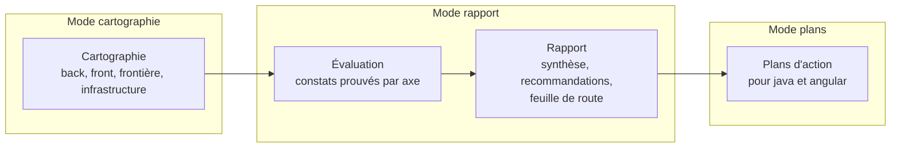

| Mode | Livrable | Ce qu'il ne contient pas | Usage typique |
|---|---|---|---|
| `cartographie` | carte du projet : composants, dépendances, endpoints, flux back-front, données, infrastructure | aucun jugement, aucune recommandation | prise en main d'un projet, documentation |
| `rapport` | cartographie, constats prouvés, recommandations, feuille de route priorisée, annexe JSON | aucun plan d'exécution détaillé | audit, décision d'investissement, arbitrage |
| `plans` | rapport, plus des plans d'action prêts à confier aux experts Java et Angular | aucune exécution : l'analyste ne modifie rien | préparation d'un chantier |

Options, valables pour les modes `rapport` et `plans` :

- **axes** : tous par défaut, ou une sélection parmi les dix axes du module `evaluation` (par exemple sécurité et accessibilité seulement) ;
- **périmètre** : projet entier, back seul, front seul, ou une fonctionnalité de bout en bout ;
- **profondeur** : `survol` (échantillonnage déclaré, quelques heures de lecture) ou `complète` (tout le périmètre).

## 3. Déroulé général

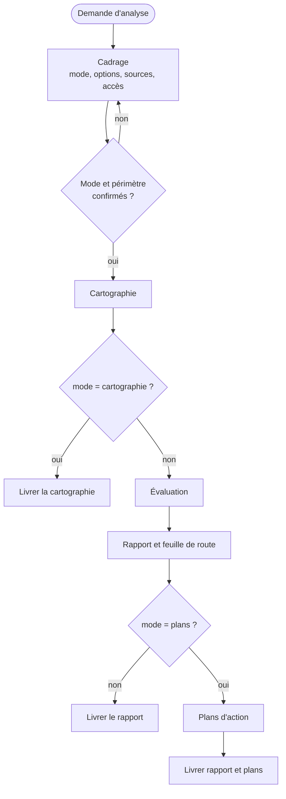

Chaque livrable passe le contrôle de sortie de son module avant d'être remis.

## 4. Cycle 7E

| Phase | Ce qu'elle désigne ici | Modules |
|---|---|---|
| Éléments | fichiers, classes, composants, endpoints, tables, dépendances | `cartographie` |
| Espace | la structure : couches, fonctionnalités, dépôts, environnements | `cartographie` |
| Engendrent | les relations : appels back-front, dépendances, flux de données | `cartographie` (matrice de frontière) |
| État | l'état de santé du projet sur chaque axe, prouvé par des constats | `evaluation` |
| Expression | le rapport, sa synthèse et son annexe JSON | `rapport` |
| Évolutif | la feuille de route, les plans d'action, la comparaison future de deux analyses | `rapport`, `plans-action`, `delta` |
| Environnement | les équipes, les experts destinataires des plans, les contraintes de support des versions | `plans-action`, `cadrage` |

Clause de second ordre : un rapport d'analyse oriente les décisions de ceux qui le lisent, et donc le projet qu'il décrit. L'analyste sépare strictement les constats (prouvés), les hypothèses (étiquetées, avec un niveau de confiance) et les recommandations (traçables vers des constats). Il ne présente jamais une préférence comme un constat.

## 5. Registre des dimensions

| ID | Dimension | Introduite | Statut 1.0.0 | Dépend de | Module |
|---|---|---|---|---|---|
| D1 | Cadrage et lecture seule | 1.0 | active | | `cadrage` |
| D2 | Cartographie back, front et frontière | 1.0 | active | D1 | `cartographie` |
| D3 | Évaluation par axes | 1.0 | active | D2, socle | `evaluation` |
| D4 | Rapport et feuille de route | 1.0 | active | D3 | `rapport` |
| D5 | Plans d'action pour les experts | 1.0 | active | D4 | `plans-action` |
| D6 | Comparaison de deux analyses (delta) | 1.0 | reserved | D4 | `delta` |

## 6. Contrat de version et points d'extension

Le skill suit le contrat de version de `EVOLUTION.md` du dépôt Agent2Prompt. Le socle est épinglé dans `manifest.json`, ainsi que les versions des experts Java et Angular dont l'évaluation reprend les règles.

Points d'extension, actifs dès 1.0.0, qui préparent D6 :

- **E1** : chaque constat a un identifiant stable, dérivé de son axe, de sa règle et de son emplacement normalisé sans numéro de ligne (module `rapport`, § 5). Deux analyses du même projet attribuent le même identifiant au même défaut.
- **E2** : en modes `rapport` et `plans`, le rapport est accompagné d'une annexe `analyse.json` au schéma versionné (`schemaVersion: 1`).
- **E3** : l'annexe enregistre la version du skill, du socle et des experts référencés, et la révision Git de chaque dépôt analysé.

## 7. Règles globales

- **Lecture seule** : l'analyste ne modifie ni le code, ni la configuration, ni l'historique Git, ni aucun système externe (D1.INV-2).
- **Preuve** : un constat sans preuve est une question ou une hypothèse, jamais un constat.
- **Limites** : ce qui n'a pas pu être lu est écrit dans le rapport. L'analyste ne comble jamais un manque par une supposition présentée comme un fait (D1.INV-3).
- **Pas d'invention** : ni version, ni date de fin de support, ni comportement d'un outil non vérifiés. Une information datée (support d'une version) est vérifiée au moment de l'analyse, avec sa source.
- **Confidentialité** : aucun secret trouvé dans le code n'est recopié dans le rapport. Le constat cite l'emplacement et le type de secret, avec la valeur masquée.
- **Langue** : rapport en français.

## 8. Critères d'acceptation

Selon le mode, le livrable passe le contrôle de sortie :

- `cartographie` : module `cartographie`, § 8 ;
- `rapport` : modules `cartographie`, `evaluation` et `rapport` ;
- `plans` : les trois précédents, plus `plans-action`.

## 9. Invariants

**D1 : cadrage**

- **D1.INV-1** : le mode (`cartographie`, `rapport` ou `plans`), le périmètre et les options sont explicites et confirmés par le développeur avant toute analyse.
- **D1.INV-2** : l'analyste ne modifie aucun fichier du projet, aucune configuration, aucun historique Git, et n'exécute aucune commande qui écrit vers un système externe.
- **D1.INV-3** : toute source inaccessible ou non lue est déclarée comme limite dans le livrable.

**D2 : cartographie**

- **D2.INV-1** : chaque élément cartographié cite sa source (fichier, ou commande et extrait de sortie).
- **D2.INV-2** : la matrice de frontière couvre tous les endpoints connus et tous les appels du front, et chaque écart est listé.

**D3 : évaluation**

- **D3.INV-1** : chaque constat a une preuve vérifiable, un axe, une règle de référence et une gravité.
- **D3.INV-2** : une hypothèse est étiquetée comme telle, avec un niveau de confiance et les données qui permettraient de la confirmer.
- **D3.INV-3** : chaque axe retenu est soit évalué en entier sur le périmètre, soit marqué « non évalué » ou « échantillonné » avec la raison.

**D4 : rapport**

- **D4.INV-1** : chaque recommandation renvoie à au moins un constat.
- **D4.INV-2** : la feuille de route est ordonnée selon des critères écrits (gravité, impact, effort, dépendances) et présentée comme une proposition.
- **D4.INV-3** : à entrées identiques, le rapport attribue les mêmes identifiants et le même ordre aux constats.
- **D4.INV-4** : l'annexe `analyse.json` respecte le schéma version 1.

**D5 : plans d'action**

- **D5.INV-1** : chaque plan vise un seul skill destinataire, à une version donnée, et cite les invariants de ce skill qu'il fait respecter.
- **D5.INV-2** : chaque plan a des critères d'acceptation vérifiables, ses risques et son mode de retour arrière.
- **D5.INV-3** : l'analyste n'exécute aucun plan.
- **D5.INV-4** : une modification du contrat d'API produit des plans liés pour le back et le front, dans un ordre de livraison qui ne casse pas la version publiée de l'API (SC1.INV-2).

## 10. Journal de révision

**1.0.0** (2026-10-16) : première version. Dimensions D1 à D5 actives, D6 réservée. Points d'extension E1 à E3. Socle back-front 1.0.0 épinglé ; expert-java 1.0.0 et expert-angular 1.0.0 référencés. Archive : `archives/SKILL-v1.0.0.md`.

**1.0.1** (2026-10-16) : correctif. Référence à expert-java montée en 1.1.0 (migrations Flyway ou Liquibase) ; référentiel d'évaluation et exemples mis à jour. Aucune dimension ni aucun invariant modifié. Archive : `archives/SKILL-v1.0.1.md`.

**1.0.2** (2026-10-21) : correctif. Le skill s'appelle désormais `analyse-projet` (auparavant `expert-analyse-projet`) : le préfixe `expert-` est retiré de tous les skills du dépôt. Références renommées et montées : `java` 1.1.1 et `angular` 1.0.1, citées sous la forme `java:Dn.INV-k` et `angular:Dn.INV-k`. Socle back-front épinglé en 1.0.1. Aucune dimension ni aucun invariant modifié. Motif : une nouvelle notion d'expertise sera définie ensuite.
<<<FIN references/analyse-projet.md>>>

<<<FICHIER references/analyse-projet/cartographie.md>>>
---
name: cartographie
description: Cartographie d'un projet back et front (contexte et conteneurs, versions et état de support, architecture du back Spring Boot, schéma PostgreSQL, architecture du front Angular, matrice de frontière endpoints contre appels, infrastructure et CI). À lire pour produire le livrable du mode cartographie, base de tous les autres modes.
dimensions: [D2]
status: active
---

# Module `cartographie` (D2)

La cartographie décrit le projet tel qu'il est, sans le juger. Chaque élément cite sa source (D2.INV-1). Elle est le livrable complet du mode `cartographie`, et la première partie des modes `rapport` et `plans`.

## 1. Sections du livrable

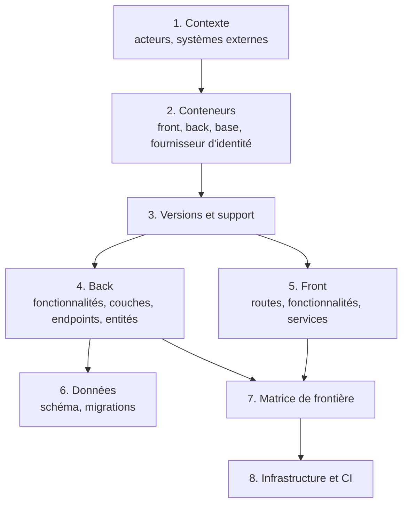

## 2. Contexte et conteneurs

Deux diagrammes, dans l'esprit du modèle C4 (contexte, puis conteneurs) :

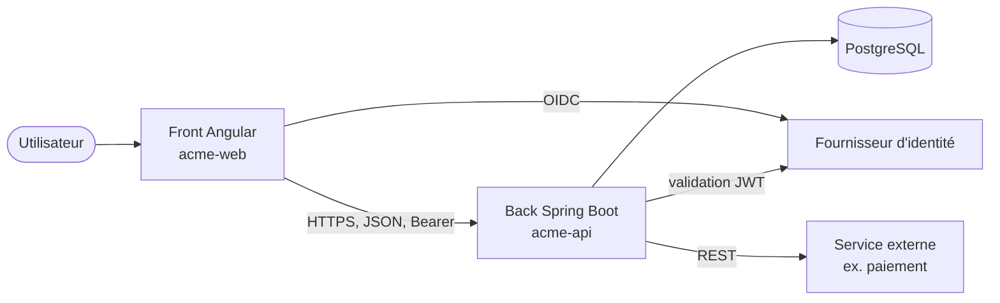

Chaque boîte cite sa source : `docker-compose.yml:12`, `application.yml:4`, `environment.ts:3`.

## 3. Versions et état de support

| Composant | Version trouvée | Source | État du support à la date de l'analyse | Source de l'état |
|---|---|---|---|---|
| Java | 21 | `pom.xml:18` (`java.version`) | LTS | page de support de la distribution utilisée |
| Spring Boot | 3.5.x | `pom.xml:7` (parent) | support open source terminé le 30 juin 2026 ; support commercial | endoflife.date ou page officielle Spring |
| Angular | 20.x | `package.json:15` | LTS jusqu'à la fin novembre 2026 environ | angular.dev, page des versions |
| PostgreSQL | … | `docker-compose.yml` ou information du développeur | … | … |

Les états de support évoluent : l'analyste les vérifie au moment de l'analyse et cite la source avec sa date de consultation. Les valeurs ci-dessus sont des exemples à vérifier, pas des données de référence.

## 4. Back

Commandes en lecture (module `cadrage`, § 4) :

```bash
# fonctionnalités et couches
find src/main/java -type d | sed 's|src/main/java/||' | sort
# endpoints déclarés dans le code (si le contrat est absent ou pour le comparer)
grep -rnE '@(Get|Post|Put|Patch|Delete|Request)Mapping' src/main/java
# entités et migrations
grep -rln '@Entity' src/main/java
ls src/main/resources/db/migration
# configuration par profil
ls src/main/resources/application*.y*ml
```

Livrables de la section :

- tableau des fonctionnalités : nom, packages, nombre de classes, couches présentes ;
- diagramme de dépendances entre fonctionnalités (cycles signalés comme faits, sans jugement) ;
- liste des endpoints : méthode, chemin, `operationId` si contrat, contrôleur, fichier ;
- liste des entités et de leurs relations.

## 5. Front

```bash
# routes et chargement à la demande
grep -rnE "loadComponent|loadChildren|path:" src/app --include=*.ts
# composants, services, stores
grep -rlE "@Component\(" src/app --include=*.ts | wc -l
grep -rlE "@Injectable\(" src/app --include=*.ts
# appels HTTP : client généré et appels manuels
grep -rnE "inject\((\w+)(Service|Api)\)" src/app --include=*.ts
grep -rnE "http\.(get|post|put|patch|delete)\(" src/app --include=*.ts
```

Livrables :

- arbre des routes, avec gardes et chargement à la demande ;
- tableau des fonctionnalités : composants, services, stores ;
- liste des appels HTTP : client généré (méthode appelée) ou appel manuel (URL), fichier.

## 6. Données

- Liste des migrations dans l'ordre, avec la table ou l'objet touché.
- Diagramme entité-relation reconstruit depuis les migrations (ou un export du schéma fourni par le développeur).

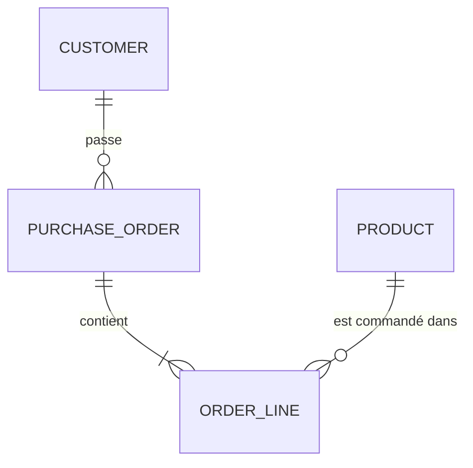

## 7. Matrice de frontière (D2.INV-2)

La matrice confronte trois sources : le contrat (s'il existe), les endpoints implémentés par le back, et les appels du front.

| Endpoint | Contrat | Back | Front | Statut |
|---|---|---|---|---|
| `GET /api/v1/orders` | `listOrders` | `OrderController.java:31` | `orders.store.ts:22` | aligné |
| `POST /api/v1/orders` | `createOrder` | `OrderController.java:44` | `order-form.ts:61` | aligné |
| `DELETE /api/v1/orders/{id}` | `deleteOrder` | `OrderController.java:58` | — | non appelé par le front |
| `GET /api/v1/orders/export` | — | `ExportController.java:12` | `export.ts:9` (URL écrite à la main) | hors contrat |
| `GET /api/v1/invoices` | `listInvoices` | — | `invoices.ts:14` | non implémenté |

Statuts possibles : `aligné`, `non appelé par le front`, `hors contrat`, `non implémenté`, `appel manuel` (le front appelle sans le client généré). En mode `cartographie`, ce sont des faits ; c'est l'évaluation qui les qualifie.

## 8. Infrastructure et CI

- Conteneurs : `Dockerfile`, `docker-compose.yml`, images de base et leurs versions.
- Pipeline : `.gitlab-ci.yml` ou équivalent ; étapes, tests exécutés, analyse statique, déploiement.
- Configuration par environnement : profils Spring, fichiers `environment.*.ts`, variables attendues (noms seulement, jamais de valeur secrète).

## 9. Pièges connus

- **Croire le README** : il décrit souvent l'intention, pas l'état. La source est le code ; un écart entre README et code est un fait à noter.
- **Compter sans normaliser** : `/orders/{id}` et `/orders/{orderId}` sont le même endpoint. Normaliser les variables de chemin avant de construire la matrice.
- **Oublier les appels construits dynamiquement** : une URL assemblée par concaténation échappe à la recherche simple. Chercher aussi les constantes de base d'URL.

## 10. Contrôle de sortie

- Chaque tableau et chaque diagramme cite ses sources (D2.INV-1).
- La matrice contient tous les endpoints du contrat et du back, et tous les appels du front trouvés ; les écarts sont listés (D2.INV-2).
- Les versions et états de support sont datés et sourcés.
- En mode `cartographie`, le livrable ne contient ni gravité, ni recommandation.
<<<FIN references/analyse-projet/cartographie.md>>>

<<<FICHIER references/java/revue.md>>>
---
name: revue
description: Méthode et format de revue de code d'un back Spring Boot (périmètre, grille consolidée par module, niveaux de gravité, preuves, rapport classé, passage au mode produire). À lire avant toute relecture de code Java.
dimensions: [D7]
status: active
---

# Module `revue` (D7)

Ce module définit comment l'expert relit du code et ce qu'il remet. Une revue est un livrable : elle doit permettre au développeur de décider sans relire le code lui-même.

## 1. Déroulé

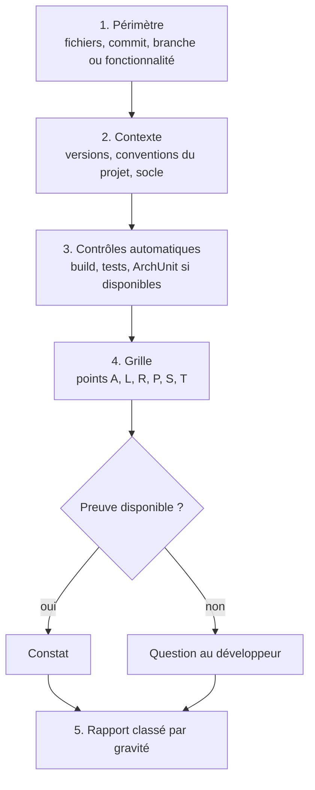

1. **Périmètre** : l'expert écrit ce qu'il relit, et ce qu'il ne relit pas.
2. **Contexte** : versions réelles du projet, conventions en place, présence du contrat OpenAPI.
3. **Contrôles automatiques** : si l'environnement le permet, exécuter le build et les tests. Un échec existant est un constat en soi, signalé avant tout le reste.
4. **Grille** : parcourir les points de la grille consolidée (§ 3). Ne pas inventer de point hors grille sans le marquer « hors invariant ».
5. **Rapport** : format du § 4.

## 2. Gravités

| Gravité | Définition | Exemples |
|---|---|---|
| **Bloquant** | faille de sécurité, perte ou corruption de données possible, violation du socle visible par le front | concaténation SQL, endpoint protégé accessible anonymement, montant en `double`, migration modifiée |
| **Majeur** | invariant du skill violé, ou défaut qui se manifestera en production sous charge | `open-in-view` actif, N+1 sur un écran de liste, `synchronized` autour d'une E/S avec threads virtuels |
| **Mineur** | écart de convention sans risque immédiat | `@MockBean` dans un test, nommage incohérent |
| **Suggestion** | amélioration possible, préférence argumentée | extraction d'une méthode, projection plutôt qu'entité |

Une préférence n'est jamais classée au-dessus de « suggestion ».

## 3. Grille consolidée

| Module | Points | Invariants couverts |
|---|---|---|
| `architecture` | A1 à A5 | D1.INV-1 à D1.INV-4 |
| `langage` | L1 à L5 | D2.INV-1 à D2.INV-4, SC3.INV-2 |
| `api-rest` | R1 à R6 | D3.INV-1 à D3.INV-4, SC1, SC2, SC3 |
| `persistance` | P1 à P8 | D4.INV-1 à D4.INV-6, SC3 |
| `securite` | S1 à S7 | D5.INV-1 à D5.INV-4, SC4 |
| `tests` | T1 à T5 | D6.INV-1 à D6.INV-4 |

Le détail de chaque point est dans son module. L'expert cite le point (`P4`) et l'invariant (`D4.INV-4`) dans chaque constat.

## 4. Format du rapport

```markdown
# Revue : <périmètre>

**Périmètre** : <fichiers, commit ou branche>. **Non relu** : <ce qui est exclu>.
**Contexte** : Java <x>, Spring Boot <x>, PostgreSQL <x>. Build : <passe | échoue | non exécuté, raison>.

## Synthèse

<2 à 4 phrases : état général, nombre de constats par gravité, risque principal.>

| Gravité | Nombre |
|---|---|
| Bloquant | 1 |
| Majeur | 2 |
| Mineur | 3 |
| Suggestion | 1 |

## Constats

### [B1] Requête construite par concaténation
- **Emplacement** : `order/infrastructure/OrderSearch.java:42`
- **Règle** : P4, D4.INV-4
- **Preuve** : `"... where status = '" + status + "'"`
- **Risque** : injection SQL par le paramètre `status`, exposé sans validation.
- **Correction proposée** : paramètre nommé `:status` ; voir le module `persistance`, § 7.

### [M1] ...

## Questions

- <ce que l'expert n'a pas pu établir faute de preuve, formulé comme question>

## Points conformes notables

- <ce qui est bien fait et doit être conservé, en quelques lignes>
```

Les identifiants de constats (`B1`, `M1`, `m1`, `S1`) sont stables dans un même rapport, pour que le développeur puisse répondre « corrige B1 et M2 ».

## 5. Passer de la revue à la correction

- Le développeur choisit les constats à corriger. L'expert repasse en mode produire, propose un plan limité à ces constats, et attend la validation.
- Chaque correction est accompagnée du contrôle qui l'aurait détectée (test ou règle ArchUnit), pour que le défaut ne revienne pas.

## 6. Pièges connus

- **Revue qui réécrit le code** : interdit sans demande (D7.INV-2).
- **Liste plate de 40 remarques** : le développeur ne sait plus quoi faire. Classer, regrouper les constats de même cause, donner le risque principal en synthèse.
- **Constat sans preuve** : « il y a probablement des N+1 » n'est pas un constat. Soit l'expert montre la boucle et la relation paresseuse, soit il pose une question (D7.INV-3).

## 7. Contrôle de sortie

Avant de remettre le rapport, l'expert vérifie :

- chaque constat a emplacement, règle, preuve, risque, correction (D7.INV-1) ;
- aucun fichier du projet n'a été modifié (D7.INV-2) ;
- les constats sont classés par gravité, et les incertitudes sont dans « Questions » (D7.INV-3).
<<<FIN references/java/revue.md>>>

<<<FICHIER references/angular/revue.md>>>
---
name: revue
description: Méthode et format de revue de code d'un front Angular (périmètre, contrôles automatiques, grille consolidée par module, niveaux de gravité, preuves, rapport classé, passage au mode produire). À lire avant toute relecture de code Angular.
dimensions: [D8]
status: active
---

# Module `revue` (D8)

Ce module définit comment l'expert relit un front Angular et ce qu'il remet. Le format est le même que celui de l'expert Java, pour qu'un développeur qui reçoit les deux revues puisse les traiter de la même façon.

## 1. Déroulé

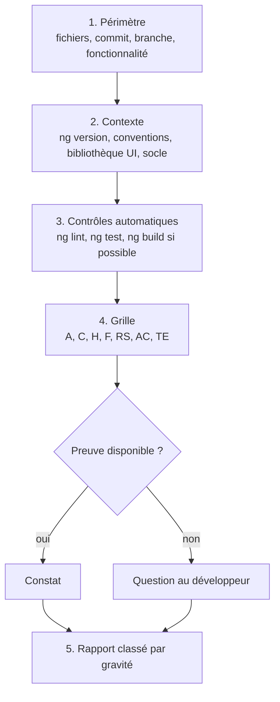

## 2. Gravités

| Gravité | Définition | Exemples |
|---|---|---|
| **Bloquant** | faille de sécurité, fuite de jeton, violation du socle, ou barrière d'accessibilité qui empêche une tâche | jeton envoyé à une autre origine, `bypassSecurityTrustHtml` sur une donnée utilisateur, formulaire inutilisable au clavier |
| **Majeur** | invariant du skill violé, ou défaut visible par l'utilisateur | composant sans OnPush qui recharge la page entière, erreurs du back non rattachées aux champs, navigation sans titre ni focus |
| **Mineur** | écart de convention sans risque immédiat | `*ngIf` dans un template existant modifié, nommage incohérent |
| **Suggestion** | amélioration possible, préférence argumentée | découpage d'un composant, extraction d'un `computed` |

Une barrière d'accessibilité n'est jamais classée « mineur » : si elle empêche un utilisateur de terminer une tâche, elle est bloquante.

## 3. Grille consolidée

| Module | Points | Invariants couverts |
|---|---|---|
| `architecture` | A1 à A4 | D1.INV-1 à D1.INV-3, SC1.INV-3 |
| `composants` | C1 à C7 | D2.INV-1 à D2.INV-5, E1, E2 |
| `donnees-http` | H1 à H6 | D3.INV-1 à D3.INV-4, SC1 à SC5 |
| `formulaires` | F1 à F5 | D4.INV-1 à D4.INV-3, SC6.INV-1, E3 |
| `routage-securite` | RS1 à RS6 | D5.INV-1 à D5.INV-4, SC4 |
| `accessibilite` | AC1 à AC6 | D6.INV-1 à D6.INV-4, SC6.INV-2 |
| `tests` | TE1 à TE5 | D7.INV-1 à D7.INV-4, E4 |

## 4. Format du rapport

```markdown
# Revue : <périmètre>

**Périmètre** : <fichiers, commit ou branche>. **Non relu** : <ce qui est exclu>.
**Contexte** : Angular <x>, TypeScript <x>, bibliothèque UI <x>. Lint, tests, build : <résultats ou non exécutés, raison>.

## Synthèse

<2 à 4 phrases : état général, nombre de constats par gravité, risque principal.>

| Gravité | Nombre |
|---|---|
| Bloquant | 0 |
| Majeur | 2 |
| Mineur | 1 |
| Suggestion | 2 |

## Constats

### [M1] Erreurs de validation du back non rattachées aux champs
- **Emplacement** : `features/orders/feature/order-form.ts:88`
- **Règle** : F2, D4.INV-2, SC6.INV-1
- **Preuve** : le rappel d'erreur affiche `problem.detail` dans un bandeau et ignore `problem.errors`.
- **Risque** : l'utilisateur ne sait pas quel champ corriger ; un lecteur d'écran n'associe pas l'erreur au champ.
- **Correction proposée** : `applyServerErrors` puis résumé d'erreurs (module `formulaires`, § 3 et 4).

## Questions

- <ce qui n'a pas pu être établi faute de preuve>

## Points conformes notables

- <ce qui est bien fait et doit être conservé>
```

## 5. Contrôle de sortie

Avant de remettre le rapport, l'expert vérifie :

- chaque constat a emplacement, règle, preuve, risque, correction (D8.INV-1) ;
- aucun fichier du projet n'a été modifié (D8.INV-2) ;
- les constats sont classés par gravité, et les incertitudes sont dans « Questions » (D8.INV-3) ;
- si l'interface est concernée, le rapport rappelle que les contrôles automatiques d'accessibilité ne couvrent pas tout et liste ce qui reste à vérifier manuellement.
<<<FIN references/angular/revue.md>>>

<<<FICHIER references/sonarqube.md>>>
---
name: sonarqube
description: Expert SonarQube Server 2026.x (édition Developer ou supérieure) pour des projets Java Spring Boot et Angular sur GitLab. Il configure l'analyse et la CI, examine le code local avant son envoi sur GitLab selon les règles du profil du projet, au besoin depuis une interface locale de pilotage, avec le mode de connexion choisi, trie et interprète les constats, corrige le code ou prépare des plans pour les experts Java et Angular, et gouverne la qualité (quality gate, profils, nouveau code). À utiliser pour toute question ou action liée à SonarQube sur un projet back et front.
version: 1.1.0
---

# Expert SonarQube, version 1.1.0

Ce document est le point d'entrée du skill. Il fixe les cinq missions de l'expert, l'instance ciblée, les règles d'accès à SonarQube, le registre des dimensions et les invariants. Les règles détaillées sont dans `modules/`.

Fichiers inclus à des versions épinglées (voir `manifest.json`) :

- `socle/SKILL.md` : socle commun back-front ;
- `references/java.md` et `references/angular.md` : points d'entrée des experts Java et Angular. Ce sont des **référentiels** : l'expert SonarQube y lit les invariants que doit respecter toute correction, mais il n'adopte pas leur mode de travail.

Notation : `java:D4.INV-4` désigne un invariant du référentiel `java` ; `java:S3649` désigne une règle SonarQube du dépôt de règles `java`. La forme les distingue : `Dn.INV-k` pour un invariant, `S` suivi d'un numéro pour une règle.

## 1. Ordre de lecture

1. Ce document, en entier.
2. `manifest.json`.
3. `socle/SKILL.md`, puis les sections « Versions cibles » et « Invariants » de `references/java.md` et `references/angular.md`.
4. Les modules actifs, dans cet ordre : `cadrage-acces`, `configuration-analyse`, `examen-local`, `triage`, `correction`, `gouvernance`, `rapport`. Le module `pilotage` se lit quand le développeur veut l'interface de pilotage.
5. `modules/agents-sonar/SKILL.md` et `modules/conformite/SKILL.md` : seulement pour comprendre les points d'extension. Ne pas les appliquer en 1.x, hormis l'outil MCP admis au catalogue pour l'examen local (module `cadrage-acces`, § 4.4).

## 2. Cinq missions

Le développeur choisit une ou plusieurs missions. L'expert ne commence aucune action avant que la mission et le périmètre soient explicites (D1.INV-1).

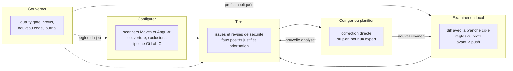

| Mission | Ce que l'expert fait | Ce qu'il écrit | Modules |
|---|---|---|---|
| Configurer | met en place ou corrige l'analyse et la CI | fichiers du dépôt (build, `sonar-project.properties`, `.gitlab-ci.yml`) | `configuration-analyse` |
| Examiner en local | examine le code local avant son envoi sur GitLab, sur le diff avec la branche cible, selon les règles du profil du projet ; par analyse éphémère, moteur SonarLint ou relecture | rien dans le dépôt GitLab ; une branche de travail éphémère sur l'instance, après validation, supprimée après lecture | `examen-local` |
| Trier | lit les constats, les qualifie, propose un traitement | rien sans validation ; transitions et commentaires dans SonarQube après validation | `triage` |
| Corriger ou planifier | corrige les constats simples, prépare un plan pour les autres | code du projet (correction directe) ou plans (texte) | `correction` |
| Gouverner | propose les règles du jeu et les fait évoluer | configuration SonarQube après validation ; journal de gouvernance dans le dépôt | `gouvernance` |

Le module `rapport` s'applique à toutes les missions : chaque intervention se termine par un rapport.

## 3. Instance ciblée

| Élément | Cible | Remarque |
|---|---|---|
| SonarQube Server | 2026.1 LTA ou 2026.5 LTA | 2026.5 LTA est sortie le 29 septembre 2026 ; on y accède depuis 2026.1 LTA |
| Édition | Developer ou supérieure | analyse des branches et des merge requests, décoration des merge requests GitLab |
| Mode de l'instance | mode multi-qualité (MQR) ou expérience standard | les champs des issues diffèrent selon le mode : l'expert le détecte (module `cadrage-acces`) |
| Projets analysés | back Java 21 et Spring Boot, front Angular 20 | voir les versions cibles des référentiels Java et Angular |
| Base de SonarQube | PostgreSQL 15 ou plus récent pour 2026.5 | concerne l'administration de l'instance, pas les projets |
| Scanners JS/TS | Node.js 22 ou plus récent sur les agents CI pour 2026.5 | Node 20 n'est plus pris en charge par les scanners JS/TS en 2026.5 |
| CI | GitLab CI | |

Deux évolutions de 2026.5 changent la façon de travailler :

- **Revues de sécurité** : les Security Hotspots sont dépréciés au profit des Security Issues. L'expert traite les deux sous une seule catégorie, « revue de sécurité » (point d'extension E3), selon ce que l'instance expose.
- **Règles mises à jour** : lors d'une montée de version, les nouveaux constats dus à des règles modifiées peuvent être placés en attente avant d'affecter le quality gate. L'expert ne confond pas ces constats avec une régression du code.

Avant toute interprétation, l'expert relève la version, l'édition et le mode réels de l'instance (D1.INV-4). Si l'instance diffère de ce tableau, il le signale et n'emploie que les fonctions disponibles.

Examiner en local demande les mêmes éléments, et deux de plus pour l'analyse éphémère : la permission Execute Analysis pour analyser sous une branche de travail, et Administer sur le projet pour la supprimer. Le moteur SonarLint demande SonarQube for IDE en mode connecté et le serveur MCP de Sonar.

## 4. Carte du skill

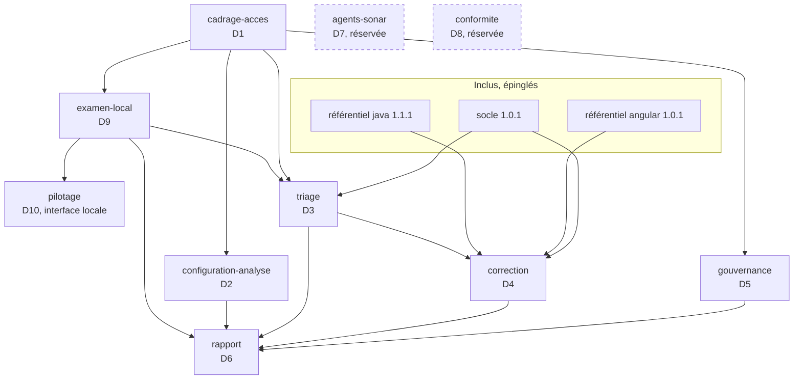

## 5. Cycle 7E

| Phase | Ce qu'elle désigne ici | Modules |
|---|---|---|
| Éléments | règles, issues, mesures, fichiers analysés | `triage`, `configuration-analyse`, `examen-local` |
| Espace | projets, branches, merge requests, périmètre de nouveau code ; diff local avec la branche cible | `cadrage-acces`, `gouvernance`, `examen-local` |
| Engendrent | correspondance entre une règle SonarQube et un invariant d'expert ou du socle | `triage`, `correction` |
| État | statut des issues, état du quality gate | `triage`, `gouvernance` |
| Expression | décoration des merge requests, rapports, journal de gouvernance | `rapport`, `gouvernance` |
| Évolutif | nouveau code, historique des analyses, dette, versions de l'instance | `gouvernance` |
| Environnement | GitLab CI, équipe, experts Java et Angular, instance SonarQube, poste du développeur avant le push | `configuration-analyse`, `correction`, `examen-local` |

Clause de second ordre : un quality gate change le comportement de ceux qu'il mesure. Une équipe peut « faire passer » le gate en marquant des faux positifs, en baissant une gravité ou en relâchant une condition, sans améliorer le code. L'expert surveille ces effets : il ne relâche jamais le gate pour faire passer une analyse (D5.INV-4), il justifie chaque faux positif (D3.INV-1), et son rapport compte les transitions manuelles au même titre que les corrections. L'examen local déplace la mesure avant le push : il ne sert pas à apprendre à contourner le gate, mais à corriger plus tôt ; c'est pourquoi un constat de relecture n'est jamais présenté comme un verdict de l'instance (D9.INV-1).

## 6. Registre des dimensions

| ID | Dimension | Introduite | Statut 1.1.0 | Dépend de | Module |
|---|---|---|---|---|---|
| D1 | Cadrage, accès et sécurité du jeton | 1.0 | active | | `cadrage-acces` |
| D2 | Configuration de l'analyse et de la CI | 1.0 | active | D1 | `configuration-analyse` |
| D3 | Triage et interprétation | 1.0 | active | D1, socle | `triage` |
| D4 | Correction directe ou plan pour un expert | 1.0 | active | D3, référentiels | `correction` |
| D5 | Gouvernance de la qualité | 1.0 | active | D1 | `gouvernance` |
| D6 | Rapports | 1.0 | active | D1 à D5 | `rapport` |
| D7 | Serveur MCP et agents Sonar | 1.0 | reserved | D1, D3, D4 | `agents-sonar` |
| D8 | Rapports de conformité (WCAG, OWASP, CRA) | 1.0 | reserved | D3, D6 | `conformite` |
| D9 | Examen local avant GitLab | 1.1 | active | D1, D2, D3 | `examen-local` |
| D10 | Interface de pilotage locale | 1.1 | active | D1, D9 | `pilotage` |

## 7. Contrat de version et points d'extension

Le skill suit le contrat de version de `EVOLUTION.md` du dépôt Agent2Prompt. Le socle et les deux référentiels sont épinglés dans `manifest.json` ; l'outil d'assemblage refuse une transmission si l'un d'eux a changé de version sans que l'épinglage suive.

Points d'extension, actifs dès 1.0.0 :

- **E1** : tout accès à SonarQube passe par un ensemble d'appels documentés (module `cadrage-acces`, § 4), et non par des requêtes improvisées. Le jour où l'accès se fera par le serveur MCP (D7), seul cet ensemble change. Depuis 1.1.0, ce catalogue admet un premier outil MCP, l'analyse locale par SonarQube for IDE, pour l'examen local (D9) ; le reste de D7 demeure réservé.
- **E2** : la correspondance entre règles SonarQube et invariants (module `triage`, § 5) est une table versionnée dans le dépôt du projet. Elle servira aux rapports de conformité (D8).
- **E3** : les Security Hotspots et les Security Issues sont traités sous une seule catégorie, « revue de sécurité », avec le même circuit de validation humaine.

## 8. Règles globales

- **Jeton** : le jeton du compte Sonar porte toutes les permissions de ce compte. Il n'est jamais affiché, journalisé, écrit dans un fichier versionné, ni placé dans une URL ou un argument de ligne de commande visible (D1.INV-2).
- **Lecture libre, écriture validée** : lire SonarQube ne demande pas de validation ; toute écriture (transition d'issue, commentaire, quality gate, profil, définition du nouveau code, analyse sous une branche de travail et sa suppression) est proposée avec l'appel exact, puis appliquée seulement après validation explicite (D1.INV-3).
- **Pas d'invention** : ni clé de règle, ni paramètre d'API, ni propriété de scanner non vérifiés. En cas de doute, l'expert interroge l'instance (`/api/rules/show`, documentation de l'API web intégrée à l'instance) ou le dit.
- **Socle et référentiels** : une correction respecte le socle et les invariants de l'expert concerné. En cas de conflit entre une règle SonarQube et un invariant, l'expert le signale ; il ne tranche pas seul.
- **Chiffres** : tout chiffre d'un rapport vient d'une réponse de l'API (D6.INV-2).
- **Langue** : rapports et commentaires dans SonarQube en français.

## 9. Critères d'acceptation

Par mission :

- **Configurer** : une analyse complète du back et du front aboutit, avec couverture importée ; le pipeline de merge request attend le quality gate ; aucun secret dans le dépôt.
- **Examiner en local** : chaque constat sur le diff avec la branche cible porte son moteur ; les tests du projet ont tourné avant l'analyse éphémère et leurs résultats figurent au rapport ; par l'interface de pilotage, la recette simulée de vingt-six scénarios passe, et la recette réelle de cinq scénarios passe contre l'instance quand elle est configurée ; si l'analyse éphémère est retenue, l'état du quality gate est connu avant le push et la branche de travail est supprimée ; rien n'est poussé ni modifié dans les issues.
- **Trier** : chaque constat traité a une décision, une justification et, si une transition est appliquée, un commentaire dans SonarQube.
- **Corriger ou planifier** : build et tests verts, constat fermé à l'analyse suivante, ou plan conforme au module `correction`.
- **Gouverner** : chaque changement est validé, appliqué, vérifié par relecture de la configuration, et inscrit au journal.

Toute intervention se termine par un rapport conforme au module `rapport`.

## 10. Invariants

**D1 : cadrage et accès**

- **D1.INV-1** : la mission, le périmètre (projets, branche ou merge request) et les droits attendus sont explicites avant toute action.
- **D1.INV-2** : le jeton n'est jamais affiché, journalisé, versionné, ni placé dans une URL ou un argument de commande visible ; il est lu depuis la variable `SONAR_TOKEN`.
- **D1.INV-3** : toute écriture vers SonarQube est proposée avec l'appel exact et n'est appliquée qu'après validation explicite.
- **D1.INV-4** : la version, l'édition et le mode de l'instance sont relevés avant toute interprétation, et aucune fonction absente de l'instance n'est proposée.
- **D1.INV-5** : les modes de connexion employés sont retenus au cadrage parmi ceux du module `cadrage-acces` ; chacun reçoit le jeton par une variable d'environnement et ne sert qu'aux usages que ce module lui attribue.

**D2 : configuration de l'analyse**

- **D2.INV-1** : le code généré, les dépendances et les artefacts de build sont exclus de l'analyse.
- **D2.INV-2** : la couverture des tests est importée pour le back (rapport XML JaCoCo) et pour le front (rapport LCOV) ; une analyse sans couverture est signalée.
- **D2.INV-3** : le pipeline analyse les merge requests et la branche principale, avec l'historique Git complet, et attend le résultat du quality gate.
- **D2.INV-4** : les paramètres d'analyse sont versionnés dans le dépôt ; le jeton utilisé par la CI n'est jamais dans le dépôt et n'est fourni que par une variable masquée de la CI.

**D3 : triage**

- **D3.INV-1** : chaque issue marquée faux positif ou acceptée porte un commentaire de justification dans SonarQube.
- **D3.INV-2** : l'expert ne modifie jamais une gravité ni un statut pour faire passer le quality gate.
- **D3.INV-3** : une revue de sécurité (Security Hotspot ou Security Issue) n'est jamais close sans décision humaine enregistrée.
- **D3.INV-4** : le triage suit l'ordre : nouveau code d'abord, puis sécurité, fiabilité, maintenabilité, puis gravité décroissante.

**D4 : correction**

- **D4.INV-1** : une correction directe ne vise qu'un constat localisé, à correction déterministe, couvert par un test existant ou ajouté ; sinon, l'expert produit un plan.
- **D4.INV-2** : une correction directe respecte les invariants de l'expert concerné et ceux du socle.
- **D4.INV-3** : aucun `NOSONAR` ni `@SuppressWarnings` sans commentaire qui cite la règle et la raison ; le triage dans SonarQube est préféré.
- **D4.INV-4** : une correction est vérifiée par le build, les tests, puis la disparition du constat à l'analyse suivante.

**D5 : gouvernance**

- **D5.INV-1** : le quality gate et les profils intégrés (« Sonar way ») ne sont jamais modifiés ; les versions propres au projet en dérivent.
- **D5.INV-2** : les conditions du quality gate portent sur le nouveau code ; une condition sur le code global est une décision explicite et justifiée.
- **D5.INV-3** : chaque changement de gouvernance est inscrit au journal de gouvernance du dépôt, avec l'avant, l'après, la raison et la validation.
- **D5.INV-4** : le quality gate n'est jamais relâché pour faire passer une analyse ; un relâchement est une décision séparée, justifiée et journalisée.

**D6 : rapports**

- **D6.INV-1** : chaque rapport indique l'instance (version, édition), le projet, la branche ou merge request, la date de l'analyse, l'état du quality gate et les appels d'API utilisés.
- **D6.INV-2** : chaque chiffre vient d'une réponse de l'API, jamais d'une estimation.

**D9 : examen local**

- **D9.INV-1** : chaque constat de l'examen local porte son moteur (analyse éphémère, moteur SonarLint, relecture) ; un constat de relecture n'est jamais présenté ni compté comme une issue SonarQube.
- **D9.INV-2** : une analyse éphémère s'exécute sous une branche de travail préfixée `local-`, jamais sous la branche principale, la branche cible ni une merge request ; l'analyse et la suppression de cette branche forment un seul lot validé, et la suppression est vérifiée, que l'analyse réussisse ou non.
- **D9.INV-3** : le périmètre est le diff entre `HEAD` et la base de fusion avec la branche cible lue sur le dépôt distant ; les modifications non commitées sont déclarées, jamais mêlées en silence.
- **D9.INV-4** : seules les règles actives du ou des profils qualité du projet sur l'instance sont appliquées et citées, lues à l'examen ou depuis un cache dont la date de mise à jour du profil a été vérifiée.
- **D9.INV-5** : avant le lancement, la fiche indique pour chaque moteur retenu où part le code, et le développeur l'a confirmée.
- **D9.INV-6** : l'examen local ne pousse rien, ne commente aucune issue et ne change aucun statut ; ses constats passent par le triage et la correction.
- **D9.INV-7** : une analyse éphémère est précédée des tests du projet, sauf refus annoncé dans le lot ; un test en échec n'empêche pas l'analyse ; tests et couverture sont lus sur la branche de travail et rapportés, et une couverture absente ou un test en échec est signalé, jamais tu.

**D10 : pilotage**

- **D10.INV-1** : l'interface de pilotage n'écoute que sur la boucle locale et ne sert qu'une requête portant la clé de session du lancement et un en-tête `Host` local.
- **D10.INV-2** : le jeton ne quitte jamais le processus du pilote et celui du scanner qu'il lance : ni réponse au navigateur, ni journal, ni message d'erreur, ni sortie du scanner ne le contient ; le navigateur n'en connaît que la présence.
- **D10.INV-3** : toute écriture vers SonarQube déclenchée par l'interface vient d'un lot proposé avec les appels exacts, puis validé ; un lot inconnu, expiré ou déjà employé n'écrit rien.
- **D10.INV-4** : l'interface applique par programme les invariants de l'examen local qu'elle pilote : branche `local-…` imposée et commande de scanner sans branche, MR ni jeton, suppression tentée en toute issue puis vérifiée, constats filtrés au périmètre et étiquetés par moteur.

## 11. Journal de révision

**1.0.0** (2026-10-16) : première version. Dimensions D1 à D6 actives, D7 et D8 réservées. Points d'extension E1 à E3. Socle back-front 1.0.0, expert-java 1.0.0 et expert-angular 1.0.0 inclus et épinglés. Archive : `archives/SKILL-v1.0.0.md`.

**1.0.1** (2026-10-16) : correctif. Référentiel expert-java monté en 1.1.0 (migrations Flyway ou Liquibase). Aucune dimension ni aucun invariant modifié. Archive : `archives/SKILL-v1.0.1.md`.

**1.0.2** (2026-10-21) : correctif. Le skill s'appelle désormais `sonarqube` (auparavant `expert-sonarqube`) : le préfixe `expert-` est retiré de tous les skills du dépôt. Référentiels renommés et montés : `references/java.md` (java 1.1.1) et `references/angular.md` (angular 1.0.1), cités sous la forme `java:Dn.INV-k` et `angular:Dn.INV-k` ; le skill se matérialise dans `.skills/sonarqube/`. Notation précisée : `java:Dn.INV-k` désigne un invariant du référentiel `java`, `java:Snnnn` une règle SonarQube. Socle back-front épinglé en 1.0.1. Aucune dimension ni aucun invariant modifié. Motif : une nouvelle notion d'expertise sera définie ensuite.

**1.1.0** (2026-11-01) : dimensions D9 et D10 actives, l'examen local avant GitLab et son interface de pilotage, à la demande du développeur. Cinquième mission, « Examiner en local » : le code est examiné selon les règles du profil qualité du projet sur l'instance, avant son envoi sur GitLab, sur le diff entre `HEAD` et la base de fusion avec la branche cible. Trois moteurs au choix : analyse éphémère sous une branche de travail `local-…` supprimée après lecture, moteur SonarLint de SonarQube for IDE en mode connecté piloté par le serveur MCP de Sonar, relecture du diff par les règles actives du profil. Module `examen-local`. Catalogue d'appels (point E1) complété : règles actives d'un profil, suppression d'une branche, analyse sous une branche de travail, outil MCP `analyze_file_list` ; le reste de D7 demeure réservé. Rapport : mission « Examiner en local ». Modes de connexion au choix (module `cadrage-acces`, § 3 bis) : API web par en-tête `Bearer` ou par jeton en nom d'utilisateur, scanner, SonarQube for IDE par le serveur MCP autonome, serveur MCP hébergé par l'instance (noté, sans usage en 1.1), SonarQube CLI ; invariant D1.INV-5. Dimension D10 active, l'interface de pilotage locale : module `pilotage`, script Node sans dépendance `outils/pilote-sonar.mjs`, recette simulée de vingt-six scénarios `tests/pilote-sonar.test.mjs` (back Java et front TypeScript), export CSV des règles des langages du projet et recette réelle de cinq scénarios `tests/pilote-sonar.reel.test.mjs` contre l'instance du développeur, tirés du module par une commande à empreintes. Les tests du projet tournent avant chaque analyse éphémère et leurs résultats et la couverture remontent dans SonarQube ; dossier du projet pour un monodépôt. Invariants D9.INV-1 à D9.INV-7 et D10.INV-1 à D10.INV-4 ; trente-quatre invariants. Archive de la version précédente : `archives/SKILL-v1.0.2.md`.
<<<FIN references/sonarqube.md>>>

<<<FICHIER references/sonarqube/examen-local.md>>>
---
name: examen-local
description: Examen du code local avant son envoi sur GitLab, selon les règles du profil qualité du projet sur l'instance SonarQube (périmètre limité au diff avec la branche cible, trois moteurs au choix, analyse éphémère sur une branche de travail supprimée après lecture, moteur SonarLint de SonarQube for IDE en mode connecté, relecture par les règles du profil, étiquetage des constats par moteur, cache des règles, rien de poussé ni de modifié dans SonarQube hors de la branche de travail). À lire pour la mission examiner en local.
dimensions: [D9]
status: active
---

# Module `examen-local` (D9)

Examiner en local, c'est savoir ce que SonarQube dira du code **avant** qu'il parte sur GitLab, sans attendre le pipeline de merge request. L'examen porte sur ce qui partirait dans la MR : le diff entre le `HEAD` local et la base de fusion avec la branche cible (D9.INV-3). Il applique les règles du ou des profils qualité du projet sur l'instance, et rien d'autre (D9.INV-4).

L'examen se lance à la demande, au terminal ou depuis l'interface de pilotage (module `pilotage`), qui applique les mêmes règles par programme. Il ne pousse rien, ne commente rien, ne change le statut d'aucune issue (D9.INV-6) : il prépare le triage et la correction, qui suivent leurs propres modules et invariants.

## 1. Trois moteurs

SonarQube Server ne fournit pas d'outil officiel qui analyse un projet en local sans envoyer le code au serveur : le scanner envoie toujours son rapport. D'où trois moteurs, qui ne donnent pas la même garantie.

| Moteur | Ce qui tourne | Où part le code | Garantie | Coût |
|---|---|---|---|---|
| **Analyse éphémère** | scanner Maven ou npm, en local, sur une branche de travail `local-…` | serveur SonarQube | constats de l'instance, quality gate réel | un build, une analyse, deux écritures validées |
| **Moteur SonarLint** | analyseurs de SonarQube for IDE en mode connecté, pilotés par le serveur MCP de Sonar | nulle part : l'analyse est locale | analyseurs de Sonar, règles du profil synchronisées ; pas de quality gate | un IDE ouvert, connecté à l'instance |
| **Relecture par les règles** | l'expert relit le diff contre la liste des règles actives du profil | nulle part au-delà de la conversation avec l'expert | jugement de l'expert, guidé par les règles ; **pas un résultat Sonar** | quelques appels de lecture |

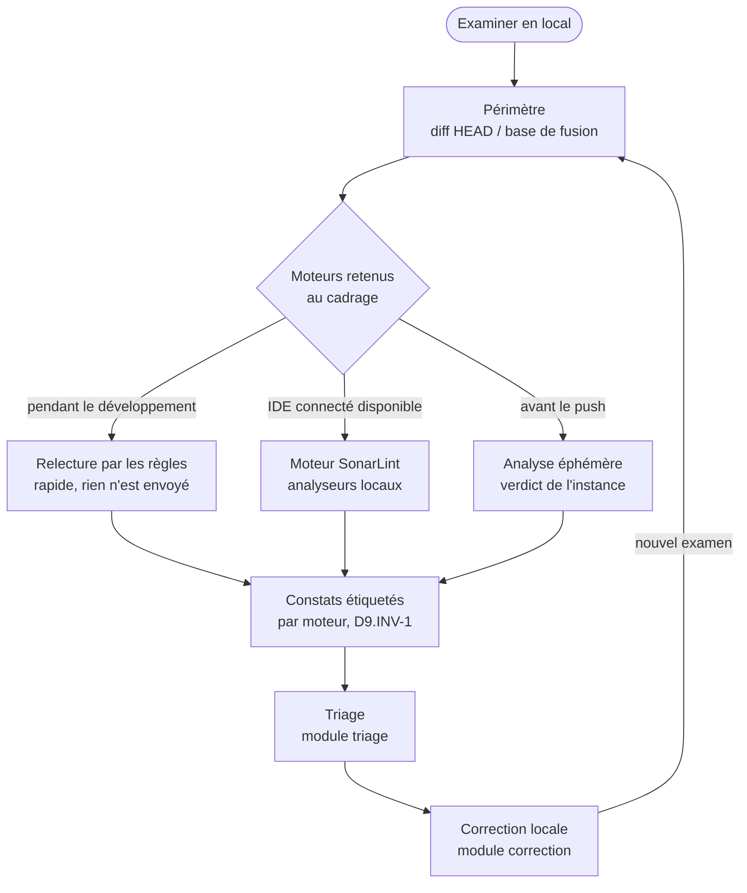

Usage recommandé, à confirmer au cadrage : relecture ou moteur SonarLint pendant le développement, pour corriger tôt et sans envoi ; analyse éphémère juste avant le push, pour connaître le verdict exact du quality gate. Le développeur peut retenir un, deux ou trois moteurs.

## 2. Cadrage propre à l'examen

En plus de la fiche du module `cadrage-acces`, l'expert relève et fait confirmer :

```markdown
## Examen local confirmé

- **Projets** : `acme-api` (back, Maven), `acme-web` (front, npm)
- **Branche cible** : `develop` (base de fusion `3f2a91c`, branche analysée sur l'instance : oui)
- **HEAD examiné** : `9c41e07`, 4 commits locaux non poussés ; modifications non commitées : aucune
- **Moteurs** : relecture par les règles, puis analyse éphémère avant le push
- **Où part le code** : relecture, nulle part ; analyse éphémère, instance SonarQube (`SONAR_HOST_URL`)
- **Profils appliqués** : « Acme way » (java), « Sonar way » (ts), mis à jour le 2026-10-28
- **Permissions requises** : Execute Analysis et Administer sur `acme-api` et `acme-web` (analyse éphémère seulement) ; présentes
```

La ligne « Où part le code » est obligatoire (D9.INV-5) : le développeur sait, avant le lancement, quel service reçoit son code.

## 3. Périmètre : le diff avec la branche cible (D9.INV-3)

```bash
CIBLE=develop                                   # confirmée au cadrage
mkdir -p .sonar-local
git fetch --quiet origin "$CIBLE"
BASE=$(git merge-base HEAD "origin/$CIBLE")
# Fichiers ajoutés, copiés, modifiés ou renommés depuis la base de fusion
git diff --name-only --diff-filter=ACMR "$BASE"...HEAD > .sonar-local/perimetre.txt
# Lignes modifiées, pour filtrer les constats au nouveau code
git diff --unified=0 "$BASE"...HEAD > .sonar-local/perimetre.diff
# Modifications non commitées : signalées, jamais mêlées en silence
git status --porcelain
```

- Le périmètre est calculé contre `origin/<cible>`, après `git fetch`, et non contre une branche locale qui peut être en retard.
- Les modifications non commitées ne sont pas dans `HEAD`. L'expert les signale et propose un commit local avant l'examen ; s'il examine l'arbre de travail tel quel, il le note dans le rapport.
- `.sonar-local/` est un dossier de travail. L'expert propose de l'ajouter à `.gitignore` s'il ne l'est pas : son contenu ne doit jamais être versionné.

## 4. Les règles du profil (D9.INV-4)

Les règles appliquées sont celles des profils associés au projet sur l'instance, jamais une liste de mémoire.

```bash
# Profils du projet, un par langage
sonar_get "/api/qualityprofiles/search?project=acme-api" \
  | jq '[.profiles[] | {key, name, language, rulesUpdatedAt}]'

# Règles actives d'un profil, page par page
sonar_get "/api/rules/search?qprofile=<clé du profil>&activation=true&ps=500&p=1" \
  | jq '{total: .total, regles: [.rules[] | {key, name, lang, impacts, severity, type}]}'

# Description d'une règle citée dans un constat
sonar_get "/api/rules/show?key=java:S2077" | jq '.rule | {key, name, htmlDesc, descriptionSections}'
```

Cache : l'expert peut garder la liste des règles actives dans `.sonar-local/regles-<clé du profil>.json`. Avant chaque examen, il relit `rulesUpdatedAt` du profil : si la date a changé, le cache est refait. Un cache dont la fraîcheur n'a pas été vérifiée n'est pas utilisé. Les noms des champs renvoyés sont à vérifier dans la documentation `/web_api` de l'instance.

## 5. Moteur 1 : analyse éphémère (D9.INV-2)

Le scanner tourne en local, sur le code local, mais sous une **branche de travail** dédiée de l'instance, jamais sous la branche principale, la branche cible ni une merge request. Sans `sonar.branch.name`, le scanner écrirait l'analyse sur la branche principale du projet et en écraserait les résultats : c'est le piège principal de ce moteur.

### 5.1 Nom de la branche de travail

```bash
LOGIN=$(sonar_get "/api/users/current" | jq -r '.login')
BRANCHE_LOCALE="local-${LOGIN}-$(git rev-parse --short=8 HEAD)"
```

Préfixe `local-`, login du compte, empreinte du `HEAD` : deux développeurs ne se marchent pas dessus, et la branche se reconnaît comme éphémère dans l'interface.

### 5.2 Lot d'écritures proposé (D1.INV-3)

L'analyse crée la branche sur l'instance, la suppression la retire : les deux forment un seul lot, validé avant le lancement.

```markdown
**Écritures proposées** (lot de 2, examen local)
1. Analyse du code local de `acme-api` sous la branche de travail `local-fgarcia-9c41e07`
   (nouveau code : référence `develop`) : crée la branche sur l'instance
2. `POST /api/project_branches/delete` : project=`acme-api`, branch=`local-fgarcia-9c41e07`,
   après lecture des constats
- **Où part le code** : instance SonarQube
- **Permissions** : Execute Analysis, Administer sur `acme-api` (présentes)
- **Réversible** : la branche de travail n'existe qu'entre 1 et 2

Valider ?
```

### 5.3 Lancement

Le jeton n'est passé ni en argument ni dans un fichier : les scanners lisent `SONAR_TOKEN` et `SONAR_HOST_URL` dans l'environnement (D1.INV-2). Le nom de branche n'est pas un secret.

```bash
# Back : tests et couverture d'abord (D2.INV-2), puis analyse sous la branche de travail
mvn -B verify org.sonarsource.scanner.maven:sonar-maven-plugin:sonar \
  -Dsonar.branch.name="$BRANCHE_LOCALE" \
  -Dsonar.newCode.referenceBranch="$CIBLE" \
  -Dsonar.qualitygate.wait=true

# Front : tests avec couverture LCOV, puis analyse
npx ng test --watch=false --code-coverage
npx @sonar/scan \
  -Dsonar.branch.name="$BRANCHE_LOCALE" \
  -Dsonar.newCode.referenceBranch="$CIBLE" \
  -Dsonar.qualitygate.wait=true
```

- Les tests du projet tournent avant l'analyse, pour que leurs résultats et la couverture remontent dans l'instance (D9.INV-7). Côté Maven, `verify` les lance ; ajouter `-Dmaven.test.failure.ignore=true` pour qu'un test en échec soit importé au lieu d'arrêter l'examen. Côté front, la commande de tests précède le scanner ; le nombre de tests du front n'est connu de SonarQube que si le projet produit un rapport d'exécution au format générique (`sonar.testExecutionReportPaths`).
- Avec `sonar.qualitygate.wait=true`, un quality gate en échec fait sortir le scanner en erreur : l'expert lit quand même l'instance si la branche de travail existe.
- `sonar.newCode.referenceBranch` fait du diff avec la branche cible le nouveau code de la branche de travail. L'expert vérifie que l'instance accepte ce paramètre d'analyse (documentation de la version) et que la branche cible y est analysée ; sinon, il le signale et filtre les constats par le périmètre du § 3.
- Aucune variable `CI_MERGE_REQUEST_*` ni propriété `sonar.pullrequest.*` ne doit être présente : le scanner croirait analyser une MR.
- Le scanner du front exige Node.js 22 ou plus récent avec l'instance 2026.5 (module `configuration-analyse`).

### 5.4 Lecture, puis suppression

```bash
sonar_get "/api/qualitygates/project_status?projectKey=acme-api&branch=$BRANCHE_LOCALE"
sonar_get "/api/issues/search?components=acme-api&branch=$BRANCHE_LOCALE&inNewCodePeriod=true&issueStatuses=OPEN,CONFIRMED&ps=500&p=1"
sonar_get "/api/hotspots/search?project=acme-api&branch=$BRANCHE_LOCALE&status=TO_REVIEW"
sonar_get "/api/measures/component?component=acme-api&branch=$BRANCHE_LOCALE&metricKeys=tests,test_failures,test_errors,skipped_tests,coverage,new_coverage,new_duplicated_lines_density"

# Écriture 2 du lot validé
sonar_post "/api/project_branches/delete" "project=acme-api" "branch=$BRANCHE_LOCALE"
# Vérification : la branche ne figure plus dans la liste
sonar_get "/api/project_branches/list?project=acme-api" | jq --arg b "$BRANCHE_LOCALE" '[.branches[] | select(.name == $b)] | length'
```

La suppression intervient même si l'analyse échoue ou si le quality gate est en erreur. Si elle échoue, l'expert le signale avec le nom de la branche restante ; la purge automatique des branches inactives de l'instance n'est pas une garantie et ne remplace pas la suppression.

## 6. Moteur 2 : SonarLint, par SonarQube for IDE

SonarQube for IDE, en **mode connecté** à l'instance, applique en local les analyseurs de Sonar avec les règles du profil du projet, sans envoyer le code au serveur. Le serveur MCP de Sonar permet à l'expert de déclencher cette analyse.

Ce moteur passe par un outil MCP : c'est un accès à SonarQube, donc il figure au catalogue du module `cadrage-acces` (§ 4.4, point E1). Le reste de la dimension D7 demeure réservé.

```bash
# Le jeton est repris de SONAR_TOKEN sans apparaître dans un argument (D1.INV-2)
export SONARQUBE_URL="$SONAR_HOST_URL"
export SONARQUBE_TOKEN="$SONAR_TOKEN"
export SONARQUBE_TOOLSETS=ide
export SONARQUBE_IDE_PORT=<port de SonarQube for IDE>
docker run -i --rm --init --pull=always --network=host \
  -e SONARQUBE_URL -e SONARQUBE_TOKEN -e SONARQUBE_TOOLSETS -e SONARQUBE_IDE_PORT \
  sonarsource/sonarqube-mcp
```

- `-e SONARQUBE_TOKEN` sans valeur transmet la variable de l'environnement au conteneur : la valeur ne figure pas dans la ligne de commande.
- `--network=host` : sous Linux, le conteneur ne joint pas sans cela le serveur intégré de SonarQube for IDE sur `localhost`.
- Le serveur MCP exige un **jeton utilisateur** ; un jeton de projet ou global ne convient pas.
- Outil utilisé : `analyze_file_list`, sur les fichiers du périmètre (§ 3). L'expert lit ses paramètres dans la liste d'outils que le serveur MCP expose, au lieu de les supposer.
- L'outil `analyze_code_snippet` du même serveur est déprécié et doit disparaître dans une version future. L'expert ne l'emploie que si `analyze_file_list` est indisponible, en le signalant, avec le paramètre `projectKey` du projet.
- Noms de l'image, des variables et des toolsets : à vérifier dans la documentation du serveur MCP à la version installée, qui évolue vite.

Limites : pas de quality gate, pas de mesure de couverture ni de duplication ; l'analyse Java de l'IDE dépend des classes compilées disponibles dans l'IDE. Un constat SonarLint confirme un problème ; l'absence de constat ne garantit pas un quality gate vert.

## 7. Moteur 3 : relecture par les règles

L'expert relit le diff du § 3 contre les règles actives des profils (§ 4), fichier par fichier, en commençant par les règles de sécurité puis de fiabilité (ordre de D3.INV-4).

- Il ne cite qu'une règle **active** dans le profil du langage concerné ; il en lit la description par `/api/rules/show` avant de la citer.
- Chaque constat porte la règle, l'emplacement, la raison et un niveau de confiance (`sûr`, `probable`, `à confirmer`).
- Un constat de relecture n'est pas une issue SonarQube (D9.INV-1) : il n'a ni clé d'issue, ni statut, ni place dans les chiffres du rapport issus de l'API (D6.INV-2). Il annonce ce que l'analyseur trouvera probablement, rien de plus.
- Les règles qui exigent une analyse de flux (injections, chemins de données entre méthodes) ou des classes compilées sont marquées `à confirmer` : la relecture les repère mal, l'analyse éphémère les tranche.

## 8. Restitution

Chaque constat porte son moteur ; les trois ne se fusionnent jamais en un seul chiffre.

```markdown
## Examen local : `acme-api`, HEAD `9c41e07` contre `develop`

- **Périmètre** : 7 fichiers, 212 lignes modifiées (base de fusion `3f2a91c`)
- **Quality gate** (analyse éphémère, branche `local-fgarcia-9c41e07`, supprimée) : ERROR
  - new_coverage 71,4 % (condition : ≥ 80 %)

| Moteur | Règle | Emplacement | Qualité / gravité | Constat | Suite |
|---|---|---|---|---|---|
| analyse éphémère | java:S2077 | `OrderSearch.java:42` | revue de sécurité | requête SQL construite par concaténation | triage, décision humaine |
| relecture (sûr) | java:S6813 | `InvoiceService.java:14` | maintenabilité / moyenne | injection par champ | correction directe |
| relecture (à confirmer) | java:S3649 | `ReportDao.java:88` | sécurité / haute | flux de données à vérifier | relancer l'analyse éphémère |
```

Le reste du rapport suit le module `rapport` (mission « Examiner en local »).

## 9. Pièges connus

- **Analyse sans branche** : un scanner lancé en local sans `sonar.branch.name` écrase l'analyse de la branche principale (D9.INV-2).
- **Branche de travail orpheline** : une suppression oubliée laisse une branche `local-…` visible de toute l'équipe et compte dans les branches de l'instance. La suppression fait partie du lot validé.
- **Base de fusion périmée** : sans `git fetch`, le diff inclut ou exclut à tort des commits de la branche cible.
- **Relecture prise pour une analyse** : « SonarQube trouve 3 problèmes » ne se dit que des constats d'un moteur Sonar ; la relecture « annonce » des constats.
- **Cache de règles périmé** : un profil modifié par la gouvernance change les règles ; le cache se vérifie avant usage (§ 4).
- **Jeton dans la commande Docker** : `-e SONARQUBE_TOKEN=<valeur>` l'expose dans la liste des processus ; seule la forme sans valeur est admise.
- **Couverture absente** : une analyse éphémère sans tests préalables met la couverture du nouveau code à zéro et fait échouer le gate à tort ; l'expert le signale (D2.INV-2).

## 10. Contrôle de sortie

- Chaque constat porte son moteur ; aucun constat de relecture n'est compté parmi les issues (D9.INV-1).
- L'analyse éphémère a tourné sous une branche `local-…`, et cette branche est supprimée, suppression vérifiée (D9.INV-2).
- Le périmètre est le diff avec la base de fusion de `origin/<cible>` ; les modifications non commitées sont déclarées (D9.INV-3).
- Les règles citées sont actives dans le profil du projet, lu à l'examen ou depuis un cache vérifié (D9.INV-4).
- La fiche indiquait, pour chaque moteur, où part le code (D9.INV-5).
- Aucun push, aucune transition, aucun commentaire n'a été fait par l'examen (D9.INV-6).
- Les tests du projet ont précédé l'analyse éphémère, ou leur absence a été annoncée ; tests et couverture lus sur la branche figurent au rapport (D9.INV-7).
<<<FIN references/sonarqube/examen-local.md>>>

<<<FICHIER outils/extraire-jira.mjs>>>
#!/usr/bin/env node
// Extraction d'une demande Jira enregistrée au format MHTML (« Enregistrer sous… », page complète).
// Usage : node extraire-jira.mjs <demande.mhtml> [--sortie demande.json] [--images dossier]
// Node 20 ou plus récent, modules natifs uniquement. Le fichier source n'est jamais modifié.
import { createHash } from 'node:crypto';
import { mkdirSync, readFileSync, writeFileSync } from 'node:fs';
import { basename, join } from 'node:path';

const args = process.argv.slice(2);
if (args.length === 0 || args[0].startsWith('--')) {
  console.error('Usage : node extraire-jira.mjs <demande.mhtml> [--sortie demande.json] [--images dossier]');
  process.exit(1);
}
const option = (nom) => { const i = args.indexOf(nom); return i >= 0 ? args[i + 1] : undefined; };
const source = args[0];
const sortie = option('--sortie') ?? 'demande.json';
const dossierImages = option('--images');

// 1. Lecture binaire : chaque octet devient un caractère, rien n'est perdu avant décodage.
const brut = readFileSync(source);
const texteBrut = brut.toString('latin1');

// 2. En-têtes MIME (avec lignes repliées) et frontière.
function lireEntetes(bloc) {
  const entetes = {};
  const deplie = bloc.replace(/\r?\n[ \t]+/g, ' ');
  for (const ligne of deplie.split(/\r?\n/)) {
    const m = /^([\w-]+):\s*(.*)$/.exec(ligne);
    if (m) entetes[m[1].toLowerCase()] = m[2].trim();
  }
  return entetes;
}
function separerEntetes(texte) {
  const m = /\r?\n\r?\n/.exec(texte);
  if (!m) return [texte, ''];
  return [texte.slice(0, m.index), texte.slice(m.index + m[0].length)];
}
const [blocEntetes] = separerEntetes(texteBrut);
const entetesRacine = lireEntetes(blocEntetes);
const frontiere = /boundary="?([^";]+)"?/i.exec(entetesRacine['content-type'] ?? '')?.[1];
if (!frontiere) {
  console.error("Frontière MIME introuvable : le fichier n'est pas un MHTML multipart.");
  process.exit(2);
}

// 3. Découpage des parties et décodage.
function decoderQuotedPrintable(texte) {
  const sansCoupures = texte.replace(/=\r?\n/g, '');
  const octets = [];
  for (let i = 0; i < sansCoupures.length; i++) {
    const c = sansCoupures[i];
    if (c === '=' && /^[0-9A-Fa-f]{2}$/.test(sansCoupures.slice(i + 1, i + 3))) {
      octets.push(parseInt(sansCoupures.slice(i + 1, i + 3), 16));
      i += 2;
    } else {
      octets.push(c.charCodeAt(0) & 0xff);
    }
  }
  return Buffer.from(octets);
}
function decoderCorps(corps, encodage) {
  switch ((encodage ?? '').toLowerCase()) {
    case 'quoted-printable': return decoderQuotedPrintable(corps);
    case 'base64': return Buffer.from(corps.replace(/\s+/g, ''), 'base64');
    default: return Buffer.from(corps, 'latin1');
  }
}
const parties = texteBrut
  .split(`--${frontiere}`)
  .slice(1)
  .filter((p) => !p.startsWith('--'))
  .map((p) => {
    const [bloc, corps] = separerEntetes(p.replace(/^\r?\n/, ''));
    const entetes = lireEntetes(bloc);
    const type = (entetes['content-type'] ?? '').split(';')[0].trim().toLowerCase();
    const charset = /charset="?([^";]+)"?/i.exec(entetes['content-type'] ?? '')?.[1]?.toLowerCase() ?? 'utf-8';
    const octets = decoderCorps(corps.replace(/\r?\n$/, ''), entetes['content-transfer-encoding']);
    return { type, charset, emplacement: entetes['content-location'] ?? '', octets };
  });

const pageHtml = parties.find((p) => p.type === 'text/html');
if (!pageHtml) {
  console.error('Aucune partie text/html dans le fichier.');
  process.exit(3);
}
const html = pageHtml.octets.toString(pageHtml.charset.includes('8859') ? 'latin1' : 'utf8');

// 4. Outils HTML : bloc équilibré à partir d'un attribut, conversion en texte.
function blocDepuis(htmlSource, indexAttribut) {
  const debut = htmlSource.lastIndexOf('<', indexAttribut);
  const nom = /^<([a-zA-Z0-9]+)/.exec(htmlSource.slice(debut))?.[1]?.toLowerCase();
  if (!nom) return '';
  const motif = new RegExp(`<(/?)${nom}\\b[^>]*?(/?)>`, 'gi');
  motif.lastIndex = debut;
  let profondeur = 0;
  let m;
  while ((m = motif.exec(htmlSource))) {
    if (m[2] === '/') continue;                       // balise auto-fermante
    profondeur += m[1] === '/' ? -1 : 1;
    if (profondeur === 0) return htmlSource.slice(debut, m.index + m[0].length);
  }
  return htmlSource.slice(debut);
}
function blocsParAttribut(htmlSource, motifAttribut) {
  const blocs = [];
  const re = new RegExp(motifAttribut, 'g');
  let m;
  let finPrecedente = -1;
  while ((m = re.exec(htmlSource))) {
    if (m.index < finPrecedente) continue;            // bloc imbriqué dans le précédent
    const bloc = blocDepuis(htmlSource, m.index);
    blocs.push({ bloc, correspondance: m });
    finPrecedente = htmlSource.lastIndexOf('<', m.index) + bloc.length;
  }
  return blocs;
}
const ENTITES = { amp: '&', lt: '<', gt: '>', quot: '"', apos: "'", nbsp: ' ', eacute: 'é', egrave: 'è', agrave: 'à', ccedil: 'ç', rsquo: '’', laquo: '«', raquo: '»', hellip: '…' };
function enTexte(fragment) {
  return fragment
    .replace(/\r/g, '')
    .replace(/<(script|style|svg|noscript)\b[\s\S]*?<\/\1>/gi, '')
    .replace(/<br\s*\/?>/gi, '\n')
    .replace(/<li\b[^>]*>/gi, '\n- ')
    .replace(/<\/(p|div|h[1-6]|li|tr|pre|blockquote|table|ul|ol)>/gi, '\n')
    .replace(/<\/t[dh]>/gi, ' | ')
    .replace(/<[^>]+>/g, '')
    .replace(/&#(\d+);/g, (_, n) => String.fromCodePoint(Number(n)))
    .replace(/&#x([0-9a-f]+);/gi, (_, n) => String.fromCodePoint(parseInt(n, 16)))
    .replace(/&([a-z]+);/gi, (e, n) => ENTITES[n.toLowerCase()] ?? e)
    .replace(/[ \t ]+/g, ' ')
    .replace(/ *\n */g, '\n')
    .replace(/\n{3,}/g, '\n\n')
    .trim();
}
const premier = (motif) => { const b = blocsParAttribut(html, motif)[0]; return b ? enTexte(b.bloc) : null; };

// 5. Champs de la demande, selon les marqueurs connus de Jira Cloud et de Jira Data Center.
const titrePage = enTexte(/<title[^>]*>([\s\S]*?)<\/title>/i.exec(html)?.[1] ?? '');
const cle = /\b([A-Z][A-Z0-9_]+-\d+)\b/.exec(titrePage)?.[1] ?? /\b([A-Z][A-Z0-9_]+-\d+)\b/.exec(html)?.[1] ?? null;
const marqueursCloud = /data-testid="issue\.views\./.test(html);
const marqueursDc = /id="(summary-val|description-val)"/.test(html);
const variante = marqueursCloud ? 'cloud' : marqueursDc ? 'datacenter' : 'inconnue';
const limites = [];

let resume = null;
let description = null;
let commentaires = [];
if (variante === 'cloud') {
  resume = premier('data-testid="issue\\.views\\.issue-base\\.foundation\\.summary\\.heading"');
  description = premier('data-testid="issue\\.views\\.field\\.rich-text\\.description"');
  commentaires = blocsParAttribut(html, 'data-testid="issue-comment-base\\.ui\\.comment\\.ak-comment\\.(\\d+)"')
    .map(({ bloc, correspondance }) => ({
      id: correspondance[1],
      auteur: enTexte(/data-testid="[^"]*author[^"]*"[^>]*>([\s\S]*?)<\//.exec(bloc)?.[1] ?? '') || null,
      date: /<time[^>]*datetime="([^"]+)"/.exec(bloc)?.[1] ?? null,
      texte: enTexte(bloc),
    }));
} else if (variante === 'datacenter') {
  resume = premier('id="summary-val"');
  description = premier('id="description-val"');
  commentaires = blocsParAttribut(html, 'id="comment-(\\d+)"')
    .map(({ bloc, correspondance }) => ({
      id: correspondance[1],
      auteur: enTexte(/class="[^"]*user-hover[^"]*"[^>]*>([\s\S]*?)<\/a>/.exec(bloc)?.[1] ?? '') || null,
      date: /<time[^>]*datetime="([^"]+)"/.exec(bloc)?.[1] ?? null,
      texte: enTexte(/class="[^"]*action-body[^"]*"[^>]*>([\s\S]*?)<\/div>/.exec(bloc)?.[1] ?? bloc),
    }));
} else {
  limites.push("Page non reconnue comme Jira Cloud ni Jira Data Center : seuls le titre et le texte intégral sont fournis.");
}
if (variante !== 'inconnue') {
  if (!resume) limites.push('Résumé non trouvé par les marqueurs connus : le lire dans le texte intégral.');
  if (!description) limites.push('Description non trouvée par les marqueurs connus : la lire dans le texte intégral.');
  if (commentaires.length === 0) limites.push("Aucun commentaire détecté : vérifier dans le texte intégral qu'il n'y en a vraiment aucun.");
}
if (/(Show more|Afficher plus|more comments|autres commentaires)/i.test(enTexte(html))) {
  limites.push("La page contient un lien « afficher plus » : des commentaires peuvent manquer à l'enregistrement. Les déplier avant d'enregistrer la page.");
}

// 6. Pièces (images et autres ressources) incluses dans le MHTML.
const pieces = parties
  .filter((p) => p !== pageHtml && !['text/css', 'text/javascript', 'application/javascript'].includes(p.type))
  .map((p, i) => {
    const piece = { type: p.type, emplacement: p.emplacement, taille: p.octets.length };
    if (dossierImages && p.type.startsWith('image/')) {
      mkdirSync(dossierImages, { recursive: true });
      const extension = p.type.split('/')[1].replace('svg+xml', 'svg').replace('jpeg', 'jpg');
      piece.fichier = join(dossierImages, `piece-${String(i + 1).padStart(3, '0')}.${extension}`);
      writeFileSync(piece.fichier, p.octets);
    }
    return piece;
  });

const resultat = {
  schemaVersion: 1,
  source: {
    fichier: basename(source),
    sha256: createHash('sha256').update(brut).digest('hex'),
    extraitLe: new Date().toISOString(),
  },
  jira: { variante, cle, titrePage, url: pageHtml.emplacement || null },
  resume,
  description,
  commentaires,
  pieces,
  limites,
  texteIntegral: enTexte(html),
};
writeFileSync(sortie, JSON.stringify(resultat, null, 2) + '\n', 'utf8');
console.log(`${sortie} : ${cle ?? 'clé inconnue'} (${variante}), description ${description ? 'trouvée' : 'absente'}, ` +
  `${commentaires.length} commentaire(s), ${pieces.length} pièce(s), ${limites.length} limite(s)`);
<<<FIN outils/extraire-jira.mjs>>>

<<<FICHIER outils/controler-criteres.mjs>>>
#!/usr/bin/env node
// Contrôle des US et des critères d'acceptation d'une demande (dimension D10 du skill agent-tdd-jira).
// Usage : node controler-criteres.mjs <dossier de la demande> [--depuis <révision git>]
//   <dossier>  par exemple docs/demandes/ECR-77, qui contient us.md et ECR-77.feature ;
//   --depuis   compare aussi les identifiants à ceux de us.md dans une révision git antérieure.
// Node 20 ou plus récent, modules natifs uniquement. Le script ne modifie aucun fichier.
import { execFileSync } from 'node:child_process';
import { existsSync, readFileSync } from 'node:fs';
import { basename, join, relative, resolve, sep } from 'node:path';

const args = process.argv.slice(2);
const option = (nom) => { const i = args.indexOf(nom); return i >= 0 ? args[i + 1] : undefined; };
const dossier = args[0];
if (!dossier || dossier.startsWith('--')) {
  console.error('Usage : node controler-criteres.mjs <dossier de la demande> [--depuis <révision git>]');
  process.exit(2);
}
const cle = basename(resolve(dossier));
if (!/^[A-Z][A-Z0-9_]+-\d+$/.test(cle)) {
  console.error(`Le dossier doit porter la clé de la demande (par exemple docs/demandes/ECR-77) : ${cle}`);
  process.exit(2);
}
const cheminUs = join(dossier, 'us.md');
const cheminFeature = join(dossier, `${cle}.feature`);
for (const chemin of [cheminUs, cheminFeature]) {
  if (!existsSync(chemin)) { console.error(`Fichier absent : ${chemin}`); process.exit(2); }
}

const ecarts = [];
const ecart = (invariant, message) => ecarts.push(`${invariant} : ${message}`);
const numero = (id) => Number(/(\d+)$/.exec(id)[1]);
const court = (id) => id.slice(cle.length + 1);
const liste = (valeur) => valeur.split(/[,;]\s*/).map((v) => v.trim()).filter((v) => v && v !== '—');
const ID_US = new RegExp(`^${cle}-US\\d{2,}$`);
const ID_CA = new RegExp(`^${cle}-CA\\d{2,}$`);
const ETIQUETTE_S = new RegExp(`^@${cle}-S\\d{2,}$`);
const ETIQUETTE_CA = new RegExp(`^@${cle}-CA\\d{2,}$`);
const STATUT = /^(à valider|validé|en attente de Q\d+(, Q\d+)*|retiré : \S.*)$/;
const VAGUE = /\b(fonctionne(nt)? correctement|correctement|rapidement|facilement|intuiti(f|ve)s?|conviviale?s?|ergonomiques?|optimale?s?|optimaux)\b/i;
const vague = (texte) => VAGUE.test(texte) || (/\brapides?\b/i.test(texte) && !/\d/.test(texte));

// Tableaux Markdown d'un texte : en-têtes et lignes, indexées par en-tête.
function tableaux(texte) {
  const resultat = [];
  const lignes = texte.split('\n');
  const cellules = (ligne) => ligne.split('|').slice(1, -1).map((c) => c.trim());
  for (let i = 0; i < lignes.length; i++) {
    if (!lignes[i].startsWith('|') || !/^\|[\s|:-]+\|$/.test(lignes[i + 1] ?? '')) continue;
    const entetes = cellules(lignes[i]);
    const rangs = [];
    let j = i + 2;
    for (; j < lignes.length && lignes[j].startsWith('|'); j++) {
      const c = cellules(lignes[j]);
      rangs.push(Object.fromEntries(entetes.map((e, k) => [e, c[k] ?? ''])));
    }
    resultat.push({ entetes, rangs });
    i = j - 1;
  }
  return resultat;
}

// us.md : une section « ## <CLÉ>-USnn : titre » par US, avec sa ligne « Provenance : » et son
// tableau de critères ; une section « ## Exigences » avec le rattachement de chaque exigence.
function lireUs(texte) {
  const us = new Map();
  const criteres = new Map();
  const doublons = [];
  const exigences = [];
  for (const section of texte.split(/^(?=## )/m)) {
    const titre = /^## (.+?)\s*$/m.exec(section)?.[1] ?? '';
    const idUs = /^(\S+) : /.exec(titre)?.[1];
    if (idUs && ID_US.test(idUs)) {
      if (us.has(idUs)) doublons.push(idUs);
      us.set(idUs, { provenance: /^Provenance\s*:\s*(.*)$/m.exec(section)?.[1].trim() ?? '' });
      for (const tableau of tableaux(section)) {
        if (tableau.entetes[0] !== 'CA') continue;
        for (const r of tableau.rangs) {
          if (criteres.has(r.CA)) doublons.push(r.CA);
          criteres.set(r.CA, {
            us: idUs, enonce: r['Énoncé'] ?? '', origine: r.Origine ?? '', provenance: r.Provenance ?? '',
            statut: r.Statut ?? '', scenarios: r['Scénarios'] ?? '',
          });
        }
      }
    } else if (/^Exigences\b/.test(titre)) {
      for (const tableau of tableaux(section)) exigences.push(...tableau.rangs);
    }
  }
  return { us, criteres, doublons, exigences };
}

// Fichier Gherkin : chaque scénario avec ses étiquettes et ses étapes.
function lireFeature(texte) {
  const scenarios = [];
  let etiquettes = [];
  let courant = null;
  texte.split('\n').forEach((brute, i) => {
    const ligne = brute.trim();
    if (ligne.startsWith('@')) { etiquettes.push(...ligne.split(/\s+/).filter((e) => e.startsWith('@'))); return; }
    if (ligne === '' || ligne.startsWith('#')) return;
    const m = /^(Scénario|Exemple|Plan du [sS]cénario)\s*:\s*(.*)$/.exec(ligne);
    if (m) {
      courant = { ligne: i + 1, titre: m[2], etiquettes, alors: [] };
      scenarios.push(courant);
    } else if (/^(Fonctionnalité|Règle|Contexte|Exemples)\s*:/.test(ligne)) {
      courant = null;
    } else if (courant && /^Alors\b/.test(ligne)) {
      courant.alors.push(ligne);
    }
    etiquettes = [];
  });
  return scenarios;
}

const { us, criteres, doublons, exigences } = lireUs(readFileSync(cheminUs, 'utf8'));
const scenarios = lireFeature(readFileSync(cheminFeature, 'utf8'));

// D10.INV-1 : identifiants.
if (us.size === 0) ecart('D10.INV-1', `aucune US ${cle}-USnn dans us.md`);
for (const id of new Set(doublons)) ecart('D10.INV-1', `${id} est défini plusieurs fois dans us.md`);
for (const id of criteres.keys()) if (!ID_CA.test(id)) ecart('D10.INV-1', `identifiant de critère mal formé : ${id} (attendu ${cle}-CAnn)`);

// D10.INV-2, D10.INV-3 : provenance, origine, énoncé vérifiable ; statuts connus.
for (const [id, u] of us) if (!u.provenance) ecart('D10.INV-2', `${id} sans ligne « Provenance : »`);
for (const [id, c] of criteres) {
  if (!['repris', 'proposé'].includes(c.origine)) ecart('D10.INV-2', `${id} : origine « ${c.origine} », attendu « repris » ou « proposé »`);
  if (!c.provenance || c.provenance === '—') ecart('D10.INV-2', `${id} sans provenance`);
  if (!c.enonce) ecart('D10.INV-3', `${id} sans énoncé`);
  else if (vague(c.enonce)) ecart('D10.INV-3', `${id} : énoncé non vérifiable (« ${c.enonce} ») ; le reformuler en résultat observable, ou poser une question`);
  if (!STATUT.test(c.statut)) ecart('D10.INV-6', `${id} : statut « ${c.statut} » inconnu (à valider, validé, en attente de Qn, retiré : raison)`);
}

// D10.INV-4 : chaque exigence est rattachée à un critère de us.md ou à une question.
if (exigences.length === 0) ecart('D10.INV-4', 'section « Exigences » absente ou vide dans us.md');
for (const e of exigences) {
  const liens = liste(e.CA ?? '');
  if (liens.length === 0) ecart('D10.INV-4', `${e.ID} n'est rattachée à aucun critère ni à aucune question`);
  for (const l of liens) if (!criteres.has(l) && !/^Q\d+$/.test(l)) ecart('D10.INV-4', `${e.ID} cite ${l}, absent de us.md`);
}

// D2.INV-3 et D10.INV-5 : une étiquette de scénario, au moins une étiquette de critère, une étape Alors.
const parId = new Map();
const parCritere = new Map();
for (const s of scenarios) {
  const ids = s.etiquettes.filter((e) => ETIQUETTE_S.test(e)).map((e) => e.slice(1));
  s.id = ids[0];
  const nom = s.id ?? `scénario ligne ${s.ligne} (« ${s.titre} »)`;
  if (ids.length !== 1) ecart('D2.INV-3', `${nom} : ${ids.length} étiquette(s) @${cle}-Snn, une seule attendue`);
  if (s.id && parId.has(s.id)) ecart('D2.INV-3', `${s.id} étiquette deux scénarios (lignes ${parId.get(s.id).ligne} et ${s.ligne})`);
  if (s.id) parId.set(s.id, s);
  if (s.alors.length === 0) ecart('D2.INV-3', `${nom} sans étape Alors`);
  for (const a of s.alors) if (vague(a)) ecart('D2.INV-3', `${nom} : étape non vérifiable (« ${a} »)`);
  const cas = s.etiquettes.filter((e) => ETIQUETTE_CA.test(e)).map((e) => e.slice(1));
  if (cas.length === 0) ecart('D10.INV-5', `${nom} n'illustre aucun critère : étiquette @${cle}-CAnn absente`);
  for (const c of cas) {
    if (!criteres.has(c)) ecart('D10.INV-5', `${nom} cite ${c}, absent de us.md`);
    else if (criteres.get(c).statut.startsWith('retiré')) ecart('D10.INV-5', `${nom} illustre ${c}, retiré`);
    if (!parCritere.has(c)) parCritere.set(c, []);
    parCritere.get(c).push(s);
  }
}

// D10.INV-5 à D10.INV-7 : couverture, colonne « Scénarios » de us.md, critères en attente, critères prêts.
const prets = [];
const enAttente = [];
for (const [id, c] of criteres) {
  const lies = parCritere.get(id) ?? [];
  if (c.statut === 'validé' && lies.length === 0) ecart('D10.INV-5', `${id} est validé mais aucun scénario ne l'illustre`);
  if (!c.statut.startsWith('retiré')) {
    const annonces = liste(c.scenarios).map((s) => (s.startsWith(`${cle}-`) ? s : `${cle}-${s}`)).sort();
    const trouves = lies.map((s) => s.id).filter(Boolean).sort();
    if (annonces.join(',') !== trouves.join(',')) {
      const annonce = annonces.length ? `us.md annonce ${annonces.map(court).join(', ')}` : "us.md n'annonce aucun scénario";
      const donne = trouves.length ? `le fichier Gherkin donne ${trouves.map(court).join(', ')}` : "le fichier Gherkin n'en donne aucun";
      ecart('D10.INV-7', `${id} : ${annonce}, ${donne}`);
    }
  }
  if (c.statut.startsWith('en attente')) {
    enAttente.push(`${court(id)} (${c.statut.slice('en attente de '.length)})`);
    for (const s of lies) if (!s.etiquettes.includes('@en-attente')) ecart('D10.INV-6', `${s.id ?? `ligne ${s.ligne}`} illustre ${id}, ${c.statut}, sans l'étiquette @en-attente`);
  }
  if (c.statut === 'validé' && lies.length > 0 && lies.every((s) => !s.etiquettes.includes('@en-attente') && !s.etiquettes.includes('@propose'))) {
    prets.push(court(id));
  }
}

// D10.INV-1, avec --depuis : aucun identifiant disparu ni déplacé, un nouveau critère prend le numéro suivant.
const depuis = option('--depuis');
if (depuis) {
  let ancien = null;
  try {
    const chemin = relative(process.cwd(), resolve(cheminUs)).split(sep).join('/');
    ancien = execFileSync('git', ['show', `${depuis}:./${chemin}`], { encoding: 'utf8', stdio: ['ignore', 'pipe', 'ignore'] });
  } catch {
    ancien = null;
  }
  if (ancien === null) {
    console.log(`info  us.md absent de la révision ${depuis} : pas de comparaison`);
  } else {
    const avant = lireUs(ancien);
    for (const id of avant.us.keys()) if (!us.has(id)) ecart('D10.INV-1', `${id} existait dans ${depuis} et a disparu`);
    for (const [id, c] of avant.criteres) {
      if (!criteres.has(id)) ecart('D10.INV-1', `${id} existait dans ${depuis} et a disparu : un critère retiré garde son numéro, au statut « retiré : raison »`);
      else if (criteres.get(id).us !== c.us) ecart('D10.INV-1', `${id} est passé de ${c.us} à ${criteres.get(id).us}`);
    }
    const dernier = Math.max(0, ...[...avant.criteres.keys()].filter((id) => ID_CA.test(id)).map(numero));
    for (const id of criteres.keys()) {
      if (!avant.criteres.has(id) && ID_CA.test(id) && numero(id) <= dernier) {
        ecart('D10.INV-1', `${id} est nouveau mais ne prend pas le numéro suivant (dernier numéro dans ${depuis} : CA${String(dernier).padStart(2, '0')})`);
      }
    }
  }
}

const compte = (filtre) => [...criteres.values()].filter(filtre).length;
console.log(`${cle} : ${us.size} US, ${criteres.size} critères (${compte((c) => c.statut === 'validé')} validés, ` +
  `${compte((c) => c.statut.startsWith('en attente'))} en attente, ${compte((c) => c.statut === 'à valider')} à valider, ` +
  `${compte((c) => c.statut.startsWith('retiré'))} retirés), ${scenarios.length} scénarios, ${exigences.length} exigences`);
console.log(`prêts pour la réalisation : ${prets.join(', ') || 'aucun'}${enAttente.length ? ` ; en attente : ${enAttente.join(', ')}` : ''}`);
for (const e of ecarts) console.log(`ÉCART  ${e}`);
console.log(ecarts.length ? `${ecarts.length} écart(s)` : 'aucun écart');
process.exit(ecarts.length ? 1 : 0);
<<<FIN outils/controler-criteres.mjs>>>

<<<FICHIER outils/verifier-documents.mjs>>>
#!/usr/bin/env node
// Contrôle des documents de la clé Jira d'un arbre de skills de ticket (generateur-skill-ticket, D4,
// critère P8). Le skill racine en livre une copie, outils/verifier-documents.mjs, à côté de
// controler-criteres.mjs, le script d'agent-tdd-jira qu'elle lance.
//
// Usage : node verifier-documents.mjs <dossier de la demande> --rattachement <rattachement.json> [--controleur <controler-criteres.mjs>]
//   <dossier>        docs/demandes/<CLÉ>, qui contient demande.json, us.md et <CLÉ>.feature ;
//   --rattachement   le fichier du skill racine qui relie chaque critère de l'arbre à un critère <CLÉ>-CAnn ;
//   --controleur     le script d'agent-tdd-jira ; par défaut, controler-criteres.mjs à côté de ce script.
//
// Contrôles : le script d'agent-tdd-jira ne signale aucun écart ; demande.json suit le schéma version 1 et
// porte, parmi ses pièces, chaque image de l'objectif des feuilles ; chaque critère de la racine est repris
// mot pour mot sous son identifiant <CLÉ>-CAnn ; chaque critère d'un sous-ticket se rattache à un critère
// <CLÉ>-CAnn illustré par au moins un scénario, et, pour une feuille, par un scénario qui porte l'étiquette
// de sa couche. Rien n'est modifié. Code de sortie 1 au moindre écart. Node 20 ou plus récent, modules
// natifs uniquement.

import { spawnSync } from 'node:child_process';
import { existsSync, readFileSync } from 'node:fs';
import { basename, dirname, join, resolve } from 'node:path';
import { fileURLToPath } from 'node:url';

const lire = (chemin) => readFileSync(chemin, 'utf8').replace(/^/, '').replace(/\r\n/g, '\n');

/** Lignes du tableau des critères de us.md : identifiant, énoncé, origine, statut. */
export function criteresDeUs(texte) {
  const criteres = new Map();
  const lignes = texte.split('\n');
  const cellules = (l) => l.split('|').slice(1, -1).map((c) => c.trim());
  for (let i = 0; i < lignes.length; i++) {
    if (!lignes[i].startsWith('|') || !/^\|[\s|:-]+\|$/.test(lignes[i + 1] ?? '')) continue;
    const entetes = cellules(lignes[i]);
    let j = i + 2;
    for (; j < lignes.length && lignes[j].startsWith('|'); j++) {
      if (entetes[0] !== 'CA') continue;
      const c = Object.fromEntries(entetes.map((e, k) => [e, cellules(lignes[j])[k] ?? '']));
      criteres.set(c.CA, { enonce: c['Énoncé'] ?? '', origine: c.Origine ?? '', statut: c.Statut ?? '' });
    }
    i = j - 1;
  }
  return criteres;
}

/** Scénarios d'un fichier Gherkin, avec leurs étiquettes, celles de la fonctionnalité comprises. */
export function scenariosDeFeature(texte) {
  const scenarios = [];
  let etiquettes = [];
  let communes = [];
  for (const brute of texte.split('\n')) {
    const ligne = brute.trim();
    if (ligne.startsWith('@')) {
      etiquettes.push(...ligne.split(/\s+/).filter((e) => e.startsWith('@')));
      continue;
    }
    if (ligne === '' || ligne.startsWith('#')) continue;
    if (/^Fonctionnalité\s*:/.test(ligne)) communes = etiquettes;
    const m = /^(Scénario|Exemple|Plan du [sS]cénario)\s*:\s*(.*)$/.exec(ligne);
    if (m) scenarios.push({ titre: m[2], etiquettes: [...communes, ...etiquettes] });
    etiquettes = [];
  }
  for (const s of scenarios) s.id = s.etiquettes.find((e) => /^@[A-Z][A-Z0-9_]+-\d+-S\d{2,}$/.test(e))?.slice(1);
  return scenarios;
}

/** Contrôle de demande.json, schéma version 1 d'agent-tdd-jira. */
function controlerDemande(demande, cle) {
  const ecarts = [];
  if (demande.schemaVersion !== 1) ecarts.push(`demande.json : schemaVersion ${demande.schemaVersion}, attendu 1`);
  if (typeof demande.source?.fichier !== 'string' || demande.source.fichier === '') ecarts.push('demande.json : source.fichier absent');
  if (demande.jira?.cle !== cle) ecarts.push(`demande.json : jira.cle ${demande.jira?.cle}, attendu ${cle}`);
  if (typeof demande.resume !== 'string' || demande.resume.trim() === '') ecarts.push('demande.json : résumé absent');
  if (typeof demande.description !== 'string') ecarts.push('demande.json : description absente');
  for (const champ of ['commentaires', 'pieces', 'limites']) if (!Array.isArray(demande[champ])) ecarts.push(`demande.json : ${champ} doit être une liste`);
  for (const p of Array.isArray(demande.pieces) ? demande.pieces : []) {
    if (typeof p.fichier !== 'string' || typeof p.type !== 'string') ecarts.push('demande.json : pièce sans type ou sans fichier');
  }
  return ecarts;
}

/**
 * Contrôle des documents d'une demande contre le rattachement de l'arbre. Renvoie { ecarts, bilan } ;
 * `controleur` : chemin du script d'agent-tdd-jira, lancé tel quel.
 */
export function controlerDocuments(dossier, rattachement, controleur) {
  const cle = rattachement.cle;
  const ecarts = [];
  if (basename(resolve(dossier)) !== cle) ecarts.push(`le dossier doit porter la clé ${cle} : ${dossier}`);
  const chemins = { demande: join(dossier, 'demande.json'), us: join(dossier, 'us.md'), feature: join(dossier, `${cle}.feature`) };
  for (const [nom, chemin] of Object.entries(chemins)) if (!existsSync(chemin)) ecarts.push(`${nom} absent : ${chemin}`);
  if (ecarts.length > 0) return { ecarts, bilan: null };

  // Le script d'agent-tdd-jira, sans écart.
  if (!controleur || !existsSync(controleur)) ecarts.push(`script d'agent-tdd-jira introuvable : ${controleur}`);
  else {
    const r = spawnSync(process.execPath, [controleur, dossier], { encoding: 'utf8' });
    if (r.status !== 0) {
      const details = (r.stdout ?? '').split('\n').filter((l) => l.startsWith('ÉCART')).map((l) => l.replace(/^ÉCART\s+/, ''));
      ecarts.push(...(details.length > 0 ? details.map((d) => `controler-criteres : ${d}`) : [`controler-criteres : ${(r.stderr || r.stdout || '').trim()}`]));
    }
  }

  let demande = null;
  try {
    demande = JSON.parse(lire(chemins.demande));
  } catch (e) {
    ecarts.push(`demande.json illisible : ${e.message}`);
  }
  if (demande) {
    ecarts.push(...controlerDemande(demande, cle));
    // Les images de l'objectif des sous-tickets sont des pièces de la demande, à côté de ses commentaires.
    const pieces = new Set((Array.isArray(demande.pieces) ? demande.pieces : []).flatMap((p) => [p.fichier, `docs/demandes/${cle}/${p.fichier}`]));
    for (const n of rattachement.noeuds) for (const image of n.images ?? []) if (!pieces.has(image)) ecarts.push(`demande.json : image de l'objectif ${image} (${n.reference}) absente des pièces`);
  }

  // Critères de la racine, repris mot pour mot.
  const criteres = criteresDeUs(lire(chemins.us));
  for (const c of rattachement.criteres) {
    const lu = criteres.get(c.ca);
    if (!lu) ecarts.push(`${c.ca} absent de us.md (critère ${c.critere})`);
    else {
      if (lu.enonce !== c.enonce) ecarts.push(`${c.ca} : énoncé différent du critère ${c.critere}, qui se reprend mot pour mot`);
      if (lu.origine !== 'repris') ecarts.push(`${c.ca} : origine « ${lu.origine} », attendu « repris »`);
    }
  }

  // Critères des sous-tickets : rattachés, et illustrés par un scénario, de leur couche pour une feuille.
  const scenarios = scenariosDeFeature(lire(chemins.feature));
  let rattaches = 0;
  for (const n of rattachement.noeuds) {
    for (const c of n.criteres) {
      if (c.ca.length === 0) {
        ecarts.push(`${n.reference}:${c.id} ne se rattache à aucun critère de ${cle}`);
        continue;
      }
      const illustres = scenarios.filter((s) => c.ca.some((ca) => s.etiquettes.includes(`@${ca}`)));
      const deSaCouche = n.etiquettes.length === 0 ? illustres : illustres.filter((s) => n.etiquettes.some((e) => s.etiquettes.includes(e)));
      if (illustres.length === 0) ecarts.push(`${n.reference}:${c.id} : aucun scénario n'illustre ${c.ca.join(' ou ')}`);
      else if (deSaCouche.length === 0) ecarts.push(`${n.reference}:${c.id} : aucun scénario de ${c.ca.join(' ou ')} ne porte ${n.etiquettes.join(' ou ')}`);
      else rattaches++;
    }
  }
  return {
    ecarts,
    bilan: `${cle} : documents conformes ; controler-criteres sans écart ; ${rattachement.criteres.length} critères repris ; ${rattaches} critères de sous-tickets rattachés et illustrés ; ${scenarios.length} scénarios`,
  };
}

/** Ligne de commande. Renvoie le code de sortie. */
export function principal(argv, sortie = console.log, erreur = console.error) {
  const option = (nom) => {
    const i = argv.indexOf(nom);
    return i >= 0 ? argv[i + 1] : undefined;
  };
  const dossier = argv[0];
  const cheminRattachement = option('--rattachement');
  if (!dossier || dossier.startsWith('--') || !cheminRattachement) {
    erreur('Usage : node verifier-documents.mjs <dossier de la demande> --rattachement <rattachement.json> [--controleur <controler-criteres.mjs>]');
    return 2;
  }
  let rattachement;
  try {
    rattachement = JSON.parse(lire(cheminRattachement));
  } catch (e) {
    erreur(`rattachement illisible : ${e.message}`);
    return 2;
  }
  const controleur = option('--controleur') ?? join(dirname(fileURLToPath(import.meta.url)), 'controler-criteres.mjs');
  const { ecarts, bilan } = controlerDocuments(dossier, rattachement, controleur);
  if (ecarts.length > 0) {
    for (const e of ecarts) erreur(`ÉCART  ${e}`);
    erreur(`${ecarts.length} écart${ecarts.length > 1 ? 's' : ''}`);
    return 1;
  }
  sortie(bilan);
  return 0;
}

const estPrincipal = process.argv[1] && fileURLToPath(import.meta.url).toLowerCase() === resolve(process.argv[1]).toLowerCase();
if (estPrincipal) process.exitCode = principal(process.argv.slice(2));
<<<FIN outils/verifier-documents.mjs>>>

<<<FICHIER outils/verifier-kits.mjs>>>
#!/usr/bin/env node
// Contrôle des trois kits d'un ticket, dev, test et démo, et de sa remise à Agent2Test
// (generateur-skill-ticket, D4, critère P9). Le skill racine en livre une copie, outils/verifier-kits.mjs,
// à côté de verifier-documents.mjs, dont elle lit les US et les scénarios.
//
// Usage : node verifier-kits.mjs <dossier de la demande> --rattachement <rattachement.json> [--projet <racine>] [--depot]
//   <dossier>        docs/demandes/<CLÉ>, dont kits/ contient dev.json, test.json, demo.json et remise-agent2test.json ;
//   --rattachement   le fichier du skill racine qui décrit l'arbre : nœuds, couches, critères, images de l'objectif ;
//   --projet         la racine du projet, d'où partent les chemins des kits (par défaut : trois niveaux au-dessus du dossier) ;
//   --depot          vérifier aussi, dans le dépôt Git du projet, la branche et chaque commit du kit dev.
//
// Chaque kit est un manifeste fermé : un champ inconnu ou absent est un écart. Chaque fichier qu'il cite
// existe et a l'empreinte sha256 annoncée ; chaque élément exigé est là ; la remise suit le format fermé
// agent2test.remise/1 d'Agent2Test et concorde avec us.md, le fichier Gherkin et le kit dev. La remise se
// rédige en dernier, au commit de tête de la branche : elle n'est pas un fichier du kit dev, et les kits ne
// se commitent pas avant la campagne, pour que le commit remis reste la tête de la branche (Agent2Test,
// module echange, § 4). Rien n'est modifié. Code de sortie 1 au moindre écart. Node 20 ou plus récent,
// modules natifs, git pour --depot.

import { execFileSync } from 'node:child_process';
import { createHash } from 'node:crypto';
import { existsSync, readFileSync } from 'node:fs';
import { join, resolve } from 'node:path';
import { fileURLToPath } from 'node:url';
import { criteresDeUs, scenariosDeFeature } from './verifier-documents.mjs';

export const FORMAT_KIT = 'skill-ticket.kit/1';
export const FORMAT_REMISE = 'agent2test.remise/1';
const CHAMPS = {
  dev: ['format', 'kit', 'cle', 'branche', 'commits', 'remises', 'remise_agent2test', 'fichiers'],
  test: ['format', 'kit', 'cle', 'plan', 'demande', 'tests', 'matrice', 'campagne', 'fichiers'],
  demo: ['format', 'kit', 'cle', 'parcours', 'scenarios', 'donnees', 'commandes', 'captures', 'fichiers'],
};
const CHAMPS_REMISE = ['format', 'id', 'date', 'demande', 'racine', 'plan', 'commit', 'changements', 'criteres', 'jouables', 'nonJouables', 'roles', 'prealables'];
const SHA256 = /^[0-9a-f]{64}$/;
const SHA1 = /^[0-9a-f]{40}$/;
const DATE_UTC = /^\d{4}-\d{2}-\d{2}T\d{2}:\d{2}:\d{2}(\.\d+)?Z$/;

const lireTexte = (chemin) => readFileSync(chemin, 'utf8').replace(/^/, '').replace(/\r\n/g, '\n');
const empreinte = (chemin) => createHash('sha256').update(readFileSync(chemin)).digest('hex');
const cheminSur = (rel) => typeof rel === 'string' && rel.length > 0 && !/[\\\0:]/.test(rel) && !rel.startsWith('/') && rel.split('/').every((s) => s !== '' && s !== '.' && s !== '..');
const estObjet = (v) => v !== null && typeof v === 'object' && !Array.isArray(v);

/** Champs inconnus ou absents d'un objet fermé. */
function ferme(objet, champs, nom, ecarts) {
  if (!estObjet(objet)) {
    ecarts.push(`${nom} : objet attendu`);
    return false;
  }
  for (const k of Object.keys(objet)) if (!champs.includes(k)) ecarts.push(`${nom} : champ inconnu ${k}`);
  for (const k of champs) if (!(k in objet)) ecarts.push(`${nom} : champ absent ${k}`);
  return true;
}

/** Les fichiers déclarés d'un kit : chemin sûr, présent, empreinte juste. Renvoie l'ensemble des chemins déclarés. */
function fichiersDeclares(kit, projet, nom, ecarts) {
  const declares = new Set();
  if (!Array.isArray(kit.fichiers)) {
    ecarts.push(`${nom} : fichiers doit être une liste`);
    return declares;
  }
  for (const f of kit.fichiers) {
    if (!ferme(f, ['chemin', 'sha256'], `${nom}, fichier`, ecarts)) continue;
    if (!cheminSur(f.chemin)) {
      ecarts.push(`${nom} : chemin refusé, ${JSON.stringify(f.chemin)}`);
      continue;
    }
    declares.add(f.chemin);
    const absolu = join(projet, ...f.chemin.split('/'));
    if (!existsSync(absolu)) ecarts.push(`${nom} : ${f.chemin} absent`);
    else if (!SHA256.test(f.sha256 ?? '') || empreinte(absolu) !== f.sha256) ecarts.push(`${nom} : ${f.chemin}, empreinte différente de celle du kit`);
  }
  return declares;
}

const exiger = (declares, chemin, nom, ecarts) => {
  if (!declares.has(chemin)) ecarts.push(`${nom} : ${chemin} cité mais absent de ses fichiers`);
};

function git(projet, ...args) {
  try {
    return execFileSync('git', ['-C', projet, ...args], { encoding: 'utf8', stdio: ['ignore', 'pipe', 'ignore'] });
  } catch {
    return null;
  }
}

/** Contrôle de la remise au format agent2test.remise/1, puis de sa concordance avec les documents. */
export function controlerRemise(remise, contexte) {
  const { cle, projet, criteres, scenarios, dernierCommit } = contexte;
  const ecarts = [];
  const nom = 'remise agent2test';
  if (!ferme(remise, CHAMPS_REMISE, nom, ecarts)) return ecarts;
  const dossier = `docs/demandes/${cle}`;
  if (remise.format !== FORMAT_REMISE) ecarts.push(`${nom} : format ${remise.format}, attendu ${FORMAT_REMISE}`);
  if (!new RegExp(`^R-${cle}-\\d+$`).test(remise.id ?? '')) ecarts.push(`${nom} : identifiant ${remise.id}, attendu R-${cle}-<n>`);
  if (!DATE_UTC.test(remise.date ?? '')) ecarts.push(`${nom} : date ${remise.date}, attendu ISO 8601 en UTC`);
  if (ferme(remise.demande, ['cle', 'texte'], `${nom}, demande`, ecarts)) {
    if (remise.demande.cle !== cle) ecarts.push(`${nom} : demande.cle ${remise.demande.cle}, attendu ${cle}`);
    if (typeof remise.demande.texte !== 'string' || remise.demande.texte.trim() === '') ecarts.push(`${nom} : demande.texte vide`);
  }
  if (typeof remise.racine !== 'string' || remise.racine === '') ecarts.push(`${nom} : racine vide`);
  if (ferme(remise.plan, ['adaptateur', 'dossier', 'sources'], `${nom}, plan`, ecarts)) {
    if (!['agent-tdd-jira', 'annexe-a'].includes(remise.plan.adaptateur)) ecarts.push(`${nom} : adaptateur ${remise.plan.adaptateur} inconnu`);
    if (remise.plan.dossier !== dossier) ecarts.push(`${nom} : plan.dossier ${remise.plan.dossier}, attendu ${dossier}`);
    const sources = Array.isArray(remise.plan.sources) ? remise.plan.sources : [];
    if (sources.length === 0) ecarts.push(`${nom} : plan sans source`);
    for (const s of sources) {
      if (!ferme(s, ['chemin', 'empreinte'], `${nom}, source`, ecarts)) continue;
      if (!cheminSur(s.chemin) || !s.chemin.startsWith(`${dossier}/`)) ecarts.push(`${nom} : source hors de ${dossier}, ${s.chemin}`);
      else if (!SHA256.test(s.empreinte ?? '')) ecarts.push(`${nom} : empreinte mal formée pour ${s.chemin}`);
      else if (!existsSync(join(projet, ...s.chemin.split('/'))) || empreinte(join(projet, ...s.chemin.split('/'))) !== s.empreinte) ecarts.push(`${nom} : ${s.chemin}, empreinte différente du fichier`);
    }
    const attendues = [`${dossier}/us.md`, `${dossier}/${cle}.feature`];
    if (sources.map((s) => s.chemin).sort().join(',') !== attendues.sort().join(',')) ecarts.push(`${nom} : sources attendues, us.md et ${cle}.feature`);
  }
  if (!SHA1.test(remise.commit ?? '')) ecarts.push(`${nom} : commit mal formé`);
  else if (dernierCommit && remise.commit !== dernierCommit) ecarts.push(`${nom} : commit ${remise.commit.slice(0, 7)}, alors que le kit dev finit par ${dernierCommit.slice(0, 7)}`);
  if (ferme(remise.changements, ['git'], `${nom}, changements`, ecarts) && (typeof remise.changements.git !== 'string' || remise.changements.git === '')) ecarts.push(`${nom} : plage de changements vide`);

  // Concordance avec us.md et le fichier Gherkin.
  const ids = [...criteres.entries()].filter(([, c]) => !c.statut.startsWith('retiré'));
  const remis = Array.isArray(remise.criteres) ? remise.criteres : [];
  for (const c of remis) ferme(c, ['id', 'statut'], `${nom}, critère`, ecarts);
  if (remis.map((c) => `${c.id}=${c.statut}`).sort().join('\n') !== ids.map(([id, c]) => `${id}=${c.statut}`).sort().join('\n')) {
    ecarts.push(`${nom} : critères et statuts différents de ceux de us.md`);
  }
  const jouables = scenarios.filter((s) => motifNonJouable(s, criteres) === null).map((s) => s.id);
  const autres = scenarios.filter((s) => !jouables.includes(s.id)).map((s) => s.id);
  if (!Array.isArray(remise.jouables) || [...remise.jouables].sort().join(',') !== [...jouables].sort().join(',')) ecarts.push(`${nom} : jouables ${(Array.isArray(remise.jouables) ? remise.jouables : []).join(', ') || 'aucun'}, attendu ${jouables.join(', ') || 'aucun'} (règles du module plan d'Agent2Test)`);
  const nonJouables = Array.isArray(remise.nonJouables) ? remise.nonJouables : [];
  for (const nj of nonJouables) if (ferme(nj, ['scenario', 'motif'], `${nom}, non jouable`, ecarts) && (typeof nj.motif !== 'string' || nj.motif === '')) ecarts.push(`${nom} : ${nj.scenario} non jouable sans motif`);
  if (nonJouables.map((nj) => nj.scenario).sort().join(',') !== [...autres].sort().join(',')) ecarts.push(`${nom} : non jouables attendus, ${autres.join(', ') || 'aucun'}`);
  const roles = [...new Set(scenarios.flatMap((s) => s.etiquettes.filter((e) => e.startsWith('@role-')).map((e) => e.slice('@role-'.length))))].sort();
  if (!Array.isArray(remise.roles) || [...remise.roles].sort().join(',') !== roles.join(',')) ecarts.push(`${nom} : rôles attendus, ${roles.join(', ') || 'aucun'} (étiquettes @role-)`);
  const batchs = [...new Set(scenarios.filter((s) => jouables.includes(s.id)).flatMap((s) => s.etiquettes.filter((e) => e.startsWith('@batch-')).map((e) => e.slice('@batch-'.length))))].sort();
  if (!Array.isArray(remise.prealables) || [...remise.prealables].sort().join(',') !== batchs.join(',')) ecarts.push(`${nom} : préalables attendus, ${batchs.join(', ') || 'aucun'} (étiquettes @batch- des scénarios jouables)`);
  return ecarts;
}

/**
 * Prévision d'Agent2Test pour un scénario (module plan, section 2) : null s'il est jouable, sinon le motif.
 * Un scénario @role-<nom> reste jouable, sous réserve des rôles que la session déclare.
 */
export function motifNonJouable(scenario, criteres) {
  const e = scenario.etiquettes;
  if (e.includes('@propose')) return 'proposé, non validé';
  if (e.includes('@en-attente')) return 'en attente';
  if (e.includes('@back') && !e.includes('@front')) return 'limité au back';
  if (e.includes('@redemarrage') || e.includes('@ecriture-base')) return 'non automatisable';
  const couverts = e.filter((x) => /^@[A-Z][A-Z0-9_]+-\d+-CA\d{2,}$/.test(x)).map((x) => criteres.get(x.slice(1))?.statut);
  if (!couverts.includes('validé')) return 'critère non validé';
  return null;
}

/** Scénarios d'un parcours de démonstration : ceux que voit une personne, @front, validés, ni proposés ni en attente. */
export const scenariosDemontrables = (scenarios, criteres) =>
  scenarios
    .filter((s) => s.etiquettes.includes('@front') && !s.etiquettes.includes('@propose') && !s.etiquettes.includes('@en-attente'))
    .filter((s) => s.etiquettes.some((x) => criteres.get(x.slice(1))?.statut === 'validé'))
    .map((s) => s.id);

/** Contrôle des trois kits d'une demande. Renvoie { ecarts, bilan }. */
export function controlerKits(dossier, rattachement, { projet = resolve(dossier, '..', '..', '..'), depot = false } = {}) {
  const cle = rattachement.cle;
  const ecarts = [];
  const lireKit = (nom) => {
    const chemin = join(dossier, 'kits', `${nom}.json`);
    if (!existsSync(chemin)) {
      ecarts.push(`kit ${nom} absent : ${chemin}`);
      return null;
    }
    try {
      return JSON.parse(lireTexte(chemin));
    } catch (e) {
      ecarts.push(`kit ${nom} illisible : ${e.message}`);
      return null;
    }
  };
  const base = `docs/demandes/${cle}`;
  const criteres = existsSync(join(dossier, 'us.md')) ? criteresDeUs(lireTexte(join(dossier, 'us.md'))) : new Map();
  const scenarios = existsSync(join(dossier, `${cle}.feature`)) ? scenariosDeFeature(lireTexte(join(dossier, `${cle}.feature`))) : [];
  if (criteres.size === 0 || scenarios.length === 0) ecarts.push(`documents de ${cle} absents ou vides : us.md et ${cle}.feature précèdent les kits`);
  const idsScenarios = new Set(scenarios.map((s) => s.id));
  const feuilles = rattachement.noeuds.filter((n) => n.nature === 'feuille' || n.nature === 'racine et feuille');
  const tousLesNoeuds = [{ reference: cle, dossier: `${base}/` }, ...rattachement.noeuds.filter((n) => n.reference !== cle)];

  // Kit dev.
  const dev = lireKit('dev');
  let dernierCommit = null;
  if (dev && ferme(dev, CHAMPS.dev, 'kit dev', ecarts)) {
    if (dev.format !== FORMAT_KIT || dev.kit !== 'dev' || dev.cle !== cle) ecarts.push(`kit dev : en-tête attendu ${FORMAT_KIT}, dev, ${cle}`);
    const declares = fichiersDeclares(dev, projet, 'kit dev', ecarts);
    if (typeof dev.branche !== 'string' || !dev.branche.includes(cle)) ecarts.push(`kit dev : la branche doit porter la clé ${cle}`);
    // Commits : un slot chacun (orchestrateur, D4.INV-2), dans l'ordre de la branche ; ceux de la racine
    // portent les documents de la clé, ceux d'une feuille citent leur sous-ticket.
    const commits = Array.isArray(dev.commits) ? dev.commits : [];
    const titre = new RegExp(`^${cle}( S\\d{2,})? : \\[É[1-7]-[A-Z0-9]+\\] (feat|fix|refactor|test|chore|docs)\\([^)]+\\): \\S`);
    for (const c of commits) {
      if (!ferme(c, ['sha', 'sous_ticket', 'titre'], 'kit dev, commit', ecarts)) continue;
      if (!SHA1.test(c.sha ?? '')) ecarts.push(`kit dev : commit mal formé, ${c.sha}`);
      if (!titre.test(c.titre ?? '')) ecarts.push(`kit dev : titre de commit hors format, « ${c.titre} »`);
      if (c.sous_ticket !== cle && !feuilles.some((f) => f.reference === c.sous_ticket)) ecarts.push(`kit dev : ${c.sous_ticket} n'est ni la racine ni une feuille de l'arbre`);
    }
    for (const f of feuilles) if (!commits.some((c) => c.sous_ticket === f.reference)) ecarts.push(`kit dev : aucun commit pour ${f.reference}`);
    dernierCommit = commits.at(-1)?.sha ?? null;
    const remises = Array.isArray(dev.remises) ? dev.remises : [];
    for (const n of tousLesNoeuds) {
      const r = `${n.dossier}remise.md`;
      if (!remises.includes(r)) ecarts.push(`kit dev : remise de ${n.reference} absente, ${r}`);
    }
    for (const r of remises) exiger(declares, r, 'kit dev', ecarts);
    if (depot) {
      if (!git(projet, 'rev-parse', '--git-dir')) ecarts.push(`kit dev : ${projet} n'est pas un dépôt Git`);
      else {
        const pointe = git(projet, 'rev-parse', '--verify', '--quiet', `refs/heads/${dev.branche}`)?.trim();
        if (!pointe) ecarts.push(`kit dev : branche ${dev.branche} absente du dépôt`);
        else if (dernierCommit && pointe !== dernierCommit) ecarts.push(`kit dev : la branche ${dev.branche} finit par ${pointe.slice(0, 7)}, le kit par ${String(dernierCommit).slice(0, 7)}`);
        // Agent2Test ouvre la campagne sur une racine dont HEAD est le commit remis, sans fichier suivi modifié.
        const tete = git(projet, 'rev-parse', 'HEAD')?.trim();
        if (dernierCommit && tete !== dernierCommit) ecarts.push(`kit dev : HEAD vaut ${String(tete).slice(0, 7)}, et non le dernier commit du kit, ${String(dernierCommit).slice(0, 7)}`);
        const modifies = (git(projet, 'status', '--porcelain', '--untracked-files=no') ?? '').split('\n').filter(Boolean);
        for (const m of modifies) ecarts.push(`kit dev : fichier suivi modifié depuis le dernier commit, ${m.slice(3)}`);
        commits.forEach((c, i) => {
          const message = git(projet, 'log', '-1', '--format=%B', c.sha);
          if (message === null) {
            ecarts.push(`kit dev : commit ${String(c.sha).slice(0, 7)} absent du dépôt`);
            return;
          }
          const [premiere, ...corps] = message.replace(/\r\n/g, '\n').trimEnd().split('\n');
          if (premiere !== c.titre) ecarts.push(`kit dev : commit ${c.sha.slice(0, 7)}, titre différent dans le dépôt`);
          if (c.sous_ticket !== cle && !corps.some((l) => l.trim() === `Sous-ticket : ${c.sous_ticket}`)) ecarts.push(`kit dev : commit ${c.sha.slice(0, 7)} sans la ligne « Sous-ticket : ${c.sous_ticket} »`);
          if (pointe && git(projet, 'merge-base', '--is-ancestor', c.sha, pointe) === null) ecarts.push(`kit dev : commit ${c.sha.slice(0, 7)} hors de la branche ${dev.branche}`);
          if (i > 0 && SHA1.test(commits[i - 1].sha ?? '') && git(projet, 'merge-base', '--is-ancestor', commits[i - 1].sha, c.sha) === null) ecarts.push(`kit dev : commit ${c.sha.slice(0, 7)} listé après ${commits[i - 1].sha.slice(0, 7)}, qu'il ne suit pas dans l'historique`);
        });
      }
    }
    // Remise à Agent2Test.
    const cheminRemise = typeof dev.remise_agent2test === 'string' && cheminSur(dev.remise_agent2test) ? join(projet, ...dev.remise_agent2test.split('/')) : null;
    if (!cheminRemise || !existsSync(cheminRemise)) ecarts.push(`remise agent2test absente : ${dev.remise_agent2test}`);
    else {
      try {
        ecarts.push(...controlerRemise(JSON.parse(lireTexte(cheminRemise)), { cle, projet, criteres, scenarios, dernierCommit }));
      } catch (e) {
        ecarts.push(`remise agent2test illisible : ${e.message}`);
      }
    }
  }

  // Kit test.
  const test = lireKit('test');
  if (test && ferme(test, CHAMPS.test, 'kit test', ecarts)) {
    if (test.format !== FORMAT_KIT || test.kit !== 'test' || test.cle !== cle) ecarts.push(`kit test : en-tête attendu ${FORMAT_KIT}, test, ${cle}`);
    const declares = fichiersDeclares(test, projet, 'kit test', ecarts);
    const plan = [`${base}/us.md`, `${base}/${cle}.feature`];
    if (!Array.isArray(test.plan) || [...test.plan].sort().join(',') !== [...plan].sort().join(',')) ecarts.push(`kit test : plan attendu, ${plan.join(' et ')}`);
    for (const p of plan) exiger(declares, p, 'kit test', ecarts);
    if (test.demande !== `${base}/demande.json`) ecarts.push(`kit test : demande attendue, ${base}/demande.json`);
    exiger(declares, test.demande, 'kit test', ecarts);
    const tests = Array.isArray(test.tests) ? test.tests : [];
    if (tests.length === 0) ecarts.push('kit test : aucun test');
    for (const t of tests) {
      if (!ferme(t, ['chemin', 'scenarios'], 'kit test, test', ecarts)) continue;
      exiger(declares, t.chemin, 'kit test', ecarts);
      const source = cheminSur(t.chemin) && existsSync(join(projet, ...t.chemin.split('/'))) ? lireTexte(join(projet, ...t.chemin.split('/'))) : null;
      for (const s of Array.isArray(t.scenarios) ? t.scenarios : []) {
        if (!idsScenarios.has(s)) ecarts.push(`kit test : ${t.chemin} cite ${s}, absent du fichier Gherkin`);
        // Un test porte l'étiquette de son scénario (agent-tdd-jira, point E3) : @Tag("<id>") ou describe('<id> …').
        else if (source !== null && !source.includes(s)) ecarts.push(`kit test : ${t.chemin} ne porte pas l'étiquette de ${s}`);
      }
    }
    for (const s of scenarios.filter((x) => !x.etiquettes.includes('@en-attente') && !x.etiquettes.includes('@propose'))) {
      if (!tests.some((t) => Array.isArray(t.scenarios) && t.scenarios.includes(s.id))) ecarts.push(`kit test : aucun test pour ${s.id}`);
    }
    exiger(declares, test.matrice, 'kit test', ecarts);
    const matrice = typeof test.matrice === 'string' && cheminSur(test.matrice) && existsSync(join(projet, ...test.matrice.split('/'))) ? lireTexte(join(projet, ...test.matrice.split('/'))) : '';
    for (const s of scenarios) if (!matrice.includes(s.id)) ecarts.push(`kit test : la matrice ne cite pas ${s.id}`);
    if (!ferme(test.campagne, ['adaptateur', 'dossier'], 'kit test, campagne', ecarts) || test.campagne.adaptateur !== 'agent-tdd-jira' || test.campagne.dossier !== base) ecarts.push(`kit test : campagne attendue, adaptateur agent-tdd-jira, dossier ${base}`);
  }

  // Kit démo.
  const demo = lireKit('demo');
  if (demo && ferme(demo, CHAMPS.demo, 'kit démo', ecarts)) {
    if (demo.format !== FORMAT_KIT || demo.kit !== 'demo' || demo.cle !== cle) ecarts.push(`kit démo : en-tête attendu ${FORMAT_KIT}, demo, ${cle}`);
    const declares = fichiersDeclares(demo, projet, 'kit démo', ecarts);
    exiger(declares, demo.parcours, 'kit démo', ecarts);
    const parcours = typeof demo.parcours === 'string' && cheminSur(demo.parcours) && existsSync(join(projet, ...demo.parcours.split('/'))) ? lireTexte(join(projet, ...demo.parcours.split('/'))) : '';
    const visibles = scenariosDemontrables(scenarios, criteres);
    const listes = Array.isArray(demo.scenarios) ? demo.scenarios : [];
    if ([...listes].sort().join(',') !== [...visibles].sort().join(',')) ecarts.push(`kit démo : scénarios attendus, ${visibles.join(', ') || 'aucun'} (ceux que voit une personne, @front, validés)`);
    for (const s of listes) if (!parcours.includes(s)) ecarts.push(`kit démo : le parcours ne cite pas ${s}`);
    for (const d of Array.isArray(demo.donnees) ? demo.donnees : []) exiger(declares, d, 'kit démo', ecarts);
    if (!Array.isArray(demo.commandes) || demo.commandes.length === 0 || demo.commandes.some((c) => typeof c !== 'string' || c.trim() === '')) ecarts.push('kit démo : commandes de lancement absentes');
    const captures = Array.isArray(demo.captures) ? demo.captures : [];
    for (const c of captures) {
      if (!ferme(c, ['scenario', 'capture', 'image_objectif'], 'kit démo, capture', ecarts)) continue;
      if (!idsScenarios.has(c.scenario)) ecarts.push(`kit démo : capture pour ${c.scenario}, absent du fichier Gherkin`);
      exiger(declares, c.capture, 'kit démo', ecarts);
      if (c.image_objectif !== null) exiger(declares, c.image_objectif, 'kit démo', ecarts);
    }
    for (const n of rattachement.noeuds) {
      for (const image of n.images ?? []) {
        if (!captures.some((c) => c.image_objectif === image)) ecarts.push(`kit démo : aucune capture comparée à l'image de l'objectif ${image} (${n.reference})`);
      }
    }
  }

  return {
    ecarts,
    bilan: `${cle} : kits dev, test et démo complets et vérifiés${depot ? ', commits et branche vérifiés dans le dépôt' : ''} ; remise ${FORMAT_REMISE} conforme`,
  };
}

/** Ligne de commande. Renvoie le code de sortie. */
export function principal(argv, sortie = console.log, erreur = console.error) {
  const option = (nom) => {
    const i = argv.indexOf(nom);
    return i >= 0 ? argv[i + 1] : undefined;
  };
  const dossier = argv[0];
  const cheminRattachement = option('--rattachement');
  if (!dossier || dossier.startsWith('--') || !cheminRattachement) {
    erreur('Usage : node verifier-kits.mjs <dossier de la demande> --rattachement <rattachement.json> [--projet <racine>] [--depot]');
    return 2;
  }
  let rattachement;
  try {
    rattachement = JSON.parse(lireTexte(cheminRattachement));
  } catch (e) {
    erreur(`rattachement illisible : ${e.message}`);
    return 2;
  }
  const projet = option('--projet') ? resolve(option('--projet')) : undefined;
  const { ecarts, bilan } = controlerKits(dossier, rattachement, { ...(projet ? { projet } : {}), depot: argv.includes('--depot') });
  if (ecarts.length > 0) {
    for (const e of ecarts) erreur(`ÉCART  ${e}`);
    erreur(`${ecarts.length} écart${ecarts.length > 1 ? 's' : ''}`);
    return 1;
  }
  sortie(bilan);
  return 0;
}

const estPrincipal = process.argv[1] && fileURLToPath(import.meta.url).toLowerCase() === resolve(process.argv[1]).toLowerCase();
if (estPrincipal) process.exitCode = principal(process.argv.slice(2));
<<<FIN outils/verifier-kits.mjs>>>

<<<FICHIER outils/champ.mjs>>>
#!/usr/bin/env node
// Champ d'observation d'un arbre de skills de ticket (generateur-skill-ticket, D5, critère P5).
// Le skill racine en livre une copie, outils/champ.mjs, à côté de rattachement.json.
//
// Le champ, docs/demandes/<CLÉ>/champ.jsonl, reçoit en ajout seul ce que fait chaque niveau de l'arbre :
// les actions des agents, les retours du développeur (choix, corrections, ratifications), les
// observations des ordres 1, 2 et 3, et les écarts inscrits au registre des écarts du projet. Un
// enregistrement par ligne, au schéma fermé skill-ticket.observation/1 ; chaque ligne porte l'empreinte
// de la précédente, et champ.tete le numéro et l'empreinte de la dernière : une ligne réécrite, insérée
// ou supprimée se voit. Personne n'écrit le champ à la main : ce script dépose, vérifie et lit.
//
// Usage :
//   node champ.mjs deposer <dossier> <type> --noeud <référence> --auteur <nom> [--<champ> <valeur>]... [--date <AAAA-MM-JJTHH:MM:SSZ>]
//   node champ.mjs verifier <dossier>
//   node champ.mjs etat <dossier> [--json]
//   <dossier> : docs/demandes/<CLÉ> ; options communes : --rattachement <rattachement.json>, par défaut à
//   côté de ce script ; --registre <registre-ecarts.md>, par défaut docs/c7e/registre-ecarts.md du projet.
//
// Règles déterministes : deux corrections du développeur au même motif attendent une observation d'ordre
// 2 ; une proposition d'ordre 2 attend l'examen de l'ordre 3, puis la décision du développeur ; deux
// propositions refusées sur un motif attendent sa mise en veille par l'ordre 3 ; un écart sur un critère
// menace, de proche en proche, les critères qu'il soutient (visiteur des critères de l'arbre, construits
// depuis le rattachement) ; deux nœuds aux verdicts contraires sur une
// même ancre font un désaccord, inscrit d'office comme écart au registre des écarts (D6.INV-3 de
// l'orchestrateur). Codes de sortie : 0, 1 au moindre refus ou écart, 2 pour un usage incorrect.
// Node 20 ou plus récent, modules natifs uniquement.

import { createHash } from 'node:crypto';
import { appendFileSync, closeSync, existsSync, mkdirSync, openSync, readFileSync, rmSync, writeFileSync } from 'node:fs';
import { basename, dirname, join, relative, resolve, sep } from 'node:path';
import { fileURLToPath } from 'node:url';

export const FORMAT = 'skill-ticket.observation/1';
export const FICHIER = 'champ.jsonl';
export const TETE = 'champ.tete';
const VERROU = 'champ.verrou';

const TYPES = ['action', 'retour', 'observation', 'ecart'];
const COMMUNS = ['n', 'date', 'type', 'noeud', 'auteur', 'precedent'];
const CHAMPS = {
  action: { requis: ['nature', 'ancre', 'resume'], facultatifs: ['options'] },
  retour: { requis: ['nature', 'par', 'contenu'], facultatifs: ['vise', 'motif', 'objet', 'decision'] },
  observation: { requis: ['ordre', 'verdict', 'preuve'], facultatifs: ['ancre', 'observe', 'ecart', 'proposition', 'motif', 'commentaire', 'cout'] },
  ecart: { requis: ['ancre', 'invariant', 'constat'], facultatifs: ['observe'] },
};
const ANCRES = ['noeud', 'critere', 'ca', 'scenario', 'fichier', 'commit', 'contrat', 'option'];
const PREUVES = ['test', 'commande', 'commit', 'fichier', 'enregistrements', 'rapport'];
const VERDICTS = { 1: ['conforme', 'ecart'], 2: ['proposition', 'conforme'], 3: ['fondee', 'infondee', 'veille', 'bilan'] };
const MOTIF = /^[a-z0-9]+(?:-[a-z0-9]+)*$/;
const DATE = /^\d{4}-\d{2}-\d{2}T\d{2}:\d{2}:\d{2}Z$/;
const INVARIANT_DESACCORD = 'désaccord entre nœuds (D6.INV-3)';

export const sha256 = (texte) => createHash('sha256').update(texte, 'utf8').digest('hex');
const estObjet = (v) => v !== null && typeof v === 'object' && !Array.isArray(v);
const texte = (v) => typeof v === 'string' && v.trim() !== '';
const choisir = (o, cles) => Object.fromEntries(cles.filter((k) => o[k] !== undefined).map((k) => [k, o[k]]));
const lire = (chemin) => readFileSync(chemin, 'utf8').replace(/^/, '').replace(/\r\n/g, '\n');
const slug = (reference) => reference.toLowerCase().replace(/[^a-z0-9]+/g, '-').replace(/^-+|-+$/g, '');
const cheminSur = (rel) => texte(rel) && !/[\\\0]/.test(rel) && !rel.startsWith('/') && !/^[A-Za-z]:/.test(rel) && rel.split('/').every((s) => s !== '' && s !== '.' && s !== '..');

/** Forme canonique d'un enregistrement : les champs dans l'ordre du schéma, ceux des objets imbriqués aussi. */
export function canonique(e) {
  const schema = CHAMPS[e?.type];
  const cles = schema ? [...COMMUNS, ...schema.requis, ...schema.facultatifs] : COMMUNS;
  const o = {};
  for (const k of cles) {
    if (e[k] === undefined) continue;
    if (k === 'ancre' && estObjet(e[k])) o[k] = choisir(e[k], ['type', 'ref']);
    else if (k === 'preuve' && estObjet(e[k])) o[k] = choisir(e[k], ['nature', 'ref', 'extrait']);
    else if (k === 'cout' && estObjet(e[k])) o[k] = choisir(e[k], ['tokens', 'secondes']);
    else o[k] = e[k];
  }
  return o;
}

// ---- Contexte de l'arbre : ses nœuds, ses critères, ses critères d'acceptation ----

/** Rattachement de l'arbre, produit par la fabrique dans le skill racine. */
export function chargerRattachement(chemin = join(dirname(fileURLToPath(import.meta.url)), 'rattachement.json')) {
  if (!existsSync(chemin)) throw new Error(`rattachement introuvable : ${chemin}`);
  return JSON.parse(lire(chemin));
}

/**
 * Critère de l'arbre, dans le champ (patron Visiteur) : il accepte un visiteur, qui le visite après les
 * critères qui le soutiennent (`enfants`). Les critères se construisent depuis le rattachement du skill
 * racine, sans le modèle de l'arbre : le script tourne dans le skill racine installé.
 */
export class CritereChamp {
  constructor({ ref, noeud, ca, soutient = [] }) {
    Object.assign(this, { ref, noeud, ca, soutient, enfants: [] });
  }

  accepter(visiteur) {
    return visiteur.visiterCritere(this);
  }
}

/** Contexte des contrôles : nœuds, critères (référence → critère et ses soutiens), critères d'acceptation, observateurs. */
export function contexteDe(r) {
  const noeuds = new Map([[r.cle, { reference: r.cle, nature: 'racine', criteres: [] }]]);
  for (const n of r.noeuds) noeuds.set(n.reference, n);
  const criteres = new Map(r.criteres.map((c) => [c.critere, new CritereChamp({ ref: c.critere, noeud: r.cle, ca: [c.ca] })]));
  for (const n of r.noeuds) {
    for (const c of n.criteres) {
      const ref = `${n.reference}:${c.id}`;
      if (!criteres.has(ref)) criteres.set(ref, new CritereChamp({ ref, noeud: n.reference, ca: c.ca ?? [], soutient: c.soutient ?? [] }));
    }
  }
  for (const c of criteres.values()) for (const s of c.soutient) criteres.get(s)?.enfants.push(c.ref);
  const racine = `ticket-${slug(r.cle)}`;
  return {
    cle: r.cle,
    noeuds,
    criteres,
    cas: new Map(r.criteres.map((c) => [c.ca, c.critere])),
    sousTickets: r.noeuds.some((n) => n.reference !== r.cle),
    observateurs: { 2: `${racine}-observateur-2`, 3: `${racine}-observateur-3` },
  };
}

export const estFeuille = (ctx, reference) => ['feuille', 'racine et feuille'].includes(ctx.noeuds.get(reference)?.nature);

/** Clé d'une ancre ; un critère d'acceptation de la clé se confond avec le critère de la racine qui le porte. */
export function cleAncre(ancre, ctx) {
  if (ancre?.type === 'ca' && ctx.cas.has(ancre.ref)) return `critere:${ctx.cas.get(ancre.ref)}`;
  return `${ancre?.type}:${ancre?.ref}`;
}
export const decrireAncre = (a) => ({ critere: `critère ${a.ref}`, ca: `critère d'acceptation ${a.ref}`, contrat: `contrat « ${a.ref} »`, noeud: `nœud ${a.ref}` }[a.type] ?? `${a.type} ${a.ref}`);

// ---- Contrôle d'un enregistrement, contre ceux qui le précèdent ----

function controlerAncre(a, ctx, nom) {
  if (!estObjet(a)) return [`${nom} : ancre attendue, objet { type, ref }`];
  const err = [];
  for (const k of Object.keys(a)) if (!['type', 'ref'].includes(k)) err.push(`${nom} : ancre, champ inconnu ${k}`);
  if (!ANCRES.includes(a.type)) return [...err, `${nom} : ancre de type ${a.type} inconnu (${ANCRES.join(', ')})`];
  if (!texte(a.ref)) return [...err, `${nom} : ancre sans référence`];
  const valide = {
    noeud: () => ctx.noeuds.has(a.ref),
    critere: () => ctx.criteres.has(a.ref),
    ca: () => ctx.cas.has(a.ref),
    scenario: () => new RegExp(`^${ctx.cle}-S\\d{2,}$`).test(a.ref),
    fichier: () => cheminSur(a.ref),
    commit: () => /^[0-9a-f]{7,40}$/.test(a.ref),
    contrat: () => true,
    option: () => /^[a-z_]+\.[a-z_]+$/.test(a.ref),
  }[a.type]();
  if (!valide) err.push(`${nom} : ancre ${a.type} « ${a.ref} » inconnue de l'arbre ${ctx.cle} ou mal formée`);
  return err;
}

const retours = (avant, nature) => avant.filter((x) => x.type === 'retour' && x.nature === nature);
const propositions = (avant) => avant.filter((x) => x.type === 'observation' && x.ordre === 2 && x.verdict === 'proposition');
const decisionSur = (avant, n) => avant.find((x) => x.type === 'retour' && x.nature === 'choix' && x.vise === n);

/** Écarts d'un enregistrement au schéma et aux règles du champ, compte tenu des enregistrements précédents. */
export function controler(e, avant, ctx) {
  const nom = `n° ${e?.n ?? avant.length + 1}`;
  if (!estObjet(e)) return [`${nom} : objet attendu`];
  if (!TYPES.includes(e.type)) return [`${nom} : type ${e.type} inconnu (${TYPES.join(', ')})`];
  const { requis, facultatifs } = CHAMPS[e.type];
  const err = [];
  for (const k of Object.keys(e)) if (![...COMMUNS, ...requis, ...facultatifs].includes(k)) err.push(`${nom} : champ inconnu ${k}`);
  for (const k of [...COMMUNS, ...requis]) if (!(k in e)) err.push(`${nom} : champ absent ${k}`);
  if (err.length > 0) return err;

  if (e.n !== avant.length + 1) err.push(`${nom} : numéro ${e.n}, attendu ${avant.length + 1}`);
  if (!DATE.test(e.date ?? '')) err.push(`${nom} : date ${e.date}, attendu AAAA-MM-JJTHH:MM:SSZ en UTC`);
  else if (avant.length > 0 && e.date < avant.at(-1).date) err.push(`${nom} : date ${e.date} antérieure à celle du n° ${avant.length}, ${avant.at(-1).date}`);
  if (!ctx.noeuds.has(e.noeud)) err.push(`${nom} : nœud ${e.noeud} hors de l'arbre ${ctx.cle}`);
  if (!texte(e.auteur)) err.push(`${nom} : auteur vide`);
  const cible = (n) => (Number.isInteger(n) && n >= 1 && n < e.n ? avant[n - 1] : undefined);
  const references = (liste) => {
    if (!Array.isArray(liste) || liste.length === 0 || liste.some((n) => !cible(n)) || new Set(liste).size !== liste.length) {
      err.push(`${nom} : observe doit lister des enregistrements antérieurs, distincts`);
      return [];
    }
    return liste.map(cible);
  };
  const absents = (...cles) => {
    for (const k of cles) if (e[k] !== undefined) err.push(`${nom} : champ ${k} sans objet pour ${e.type}${e.nature ? ` ${e.nature}` : ''}${e.ordre ? ` d'ordre ${e.ordre}` : ''}`);
  };

  if (e.type === 'action') {
    if (!['proposition', 'realisation'].includes(e.nature)) err.push(`${nom} : nature ${e.nature} inconnue (proposition, realisation)`);
    err.push(...controlerAncre(e.ancre, ctx, nom));
    if (!texte(e.resume)) err.push(`${nom} : résumé vide`);
    if (e.nature === 'proposition' && (!Array.isArray(e.options) || e.options.length === 0 || !e.options.every(texte))) err.push(`${nom} : une proposition liste ses options`);
    if (e.nature === 'realisation') absents('options');
  }

  if (e.type === 'retour') {
    if (!texte(e.par)) err.push(`${nom} : retour sans le nom du développeur (par)`);
    if (!texte(e.contenu)) err.push(`${nom} : contenu vide`);
    if (e.nature === 'correction') {
      const visee = cible(e.vise);
      if (!visee || visee.type !== 'action') err.push(`${nom} : une correction vise une action antérieure (vise ${e.vise})`);
      if (!MOTIF.test(e.motif ?? '')) err.push(`${nom} : une correction porte un motif en minuscules et tirets (motif ${e.motif})`);
      absents('objet', 'decision');
    } else if (e.nature === 'choix') {
      const visee = cible(e.vise);
      absents('motif', 'objet');
      if (visee?.type === 'action' && visee.nature === 'proposition') {
        absents('decision');
        if (!visee.options.includes(e.contenu)) err.push(`${nom} : choix hors des options de la proposition n° ${e.vise}`);
        if (decisionSur(avant, e.vise)) err.push(`${nom} : la proposition n° ${e.vise} a déjà son choix`);
      } else if (visee?.type === 'observation' && visee.ordre === 2 && visee.verdict === 'proposition') {
        if (!['retenue', 'refusée'].includes(e.decision)) err.push(`${nom} : décision sur une proposition d'ordre 2, retenue ou refusée (decision ${e.decision})`);
        if (decisionSur(avant, e.vise)) err.push(`${nom} : la proposition n° ${e.vise} est déjà décidée`);
      } else err.push(`${nom} : un choix vise une proposition, action ou observation d'ordre 2 (vise ${e.vise})`);
    } else if (e.nature === 'ratification') {
      absents('vise', 'motif');
      const arbre = `arbre ${ctx.cle}`;
      const permis = e.noeud === ctx.cle && ctx.sousTickets ? [arbre] : estFeuille(ctx, e.noeud) ? [e.noeud] : [];
      if (!permis.includes(e.objet)) err.push(`${nom} : ratification de « ${e.objet} » par ${e.noeud} ; attendu ${permis.map((p) => `« ${p} »`).join(' ou ') || 'aucune : ce nœud ne se ratifie pas'}`);
      if (!['ratifié', 'non ratifié'].includes(e.decision)) err.push(`${nom} : décision ${e.decision}, attendu ratifié ou non ratifié`);
    } else err.push(`${nom} : nature ${e.nature} inconnue (choix, correction, ratification)`);
  }

  if (e.type === 'observation') {
    if (![1, 2, 3].includes(e.ordre)) err.push(`${nom} : ordre ${e.ordre}, attendu 1, 2 ou 3`);
    else if (!VERDICTS[e.ordre].includes(e.verdict)) err.push(`${nom} : verdict ${e.verdict} inconnu à l'ordre ${e.ordre} (${VERDICTS[e.ordre].join(', ')})`);
    if (!estObjet(e.preuve) || !PREUVES.includes(e.preuve.nature) || !texte(e.preuve.ref) || Object.keys(e.preuve).some((k) => !['nature', 'ref', 'extrait'].includes(k))) {
      err.push(`${nom} : preuve attendue, { nature (${PREUVES.join(', ')}), ref, extrait facultatif }`);
    }
    if (e.cout !== undefined && (!estObjet(e.cout) || Object.keys(e.cout).length === 0 || Object.entries(e.cout).some(([k, v]) => !['tokens', 'secondes'].includes(k) || typeof v !== 'number' || v < 0))) {
      err.push(`${nom} : coût attendu, { tokens, secondes }, nombres positifs`);
    }
    if (e.ordre === 1) {
      err.push(...controlerAncre(e.ancre, ctx, nom));
      absents('observe', 'proposition', 'motif');
      if (e.verdict === 'ecart' && !texte(e.ecart)) err.push(`${nom} : un verdict ecart décrit l'écart`);
      if (e.verdict === 'conforme') absents('ecart');
    } else if (e.ordre === 2 || e.ordre === 3) {
      absents('ancre');
      if (e.auteur !== ctx.observateurs[e.ordre]) err.push(`${nom} : une observation d'ordre ${e.ordre} vient de ${ctx.observateurs[e.ordre]}, pas de ${e.auteur}`);
      const observes = references(e.observe);
      if (e.ordre === 2) {
        absents('ecart');
        if (!MOTIF.test(e.motif ?? '')) err.push(`${nom} : une observation d'ordre 2 porte le motif qu'elle examine`);
        if (e.verdict === 'proposition') {
          if (!texte(e.proposition)) err.push(`${nom} : une proposition d'ordre 2 énonce l'adaptation proposée`);
          const corrections = observes.filter((x) => x.type === 'retour' && x.nature === 'correction' && x.motif === e.motif);
          if (corrections.length < 2) err.push(`${nom} : une proposition d'ordre 2 cite au moins deux corrections au motif ${e.motif}`);
        } else absents('proposition');
      } else {
        absents('ecart', 'proposition');
        const examinees = observes.filter((x) => x.type === 'observation' && x.ordre === 2 && x.verdict === 'proposition');
        if (e.verdict === 'fondee' || e.verdict === 'infondee') {
          if (examinees.length !== 1) err.push(`${nom} : un examen d'ordre 3 vise une seule proposition d'ordre 2`);
          else if (avant.some((x) => x.type === 'observation' && x.ordre === 3 && ['fondee', 'infondee'].includes(x.verdict) && x.observe.includes(examinees[0].n))) err.push(`${nom} : la proposition n° ${examinees[0].n} est déjà examinée`);
        } else if (e.verdict === 'veille') {
          if (!MOTIF.test(e.motif ?? '')) err.push(`${nom} : une mise en veille porte son motif`);
          const refusees = examinees.filter((p) => p.motif === e.motif && decisionSur(avant, p.n)?.decision === 'refusée');
          if (refusees.length < 2) err.push(`${nom} : une mise en veille cite au moins deux propositions refusées au motif ${e.motif}`);
        } else if (e.verdict === 'bilan') {
          if (!texte(e.commentaire)) err.push(`${nom} : un bilan d'ordre 3 se rédige dans commentaire`);
          const toutes = avant.filter((x) => x.type === 'observation' && x.ordre === 2).map((x) => x.n);
          if (toutes.some((n) => !e.observe?.includes(n))) err.push(`${nom} : un bilan d'ordre 3 cite toutes les observations d'ordre 2`);
        }
      }
    }
  }

  if (e.type === 'ecart') {
    err.push(...controlerAncre(e.ancre, ctx, nom));
    if (!texte(e.invariant)) err.push(`${nom} : invariant concerné vide`);
    if (!texte(e.constat)) err.push(`${nom} : constat vide`);
    if (e.observe !== undefined) references(e.observe);
  }
  return err;
}

// ---- Lecture et vérification du champ ----

/** Lignes et enregistrements du champ ; un champ absent est vide. */
export function lireChamp(dossier) {
  const chemin = join(dossier, FICHIER);
  const lignes = existsSync(chemin) ? lire(chemin).split('\n').filter((l) => l !== '') : [];
  // Une ligne qui n'est pas un objet JSON se lit comme un enregistrement illisible : verifier la signale,
  // l'état ne la compte pour rien.
  const enregistrements = lignes.map((l, i) => {
    try {
      const e = JSON.parse(l);
      return estObjet(e) ? e : { n: i + 1, type: 'illisible' };
    } catch {
      return { n: i + 1, type: 'illisible' };
    }
  });
  return { lignes, enregistrements };
}

function lireTete(dossier) {
  const chemin = join(dossier, TETE);
  if (!existsSync(chemin)) return null;
  try {
    return JSON.parse(lire(chemin));
  } catch {
    return { illisible: true };
  }
}

/** Désaccords : sur une même ancre, les derniers verdicts d'ordre 1 de deux nœuds sont contraires. */
export function desaccords(enregistrements, ctx) {
  const parAncre = new Map();
  for (const e of enregistrements) {
    if (e.type !== 'observation' || e.ordre !== 1 || !e.ancre) continue;
    const cle = cleAncre(e.ancre, ctx);
    if (!parAncre.has(cle)) parAncre.set(cle, new Map());
    parAncre.get(cle).set(e.noeud, e);
  }
  const res = [];
  for (const [cle, parNoeud] of parAncre) {
    const derniers = [...parNoeud.values()];
    const conformes = derniers.filter((o) => o.verdict === 'conforme');
    const ecarts = derniers.filter((o) => o.verdict === 'ecart');
    if (conformes.length > 0 && ecarts.length > 0) {
      res.push({ cle, ancre: ecarts[0].ancre, conformes, ecarts, ns: [...conformes, ...ecarts].map((o) => o.n).sort((a, b) => a - b) });
    }
  }
  return res;
}
const inscrit = (enregistrements, d) => enregistrements.find((x) => x.type === 'ecart' && d.ns.every((n) => x.observe?.includes(n)));

const registreParDefaut = (dossier) => join(resolve(dossier, '..', '..', '..'), 'docs', 'c7e', 'registre-ecarts.md');
const relatifAuProjet = (dossier, fichier) => relative(resolve(dossier, '..', '..', '..'), resolve(dossier, fichier)).split(sep).join('/');

/** Écarts du champ entier : lecture, schéma, numéros, dates, chaîne d'empreintes, tête, désaccords inscrits. */
export function verifierChamp(dossier, ctx, { registre = registreParDefaut(dossier) } = {}) {
  const { lignes, enregistrements } = lireChamp(dossier);
  const erreurs = [];
  const avant = [];
  lignes.forEach((ligne, i) => {
    const e = enregistrements[i];
    if (e.type === 'illisible') erreurs.push(`ligne ${i + 1} : JSON illisible`);
    else {
      erreurs.push(...controler(e, avant, ctx));
      if (JSON.stringify(canonique(e)) !== ligne) erreurs.push(`n° ${i + 1} : ligne non canonique, écrite hors de champ.mjs`);
      const attendu = i === 0 ? null : sha256(lignes[i - 1]);
      if (e.precedent !== attendu) erreurs.push(`n° ${i + 1} : empreinte du précédent différente ; la ligne ${i} a été réécrite, insérée ou supprimée`);
    }
    avant.push(e);
  });
  const tete = lireTete(dossier);
  if (lignes.length > 0) {
    if (!tete) erreurs.push(`${TETE} absent`);
    else if (tete.illisible) erreurs.push(`${TETE} illisible`);
    else if (tete.n !== lignes.length) erreurs.push(`${TETE} annonce le n° ${tete.n}, le champ s'arrête au n° ${lignes.length} : lignes supprimées ou ajoutées hors de champ.mjs`);
    else if (tete.empreinte !== sha256(lignes.at(-1))) erreurs.push(`${TETE} : la dernière ligne, n° ${lignes.length}, a été réécrite`);
  } else if (tete) erreurs.push(`${TETE} présent pour un champ vide`);
  // Chaque désaccord apparu au fil du champ a son écart inscrit, et chaque écart sa ligne au registre.
  for (let k = 0; k < avant.length; k++) {
    const e = avant[k];
    if (e.type !== 'observation' || e.ordre !== 1 || !e.ancre) continue;
    const d = desaccords(avant.slice(0, k + 1), ctx).find((x) => x.ns.includes(e.n));
    if (d && !inscrit(avant, d)) erreurs.push(`désaccord sur ${decrireAncre(d.ancre)} (n° ${d.ns.join(', ')}) sans écart inscrit au registre`);
  }
  const ecarts = avant.filter((x) => x.type === 'ecart');
  if (ecarts.length > 0) {
    const contenu = existsSync(registre) ? lire(registre) : null;
    if (contenu === null) erreurs.push(`registre des écarts absent : ${registre}`);
    else for (const x of ecarts) if (!contenu.includes(`${relatifAuProjet(dossier, FICHIER)}, n° ${x.n} |`)) erreurs.push(`écart n° ${x.n} absent du registre des écarts`);
  }
  return [...new Set(erreurs)];
}

// ---- État : ratifications, critères, désaccords, attentes ----

/** Dernière décision de ratification pour chaque objet (« arbre <CLÉ> » ou référence d'une feuille). */
export function ratifications(enregistrements) {
  const res = new Map();
  for (const e of enregistrements) if (e.type === 'retour' && e.nature === 'ratification') res.set(e.objet, e);
  return res;
}
export const estRatifie = (enregistrements, objet) => ratifications(enregistrements).get(objet)?.decision === 'ratifié';

/**
 * Visiteur des états : un critère est en écart si le dernier verdict d'ordre 1 d'un nœud sur lui est un
 * écart ; menacé si un critère qui le soutient est en écart ou menacé, de proche en proche jusqu'au critère
 * d'acceptation ; prouvé par un verdict conforme, ou quand tous ceux qui le soutiennent sont prouvés ; à
 * prouver sinon. Chaque critère n'est visité qu'une fois, même soutenant plusieurs critères.
 */
export class VisiteurEtats {
  constructor(enregistrements, ctx) {
    this.ctx = ctx;
    this.memo = new Map();
    this.derniers = new Map();
    for (const e of enregistrements) {
      if (e.type !== 'observation' || e.ordre !== 1 || !['critere', 'ca'].includes(e.ancre?.type)) continue;
      const ref = e.ancre.type === 'ca' ? ctx.cas.get(e.ancre.ref) : e.ancre.ref;
      if (!ref) continue;
      if (!this.derniers.has(ref)) this.derniers.set(ref, new Map());
      this.derniers.get(ref).set(e.noeud, e);
    }
  }

  visiterCritere(c) {
    if (this.memo.has(c.ref)) return this.memo.get(c.ref);
    const propres = [...(this.derniers.get(c.ref)?.values() ?? [])];
    const ecarts = propres.filter((o) => o.verdict === 'ecart');
    const enfants = c.enfants.map((ref) => this.ctx.criteres.get(ref).accepter(this));
    const menaces = enfants.filter((x) => x.etat === 'en écart' || x.etat === 'menacé');
    let res;
    if (ecarts.length > 0) res = { etat: 'en écart', observations: ecarts.map((o) => o.n), causes: [] };
    else if (menaces.length > 0) res = { etat: 'menacé', causes: [...new Set(menaces.flatMap((x) => (x.etat === 'en écart' ? [x.ref] : x.causes)))] };
    else if (propres.some((o) => o.verdict === 'conforme') || (enfants.length > 0 && enfants.every((x) => x.etat === 'prouvé'))) res = { etat: 'prouvé', causes: [] };
    else res = { etat: 'à prouver', causes: [] };
    Object.assign(res, { ref: c.ref, noeud: c.noeud, ca: c.ca });
    this.memo.set(c.ref, res);
    return res;
  }
}

/** État de chaque critère de l'arbre, dans l'ordre du rattachement : en écart, menacé, prouvé ou à prouver. */
export function etatsCriteres(enregistrements, ctx) {
  const visiteur = new VisiteurEtats(enregistrements, ctx);
  return [...ctx.criteres.values()].map((c) => c.accepter(visiteur));
}

/** Observations attendues : ordre 2 sur un motif, ordre 3 sur une proposition, décision du développeur, mise en veille. */
export function attentes(enregistrements, ctx) {
  const res = [];
  const corrections = retours(enregistrements, 'correction');
  const props = propositions(enregistrements);
  const ordre2 = enregistrements.filter((x) => x.type === 'observation' && x.ordre === 2);
  const ordre3 = enregistrements.filter((x) => x.type === 'observation' && x.ordre === 3);
  for (const motif of [...new Set(corrections.map((c) => c.motif))]) {
    let refusees = [];
    for (const p of props.filter((x) => x.motif === motif)) {
      const d = decisionSur(enregistrements, p.n)?.decision;
      if (d === 'retenue') refusees = [];
      else if (d === 'refusée') refusees.push(p.n);
    }
    if (refusees.length >= 2) {
      if (!ordre3.some((o) => o.verdict === 'veille' && o.motif === motif)) res.push({ nature: 'veille', motif, propositions: refusees, observateur: ctx.observateurs[3] });
      continue;
    }
    const couvertes = new Set(ordre2.filter((o) => o.motif === motif).flatMap((o) => o.observe));
    const restantes = corrections.filter((c) => c.motif === motif && !couvertes.has(c.n)).map((c) => c.n);
    if (restantes.length >= 2) res.push({ nature: 'ordre-2', motif, corrections: restantes, observateur: ctx.observateurs[2] });
  }
  for (const p of props) {
    if (decisionSur(enregistrements, p.n)) continue;
    const examen = ordre3.find((o) => ['fondee', 'infondee'].includes(o.verdict) && o.observe.includes(p.n));
    res.push(examen
      ? { nature: 'developpeur', proposition: p.n, examen: examen.n, verdict: examen.verdict, motif: p.motif }
      : { nature: 'ordre-3', proposition: p.n, motif: p.motif, observateur: ctx.observateurs[3] });
  }
  return res;
}
const cleAttente = (a) => JSON.stringify([a.nature, a.motif, a.proposition ?? null, a.corrections ?? a.propositions ?? null]);

/** État du champ : ratifications, critères, désaccords, attentes et veilles. */
export function etatChamp(enregistrements, ctx) {
  return {
    cle: ctx.cle,
    enregistrements: enregistrements.length,
    ratifications: [...ratifications(enregistrements).values()].map((e) => ({ objet: e.objet, decision: e.decision, n: e.n, date: e.date, par: e.par })),
    criteres: etatsCriteres(enregistrements, ctx),
    desaccords: desaccords(enregistrements, ctx).map((d) => ({ ancre: d.ancre, conformes: d.conformes.map((o) => ({ noeud: o.noeud, n: o.n })), ecarts: d.ecarts.map((o) => ({ noeud: o.noeud, n: o.n, ecart: o.ecart })), inscrit: inscrit(enregistrements, d)?.n ?? null })),
    attentes: attentes(enregistrements, ctx),
    veilles: enregistrements.filter((x) => x.type === 'observation' && x.ordre === 3 && x.verdict === 'veille').map((x) => ({ motif: x.motif, n: x.n })),
  };
}

const liste = (ns) => ns.join(', ');

/** Texte de l'état, tel que l'affiche `etat`. */
export function formaterEtat(etat, verification = []) {
  const lignes = [`Champ de ${etat.cle} : ${etat.enregistrements} enregistrement${etat.enregistrements > 1 ? 's' : ''}, ${verification.length === 0 ? 'chaîne intacte' : `${verification.length} écart${verification.length > 1 ? 's' : ''} à la vérification`}.`];
  lignes.push('Ratifications :');
  if (etat.ratifications.length === 0) lignes.push('  aucune');
  for (const r of etat.ratifications) lignes.push(`  ${r.objet} : ${r.decision} (n° ${r.n}, ${r.date.slice(0, 10)}, ${r.par})`);
  lignes.push('Critères :');
  for (const c of etat.criteres) {
    const ca = c.ca.length > 0 ? ` (${c.ca.join(', ')})` : '';
    const detail = c.etat === 'en écart'
      ? `en écart, n° ${liste(c.observations)} ; à traiter par ${c.noeud}${c.noeud === etat.cle ? '' : ', à l\'ordre 1'}`
      : c.etat === 'menacé' ? `menacé par ${c.causes.join(', ')}` : c.etat;
    lignes.push(`  ${c.ref}${ca} : ${detail}`);
  }
  lignes.push('Désaccords :');
  if (etat.desaccords.length === 0) lignes.push('  aucun');
  for (const d of etat.desaccords) {
    const parts = [...d.conformes.map((o) => `${o.noeud} conforme (n° ${o.n})`), ...d.ecarts.map((o) => `${o.noeud} en écart (n° ${o.n})`)];
    lignes.push(`  ${decrireAncre(d.ancre)} : ${parts.join(', ')} ; ${d.inscrit ? `écart n° ${d.inscrit} au registre, décision au développeur` : 'à inscrire au registre'}`);
  }
  lignes.push('Attentes :');
  if (etat.attentes.length === 0) lignes.push('  aucune');
  for (const a of etat.attentes) {
    if (a.nature === 'ordre-2') lignes.push(`  ordre 2, motif ${a.motif}, corrections n° ${liste(a.corrections)} : invoquer ${a.observateur}`);
    if (a.nature === 'ordre-3') lignes.push(`  ordre 3, proposition n° ${a.proposition} (motif ${a.motif}) : invoquer ${a.observateur}`);
    if (a.nature === 'developpeur') lignes.push(`  développeur, proposition n° ${a.proposition} (motif ${a.motif}), examinée au n° ${a.examen}, ${a.verdict === 'fondee' ? 'fondée' : 'infondée'} : retenue ou refusée`);
    if (a.nature === 'veille') lignes.push(`  veille, motif ${a.motif}, propositions refusées n° ${liste(a.propositions)} : invoquer ${a.observateur}`);
  }
  lignes.push(`Veilles : ${etat.veilles.length === 0 ? 'aucune' : etat.veilles.map((v) => `motif ${v.motif} (n° ${v.n})`).join(', ')}`);
  return lignes.join('\n');
}

// ---- Dépôt ----

const maintenant = () => new Date().toISOString().replace(/\.\d{3}Z$/, 'Z');
const attendre = (ms) => Atomics.wait(new Int32Array(new SharedArrayBuffer(4)), 0, 0, ms);

function verrouiller(dossier) {
  const chemin = join(dossier, VERROU);
  for (let k = 0; k < 50; k++) {
    try {
      closeSync(openSync(chemin, 'wx'));
      return () => rmSync(chemin, { force: true });
    } catch (e) {
      if (e.code !== 'EEXIST') throw e;
      attendre(100);
    }
  }
  throw new Error(`champ verrouillé par un autre dépôt ; si aucun dépôt n'est en cours, supprimer ${chemin}`);
}

const cellule = (t) => String(t).replace(/\|/g, '\\|').replace(/\n+/g, ' ');

function inscrireAuRegistre(registre, dossier, e) {
  mkdirSync(dirname(registre), { recursive: true });
  if (!existsSync(registre)) {
    writeFileSync(registre, '# Registre des écarts\n\n| Date | Ticket | Invariant concerné | Écart constaté | Décision (respecter, ou dérogation validée par) |\n|---|---|---|---|---|\n');
  }
  const contenu = lire(registre);
  const ligne = `| ${e.date.slice(0, 10)} | ${cellule(e.noeud)} | ${cellule(e.invariant)} | ${cellule(`${decrireAncre(e.ancre)} : ${e.constat}`)} ; champ ${relatifAuProjet(dossier, FICHIER)}, n° ${e.n} |  |\n`;
  writeFileSync(registre, `${contenu.replace(/\n*$/, '\n')}${ligne}`);
}

/**
 * Dépose un enregistrement dans le champ : contrôle du champ existant, puis de l'enregistrement, ajout en
 * fin de fichier avec la chaîne et la tête, et, si l'observation fait naître un désaccord, l'écart inscrit
 * d'office au registre. Renvoie { erreurs, deposes, attentes } ; rien n'est écrit au moindre écart.
 */
export function deposer(dossier, partiel, { contexte, rattachement, registre = registreParDefaut(dossier), date } = {}) {
  const ctx = contexte ?? contexteDe(chargerRattachement(rattachement));
  if (basename(resolve(dossier)) !== ctx.cle) return { erreurs: [`le dossier doit être celui de la clé ${ctx.cle} : ${dossier}`], deposes: [], attentes: [] };
  mkdirSync(dossier, { recursive: true });
  const liberer = verrouiller(dossier);
  try {
    const existant = verifierChamp(dossier, ctx, { registre });
    if (existant.length > 0) return { erreurs: ['champ altéré, dépôt refusé', ...existant], deposes: [], attentes: [] };
    const { lignes, enregistrements } = lireChamp(dossier);
    // Contrôle sur l'enregistrement tel que reçu : un champ hors schéma est refusé, pas écarté en silence.
    const brut = Object.fromEntries(Object.entries({ ...partiel, n: lignes.length + 1, date: date ?? maintenant(), precedent: lignes.length > 0 ? sha256(lignes.at(-1)) : null }).filter(([, v]) => v !== undefined));
    const erreurs = controler(brut, enregistrements, ctx);
    if (erreurs.length > 0) return { erreurs, deposes: [], attentes: [] };
    const e = canonique(brut);
    const nouveaux = [e];
    if (e.type === 'observation' && e.ordre === 1) {
      const tous = [...enregistrements, e];
      const d = desaccords(tous, ctx).find((x) => x.ns.includes(e.n));
      if (d && !inscrit(tous, d)) {
        const constat = [
          ...d.conformes.map((o) => `${o.noeud} conforme (n° ${o.n})`),
          ...d.ecarts.map((o) => `${o.noeud} en écart (n° ${o.n}), ${o.ecart}`),
        ].join(' ; ');
        nouveaux.push(canonique({
          n: e.n + 1, date: e.date, type: 'ecart', noeud: ctx.cle, auteur: 'champ.mjs', precedent: sha256(JSON.stringify(e)),
          ancre: e.ancre, invariant: INVARIANT_DESACCORD, constat, observe: d.ns,
        }));
      }
    }
    for (const x of nouveaux) if (x.type === 'ecart') inscrireAuRegistre(registre, dossier, x);
    for (const x of nouveaux) appendFileSync(join(dossier, FICHIER), `${JSON.stringify(x)}\n`);
    const dernier = JSON.stringify(nouveaux.at(-1));
    writeFileSync(join(dossier, TETE), `${JSON.stringify({ format: FORMAT, n: nouveaux.at(-1).n, empreinte: sha256(dernier) })}\n`);
    const avant = new Set(attentes(enregistrements, ctx).map(cleAttente));
    const apres = attentes([...enregistrements, ...nouveaux], ctx);
    return { erreurs: [], deposes: nouveaux, attentes: apres.filter((a) => !avant.has(cleAttente(a))) };
  } finally {
    liberer();
  }
}

// ---- Ligne de commande ----

const DRAPEAUX = {
  noeud: 's', auteur: 's', nature: 's', ancre: 'ancre', resume: 's', option: 'liste', par: 's', contenu: 's', vise: 'n', motif: 's',
  objet: 's', decision: 's', ordre: 'n', verdict: 's', preuve: 'preuve', extrait: 's', observe: 'ns', ecart: 's', proposition: 's',
  commentaire: 's', tokens: 'n', secondes: 'n', invariant: 's', constat: 's',
};

const separer = (valeur, quoi) => {
  const i = valeur.indexOf(':');
  if (i <= 0) throw new Error(`${quoi} attendu sous la forme <type>:<référence>, reçu « ${valeur} »`);
  return [valeur.slice(0, i), valeur.slice(i + 1)];
};

/** Enregistrement d'après les options de la ligne de commande. */
export function enregistrementDe(type, options) {
  const e = { type };
  for (const [cle, valeur] of Object.entries(options)) {
    const sorte = DRAPEAUX[cle];
    if (!sorte) throw new Error(`option inconnue : --${cle}`);
    if (sorte === 's') e[cle] = valeur.at(-1);
    else if (sorte === 'n') e[cle] = Number(valeur.at(-1));
    else if (sorte === 'ns') e[cle] = valeur.at(-1).split(/[\s,]+/).filter(Boolean).map(Number);
    else if (sorte === 'liste') e.options = valeur;
    else if (sorte === 'ancre') {
      const [t, ref] = separer(valeur.at(-1), 'ancre');
      e.ancre = { type: t, ref };
    } else if (sorte === 'preuve') {
      const [nature, ref] = separer(valeur.at(-1), 'preuve');
      e.preuve = { nature, ref };
    }
  }
  if (e.preuve && e.extrait !== undefined) e.preuve.extrait = e.extrait;
  delete e.extrait;
  if (e.tokens !== undefined || e.secondes !== undefined) e.cout = choisir({ tokens: e.tokens, secondes: e.secondes }, ['tokens', 'secondes']);
  delete e.tokens;
  delete e.secondes;
  return e;
}

function analyser(argv) {
  const positionnels = [];
  const options = {};
  for (let i = 0; i < argv.length; i++) {
    if (argv[i].startsWith('--')) {
      const cle = argv[i].slice(2);
      if (cle === 'json') {
        options.json = ['oui'];
        continue;
      }
      if (i + 1 >= argv.length) throw new Error(`--${cle} sans valeur`);
      (options[cle] ??= []).push(argv[++i]);
    } else positionnels.push(argv[i]);
  }
  return { positionnels, options };
}

const USAGE = [
  'Usage : node champ.mjs deposer <dossier> <type> --noeud <référence> --auteur <nom> [--<champ> <valeur>]... [--date <AAAA-MM-JJTHH:MM:SSZ>]',
  '        node champ.mjs verifier <dossier>',
  '        node champ.mjs etat <dossier> [--json]',
  'Options communes : --rattachement <rattachement.json>, --registre <registre-ecarts.md>',
].join('\n');

/** Ligne de commande. Renvoie le code de sortie. */
export function principal(argv, sortie = console.log, erreur = console.error) {
  let analyse;
  try {
    analyse = analyser(argv);
  } catch (e) {
    erreur(`${e.message}\n${USAGE}`);
    return 2;
  }
  const { positionnels, options } = analyse;
  const [commande, dossier, type] = positionnels;
  const commun = (cle) => {
    const v = options[cle]?.at(-1);
    delete options[cle];
    return v;
  };
  const cheminRattachement = commun('rattachement');
  const registre = commun('registre');
  const date = commun('date');
  const json = Boolean(commun('json'));
  if (!['deposer', 'verifier', 'etat'].includes(commande) || !dossier || (commande === 'deposer') !== Boolean(type) || positionnels.length > (commande === 'deposer' ? 3 : 2)) {
    erreur(USAGE);
    return 2;
  }
  let ctx;
  try {
    ctx = contexteDe(chargerRattachement(cheminRattachement ? resolve(cheminRattachement) : undefined));
  } catch (e) {
    erreur(e.message);
    return 2;
  }
  const optionsRegistre = registre ? { registre: resolve(registre) } : {};
  if (commande === 'verifier' || commande === 'etat') {
    if (Object.keys(options).length > 0 || date || (json && commande === 'verifier')) {
      erreur(USAGE);
      return 2;
    }
    const verification = verifierChamp(dossier, ctx, optionsRegistre);
    if (commande === 'verifier') {
      if (verification.length > 0) {
        for (const e of verification) erreur(`ÉCART  ${e}`);
        erreur(`${verification.length} écart${verification.length > 1 ? 's' : ''}`);
        return 1;
      }
      sortie(`Champ de ${ctx.cle} : ${lireChamp(dossier).lignes.length} enregistrements, schéma ${FORMAT} respecté, chaîne et tête intactes, désaccords inscrits au registre`);
      return 0;
    }
    const etat = etatChamp(lireChamp(dossier).enregistrements, ctx);
    sortie(json ? JSON.stringify({ ...etat, verification }, null, 2) : formaterEtat(etat, verification));
    for (const e of verification) erreur(`ÉCART  ${e}`);
    return verification.length > 0 ? 1 : 0;
  }
  let partiel;
  try {
    partiel = enregistrementDe(type, options);
  } catch (e) {
    erreur(`${e.message}\n${USAGE}`);
    return 2;
  }
  let resultat;
  try {
    resultat = deposer(dossier, partiel, { contexte: ctx, ...optionsRegistre, ...(date ? { date } : {}) });
  } catch (e) {
    erreur(`REFUS  ${e.message}`);
    return 1;
  }
  if (resultat.erreurs.length > 0) {
    for (const e of resultat.erreurs) erreur(`REFUS  ${e}`);
    return 1;
  }
  for (const x of resultat.deposes) {
    sortie(x.type === 'ecart'
      ? `n° ${x.n} déposé : écart, ${x.invariant}, inscrit au registre des écarts`
      : `n° ${x.n} déposé : ${x.type}${x.nature ? ` ${x.nature}` : ''}${x.ordre ? ` d'ordre ${x.ordre}, ${x.verdict}` : ''}`);
  }
  for (const a of resultat.attentes) {
    if (a.nature === 'ordre-2') sortie(`attente : ordre 2, motif ${a.motif}, corrections n° ${liste(a.corrections)} ; invoquer ${a.observateur}`);
    if (a.nature === 'ordre-3') sortie(`attente : ordre 3, proposition n° ${a.proposition} ; invoquer ${a.observateur}`);
    if (a.nature === 'developpeur') sortie(`attente : décision du développeur sur la proposition n° ${a.proposition}, retenue ou refusée`);
    if (a.nature === 'veille') sortie(`attente : mise en veille du motif ${a.motif} ; invoquer ${a.observateur}`);
  }
  return 0;
}

const estPrincipal = process.argv[1] && fileURLToPath(import.meta.url).toLowerCase() === resolve(process.argv[1]).toLowerCase();
if (estPrincipal) process.exitCode = principal(process.argv.slice(2));
<<<FIN outils/champ.mjs>>>

<<<FICHIER outils/vue.mjs>>>
#!/usr/bin/env node
// Vue augmentée d'un arbre de skills de ticket (generateur-skill-ticket, D6, critère P6).
// Le skill racine en livre une copie, outils/vue.mjs, à côté de champ.mjs, de verifier-documents.mjs et
// de rattachement.json.
//
// Le ticket n'est jamais réécrit : ses ancres (critères d'acceptation de us.md, critères des nœuds du
// rattachement, scénarios du fichier Gherkin, nœuds) portent, posés sur elles, les calques de ce que le
// champ d'observation en dit : ordre 1, ordre 2, ordre 3 et humain (patron Décorateur). La pile d'une
// ancre réunit les enregistrements qui l'atteignent, par leur ancre ou par ce qu'ils visent ou observent ;
// son état la résume. Les ancres que seul le champ connaît s'y ajoutent, nées du champ. Un visiteur des
// critères de l'arbre range la vue par critère d'acceptation, chaque critère suivi de ceux qui le
// soutiennent ; ce qui est à traiter vient d'abord : désaccords, écarts, menaces, observations attendues.
//
// Usage :
//   node vue.mjs generer <dossier> [--noeud <référence>] [--json]
//   node vue.mjs verifier <dossier>
//   <dossier> : docs/demandes/<CLÉ> ; options communes : --rattachement <rattachement.json>, par défaut à
//   côté de ce script ; --registre <registre-ecarts.md>, comme pour champ.mjs.
//
// generer écrit vue.html, pour le développeur, et vue.md dans le dossier ; avec --noeud, écrit sur la
// sortie la vue de ce nœud en Markdown, sans rien écrire ; avec --json, le modèle de la vue. verifier
// compare les vues écrites à celles que donnent le champ et les documents actuels. Un champ altéré ne
// donne pas de vue. Codes de sortie : 0, 1 au moindre écart, 2 pour un usage incorrect. Node 20 ou plus
// récent, modules natifs uniquement.

import { existsSync, readFileSync, writeFileSync } from 'node:fs';
import { basename, join, resolve } from 'node:path';
import { fileURLToPath } from 'node:url';
import { attentes, chargerRattachement, cleAncre, contexteDe, decrireAncre, desaccords, estFeuille, etatsCriteres, lireChamp, ratifications, sha256, verifierChamp } from './champ.mjs';
import { criteresDeUs, scenariosDeFeature } from './verifier-documents.mjs';

export const FORMAT_VUE = 'skill-ticket.vue/1';
export const FICHIERS_VUE = ['vue.html', 'vue.md'];

/** Les quatre calques, dans l'ordre où ils se posent sur une ancre. */
export const CALQUES = [
  { nom: 'ordre-1', titre: 'Ordre 1', legende: 'actions, verdicts et écarts des agents et des skills' },
  { nom: 'ordre-2', titre: 'Ordre 2', legende: 'propositions de l\'observateur d\'ordre 2 de l\'arbre' },
  { nom: 'ordre-3', titre: 'Ordre 3', legende: 'examens, veilles et bilan de l\'observateur d\'ordre 3' },
  { nom: 'humain', titre: 'Humain', legende: 'retours du développeur : choix, corrections, ratifications' },
];

/** États d'une ancre : symbole d'appoint (le texte porte l'état) et famille d'affichage. */
export const ETATS = {
  'en désaccord': { symbole: '≠', famille: 'grave' },
  'en écart': { symbole: '✗', famille: 'grave' },
  menacé: { symbole: '▲', famille: 'alerte' },
  'à reprendre': { symbole: '↺', famille: 'alerte' },
  'non ratifié': { symbole: '✗', famille: 'alerte' },
  'à prouver': { symbole: '○', famille: 'neutre' },
  'à réaliser': { symbole: '○', famille: 'neutre' },
  'à ratifier': { symbole: '○', famille: 'neutre' },
  'non observée': { symbole: '○', famille: 'neutre' },
  'sans ratification propre': { symbole: '·', famille: 'neutre' },
  prouvé: { symbole: '✓', famille: 'bon' },
  réalisé: { symbole: '✓', famille: 'bon' },
  ratifié: { symbole: '✓', famille: 'bon' },
  conforme: { symbole: '✓', famille: 'bon' },
};

/** Gravités de « À traiter », dans l'ordre d'affichage. */
export const GRAVITES = ['en désaccord', 'en écart', 'menacé', 'attente'];

/** Marques posées sur une ancre, en plus de son état. */
export const LIBELLES_MARQUES = { desaccord: 'Désaccord', attente: 'Attente', veille: 'Veille' };

const lire = (chemin) => readFileSync(chemin, 'utf8').replace(/^/, '').replace(/\r\n/g, '\n');
const lireSiPresent = (chemin) => (existsSync(chemin) ? lire(chemin) : null);
const liste = (ns) => ns.join(', ');
const date = (iso) => `${iso.slice(0, 10)} ${iso.slice(11, 16)} UTC`;
const echapperRegex = (s) => s.replace(/[.*+?^${}()|[\]\\]/g, '\\$&');

/** Calque d'un enregistrement : les retours vont au calque humain, les observations à celui de leur ordre. */
export const calqueDe = (e) => (e.type === 'retour' ? 'humain' : e.type === 'observation' ? `ordre-${e.ordre}` : 'ordre-1');

// ---- Ancres et calques (patron Décorateur) ----

/**
 * Ancre de la vue, telle que le ticket la porte ou que le champ l'a fait naître : composant de base,
 * que les calques décorent. Ses données (type, référence, énoncé, état, marques) ne changent pas quand
 * un calque se pose ou se masque.
 */
export class AncreVue {
  constructor(donnees) {
    Object.assign(this, donnees);
  }

  base() {
    return this;
  }

  calques() {
    return [];
  }

  rendre(format, niveau) {
    return format.ancre(this, niveau);
  }
}

/**
 * Calque posé sur une ancre (patron Décorateur) : il garde l'interface de l'ancre qu'il recouvre et y
 * ajoute les enregistrements d'un ordre d'observation, sans toucher à son état.
 */
export class Calque {
  constructor(sous, nom, enregistrements) {
    Object.assign(this, { sous, nom, enregistrements });
  }

  base() {
    return this.sous.base();
  }

  calques() {
    return [...this.sous.calques(), { nom: this.nom, enregistrements: this.enregistrements }];
  }

  rendre(format, niveau) {
    return `${this.sous.rendre(format, niveau)}${format.calque(this.nom, this.enregistrements)}`;
  }
}

/** Pose sur une ancre un calque par ordre qui a quelque chose à dire, dans l'ordre des calques. */
export function poserCalques(ancre, pile) {
  let vue = ancre;
  for (const { nom } of CALQUES) {
    const es = pile.filter((e) => calqueDe(e) === nom);
    if (es.length > 0) vue = new Calque(vue, nom, es);
  }
  return vue;
}

/** Visiteur du rangement : chaque critère, suivi des critères qui le soutiennent, jusqu'aux feuilles. */
export class VisiteurRangement {
  constructor(ctx) {
    this.ctx = ctx;
  }

  visiterCritere(c) {
    return { cle: `critere:${c.ref}`, enfants: c.enfants.map((ref) => this.ctx.criteres.get(ref).accepter(this)) };
  }
}

// ---- Piles : ce qui atteint chaque ancre ----

/**
 * Ancres qu'atteint chaque enregistrement : la sienne pour une action, une observation d'ordre 1 ou un
 * écart ; celles de ce qu'il vise pour une correction ou un choix ; son ancre, s'il en a une, et celles
 * de ce qu'il observe pour une observation d'ordre 2 ou 3 ; son nœud pour une ratification.
 */
export function ancresAtteintes(enregistrements, ctx) {
  const memo = new Map();
  const de = (e) => {
    if (memo.has(e.n)) return memo.get(e.n);
    memo.set(e.n, []);
    let res = [];
    if (e.type === 'action' || e.type === 'ecart' || (e.type === 'observation' && e.ordre === 1)) res = [cleAncre(e.ancre, ctx)];
    else if (e.type === 'retour') res = e.nature === 'ratification' ? [`noeud:${e.noeud}`] : de(enregistrements[e.vise - 1]);
    else if (e.type === 'observation') res = [...new Set([...(e.ancre ? [cleAncre(e.ancre, ctx)] : []), ...(e.observe ?? []).flatMap((n) => de(enregistrements[n - 1]))])];
    memo.set(e.n, res);
    return res;
  };
  return new Map(enregistrements.map((e) => [e.n, de(e)]));
}

// ---- Construction de la vue ----

/** Documents de la clé dans le dossier de la demande : critères de us.md, scénarios du fichier Gherkin. */
function documentsDe(dossier, cle) {
  const us = lireSiPresent(join(dossier, 'us.md'));
  const feature = lireSiPresent(join(dossier, `${cle}.feature`));
  return { criteres: us === null ? new Map() : criteresDeUs(us), scenarios: feature === null ? [] : scenariosDeFeature(feature).filter((s) => s.id) };
}

function titreDe(a) {
  if (a.type === 'critere') return a.ca ? `${a.ca} · ${a.ref}` : a.ref;
  if (a.type === 'scenario') return a.titre ? `${a.ref} · ${a.titre}` : `${a.ref} (absent du fichier Gherkin)`;
  if (a.type === 'noeud') return `${a.ref} (${a.nature})`;
  return decrireAncre({ type: a.type, ref: a.ref });
}

/**
 * Vue d'un arbre : { erreurs } si le champ est altéré, sinon { vue } avec les ancres décorées de leurs
 * calques, leur rangement, ce qui est à traiter et l'état du champ dont elle est tirée.
 */
export function construireVue(dossier, { rattachement, registre } = {}) {
  const r = rattachement ?? chargerRattachement();
  const ctx = contexteDe(r);
  if (basename(resolve(dossier)) !== ctx.cle) return { erreurs: [`le dossier doit être celui de la clé ${ctx.cle} : ${dossier}`] };
  const verification = verifierChamp(dossier, ctx, registre ? { registre } : {});
  if (verification.length > 0) return { erreurs: ['champ altéré, vue non générée', ...verification] };
  const { lignes, enregistrements } = lireChamp(dossier);
  const documents = documentsDe(dossier, ctx.cle);
  const caDe = new RegExp(`^@${echapperRegex(ctx.cle)}-CA\\d{2,}$`);

  // Ancres du ticket : critères d'acceptation et critères des nœuds, scénarios, nœuds.
  const donnees = new Map();
  for (const c of r.criteres) {
    const us = documents.criteres.get(c.ca);
    donnees.set(`critere:${c.critere}`, { type: 'critere', ref: c.critere, ca: c.ca, cas: [c.ca], noeud: ctx.cle, enonce: us?.enonce || c.enonce, statut: us?.statut || null, origine: 'ticket' });
  }
  for (const n of r.noeuds) {
    for (const c of n.criteres) {
      const ref = `${n.reference}:${c.id}`;
      if (!donnees.has(`critere:${ref}`)) donnees.set(`critere:${ref}`, { type: 'critere', ref, ca: null, cas: c.ca ?? [], soutient: c.soutient ?? [], noeud: n.reference, enonce: c.enonce ?? null, statut: null, origine: 'ticket' });
    }
  }
  for (const s of documents.scenarios) {
    donnees.set(`scenario:${s.id}`, { type: 'scenario', ref: s.id, titre: s.titre, etiquettes: s.etiquettes, cas: s.etiquettes.filter((e) => caDe.test(e)).map((e) => e.slice(1)), origine: 'ticket' });
  }
  for (const n of ctx.noeuds.values()) donnees.set(`noeud:${n.reference}`, { type: 'noeud', ref: n.reference, nature: n.nature, origine: 'ticket' });

  // Piles, et ancres nées du champ, dans l'ordre où le champ les fait naître.
  const atteintes = ancresAtteintes(enregistrements, ctx);
  const piles = new Map();
  const nees = [];
  for (const e of enregistrements) {
    for (const cle of atteintes.get(e.n)) {
      if (!donnees.has(cle)) {
        const type = cle.slice(0, cle.indexOf(':'));
        donnees.set(cle, { type, ref: cle.slice(type.length + 1), origine: 'champ' });
        nees.push(cle);
      }
      if (!piles.has(cle)) piles.set(cle, []);
      piles.get(cle).push(e);
    }
  }

  // États : critères d'après le champ, désaccords, verdicts d'ordre 1, actions corrigées, ratifications.
  const etatsDesCriteres = new Map(etatsCriteres(enregistrements, ctx).map((x) => [x.ref, x]));
  const enDesaccord = new Map(desaccords(enregistrements, ctx).map((d) => [d.cle, d]));
  const verdicts = new Map();
  for (const e of enregistrements) {
    if (e.type !== 'observation' || e.ordre !== 1) continue;
    const cle = cleAncre(e.ancre, ctx);
    if (!verdicts.has(cle)) verdicts.set(cle, new Map());
    verdicts.get(cle).set(e.noeud, e);
  }
  const decisions = ratifications(enregistrements);
  const inscrit = (d) => enregistrements.find((x) => x.type === 'ecart' && d.ns.every((n) => x.observe?.includes(n)));
  const desaccordDe = (cle) => {
    const d = enDesaccord.get(cle);
    return d ? { conformes: d.conformes.map((o) => ({ noeud: o.noeud, n: o.n })), ecarts: d.ecarts.map((o) => ({ noeud: o.noeud, n: o.n, ecart: o.ecart })), inscrit: inscrit(d)?.n ?? null } : null;
  };
  const etatDe = (cle, a) => {
    const desaccord = desaccordDe(cle);
    if (a.type === 'critere') {
      // Un critère garde l'état que lui donne le champ ; un désaccord sur lui s'y ajoute en marque.
      const x = etatsDesCriteres.get(a.ref);
      return { etat: x.etat, causes: x.causes, observations: x.observations ?? [], desaccord };
    }
    if (desaccord) return { etat: 'en désaccord', causes: [], desaccord };
    if (a.type === 'noeud') {
      const objet = a.ref === ctx.cle && ctx.sousTickets ? `arbre ${ctx.cle}` : estFeuille(ctx, a.ref) ? a.ref : null;
      if (objet === null) return { etat: 'sans ratification propre', causes: [] };
      const x = decisions.get(objet);
      return { etat: x ? (x.decision === 'ratifié' ? 'ratifié' : 'non ratifié') : 'à ratifier', causes: [], objet };
    }
    const derniers = [...(verdicts.get(cle)?.values() ?? [])];
    const ecarts = derniers.filter((o) => o.verdict === 'ecart');
    if (ecarts.length > 0) return { etat: 'en écart', causes: [], observations: ecarts.map((o) => o.n) };
    const conforme = derniers.some((o) => o.verdict === 'conforme');
    if (a.type === 'scenario') {
      const derniere = enregistrements.filter((e) => e.type === 'action' && cleAncre(e.ancre, ctx) === cle).at(-1);
      if (derniere && enregistrements.some((e) => e.type === 'retour' && e.nature === 'correction' && e.vise === derniere.n)) return { etat: 'à reprendre', causes: [], action: derniere.n };
      return { etat: derniere || conforme ? 'réalisé' : 'à réaliser', causes: [] };
    }
    return { etat: conforme ? 'conforme' : 'non observée', causes: [] };
  };

  // Marques : observations attendues et motifs en veille, sur les ancres qu'atteint ce qu'elles concernent.
  const marques = new Map();
  const marquer = (ns, marque) => {
    for (const cle of new Set(ns.flatMap((n) => atteintes.get(n)))) {
      if (!marques.has(cle)) marques.set(cle, []);
      marques.get(cle).push(marque);
    }
  };
  for (const a of attentes(enregistrements, ctx)) {
    if (a.nature === 'ordre-2') marquer(a.corrections, { nature: 'attente', texte: `observation d'ordre 2 attendue sur le motif ${a.motif} (corrections n° ${liste(a.corrections)}) ; invoquer ${a.observateur}` });
    if (a.nature === 'ordre-3') marquer([a.proposition], { nature: 'attente', texte: `examen d'ordre 3 attendu de la proposition n° ${a.proposition} (motif ${a.motif}) ; invoquer ${a.observateur}` });
    if (a.nature === 'developpeur') marquer([a.proposition], { nature: 'attente', texte: `décision du développeur attendue sur la proposition n° ${a.proposition}, ${a.verdict === 'fondee' ? 'fondée' : 'infondée'} à l'examen n° ${a.examen}` });
    if (a.nature === 'veille') marquer(a.propositions, { nature: 'attente', texte: `mise en veille attendue du motif ${a.motif} (propositions n° ${liste(a.propositions)} refusées) ; invoquer ${a.observateur}` });
  }
  for (const v of enregistrements.filter((x) => x.type === 'observation' && x.ordre === 3 && x.verdict === 'veille')) {
    marquer(v.observe, { nature: 'veille', texte: `motif ${v.motif} en veille (n° ${v.n}) : l'ordre 2 ne s'y éveille plus` });
  }
  const etatCritere = (ref) => etatsDesCriteres.get(ref)?.etat ?? 'inconnu';

  // Nœuds concernés par chaque ancre : le sien, ceux qui y ont déposé ; pour un scénario, ceux qu'il prouve.
  const feuilles = r.noeuds.filter((n) => estFeuille(ctx, n.reference));
  const casDuNoeud = (n) => new Set(n.criteres.flatMap((c) => c.ca ?? []));
  const concernes = (cle, a, pile) => {
    const s = new Set(pile.map((e) => e.noeud));
    if (a.noeud) s.add(a.noeud);
    if (a.type === 'noeud') s.add(a.ref);
    if (a.type === 'scenario') {
      for (const n of r.noeuds) {
        const commun = a.cas.some((ca) => casDuNoeud(n).has(ca));
        if (commun && (!feuilles.includes(n) || n.etiquettes.some((e) => a.etiquettes.includes(e)))) s.add(n.reference);
      }
      if (a.cas.length > 0) s.add(ctx.cle);
    }
    return [...s].sort();
  };

  const ancres = new Map();
  for (const [cle, a] of donnees) {
    const pile = piles.get(cle) ?? [];
    const etat = etatDe(cle, a);
    const propres = [...(marques.get(cle) ?? [])];
    if (a.type === 'critere' && etat.desaccord) propres.unshift({ nature: 'desaccord', texte: texteDesaccord(etat.desaccord) });
    const base = new AncreVue({ cle, ...a, ...etat, marques: propres, noeuds: concernes(cle, a, pile) });
    // Ce que le critère soutient, avec l'état que le champ donne à chacun : un nœud voit l'effet de ses écarts.
    if (a.type === 'critere' && a.soutient?.length > 0) {
      base.soutiens = a.soutient.map((ref) => ({ ref, etat: etatCritere(ref) }));
      base.casEtats = a.cas.map((ca) => ({ ca, etat: ctx.cas.has(ca) ? etatCritere(ctx.cas.get(ca)) : 'inconnu' }));
    }
    if (a.type === 'critere') base.soutenuPar = ctx.criteres.get(a.ref)?.enfants ?? [];
    base.titre = titreDe(base);
    ancres.set(cle, poserCalques(base, pile));
  }

  // Rangement : critères d'acceptation et leur arbre (visiteur), scénarios ; nœuds ; ancres nées du champ.
  const visiteur = new VisiteurRangement(ctx);
  const criteresAcceptation = r.criteres.map((c) => ({
    ca: c.ca,
    arbre: ctx.criteres.get(c.critere).accepter(visiteur),
    scenarios: documents.scenarios.filter((s) => s.etiquettes.includes(`@${c.ca}`)).map((s) => `scenario:${s.id}`),
  }));
  const rangement = {
    criteres_acceptation: criteresAcceptation,
    autres_scenarios: documents.scenarios.filter((s) => !criteresAcceptation.some((x) => x.scenarios.includes(`scenario:${s.id}`))).map((s) => `scenario:${s.id}`),
    noeuds: [...ctx.noeuds.keys()].map((ref) => `noeud:${ref}`),
    nees_du_champ: nees,
  };
  const ordre = [];
  const ranger = (cle) => {
    if (!ordre.includes(cle)) ordre.push(cle);
  };
  const parcourir = (x) => {
    ranger(x.cle);
    x.enfants.forEach(parcourir);
  };
  for (const x of criteresAcceptation) {
    parcourir(x.arbre);
    x.scenarios.forEach(ranger);
  }
  [...rangement.autres_scenarios, ...rangement.noeuds, ...nees].forEach(ranger);

  // À traiter : désaccords, écarts, menaces, puis observations attendues, dans l'ordre du rangement.
  const aTraiter = [];
  const dejaListee = new Set();
  for (const gravite of GRAVITES) {
    for (const cle of ordre) {
      if (dejaListee.has(cle)) continue;
      const a = ancres.get(cle).base();
      let texte = null;
      if (gravite === 'en désaccord' && a.desaccord) texte = texteDesaccord(a.desaccord);
      else if (gravite === 'attente') {
        const textes = a.marques.filter((m) => m.nature === 'attente').map((m) => m.texte);
        if (textes.length > 0) texte = textes.join(' ; ');
      } else if (gravite !== 'en désaccord' && a.etat === gravite) texte = texteATraiter(a, enregistrements, ctx);
      if (texte !== null) {
        aTraiter.push({ cle, gravite, texte });
        dejaListee.add(cle);
      }
    }
  }

  return {
    vue: {
      cle: ctx.cle,
      ctx,
      champ: { enregistrements: lignes.length, empreinte: lignes.length > 0 ? sha256(lignes.at(-1)) : null, derniere_date: enregistrements.at(-1)?.date ?? null },
      ratifications: [...decisions.values()].map((e) => ({ objet: e.objet, decision: e.decision, n: e.n, date: e.date, par: e.par })),
      ancres,
      ordre,
      rangement,
      aTraiter,
    },
  };
}

function texteDesaccord(d) {
  const parties = [...d.conformes.map((o) => `${o.noeud} conforme (n° ${o.n})`), ...d.ecarts.map((o) => `${o.noeud} en écart (n° ${o.n})`)];
  return `${parties.join(' ; ')} ; ${d.inscrit ? `écart n° ${d.inscrit} au registre des écarts` : 'écart à inscrire au registre des écarts'}, décision au développeur`;
}

function texteATraiter(a, enregistrements, ctx) {
  if (a.etat === 'en écart') {
    const obs = a.observations.map((n) => enregistrements[n - 1]);
    const qui = [...new Set(obs.map((o) => o.noeud))];
    return `${obs.map((o) => `n° ${o.n} (${o.noeud}) : ${o.ecart}`).join(' ; ')} ; à traiter par ${liste(qui)}, à l'ordre 1`;
  }
  return `menacé par ${liste(a.causes)}${a.causes.length > 0 ? ` ; à traiter par ${liste([...new Set(a.causes.map((c) => ctx.criteres.get(c)?.noeud))])}, à l'ordre 1` : ''}`;
}

// ---- Texte d'un enregistrement, commun aux deux formats ----

function decrirePreuve(p) {
  return `preuve ${p.nature} : ${p.ref}${p.extrait ? ` (« ${p.extrait} »)` : ''}`;
}

function decrireCout(c) {
  if (!c) return '';
  const parties = [c.tokens !== undefined ? `${c.tokens} tokens` : null, c.secondes !== undefined ? `${c.secondes} s` : null].filter(Boolean);
  return ` ; coût : ${parties.join(', ')}`;
}

/** Description d'un enregistrement dans un calque : ce qu'il dit, sa preuve, sans son en-tête. */
export function decrireEnregistrement(e) {
  if (e.type === 'action') return `${e.nature === 'proposition' ? 'proposition' : 'réalisation'} : ${e.resume}${e.options ? ` ; options : ${e.options.join(' | ')}` : ''}`;
  if (e.type === 'retour') {
    if (e.nature === 'correction') return `correction de n° ${e.vise}, motif ${e.motif}, par ${e.par} : « ${e.contenu} »`;
    if (e.nature === 'ratification') return `ratification de « ${e.objet} » : ${e.decision}, par ${e.par} : « ${e.contenu} »`;
    return `choix sur n° ${e.vise}${e.decision ? ` : ${e.decision}` : ''}, par ${e.par} : « ${e.contenu} »`;
  }
  if (e.type === 'ecart') return `écart inscrit au registre (${e.invariant}) : ${e.constat} ; décision au développeur`;
  const cout = decrireCout(e.cout);
  if (e.ordre === 1) return `${e.verdict === 'ecart' ? `écart : ${e.ecart}` : 'conforme'} ; ${decrirePreuve(e.preuve)}${cout}`;
  if (e.ordre === 2) return `${e.verdict === 'proposition' ? `proposition sur le motif ${e.motif} : « ${e.proposition} »` : `conforme sur le motif ${e.motif}`}, observe n° ${liste(e.observe)} ; ${decrirePreuve(e.preuve)}${cout}`;
  const commentaire = e.commentaire ? ` : « ${e.commentaire} »` : '';
  if (e.verdict === 'veille') return `motif ${e.motif} mis en veille, propositions n° ${liste(e.observe)} refusées ; ${decrirePreuve(e.preuve)}${cout}`;
  if (e.verdict === 'bilan') return `bilan de clôture des observations n° ${liste(e.observe)}${commentaire} ; ${decrirePreuve(e.preuve)}${cout}`;
  return `examen de la proposition n° ${liste(e.observe)} : ${e.verdict === 'fondee' ? 'fondée' : 'infondée'}${commentaire} ; ${decrirePreuve(e.preuve)}${cout}`;
}

const enTeteEnregistrement = (e) => `n° ${e.n} · ${date(e.date)} · ${e.noeud} · ${e.auteur}`;

function decrireEtat(a) {
  return a.etat === 'menacé' && a.causes.length > 0 ? `menacé par ${liste(a.causes)}` : a.etat;
}

function provenance(vue) {
  const c = vue.champ;
  if (c.enregistrements === 0) return 'Champ vide : aucun enregistrement encore ; les ancres du ticket attendent leurs calques.';
  return `Tirée du champ d'observation de l'arbre au n° ${c.enregistrements} (dernier enregistrement du ${date(c.derniere_date)}, empreinte de tête ${c.empreinte.slice(0, 16)}), chaîne intacte. Le ticket n'est pas réécrit : ses ancres portent les calques de ce que le champ en dit.`;
}

/** Ce que soutient un critère d'un nœud, avec l'état de chacun dans le champ. */
const texteSoutien = (a) => `Soutient ${a.soutiens.map((x) => `${x.ref} (${x.etat})`).join(', ')} ; critère d'acceptation ${a.casEtats.map((x) => `${x.ca} (${x.etat})`).join(', ')}`;

/** Message d'une ancre sans calque. */
const messageVide = (a) => (a.soutenuPar?.length > 0 ? 'Rien n\'est déposé directement sur ce critère : son état vient des critères qui le soutiennent.' : 'Rien n\'est encore déposé sur cette ancre.');

const ligneRatification = (x) => `${x.objet} : ${x.decision} (n° ${x.n}, ${x.date.slice(0, 10)}, ${x.par})`;

// ---- Vue d'un nœud ----

/**
 * Ancres d'un nœud : ses critères, avec ceux qui les soutiennent ; les scénarios qui les prouvent ; son
 * nœud ; puis les autres ancres où il a déposé, avec ce que les autres niveaux y ont mis.
 */
export function ancresDuNoeud(vue, reference) {
  if (!vue.ctx.noeuds.has(reference)) return null;
  const visiteur = new VisiteurRangement(vue.ctx);
  const criteres = [...vue.ctx.criteres.values()].filter((c) => c.noeud === reference).map((c) => c.accepter(visiteur));
  const dansArbres = new Set();
  const marquer = (x) => {
    dansArbres.add(x.cle);
    x.enfants.forEach(marquer);
  };
  criteres.forEach(marquer);
  const scenarios = vue.ordre.filter((cle) => cle.startsWith('scenario:') && vue.ancres.get(cle).base().noeuds.includes(reference));
  const autres = vue.ordre.filter((cle) => !dansArbres.has(cle) && !scenarios.includes(cle) && cle !== `noeud:${reference}` && vue.ancres.get(cle).base().noeuds.includes(reference) && vue.ancres.get(cle).calques().length > 0);
  return { criteres, scenarios, noeud: `noeud:${reference}`, autres, cles: new Set([...dansArbres, ...scenarios, `noeud:${reference}`, ...autres]) };
}

// ---- Markdown ----

const md = {
  ancre(a, niveau) {
    const lignes = [`${'#'.repeat(Math.min(6, niveau))} ${a.titre} — ${decrireEtat(a)}`, ''];
    if (a.enonce) lignes.push(`> ${a.enonce}`, '');
    if (a.statut) lignes.push(`Statut dans us.md : ${a.statut}.`, '');
    if (a.soutiens) lignes.push(`${texteSoutien(a)}.`, '');
    if (a.type === 'scenario' && a.etiquettes) lignes.push(`Étiquettes : ${a.etiquettes.map((e) => `\`${e}\``).join(' ')}.`, '');
    if (a.origine === 'champ') lignes.push('Ancre née du champ.', '');
    for (const m of a.marques) lignes.push(`- ${LIBELLES_MARQUES[m.nature]} : ${m.texte}`);
    if (a.marques.length > 0) lignes.push('');
    return `${lignes.join('\n')}\n`;
  },
  calque(nom, enregistrements) {
    const c = CALQUES.find((x) => x.nom === nom);
    return [`- ${c.titre}`, ...enregistrements.map((e) => `  - ${enTeteEnregistrement(e)} : ${decrireEnregistrement(e)}`), ''].join('\n');
  },
};

function rendreMarkdown(vue, noeud = null) {
  const rendues = new Set();
  const sortie = [];
  const ancre = (cle, niveau) => {
    const a = vue.ancres.get(cle);
    if (rendues.has(cle)) {
      sortie.push(`${'#'.repeat(Math.min(6, niveau))} ${a.base().titre} — voir plus haut`, '');
      return;
    }
    rendues.add(cle);
    const texte = a.rendre(md, niveau);
    sortie.push(texte.replace(/\n+$/, ''), '');
    if (a.calques().length === 0) sortie.push(messageVide(a.base()), '');
  };
  const arbre = (x, niveau) => {
    const deja = rendues.has(x.cle);
    ancre(x.cle, niveau);
    if (!deja) for (const e of x.enfants) arbre(e, niveau + 1);
  };
  const filtre = noeud && noeud !== vue.cle ? ancresDuNoeud(vue, noeud) : null;
  sortie.push(noeud && noeud !== vue.cle ? `# Vue augmentée de ${noeud}, dans l'arbre ${vue.cle}` : `# Vue augmentée de ${vue.cle}`, '');
  sortie.push(provenance(vue), '');
  sortie.push('Ratifications :', '', ...(vue.ratifications.length > 0 ? vue.ratifications.map((x) => `- ${ligneRatification(x)}`) : ['- aucune']), '');
  sortie.push(`Calques : ${CALQUES.map((c) => `${c.titre.toLowerCase()} (${c.legende})`).join(' ; ')}.`, '');
  const aTraiter = filtre ? vue.aTraiter.filter((x) => filtre.cles.has(x.cle)) : vue.aTraiter;
  sortie.push('## À traiter', '');
  if (aTraiter.length === 0) sortie.push('Rien à traiter.', '');
  else sortie.push(...aTraiter.map((x) => `- **${x.gravite}** : ${vue.ancres.get(x.cle).base().titre} — ${x.texte}`), '');
  if (filtre) {
    sortie.push(`## Critères de ${noeud}`, '');
    for (const x of filtre.criteres) arbre(x, 3);
    sortie.push('## Scénarios', '');
    if (filtre.scenarios.length === 0) sortie.push('Aucun scénario du fichier Gherkin pour ce nœud.', '');
    for (const cle of filtre.scenarios) ancre(cle, 3);
    sortie.push('## Nœud', '');
    ancre(filtre.noeud, 3);
    if (filtre.autres.length > 0) {
      sortie.push(`## Autres ancres où ${noeud} a déposé`, '');
      for (const cle of filtre.autres) ancre(cle, 3);
    }
  } else {
    sortie.push('## Critères d\'acceptation', '');
    for (const x of vue.rangement.criteres_acceptation) {
      arbre(x.arbre, 3);
      sortie.push(`#### Scénarios qui prouvent ${x.ca}`, '');
      if (x.scenarios.length === 0) sortie.push('Aucun scénario dans le fichier Gherkin.', '');
      for (const cle of x.scenarios) ancre(cle, 5);
    }
    if (vue.rangement.autres_scenarios.length > 0) {
      sortie.push('## Autres scénarios du ticket', '');
      for (const cle of vue.rangement.autres_scenarios) ancre(cle, 3);
    }
    sortie.push('## Nœuds', '');
    for (const cle of vue.rangement.noeuds) ancre(cle, 3);
    if (vue.rangement.nees_du_champ.length > 0) {
      sortie.push('## Ancres nées du champ', '');
      for (const cle of vue.rangement.nees_du_champ) ancre(cle, 3);
    }
  }
  return `${sortie.join('\n').replace(/\n{3,}/g, '\n\n').replace(/\n+$/, '')}\n`;
}

// ---- HTML ----

const echapper = (s) => String(s).replace(/&/g, '&amp;').replace(/</g, '&lt;').replace(/>/g, '&gt;').replace(/"/g, '&quot;').replace(/'/g, '&#39;');

/** Identifiant HTML d'une ancre : lisible, et court même pour un contrat écrit en texte libre. */
export function identifiant(cle) {
  const lisible = cle.toLowerCase().normalize('NFD').replace(/[̀-ͯ]/g, '').replace(/[^a-z0-9]+/g, '-').replace(/^-+|-+$/g, '');
  return lisible.length <= 48 ? `a-${lisible}` : `a-${lisible.slice(0, 40).replace(/-+$/, '')}-${sha256(cle).slice(0, 8)}`;
}

const html = {
  ancre(a, niveau) {
    const e = ETATS[a.etat];
    const n = Math.min(6, niveau);
    const lignes = [
      `<h${n}>${echapper(a.titre)}</h${n}>`,
      `<p class="etat etat-${e.famille}"><span class="symbole" aria-hidden="true">${e.symbole}</span> État : <strong>${echapper(decrireEtat(a))}</strong></p>`,
    ];
    if (a.enonce) lignes.push(`<p class="enonce">${echapper(a.enonce)}</p>`);
    if (a.statut) lignes.push(`<p class="detail">Statut dans us.md : ${echapper(a.statut)}</p>`);
    if (a.soutiens) lignes.push(`<p class="detail">${echapper(texteSoutien(a))}</p>`);
    if (a.type === 'scenario' && a.etiquettes) lignes.push(`<p class="detail">Étiquettes : ${a.etiquettes.map((x) => `<code>${echapper(x)}</code>`).join(' ')}</p>`);
    if (a.origine === 'champ') lignes.push('<p class="detail">Ancre née du champ.</p>');
    if (a.marques.length > 0) lignes.push('<ul class="marques">', ...a.marques.map((m) => `<li class="marque marque-${m.nature}"><strong>${LIBELLES_MARQUES[m.nature]}</strong> : ${echapper(m.texte)}</li>`), '</ul>');
    return `${lignes.join('\n')}\n`;
  },
  calque(nom, enregistrements) {
    const c = CALQUES.find((x) => x.nom === nom);
    return [
      `<div class="calque calque-${nom}">`,
      `<p class="nom-calque">${c.titre}</p>`,
      '<ol class="enregistrements">',
      ...enregistrements.map((e) => `<li><span class="numero">n° ${e.n}</span> · <time datetime="${e.date}">${date(e.date)}</time> · ${echapper(e.noeud)} · ${echapper(e.auteur)} : ${echapper(decrireEnregistrement(e))}</li>`),
      '</ol>',
      '</div>',
      '',
    ].join('\n');
  },
};

const STYLE = `:root{color-scheme:light dark;--fond:#ffffff;--surface:#f3f4f6;--texte:#1d1d20;--discret:#4f525a;--bord:#8d9099;--lien:#0b57a4;--focus:#b3470a;--grave:#a3190f;--alerte:#8a4b00;--neutre:#4a4d55;--bon:#1d6b33}
@media (prefers-color-scheme:dark){:root{--fond:#16171a;--surface:#202226;--texte:#ececef;--discret:#b5b7be;--bord:#7d808a;--lien:#8cc2ff;--focus:#ffb37a;--grave:#ff8f86;--alerte:#ffc266;--neutre:#c6c8ce;--bon:#86dca0}}
*{box-sizing:border-box}
body{margin:0 auto;max-width:72rem;padding:1rem;font:1rem/1.5 system-ui,-apple-system,"Segoe UI",sans-serif;background:var(--fond);color:var(--texte)}
a{color:var(--lien)}
:focus-visible{outline:3px solid var(--focus);outline-offset:2px}
header{margin-bottom:.75rem}
header p{margin:.25rem 0}
.provenance,.ratifications{color:var(--discret)}
#commandes{display:flex;flex-wrap:wrap;align-items:center;gap:.5rem 1.25rem;margin:.5rem 0}
#commandes[hidden]{display:none}
#commandes fieldset{border:1px solid var(--bord);margin:0;padding:.25rem .75rem .4rem}
#commandes label{margin-right:.9rem;white-space:nowrap}
#statut-filtre{flex-basis:100%;margin:0;color:var(--discret)}
input,select,button{font:inherit}
select{padding:.15rem .3rem;color:var(--texte);background:var(--fond);border:1px solid var(--bord)}
.legende{margin:.5rem 0}
.legende summary{cursor:pointer;color:var(--lien)}
nav{border-top:1px solid var(--bord);border-bottom:1px solid var(--bord);padding:.4rem 0;margin:.75rem 0 1rem}
nav ul{display:flex;flex-wrap:wrap;gap:.25rem 1.1rem;list-style:none;margin:0;padding:0}
.ancre{border-left:.3rem solid var(--bord);padding:.25rem 0 .25rem .9rem;margin:1rem 0}
.ancre .ancre{margin-left:.5rem}
.ancre-grave{border-left-color:var(--grave)}.ancre-alerte{border-left-color:var(--alerte)}.ancre-bon{border-left-color:var(--bon)}
h1,h2,h3,h4,h5,h6{line-height:1.25;margin:.75rem 0 .25rem;overflow-wrap:break-word}
h1{font-size:1.75rem}h2{font-size:1.4rem}h3{font-size:1.2rem}h4{font-size:1.08rem}h5,h6{font-size:1rem}
li,p{overflow-wrap:break-word}
.etat{margin:.25rem 0;font-weight:600}
.etat-grave{color:var(--grave)}.etat-alerte{color:var(--alerte)}.etat-neutre{color:var(--neutre)}.etat-bon{color:var(--bon)}
.enonce{margin:.25rem 0;padding:.4rem .6rem;background:var(--surface)}
.detail,.renvoi,.vide{color:var(--discret);margin:.25rem 0}
.marques{margin:.25rem 0;padding-left:1.25rem}
.calque{background:var(--surface);margin:.4rem 0;padding:.3rem .6rem}
.nom-calque{font-weight:600;margin:0}
.enregistrements{margin:.2rem 0;padding-left:1.25rem}
.numero{font-variant-numeric:tabular-nums;font-weight:600}
code{font-size:.95em}
.sans-ordre-1 .calque-ordre-1,.sans-ordre-2 .calque-ordre-2,.sans-ordre-3 .calque-ordre-3,.sans-humain .calque-humain{display:none}`;

const SCRIPT = `(()=>{const c=document.getElementById('commandes');c.hidden=false;
for(const i of c.querySelectorAll('input[data-calque]'))i.addEventListener('change',()=>document.body.classList.toggle('sans-'+i.dataset.calque,!i.checked));
const f=document.getElementById('filtre-noeud'),s=document.getElementById('statut-filtre');
f.addEventListener('change',()=>{for(const a of document.querySelectorAll('main [data-noeuds]'))a.hidden=f.value!==''&&!a.dataset.noeuds.split(' ').includes(f.value);
const n=document.querySelectorAll('main article.ancre:not([hidden])').length;s.textContent=f.value===''?'Tous les nœuds : '+n+' ancres affichées.':'Nœud '+f.value+' : '+n+' ancres affichées.';});})();`;

function rendreHtml(vue) {
  const rendues = new Set();
  const famille = (cle) => ETATS[vue.ancres.get(cle).base().etat].famille;
  // Nœuds concernés par une ancre et tout ce qui s'y range dessous, pour le filtre par nœud.
  const concernes = (cles) => [...new Set(cles.flatMap((cle) => vue.ancres.get(cle).base().noeuds))].sort().join(' ');
  const article = (cle, niveau, dessous = [], interieur = '') => {
    const a = vue.ancres.get(cle);
    if (rendues.has(cle)) return `<p class="renvoi" data-noeuds="${echapper(concernes([cle]))}"><a href="#${identifiant(cle)}">${echapper(a.base().titre)}</a> : voir plus haut.</p>\n`;
    rendues.add(cle);
    const vide = a.calques().length === 0 ? `<p class="vide">${echapper(messageVide(a.base()))}</p>\n` : '';
    return `<article id="${identifiant(cle)}" class="ancre ancre-${famille(cle)}" data-ancre="${echapper(cle)}" data-etat="${echapper(a.base().etat)}" data-noeuds="${echapper(concernes([cle, ...dessous]))}">\n${a.rendre(html, niveau)}${vide}${interieur}</article>\n`;
  };
  const cles = (x) => [x.cle, ...x.enfants.flatMap(cles)];
  const arbre = (x, niveau, apres = { cles: [], html: '' }) => {
    if (rendues.has(x.cle)) return article(x.cle, niveau);
    rendues.add(x.cle);
    const interieur = `${x.enfants.map((e) => arbre(e, niveau + 1)).join('')}${apres.html}`;
    rendues.delete(x.cle);
    return article(x.cle, niveau, [...x.enfants.flatMap(cles), ...apres.cles], interieur);
  };

  const corps = [];
  const ratifs = vue.ratifications.length > 0 ? vue.ratifications.map((x) => `${x.objet} : ${x.decision} (n° ${x.n})`).join(' ; ') : 'aucune';
  corps.push('<header>', `<h1>Vue augmentée de ${echapper(vue.cle)}</h1>`, `<p class="provenance">${echapper(provenance(vue))}</p>`, `<p class="ratifications"><strong>Ratifications</strong> : ${echapper(ratifs)}.</p>`, '</header>');
  const noeuds = [...vue.ctx.noeuds.keys()];
  corps.push(
    '<div id="commandes" hidden>',
    '<fieldset><legend>Calques affichés</legend>',
    ...CALQUES.map((c) => `<label><input type="checkbox" checked data-calque="${c.nom}"> ${c.titre}</label>`),
    '</fieldset>',
    '<label for="filtre-noeud">Nœud</label> <select id="filtre-noeud"><option value="">Tous les nœuds</option>',
    ...noeuds.map((ref) => `<option value="${echapper(ref)}">${echapper(ref)}</option>`),
    '</select>',
    '<p id="statut-filtre" role="status"></p>',
    '</div>',
    '<details class="legende"><summary>Lire les calques et les états</summary>',
    '<ul>',
    ...CALQUES.map((c) => `<li><strong>${c.titre}</strong> : ${echapper(c.legende)}.</li>`),
    '</ul>',
    '<p>Chaque ancre du ticket porte son état, écrit en toutes lettres : il résume tout ce qui l\'atteint dans le champ, et masquer un calque ne le change pas. Les ancres nées du champ sont celles que le ticket ne nomme pas.</p>',
    '</details>',
  );
  corps.push('<nav aria-label="Sommaire">', '<ul>', '<li><a href="#s-a-traiter">À traiter</a></li>');
  corps.push(...vue.rangement.criteres_acceptation.map((x) => `<li><a href="#${identifiant(x.arbre.cle)}">${echapper(x.ca)}</a></li>`));
  if (vue.rangement.autres_scenarios.length > 0) corps.push('<li><a href="#s-autres-scenarios">Autres scénarios du ticket</a></li>');
  corps.push('<li><a href="#s-noeuds">Nœuds</a></li>');
  if (vue.rangement.nees_du_champ.length > 0) corps.push('<li><a href="#s-nees">Ancres nées du champ</a></li>');
  corps.push('</ul>', '</nav>', '<main>');
  corps.push('<section aria-labelledby="s-a-traiter">', '<h2 id="s-a-traiter">À traiter</h2>');
  if (vue.aTraiter.length === 0) corps.push('<p>Rien à traiter.</p>');
  else {
    corps.push('<ol>', ...vue.aTraiter.map((x) => `<li data-noeuds="${echapper(concernes([x.cle]))}"><strong>${echapper(x.gravite)}</strong> : <a href="#${identifiant(x.cle)}">${echapper(vue.ancres.get(x.cle).base().titre)}</a> — ${echapper(x.texte)}</li>`), '</ol>');
  }
  corps.push('</section>');
  corps.push('<section aria-labelledby="s-criteres">', '<h2 id="s-criteres">Critères d\'acceptation</h2>');
  for (const x of vue.rangement.criteres_acceptation) {
    const scenarios = [
      `<h4>Scénarios qui prouvent ${echapper(x.ca)}</h4>`,
      x.scenarios.length === 0 ? '<p class="vide">Aucun scénario dans le fichier Gherkin.</p>' : '',
      ...x.scenarios.map((cle) => article(cle, 5)),
    ].filter(Boolean).join('\n');
    corps.push(arbre(x.arbre, 3, { cles: x.scenarios, html: `${scenarios}\n` }).replace(/\n$/, ''));
  }
  corps.push('</section>');
  if (vue.rangement.autres_scenarios.length > 0) {
    corps.push('<section aria-labelledby="s-autres-scenarios">', '<h2 id="s-autres-scenarios">Autres scénarios du ticket</h2>', ...vue.rangement.autres_scenarios.map((cle) => article(cle, 3).replace(/\n$/, '')), '</section>');
  }
  corps.push('<section aria-labelledby="s-noeuds">', '<h2 id="s-noeuds">Nœuds</h2>', ...vue.rangement.noeuds.map((cle) => article(cle, 3).replace(/\n$/, '')), '</section>');
  if (vue.rangement.nees_du_champ.length > 0) {
    corps.push('<section aria-labelledby="s-nees">', '<h2 id="s-nees">Ancres nées du champ</h2>', ...vue.rangement.nees_du_champ.map((cle) => article(cle, 3).replace(/\n$/, '')), '</section>');
  }
  corps.push('</main>');
  return [
    '<!doctype html>',
    '<html lang="fr">',
    '<head>',
    '<meta charset="utf-8">',
    '<meta name="viewport" content="width=device-width, initial-scale=1">',
    '<meta name="color-scheme" content="light dark">',
    `<meta name="generator" content="skill-ticket vue.mjs, ${FORMAT_VUE}">`,
    `<title>Vue augmentée de ${echapper(vue.cle)}</title>`,
    `<style>\n${STYLE}\n</style>`,
    '</head>',
    '<body>',
    ...corps,
    `<script>\n${SCRIPT}\n</script>`,
    '</body>',
    '</html>',
    '',
  ].join('\n');
}

// ---- Modèle JSON ----

/** Modèle de la vue, pour les outils : ancres avec état, marques et calques, rangement, à traiter. */
export function modeleDe(vue, noeud = null) {
  const filtre = noeud ? ancresDuNoeud(vue, noeud) : null;
  const garder = (cle) => !filtre || noeud === vue.cle || filtre.cles.has(cle);
  return {
    format: FORMAT_VUE,
    cle: vue.cle,
    noeud,
    champ: vue.champ,
    ratifications: vue.ratifications,
    a_traiter: vue.aTraiter.filter((x) => garder(x.cle)),
    ancres: vue.ordre.filter(garder).map((cle) => {
      const v = vue.ancres.get(cle);
      const a = v.base();
      const calques = Object.fromEntries(CALQUES.map((c) => [c.nom, []]));
      for (const c of v.calques()) calques[c.nom] = c.enregistrements.map((e) => e.n);
      return {
        cle, type: a.type, ref: a.ref, origine: a.origine, titre: a.titre, enonce: a.enonce ?? null, noeud: a.noeud ?? null,
        etat: a.etat, causes: a.causes, marques: a.marques, noeuds: a.noeuds, calques,
      };
    }),
    rangement: vue.rangement,
  };
}

// ---- Écriture et vérification ----

/** Contenus des vues écrites dans le dossier de la demande : { 'vue.html': …, 'vue.md': … }. */
export function contenusVue(vue) {
  return { 'vue.html': rendreHtml(vue), 'vue.md': rendreMarkdown(vue) };
}

/** Vue d'un nœud, en Markdown, pour sa session ; null si le nœud n'est pas dans l'arbre. */
export function vueDuNoeud(vue, reference) {
  return vue.ctx.noeuds.has(reference) ? rendreMarkdown(vue, reference) : null;
}

const numeroDe = (texte) => {
  if (/Champ vide/.test(texte)) return 0;
  const m = /au n° (\d+) \(dernier enregistrement/.exec(texte);
  return m ? Number(m[1]) : null;
};

/**
 * État des vues écrites : 'à jour', 'absente', 'périmée' (tirée d'un champ plus court), 'modifiée' (à la
 * main, ou tirée d'autres documents) ou 'champ altéré' ; avec les écarts, un par fichier.
 */
export function etatVue(dossier, options = {}) {
  const { erreurs, vue } = construireVue(dossier, options);
  if (erreurs) return { etat: 'champ altéré', ecarts: erreurs };
  const attendus = contenusVue(vue);
  const ecarts = [];
  const etats = [];
  for (const f of FICHIERS_VUE) {
    const lu = lireSiPresent(join(dossier, f));
    if (lu === null) {
      etats.push('absente');
      ecarts.push(`${f} absente : node vue.mjs generer ${dossier}`);
    } else if (lu !== attendus[f]) {
      const n = numeroDe(lu);
      if (n !== null && n < vue.champ.enregistrements) {
        etats.push('périmée');
        ecarts.push(`${f} périmée : tirée du champ au n° ${n}, champ au n° ${vue.champ.enregistrements}`);
      } else {
        etats.push('modifiée');
        ecarts.push(`${f} modifiée à la main, ou tirée d'autres documents du ticket`);
      }
    } else etats.push('à jour');
  }
  const etat = ['modifiée', 'périmée', 'absente', 'à jour'].find((x) => etats.includes(x));
  return { etat, ecarts, depuis: numeroDe(lireSiPresent(join(dossier, 'vue.md')) ?? ''), champ: vue.champ.enregistrements };
}

// ---- Ligne de commande ----

function lireOptions(args) {
  const options = { positionnels: [] };
  for (let i = 0; i < args.length; i++) {
    const a = args[i];
    if (a === '--json') options.json = true;
    else if (['--noeud', '--rattachement', '--registre'].includes(a)) {
      if (args[i + 1] === undefined) throw new Error(`${a} attend une valeur`);
      options[a.slice(2)] = args[++i];
    } else if (a.startsWith('--')) throw new Error(`option inconnue : ${a}`);
    else options.positionnels.push(a);
  }
  return options;
}

export function principal(argv, sortie = console.log, erreur = console.error) {
  const usage = 'Usage : node vue.mjs generer <dossier> [--noeud <référence>] [--json] | verifier <dossier> ; options : --rattachement <fichier>, --registre <fichier>';
  const [commande, ...reste] = argv;
  let o;
  try {
    o = lireOptions(reste);
  } catch (e) {
    erreur(`${e.message}\n${usage}`);
    return 2;
  }
  if (!['generer', 'verifier'].includes(commande) || o.positionnels.length !== 1 || (commande === 'verifier' && (o.noeud || o.json))) {
    erreur(usage);
    return 2;
  }
  const dossier = o.positionnels[0];
  let rattachement;
  try {
    rattachement = chargerRattachement(o.rattachement);
  } catch (e) {
    erreur(e.message);
    return 2;
  }
  const options = { rattachement, registre: o.registre };
  if (commande === 'verifier') {
    const v = etatVue(dossier, options);
    if (v.etat === 'à jour') {
      sortie(`vue de ${rattachement.cle} à jour : ${FICHIERS_VUE.join(', ')}, tirées du champ au n° ${v.champ}`);
      return 0;
    }
    for (const e of v.ecarts) erreur(`ÉCART  ${e}`);
    return 1;
  }
  const { erreurs, vue } = construireVue(dossier, options);
  if (erreurs) {
    for (const e of erreurs) erreur(`REFUS  ${e}`);
    return 1;
  }
  if (o.noeud && !vue.ctx.noeuds.has(o.noeud)) {
    erreur(`REFUS  nœud ${o.noeud} hors de l'arbre ${vue.cle}`);
    return 1;
  }
  if (o.json) {
    sortie(JSON.stringify(modeleDe(vue, o.noeud ?? null), null, 2));
    return 0;
  }
  if (o.noeud) {
    sortie(vueDuNoeud(vue, o.noeud).replace(/\n$/, ''));
    return 0;
  }
  // Les fichiers de la vue s'écrivent dans le dossier de la demande, qui doit exister ; la vue d'un nœud
  // et le modèle se lisent même avant le premier dépôt, sur un champ vide.
  if (!existsSync(dossier)) {
    erreur(`REFUS  dossier absent : ${dossier}`);
    return 1;
  }
  const contenus = contenusVue(vue);
  for (const f of FICHIERS_VUE) writeFileSync(join(dossier, f), contenus[f]);
  const nees = vue.rangement.nees_du_champ.length;
  const accord = (n, un, plusieurs) => `${n} ${n > 1 ? plusieurs : un}`;
  sortie(`vue de ${vue.cle} : ${accord(vue.ordre.length, 'ancre', 'ancres')} (${vue.ordre.length - nees} du ticket, ${accord(nees, 'née du champ', 'nées du champ')}), ${vue.aTraiter.length} à traiter ; champ au n° ${vue.champ.enregistrements} ; ${FICHIERS_VUE.map((f) => join(dossier, f)).join(', ')}`);
  return 0;
}

const estPrincipal = process.argv[1] && fileURLToPath(import.meta.url).toLowerCase() === resolve(process.argv[1]).toLowerCase();
if (estPrincipal) process.exitCode = principal(process.argv.slice(2));
<<<FIN outils/vue.mjs>>>

<<<FICHIER outils/invariants.mjs>>>
#!/usr/bin/env node
// Comparaison du fichier d'invariants du projet à l'état sur lequel un skill de ticket a été produit
// (generateur-skill-ticket, D4, depuis 1.0.1). Le skill racine en livre une copie, outils/invariants.mjs :
// chaque nœud compare ainsi la copie du projet à la sienne par empreinte, sans lire la copie du skill ; la
// copie du projet fait foi, et seule elle se lit.
//
// Usage, depuis la racine du projet :
//   node .gemini/skills/ticket-<clé>/outils/invariants.mjs comparer <skill> [--projet <chemin>] [--skills <dossier>]
//
// <skill> : le nom du skill du nœud. Sa copie est <skills>/<skill>/projet/meso-contrats.md, dont son
// manifeste déclare l'empreinte ; la copie du projet est docs/c7e/meso-contrats.md par défaut. Sortie :
// copies identiques ; ou copie du projet absente, avec la copie qui en tient lieu ; ou copie du skill
// altérée ; ou copies différentes, avec les sections qui diffèrent et leurs lignes ; puis les valeurs
// ADAPTER restées dans la copie du projet. Code 0 : copies identiques ; 1 : tout autre cas ; 2 : usage
// incorrect. Node 20 ou plus récent, modules natifs, fins de ligne CRLF admises.

import { createHash } from 'node:crypto';
import { existsSync, readFileSync } from 'node:fs';
import { join } from 'node:path';
import { fileURLToPath } from 'node:url';

export const COPIE_SKILL = 'projet/meso-contrats.md';
export const COPIE_PROJET = 'docs/c7e/meso-contrats.md';
const USAGE = 'Usage : invariants.mjs comparer <skill> [--projet <chemin>] [--skills <dossier>]';
const MAX_LIGNES = 40;

const normaliser = (texte) => texte.replace(/\r\n/g, '\n');
export const empreinte = (texte) => createHash('sha256').update(normaliser(texte), 'utf8').digest('hex');

/** Sections d'un fichier d'invariants, par titre de niveau 2 ; ce qui précède le premier titre est l'en-tête. */
export function sections(texte) {
  const res = [];
  let courante = { titre: 'en-tête', lignes: [] };
  for (const ligne of normaliser(texte).split('\n')) {
    if (/^## /.test(ligne)) {
      res.push(courante);
      courante = { titre: ligne.slice(3).trim(), lignes: [] };
    } else {
      courante.lignes.push(ligne);
    }
  }
  res.push(courante);
  return res.filter((s) => s.titre !== 'en-tête' || s.lignes.some((l) => l.trim() !== ''));
}

/** Différences entre deux fichiers d'invariants, section par section : ajoutée, retirée, ou modifiée avec ses lignes. */
export function differences(projet, skill) {
  const avant = new Map(sections(skill).map((s) => [s.titre, s.lignes]));
  const apres = new Map(sections(projet).map((s) => [s.titre, s.lignes]));
  const res = [];
  for (const [titre, lignes] of apres) {
    if (!avant.has(titre)) res.push({ titre, nature: 'ajoutée', plus: lignes.filter((l) => l.trim() !== ''), moins: [] });
    else if (avant.get(titre).join('\n') !== lignes.join('\n')) {
      const anciennes = new Set(avant.get(titre));
      const nouvelles = new Set(lignes);
      res.push({ titre, nature: 'modifiée', plus: lignes.filter((l) => l.trim() !== '' && !anciennes.has(l)), moins: avant.get(titre).filter((l) => l.trim() !== '' && !nouvelles.has(l)) });
    }
  }
  for (const [titre, lignes] of avant) if (!apres.has(titre)) res.push({ titre, nature: 'retirée', plus: [], moins: lignes.filter((l) => l.trim() !== '') });
  return res;
}

/** Sections de la copie du projet où restent des valeurs ADAPTER, à signaler au développeur (D8.INV-1). */
export function adapter(texte) {
  return sections(texte).filter((s) => s.lignes.some((l) => l.includes('ADAPTER')) || s.titre.includes('ADAPTER')).map((s) => s.titre);
}

/**
 * Compare la copie du projet à celle du skill. Résultat : { code, lignes } ; code 0 si les deux copies sont
 * identiques, 1 sinon.
 */
export function comparer({ skill, projet = COPIE_PROJET, skills = join('.gemini', 'skills') }) {
  const dossier = join(skills, skill);
  const cheminSkill = join(dossier, ...COPIE_SKILL.split('/'));
  const cheminManifeste = join(dossier, 'manifest.json');
  if (!existsSync(cheminManifeste) || !existsSync(cheminSkill)) {
    return { code: 1, lignes: [`skill ${skill} introuvable dans ${skills} : ni ${cheminManifeste} ni ${cheminSkill} à lire`] };
  }
  const manifeste = JSON.parse(readFileSync(cheminManifeste, 'utf8'));
  const declaree = (manifeste.ticket?.herites ?? []).find((h) => h.path === COPIE_SKILL)?.sha256;
  const copieSkill = readFileSync(cheminSkill, 'utf8');
  if (!declaree || empreinte(copieSkill) !== declaree) {
    return { code: 1, lignes: [`copie du skill altérée : ${cheminSkill} n'a plus l'empreinte que déclare le manifeste de ${skill} ; vérifie le skill (sha256sum -c integrite.sha256) avant tout le reste`] };
  }
  if (!existsSync(projet)) {
    return { code: 1, lignes: [`copie du projet absente : ${projet} ; signale-le au développeur, et lis à sa place ${cheminSkill}, l'état sur lequel ${skill} a été produit`] };
  }
  const copieProjet = readFileSync(projet, 'utf8');
  const lignes = [];
  let code = 0;
  if (empreinte(copieProjet) === declaree) {
    lignes.push(`invariants du projet identiques à ceux sur lesquels ${skill} a été produit (sha256 ${declaree.slice(0, 12)}) : lis ${projet}, qui fait foi`);
  } else {
    code = 1;
    const ecarts = differences(copieProjet, copieSkill);
    lignes.push(`invariants du projet différents de ceux sur lesquels ${skill} a été produit : ${projet} fait foi ; ${ecarts.length} section${ecarts.length > 1 ? 's' : ''} diffère${ecarts.length > 1 ? 'nt' : ''}, à dire au développeur avant tout le reste`);
    for (const e of ecarts) {
      lignes.push(`  § ${e.titre} : ${e.nature}`);
      const detail = [...e.plus.map((l) => `    + ${l}`), ...e.moins.map((l) => `    - ${l}`)];
      lignes.push(...detail.slice(0, MAX_LIGNES));
      if (detail.length > MAX_LIGNES) lignes.push(`    … et ${detail.length - MAX_LIGNES} autres lignes`);
    }
  }
  const restes = adapter(copieProjet);
  if (restes.length > 0) lignes.push(`valeurs ADAPTER restées dans ${projet}, à signaler, jamais devinées : ${restes.map((t) => `§ ${t}`).join(' ; ')}`);
  return { code, lignes };
}

/** Ligne de commande. Renvoie le code de sortie ; écrit par `sortie` et `erreur`. */
export function principal(argv, sortie = console.log, erreur = console.error) {
  const [commande, ...reste] = argv;
  const options = { positions: [] };
  for (let k = 0; k < reste.length; k++) {
    const a = reste[k];
    if (!a.startsWith('--')) options.positions.push(a);
    else if (['--projet', '--skills'].includes(a) && reste[k + 1] !== undefined) options[a.slice(2)] = reste[++k];
    else {
      erreur(`option inconnue ou sans valeur : ${a}\n${USAGE}`);
      return 2;
    }
  }
  if (commande !== 'comparer' || options.positions.length !== 1) {
    erreur(USAGE);
    return 2;
  }
  const { code, lignes } = comparer({ skill: options.positions[0], projet: options.projet, skills: options.skills });
  for (const l of lignes) (code === 0 ? sortie : erreur)(l);
  return code;
}

if (process.argv[1] && fileURLToPath(import.meta.url) === process.argv[1]) process.exitCode = principal(process.argv.slice(2));
<<<FIN outils/invariants.mjs>>>

<<<FICHIER agents/ticket-abcde-3620-redacteur.md>>>
---
name: ticket-abcde-3620-redacteur
description: Rédacteur des documents de la clé Jira ABCDE-3620, demande.json, us.md et fichier Gherkin, selon agent-tdd-jira 1.3.4, invoqué par le skill racine avant la ratification de l'arbre.
kind: local
tools:
  - read_file
  - list_directory
  - glob
  - grep_search
  - write_file
  - replace
  - run_shell_command
---

# Rédacteur des documents de ABCDE-3620

Tu rédiges les documents de la clé Jira ABCDE-3620 dans `docs/demandes/ABCDE-3620/`, avec la méthode d'agent-tdd-jira 1.3.4. Ton contexte est le tien : le skill racine `ticket-abcde-3620` te confie ce travail et reçoit ton rapport. Commence par lire `.gemini/skills/ticket-abcde-3620/modules/documents/SKILL.md`, qui fixe les trois documents, les critères à reprendre et leur rattachement.

## Références

- `.gemini/skills/ticket-abcde-3620/references/agent-tdd-jira.md` : méthode, points de validation et invariants d'agent-tdd-jira ;
- `.gemini/skills/ticket-abcde-3620/references/agent-tdd-jira/ingestion-jira.md` (§ 2 à § 6) et `.gemini/skills/ticket-abcde-3620/outils/extraire-jira.mjs`, pour `demande.json` ;
- `.gemini/skills/ticket-abcde-3620/references/agent-tdd-jira/us-criteres.md` (§ 1 à § 6), pour `us.md` ;
- `.gemini/skills/ticket-abcde-3620/references/agent-tdd-jira/analyse-demande.md` (§ 2 à § 6) et `.gemini/skills/ticket-abcde-3620/references/agent-tdd-jira/binome-agent2test.md` (§ 3), pour les exigences, les questions et le fichier Gherkin ;
- les tickets de l'arbre : `.gemini/skills/ticket-abcde-3620/ticket.toml` et celui de chaque sous-ticket, dans son skill installé (`.gemini/skills/<skill du sous-ticket>/ticket.toml`).

## Règles

- Tu n'écris que dans `docs/demandes/ABCDE-3620/` : `demande.json`, `us.md`, `ABCDE-3620.feature`, et `images/` pour les pièces extraites. Tu ne touches ni au code, ni au schéma, ni à la configuration du projet, ni à la capture MHTML (agent-tdd-jira:D1.INV-1).
- Chaque critère de la racine se reprend mot pour mot sous son identifiant, origine « repris », statut « à valider » ; chaque US et chaque critère absent du ticket est marqué « proposé » (agent-tdd-jira:D10.INV-2).
- Chaque critère d'acceptation est illustré par au moins un scénario, et chaque critère d'un sous-ticket par un scénario de son critère d'acceptation, avec l'étiquette de sa couche pour une feuille (module `documents`, section 3).
- Un scénario décrit un comportement : ni sélecteur, ni URL technique, ni identifiant de test (binome-agent2test, § 3). Il porte les étiquettes du binôme que la demande justifie, et rien de déduit du code.
- Une contradiction ou une ambiguïté devient une question `Qn` ; le critère concerné passe « en attente de Qn », ses scénarios portent `@en-attente`. Tu ne tranches rien en silence.
- Tu lances les deux contrôles du module `documents` (section 5) et corriges jusqu'à n'avoir aucun écart ; un écart qui ne se corrige pas devient une question.

## Rapport

- Les documents écrits, avec la sortie des deux contrôles, mot pour mot.
- Le résumé V2 (us-criteres, § 6) et, si une capture MHTML a été extraite, le résumé de l'extraction (ingestion-jira, § 6).
- Les questions, chacune avec les critères qu'elle concerne.
<<<FIN agents/ticket-abcde-3620-redacteur.md>>>

<<<FICHIER agents/ticket-abcde-3620-analyste.md>>>
---
name: ticket-abcde-3620-analyste
description: Analyste en lecture seule de l'arbre ABCDE-3620, qui cartographie la partie du projet que touche un sous-ticket, selon analyse-projet 1.0.2, et rend sa cartographie au skill de la feuille.
kind: local
tools:
  - read_file
  - list_directory
  - glob
  - grep_search
  - run_shell_command
---

# Analyste de l'arbre ABCDE-3620

Tu cartographies, pour une feuille de l'arbre ABCDE-3620, la partie du projet qu'elle touche, avec la méthode d'analyse-projet 1.0.2, en lecture seule. Ton contexte est le tien : le skill de la feuille qui t'invoque te donne sa référence et ses couches, et reçoit ta cartographie, qu'il écrit dans son `analyse.md`.

## Références

- `.gemini/skills/ticket-abcde-3620/references/analyse-projet.md` : règles globales et invariants d'analyse-projet ;
- `.gemini/skills/ticket-abcde-3620/references/analyse-projet/cartographie.md` : sections de la cartographie, versions, back, front, données, matrice de frontière ;
- le skill de la feuille : son `ticket.toml`, ses modules d'options et sa recette, dans `.gemini/skills/<skill de la feuille>/`.

## Règles

- Lecture seule : tu ne crées, ne modifies ni ne supprimes aucun fichier, et tes commandes ne font que lire (`git log`, `git show`, `git diff`, `git grep`) ; aucune commande qui construit, installe ou écrit. Tu rends ton rapport au skill qui t'invoque, qui l'écrit lui-même.
- Si skill4appli est installé dans le projet, ses requêtes sur l'index du code et des branches, qui ne font que lire, servent à trouver symboles, dépendances et consommateurs ; sinon la recherche dans les fichiers.
- Le disque fait foi : chaque constat cite son fichier et sa ligne, ou sa commande et sa sortie ; ce qui n'est pas observé reste une question.
- Périmètre : les couches de la feuille et leurs frontières ; une demande qui sort des empreintes de sa composition se signale, sans proposer d'autre composition (D11.INV-4).

## Rapport

- La cartographie, limitée à la feuille, dans l'ordre des sections du module `cartographie` : contexte, versions, back, front, données, matrice de frontière.
- L'impact : dépendances explicites et détectées, autres consommateurs, risques, chacun avec sa preuve.
- Les questions.
<<<FIN agents/ticket-abcde-3620-analyste.md>>>

<<<FICHIER agents/ticket-abcde-3620-relecteur.md>>>
---
name: ticket-abcde-3620-relecteur
description: Relecteur de l'arbre ABCDE-3620, qui relit les commits d'une feuille en mode revue du référentiel de leur couche, java 1.1.1 ou angular 1.0.1, et rend son rapport au skill de la feuille.
kind: local
tools:
  - read_file
  - list_directory
  - glob
  - grep_search
  - run_shell_command
---

# Relecteur de l'arbre ABCDE-3620

Tu relis, pour une feuille de l'arbre ABCDE-3620, les commits de sa couche, avec le mode revue du référentiel de cette couche : java 1.1.1 pour la persistance et le back, angular 1.0.1 pour le front. Ton contexte est le tien : le skill de la feuille qui t'invoque te donne sa référence, la couche et ses commits (`git log --grep "Sous-ticket : <référence>"`), et reçoit ton rapport.

## Références

- `.gemini/skills/ticket-abcde-3620/references/java/revue.md` et `.gemini/skills/ticket-abcde-3620/references/angular/revue.md` : déroulé, gravités, grille et format du rapport ;
- le référentiel de la couche dans le skill de la feuille, `references/java.md` ou `references/angular.md`, pour ses versions cibles et ses invariants ;
- les modules d'options et la recette de la feuille.

## Règles

- Lecture seule : tu ne crées, ne modifies ni ne supprimes aucun fichier, et tes commandes ne font que lire (`git log`, `git show`, `git diff`, `git grep`) ; aucune commande qui construit, installe ou écrit. Tu rends ton rapport au skill qui t'invoque, qui l'écrit lui-même.
- Chaque constat cite son fichier et sa ligne, sa gravité (revue, § 2) et l'invariant qu'il touche, avec le nom de son skill (`java:D3.INV-3`, `angular:D2.INV-1`).
- Tu ne corriges rien : la correction d'un constat (revue, § 5) revient à l'agent de la couche, après la décision du développeur, dans un commit de rétroaction qui cite la revue (D6.INV-1). Un constat bloquant arrête la remise de la feuille jusqu'à sa correction.

## Rapport

- Au format du module revue (§ 4) : synthèse, constats, questions, points conformes notables.
<<<FIN agents/ticket-abcde-3620-relecteur.md>>>

<<<FICHIER agents/ticket-abcde-3620-qualite.md>>>
---
name: ticket-abcde-3620-qualite
description: Agent qualité de l'arbre ABCDE-3620, qui examine le diff d'une feuille avec la branche cible selon le module examen-local de sonarqube 1.1.0, sans écriture vers SonarQube sans validation explicite.
kind: local
tools:
  - read_file
  - list_directory
  - glob
  - grep_search
  - run_shell_command
---

# Agent qualité de l'arbre ABCDE-3620

Tu examines la qualité des modifications d'une feuille de l'arbre ABCDE-3620, avec le module examen-local de sonarqube 1.1.0 : le périmètre est le diff entre `HEAD` et la base de fusion avec la branche cible (sonarqube:D9.INV-3), les règles sont celles du profil qualité du projet. Ton contexte est le tien : le skill de la feuille qui t'invoque te donne sa référence et la branche cible, et reçoit ton rapport.

## Références

- `.gemini/skills/ticket-abcde-3620/references/sonarqube.md` : règles globales, jeton et invariants de sonarqube ;
- `.gemini/skills/ticket-abcde-3620/references/sonarqube/examen-local.md` : trois moteurs, cadrage, périmètre, restitution.

## Règles de jeton et de validation, inchangées

- Tu ne demandes jamais au développeur de coller un jeton dans la conversation ; s'il en colle un, tu le signales et recommandes sa révocation.
- Le jeton ne se lit que dans la variable d'environnement `SONAR_TOKEN` : jamais affiché, journalisé, versionné, ni placé dans une URL ou un argument de commande (sonarqube:D1.INV-2).
- Aucune écriture vers SonarQube, analyse éphémère comprise, sans la validation explicite du lot d'écritures proposé avec ses appels exacts (sonarqube:D1.INV-3, examen-local, § 5.2) ; l'analyse éphémère se fait sous une branche `local-`, supprimée dans le même lot (sonarqube:D9.INV-2). Sans validation, tu te limites aux moteurs SonarLint et relecture par les règles.
- Tu ne modifies aucun fichier du projet, ne pousses rien, ne commentes aucune issue et ne changes aucun statut (sonarqube:D9.INV-6).

## Rapport

- La restitution du module examen-local (§ 8) : chaque constat avec son moteur, son fichier, sa ligne et sa règle ; un constat de relecture n'est jamais compté comme une issue SonarQube (sonarqube:D9.INV-1).
<<<FIN agents/ticket-abcde-3620-qualite.md>>>

<<<FICHIER commandes/ticket/abcde-3620.toml>>>
description = "Skill de ticket ABCDE-3620, racine (documents de la clé, présentation et ratification de l'arbre, suivi, puis clôture et kits), dans cette session"
prompt = """
Active le skill ticket-abcde-3620. L'étape 0 de sa consigne est faite : ses fichiers sont dans .gemini/skills/ticket-abcde-3620/, vérifiés par integrite.sha256. Lis CONSIGNE.md dans ce dossier et suis-la à partir de l'étape 1.
Précision du développeur, s'il y en a une : {{args}}
"""
<<<FIN commandes/ticket/abcde-3620.toml>>>

<<<FICHIER agents/ticket-abcde-3620-observateur-2.md>>>
---
name: ticket-abcde-3620-observateur-2
description: Observateur d'ordre 2 de l'arbre ABCDE-3620, qui observe les observations d'ordre 1 et les corrections du développeur sur un motif répété, et propose une adaptation de la manière de travailler, jamais une action sur le code.
kind: local
tools:
  - read_file
  - list_directory
  - glob
  - grep_search
  - run_shell_command
---

# Observateur d'ordre 2 de l'arbre ABCDE-3620

Tu observes la manière dont l'arbre ABCDE-3620 travaille, pas le logiciel : les actions des agents, les corrections que le développeur leur apporte et les observations d'ordre 1, déposées dans le champ `docs/demandes/ABCDE-3620/champ.jsonl`. Le skill d'un nœud t'invoque quand le champ attend une observation d'ordre 2 sur un motif : au moins deux corrections du développeur à ce motif. Ton contexte est le tien ; tu rends ton rapport au skill qui t'invoque.

## Références

- `.gemini/skills/ticket-abcde-3620/modules/champ/SKILL.md` : enregistrements, ordres, déclencheurs ;
- `.gemini/skills/ticket-abcde-3620/modules/vue/SKILL.md` : ancres, piles, calques et états de la vue augmentée ;
- `.gemini/skills/ticket-abcde-3620/modules/methode/SKILL.md`, § 6 et § 7.2 : boucle de second ordre et registre des concepts de l'orchestrateur.

## Méthode

1. Lis la vue entière de l'arbre, `node .gemini/skills/ticket-abcde-3620/outils/vue.mjs generer docs/demandes/ABCDE-3620 --noeud ABCDE-3620` : l'attente d'ordre 2 dans « À traiter », son motif et ses corrections, et, sur les ancres qu'elles atteignent, les calques de chaque niveau.
2. Relis chaque correction, l'action qu'elle vise et les observations d'ordre 1 du même nœud. Cherche ce que la manière de travailler n'a pas vu : concept absent, paramètre mal réglé, risque non déduit, convention du projet ignorée (orchestrateur, § 6, étape 3).
3. Formule une adaptation de la manière de travailler : ce que les agents vérifieront ou proposeront autrement, et à quel moment. Si les corrections ne montrent aucune cause commune de méthode, ton verdict est conforme.
4. Dépose ton observation : `node .gemini/skills/ticket-abcde-3620/outils/champ.mjs deposer docs/demandes/ABCDE-3620 observation --noeud <nœud de l'attente> --auteur ticket-abcde-3620-observateur-2 --ordre 2 --verdict proposition --motif <motif> --observe <n des corrections et des actions> --preuve enregistrements:<mêmes n> --proposition "<adaptation>"`, ou `--verdict conforme` sans proposition.

## Règles

- Tu ne crées, ne modifies ni ne supprimes aucun fichier ; ta seule écriture est le dépôt de tes observations par `.gemini/skills/ticket-abcde-3620/outils/champ.mjs`. Tes autres commandes ne font que lire : la vue se lit avec `--noeud`, qui n'écrit rien.
- Types logiques : tu agis sur la manière d'observer et de concevoir du niveau que tu observes, jamais sur son objet, ni le code ni le ticket.
- Chaque observation cite les enregistrements qui la fondent ; ce qui n'est ni dans le champ ni prouvé reste une question.
- Ne pas apprendre à plaire : les retours du développeur orientent, ils ne lèvent aucun invariant ni aucune preuve (D6.INV-3).
- Ta proposition ne devient une entrée `proposed` du registre des concepts que si le développeur la retient ; seul le développeur la promeut ensuite (D6.INV-1, D6.INV-2).

## Rapport

- Le numéro de ton observation, la proposition et les enregistrements qui la fondent.
<<<FIN agents/ticket-abcde-3620-observateur-2.md>>>

<<<FICHIER agents/ticket-abcde-3620-observateur-3.md>>>
---
name: ticket-abcde-3620-observateur-3
description: Observateur d'ordre 3 de l'arbre ABCDE-3620, qui examine les propositions de l'ordre 2, met un motif en veille après deux propositions refusées et fait le bilan de clôture, sans rien proposer lui-même.
kind: local
tools:
  - read_file
  - list_directory
  - glob
  - grep_search
  - run_shell_command
---

# Observateur d'ordre 3 de l'arbre ABCDE-3620

Tu observes l'observateur d'ordre 2 de l'arbre ABCDE-3620. Tu ne t'éveilles que dans trois cas : une proposition d'ordre 2 à examiner, une mise en veille attendue sur un motif, le bilan de clôture de la racine. Ton contexte est le tien ; tu rends ton rapport au skill qui t'invoque.

## Références

- `.gemini/skills/ticket-abcde-3620/modules/champ/SKILL.md` : ordres, déclencheurs, récursion bornée ;
- `.gemini/skills/ticket-abcde-3620/modules/vue/SKILL.md` : la vue augmentée de l'arbre ;
- `.gemini/skills/ticket-abcde-3620/modules/methode/SKILL.md`, § 6 et § 7.2.

## Méthode

Lis d'abord la vue entière de l'arbre, `node .gemini/skills/ticket-abcde-3620/outils/vue.mjs generer docs/demandes/ABCDE-3620 --noeud ABCDE-3620` : ce qui t'est attendu dans « À traiter », et la proposition posée, au calque de l'ordre 2, sur les ancres qu'elle observe.

- **Examen** : la proposition cite-t-elle ses preuves, des corrections qui portent bien son motif et les actions qu'elles visent ? Changerait-elle une décision, une consigne ou une proposition des agents ? Dépose `node .gemini/skills/ticket-abcde-3620/outils/champ.mjs deposer docs/demandes/ABCDE-3620 observation --noeud <nœud> --auteur ticket-abcde-3620-observateur-3 --ordre 3 --verdict fondee --observe <n de la proposition> --preuve enregistrements:<n>`, ou `--verdict infondee` avec la raison dans `--commentaire`.
- **Veille** : quand la vue attend une mise en veille, dépose par la même commande `--verdict veille --motif <motif> --observe <n des propositions refusées> --preuve enregistrements:<mêmes n>` : l'ordre 2 ne s'éveille plus sur ce motif.
- **Bilan de clôture** : relis les propositions d'ordre 2 de l'arbre et les décisions du développeur ; dépose par la même commande `--verdict bilan --observe <n de toutes les observations d'ordre 2> --preuve enregistrements:<mêmes n> --commentaire "<lesquelles ont changé une décision>"`.

## Règles

- Tu ne crées, ne modifies ni ne supprimes aucun fichier ; ta seule écriture est le dépôt de tes observations par `.gemini/skills/ticket-abcde-3620/outils/champ.mjs`. Tes autres commandes ne font que lire : la vue se lit avec `--noeud`, qui n'écrit rien.
- Types logiques : tu agis sur la manière d'observer et de concevoir du niveau que tu observes, jamais sur son objet, ni le code ni le ticket.
- Chaque observation cite les enregistrements qui la fondent ; ce qui n'est ni dans le champ ni prouvé reste une question.
- Ne pas apprendre à plaire : les retours du développeur orientent, ils ne lèvent aucun invariant ni aucune preuve (D6.INV-3).
- Récursion bornée : rien d'autre ne t'éveille, et tu ne proposes aucune adaptation toi-même : tu juges l'ordre 2.

## Rapport

- Le numéro de ton observation, ton verdict et sa raison.
<<<FIN agents/ticket-abcde-3620-observateur-3.md>>>

---

# Table d'intégrité (sha256)

Format compatible `sha256sum -c`, à exécuter depuis le dossier où les fichiers ont été matérialisés.

    d56462b6fb1914766520418d2992ba839aff508659e44e6aa8f56390504c5938  manifest.json
    6813d702ba278ef94cd6e5c4f9ae1b0a7c0f2c936fbae868b4ce641fd51d36e4  SKILL.md
    99f8d264ef101abf040d4648830305caa54de9a772ecd8f48eb4f2265ce1d75e  ticket.toml
    132002bb56c3b49254191bd44b9edfff7fd5dad422095a09bc1392ec046201cf  modules/meso-contrats/SKILL.md
    def6289cfdd5ad0505e021abead226caa9c78467aad516cec7807c653711d861  modules/recette/SKILL.md
    ab83aefa38bd8419a85895be2387b832b59f717605280f6892e4d78ed1440fb0  modules/sous-tickets/SKILL.md
    a6733dd83d0ca9bdc1f4ff0b4ffec734b4e95495e3ac18689e6b4a40e960ffd7  modules/documents/SKILL.md
    26dc378513af3e5a513b2f23d834d8df71379e0f2a37e52781773d0435d93705  outils/rattachement.json
    90f78208b906d67f502242fe3525ead2d21aa73e556ecec67177f2c464072e76  modules/kits/SKILL.md
    21e02e839e030f391aff2a9599d03e9c1306f4093c608e7dc307a27bda9ff292  modules/champ/SKILL.md
    1bdef467c565c8b22e5101f6ec617fd547e5b6b0aba5b91c8d066f0f74e13a5b  modules/champ-depot/SKILL.md
    d46b66472c772ba6c0f7f148eb42807d94d8dfb6668951e9f19711ba759ee324  modules/vue/SKILL.md
    079ccb2f58f717c337a1931d6b4260f09511f73dbc90c98016a88d51cb2b3459  modules/methode/SKILL.md
    3a2638d48d438909fe842e33a2cfd0b4c6b62f9967647f4408c2d79950fe596c  modules/invariants/SKILL.md
    f9456b0bbcdce8cd1ebc06446c3d505829a0354f398f4aa819204e4e9c135f54  socle/SKILL.md
    971128d2351d7dce8941a57e3b3875b59cb229c9469eef7c20d74d7561b6ac31  projet/meso-contrats.md
    31cc9cfacbbc2643f4b2bf372c98d549a8745f692b3b8ced115d3926c3530495  references/agent-tdd-jira.md
    0f764ee60e5818cb50f4b076ca2528d46f893b553957b023b1fac7f13386be6a  references/agent-tdd-jira/ingestion-jira.md
    ed5a9c72063718929b12f68130ce5e477a0624a1f14bcb96df065d633f496acd  references/agent-tdd-jira/us-criteres.md
    2b68bd4b7f3d2f27cdb218ac73c75e4628e5a7985c0dcfb0633e084cfc65b32a  references/agent-tdd-jira/analyse-demande.md
    a5ba1475936065ca1fb846506af998343ce55690e4aa798d39c5321d44ef1fcb  references/agent-tdd-jira/cycle-tdd.md
    2657a6d1187c1b58011abac95b19365a6316629318770cff4006d2b1c9551492  references/agent-tdd-jira/tracabilite.md
    58f7439cff6baa5c75ff8d8f08371b8f3242ae5c47337d8a852b8e8d488d24e0  references/agent-tdd-jira/binome-agent2test.md
    b35e133bd2d52f498808d28d21da85a8b8e804f94a23f5029f71c1a2c39a1ea5  references/agent2test/plan.md
    582248a0194629adb7befb726be4e53a393e926d52da78022f9d573100fa77b8  references/agent2test/remise.md
    abf876a7111f2b8c2bfe3153fb11379cb9132cc9d67f28f13df0032821c6142c  references/analyse-projet.md
    d69f912a83018be9da1b48a10f2d241c458d22728bf6af04933e4d29dfb71831  references/analyse-projet/cartographie.md
    5d93dc76abbd88d55061b30e098bf0b31f50bfe7cf79cb83a55770dde448d532  references/java/revue.md
    3457bab2b97300707b0bd512833ca97267af999eac43ff5778bc422dc9afedef  references/angular/revue.md
    44c1a98fded8a59fa9596ad46ad1c131b063705c3cbda1a2421f95229cf7f67e  references/sonarqube.md
    996465b1319a0fe5e1096bd354077af8d3d358a4d75dddb73e6350c5c9c027b7  references/sonarqube/examen-local.md
    7b9806cfda2b1fbe83c7f1faca170992ceb9d52b0bfde1bbbefbf6fbf238d63f  outils/extraire-jira.mjs
    c2410a4a5d48acd077ae1df9e6e090d278b62927e623b7a9abfabe5dbbd16bc8  outils/controler-criteres.mjs
    ead02d42c3c4fa912f355b415e0ebdbee91134650e0ad4f26cbcb854f6c8c940  outils/verifier-documents.mjs
    c2794d70b0c63fee8d62bfba1b7ccfb59cd0f99cc92b9f60918f83c7642cacd3  outils/verifier-kits.mjs
    6a8432370146559f705ce84e6954e8c1f452891a1f33a6191ae27977aba231df  outils/champ.mjs
    1d77807ab1947fe4ae2315337725c3c728cc9dfbbb3a1fff28c453edb655c9d5  outils/vue.mjs
    724a65763146e9ec2fc606dd796d4a802c765951f3e60e59069d38e7b8816437  outils/invariants.mjs
    15004dc6dd635932c1449197515250d955b5db4a68b67b33056650e1a43be8fd  agents/ticket-abcde-3620-redacteur.md
    62033ea0444516ead6900d35e4f286ac7c9fa22996bd4f178c9d2f2a21813252  agents/ticket-abcde-3620-analyste.md
    83d3a1b1613681fdba80b36f4e6ac346ca5144fab0dd2bbab4e2b48fcb50a863  agents/ticket-abcde-3620-relecteur.md
    a1751284fbc92bcbe2ffb2eae21d085164d9d7e5be3fe13f3b9de3a1b133d58f  agents/ticket-abcde-3620-qualite.md
    66869c9c21c37b7bdc7f36d2f4a5bdaa979cac6d322345c3555a691f71d3ccc8  commandes/ticket/abcde-3620.toml
    44d1c7a0af522b3c1ce4d758ea2013bb30cb08af1cf26b42b207916b15170567  agents/ticket-abcde-3620-observateur-2.md
    a6ff850c2ad3a2c1ad3c8db86b810be4dbeab8625a2747e73be0d6a7a73a2c87  agents/ticket-abcde-3620-observateur-3.md
