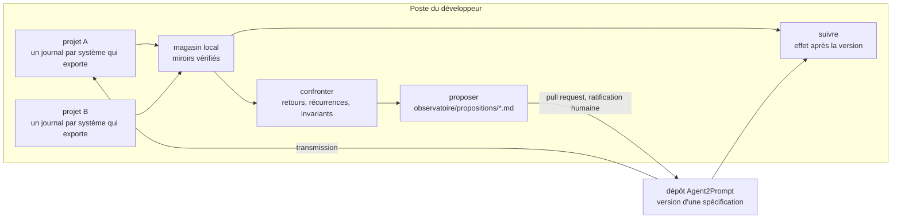

# Observatoire de l'écosystème, version 1.1.0

Chaque système de second ordre du dépôt apprend dans ses projets, mais seul : le générateur de skills de ticket relève ce qu'il apprend d'un ticket et en propose l'évolution à son développeur, sans voir ce que ses autres instances apprennent, et ce qui doit remonter jusqu'au dépôt y remonte à la main. L'observatoire ferme cette boucle, le premier couplage du troisième ordre, entre systèmes (`EVOLUTION.md`, section 10.3). Sur le poste, il relève les journaux d'enveloppes que les systèmes exportent dans leurs projets, au format du socle `socle-observation`, inclus dans sa transmission ; il les confronte d'une instance à l'autre, et d'un système à l'autre par les invariants du dépôt que citent leurs écarts, observe l'état de l'écosystème, en tire des propositions que le développeur apporte au dépôt par pull request, et suit, dans les enveloppes qui suivent, l'effet de celles que la ratification fait entrer dans une version.

L'observatoire propose et n'applique jamais (`EVOLUTION.md`, section 10.5, règle 4). Il n'ajoute aucun niveau d'observation : il ne lit des instances que leurs enveloppes, minimisées, et ne regarde jamais à l'intérieur d'un système (règle 1). Ce qu'il relève reste sur le poste ; seules entrent dans le dépôt les propositions, aussi minimisées que les enveloppes. Les règles détaillées sont dans `modules/`.

## 1. Lecture

1. Ce fichier.
2. `manifest.json` : modules, et socle d'observation inclus.
3. Le socle `socle-observation/SKILL.md` : l'enveloppe que l'observatoire lit, ses ordres et niveaux, son chaînage et sa minimisation.
4. Les modules, dans l'ordre de la boucle : `releve`, `confrontation`, `systemes`, `etat`, `propositions`, `suivi`.

## 2. Vue d'ensemble

Le magasin est dans le répertoire Git commun du clone d'Agent2Prompt, `<git-common-dir>/agent2prompt/observatoire/` : il n'est jamais versionné, et les worktrees du clone le partagent. Il se reconstruit à partir des journaux, versionnés dans les projets ; seule la liste des projets inscrits serait à refaire.

## 3. Déroulé

1. **Exporter**, dans chaque projet, avec l'outil de chaque système, sous le même sel d'instance : pour le générateur, son `observation.mjs exporter` (`generateur-skill-ticket`, module `observation`) ; pour l'orchestrateur, le sien (`orchestrateur-c7e`, module `observation`).
2. **Inscrire** chaque projet une fois : `node specs/observatoire/outils/observatoire.mjs inscrire --projet <dossier>`, depuis le clone. Son instance est celle de ses journaux, la même pour tous (module `releve`).
3. **Relever** : chaque journal inscrit est vérifié et recopié dans le magasin, en ajout seul ; `etat`, `confronter`, `proposer` et `suivre` relèvent d'abord.
4. **Lire l'état** de l'écosystème : instances, versions en usage, écarts aux versions publiées (module `etat`).
5. **Confronter** : retours et récurrences candidats (module `confrontation`), et invariants du dépôt relevés par plusieurs systèmes ou plusieurs instances (module `systemes`).
6. **Proposer** : une proposition par candidat nouveau, écrite dans `observatoire/propositions/` ; le développeur la relit, rédige ce qu'il propose de changer, et ouvre la pull request (module `propositions`).
7. **Ratifier** : la pull request de ratification inscrit le statut de la proposition, ratifiée dans telle version de telle spécification, ou refusée ; la version suit `EVOLUTION.md`.
8. **Suivre** : pour chaque proposition ratifiée, l'effet observé dans les enveloppes des versions qui la portent (module `suivi`).

## 4. Outils

Lancés depuis le clone du dépôt, avec Node 20 ou plus récent, sans dépendance.

| Outil | Commandes | Modules |
|---|---|---|
| `observatoire.mjs` | `inscrire --projet <dossier>`, `relever`, `etat [--json]`, `confronter [--json]`, `proposer [--date AAAA-MM-JJ]`, `suivre [--json]`, `verifier` | tous |

Codes de sortie : 0 ; 1 pour un refus, un journal altéré ou un magasin altéré ; 2 pour un usage incorrect. Aucun outil ne commite, ne pousse ni n'ouvre de pull request.

## 5. Cycle 7E, au niveau de l'écosystème

| Phase | Dans l'observatoire | Module |
|---|---|---|
| Éléments | les enveloppes que les instances exportent | `releve` |
| Espace | le socle d'observation, milieu commun ; le magasin local | `releve` |
| Engendrent | la confrontation des instances entre elles, et des systèmes entre eux | `confrontation`, `systemes` |
| État | les versions en usage, comparées aux versions publiées | `etat` |
| Expression | les propositions, apportées au dépôt par pull request | `propositions` |
| Évolutif | l'effet des propositions ratifiées, suivi dans les enveloppes | `suivi` |
| Environnement | le développeur qui ratifie, les projets, le dépôt et ses transmissions | tous |

## 6. Registre des dimensions

| ID | Dimension | Introduite | Statut 1.1.0 | Ordre | Dépend de | Module |
|---|---|---|---|---|---|---|
| D1 | Inscription et relevé | 1.0 | active | OC1 | socle d'observation | `releve` |
| D2 | Confrontation entre instances | 1.0 | active | OC3 | D1 | `confrontation` |
| D3 | État de l'écosystème | 1.0 | active | OC3 | D1 | `etat` |
| D4 | Propositions au dépôt | 1.0 | active | OC3 | D2 | `propositions` |
| D5 | Suivi des propositions ratifiées | 1.0 | active | OC3 | D4 | `suivi` |
| D6 | Confrontation entre systèmes | 1.1 | active | OC3 | D1, D2 | `systemes` |

La colonne « Ordre » dit l'ordre cybernétique de chaque dimension, au sens d'`EVOLUTION.md`, section 10 : D1 régule, au premier ordre, ce qui entre dans le magasin ; D2 à D6 font la boucle du troisième ordre, des instances et des systèmes au dépôt et du dépôt aux instances, active parce que ses invariants ont leurs tests (règle 3).

## 7. Versions et points d'extension

L'observatoire suit le contrat de version de `EVOLUTION.md`. Le socle d'observation est inclus dans sa transmission, épinglé dans `manifest.json`, et référencé à sa version courante : une version du socle entraîne une version de l'observatoire, dont la vérification des enveloppes suit le socle.

- **E1** : systèmes qui exportent. En 1.1, le générateur de skills de ticket exporte dans `docs/c7e/observations.jsonl`, et l'orchestrateur C7E (D12) dans `docs/c7e/observations-orchestrateur-c7e.jsonl`. Le binôme Agent2Dev et Agent2Test (D26) rejoindra la confrontation par son export, dans son journal, que l'observatoire ajoutera à sa liste.
- **E2** : pluralité des sujets. En 1.0, un seul développeur peut ratifier une proposition ; la ratification par au moins deux sujets distincts, référent, pair ou commanditaire, relève de la gouvernance distribuée, jalon J5 du passage au troisième ordre.
- **E3** : modèle de l'acceptable. Les refus et les dérogations, quand les systèmes les exporteront, se confronteront comme les autres enveloppes, sous le modèle de l'acceptable, jalon J3.

## 8. Règles globales

- **Proposer, jamais appliquer** : l'observatoire n'écrit dans le dépôt que des propositions ; il ne modifie aucune spécification ni aucun projet, ne commite, ne pousse ni ne publie ; la pull request et sa ratification restent humaines (D4.INV-2).
- **Minimisation** : rien d'une instance n'entre dans le dépôt, sinon des valeurs minimisées : un système et ses versions, un motif, une profondeur, des nombres, des références tronquées (D4.INV-1). Le corps d'une proposition est rédigé par le développeur, qui n'y met aucune donnée d'une instance.
- **Local** : le magasin reste sur le poste, hors de tout arbre de travail (D1.INV-1) ; aucun outil ne se connecte au réseau.
- **Aucun niveau de plus** : l'observatoire ne lit que des enveloppes vérifiées (D1.INV-2) ; il ne lit ni le sel, ni le champ, ni le registre d'une instance.
- **Limites déclarées** : en 1.1, deux systèmes exportent, le générateur et l'orchestrateur (E1) ; leurs motifs ne se ressemblent pas, et ils ne se confrontent que par les invariants du dépôt que citent leurs écarts (D6) ; les enveloppes du registre des concepts, sans profondeur et qui visent l'instance, ne font ni retour ni récurrence : elles comptent dans l'état de l'écosystème. Un seul sujet ratifie (E2). Avec une seule instance sur le poste, les retours et les invariants relevés par deux systèmes remontent, et les récurrences attendent une deuxième instance. Le couplage 1 du troisième ordre est fermé dans ces limites, qu'`EVOLUTION.md`, section 10, rappelle.

## 9. Critères de réussite

- **P1** : un journal altéré, réécrit, ou d'une version inconnue n'entre dans aucune confrontation ; le magasin ne fait que s'allonger.
- **P2** : un retour remonte dès une instance ; une récurrence demande deux instances distinctes.
- **P3** : l'état de l'écosystème dit, pour chaque instance, quels systèmes sont en retard sur leur version publiée.
- **P4** : une proposition ne porte aucune donnée d'une instance, et ne se répète pas.
- **P5** : l'effet d'une proposition ratifiée se mesure, ou se déclare indécidable.
- **P6** : un même invariant du dépôt, relevé par deux systèmes ou dans deux instances, remonte à la spécification qui le définit ; un même écart, constaté par un système et décidé dans le registre d'un autre, ne compte qu'une fois.

## 10. Invariants

**D1 : inscription et relevé**

- **D1.INV-1** : le magasin de l'observatoire est dans le répertoire Git commun du clone d'Agent2Prompt, `<git-common-dir>/agent2prompt/observatoire/`, partagé par ses worktrees et hors de tout arbre de travail : il n'est jamais versionné, publié ni exporté, et ne garde que les chemins des projets inscrits et les miroirs de leurs journaux.
- **D1.INV-2** : un journal ne se relève que vérifié selon le socle épinglé, schéma, chaîne et tête ; un journal altéré, ou réécrit depuis le dernier relevé, est refusé et son miroir reste tel quel ; un miroir ne fait que s'allonger, et un magasin altéré arrête tout relevé.
- **D1.INV-3** : une enveloppe d'un système ou d'une version que le dépôt ne publie pas est écartée de toute confrontation, et signalée.

**D2 : confrontation entre instances**

- **D2.INV-1** : une récurrence est un même motif, à la même profondeur, pour un même système, dans au moins deux instances distinctes, comptées par leur empreinte et non par leurs projets ; un motif générique, un verdict neutre ou une décision n'en font pas.
- **D2.INV-2** : un retour est une proposition d'une instance qui vise une spécification et qu'une décision humaine de cette instance a retenue ; il remonte dès une instance ; une proposition refusée, ou qui ne vise que l'instance, ne remonte pas.

**D3 : état de l'écosystème**

- **D3.INV-1** : pour chaque instance, chaque système qui exporte est comparé à la version que le dépôt publie : à jour, en retard, ou inconnue.

**D4 : propositions au dépôt**

- **D4.INV-1** : une proposition suit le format `observatoire.proposition/1` : son en-tête ne porte que des valeurs minimisées, système, versions, sorte, motif, profondeur, nombres d'instances et d'enveloppes, références tronquées et statut, et, pour une proposition par invariant, l'invariant du dépôt et les systèmes qui l'ont relevé ; aucun texte, chemin, clé ni nom d'une instance n'entre dans le dépôt.
- **D4.INV-2** : l'observatoire n'écrit dans le dépôt que des propositions, dans `observatoire/propositions/`, ne modifie ni une spécification ni un projet, ne commite ni ne publie : la pull request et sa ratification restent humaines ; une proposition ouverte ou ratifiée ne se répète pas, et une proposition refusée ne revient qu'avec une instance nouvelle.

**D5 : suivi des propositions ratifiées**

- **D5.INV-1** : l'effet d'une proposition ratifiée se mesure par la part de son motif dans les enveloppes du système, avant et après la version qui la porte ; il ne se déclare, observé ou non observé, qu'avec au moins vingt enveloppes de part et d'autre, sinon il est indécidable.

**D6 : confrontation entre systèmes**

- **D6.INV-1** : un même invariant du dépôt, cité par des écarts ou des dérogations, fait un candidat quand ses écarts distincts sont au moins deux et viennent de deux instances ou de deux systèmes ; un écart se désigne par son instance et son ticket, et les enveloppes d'un même écart, celle du système qui le constate et celle du registre où il est décidé, ne comptent qu'une fois ; un invariant que le dépôt ne définit pas ne fait pas de candidat.
- **D6.INV-2** : un candidat par invariant se propose à la spécification qui définit l'invariant, à sa version courante, avec les systèmes qui l'ont relevé ; ses références désignent chaque enveloppe par son instance tronquée, son système et son numéro, puisque chaque système tient son journal.

## 11. Journal de révision

**1.0.0** (2026-11-24) : création, jalon J2 du passage du dépôt au troisième ordre (`EVOLUTION.md`, section 10). Dimensions D1 à D5, actives ; D2 à D5 forment la première boucle OC3 du dépôt, entre systèmes. Outil `observatoire.mjs` ; magasin local dans le répertoire Git commun du clone ; propositions dans `observatoire/propositions/`, au format `observatoire.proposition/1`. Socle `socle-observation` 1.1.0 inclus et référencé. Décisions ratifiées avant la rédaction (plan du jalon J2) : spécification `observatoire`, transmissible et outillée (O1) ; magasin dans le répertoire Git commun du clone (O2) ; retours dès une instance et récurrences dans au moins deux (O3) ; propositions versionnées, leur statut inscrit par la pull request de ratification (O4).

**1.1.0** (2026-11-24) : dimension D6 active, la confrontation entre systèmes, jalon J1c du passage du dépôt au troisième ordre (`EVOLUTION.md`, section 10). L'observatoire relève aussi le journal de l'orchestrateur C7E, `docs/c7e/observations-orchestrateur-c7e.jsonl`, que l'export de sa version 3.7.0 écrit sous le sel de l'instance (E1), et reconnaît en clair les identifiants de concepts `C_<DOMAINE>_<NNN>`. Une sorte de candidat de plus, l'invariant : un même invariant du dépôt, relevé par des écarts distincts de deux systèmes ou de deux instances, proposé à la spécification qui le définit ; le même écart, constaté par le générateur et décidé au registre des écarts de l'orchestrateur, ne compte qu'une fois. Module `systemes` ; invariants D6.INV-1 et D6.INV-2 ; D4.INV-1 étendu à l'en-tête d'une proposition par invariant, qui porte l'invariant et les systèmes, identifiants du dépôt, sans rien relâcher de la minimisation ; références qui nomment le système de chaque enveloppe ; effet d'une proposition par invariant mesuré sur les écarts qui le citent, dans les enveloppes de la spécification qui le définit. Onze invariants. Décision ratifiée avant la rédaction : confrontation par invariant (C4, plan du jalon J1c). Archive : `archives/SKILL-v1.0.0.md`.
