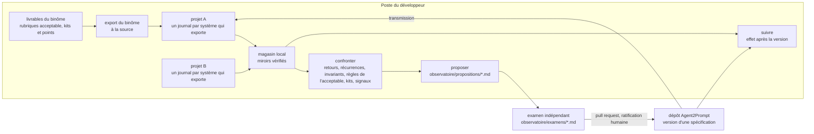

# Observatoire de l'écosystème, version 1.5.0

Chaque système de second ordre du dépôt apprend dans ses projets, mais seul : le générateur de skills de ticket relève ce qu'il apprend d'un ticket et en propose l'évolution à son développeur, sans voir ce que ses autres instances apprennent, et ce qui doit remonter jusqu'au dépôt y remonte à la main. L'observatoire ferme cette boucle, le premier couplage du troisième ordre, entre systèmes (`EVOLUTION.md`, section 10.3). Sur le poste, il relève les journaux d'enveloppes que les systèmes exportent dans leurs projets, au format du socle `socle-observation`, inclus dans sa transmission ; il les confronte d'une instance à l'autre, et d'un système à l'autre par les invariants du dépôt que citent leurs écarts, observe l'état de l'écosystème, en tire des propositions que le développeur apporte au dépôt par pull request, et suit, dans les enveloppes qui suivent, l'effet de celles que la ratification fait entrer dans une version.

Depuis 1.2.0, il ferme aussi, dans ses limites, la boucle du troisième couplage, avec les valeurs : le binôme Agent2Dev et Agent2Test, qui n'a pas d'outil dans le dépôt, exporte ses refus par l'outil d'export que porte l'observatoire, et l'observatoire confronte ces refus par la règle qu'ils citent, du socle de l'acceptable ou des constitutions ; une règle que plusieurs instances déclarent infondée par des faux refus remonte, trop large, à la spécification qui la définit. Depuis 1.3.0, l'export du binôme traduit aussi les étapes de ses kits, remise, validation, application ou échec, retour arrière, et l'observatoire les compte par système, environnement et instance, sans en tirer de proposition. Depuis 1.4.0, il ouvre le deuxième couplage, entre description et pratique : les décisions d'Agent2Dev aux points de validation, avec leurs délais, deux signaux du catalogue d'`EVOLUTION.md`, section 10.6, sortent de leur instance par le même export, et l'observatoire les compte, sans proposition. Depuis 1.5.0, une proposition ne se ratifie qu'après l'avis d'un examinateur indépendant, un observateur sur un autre modèle que celui qui l'a préparée, consigné dans `observatoire/examens/` : le développeur ratifie seul, mais pas sans ce second regard, qui précède aussi le relâchement d'une forme propre du dépôt (`EVOLUTION.md`, section 10.7).

L'observatoire propose et n'applique jamais (`EVOLUTION.md`, section 10.5, règle 4). Il n'ajoute aucun niveau d'observation : il ne lit des instances que leurs enveloppes, minimisées, et ne regarde jamais à l'intérieur d'un système (règle 1) ; son outil d'export du binôme agit à la source, pour le binôme, comme l'export d'un système pour le sien, et ne partage rien avec le magasin. Ce qu'il relève reste sur le poste ; seules entrent dans le dépôt les propositions, aussi minimisées que les enveloppes, et les examens, que d'autres écrivent et qu'il contrôle. Les règles détaillées sont dans `modules/`.

## 1. Lecture

1. Ce fichier.
2. `manifest.json` : modules, et socle d'observation inclus.
3. Le socle `socle-observation/SKILL.md` : l'enveloppe que l'observatoire lit, ses ordres et niveaux, son chaînage et sa minimisation.
4. Les modules, dans l'ordre de la boucle : `export-binome`, `releve`, `confrontation`, `systemes`, `acceptable`, `kits`, `signaux`, `etat`, `propositions`, `examens`, `suivi`.

## 2. Vue d'ensemble

Le magasin est dans le répertoire Git commun du clone d'Agent2Prompt, `<git-common-dir>/agent2prompt/observatoire/` : il n'est jamais versionné, et les worktrees du clone le partagent. Il se reconstruit à partir des journaux, versionnés dans les projets ; seule la liste des projets inscrits serait à refaire.

## 3. Déroulé

1. **Exporter**, dans chaque projet, avec l'outil de chaque système, sous le même sel d'instance : pour le générateur, son `observation.mjs exporter` (`generateur-skill-ticket`, module `observation`) ; pour l'orchestrateur, le sien (`orchestrateur-c7e`, module `observation`) ; pour le binôme, `export-binome.mjs exporter`, de l'observatoire, avec les livrables d'Agent2Dev et les journaux de tests d'Agent2Test de l'application (module `export-binome`).
2. **Inscrire** chaque projet une fois : `node specs/observatoire/outils/observatoire.mjs inscrire --projet <dossier>`, depuis le clone. Son instance est celle de ses journaux, la même pour tous (module `releve`).
3. **Relever** : chaque journal inscrit est vérifié et recopié dans le magasin, en ajout seul ; `etat`, `confronter`, `proposer` et `suivre` relèvent d'abord.
4. **Lire l'état** de l'écosystème : instances, versions en usage, écarts aux versions publiées (module `etat`).
5. **Confronter** : retours et récurrences candidats (module `confrontation`), invariants du dépôt relevés par plusieurs systèmes ou plusieurs instances (module `systemes`), règles de l'acceptable que citent les refus, dont celles que des faux refus de plusieurs instances déclarent trop larges (module `acceptable`), kits du binôme, comptés, sans candidat (module `kits`), et décisions aux points de validation, avec leurs délais, comptées de même (module `signaux`).
6. **Proposer** : une proposition par candidat nouveau, écrite dans `observatoire/propositions/` ; le développeur la relit, rédige ce qu'il propose de changer, et ouvre la pull request (module `propositions`).
7. **Ratifier** : un examinateur indépendant, sur un autre modèle que celui qui a préparé la proposition, écrit son avis dans `observatoire/examens/`, sous le nom de la proposition (module `examens`) ; la pull request de ratification apporte cet examen et inscrit le statut de la proposition, ratifiée dans telle version de telle spécification, ou refusée, sans examen pour un refus ; la version suit `EVOLUTION.md`.
8. **Suivre** : pour chaque proposition ratifiée, l'effet observé dans les enveloppes des versions qui la portent (module `suivi`).

## 4. Outils

Lancés depuis le clone du dépôt, avec Node 20 ou plus récent, sans dépendance.

| Outil | Commandes | Modules |
|---|---|---|
| `observatoire.mjs` | `inscrire --projet <dossier>`, `relever`, `etat [--json]`, `confronter [--json]`, `proposer [--date AAAA-MM-JJ]`, `suivre [--json]`, `verifier` : magasin, propositions, examens et ratifications | tous, sauf `export-binome` |
| `export-binome.mjs` | `exporter --projet <dossier> <fichier>...`, `verifier --projet <dossier>`, `etat --projet <dossier> [--json]` | `export-binome` |

Codes de sortie : 0 ; 1 pour un refus, un journal altéré ou un magasin altéré ; 2 pour un usage incorrect. Aucun outil ne commite, ne pousse ni n'ouvre de pull request. `export-binome.mjs` écrit dans le projet de l'application, `<dossier>`, et dans son répertoire Git commun, pour le sel de l'instance ; jamais dans le magasin.

## 5. Cycle 7E, au niveau de l'écosystème

| Phase | Dans l'observatoire | Module |
|---|---|---|
| Éléments | les enveloppes que les instances exportent, dont celles que l'export écrit pour le binôme | `export-binome`, `releve` |
| Espace | le socle d'observation, milieu commun ; le magasin local | `releve` |
| Engendrent | la confrontation des instances entre elles, des systèmes entre eux, des refus avec les règles qu'ils citent, et les comptes des kits et des signaux | `confrontation`, `systemes`, `acceptable`, `kits`, `signaux` |
| État | les versions en usage, comparées aux versions publiées | `etat` |
| Expression | les propositions, apportées au dépôt par pull request, et les examens qui précèdent leur ratification | `propositions`, `examens` |
| Évolutif | l'effet des propositions ratifiées, suivi dans les enveloppes | `suivi` |
| Environnement | le développeur qui ratifie, l'examinateur indépendant, les projets, le dépôt et ses transmissions | tous |

## 6. Registre des dimensions

| ID | Dimension | Introduite | Statut 1.5.0 | Ordre | Dépend de | Module |
|---|---|---|---|---|---|---|
| D1 | Inscription et relevé | 1.0 | active | OC1 | socle d'observation | `releve` |
| D2 | Confrontation entre instances | 1.0 | active | OC3 | D1 | `confrontation` |
| D3 | État de l'écosystème | 1.0 | active | OC3 | D1 | `etat` |
| D4 | Propositions au dépôt | 1.0 | active | OC3 | D2 | `propositions` |
| D5 | Suivi des propositions ratifiées | 1.0 | active | OC3 | D4 | `suivi` |
| D6 | Confrontation entre systèmes | 1.1 | active | OC3 | D1, D2 | `systemes` |
| D7 | Export du binôme | 1.2 | active | OC1 | socle d'observation | `export-binome` |
| D8 | Confrontation de l'acceptable | 1.2 | active | OC3 | D1, D7 | `acceptable` |
| D9 | Confrontation des kits | 1.3 | active | OC3 | D1, D7 | `kits` |
| D10 | Confrontation des signaux | 1.4 | active | OC3 | D1, D7 | `signaux` |
| D11 | Examen indépendant | 1.5 | active | OC3 | D4 | `examens` |

La colonne « Ordre » dit l'ordre cybernétique de chaque dimension, au sens d'`EVOLUTION.md`, section 10 : D1 régule, au premier ordre, ce qui entre dans le magasin, et D7 ce qui sort d'une instance pour le binôme ; D2 à D6 font la boucle du troisième ordre entre systèmes, des instances et des systèmes au dépôt et du dépôt aux instances, et D8 celle du troisième couplage, des refus aux règles de l'acceptable ; D9 y observe les kits, en comptes, sans proposition ; D10 ouvre le deuxième couplage, entre description et pratique, par les comptes des signaux du binôme ; D11 met entre la proposition et sa ratification l'avis d'un observateur extérieur au modèle qui l'a préparée ; elles sont actives parce que leurs invariants ont leurs tests (règle 3).

## 7. Versions et points d'extension

L'observatoire suit le contrat de version de `EVOLUTION.md`. Le socle d'observation est inclus dans sa transmission, épinglé dans `manifest.json`, et référencé à sa version courante : une version du socle entraîne une version de l'observatoire, dont la vérification des enveloppes suit le socle.

- **E1** : systèmes qui exportent. En 1.4, le générateur de skills de ticket exporte dans `docs/c7e/observations.jsonl`, l'orchestrateur C7E (D12) dans `docs/c7e/observations-orchestrateur-c7e.jsonl`, et le binôme Agent2Dev et Agent2Test, ses refus (D26), ses kits (D27) et, pour Agent2Dev, ses décisions aux points de validation (D12), par l'outil d'export de l'observatoire (D7), dans `docs/c7e/observations-agent2dev.jsonl` et `docs/c7e/observations-agent2test.jsonl`. Un autre système rejoindra la confrontation par son export, dans son journal, que l'observatoire ajoutera à sa liste.
- **E2** : pluralité des sujets. Depuis 1.5, une proposition ne se ratifie qu'avec l'avis consigné d'un examinateur indépendant, un observateur sur un autre modèle (D11) ; le développeur ratifie seul. La ratification par au moins deux sujets humains distincts, référent, pair ou commanditaire, s'ajoutera à l'examen sans le remplacer, quand ces sujets prendront part à la gouvernance (`EVOLUTION.md`, section 10.7).
- **E3** : modèle de l'acceptable. Depuis 1.2, les refus, dérogations et faux refus du binôme se confrontent par règle, sous le modèle de l'acceptable (D8) ; depuis 1.3, ses kits, leurs applications, leurs échecs et leurs retours arrière, s'y comptent, selon le contrat des kits du socle de l'acceptable (D9). Les refus de l'orchestrateur et du générateur, dont l'acceptable reste réservé, et le kit démo du générateur s'y ajouteront, chacun par une correspondance du socle d'observation ; une proposition sur les kits attendra des données réelles.
- **E4** : signaux du deuxième couplage. Depuis 1.4, deux signaux du catalogue d'`EVOLUTION.md`, section 10.6, les décisions d'Agent2Dev au point V2 et les délais de décision, sortent de leur instance et se comptent (D10). Un autre signal s'ajoutera par une correspondance du socle d'observation, quand sa spécification le journalisera ; une proposition par signal, et la campagne de mesure de l'orchestrateur, avec un évaluateur indépendant, attendent J4 complet.

## 8. Règles globales

- **Proposer, jamais appliquer** : l'observatoire n'écrit dans le dépôt que des propositions ; il ne modifie aucune spécification ni aucun projet, n'écrit aucun examen, ne commite, ne pousse ni ne publie ; la pull request et sa ratification restent humaines (D4.INV-2), et un examen n'est qu'un avis (D11.INV-1).
- **Minimisation** : rien d'une instance n'entre dans le dépôt, sinon des valeurs minimisées : un système et ses versions, un motif, une profondeur, des nombres, des références tronquées (D4.INV-1). Le corps d'une proposition est rédigé par le développeur, qui n'y met aucune donnée d'une instance.
- **Local** : le magasin reste sur le poste, hors de tout arbre de travail (D1.INV-1) ; aucun outil ne se connecte au réseau.
- **Aucun niveau de plus** : l'observatoire ne lit que des enveloppes vérifiées (D1.INV-2) ; il ne lit ni le sel, ni le champ, ni le registre d'une instance. L'export du binôme (D7) agit à la source, à part, pour un système sans outil dans le dépôt : il lit les livrables qu'on lui désigne et le sel de l'instance, comme l'export d'un système, et ne touche pas au magasin.
- **Limites déclarées** : en 1.5, quatre systèmes exportent, le générateur, l'orchestrateur, Agent2Dev et Agent2Test (E1) ; leurs motifs ne se ressemblent pas, et ils ne se confrontent que par les invariants du dépôt que citent leurs écarts (D6), et par les règles de l'acceptable que citent les refus du binôme (D8) ; les enveloppes du registre des concepts, sans profondeur et qui visent l'instance, ne font ni retour ni récurrence : elles comptent dans l'état de l'écosystème. Le dépôt prouve l'export du binôme sur des livrables d'épreuve : le binôme réel les produira une fois construit. Seuls les faux refus récurrents font une proposition ; un refus seul ne fait que se compter, comme les kits et les signaux, qui ne citent aucune règle ; un signal ne classe jamais des personnes, son sujet reste un rôle. L'effet d'une proposition sur une règle du noyau reste indécidable : le socle de l'acceptable n'exporte pas, et les enveloppes ne portent pas sa version. Un seul sujet ratifie, sur l'avis d'un examinateur indépendant dont le modèle se déclare sans se prouver (E2). Avec une seule instance sur le poste, les retours et les invariants relevés par deux systèmes remontent, et les récurrences et les règles trop larges attendent une deuxième instance. Les couplages 1 et 3 du troisième ordre sont fermés dans ces limites, et le couplage 2 ouvert, sans boucle encore, qu'`EVOLUTION.md`, section 10, rappelle.

## 9. Critères de réussite

- **P1** : un journal altéré, réécrit, ou d'une version inconnue n'entre dans aucune confrontation ; le magasin ne fait que s'allonger.
- **P2** : un retour remonte dès une instance ; une récurrence demande deux instances distinctes.
- **P3** : l'état de l'écosystème dit, pour chaque instance, quels systèmes sont en retard sur leur version publiée.
- **P4** : une proposition ne porte aucune donnée d'une instance, et ne se répète pas.
- **P5** : l'effet d'une proposition ratifiée se mesure, ou se déclare indécidable.
- **P6** : un même invariant du dépôt, relevé par deux systèmes ou dans deux instances, remonte à la spécification qui le définit ; un même écart, constaté par un système et décidé dans le registre d'un autre, ne compte qu'une fois.
- **P7** : les refus du binôme sortent de leur instance minimisés, datés par leur rubrique, chaînés dans un journal par système ; une rubrique réécrite depuis son export arrête l'export.
- **P8** : une règle déclarée infondée par des faux refus dans deux instances remonte, trop large, à la spécification qui la définit ; un refus seul, ou des faux refus d'une seule instance, ne font que se compter.
- **P9** : les étapes des kits du binôme sortent de leur instance minimisées, une enveloppe par étape, reliées par l'ancre de leur kit ; l'observatoire les compte par système, environnement et instance, kits en attente et kits test non nettoyés compris, sans proposition.
- **P10** : les décisions d'Agent2Dev aux points de validation sortent de leur instance minimisées, chaque décision avec son délai, calculé à la source ; l'observatoire les compte par système et par point, en attente comprises, avec les délais médian et maximal, sans proposition.
- **P11** : une proposition ne se ratifie qu'avec l'avis consigné d'un examinateur indépendant, sur un autre modèle ; un avis défavorable n'empêche pas la ratification, qui lui répond ; un refus se décide seul.

## 10. Invariants

**D1 : inscription et relevé**

- **D1.INV-1** : le magasin de l'observatoire est dans le répertoire Git commun du clone d'Agent2Prompt, `<git-common-dir>/agent2prompt/observatoire/`, partagé par ses worktrees et hors de tout arbre de travail : il n'est jamais versionné, publié ni exporté, et ne garde que les chemins des projets inscrits et les miroirs de leurs journaux.
- **D1.INV-2** : un journal ne se relève que vérifié selon le socle épinglé, schéma, chaîne et tête ; un journal altéré, ou réécrit depuis le dernier relevé, est refusé et son miroir reste tel quel ; un miroir ne fait que s'allonger, et un magasin altéré arrête tout relevé.
- **D1.INV-3** : une enveloppe d'un système ou d'une version que le dépôt ne publie pas est écartée de toute confrontation, et signalée.

**D2 : confrontation entre instances**

- **D2.INV-1** : une récurrence est un même motif, à la même profondeur, pour un même système, dans au moins deux instances distinctes, comptées par leur empreinte et non par leurs projets ; un motif générique, un verdict neutre ou une décision n'en font pas.
- **D2.INV-2** : un retour est une proposition d'une instance qui vise une spécification et qu'une décision humaine de cette instance a retenue ; il remonte dès une instance ; une proposition refusée, ou qui ne vise que l'instance, ne remonte pas.

**D3 : état de l'écosystème**

- **D3.INV-1** : pour chaque instance, chaque système qui exporte est comparé à la version que le dépôt publie : à jour, en retard, ou inconnue.

**D4 : propositions au dépôt**

- **D4.INV-1** : une proposition suit le format `observatoire.proposition/1` : son en-tête ne porte que des valeurs minimisées, système, versions, sorte, motif, profondeur, nombres d'instances et d'enveloppes, références tronquées et statut, et, pour une proposition par invariant ou par faux refus, l'invariant du dépôt et les systèmes qui l'ont relevé ; aucun texte, chemin, clé ni nom d'une instance n'entre dans le dépôt.
- **D4.INV-2** : l'observatoire n'écrit dans le dépôt que des propositions, dans `observatoire/propositions/`, ne modifie ni une spécification ni un projet, ne commite ni ne publie : la pull request et sa ratification restent humaines ; une proposition ouverte ou ratifiée ne se répète pas, et une proposition refusée ne revient qu'avec une instance nouvelle.

**D5 : suivi des propositions ratifiées**

- **D5.INV-1** : l'effet d'une proposition ratifiée se mesure par la part de son motif dans les enveloppes du système, avant et après la version qui la porte ; il ne se déclare, observé ou non observé, qu'avec au moins vingt enveloppes de part et d'autre, sinon il est indécidable.

**D6 : confrontation entre systèmes**

- **D6.INV-1** : un même invariant du dépôt, cité par des écarts ou des dérogations, fait un candidat quand ses écarts distincts sont au moins deux et viennent de deux instances ou de deux systèmes ; un écart se désigne par son instance et son ticket, et les enveloppes d'un même écart, celle du système qui le constate et celle du registre où il est décidé, ne comptent qu'une fois ; un invariant que le dépôt ne définit pas ne fait pas de candidat ; une réponse à un refus, qui vise l'enveloppe de son refus, n'est pas un écart : elle relève de D8.
- **D6.INV-2** : un candidat par invariant se propose à la spécification qui définit l'invariant, à sa version courante, avec les systèmes qui l'ont relevé ; ses références désignent chaque enveloppe par son instance tronquée, son système et son numéro, puisque chaque système tient son journal.

**D7 : export du binôme**

- **D7.INV-1** : l'export du binôme traduit la rubrique `acceptable` d'un livrable d'Agent2Dev ou d'un journal de tests d'Agent2Test selon la correspondance du socle d'observation, section 6.5, sa rubrique `kits` selon la section 6.6, et, pour Agent2Dev, sa rubrique `points` selon la section 6.7 : une enveloppe par refus, par réponse, par étape d'un kit, un échec en une seule, et par présentation d'un point et par décision, avec son délai calculé à la source, datée par la rubrique, au nom et à la version du système qui a produit l'enregistrement ; il ne modifie aucun fichier désigné, et la même rubrique, sous le même sel, donne les mêmes enveloppes, octet pour octet, quel que soit l'ordre des fichiers.
- **D7.INV-2** : l'export écrit dans le projet de l'application un journal par système, `docs/c7e/observations-agent2dev.jsonl` et `docs/c7e/observations-agent2test.jsonl`, en ajout seul, chaîné, avec sa tête, sous le sel de l'instance, qu'il lit dans le répertoire Git commun du projet, ou tire s'il n'y existe aucun journal d'enveloppes ; un enregistrement déjà exporté ne l'est pas deux fois ; une réponse venue après son refus le vise, la validation d'un kit, l'enveloppe de sa remise, et une décision, l'enveloppe de la présentation de son point ; un journal altéré, une source illisible, une rubrique qui change ou retire un enregistrement exporté, un sel absent alors qu'un journal existe, ou étranger à l'un d'eux, ou une enveloppe mal formée arrêtent l'export, sans rien écrire.
- **D7.INV-3** : aucune enveloppe de l'export ne porte l'objet refusé, le motif d'une réponse, le commentaire d'un échec ou d'une décision, son canal ni le nom d'une personne : la règle sort préfixée par la spécification qui la définit, le rôle qui répond ou déclare par son nom dans le socle, la demande, la campagne et l'empreinte du patch d'un kit par leur empreinte salée ; l'export n'écrit rien dans le magasin de l'observatoire, et le sel ne s'affiche ni ne sort.

**D8 : confrontation de l'acceptable**

- **D8.INV-1** : les refus se confrontent par règle : pour chaque invariant qu'un refus cite, l'observatoire rend le nombre de refus, de dérogations et de faux refus, les systèmes qui les ont produits et le nombre d'instances où ils ont paru, une réponse comptant sous la règle du refus qu'elle vise, dans le journal de son système ; un refus, une dérogation ou un faux refus ne fait ni retour, ni récurrence, ni candidat par invariant.
- **D8.INV-2** : une règle que le dépôt définit, déclarée infondée par des faux refus dans au moins deux instances distinctes, fait un candidat « règle trop large », de sorte `faux-refus`, proposé à la spécification qui la définit, à sa version courante, avec les systèmes qui ont relevé ces faux refus ; un refus sans faux refus, des faux refus d'une seule instance, ou une règle que le dépôt ne définit pas n'en font pas.

**D9 : confrontation des kits**

- **D9.INV-1** : les kits se comptent par système et par environnement, leurs étapes se reconnaissant à l'ancre de leur kit : remis, validés, appliqués, en échec, défaits, validés en attente d'application, kits test appliqués sans nettoyage déclaré, et le nombre d'instances où ils ont paru, un échec comprenant son retour arrière ; une enveloppe de kit ne fait ni retour, ni récurrence, ni candidat par invariant ou par faux refus, et la confrontation des kits ne propose rien.

**D10 : confrontation des signaux**

- **D10.INV-1** : les décisions aux points de validation se comptent par système et par point, une décision se reconnaissant à la présentation qu'elle vise, dans le journal de son système : présentations, décisions retenues, amendées et refusées, présentations en attente, délais médian et maximal, lus dans la mesure de chaque décision, et le nombre d'instances ; une enveloppe de point ne fait ni retour, ni récurrence, ni candidat, et ne classe aucune personne.

**D11 : examen indépendant**

- **D11.INV-1** : une proposition ne se ratifie qu'avec son examen, du même nom dans `observatoire/examens/`, qui la vise ; une version qui relâche une forme propre du dépôt cite à son journal l'examen de la spécification à cette version (`EVOLUTION.md`, section 10.7) ; un avis ne décide jamais, et une ratification contre un avis défavorable lui répond ; un refus n'en demande pas. Contrôle : commande `verifier` de l'outil et vérificateur du dépôt, sur des propositions ratifiées avec et sans examen, et des constitutions d'exemple relâchées.
- **D11.INV-2** : un examen suit le format fermé `observatoire.examen/1` : rien que des valeurs minimisées, l'objet, pour une spécification son nom et sa version, l'examinateur, un rôle, son modèle déclaré et son avis dans la liste ; son corps, sous `## Avis`, les points de l'examinateur, sans donnée d'une instance ; l'observatoire n'en écrit aucun. Contrôle : examens altérés, refusés.

## 11. Journal de révision

**1.0.0** (2026-11-24) : création, jalon J2 du passage du dépôt au troisième ordre (`EVOLUTION.md`, section 10). Dimensions D1 à D5, actives ; D2 à D5 forment la première boucle OC3 du dépôt, entre systèmes. Outil `observatoire.mjs` ; magasin local dans le répertoire Git commun du clone ; propositions dans `observatoire/propositions/`, au format `observatoire.proposition/1`. Socle `socle-observation` 1.1.0 inclus et référencé. Décisions ratifiées avant la rédaction (plan du jalon J2) : spécification `observatoire`, transmissible et outillée (O1) ; magasin dans le répertoire Git commun du clone (O2) ; retours dès une instance et récurrences dans au moins deux (O3) ; propositions versionnées, leur statut inscrit par la pull request de ratification (O4).

**1.1.0** (2026-11-24) : dimension D6 active, la confrontation entre systèmes, jalon J1c du passage du dépôt au troisième ordre (`EVOLUTION.md`, section 10). L'observatoire relève aussi le journal de l'orchestrateur C7E, `docs/c7e/observations-orchestrateur-c7e.jsonl`, que l'export de sa version 3.7.0 écrit sous le sel de l'instance (E1), et reconnaît en clair les identifiants de concepts `C_<DOMAINE>_<NNN>`. Une sorte de candidat de plus, l'invariant : un même invariant du dépôt, relevé par des écarts distincts de deux systèmes ou de deux instances, proposé à la spécification qui le définit ; le même écart, constaté par le générateur et décidé au registre des écarts de l'orchestrateur, ne compte qu'une fois. Module `systemes` ; invariants D6.INV-1 et D6.INV-2 ; D4.INV-1 étendu à l'en-tête d'une proposition par invariant, qui porte l'invariant et les systèmes, identifiants du dépôt, sans rien relâcher de la minimisation ; références qui nomment le système de chaque enveloppe ; effet d'une proposition par invariant mesuré sur les écarts qui le citent, dans les enveloppes de la spécification qui le définit. Onze invariants. Décision ratifiée avant la rédaction : confrontation par invariant (C4, plan du jalon J1c). Archive : `archives/SKILL-v1.0.0.md`.

**1.2.0** (2026-11-25) : dimensions D7 et D8 actives, jalon J3c du passage du dépôt au troisième ordre (`EVOLUTION.md`, section 10) : l'export des refus du binôme et la confrontation de l'acceptable ferment, dans leurs limites déclarées, la boucle du troisième couplage, avec les valeurs. Outil `export-binome.mjs`, module `export-binome` (D7) : la rubrique `acceptable` d'un livrable d'Agent2Dev ou d'un journal de tests d'Agent2Test, traduite selon la correspondance du socle d'observation 1.2.0, section 6.5, dans un journal par système du projet de l'application, `docs/c7e/observations-agent2dev.jsonl` et `docs/c7e/observations-agent2test.jsonl`, sous le sel de l'instance ; l'outil agit à la source, à part du magasin. Module `acceptable` (D8) : refus, dérogations et faux refus comptés par règle, par système et par instance ; une sorte de candidat de plus, `faux-refus`, une règle déclarée infondée par des faux refus dans au moins deux instances, proposée trop large à la spécification qui la définit, le socle de l'acceptable pour une règle `SA`. Le préfixe `SA` est reconnu dans le champ `invariant`, et le sujet `testeur`. D4.INV-1 étendu à l'en-tête d'une proposition par faux refus, sans rien relâcher de la minimisation ; D6.INV-1 précisé : une réponse à un refus n'est pas un écart. Défaut corrigé : une décision visait, par son numéro, une enveloppe de n'importe quel journal de son instance ; elle vise désormais celle du journal de son système, où les numéros recommencent à 1. Seize invariants. Socle `socle-observation` 1.2.0 inclus et référencé. Décisions ratifiées avant la rédaction : plan du jalon J3c, X1 à X3 et X5. Archive : `archives/SKILL-v1.1.0.md`.

**1.3.0** (2026-11-25) : dimension D9 active, jalon J3e du passage du dépôt au troisième ordre (`EVOLUTION.md`, section 10), l'export des kits. D7 étendue : `export-binome.mjs` traduit aussi la rubrique `kits` d'un livrable d'Agent2Dev ou d'un journal de tests d'Agent2Test, selon la correspondance du socle d'observation 1.3.0, section 6.6 : la remise, la validation, qui vise la remise, l'application ou son échec, en une seule enveloppe, et le retour arrière d'un kit, reliés par l'ancre de nature `kit`, dans les mêmes journaux, sous le même sel, tout ou rien comme avant ; une étape exportée ne change plus, une étape nouvelle s'ajoute. Module `kits` (D9) : les kits comptés par système et par environnement, remis, validés, appliqués, en échec, défaits, en attente d'application, kits test sans nettoyage déclaré, avec leurs instances ; des comptes seulement, sans candidat. D7.INV-1 à D7.INV-3 étendus aux kits, sans rien relâcher de la minimisation ; dix-sept invariants. La nature d'ancre `kit` est reconnue. Socle `socle-observation` 1.3.0 inclus et référencé. Décisions ratifiées avant la rédaction : plan du jalon J3e, Y1 à Y3. Archive : `archives/SKILL-v1.2.0.md`.

**1.4.0** (2026-11-25) : dimension D10 active, jalon J4 réduit du passage du dépôt au troisième ordre (`EVOLUTION.md`, section 10) : le deuxième couplage, entre description et pratique, s'ouvre. D7 étendue : `export-binome.mjs` traduit aussi la rubrique `points` d'un livrable d'Agent2Dev, selon la correspondance du socle d'observation 1.4.0, section 6.7 : chaque présentation d'un point de validation, et sa décision, qui la vise avec la valeur `retenue`, `amendee` ou `refusee` et porte, dans le champ `mesure`, le délai de décision en secondes, calculé à la source sur les dates de la rubrique ; la date d'une enveloppe peut être avancée, son délai jamais. Module `signaux` (D10) : décisions comptées par système et par point, retenues, amendées, refusées, présentations en attente, délais médian et maximal, avec leurs instances ; des comptes seulement, sans candidat ; un signal ne classe jamais des personnes. Ces deux signaux observent les clauses de second ordre d'agent-tdd-jira et d'agents-paralleles-gitlab, au catalogue d'`EVOLUTION.md`, section 10.6. Le champ `mesure` est reconnu, au schéma fermé ; point d'extension E4, les signaux du deuxième couplage ; D7.INV-1 à D7.INV-3 étendus aux points ; dix-huit invariants. Socle `socle-observation` 1.4.0 inclus et référencé. Décisions ratifiées avant la rédaction : plan du jalon J4 réduit, Z1 à Z5. Archive : `archives/SKILL-v1.3.0.md`.

**1.5.0** (2026-11-26) : dimension D11 active, l'examen indépendant, jalon J5a du passage du dépôt au troisième ordre (`EVOLUTION.md`, section 10), la révision des formes propres. Le développeur ratifie seul ; entre la proposition et sa ratification, un observateur sur un autre modèle que celui qui l'a préparée donne son avis, `favorable`, `reserve` ou `defavorable`, dans `observatoire/examens/`, au format fermé `observatoire.examen/1`, sous le nom de la proposition ; l'examen d'une version qui relâche une forme propre du dépôt s'appelle `<spécification>-<version>.md` et se cite au journal de cette version. Module `examens` ; `observatoire.mjs verifier` contrôle les examens, et qu'une proposition ratifiée a le sien, qui lui répond s'il est défavorable ; le vérificateur du dépôt fait de même, et compare les formes propres à leur version précédente. Le format des propositions ne change pas ; l'observatoire n'écrit aucun examen. D4 étendue : une ratification exige l'examen, un refus non ; E2 récrit, la pluralité des sujets humains restant une limite déclarée ; critère P11 ; vingt invariants. Décisions ratifiées avant la rédaction : plan du jalon J5, W1 à W4, la pluralité d'une révision devenue un examen indépendant. Archive : `archives/SKILL-v1.4.0.md`.
