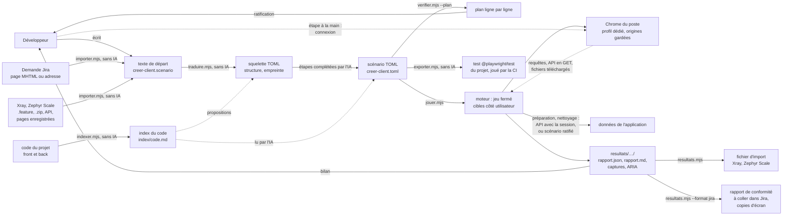

# Scénarios côté utilisateur avec Playwright, version 1.6.0

Ce document est le point d'entrée du skill. Le skill fait les manipulations d'un utilisateur dans le navigateur du poste, Chrome par défaut, à partir d'un scénario : aller sur une page, cliquer, saisir, choisir, cocher, survoler, presser une touche, joindre un fichier, télécharger, attendre, vérifier ce qui s'affiche, capturer l'écran, et rendre la main au développeur quand une étape lui revient, comme une connexion. Le scénario part d'un texte inspiré de Gherkin, que le développeur écrit en français ou en anglais, ou qu'il importe sans IA d'une demande Jira, d'un fichier `.feature`, d'un cas de test de Xray ou de Zephyr Scale, ou de la page d'un test de Xray enregistrée sur son poste ; l'IA le traduit en scénario TOML exécutable, en s'aidant d'un index du code du projet produit sans IA, le développeur ratifie la traduction, et un contrôle sans IA la garde fidèle au texte. Le moteur, écrit en Node avec `playwright-core`, joue ensuite le scénario sans IA, de façon répétable, vérifie aussi ce qui se passe hors de l'écran (requêtes de la page, API en lecture, fichiers téléchargés), prépare et nettoie les données du scénario par l'API ou par un autre scénario, et rend un rapport avec ses preuves. Plusieurs scénarios se jouent en campagne, comme un testeur recette un lot de tests : chaque test reçoit son verdict, avec ses copies d'écran, et le rapport de conformité s'écrit prêt à coller dans Jira. Le scénario ratifié s'exporte enfin, sans IA, en test `@playwright/test` du projet, que l'équipe rejoue dans sa CI, et le rapport d'une exécution ou d'une campagne se met au format d'import de Xray ou de Zephyr Scale. Les règles détaillées sont dans `modules/`.

## 1. Ordre de lecture

1. Ce document, en entier.
2. `manifest.json` : modules, versions visées, plateformes.
3. Les modules actifs, dans cet ordre : `execution`, `texte`, `jira`, `cas-de-test`, `code`, `scenario`, `cibles`, `actions`, `hors-ecran`, `donnees`, `session`, `garde`, `preuves`, `designer`, `export`, `conformite`, `agent`, `recette`.
4. `modules/traduction-auto/SKILL.md`, `modules/demo/SKILL.md`, `modules/remise/SKILL.md`, `modules/accessibilite/SKILL.md` et `modules/enregistrement/SKILL.md` : seulement pour comprendre les points d'extension. Ne pas les appliquer en 1.x.

## 2. Ce que fait le skill

| Outil | Commande, depuis n'importe quel dossier | Rôle | Module |
|---|---|---|---|
| Import de Jira | `node <skill>/scripts/importer.mjs <page.mhtml \| adresse> --adresse <url>` | écrit un texte de départ par scénario Gherkin de la demande, avec sa provenance ; `--comparer` dit ce qui a changé dans Jira depuis l'import | `jira` |
| Import de cas de test | `node <skill>/scripts/importer.mjs <fichier.feature \| export.zip \| page.html \| dossier de pages \| xray:CLÉ,… \| zephyr:CLÉ,…> --adresse <url>` | écrit un texte de départ par test, nommé par sa clé : Gherkin recopié, test manuel converti pas à pas ; Xray et Zephyr Scale, Cloud et Data Center, lus par leur API sans rien y écrire, ou pages de tests de Xray enregistrées en HTML complet, sans jeton ; `--diagnostic` décrit une page sans aucune de ses valeurs | `cas-de-test` |
| Index du code | `node <skill>/scripts/indexer.mjs <dossier du projet> [--dossier scenarios] [--langue fr]` | lit le code front et back du projet, sans IA et sans rien exécuter, et écrit `index/code.json` et `index/code.md` dans le dossier des scénarios : routes, éléments et noms accessibles, libellés traduits, endpoints, contraintes de validation, chacun avec sa source | `code` |
| Squelette de traduction | `node <skill>/scripts/traduire.mjs <texte.scenario>` | écrit `<texte>.toml` : structure du texte, empreinte, un bloc par étape et par ligne de préparation ou de nettoyage à compléter, et les propositions de l'index du code en commentaire | `scenario`, `donnees`, `code` |
| Vérification | `node <skill>/scripts/verifier.mjs <fichier>... [--plan]` | contrôle un texte ou un scénario sans navigateur, et note les cibles absentes de l'index du code ; `--plan` montre la traduction ligne par ligne, pour la ratification ; un test exporté se compare à son scénario | `texte`, `scenario`, `code`, `export` |
| Exécution | `node <skill>/scripts/jouer.mjs <scénario.toml \| dossier>... [options]` | prépare les données, joue le scénario dans le navigateur du poste, vérifie à l'écran et hors de l'écran, nettoie, et écrit le rapport, avec le verdict et les copies d'écran ; plusieurs scénarios, ou un dossier, en campagne, dans une seule fenêtre | `actions`, `hors-ecran`, `donnees`, `session`, `garde`, `preuves`, `conformite` |
| Désignation | `node <skill>/scripts/designer.mjs <adresse>` | rend la cible de chaque élément que le développeur clique | `designer` |
| Export | `node <skill>/scripts/exporter.mjs <scénario.toml>... --dossier <tests du projet>` | écrit sans IA, dans le dossier de tests désigné, un test `@playwright/test` par scénario ratifié, les aides communes et la souche de connexion de l'équipe ; `--comparer` dit ce qui changerait, `--remplacer` régénère un test périmé | `export` |
| Résultats | `node <skill>/scripts/resultats.mjs <dossier de résultats \| dossier de campagne>... --format xray\|xray-dc\|zephyr` | écrit les résultats d'une exécution ou d'une campagne au format d'import de Xray, Cloud ou Data Center, ou de Zephyr Scale, sous la clé retenue à l'import, le statut du verdict, les copies d'écran sur demande ; rien n'est envoyé | `export` |
| Rapport de conformité | `node <skill>/scripts/resultats.mjs <dossier de campagne> --format jira [--preuves]` | écrit le rapport de conformité à coller dans Jira, en balisage wiki de Data Center et en page HTML pour Cloud, avec les copies d'écran sous leur nom stable sur demande ; rien n'est envoyé | `conformite` |
| Recette | `npm test`, depuis le dossier du skill | 43 scénarios contre une application de démonstration, un Jira, un Xray et un Zephyr Scale factices, locaux, et un projet de démonstration front et back ; les tests exportés joués par `@playwright/test`, comparés au skill étape par étape | `recette` |
| Agent | `agent/pilote-scenario.md`, commandes `/scenario:importer`, `/scenario:indexer`, `/scenario:traduire`, `/scenario:jouer`, `/scenario:designer`, `/scenario:exporter`, `/scenario:resultats` | importe, indexe, traduit, préparation et nettoyage compris, fait ratifier, joue, seul ou en campagne, écrit le rapport de conformité, exporte, écrit les résultats et rend le bilan pour le développeur | `agent` |



## 3. Un scénario, du texte à l'exécution

Le texte de départ, écrit par le développeur (module `texte`) :

```text
# language: fr
@ECR-77-S01 @ECR-77-CA01
Scénario: Créer un client
  Adresse : http://127.0.0.1:4200
  Origines : http://127.0.0.1:4200, http://127.0.0.1:8080
  Paramètre : ville = Lyon

  Étant donné que je me connecte (à la main)
  Quand je clique sur le lien « Nouveau client »
  Et je saisis « <nom> » dans le champ « Nom »
  Et je choisis « <ville> » dans la liste « Ville »
  Et je clique sur le bouton « Enregistrer » (création)
  Alors je vois le message « Client <nom> créé »
  Et la requête POST « /api/clients » répond 201
  Et le client « <nom> » est supprimé (nettoyage par l'API)

  Exemples:
    | nom             |
    | Dupuis <unique> |
    | Leroy <unique>  |
```

Sa traduction, dont `traduire.mjs` écrit sans IA tout ce qui précède les étapes, et un bloc par étape à compléter (module `scenario`) :

```toml
format = "scenario-playwright.scenario/1"
titre = "Créer un client"
etiquettes = ["ECR-77-S01", "ECR-77-CA01"]
url_base = "http://127.0.0.1:4200"
origines = ["http://127.0.0.1:4200", "http://127.0.0.1:8080"]
source = "creer-client.scenario"
empreinte_source = "…"

[parametres]
ville = "Lyon"

[[jeux]]
nom = "Dupuis <unique>"

[[jeux]]
nom = "Leroy <unique>"

[[etapes]]
ligne = 8
action = "main"
message = "je me connecte"
jusqua = { url = "/accueil" }

[[etapes]]
ligne = 9
action = "cliquer"
cible = { role = "link", nom = "Nouveau client" }

[[etapes]]
ligne = 10
action = "saisir"
cible = { libelle = "Nom" }
valeur = "${nom}"

[[etapes]]
ligne = 11
action = "choisir"
cible = { libelle = "Ville" }
valeur = "${ville}"

[[etapes]]
ligne = 12
action = "cliquer"
cible = { role = "button", nom = "Enregistrer" }
mutation = "creation"

[[etapes]]
ligne = 13
action = "verifier"
critere = "contient"
cible = { role = "alert" }
attendu = "Client ${nom} créé"

[[etapes]]
ligne = 14
action = "verifier"
critere = "requete"
methode = "POST"
chemin = "/api/clients"
attendu = { statut = 201, corps = { nom = "${nom}", ville = "${ville}" } }

[[nettoyage]]
ligne = 15
methode = "DELETE"
chemin = "http://127.0.0.1:8080/api/clients/${nom}"
statut = [204, 404]
```

La dernière étape vérifie hors de l'écran ce qu'un testeur lirait dans l'onglet réseau : la requête que le clic sur « Enregistrer » a fait partir, son statut et les champs de son corps (module `hors-ecran`). La ligne marquée « (nettoyage par l'API) » ne donne pas d'étape : son entrée `[[nettoyage]]` supprime le client créé par l'API, avec la session du navigateur, après les étapes, même si l'une a échoué ; `<unique>`, dans les noms des exemples, rend chaque client propre à l'exécution, et le nettoyage ne vise que lui ; une ligne « (par l'API) » préparerait de même, avant les étapes, des données dont une valeur, l'identifiant créé, peut servir aux étapes (module `donnees`). Si le code du projet est sur le poste, `indexer.mjs` l'a indexé avant la traduction, sans IA et sans rien exécuter (module `code`) : le squelette porte alors, sous chaque étape, en commentaire, les cibles de l'index dont le nom correspond aux libellés entre guillemets de la phrase, comme `cible = { role = "link", nom = "Nouveau client" }  # src/app/clients/clients.component.html:2`, et l'IA y lit les noms, les routes et les endpoints ; `verifier.mjs` note ensuite une cible absente de l'index, sans refuser le scénario.

Le même texte peut venir de Jira, où le scénario est écrit dans la description ou un champ de texte de la demande (module `jira`) : `importer.mjs` le recopie sans IA dans `ECR-77-S01.scenario`, sous un en-tête de provenance, avec l'adresse donnée par `--adresse`. Il peut aussi venir d'un test de Xray ou de Zephyr Scale, exporté en `.feature`, lu par l'API ou depuis sa page enregistrée (module `cas-de-test`) : le texte se nomme alors par la clé du test, `ECR-80.scenario`, et un test manuel y devient, pas à pas, « Quand <action> » puis « Alors <résultat attendu> ».

Ce que produit une exécution, dans le dossier `resultats/` à côté du scénario (module `preuves`) :

```text
resultats/20261120-141503-creer-client/
  rapport.json                 champs stables (E1) : scénario, navigateur, options, chaque jeu et chaque étape, verdict
  rapport.md                   le même rapport, lisible
  captures/j1-06-verifier.png  une capture par vérification, par capture demandée et par échec
  captures/j1-fin.png          l'écran à la fin des étapes de chaque jeu
  aria/j2-05-cliquer.yml       l'instantané ARIA de la page, à chaque échec
  telechargements/…            les fichiers téléchargés, avec leur empreinte dans le rapport
  trace.zip                    seulement avec --trace
```

Le scénario ratifié se met ensuite dans les tests du projet (module `export`) : `exporter.mjs creer-client.toml --dossier e2e` écrit `e2e/creer-client.spec.ts`, un test par jeu, une étape par `test.step` qui garde son numéro et sa ligne du texte, les cibles en localisateurs de Playwright, les étiquettes en tags ; le nettoyage s'y joue dans un bloc `finally`. Le test ne dépend que de `@playwright/test` et des aides que le skill écrit à côté de lui ; une étape à la main y appelle la connexion que l'équipe écrit une fois, sans que le skill y mette d'identifiant. Dans la CI, `SCENARIO_ORIGINES` fait correspondre les origines du scénario à celles de l'environnement, et un test qui modifie des données hors du poste n'y joue qu'avec `SCENARIO_AUTORISER_MUTATIONS=1`. Quand le scénario change, `verifier.mjs` dit son test périmé, et `exporter.mjs --remplacer` le régénère. Pour un texte importé d'un test de Xray, `resultats.mjs resultats/20261120-141503-creer-client --format xray` écrit `xray-creer-client.json`, que la personne qui en a le droit importe dans Xray : le test sous sa clé, son statut, et pour un test manuel converti le statut de chacun de ses pas.

Sur un poste sans jeton d'API, d'où rien ne sort, les tests de Xray viennent de leurs pages, que le développeur enregistre dans Chrome en « Page Web, complète » : `importer.mjs pages` en fait un texte par test, un test manuel converti pas à pas comme par l'API (module `cas-de-test`, § 7). Une fois les textes traduits et ratifiés, `jouer.mjs scenarios` les joue en campagne, dans une seule fenêtre, où le développeur se connecte une fois ; chaque vérification a sa copie d'écran, chaque test son verdict, conforme, non conforme ou bloqué. `resultats.mjs resultats/20261123-141503-campagne --format jira --preuves` écrit ensuite le rapport de conformité, `conformite-jira.txt` pour Jira Data Center et `conformite.html` pour Jira Cloud, et les copies d'écran sous leur nom stable, `DEMO-21-02.png`, que le développeur colle et joint lui-même ; `--format xray` en écrit les résultats pour Xray, le statut et les copies d'écran de chaque pas compris (module `conformite`).

## 4. Cycle 7E

| Phase | Ce qu'elle désigne ici | Modules |
|---|---|---|
| Éléments | les étapes du texte, les actions du jeu fermé, les cibles, les variables ; les routes, éléments, endpoints, classes de corps et contraintes de l'index du code ; les entrées de préparation et de nettoyage | `texte`, `scenario`, `actions`, `cibles`, `code`, `donnees` |
| Espace | l'application et ses origines, le navigateur du poste, le profil dédié, le dossier de résultats ; ce qui circule hors de l'écran : requêtes de la page, API, fichiers téléchargés | `session`, `garde`, `preuves`, `hors-ecran` |
| Engendrent | les relations : ligne du texte vers étapes TOML, cible vers élément, élément vers sa source dans le code, étape vers preuve | `scenario`, `cibles`, `code`, `preuves` |
| État | la page à chaque étape, la session du profil, gardée d'un scénario à l'autre d'une campagne, le statut de chaque étape et de chaque jeu, le verdict de chaque test, les requêtes parties depuis la dernière action ; les données préparées, les valeurs gardées, ce qui reste à nettoyer | `actions`, `session`, `hors-ecran`, `donnees`, `conformite` |
| Expression | le plan de ratification, les messages « À VOUS », le rapport, les captures, le bilan de l'agent ; le rapport de campagne, le rapport de conformité à coller dans Jira et ses copies d'écran ; le test exporté, les fichiers d'import des résultats | `scenario`, `preuves`, `agent`, `conformite`, `export` |
| Évolutif | versions du skill, dimensions réservées D11 à D15, points d'extension E1 à E3, réimport et comparaison, d'une source à l'autre par la clé du test | `traduction-auto`, `demo`, `remise`, `accessibilite`, `enregistrement`, `jira`, `cas-de-test` |
| Environnement | le développeur qui écrit, ratifie et se connecte, l'IA qui traduit, Jira où s'écrivent les scénarios des US et où se colle le rapport de conformité, Xray et Zephyr Scale où vivent les cas de test, dont les pages s'enregistrent sur un poste sans jeton, le code du projet, front et back, et ses tests, que l'équipe joue dans sa CI avec `@playwright/test`, Chrome et ses versions, les autres skills qui liront les scénarios et les rapports | `agent`, `session`, `jira`, `cas-de-test`, `code`, `export` |

Clause de second ordre : la traduction n'est pas neutre. Une phrase en français se traduit en actions de plusieurs façons, et l'IA qui la traduit pourrait déplacer le sens. Le skill ne laisse donc à l'IA que ce qu'elle seule sait faire, le sens des phrases : la structure est recopiée sans IA (D3.INV-5), un contrôle sans IA vérifie que chaque ligne du texte est traduite, dans l'ordre, avec ses marques et ses variables (D3.INV-3, D3.INV-4), et rien ne se joue avant la ratification du développeur, à qui le plan est présenté ligne du texte par ligne du texte (D10.INV-1). Une étape qui revient au développeur, comme une connexion, n'est jamais ajoutée par la traduction : elle vient d'une ligne qu'il a marquée « (à la main) ». De même, le moteur ne devine aucune cible : une cible qui désigne plusieurs éléments fait échouer l'étape sans agir (D4.INV-2), et le rapport cite les éléments trouvés, pour que le développeur tranche. L'import de Jira suit la même règle : il recopie ce que Jira dit, sans IA et sans rien réécrire que ce qu'il signale (D16.INV-3) ; un scénario que le format texte n'exprime pas est refusé avec son motif, et se corrige dans Jira ; un texte que le développeur a retouché n'est jamais remplacé sans son accord, ni sans être gardé (D16.INV-5). Un test manuel n'a pas de Gherkin à recopier : sa conversion est mécanique, chaque pas en « Quand » puis « Alors », signalée dès la première ligne du texte, qui se relit avec le développeur avant la traduction (D17.INV-5) ; un test sans étapes, générique ou en texte libre, est refusé plutôt qu'interprété. L'index du code suit la même règle : lu sans IA, il ne fait que proposer ; le squelette garde chaque étape à compléter, et une cible absente de l'index n'est qu'une note, car un nom affiché peut venir des données ou d'un composant hors du projet (D18.INV-4) ; un index périmé n'est plus employé (D18.INV-2). Hors de l'écran, le skill observe comme un testeur ouvre l'onglet réseau : il ne rejoue aucune requête de la page, ne lit l'API qu'en GET, et ne garde ni en-tête, ni cookie, ni corps d'une étape à la main (D19.INV-1, D19.INV-2). La préparation des données suit la même règle : elle ne vient que d'une ligne que le développeur a marquée, se joue hors du jeu d'actions, avec la session qu'il a ouverte et sans aucun identifiant, sous la garde des mutations ; le nettoyage se joue même après un échec, et un nettoyage qui viserait une donnée d'avant l'exécution est noté avant la ratification (D20.INV-1 à D20.INV-4). L'export suit la même règle : le test s'écrit sans IA depuis le scénario ratifié, seule source, un test qui ne lui correspond plus est dit périmé, et un test retouché à la main est gardé avant d'être régénéré (D21.INV-1, D21.INV-2) ; la connexion d'un test exporté revient à l'équipe, comme elle revient au développeur dans le navigateur du skill, et le skill n'en écrit que la souche, qui échoue en le disant ; hors du poste, les gardes du moteur s'appliquent là où le test joue (D21.INV-3). La lecture d'une page de test enregistrée suit la même règle : sans rien exécuter, elle ne reconnaît les pas qu'à leurs libellés, une page dont rien n'est reconnu est refusée plutôt qu'interprétée, et son diagnostic ne dit aucune de ses valeurs (D17.INV-7). Le verdict ne juge pas l'application au-delà de ce que le test établit : il dit, d'après la première étape en échec, si le test a pu aller jusqu'à ses vérifications, bloqué, ou si l'une d'elles a vu l'application s'écarter de l'attendu, non conforme (D22.INV-3) ; le rapport de conformité n'est qu'un texte, que le développeur relit, colle et joint lui-même (D22.INV-4).

## 5. Registre des dimensions

| ID | Dimension | Introduite | Statut 1.6.0 | Dépend de | Module |
|---|---|---|---|---|---|
| D1 | Exécution : installation, dépendance, emplacements, réglages, lignes de commande | 1.0 | active | | `execution`, `recette` |
| D2 | Texte de départ inspiré de Gherkin, en français ou en anglais | 1.0 | active | | `texte`, `recette` |
| D3 | Scénario TOML et contrôle de sa traduction | 1.0 | active | D2 | `scenario`, `recette` |
| D4 | Cibles côté utilisateur | 1.0 | active | D3 | `cibles`, `recette` |
| D5 | Actions et étapes : jeu fermé, attentes, vérifications | 1.0 | active | D3, D4 | `actions`, `recette` |
| D6 | Session et navigateur du poste, étape à la main | 1.0 | active | D1 | `session`, `recette` |
| D7 | Garde : origines, mutations hors du poste, trace | 1.0 | active | D5, D6 | `garde`, `recette` |
| D8 | Preuves et rapport | 1.0 | active | D5 | `preuves`, `recette` |
| D9 | Désignation d'une cible à la souris | 1.0 | active | D4, D6 | `designer`, `recette` |
| D10 | Agent pilote-scenario et commandes de Gemini CLI | 1.0 | active | D3, D7, D8 | `agent` |
| D11 | Traduction sans IA du texte de départ, par un catalogue de phrases | 1.0 | reserved | D2, D3 | `traduction-auto` |
| D12 | Parcours du kit démo de generateur-skill-ticket, captures comparées aux images de l'objectif | 1.0 | reserved | D8 | `demo` |
| D13 | Remise des scénarios et des rapports à Agent2Test | 1.0 | reserved | D3, D8 | `remise` |
| D14 | Audit d'accessibilité des pages parcourues | 1.0 | reserved | D5 | `accessibilite` |
| D15 | Enregistrement des gestes du développeur en scénario | 1.0 | reserved | D3, D9 | `enregistrement` |
| D16 | Scénarios importés d'une demande Jira | 1.1 | active | D2, D6 | `jira`, `recette` |
| D17 | Cas de test de Xray et de Zephyr Scale, fichiers .feature, pages de tests enregistrées | 1.2 | active | D2, D16 | `cas-de-test`, `recette` |
| D18 | Index du code du projet, front et back, lu à la traduction | 1.3 | active | D3, D4 | `code`, `recette` |
| D19 | Vérifications hors de l'écran : requêtes de la page, API en lecture, fichiers téléchargés | 1.3 | active | D5, D7, D8 | `hors-ecran`, `actions`, `recette` |
| D20 | Préparation et nettoyage des données, par l'API ou par un scénario | 1.4 | active | D3, D5, D7, D8 | `donnees`, `scenario`, `actions`, `recette` |
| D21 | Export en tests `@playwright/test` du projet, résultats pour Xray et Zephyr Scale | 1.5 | active | D3, D5, D7, D8, D17, D20 | `export`, `recette` |
| D22 | Campagne, copies d'écran, verdict et rapport de conformité à coller dans Jira | 1.6 | active | D5, D6, D7, D8, D17, D21 | `conformite`, `recette` |

Statuts : `active` (implémentée et testée), `reserved` (points d'extension posés, fonctionnalité absente), `superseded` (remplacée ; la version de remplacement est indiquée).

## 6. Contrat de version et points d'extension

Le skill suit le contrat de version de `EVOLUTION.md` du dépôt Agent2Prompt. Il n'a ni base ni journal : chaque exécution écrit son rapport, seul état durable, et le profil du navigateur garde la session.

Points d'extension, actifs depuis la version indiquée :

- **E1** (1.0.0) : `rapport.json` (format `scenario-playwright.rapport/1`) a des champs stables, au niveau de l'exécution (`format`, `skill`, `version`, `scenario`, `debut`, `fin`, `duree_ms`, `navigateur`, `options`, `jeux`, `origines_bloquees`, `cibles_fragiles`, `bilan`, `statut`), de chaque jeu (`numero`, `valeurs`, `statut`, `etapes`) et de chaque étape (`numero`, `ligne`, `action`, `resume`, `cible`, `fragile`, `mutation`, `statut`, `duree_ms`, `message`, `capture`, `aria`, `telechargement`, `hors_ecran`, `console`, `erreurs_page`, `reponses`) ; `hors_ecran`, relevé d'une vérification hors de l'écran, s'est ajouté en 1.3.0, et en 1.4.0 les entrées de préparation et de nettoyage de chaque jeu (`preparation`, `nettoyage`, `gardees`, `nettoyage_en_echec`) et leurs décomptes au bilan (`preparations`, `nettoyages`, `nettoyages_en_echec`), et en 1.6.0 le verdict de l'exécution (`verdict`) et, pour chaque jeu, l'écran à la fin de ses étapes, son verdict et sa cause (`capture_fin`, `verdict`, `cause`), sans qu'aucun champ change de sens. Depuis 1.6.0, le rapport d'une campagne, `campagne.json` (format `scenario-playwright.campagne/1`), suit la même règle (module `conformite`, § 2). D12 et D13 s'en serviront sans rejouer le scénario.
- **E2** (1.0.0) : le scénario TOML (format `scenario-playwright.scenario/1`) reprend le vocabulaire du navigateur d'Agent2Test : mêmes actions pour les gestes communs, mêmes critères de vérification, mêmes stratégies de cibles, même règle des origines (`agent2test:D4.INV-2`, `agent2test:D4.INV-4`). D13 remettra un scénario ratifié à Agent2Test sans le réécrire ; les critères `requete`, `api` et `fichier` (1.3.0) et les sections `[[preparation]]` et `[[nettoyage]]` (1.4.0), hors du jeu d'actions, sont propres à ce skill, comme l'action `telecharger`, et D13 les traduira. L'export en test `@playwright/test` (1.5.0) écrit le scénario sans en changer le format, et n'est pas la remise de D13, qui reste réservée.
- **E3** (1.0.0) : le moteur est une fonction, `jouerScenario(contexte, options)` du module `actions`, qui joue des jeux préparés dans un contexte de navigateur ouvert et rend leurs résultats ; `jouer.mjs` n'en est qu'un appelant, qui l'appelle une fois par scénario d'une campagne, dans le même contexte. D12 en ajoutera un autre, sans modifier le moteur.

## 7. Règles globales

- **Aucun identifiant** : le skill ne demande, ne lit, ne stocke ni ne saisit aucun identifiant ; une connexion se fait à la main, dans la fenêtre visible, lors d'une étape « (à la main) » (D6.INV-2).
- **Un jeton ne vient que de l'environnement** : le jeton d'une API, Xray ou Zephyr Scale, se lit dans une variable d'environnement que le développeur définit lui-même ; il n'est jamais demandé, affiché, journalisé, écrit, mis dans une adresse ni passé en argument, et ne sort que dans l'en-tête des requêtes vers l'API désignée, en https hors du poste, sans suivre de redirection (D17.INV-3, D10.INV-5).
- **La traduction se ratifie** : rien ne se joue avant que le développeur ait ratifié la traduction, ligne du texte par ligne du texte ; un texte modifié rend sa traduction périmée (D3.INV-2, D10.INV-1).
- **Aucun code dans la page** : le moteur ne joue que les actions du jeu fermé, et aucune n'exécute de code dans la page (D5.INV-1).
- **Rien n'est deviné** : une cible ambiguë fait échouer l'étape, sans agir (D4.INV-2) ; aucune étape n'est rejouée (D5.INV-3).
- **Jira et les outils de test en lecture seule** : le skill n'écrit jamais dans Jira, Xray ni Zephyr Scale ; d'une demande, il ne lit que la description, les champs de texte et, sur demande, les commentaires ; par l'adresse, il n'y fait que naviguer, et le développeur se connecte lui-même ; par une API, il ne fait que des lectures, jamais une mutation ; d'une page de test enregistrée, il ne fait que lire le fichier ; les résultats pour Xray et Zephyr Scale et le rapport de conformité s'écrivent en fichiers, qu'une personne qui en a le droit importe, ou que le développeur colle : rien n'est envoyé (D16.INV-1, D16.INV-2, D17.INV-2, D17.INV-7, D21.INV-4, D22.INV-4).
- **Rien ne sort sans être déclaré** : aucune requête ne part vers une origine que le scénario ne déclare pas (D7.INV-1) ; hors du poste, une modification de données demande l'autorisation explicite du développeur pour l'exécution (D7.INV-2).
- **Le code du projet n'est que lu** : `indexer.mjs` n'exécute, ne construit ni n'importe aucun code du projet, ne suit aucun lien symbolique et n'écrit que dans le dossier `index/` des scénarios ; de la configuration du back, seul le chemin de contexte est retenu (D18.INV-1, D18.INV-5).
- **Hors de l'écran, observer sans agir** : `requete` lit les requêtes que la page a faites ; `api` ne fait qu'un GET, vers une origine déclarée, avec la session du profil, sans suivre de redirection ; `fichier` lit un fichier téléchargé par le scénario ; aucun en-tête, cookie ni jeton n'est relevé, et les secrets sont masqués dans les rapports (D19.INV-1, D19.INV-2).
- **Préparer et nettoyer sous la garde** : la préparation et le nettoyage des données ne viennent que d'une ligne marquée du texte ; un appel ne part que vers une origine déclarée, avec la session du navigateur et le jeton anti-CSRF recopié de son cookie, sans autre en-tête, une fois, sans suivre de redirection ; hors du poste, il demande l'autorisation des mutations ; le nettoyage se joue même après un échec (D20.INV-1 à D20.INV-4).
- **Une page enregistrée n'est que lue** : la page d'un test de Xray et ses cadres se lisent comme du texte, sans rien exécuter ni suivre d'adresse, un cadre seulement dans le dossier de la page ; les pas ne se reconnaissent qu'à leurs libellés, rien n'est deviné ; `--diagnostic` décrit une page sans aucune de ses valeurs (D17.INV-7).
- **Une campagne se contrôle d'abord** : tous ses scénarios sont lus et contrôlés avant la première action, et un seul refus refuse la campagne ; ils partagent leur profil, se jouent dans une seule fenêtre avec une seule connexion, chacun sous la garde de ses origines, et un test en échec n'arrête pas les suivants (D22.INV-1).
- **Le projet ne reçoit que ses tests** : `exporter.mjs` n'écrit que dans le dossier de tests que le développeur désigne, et seulement ses fichiers, tests, aides et souche de connexion, sans aucun identifiant ; un fichier qui n'est pas du skill n'est jamais remplacé, un test retouché à la main est gardé avant d'être régénéré, la connexion de l'équipe n'est jamais remplacée (D21.INV-2).
- **Les données du développeur restent chez lui** : profils, résultats, captures, téléchargements, pages Jira et Xray enregistrées et rapports de conformité restent sur le poste, dans le dossier du skill ou à côté des scénarios, écartés de Git (D1.INV-2) ; la trace n'est enregistrée que sur demande (D7.INV-3).
- **Une dépendance** : Node 22 ou plus récent et `playwright-core` à version exacte, qui pilote le navigateur du poste sans en télécharger ; `@playwright/test`, à la même version, n'est qu'une dépendance de développement, pour la recette des tests exportés (D1.INV-1).
- **Langue** : messages, documentation, commentaires et identifiants du code en français, sauf l'interface de Playwright.

## 8. Critères d'acceptation

- La recette du module `recette` passe en entier : `npm test`, 43 scénarios et 605 contrôles ; là où l'adresse 127.0.0.2 n'est pas disponible, deux contrôles de R8, deux de R34 et deux de R37 sont sautés, et là où un lien symbolique ne peut se créer, un contrôle de R26.
- La recette passe en intégration continue sur `ubuntu-latest` et `windows-latest`, avec Node 22, 24 et 26, après extraction par la commande du module `execution`, § 8, sous bash et sous CMD, puis `npm ci`, avec le Chrome stable des images GitHub.
- Les fichiers tirés des modules ont exactement les empreintes de la table du module `execution`, § 8.
- Les scénarios A1 à A18 du module `agent` sont rejoués avec le développeur avant que l'agent joue un scénario sur une application réelle.
- Un premier scénario réel est écrit, traduit, ratifié et joué avec le développeur ; chaque étape en échec est examinée avec lui.
- Une première demande réelle est importée avec le développeur, depuis sa page enregistrée puis par son adresse ; chaque limite, chaque refus et chaque écart de lecture est examiné avec lui, et signalé s'il tient au skill.
- De premiers tests réels de Xray ou de Zephyr Scale, un test Cucumber ou BDD et un test manuel, sont importés avec le développeur, depuis un export puis par l'API, le jeton défini par lui dans son terminal ; chaque réponse inattendue de l'API, chaque refus et chaque conversion d'un test manuel sont examinés avec lui, et signalés s'ils tiennent au skill.
- Un premier index est produit avec le développeur sur le code réel de son projet, front et back ; chaque limite, et chaque route, élément, libellé ou endpoint manquant ou faux, est examiné avec lui, et signalé s'il tient au skill. Un premier scénario est traduit avec cet index, ses propositions contrôlées et ses notes examinées avec lui.
- De premières vérifications hors de l'écran, une requête, une lecture de l'API et un fichier téléchargé, sont écrites, ratifiées et jouées avec le développeur sur son application ; chaque message et chaque relevé sont examinés avec lui.
- Une première préparation et un premier nettoyage sont écrits, ratifiés et joués avec le développeur sur son application, par l'API avec sa session, puis par un scénario de préparation ; chaque appel, chaque refus (401, 403, jeton anti-CSRF) et chaque nettoyage en échec sont examinés avec lui, et signalés s'ils tiennent au skill.
- Un premier scénario ratifié est exporté avec le développeur dans les tests de son projet, en TypeScript ou en JavaScript, la connexion écrite par son équipe, puis joué par `@playwright/test` sur son poste et dans sa CI, ses origines mises en correspondance ; chaque écart avec le skill, étape par étape, est examiné avec lui, et signalé s'il tient au skill.
- De premiers résultats sont écrits pour Xray ou Zephyr Scale, d'un texte importé d'un test et d'un scénario écrit à la main, puis importés par une personne qui en a le droit ; chaque refus de l'outil est examiné avec le développeur, et signalé s'il tient au skill.
- De premières pages de tests de Xray, Cloud ou Data Center, sont enregistrées par le développeur sur son poste et importées avec lui ; chaque page refusée et chaque pas mal lu sont examinés avec lui, et signalés, s'ils tiennent au skill, par la sortie de `--diagnostic` seulement.
- Une première campagne de tests importés est jouée avec le développeur sur son application, avec une seule connexion ; son rapport de conformité est collé par lui dans Jira, ses copies d'écran jointes, et ses résultats importés dans Xray par une personne qui en a le droit ; chaque verdict, chaque copie d'écran et chaque refus de l'outil sont examinés avec lui, et signalés s'ils tiennent au skill.

## 9. Invariants

**D1 : exécution**

- **D1.INV-1** : le skill demande Node 22 ou plus récent et une seule dépendance d'exécution, `playwright-core` à version exacte, qui pilote le navigateur installé sur le poste sans en télécharger ; `@playwright/test`, à la même version exacte, n'est qu'une dépendance de développement, pour la recette des tests exportés : aucun script du skill ne l'importe, seules les aides écrites dans le projet l'importent, du projet.
- **D1.INV-2** : ce que le skill écrit reste sur le poste : profils dans son dossier (`.profils/`), résultats à côté du scénario (`resultats/`) ou dans le dossier choisi ; son `.gitignore` écarte `node_modules/`, `.profils/` et `resultats/`.
- **D1.INV-3** : chaque réglage se lit dans sa variable `SCENARIO_PLAYWRIGHT_CANAL`, `SCENARIO_PLAYWRIGHT_PROFILS` ou `SCENARIO_PLAYWRIGHT_DELAI`, ou prend son défaut ; une variable vide vaut absente ; une valeur invalide est refusée.
- **D1.INV-4** : `jouer.mjs` sort avec le code 0 quand tout a réussi, 1 quand une étape a échoué, 2 quand le scénario, une option ou l'environnement sont refusés, avant toute action dans le navigateur ; dans une campagne, 0 quand chaque scénario a réussi, 1 quand l'un a échoué, 2 quand l'un est refusé ; `verifier.mjs`, `traduire.mjs`, `indexer.mjs` et `resultats.mjs` sortent avec 0 ou 2 ; `exporter.mjs` avec 0 quand chaque fichier est écrit ou à jour, 1 quand un fichier n'est pas écrit, 2 quand un scénario ou une option est refusé, avant toute écriture.

**D2 : texte de départ**

- **D2.INV-1** : un texte décrit un seul scénario : étiquettes facultatives, un titre, une adresse et des réglages, au moins une étape introduite par un mot-clé, et au plus un tableau d'exemples ; toute autre ligne est refusée, et chaque erreur donne sa ligne.
- **D2.INV-2** : chaque étape garde son numéro de ligne, son mot-clé, sa phrase, sa marque `(création)`, `(modification)`, `(suppression)`, `(à la main)`, ou de préparation et de nettoyage (D20.INV-1), et ses variables `<nom>` ; une variable qui n'est ni un paramètre, ni une colonne des exemples, ni `<unique>` est refusée.
- **D2.INV-3** : l'empreinte d'un texte est le SHA-256 de son contenu en fins de ligne LF, sans BOM, en caractères composés : une extraction en CRLF donne la même.
- **D2.INV-4** : les mots-clés de Gherkin se lisent en français ou en anglais, sans tenir compte de la casse ni des accents, et chaque mot-clé se garde tel qu'écrit ; `Contexte:` et `Règle:` (`Background:`, `Rule:`) sont refusés dans un texte, avec leur ligne ; les réglages et les marques s'écrivent en français.

**D3 : scénario TOML et traduction**

- **D3.INV-1** : un scénario n'est joué que s'il est valide : format, champs requis, actions du jeu fermé, champs connus de chaque action, valeurs bornées ; chaque erreur cite l'étape, sa ligne du TOML et sa ligne du texte, et le refus a lieu avant d'ouvrir le navigateur.
- **D3.INV-2** : un scénario traduit d'un texte cite le fichier du texte et son empreinte ; il est refusé si le texte manque ou a changé depuis la traduction.
- **D3.INV-3** : la traduction recopie exactement la structure du texte : titre, étiquettes, adresse, origines, profil, paramètres et exemples ; chaque étape cite une ligne d'étape du texte, dans l'ordre du texte, et chaque étape du texte a au moins une étape.
- **D3.INV-4** : une marque de mutation du texte se retrouve sur une étape de sa ligne ; une ligne marquée « (à la main) » donne une seule étape `main`, et une étape `main` vient toujours d'une telle ligne ; chaque variable `<nom>` d'une ligne se retrouve en `${nom}` dans une étape de cette ligne.
- **D3.INV-5** : le squelette d'une traduction est produit sans IA à partir du texte ; ses étapes restent à compléter, et un scénario qui en garde une est refusé.
- **D3.INV-6** : une variable `${nom}` prend la valeur de `--param`, sinon du jeu joué, sinon de `[parametres]` ; une variable non déclarée, ou un `--param` qui ne désigne ni un paramètre ni une colonne des jeux, est refusé.

**D4 : cibles**

- **D4.INV-1** : une cible se désigne par une seule stratégie côté utilisateur : rôle et nom accessible, libellé, texte, placeholder, identifiant de test, texte alternatif ou titre ; un sélecteur CSS et un rang ne servent qu'en dernier recours, et le rapport les signale fragiles.
- **D4.INV-2** : une cible qui désigne plusieurs éléments fait échouer l'étape sans agir, et le message cite les éléments trouvés ; une cible absente fait échouer l'étape à son délai, sans agir.
- **D4.INV-3** : `dans` restreint une cible à l'intérieur d'une autre, sur trois niveaux au plus.

**D5 : actions et étapes**

- **D5.INV-1** : le jeu d'actions est fermé : `naviguer`, `cliquer`, `saisir`, `choisir`, `cocher`, `survoler`, `touche`, `televerser`, `telecharger`, `attendre`, `verifier`, `capturer` et `main` ; aucune étape n'exécute de code dans la page, et les sources du skill n'emploient ni évaluation dans la page, ni script injecté, ni fonction exposée, ni attente d'une durée fixe.
- **D5.INV-2** : une étape attend un état, dans son délai : celui de l'étape, sinon du scénario, sinon du réglage, sinon 10 s ; jamais plus de 30 s, ni plus de 900 s pour une étape `main` ; elle s'arrête dès que l'état est obtenu.
- **D5.INV-3** : aucune étape n'est rejouée ; une étape échouée arrête le jeu et les suivantes sont « non jouées », sauf après une étape `verifier`, dont les étapes `verifier` qui suivent sont jouées.
- **D5.INV-4** : `verifier` compare selon son critère, `contient`, `visible`, `valeur`, `nombre`, `url` ou `actif`, et hors de l'écran `requete`, `api` ou `fichier` (D19), en interrogeant l'état jusqu'à son délai ; un échec donne l'attendu et l'obtenu.
- **D5.INV-5** : `televerser` ne prend que des fichiers du dossier du scénario et de ses sous-dossiers ; `telecharger` enregistre le fichier dans les résultats, avec son empreinte.

**D6 : session et navigateur**

- **D6.INV-1** : le navigateur est celui du poste, Chrome par défaut, Edge ou le Chromium de Playwright sur réglage ; le rapport note sa version, et avertit quand son numéro majeur dépasse celui du Chromium de `playwright-core`, ou reste plus de deux versions en arrière.
- **D6.INV-2** : le skill ne demande, ne lit, ne stocke ni ne saisit aucun identifiant ; une connexion se fait à la main, dans la fenêtre visible, et la session vit dans un profil dédié, réutilisé d'une exécution à l'autre.
- **D6.INV-3** : une étape `main` attend que le développeur atteigne l'état que décrit `jusqua`, dans son délai ; un scénario qui en a une est refusé sans fenêtre (`--sans-tete`), avant d'ouvrir le navigateur.

**D7 : garde**

- **D7.INV-1** : aucune requête ne part vers une origine que le scénario ne déclare pas, WebSocket compris : elle est interrompue avant chargement et comptée dans le rapport ; une navigation de la page vers une telle origine fait échouer l'étape.
- **D7.INV-2** : un scénario qui a une étape de mutation et une origine hors du poste (autre que 127.0.0.1, `localhost` ou `[::1]`) n'est joué qu'avec `--autoriser-mutations` ; sans cette option, il est refusé avant d'ouvrir le navigateur, et une étape de mutation sur une page hors du poste échoue sans agir.
- **D7.INV-3** : la trace n'est enregistrée que sur demande (`--trace`), et le rapport rappelle qu'elle contient les cookies et les en-têtes de la session ; les résultats ne quittent pas le poste.

**D8 : preuves**

- **D8.INV-1** : chaque exécution écrit, dans son dossier de résultats horodaté, `rapport.json`, aux champs stables, et `rapport.md` ; chaque étape y a son statut, sa durée, sa ligne du texte, sa cible et son message.
- **D8.INV-2** : chaque étape `verifier`, à l'écran ou hors de l'écran, chaque étape `capturer` et chaque échec ont leur capture, et chaque jeu celle de l'écran à la fin de ses étapes (D22.INV-2) ; une vérification hors de l'écran a aussi son relevé ; un échec a aussi l'instantané ARIA de la page ; les erreurs de console, les erreurs de la page et les réponses de statut 400 ou plus sont relevées étape par étape.

**D9 : désignation**

- **D9.INV-1** : la désignation n'agit pas sur la page : chaque clic du développeur rend la cible de l'élément au format du scénario, par la meilleure stratégie que propose Playwright, ou la signale non convertible.

**D10 : agent**

- **D10.INV-1** : l'agent ne joue un scénario traduit qu'après la ratification explicite du développeur, à qui le plan est présenté ligne du texte par ligne du texte.
- **D10.INV-2** : l'agent ne passe `--autoriser-mutations` qu'avec l'accord explicite du développeur pour cette exécution, et ne demande ni ne saisit aucun identifiant.
- **D10.INV-3** : l'agent ne modifie ni le texte de départ ni un scénario ratifié sans l'accord du développeur ; une correction se propose, puis se ratifie.
- **D10.INV-4** : l'agent ne lit les commentaires d'une demande Jira qu'à la demande du développeur, compare avant de remplacer, ne passe `--remplacer` qu'avec son accord, ne supprime aucun texte dont le scénario a disparu de sa source et ne corrige pas lui-même un scénario refusé.
- **D10.INV-5** : l'agent ne demande, ne lit, n'affiche, n'écrit ni ne passe en argument aucun jeton d'API ; il dit au développeur quelle variable d'environnement définir, sans la définir lui-même ; un jeton collé dans la conversation est signalé, avec la recommandation de le révoquer, et n'est pas utilisé.
- **D10.INV-6** : l'agent n'exécute, ne construit ni ne modifie le code du projet pour l'indexer ; il ne reprend aucune proposition de l'index sans l'avoir contrôlée contre la phrase et l'index, et examine avec le développeur chaque cible ou chemin noté absent de l'index avant de présenter le plan.
- **D10.INV-7** : l'agent ne traduit une préparation ou un nettoyage que d'une ligne marquée, contrôle contre l'index chaque endpoint et chaque champ de corps qu'il en reprend, ne crée, ne modifie ni ne supprime aucune donnée hors d'une entrée ratifiée, et examine avec le développeur un nettoyage noté sur une donnée fixe avant de présenter le plan ; une préparation refusée en 401 lui fait proposer une connexion à la main ou une préparation par un scénario, sans autre geste.
- **D10.INV-8** : l'agent n'exporte qu'un scénario ratifié, n'écrit dans le projet que par `exporter.mjs`, dans le dossier que le développeur désigne, n'y installe rien, ne retouche ni un test exporté ni les aides, n'écrit jamais la connexion de l'équipe et ne passe `--remplacer` qu'avec l'accord du développeur ; il n'envoie aucun résultat à Xray ni à Zephyr Scale, et n'ajoute les captures (`--preuves`) qu'à la demande du développeur.
- **D10.INV-9** : l'agent ne tire le texte d'une page de test enregistrée que par `importer.mjs`, n'ajoute aucune valeur d'une page à un diagnostic et ne recopie ni le contenu d'une page ni ses copies d'écran hors du poste ; il ne joue en campagne que des scénarios ratifiés, demande l'accord du développeur avant `--autoriser-mutations` en citant les scénarios qui modifient des données, distingue au bilan un test bloqué d'un test non conforme, n'ajoute les copies d'écran au rapport de conformité qu'à la demande du développeur et ne colle rien dans Jira.

**D16 : scénarios importés de Jira**

- **D16.INV-1** : une demande se lit depuis sa page enregistrée en MHTML, jamais modifiée, dont l'empreinte sha256 est notée dans chaque texte importé, ou depuis son adresse, ouverte dans le navigateur du poste, dans une fenêtre visible, sur un profil dédié à Jira : le skill y navigue vers l'adresse donnée et rien d'autre, sans cliquer, saisir ni envoyer de formulaire ; la connexion se fait à la main, dans le délai réglé ; la page est enregistrée en MHTML dans le sous-dossier `jira/` du dossier des textes, puis lue comme une page enregistrée.
- **D16.INV-2** : seules les pages de Jira Cloud et de Jira Data Center, reconnues à leurs marqueurs, sont lues, et seulement leur description, leurs champs de texte et, avec `--commentaires`, leurs commentaires ; scripts, styles et boutons ne sont jamais lus comme du texte ; une autre page est refusée.
- **D16.INV-3** : chaque scénario est recopié sans IA, tel qu'écrit dans Jira, en français ou en anglais : mots-clés, titre, étapes et exemples ; ne s'y ajoutent que les réglages donnés à l'import, le contexte de sa fonctionnalité et de sa règle en tête de ses étapes, et ses colonnes d'exemples adaptées au format texte avec leurs variables, chaque ajout signalé en tête du texte ; un scénario que le format texte n'exprime pas n'est pas écrit, et son refus est motivé.
- **D16.INV-4** : chaque texte importé se nomme `<ÉTIQUETTE>.scenario` et commence par sa provenance : demande, étiquette et zone, source, page enregistrée et son empreinte, date, empreinte Jira du scénario, empreinte du texte importé ; l'étiquette est celle que Jira donne au scénario, sinon celle qu'un import précédent a attribuée au scénario de même titre, sinon le plus petit numéro libre dans l'ordre de la page ; le second scénario d'une même étiquette n'est pas écrit.
- **D16.INV-5** : un texte dont le scénario n'a pas changé dans sa source n'est jamais réécrit ; un texte dont le scénario a changé n'est remplacé qu'avec `--remplacer`, et un texte retouché depuis l'import est d'abord gardé à côté ; un texte qui ne vient pas d'un import de ce scénario, de la demande ou d'une autre source qui lui donne la même étiquette, n'est jamais remplacé ; un texte dont le scénario a disparu de sa source est signalé, jamais supprimé ; `--comparer` n'écrit aucun texte et dit, pour chaque scénario, s'il est identique, modifié, nouveau ou disparu.
- **D16.INV-6** : `importer.mjs` sort avec le code 0 quand chaque scénario est écrit, remplacé ou inchangé (avec `--comparer` : identique), 1 quand un scénario n'est pas écrit, qu'un test est introuvable ou qu'il n'y a aucun scénario (avec `--comparer` : une différence), 2 quand une option, un réglage, la page, le fichier, l'archive, une variable d'environnement, une requête à une API ou le navigateur sont refusés, ou que la demande ne s'affiche pas dans le délai, avant toute écriture de texte.

**D17 : cas de test de Xray et de Zephyr Scale, fichiers .feature**

- **D17.INV-1** : une source se lit sans IA : fichier `.feature` ; archive `.zip`, lue en mémoire sans rien extraire sur le disque, ses seuls fichiers `.feature`, stockés ou compressés par deflate, chacun contrôlé par son CRC-32, en nombre et en taille bornés ; tests de Xray Cloud ou Data Center, cas de test de Zephyr Scale Cloud ou Data Center, désignés par leurs clés, 200 au plus ; chaque scénario Gherkin suit le lecteur et les règles de recopie de D16.INV-3.
- **D17.INV-2** : les API ne sont que lues : des requêtes GET, et pour Xray Cloud l'authentification et des requêtes GraphQL `query`, jamais `mutation` ; le skill n'écrit rien dans Jira, Xray ni Zephyr Scale ; toutes les lectures précèdent toute écriture de texte.
- **D17.INV-3** : un jeton se lit dans sa variable d'environnement seulement, `XRAY_CLIENT_ID` et `XRAY_CLIENT_SECRET`, `ZEPHYR_TOKEN` ou `JIRA_TOKEN` ; il ne sort que dans l'en-tête `Authorization` des requêtes vers l'origine de l'API désignée, l'identifiant et le secret de Xray Cloud dans le corps de son authentification, jamais dans une adresse, un message ou un fichier ; l'adresse de l'API est en https, hors du poste même, sans identifiant, paramètre ni fragment ; aucune redirection n'est suivie ; une variable absente ou une adresse refusée arrêtent l'import avant toute requête.
- **D17.INV-4** : la clé du test est l'identité de son scénario : clé demandée à l'API ; dans un fichier, étiquette `@TestCaseKey=` de Zephyr Scale, sinon première étiquette propre au scénario qui est une clé de Jira, préfixe `TEST_` retiré, sauf si un scénario d'un autre titre la porte aussi, sinon étiquette `<CLÉ>-Snn` ; à défaut, une étiquette `<fichier>-Snn` est reprise par le titre ou attribuée comme en D16.INV-4. Un texte importé d'une autre source sous la même identité est celui du même scénario : il se compare et se remplace selon D16.INV-5, jamais en conflit.
- **D17.INV-5** : un test Cucumber ou BDD est recopié tel qu'écrit, sous un titre formé de son résumé quand ses étapes n'en ont pas ; un test manuel devient, pas à pas, « Quand <action> », avec ses données, puis « Alors <résultat attendu> », une partie de plusieurs lignes jointe par « ; », une partie vide omise, la conversion dite dès la première ligne du texte ; un test générique, en texte libre, qui appelle un autre cas, sans résumé, sans pas ou avec un pas vide est refusé avec son motif ; les préconditions sont signalées en tête du texte, non reprises.
- **D17.INV-6** : un texte importé hors de Jira commence par sa provenance : l'outil ou le fichier dont il vient et ce que l'import en a fait, recopie ou conversion d'un test manuel ; son lot (fichier, archive ou test) ; l'étiquette et la provenance du scénario ; l'adresse de l'API qui l'a rendu, ou le chemin du fichier ou de l'archive et son empreinte sha256 ; la date ; l'empreinte de la source et celle du texte importé ; puis ses notes ; un même test donne le même texte et la même empreinte par Xray Cloud ou Data Center, par sa page enregistrée, par Zephyr Scale Cloud ou Data Center.
- **D17.INV-7** : une page de test de Xray enregistrée par Chrome en HTML complet, ou chaque page `.html` d'un dossier, 200 au plus, se lit sans IA, comme du texte : aucun script n'est exécuté, aucune adresse n'est suivie ; le texte des scripts, des styles, des menus de choix, des boutons et des éléments masqués n'est pas lu ; un cadre n'est lu que s'il est un fichier du dossier de la page, sans lien symbolique, sur deux niveaux au plus, en taille et en nombre bornés, un autre cadre étant compté sans être lu ; la clé vient du titre de la page ou de l'adresse notée à son enregistrement, une page sans clé et une seconde page du même test sont refusées ; les pas se reconnaissent à leurs libellés Action, Données et Résultat attendu, en français ou en anglais, en tableau, HTML ou aux rôles ARIA, ou en mode formulaire, sinon le scénario Gherkin d'un seul document, sinon la page est refusée avec son motif ; le test suit D17.INV-4 à D17.INV-6, sous le lot de sa clé ; `--diagnostic` décrit la structure de chaque page sans aucune de ses valeurs, ni texte, ni clé, ni adresse, ni nom de fichier, et n'écrit rien.

**D18 : index du code du projet**

- **D18.INV-1** : le projet n'est que lu : `indexer.mjs` n'exécute, n'importe ni ne construit aucun de ses codes, ne suit aucun lien symbolique, écarte les fichiers et dossiers cachés, les dépendances, les sorties de construction, les fichiers de test et le dossier des scénarios, et n'écrit que `index/code.json` et `index/code.md` dans le dossier des scénarios.
- **D18.INV-2** : chaque entrée de l'index cite sa source, `fichier:ligne` ; l'index porte l'empreinte des fichiers lus, chemins et contenus ; un index dont l'empreinte ne correspond plus au code, illisible, d'un autre format ou dont le projet est introuvable n'est pas employé, et `traduire.mjs` et `verifier.mjs` le disent ; le même projet donne le même index.
- **D18.INV-3** : la lecture est bornée : 20 000 fichiers, 1 Mio par fichier, 200 Mio en tout, 40 niveaux de dossiers ; un fichier trop gros n'est pas lu, une borne atteinte rend l'index partiel, et chacun est dit (`LIMITE`, `limites`).
- **D18.INV-4** : l'index ne décide de rien : le squelette n'en reçoit que des propositions en commentaire, chaque étape restant à compléter ; une cible ou un chemin absent de l'index est une note de `verifier.mjs`, jamais une erreur, et le code de sortie n'en dépend pas.
- **D18.INV-5** : de la configuration du back, seul le chemin de contexte est retenu, s'il a la forme d'un chemin ; aucune autre valeur, mot de passe, jeton ou adresse de base de données, n'entre dans l'index.

**D19 : vérifications hors de l'écran**

- **D19.INV-1** : hors de l'écran, le skill observe sans agir : `requete` lit les requêtes que la page a faites depuis le début de la dernière action ; `api` ne fait qu'un GET, vers une origine déclarée, vérifiée à la validation et avant l'appel, avec la session du profil et sans en-tête ajouté, et ne suit aucune redirection ; `fichier` lit un fichier qu'une étape `telecharger` nommée du scénario a enregistré.
- **D19.INV-2** : aucun en-tête ni cookie n'est relevé ; les corps de requête et les réponses restent en mémoire le temps de l'exécution, jamais ceux d'une étape à la main ; le rapport ne cite que la méthode, l'adresse, le statut et les champs vérifiés, la valeur d'un paramètre d'adresse ou d'un champ au nom de secret masquée.
- **D19.INV-3** : chaque vérification hors de l'écran a un critère fermé, des champs validés avant le navigateur, un délai borné et des tailles bornées (64 Kio de corps, 256 Kio de réponse, 1 Mio par l'API, 10 Mio de fichier, 500 requêtes par jeu) ; un échec donne l'attendu et l'obtenu.

**D20 : préparation et nettoyage des données**

- **D20.INV-1** : la préparation et le nettoyage des données se déclarent par une marque du texte, `(par l'API)`, `(nettoyage par l'API)`, `(préparation : nom)` ou `(nettoyage : nom)`, et se traduisent dans les sections `[[preparation]]` et `[[nettoyage]]` du scénario, hors du jeu fermé de treize actions, qui ne change pas ; une ligne de préparation précède les étapes qui ne sont ni à la main ni de préparation, une ligne de nettoyage suit toutes les autres ; le contrôle sans IA refuse une ligne marquée sans entrée, une entrée sans ligne marquée de son genre, un appel sur une ligne qui nomme un scénario ou l'inverse, un autre scénario que celui nommé, l'ordre du texte non suivi, une variable perdue, et une étape sur une telle ligne.
- **D20.INV-2** : un appel de préparation ou de nettoyage part vers une origine déclarée, avec les cookies du profil et le jeton anti-CSRF recopié en mémoire de son cookie (`XSRF-TOKEN` dans `X-XSRF-TOKEN`, `csrftoken` dans `X-CSRFToken`), sans autre en-tête que `Accept` et `Content-Type`, sans lire aucun identifiant ; il est fait une fois, et aucune redirection n'est suivie ; son corps et sa réponse restent en mémoire ; le rapport n'en garde que la méthode, l'adresse masquée, dans l'appel comme dans le résumé, le statut, la taille et les valeurs gardées, masquées par leur nom ; une valeur gardée au nom de secret ne paraît ensuite nulle part, ni dans la sortie ni dans le rapport, même réemployée par une étape ou un appel ; une valeur ne se garde que d'une réponse JSON d'au plus 1 Mio, présente et simple.
- **D20.INV-3** : chaque appel est une mutation que sa méthode détermine, `POST` création, `PUT` et `PATCH` modification, `DELETE` suppression, et un scénario de préparation compte par ses étapes de mutation ; un scénario qui en a et déclare une origine hors du poste n'est joué qu'avec `--autoriser-mutations`, refusé sinon avant le navigateur ; à l'exécution, un appel vers une origine hors du poste n'est pas fait sans cette autorisation, quel que soit l'appelant du moteur (E3).
- **D20.INV-4** : chaque entrée de préparation se joue à sa place, avant la première étape d'une ligne plus grande du texte, sans texte avant la première étape qui n'est pas à la main ; une préparation en échec arrête le jeu ; le nettoyage se joue après les étapes, même après un échec, chaque entrée une fois, la suivante jouée après l'échec de l'une ; une entrée dont une valeur gardée manque n'est pas jouée ; un nettoyage en échec est signalé dans la sortie et le rapport, sans changer le statut ni le code de sortie, et un nettoyage d'une donnée fixe est noté par `verifier.mjs`.
- **D20.INV-5** : un scénario de préparation ou de nettoyage est un scénario du dossier, valide et dont la traduction est contrôlée, sans jeux, sans préparation ni nettoyage à lui, aux origines comprises dans celles du scénario qui le nomme, au même profil, et qui n'est pas ce scénario ; il reçoit ses valeurs par `parametres`, qui sont ses paramètres, et le `${unique}` du jeu ; il se joue une fois, dans le même onglet, et ses étapes paraissent dans le rapport sous son entrée.
- **D20.INV-6** : `${unique}`, `<unique>` dans le texte, vaut un suffixe propre à chaque jeu de chaque exécution, sept caractères au moins, et se remplace aussi dans les valeurs des paramètres et des jeux ; `unique` est un nom réservé ; une valeur gardée devient une variable à partir de sa préparation, pour les préparations suivantes, les étapes qui ne sont pas à la main et le nettoyage, et se résout à l'exécution ; un nom gardé n'est ni déclaré ni gardé deux fois.

**D21 : export et résultats**

- **D21.INV-1** : un test exporté s'écrit sans IA depuis un scénario valide dont la traduction est contrôlée (D3.INV-1, D3.INV-2) ; le même scénario, avec la même version du skill, donne le même test, octet pour octet ; chaque jeu devient un test, chaque étape un `test.step` qui garde son numéro et sa ligne du texte, chaque cible le localisateur de Playwright du skill, chaque étiquette un tag ; son en-tête dit la version du skill, le scénario source et l'empreinte de son corps ; `verifier.mjs` le régénère depuis sa source, et le refuse périmé, retouché ou d'un scénario devenu invalide.
- **D21.INV-2** : `exporter.mjs` n'écrit que dans le dossier de tests que le développeur désigne, qui doit exister, et seulement ses fichiers : les tests, les aides et, une fois, la souche de connexion ; un fichier dont l'en-tête n'est pas du skill n'est jamais remplacé ; un test périmé ne l'est qu'avec `--remplacer`, un test retouché à la main est d'abord gardé à côté ; la connexion de l'équipe ne l'est jamais ; `--comparer` n'écrit rien ; aucun identifiant, mot de passe, jeton ni valeur d'une exécution n'est écrit : une étape à la main appelle la connexion de l'équipe, dont la souche échoue en disant ce qui manque.
- **D21.INV-3** : un test exporté suit la sémantique du moteur : attentes bornées, aucune étape rejouée, vérifications qui se poursuivent après un échec et test en échec à la fin, préparation à sa place, nettoyage même après un échec, chaque entrée une fois, nettoyage en échec annoté sans changer le résultat, `${unique}` propre à chaque jeu (D5.INV-2 à D5.INV-4, D20.INV-4, D20.INV-6) ; aucune requête, WebSocket compris, ne part vers une origine que le scénario ne déclare pas, après correspondance par `SCENARIO_ORIGINES` (D7.INV-1) ; un test qui modifie des données et dont une origine est hors du poste après correspondance est sauté sans `SCENARIO_AUTORISER_MUTATIONS=1`, et aucune étape de mutation ni aucun appel n'est fait hors du poste sans elle (D7.INV-2, D20.INV-3).
- **D21.INV-4** : `resultats.mjs` lit le rapport d'une exécution, ou ceux d'une campagne, et écrit, à côté de lui, dans le dossier de la campagne ou dans le dossier choisi, un fichier au format d'import de Xray Cloud ou Data Center (JSON) ou de Zephyr Scale (« custom », en JSON et en archive .zip) ; la clé du test est celle que l'import du texte a retenue, ou celle de `--cle`, et sa forme est contrôlée ; le statut du test est celui de son verdict (D22.INV-3) ; un test manuel converti dont le texte n'a changé ni depuis l'import ni depuis l'exécution reçoit le statut de chacun de ses pas ; aucune copie d'écran n'est jointe sans `--preuves`, et avec elle celles des étapes d'un pas vont sur ce pas ; `--execution` désigne une exécution de test existante de Xray ; rien n'est envoyé.
- **D21.INV-5** : ni un test exporté, ni ses aides, ni un fichier de résultats ne relèvent d'en-tête, de cookie ou de jeton ; leurs messages masquent la valeur d'un paramètre d'adresse ou d'un champ au nom de secret, comme le rapport du skill (D19.INV-2, D20.INV-2).

**D22 : campagne et rapport de conformité**

- **D22.INV-1** : deux scénarios ou plus, ou un dossier, dont les scénarios `.toml` se prennent dans l'ordre de leur nom, font une campagne : chacun est lu et contrôlé avant la première action, avec la garde des mutations, et un seul refus refuse la campagne, avec le code 2, sans ouvrir le navigateur ni créer de dossier ; un scénario désigné deux fois, des profils mêlés, `--jeu` et `--trace` sont refusés ; les scénarios se jouent l'un après l'autre dans un seul contexte du navigateur, sur leur profil commun, une étape à la main n'y demandant la connexion qu'une fois tant que la session tient ; avant chaque scénario, la garde des origines prend les siennes et son journal repart à zéro ; un test en échec n'arrête pas les suivants ; chaque test a son dossier de résultats dans celui de la campagne, qui porte `campagne.json`, aux champs stables, et `campagne.md`.
- **D22.INV-2** : chaque vérification, à l'écran ou hors de l'écran, réussie ou non, a sa copie d'écran, chaque échec aussi, et chaque jeu celle de l'écran à la fin de ses étapes, avant le nettoyage, réussies ou non ; une copie qui ne peut se faire laisse son champ à `null` sans changer le résultat de l'étape.
- **D22.INV-3** : chaque jeu a un verdict : conforme si toutes ses étapes et toutes ses préparations ont réussi, non conforme si la première étape en échec est une vérification, bloqué si une préparation, ou une étape qui n'est pas une vérification, a échoué la première ; le nettoyage n'y entre pas ; le verdict d'un test et celui d'une campagne sont non conformes si l'un l'est, sinon bloqués si l'un l'est, sinon conformes ; la cause d'un verdict est la première entrée ou étape en échec, avec sa ligne et son message ; le statut et le code de sortie ne changent pas ; `resultats.mjs` recalcule les verdicts depuis les étapes du rapport.
- **D22.INV-4** : `resultats.mjs --format jira` écrit, depuis les rapports d'une exécution ou d'une campagne, le rapport de conformité en balisage wiki de Jira (`conformite-jira.txt`) et en page HTML autonome (`conformite.html`), mêmes contenus : bilan, verdict, cause et statut de chaque étape de chaque test ; tout texte venu d'un rapport y est échappé ; avec `--preuves` seulement, les copies d'écran s'écrivent dans `captures-jira/` sous un nom stable, `<clé>-<n° de l'étape>.png`, `<clé>-fin.png`, `<clé>-p1.png`, `<clé>-n1.png`, préfixé du jeu quand il y en a plusieurs, citées dans le balisage et incluses dans la page ; deux tests aux mêmes noms sont refusés ; les mêmes rapports donnent le même texte, octet pour octet ; rien n'est envoyé ni collé : le développeur colle et joint lui-même.

## 10. Références

Le skill est autonome : il n'inclut aucun autre skill. Il en référence trois, sans les inclure :

- **agent2test** 1.3.1 : son module `navigateur` est le modèle du moteur. Le scénario reprend son jeu d'actions pour les gestes communs, ses critères de vérification et ses stratégies de cibles (E2), et les mêmes règles : origines déclarées (`agent2test:D4.INV-2`), jeu fermé sans code dans la page (`agent2test:D4.INV-4`), attentes par état bornées (`agent2test:D4.INV-5`). Une différence : Agent2Test retente deux fois une vérification et classe le succès au réessai en instabilité (`agent2test:D4.INV-6`) ; ce skill ne rejoue aucune étape (D5.INV-3), car il joue le scénario du développeur, non une campagne.
- **agent-tdd-jira** 1.3.4 : ses scénarios Gherkin portent l'étiquette `@<CLÉ>-Snn` et les critères `@<CLÉ>-CAnn` (`agent-tdd-jira:D2.INV-3`). Un texte de départ reprend ces étiquettes, et sa traduction les recopie (D3.INV-3) : un rapport se rattache ainsi au scénario de l'US et à ses critères. Son module `ingestion-jira` est le modèle du lecteur de pages Jira : même décodage du MHTML, mêmes marqueurs de Jira Cloud et de Jira Data Center, même lecture seule de la page, dont l'empreinte est notée (`agent-tdd-jira:D1.INV-1`) ; l'import garde l'étiquette `@<CLÉ>-Snn` d'un scénario, et n'en attribue une qu'à défaut (D16.INV-4).
- **capture-sprint-jira** 1.2.2 : ses captures sont des pages de demandes enregistrées en MHTML, au format « Page Web, un seul fichier » de Chrome (`capture-sprint-jira:D4.INV-3`) : l'import les lit telles quelles. Comme lui, l'import par l'adresse laisse le développeur se connecter dans une fenêtre visible, sur un profil dédié (`capture-sprint-jira:D2.INV-1`, `capture-sprint-jira:D2.INV-2`) ; il ne fait pas défiler la page, et lit donc des commentaires chargés au défilement sur une capture de capture-sprint-jira plutôt que par l'adresse.

## 11. Filiation

Le skill répond à la demande du développeur du 20 novembre 2026 : un skill Playwright programmable par un scénario, qui fasse les manipulations côté utilisateur. Ses choix, ratifiés par le développeur le même jour :

1. nom `scenario-playwright` ;
2. un format de départ en texte, inspiré de Gherkin, traduit en TOML : le texte appartient au développeur, le TOML est la forme exécutable (D2, D3) ;
3. la traduction est faite par l'IA et ratifiée par le développeur ; une traduction sans IA, par un catalogue de phrases, est réservée (D11) ;
4. la connexion se fait à la main seulement, dans la fenêtre visible, avec un profil dédié : le skill ne voit aucun identifiant (D6.INV-2) ;
5. le navigateur est choisi pour la meilleure compatibilité avec Chrome : celui du poste, piloté par `playwright-core` 1.65.1, dont le Chromium 159 suit le Chrome stable du moment, 158 (ChromeOS 158.0.8127.65 le 18 novembre 2026), et le suivant ; `playwright-core` 1.64.1 corrigeait l'abandon des redirections cross-origin avec préflight par Chromium 155 et suivants dès qu'une route est posée, ce que fait la garde des origines. `playwright-core` 1.65 n'est plus essayé sous Node 20 : le skill demande Node 22 (D1.INV-1, D6.INV-1) ;
6. les étapes qui modifient des données sont refusées hors du poste sans `--autoriser-mutations`, et l'agent demande avant (D7.INV-2, D10.INV-2).

La version 1.1.0 répond à la demande du même jour : récupérer aussi les scénarios depuis une page Jira. Ses choix, ratifiés par le développeur :

1. deux sources, un lecteur : l'adresse de la demande, ouverte dans le navigateur du skill sur un profil dédié à Jira, connexion à la main, puis la page enregistrée en MHTML ; ou une page déjà enregistrée, à la main, par capture-sprint-jira, ou remise à agent-tdd-jira (D16.INV-1) ;
2. seuls la description et les champs de texte se lisent, les commentaires avec `--commentaires` ; chaque scénario garde sa provenance (D16.INV-2, D16.INV-4) ;
3. les mots-clés de Gherkin se lisent en anglais ou en français, dans les textes comme dans Jira (D2.INV-4, D16.INV-3) ;
4. `--comparer` dit ce qui a changé dans Jira depuis l'import ; un réimport ne remplace un texte qu'avec `--remplacer`, et sa traduction devient périmée par l'empreinte (D16.INV-5, D3.INV-2) ;
5. livraison en version 1.1.0, dimension D16 active, recette étendue de pages factices de Jira Cloud et de Jira Data Center, en une seule pull request.

La version 1.2.0 ouvre la feuille de route qui répond à la demande du développeur du 20 novembre 2026 : qu'à partir d'un scénario, et de l'accès au code du front et du back et au navigateur, toute l'action d'un testeur humain soit émulée pour réaliser des tests automatisés, quel que soit l'outil, Playwright, Xray, Zephyr ou un autre. Feuille de route ratifiée : étendre ce skill par versions mineures ; sources Xray et Zephyr d'abord ; ensuite un index sans IA du code du front et du back, lu par l'IA à la traduction, des vérifications hors de l'écran par le réseau et l'API en lecture, puis la préparation des données par l'API sous la garde des mutations ; enfin l'export du scénario ratifié en test Playwright du projet et ses résultats au format d'import de Xray ou de Zephyr, sans écrire dans Jira ; une version par étape, chacune en une pull request. Choix de la 1.2.0, ratifiés le même jour :

1. les tests se lisent de leurs fichiers exportés, `.feature` et `.zip`, et des API REST de Xray et de Zephyr Scale, en lecture seule ; le jeton passe par une variable d'environnement seulement, et rien n'est écrit dans Jira (D17.INV-1 à D17.INV-3) ;
2. un test manuel devient, pas à pas, « Quand <action> », avec ses données, puis « Alors <résultat attendu> », sans IA, et l'en-tête le signale (D17.INV-5).

La version 1.3.0 poursuit la feuille de route : l'index sans IA du code du front et du back, lu par l'IA à la traduction, et les vérifications hors de l'écran, en lecture. Choix ratifiés par le développeur le 21 novembre 2026 :

1. piles indexées : Spring Boot et Angular, le socle des experts du dépôt, plus les gabarits génériques, HTML, Vue et JSX, pour les libellés et les identifiants de test, et le contrat OpenAPI s'il existe, pour tout back (D18) ;
2. libellés traduits : les clés se résolvent dans les fichiers de traduction JSON, ngx-translate, Transloco, vue-i18n et i18next, dans la langue choisie ;
3. à la traduction, l'IA lit l'index ; le squelette propose sans IA les cibles de l'index dont le nom correspond aux libellés entre guillemets de la phrase ; le contrôle signale une cible absente de l'index, en avertissement, car un texte peut être variable (D18.INV-4) ;
4. hors de l'écran : la requête de la page (méthode, chemin, statut, champs JSON du corps et de la réponse), l'API en lecture (GET sur une origine déclarée, avec la session du navigateur, sans jeton) et le fichier téléchargé (texte, lignes, colonne CSV) (D19) ;
5. rien de plus pour les tests manuels qu'un jeton d'API serait seul à lire : le développeur traite ce cas de son côté.

La version 1.4.0 poursuit la feuille de route : la préparation des données par l'API, sous la garde des mutations. Choix ratifiés par le développeur le 21 novembre 2026, tels que recommandés :

1. la préparation et le nettoyage se déclarent dans deux sections du scénario, `[[preparation]]`, jouée à sa place parmi les « Étant donné », et `[[nettoyage]]`, jouée après la dernière étape ; le jeu de treize actions commun avec Agent2Test ne change pas ; dans le texte, des marques sur les lignes (D20.INV-1) ;
2. les appels partent avec la session du navigateur seulement, ses cookies et le jeton anti-CSRF recopié comme le fait Angular ; aucun identifiant n'est lu, D6.INV-2 ne change pas ; une API à jeton porteur se prépare par l'écran (choix 6) (D20.INV-2) ;
3. la garde est celle des étapes : sur le poste rien n'est demandé, hors du poste `--autoriser-mutations`, que l'agent demande à chaque exécution ; la mutation se déduit de la méthode ; aucune redirection suivie, aucun appel rejoué (D20.INV-3) ;
4. une valeur de la réponse se garde en variable, pour les étapes et le nettoyage, et `${unique}` donne un suffixe propre à chaque exécution (D20.INV-6) ;
5. le nettoyage est explicite et se joue même après un échec, chaque appel une fois ; il a sa partie du rapport, et un nettoyage en échec est signalé sans cacher le résultat du scénario (D20.INV-4) ;
6. une ligne de préparation ou de nettoyage peut nommer un autre scénario ratifié, joué dans le même onglet avec ses valeurs : la préparation par l'écran, quelle que soit l'authentification (D20.INV-5).

La version 1.5.0 achève la feuille de route : l'export du scénario ratifié en test Playwright du projet, et ses résultats au format d'import de Xray ou de Zephyr Scale, sans écrire dans Jira. Choix ratifiés par le développeur le 22 novembre 2026, tels que recommandés :

1. une seule version, 1.5.0, pour l'export et les résultats (D21) ;
2. un fichier `@playwright/test` par scénario, écrit sans IA depuis le scénario TOML ratifié, en TypeScript ou en JavaScript selon le projet, avec des aides communes qui reprennent la sémantique du moteur (D21.INV-1, D21.INV-3) ;
3. l'export n'écrit que dans le dossier de tests que le développeur désigne, et jamais par-dessus un fichier que le skill n'a pas écrit (D21.INV-2) ;
4. une étape à la main devient l'appel d'une fonction de connexion que l'équipe écrit, `seConnecter` ; le skill n'en pose qu'une souche, qui échoue en le disant, et n'écrit aucun identifiant (D21.INV-2, D6.INV-2) ;
5. hors du poste, un test qui modifie des données est sauté sans `SCENARIO_AUTORISER_MUTATIONS=1`, que l'équipe définit pour son environnement (D21.INV-3) ;
6. les résultats aux formats natifs, le JSON d'import de Xray et le format « custom » de Zephyr Scale, sous la clé retenue à l'import, sans capture sauf demande ; les étiquettes du scénario, clé du test comprise, deviennent des tags du test exporté (D21.INV-4) ;
7. le test porte en en-tête son scénario source et l'empreinte de son corps : `verifier.mjs` le dit périmé, `--remplacer` le régénère, un test retouché à la main est gardé à côté ; la recette joue les tests exportés par `@playwright/test` 1.65.1, dépendance de développement, et compare leurs résultats à ceux du skill, étape par étape ; D1.INV-1 le précise (D21.INV-1, D1.INV-1).

La version 1.6.0 répond à la demande du développeur du 23 novembre 2026, pour l'essai du skill sur son poste : un poste Windows, en CMD, sans jeton d'API, d'où rien ne doit sortir, et où les tests de Xray ne sont accessibles que dans le navigateur ; il s'agit d'effectuer chaque test et de rendre un rapport de conformité ou de non-conformité, avec ses copies d'écran, prêt à coller dans Jira ou à verser dans Xray. Choix ratifiés par le développeur le même jour :

1. les tests se lisent depuis leurs pages, que le développeur enregistre dans Chrome en HTML complet, en mode formulaire comme en tableau, cadres compris, reconnus à leurs libellés ; `--diagnostic` décrit une page sans aucune de ses valeurs, pour la signaler sans rien transmettre du poste (D17.INV-7) ;
2. `jouer.mjs` joue une campagne : plusieurs scénarios ou un dossier, le même profil, une seule fenêtre et une seule connexion à la main, un test en échec n'arrêtant pas les suivants, un rapport par test et un rapport de campagne (D22.INV-1) ;
3. une copie d'écran à chaque vérification, à chaque échec et à la fin de chaque test (D22.INV-2, D8.INV-2) ;
4. un verdict par test : conforme ; non conforme, quand une vérification échoue la première ; bloqué, quand une action ou une préparation n'a pu se faire la première (D22.INV-3) ;
5. le rapport à coller sous deux formes, le balisage wiki de Jira Data Center et une page HTML à copier-coller dans Jira Cloud, les copies d'écran sous un nom stable, `<CLÉ>-<n°>.png` (D22.INV-4) ;
6. un fichier d'import des résultats de Xray par campagne, statut de chaque test et de chaque pas, copies d'écran en preuve sur leur pas, les PNG restant aussi disponibles ; Xray Data Center a son format (D21.INV-4).

## 12. Journal de révision

**1.6.0** (2026-11-23) : campagne et rapport de conformité à coller dans Jira, pages de tests de Xray enregistrées. Dimension D22 active, module `conformite` : `scripts/conformite.mjs` ; `jouer.mjs` joue une campagne, plusieurs scénarios ou un dossier, tous contrôlés avant la première action, un seul profil, une seule fenêtre et une seule connexion, la garde des origines de chaque scénario, un test en échec n'arrêtant pas les suivants, `campagne.json` et `campagne.md` ; copie d'écran à chaque vérification, hors de l'écran comprise, et à la fin des étapes de chaque jeu ; verdict de chaque jeu, de chaque test et de la campagne, conforme, non conforme ou bloqué, avec sa cause ; `resultats.mjs --format jira` écrit le rapport de conformité en balisage wiki de Jira Data Center et en page HTML pour Jira Cloud, les copies d'écran sous leur nom stable avec `--preuves` (D22.INV-1 à D22.INV-4). Module `cas-de-test` : `scripts/pages.mjs`, pages de tests de Xray enregistrées par Chrome en HTML complet, une page ou un dossier, cadres lus dans le dossier de la page, sans rien exécuter ni suivre d'adresse, pas reconnus à leurs libellés en mode formulaire ou en tableau, test Cucumber, `--diagnostic` sans aucune valeur (D17.INV-7). Résultats : `--format xray-dc`, une campagne en un fichier, statut du verdict, `ABORTED` et `Blocked` pour un test bloqué, copies d'écran de chaque pas sur ce pas, `--execution`. E1 étendu : `verdict`, `capture_fin` et `cause` ; D1.INV-4, D8.INV-2 et D21.INV-4 étendus ; agent : pages enregistrées, campagne et rapport de conformité, D10.INV-9, scénarios A17 et A18. Recette de 43 scénarios (605 contrôles) : R39 à R43 ; 158 défauts réintroduits, tous rejoués. Archive : `archives/SKILL-v1.5.0.md`.

**1.5.0** (2026-11-22) : export en tests `@playwright/test` du projet et résultats pour Xray et Zephyr Scale. Dimension D21 active, module `export` : `scripts/export.mjs`, `scripts/aides-export.mjs`, `scripts/exporter.mjs` et `scripts/resultats.mjs` ; test écrit sans IA depuis le scénario ratifié, un test par jeu, une étape par `test.step` avec son numéro et sa ligne, cibles en localisateurs de Playwright, étiquettes en tags ; aides qui reprennent le moteur : vérifications qui se poursuivent, préparation à sa place, nettoyage dans un bloc `finally`, garde des origines, WebSocket compris, et des mutations, `SCENARIO_ORIGINES` et `SCENARIO_AUTORISER_MUTATIONS` ; connexion de l'équipe, dont le skill ne pose qu'une souche ; dossier de tests désigné seulement, fichiers reconnus à leur en-tête et à l'empreinte de leur corps, conflit, test périmé, test retouché gardé à côté, `--comparer`, `--remplacer`, TypeScript ou JavaScript ; `verifier.mjs` compare un test exporté à son scénario ; `resultats.mjs` écrit le JSON d'import de Xray, statut par pas d'un test manuel converti et exemples des jeux compris, captures sur demande, ou le format « custom » de Zephyr Scale en JSON et en archive .zip, sous la clé retenue à l'import ou celle de `--cle`, sans rien envoyer (D21.INV-1 à D21.INV-5). D1.INV-1 précisé : `@playwright/test` 1.65.1 en dépendance de développement ; D1.INV-4 étendu ; agent : export et résultats, D10.INV-8, scénarios A15 et A16, commandes `/scenario:exporter` et `/scenario:resultats`. Recette de 38 scénarios (570 contrôles), où les tests exportés sont joués par `@playwright/test` 1.65.1 contre l'application de démonstration et comparés au skill étape par étape : R35 à R38 ; 158 défauts réintroduits, tous rejoués. Archive : `archives/SKILL-v1.4.0.md`.

**1.4.0** (2026-11-22) : préparation et nettoyage des données. Dimension D20 active, module `donnees` : marques `(par l'API)`, `(nettoyage par l'API)`, `(préparation : nom)` et `(nettoyage : nom)` du texte, à leur place ; sections `[[preparation]]` et `[[nettoyage]]` du scénario, hors du jeu d'actions ; appels d'écriture `POST`, `PUT`, `PATCH` et `DELETE` vers une origine déclarée, avec la session du navigateur et le jeton anti-CSRF recopié de son cookie, une fois, sans redirection suivie, corps JSON ou fichier `.json`, statut attendu, valeurs gardées de la réponse, `${unique}` ; scénario de préparation ratifié joué dans le même onglet ; préparation à sa place, nettoyage après les étapes même après un échec, nettoyage en échec signalé sans changer le statut ; garde des mutations avant le navigateur et à l'appel ; entrées au rapport (D20.INV-1 à D20.INV-6, E1, E2). Index : classes de corps des endpoints, Java, Kotlin et OpenAPI, avec leurs champs, et corps des opérations OpenAPI ; le squelette propose, pour une ligne de préparation, les endpoints d'écriture et les champs de leur corps avec leurs contraintes (D18.INV-4). D2.INV-2 étendu ; agent : traduction de la préparation, examen d'un nettoyage d'une donnée fixe, D10.INV-7, scénarios A13 et A14. Recette de 34 scénarios (522 contrôles), avec une API d'écriture à session et jeton anti-CSRF sur l'application de démonstration : R30 à R34 ; 119 défauts réintroduits, tous rejoués. Archive : `archives/SKILL-v1.3.0.md`.

**1.3.0** (2026-11-21) : index du code du projet et vérifications hors de l'écran. Dimension D18 active, module `code` : `scripts/lecteurs.mjs`, `scripts/code.mjs` et `scripts/indexer.mjs` ; l'index se produit sans IA et sans rien exécuter, en lecture seule du projet : routes d'Angular, de Vue Router et de React Router, éléments d'interface des gabarits Angular, Vue, HTML et JSX avec leur rôle, leurs noms accessibles possibles et leurs identifiants de test, libellés traduits de ngx-translate, Transloco, vue-i18n et i18next, endpoints de Spring en Java et en Kotlin, du contrat OpenAPI et des appels du front, contraintes de validation et leurs messages, chacun avec sa source ; empreinte et index périmé, bornes, configuration jamais recopiée (D18.INV-1 à D18.INV-5) ; `traduire.mjs` en tire des propositions en commentaire, `verifier.mjs` des notes. Dimension D19 active, module `hors-ecran` : critères `requete`, `api` et `fichier` de `verifier`, champ `hors_ecran` du rapport (D19.INV-1 à D19.INV-3, E1, E2). D1.INV-4, D5.INV-4 et D8.INV-2 étendus ; agent : indexation, lecture de l'index et examen des notes, D10.INV-6, scénarios A11 et A12, commande `/scenario:indexer`. Recette de 29 scénarios (426 contrôles), avec un projet de démonstration front et back et des API de lecture : R26 à R29 ; 66 défauts réintroduits, tous rejoués. Archive : `archives/SKILL-v1.2.0.md`.

**1.2.0** (2026-11-21) : cas de test de Xray et de Zephyr Scale, et fichiers .feature. Dimension D17 active, module `cas-de-test` : `scripts/cas.mjs` ; `importer.mjs` lit aussi un fichier `.feature`, une archive `.zip` d'un export, lue en mémoire, et les tests de Xray Cloud et Data Center et de Zephyr Scale Cloud et Data Center par leur API, en lecture seule, le jeton pris dans une variable d'environnement, en https, sans redirection suivie ; test Cucumber ou BDD recopié, test manuel converti pas à pas en « Quand » puis « Alors », test générique ou en texte libre refusé, préconditions signalées ; la clé du test pour identité, d'un chemin d'import à l'autre ; provenance par lot (D17.INV-1 à D17.INV-6). D16.INV-5 et D16.INV-6 étendus aux nouvelles sources ; agent : protocole d'import des cas de test, D10.INV-5, scénarios A9 et A10, commande `/scenario:importer`. Recette de 25 scénarios (339 contrôles), avec un Xray et un Zephyr Scale factices : R22 à R25 ; 42 défauts réintroduits, tous rejoués. Archive : `archives/SKILL-v1.1.1.md`.

**1.1.1** (2026-11-20) : correctif. La recette passait par intermittence dans la CI, toujours sous Node 24 : un premier lancement du navigateur lent dépassait les délais courts de R5, R6, R8 et R11, ou ceux des preuves d'un échec, et une fois sous Windows la recette s'est bloquée jusqu'au délai du job. Les preuves d'un échec, capture et instantané ARIA, attendent 10 s au plus, au lieu de 5 et 3 ; la durée d'une étape en échec s'arrête à l'échec, sans le temps de ses preuves. Dans la recette, les délais courts ne portent plus que sur les étapes dont ils sont l'objet, et R5 prend le délai par défaut, 10 s ; la recette dit son dossier temporaire dès le début, ferme ses propres navigateurs sans les attendre plus de 15 s, lit la sortie d'un script 2 s au plus après sa fin, et s'arrête d'elle-même au bout de dix minutes en disant dans quel scénario. Le workflow affiche la sortie au fil de l'eau, arrête une recette bloquée au bout de douze minutes et garde en artefact le dossier temporaire d'une recette en échec, sans les profils du navigateur. Aucune dimension ni aucun invariant modifié ; recette de 21 scénarios (279 contrôles), 29 défauts réintroduits, tous rejoués. Archive : `archives/SKILL-v1.1.0.md`.

**1.1.0** (2026-11-20) : scénarios importés d'une demande Jira. Dimension D16 active, module `jira` : `scripts/jira.mjs` et `scripts/importer.mjs`, page enregistrée en MHTML ou adresse de la demande, Jira Cloud et Jira Data Center, description et champs de texte, commentaires sur demande, scénarios recopiés sans IA avec leur provenance, étiquettes gardées, reprises ou attribuées, réimport, `--comparer` et `--remplacer`, textes retouchés gardés (D16.INV-1 à D16.INV-6). Mots-clés de Gherkin en anglais ou en français dans les textes (D2.INV-4) ; agent : protocole d'import, D10.INV-4, scénarios A7 et A8, commande `/scenario:importer`. Recette de 21 scénarios (279 contrôles), avec un Jira factice : R1 étendu, R18 à R21 ; 29 défauts réintroduits. Références : capture-sprint-jira 1.2.2 ajouté. Archive : `archives/SKILL-v1.0.0.md`.

**1.0.0** (2026-11-20) : première version. Dimensions D1 à D10 actives, D11 à D15 réservées. Points d'extension E1 à E3. Texte de départ inspiré de Gherkin, scénario TOML, squelette et contrôle de la traduction sans IA, cibles côté utilisateur, jeu de treize actions, garde des origines et des mutations, étape à la main, profil dédié, rapport et preuves, désignation à la souris, agent `pilote-scenario` et commandes `/scenario:traduire`, `/scenario:jouer` et `/scenario:designer`, écrits en entier dans les modules ; recette de 17 scénarios (213 contrôles) contre une application de démonstration locale ; 20 défauts réintroduits.
