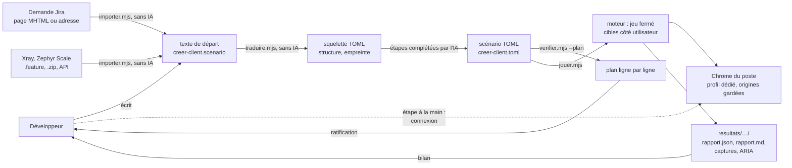

# Scénarios côté utilisateur avec Playwright, version 1.2.0

Ce document est le point d'entrée du skill. Le skill fait les manipulations d'un utilisateur dans le navigateur du poste, Chrome par défaut, à partir d'un scénario : aller sur une page, cliquer, saisir, choisir, cocher, survoler, presser une touche, joindre un fichier, télécharger, attendre, vérifier ce qui s'affiche, capturer l'écran, et rendre la main au développeur quand une étape lui revient, comme une connexion. Le scénario part d'un texte inspiré de Gherkin, que le développeur écrit en français ou en anglais, ou qu'il importe sans IA d'une demande Jira, d'un fichier `.feature`, ou d'un cas de test de Xray ou de Zephyr Scale ; l'IA le traduit en scénario TOML exécutable, le développeur ratifie la traduction, et un contrôle sans IA la garde fidèle au texte. Le moteur, écrit en Node avec `playwright-core`, joue ensuite le scénario sans IA, de façon répétable, et rend un rapport avec ses preuves. Les règles détaillées sont dans `modules/`.

## 1. Ordre de lecture

1. Ce document, en entier.
2. `manifest.json` : modules, versions visées, plateformes.
3. Les modules actifs, dans cet ordre : `execution`, `texte`, `jira`, `cas-de-test`, `scenario`, `cibles`, `actions`, `session`, `garde`, `preuves`, `designer`, `agent`, `recette`.
4. `modules/traduction-auto/SKILL.md`, `modules/demo/SKILL.md`, `modules/remise/SKILL.md`, `modules/accessibilite/SKILL.md` et `modules/enregistrement/SKILL.md` : seulement pour comprendre les points d'extension. Ne pas les appliquer en 1.x.

## 2. Ce que fait le skill

| Outil | Commande, depuis n'importe quel dossier | Rôle | Module |
|---|---|---|---|
| Import de Jira | `node <skill>/scripts/importer.mjs <page.mhtml \| adresse> --adresse <url>` | écrit un texte de départ par scénario Gherkin de la demande, avec sa provenance ; `--comparer` dit ce qui a changé dans Jira depuis l'import | `jira` |
| Import de cas de test | `node <skill>/scripts/importer.mjs <fichier.feature \| export.zip \| xray:CLÉ,… \| zephyr:CLÉ,…> --adresse <url>` | écrit un texte de départ par test, nommé par sa clé : Gherkin recopié, test manuel converti pas à pas ; Xray et Zephyr Scale, Cloud et Data Center, lus par leur API sans rien y écrire | `cas-de-test` |
| Squelette de traduction | `node <skill>/scripts/traduire.mjs <texte.scenario>` | écrit `<texte>.toml` : structure du texte, empreinte, un bloc par étape à compléter | `scenario` |
| Vérification | `node <skill>/scripts/verifier.mjs <fichier>... [--plan]` | contrôle un texte ou un scénario sans navigateur ; `--plan` montre la traduction ligne par ligne, pour la ratification | `texte`, `scenario` |
| Exécution | `node <skill>/scripts/jouer.mjs <scénario.toml> [options]` | joue le scénario dans le navigateur du poste et écrit le rapport | `actions`, `session`, `garde`, `preuves` |
| Désignation | `node <skill>/scripts/designer.mjs <adresse>` | rend la cible de chaque élément que le développeur clique | `designer` |
| Recette | `npm test`, depuis le dossier du skill | 25 scénarios contre une application de démonstration, un Jira, un Xray et un Zephyr Scale factices, locaux | `recette` |
| Agent | `agent/pilote-scenario.md`, commandes `/scenario:importer`, `/scenario:traduire`, `/scenario:jouer`, `/scenario:designer` | importe, traduit, fait ratifier, joue et rend le bilan pour le développeur | `agent` |



## 3. Un scénario, du texte à l'exécution

Le texte de départ, écrit par le développeur (module `texte`) :

```text
# language: fr
@ECR-77-S01 @ECR-77-CA01
Scénario: Créer un client
  Adresse : http://127.0.0.1:4200
  Origines : http://127.0.0.1:4200, http://127.0.0.1:8080
  Paramètre : ville = Lyon

  Étant donné que je me connecte (à la main)
  Quand je clique sur le lien « Nouveau client »
  Et je saisis « <nom> » dans le champ « Nom »
  Et je choisis « <ville> » dans la liste « Ville »
  Et je clique sur le bouton « Enregistrer » (création)
  Alors je vois le message « Client <nom> créé »

  Exemples:
    | nom    |
    | Dupuis |
    | Leroy  |
```

Sa traduction, dont `traduire.mjs` écrit sans IA tout ce qui précède les étapes, et un bloc par étape à compléter (module `scenario`) :

```toml
format = "scenario-playwright.scenario/1"
titre = "Créer un client"
etiquettes = ["ECR-77-S01", "ECR-77-CA01"]
url_base = "http://127.0.0.1:4200"
origines = ["http://127.0.0.1:4200", "http://127.0.0.1:8080"]
source = "creer-client.scenario"
empreinte_source = "…"

[parametres]
ville = "Lyon"

[[jeux]]
nom = "Dupuis"

[[jeux]]
nom = "Leroy"

[[etapes]]
ligne = 8
action = "main"
message = "je me connecte"
jusqua = { url = "/accueil" }

[[etapes]]
ligne = 9
action = "cliquer"
cible = { role = "link", nom = "Nouveau client" }

[[etapes]]
ligne = 10
action = "saisir"
cible = { libelle = "Nom" }
valeur = "${nom}"

[[etapes]]
ligne = 11
action = "choisir"
cible = { libelle = "Ville" }
valeur = "${ville}"

[[etapes]]
ligne = 12
action = "cliquer"
cible = { role = "button", nom = "Enregistrer" }
mutation = "creation"

[[etapes]]
ligne = 13
action = "verifier"
critere = "contient"
cible = { role = "alert" }
attendu = "Client ${nom} créé"
```

Le même texte peut venir de Jira, où le scénario est écrit dans la description ou un champ de texte de la demande (module `jira`) : `importer.mjs` le recopie sans IA dans `ECR-77-S01.scenario`, sous un en-tête de provenance, avec l'adresse donnée par `--adresse`. Il peut aussi venir d'un test de Xray ou de Zephyr Scale, exporté en `.feature` ou lu par l'API (module `cas-de-test`) : le texte se nomme alors par la clé du test, `ECR-80.scenario`, et un test manuel y devient, pas à pas, « Quand <action> » puis « Alors <résultat attendu> ».

Ce que produit une exécution, dans le dossier `resultats/` à côté du scénario (module `preuves`) :

```text
resultats/20261120-141503-creer-client/
  rapport.json                 champs stables (E1) : scénario, navigateur, options, chaque jeu et chaque étape
  rapport.md                   le même rapport, lisible
  captures/j1-06-verifier.png  une capture par vérification, par capture demandée et par échec
  aria/j2-05-cliquer.yml       l'instantané ARIA de la page, à chaque échec
  telechargements/…            les fichiers téléchargés, avec leur empreinte dans le rapport
  trace.zip                    seulement avec --trace
```

## 4. Cycle 7E

| Phase | Ce qu'elle désigne ici | Modules |
|---|---|---|
| Éléments | les étapes du texte, les actions du jeu fermé, les cibles, les variables | `texte`, `scenario`, `actions`, `cibles` |
| Espace | l'application et ses origines, le navigateur du poste, le profil dédié, le dossier de résultats | `session`, `garde`, `preuves` |
| Engendrent | les relations : ligne du texte vers étapes TOML, cible vers élément, étape vers preuve | `scenario`, `cibles`, `preuves` |
| État | la page à chaque étape, la session du profil, le statut de chaque étape et de chaque jeu | `actions`, `session` |
| Expression | le plan de ratification, les messages « À VOUS », le rapport, les captures, le bilan de l'agent | `scenario`, `preuves`, `agent` |
| Évolutif | versions du skill, dimensions réservées D11 à D15, points d'extension E1 à E3, réimport et comparaison, d'une source à l'autre par la clé du test | `traduction-auto`, `demo`, `remise`, `accessibilite`, `enregistrement`, `jira`, `cas-de-test` |
| Environnement | le développeur qui écrit, ratifie et se connecte, l'IA qui traduit, Jira où s'écrivent les scénarios des US, Xray et Zephyr Scale où vivent les cas de test, Chrome et ses versions, les autres skills qui liront les scénarios et les rapports | `agent`, `session`, `jira`, `cas-de-test` |

Clause de second ordre : la traduction n'est pas neutre. Une phrase en français se traduit en actions de plusieurs façons, et l'IA qui la traduit pourrait déplacer le sens. Le skill ne laisse donc à l'IA que ce qu'elle seule sait faire, le sens des phrases : la structure est recopiée sans IA (D3.INV-5), un contrôle sans IA vérifie que chaque ligne du texte est traduite, dans l'ordre, avec ses marques et ses variables (D3.INV-3, D3.INV-4), et rien ne se joue avant la ratification du développeur, à qui le plan est présenté ligne du texte par ligne du texte (D10.INV-1). Une étape qui revient au développeur, comme une connexion, n'est jamais ajoutée par la traduction : elle vient d'une ligne qu'il a marquée « (à la main) ». De même, le moteur ne devine aucune cible : une cible qui désigne plusieurs éléments fait échouer l'étape sans agir (D4.INV-2), et le rapport cite les éléments trouvés, pour que le développeur tranche. L'import de Jira suit la même règle : il recopie ce que Jira dit, sans IA et sans rien réécrire que ce qu'il signale (D16.INV-3) ; un scénario que le format texte n'exprime pas est refusé avec son motif, et se corrige dans Jira ; un texte que le développeur a retouché n'est jamais remplacé sans son accord, ni sans être gardé (D16.INV-5). Un test manuel n'a pas de Gherkin à recopier : sa conversion est mécanique, chaque pas en « Quand » puis « Alors », signalée dès la première ligne du texte, qui se relit avec le développeur avant la traduction (D17.INV-5) ; un test sans étapes, générique ou en texte libre, est refusé plutôt qu'interprété.

## 5. Registre des dimensions

| ID | Dimension | Introduite | Statut 1.2.0 | Dépend de | Module |
|---|---|---|---|---|---|
| D1 | Exécution : installation, dépendance, emplacements, réglages, lignes de commande | 1.0 | active | | `execution`, `recette` |
| D2 | Texte de départ inspiré de Gherkin, en français ou en anglais | 1.0 | active | | `texte`, `recette` |
| D3 | Scénario TOML et contrôle de sa traduction | 1.0 | active | D2 | `scenario`, `recette` |
| D4 | Cibles côté utilisateur | 1.0 | active | D3 | `cibles`, `recette` |
| D5 | Actions et étapes : jeu fermé, attentes, vérifications | 1.0 | active | D3, D4 | `actions`, `recette` |
| D6 | Session et navigateur du poste, étape à la main | 1.0 | active | D1 | `session`, `recette` |
| D7 | Garde : origines, mutations hors du poste, trace | 1.0 | active | D5, D6 | `garde`, `recette` |
| D8 | Preuves et rapport | 1.0 | active | D5 | `preuves`, `recette` |
| D9 | Désignation d'une cible à la souris | 1.0 | active | D4, D6 | `designer`, `recette` |
| D10 | Agent pilote-scenario et commandes de Gemini CLI | 1.0 | active | D3, D7, D8 | `agent` |
| D11 | Traduction sans IA du texte de départ, par un catalogue de phrases | 1.0 | reserved | D2, D3 | `traduction-auto` |
| D12 | Parcours du kit démo de generateur-skill-ticket, captures comparées aux images de l'objectif | 1.0 | reserved | D8 | `demo` |
| D13 | Remise des scénarios et des rapports à Agent2Test | 1.0 | reserved | D3, D8 | `remise` |
| D14 | Audit d'accessibilité des pages parcourues | 1.0 | reserved | D5 | `accessibilite` |
| D15 | Enregistrement des gestes du développeur en scénario | 1.0 | reserved | D3, D9 | `enregistrement` |
| D16 | Scénarios importés d'une demande Jira | 1.1 | active | D2, D6 | `jira`, `recette` |
| D17 | Cas de test de Xray et de Zephyr Scale, fichiers .feature | 1.2 | active | D2, D16 | `cas-de-test`, `recette` |

Statuts : `active` (implémentée et testée), `reserved` (points d'extension posés, fonctionnalité absente), `superseded` (remplacée ; la version de remplacement est indiquée).

## 6. Contrat de version et points d'extension

Le skill suit le contrat de version de `EVOLUTION.md` du dépôt Agent2Prompt. Il n'a ni base ni journal : chaque exécution écrit son rapport, seul état durable, et le profil du navigateur garde la session.

Points d'extension, actifs depuis la version indiquée :

- **E1** (1.0.0) : `rapport.json` (format `scenario-playwright.rapport/1`) a des champs stables, au niveau de l'exécution (`format`, `skill`, `version`, `scenario`, `debut`, `fin`, `duree_ms`, `navigateur`, `options`, `jeux`, `origines_bloquees`, `cibles_fragiles`, `bilan`, `statut`), de chaque jeu (`numero`, `valeurs`, `statut`, `etapes`) et de chaque étape (`numero`, `ligne`, `action`, `resume`, `cible`, `fragile`, `mutation`, `statut`, `duree_ms`, `message`, `capture`, `aria`, `telechargement`, `console`, `erreurs_page`, `reponses`). D12 et D13 s'en serviront sans rejouer le scénario.
- **E2** (1.0.0) : le scénario TOML (format `scenario-playwright.scenario/1`) reprend le vocabulaire du navigateur d'Agent2Test : mêmes actions pour les gestes communs, mêmes critères de vérification, mêmes stratégies de cibles, même règle des origines (`agent2test:D4.INV-2`, `agent2test:D4.INV-4`). D13 remettra un scénario ratifié à Agent2Test sans le réécrire.
- **E3** (1.0.0) : le moteur est une fonction, `jouerScenario(contexte, options)` du module `actions`, qui joue des jeux préparés dans un contexte de navigateur ouvert et rend leurs résultats ; `jouer.mjs` n'en est qu'un appelant. D12 en ajoutera un autre, sans modifier le moteur.

## 7. Règles globales

- **Aucun identifiant** : le skill ne demande, ne lit, ne stocke ni ne saisit aucun identifiant ; une connexion se fait à la main, dans la fenêtre visible, lors d'une étape « (à la main) » (D6.INV-2).
- **Un jeton ne vient que de l'environnement** : le jeton d'une API, Xray ou Zephyr Scale, se lit dans une variable d'environnement que le développeur définit lui-même ; il n'est jamais demandé, affiché, journalisé, écrit, mis dans une adresse ni passé en argument, et ne sort que dans l'en-tête des requêtes vers l'API désignée, en https hors du poste, sans suivre de redirection (D17.INV-3, D10.INV-5).
- **La traduction se ratifie** : rien ne se joue avant que le développeur ait ratifié la traduction, ligne du texte par ligne du texte ; un texte modifié rend sa traduction périmée (D3.INV-2, D10.INV-1).
- **Aucun code dans la page** : le moteur ne joue que les actions du jeu fermé, et aucune n'exécute de code dans la page (D5.INV-1).
- **Rien n'est deviné** : une cible ambiguë fait échouer l'étape, sans agir (D4.INV-2) ; aucune étape n'est rejouée (D5.INV-3).
- **Jira et les outils de test en lecture seule** : le skill n'écrit jamais dans Jira, Xray ni Zephyr Scale ; d'une demande, il ne lit que la description, les champs de texte et, sur demande, les commentaires ; par l'adresse, il n'y fait que naviguer, et le développeur se connecte lui-même ; par une API, il ne fait que des lectures, jamais une mutation (D16.INV-1, D16.INV-2, D17.INV-2).
- **Rien ne sort sans être déclaré** : aucune requête ne part vers une origine que le scénario ne déclare pas (D7.INV-1) ; hors du poste, une modification de données demande l'autorisation explicite du développeur pour l'exécution (D7.INV-2).
- **Les données du développeur restent chez lui** : profils, résultats, captures, téléchargements et pages Jira enregistrées restent sur le poste, dans le dossier du skill ou à côté des scénarios, écartés de Git (D1.INV-2) ; la trace n'est enregistrée que sur demande (D7.INV-3).
- **Une dépendance** : Node 22 ou plus récent et `playwright-core` à version exacte, qui pilote le navigateur du poste sans en télécharger (D1.INV-1).
- **Langue** : messages, documentation, commentaires et identifiants du code en français, sauf l'interface de Playwright.

## 8. Critères d'acceptation

- La recette du module `recette` passe en entier : `npm test`, 25 scénarios et 339 contrôles ; là où l'adresse 127.0.0.2 n'est pas disponible, deux contrôles de R8 sont sautés.
- La recette passe en intégration continue sur `ubuntu-latest` et `windows-latest`, avec Node 22, 24 et 26, après extraction par la commande du module `execution`, § 8, sous bash et sous CMD, puis `npm ci`, avec le Chrome stable des images GitHub.
- Les fichiers tirés des modules ont exactement les empreintes de la table du module `execution`, § 8.
- Les scénarios A1 à A10 du module `agent` sont rejoués avec le développeur avant que l'agent joue un scénario sur une application réelle.
- Un premier scénario réel est écrit, traduit, ratifié et joué avec le développeur ; chaque étape en échec est examinée avec lui.
- Une première demande réelle est importée avec le développeur, depuis sa page enregistrée puis par son adresse ; chaque limite, chaque refus et chaque écart de lecture est examiné avec lui, et signalé s'il tient au skill.
- De premiers tests réels de Xray ou de Zephyr Scale, un test Cucumber ou BDD et un test manuel, sont importés avec le développeur, depuis un export puis par l'API, le jeton défini par lui dans son terminal ; chaque réponse inattendue de l'API, chaque refus et chaque conversion d'un test manuel sont examinés avec lui, et signalés s'ils tiennent au skill.

## 9. Invariants

**D1 : exécution**

- **D1.INV-1** : le skill demande Node 22 ou plus récent et une seule dépendance, `playwright-core` à version exacte, qui pilote le navigateur installé sur le poste sans en télécharger.
- **D1.INV-2** : ce que le skill écrit reste sur le poste : profils dans son dossier (`.profils/`), résultats à côté du scénario (`resultats/`) ou dans le dossier choisi ; son `.gitignore` écarte `node_modules/`, `.profils/` et `resultats/`.
- **D1.INV-3** : chaque réglage se lit dans sa variable `SCENARIO_PLAYWRIGHT_CANAL`, `SCENARIO_PLAYWRIGHT_PROFILS` ou `SCENARIO_PLAYWRIGHT_DELAI`, ou prend son défaut ; une variable vide vaut absente ; une valeur invalide est refusée.
- **D1.INV-4** : `jouer.mjs` sort avec le code 0 quand tout a réussi, 1 quand une étape a échoué, 2 quand le scénario, une option ou l'environnement sont refusés, avant toute action dans le navigateur ; `verifier.mjs` et `traduire.mjs` sortent avec 0 ou 2.

**D2 : texte de départ**

- **D2.INV-1** : un texte décrit un seul scénario : étiquettes facultatives, un titre, une adresse et des réglages, au moins une étape introduite par un mot-clé, et au plus un tableau d'exemples ; toute autre ligne est refusée, et chaque erreur donne sa ligne.
- **D2.INV-2** : chaque étape garde son numéro de ligne, son mot-clé, sa phrase, sa marque `(création)`, `(modification)`, `(suppression)` ou `(à la main)`, et ses variables `<nom>` ; une variable qui n'est ni un paramètre ni une colonne des exemples est refusée.
- **D2.INV-3** : l'empreinte d'un texte est le SHA-256 de son contenu en fins de ligne LF, sans BOM, en caractères composés : une extraction en CRLF donne la même.
- **D2.INV-4** : les mots-clés de Gherkin se lisent en français ou en anglais, sans tenir compte de la casse ni des accents, et chaque mot-clé se garde tel qu'écrit ; `Contexte:` et `Règle:` (`Background:`, `Rule:`) sont refusés dans un texte, avec leur ligne ; les réglages et les marques s'écrivent en français.

**D3 : scénario TOML et traduction**

- **D3.INV-1** : un scénario n'est joué que s'il est valide : format, champs requis, actions du jeu fermé, champs connus de chaque action, valeurs bornées ; chaque erreur cite l'étape, sa ligne du TOML et sa ligne du texte, et le refus a lieu avant d'ouvrir le navigateur.
- **D3.INV-2** : un scénario traduit d'un texte cite le fichier du texte et son empreinte ; il est refusé si le texte manque ou a changé depuis la traduction.
- **D3.INV-3** : la traduction recopie exactement la structure du texte : titre, étiquettes, adresse, origines, profil, paramètres et exemples ; chaque étape cite une ligne d'étape du texte, dans l'ordre du texte, et chaque étape du texte a au moins une étape.
- **D3.INV-4** : une marque de mutation du texte se retrouve sur une étape de sa ligne ; une ligne marquée « (à la main) » donne une seule étape `main`, et une étape `main` vient toujours d'une telle ligne ; chaque variable `<nom>` d'une ligne se retrouve en `${nom}` dans une étape de cette ligne.
- **D3.INV-5** : le squelette d'une traduction est produit sans IA à partir du texte ; ses étapes restent à compléter, et un scénario qui en garde une est refusé.
- **D3.INV-6** : une variable `${nom}` prend la valeur de `--param`, sinon du jeu joué, sinon de `[parametres]` ; une variable non déclarée, ou un `--param` qui ne désigne ni un paramètre ni une colonne des jeux, est refusé.

**D4 : cibles**

- **D4.INV-1** : une cible se désigne par une seule stratégie côté utilisateur : rôle et nom accessible, libellé, texte, placeholder, identifiant de test, texte alternatif ou titre ; un sélecteur CSS et un rang ne servent qu'en dernier recours, et le rapport les signale fragiles.
- **D4.INV-2** : une cible qui désigne plusieurs éléments fait échouer l'étape sans agir, et le message cite les éléments trouvés ; une cible absente fait échouer l'étape à son délai, sans agir.
- **D4.INV-3** : `dans` restreint une cible à l'intérieur d'une autre, sur trois niveaux au plus.

**D5 : actions et étapes**

- **D5.INV-1** : le jeu d'actions est fermé : `naviguer`, `cliquer`, `saisir`, `choisir`, `cocher`, `survoler`, `touche`, `televerser`, `telecharger`, `attendre`, `verifier`, `capturer` et `main` ; aucune étape n'exécute de code dans la page, et les sources du skill n'emploient ni évaluation dans la page, ni script injecté, ni fonction exposée, ni attente d'une durée fixe.
- **D5.INV-2** : une étape attend un état, dans son délai : celui de l'étape, sinon du scénario, sinon du réglage, sinon 10 s ; jamais plus de 30 s, ni plus de 900 s pour une étape `main` ; elle s'arrête dès que l'état est obtenu.
- **D5.INV-3** : aucune étape n'est rejouée ; une étape échouée arrête le jeu et les suivantes sont « non jouées », sauf après une étape `verifier`, dont les étapes `verifier` qui suivent sont jouées.
- **D5.INV-4** : `verifier` compare selon son critère, `contient`, `visible`, `valeur`, `nombre`, `url` ou `actif`, en interrogeant l'état jusqu'à son délai ; un échec donne l'attendu et l'obtenu.
- **D5.INV-5** : `televerser` ne prend que des fichiers du dossier du scénario et de ses sous-dossiers ; `telecharger` enregistre le fichier dans les résultats, avec son empreinte.

**D6 : session et navigateur**

- **D6.INV-1** : le navigateur est celui du poste, Chrome par défaut, Edge ou le Chromium de Playwright sur réglage ; le rapport note sa version, et avertit quand son numéro majeur dépasse celui du Chromium de `playwright-core`, ou reste plus de deux versions en arrière.
- **D6.INV-2** : le skill ne demande, ne lit, ne stocke ni ne saisit aucun identifiant ; une connexion se fait à la main, dans la fenêtre visible, et la session vit dans un profil dédié, réutilisé d'une exécution à l'autre.
- **D6.INV-3** : une étape `main` attend que le développeur atteigne l'état que décrit `jusqua`, dans son délai ; un scénario qui en a une est refusé sans fenêtre (`--sans-tete`), avant d'ouvrir le navigateur.

**D7 : garde**

- **D7.INV-1** : aucune requête ne part vers une origine que le scénario ne déclare pas, WebSocket compris : elle est interrompue avant chargement et comptée dans le rapport ; une navigation de la page vers une telle origine fait échouer l'étape.
- **D7.INV-2** : un scénario qui a une étape de mutation et une origine hors du poste (autre que 127.0.0.1, `localhost` ou `[::1]`) n'est joué qu'avec `--autoriser-mutations` ; sans cette option, il est refusé avant d'ouvrir le navigateur, et une étape de mutation sur une page hors du poste échoue sans agir.
- **D7.INV-3** : la trace n'est enregistrée que sur demande (`--trace`), et le rapport rappelle qu'elle contient les cookies et les en-têtes de la session ; les résultats ne quittent pas le poste.

**D8 : preuves**

- **D8.INV-1** : chaque exécution écrit, dans son dossier de résultats horodaté, `rapport.json`, aux champs stables, et `rapport.md` ; chaque étape y a son statut, sa durée, sa ligne du texte, sa cible et son message.
- **D8.INV-2** : chaque étape `verifier`, chaque étape `capturer` et chaque échec ont leur capture ; un échec a aussi l'instantané ARIA de la page ; les erreurs de console, les erreurs de la page et les réponses de statut 400 ou plus sont relevées étape par étape.

**D9 : désignation**

- **D9.INV-1** : la désignation n'agit pas sur la page : chaque clic du développeur rend la cible de l'élément au format du scénario, par la meilleure stratégie que propose Playwright, ou la signale non convertible.

**D10 : agent**

- **D10.INV-1** : l'agent ne joue un scénario traduit qu'après la ratification explicite du développeur, à qui le plan est présenté ligne du texte par ligne du texte.
- **D10.INV-2** : l'agent ne passe `--autoriser-mutations` qu'avec l'accord explicite du développeur pour cette exécution, et ne demande ni ne saisit aucun identifiant.
- **D10.INV-3** : l'agent ne modifie ni le texte de départ ni un scénario ratifié sans l'accord du développeur ; une correction se propose, puis se ratifie.
- **D10.INV-4** : l'agent ne lit les commentaires d'une demande Jira qu'à la demande du développeur, compare avant de remplacer, ne passe `--remplacer` qu'avec son accord, ne supprime aucun texte dont le scénario a disparu de sa source et ne corrige pas lui-même un scénario refusé.
- **D10.INV-5** : l'agent ne demande, ne lit, n'affiche, n'écrit ni ne passe en argument aucun jeton d'API ; il dit au développeur quelle variable d'environnement définir, sans la définir lui-même ; un jeton collé dans la conversation est signalé, avec la recommandation de le révoquer, et n'est pas utilisé.

**D16 : scénarios importés de Jira**

- **D16.INV-1** : une demande se lit depuis sa page enregistrée en MHTML, jamais modifiée, dont l'empreinte sha256 est notée dans chaque texte importé, ou depuis son adresse, ouverte dans le navigateur du poste, dans une fenêtre visible, sur un profil dédié à Jira : le skill y navigue vers l'adresse donnée et rien d'autre, sans cliquer, saisir ni envoyer de formulaire ; la connexion se fait à la main, dans le délai réglé ; la page est enregistrée en MHTML dans le sous-dossier `jira/` du dossier des textes, puis lue comme une page enregistrée.
- **D16.INV-2** : seules les pages de Jira Cloud et de Jira Data Center, reconnues à leurs marqueurs, sont lues, et seulement leur description, leurs champs de texte et, avec `--commentaires`, leurs commentaires ; scripts, styles et boutons ne sont jamais lus comme du texte ; une autre page est refusée.
- **D16.INV-3** : chaque scénario est recopié sans IA, tel qu'écrit dans Jira, en français ou en anglais : mots-clés, titre, étapes et exemples ; ne s'y ajoutent que les réglages donnés à l'import, le contexte de sa fonctionnalité et de sa règle en tête de ses étapes, et ses colonnes d'exemples adaptées au format texte avec leurs variables, chaque ajout signalé en tête du texte ; un scénario que le format texte n'exprime pas n'est pas écrit, et son refus est motivé.
- **D16.INV-4** : chaque texte importé se nomme `<ÉTIQUETTE>.scenario` et commence par sa provenance : demande, étiquette et zone, source, page enregistrée et son empreinte, date, empreinte Jira du scénario, empreinte du texte importé ; l'étiquette est celle que Jira donne au scénario, sinon celle qu'un import précédent a attribuée au scénario de même titre, sinon le plus petit numéro libre dans l'ordre de la page ; le second scénario d'une même étiquette n'est pas écrit.
- **D16.INV-5** : un texte dont le scénario n'a pas changé dans sa source n'est jamais réécrit ; un texte dont le scénario a changé n'est remplacé qu'avec `--remplacer`, et un texte retouché depuis l'import est d'abord gardé à côté ; un texte qui ne vient pas d'un import de ce scénario, de la demande ou d'une autre source qui lui donne la même étiquette, n'est jamais remplacé ; un texte dont le scénario a disparu de sa source est signalé, jamais supprimé ; `--comparer` n'écrit aucun texte et dit, pour chaque scénario, s'il est identique, modifié, nouveau ou disparu.
- **D16.INV-6** : `importer.mjs` sort avec le code 0 quand chaque scénario est écrit, remplacé ou inchangé (avec `--comparer` : identique), 1 quand un scénario n'est pas écrit, qu'un test est introuvable ou qu'il n'y a aucun scénario (avec `--comparer` : une différence), 2 quand une option, un réglage, la page, le fichier, l'archive, une variable d'environnement, une requête à une API ou le navigateur sont refusés, ou que la demande ne s'affiche pas dans le délai, avant toute écriture de texte.

**D17 : cas de test de Xray et de Zephyr Scale, fichiers .feature**

- **D17.INV-1** : une source se lit sans IA : fichier `.feature` ; archive `.zip`, lue en mémoire sans rien extraire sur le disque, ses seuls fichiers `.feature`, stockés ou compressés par deflate, chacun contrôlé par son CRC-32, en nombre et en taille bornés ; tests de Xray Cloud ou Data Center, cas de test de Zephyr Scale Cloud ou Data Center, désignés par leurs clés, 200 au plus ; chaque scénario Gherkin suit le lecteur et les règles de recopie de D16.INV-3.
- **D17.INV-2** : les API ne sont que lues : des requêtes GET, et pour Xray Cloud l'authentification et des requêtes GraphQL `query`, jamais `mutation` ; le skill n'écrit rien dans Jira, Xray ni Zephyr Scale ; toutes les lectures précèdent toute écriture de texte.
- **D17.INV-3** : un jeton se lit dans sa variable d'environnement seulement, `XRAY_CLIENT_ID` et `XRAY_CLIENT_SECRET`, `ZEPHYR_TOKEN` ou `JIRA_TOKEN` ; il ne sort que dans l'en-tête `Authorization` des requêtes vers l'origine de l'API désignée, l'identifiant et le secret de Xray Cloud dans le corps de son authentification, jamais dans une adresse, un message ou un fichier ; l'adresse de l'API est en https, hors du poste même, sans identifiant, paramètre ni fragment ; aucune redirection n'est suivie ; une variable absente ou une adresse refusée arrêtent l'import avant toute requête.
- **D17.INV-4** : la clé du test est l'identité de son scénario : clé demandée à l'API ; dans un fichier, étiquette `@TestCaseKey=` de Zephyr Scale, sinon première étiquette propre au scénario qui est une clé de Jira, préfixe `TEST_` retiré, sauf si un scénario d'un autre titre la porte aussi, sinon étiquette `<CLÉ>-Snn` ; à défaut, une étiquette `<fichier>-Snn` est reprise par le titre ou attribuée comme en D16.INV-4. Un texte importé d'une autre source sous la même identité est celui du même scénario : il se compare et se remplace selon D16.INV-5, jamais en conflit.
- **D17.INV-5** : un test Cucumber ou BDD est recopié tel qu'écrit, sous un titre formé de son résumé quand ses étapes n'en ont pas ; un test manuel devient, pas à pas, « Quand <action> », avec ses données, puis « Alors <résultat attendu> », une partie de plusieurs lignes jointe par « ; », une partie vide omise, la conversion dite dès la première ligne du texte ; un test générique, en texte libre, qui appelle un autre cas, sans résumé, sans pas ou avec un pas vide est refusé avec son motif ; les préconditions sont signalées en tête du texte, non reprises.
- **D17.INV-6** : un texte importé hors de Jira commence par sa provenance : l'outil ou le fichier dont il vient et ce que l'import en a fait, recopie ou conversion d'un test manuel ; son lot (fichier, archive ou test) ; l'étiquette et la provenance du scénario ; l'adresse de l'API qui l'a rendu, ou le chemin du fichier ou de l'archive et son empreinte sha256 ; la date ; l'empreinte de la source et celle du texte importé ; puis ses notes ; un même test donne le même texte et la même empreinte par Xray Cloud ou Data Center, par Zephyr Scale Cloud ou Data Center.

## 10. Références

Le skill est autonome : il n'inclut aucun autre skill. Il en référence trois, sans les inclure :

- **agent2test** 1.3.1 : son module `navigateur` est le modèle du moteur. Le scénario reprend son jeu d'actions pour les gestes communs, ses critères de vérification et ses stratégies de cibles (E2), et les mêmes règles : origines déclarées (`agent2test:D4.INV-2`), jeu fermé sans code dans la page (`agent2test:D4.INV-4`), attentes par état bornées (`agent2test:D4.INV-5`). Une différence : Agent2Test retente deux fois une vérification et classe le succès au réessai en instabilité (`agent2test:D4.INV-6`) ; ce skill ne rejoue aucune étape (D5.INV-3), car il joue le scénario du développeur, non une campagne.
- **agent-tdd-jira** 1.3.4 : ses scénarios Gherkin portent l'étiquette `@<CLÉ>-Snn` et les critères `@<CLÉ>-CAnn` (`agent-tdd-jira:D2.INV-3`). Un texte de départ reprend ces étiquettes, et sa traduction les recopie (D3.INV-3) : un rapport se rattache ainsi au scénario de l'US et à ses critères. Son module `ingestion-jira` est le modèle du lecteur de pages Jira : même décodage du MHTML, mêmes marqueurs de Jira Cloud et de Jira Data Center, même lecture seule de la page, dont l'empreinte est notée (`agent-tdd-jira:D1.INV-1`) ; l'import garde l'étiquette `@<CLÉ>-Snn` d'un scénario, et n'en attribue une qu'à défaut (D16.INV-4).
- **capture-sprint-jira** 1.2.2 : ses captures sont des pages de demandes enregistrées en MHTML, au format « Page Web, un seul fichier » de Chrome (`capture-sprint-jira:D4.INV-3`) : l'import les lit telles quelles. Comme lui, l'import par l'adresse laisse le développeur se connecter dans une fenêtre visible, sur un profil dédié (`capture-sprint-jira:D2.INV-1`, `capture-sprint-jira:D2.INV-2`) ; il ne fait pas défiler la page, et lit donc des commentaires chargés au défilement sur une capture de capture-sprint-jira plutôt que par l'adresse.

## 11. Filiation

Le skill répond à la demande du développeur du 20 novembre 2026 : un skill Playwright programmable par un scénario, qui fasse les manipulations côté utilisateur. Ses choix, ratifiés par le développeur le même jour :

1. nom `scenario-playwright` ;
2. un format de départ en texte, inspiré de Gherkin, traduit en TOML : le texte appartient au développeur, le TOML est la forme exécutable (D2, D3) ;
3. la traduction est faite par l'IA et ratifiée par le développeur ; une traduction sans IA, par un catalogue de phrases, est réservée (D11) ;
4. la connexion se fait à la main seulement, dans la fenêtre visible, avec un profil dédié : le skill ne voit aucun identifiant (D6.INV-2) ;
5. le navigateur est choisi pour la meilleure compatibilité avec Chrome : celui du poste, piloté par `playwright-core` 1.65.1, dont le Chromium 159 suit le Chrome stable du moment, 158 (ChromeOS 158.0.8127.65 le 18 novembre 2026), et le suivant ; `playwright-core` 1.64.1 corrigeait l'abandon des redirections cross-origin avec préflight par Chromium 155 et suivants dès qu'une route est posée, ce que fait la garde des origines. `playwright-core` 1.65 n'est plus essayé sous Node 20 : le skill demande Node 22 (D1.INV-1, D6.INV-1) ;
6. les étapes qui modifient des données sont refusées hors du poste sans `--autoriser-mutations`, et l'agent demande avant (D7.INV-2, D10.INV-2).

La version 1.1.0 répond à la demande du même jour : récupérer aussi les scénarios depuis une page Jira. Ses choix, ratifiés par le développeur :

1. deux sources, un lecteur : l'adresse de la demande, ouverte dans le navigateur du skill sur un profil dédié à Jira, connexion à la main, puis la page enregistrée en MHTML ; ou une page déjà enregistrée, à la main, par capture-sprint-jira, ou remise à agent-tdd-jira (D16.INV-1) ;
2. seuls la description et les champs de texte se lisent, les commentaires avec `--commentaires` ; chaque scénario garde sa provenance (D16.INV-2, D16.INV-4) ;
3. les mots-clés de Gherkin se lisent en anglais ou en français, dans les textes comme dans Jira (D2.INV-4, D16.INV-3) ;
4. `--comparer` dit ce qui a changé dans Jira depuis l'import ; un réimport ne remplace un texte qu'avec `--remplacer`, et sa traduction devient périmée par l'empreinte (D16.INV-5, D3.INV-2) ;
5. livraison en version 1.1.0, dimension D16 active, recette étendue de pages factices de Jira Cloud et de Jira Data Center, en une seule pull request.

La version 1.2.0 ouvre la feuille de route qui répond à la demande du développeur du 20 novembre 2026 : qu'à partir d'un scénario, et de l'accès au code du front et du back et au navigateur, toute l'action d'un testeur humain soit émulée pour réaliser des tests automatisés, quel que soit l'outil, Playwright, Xray, Zephyr ou un autre. Feuille de route ratifiée : étendre ce skill par versions mineures ; sources Xray et Zephyr d'abord ; ensuite un index sans IA du code du front et du back, lu par l'IA à la traduction, des vérifications hors de l'écran par le réseau et l'API en lecture, puis la préparation des données par l'API sous la garde des mutations ; enfin l'export du scénario ratifié en test Playwright du projet et ses résultats au format d'import de Xray ou de Zephyr, sans écrire dans Jira ; une version par étape, chacune en une pull request. Choix de la 1.2.0, ratifiés le même jour :

1. les tests se lisent de leurs fichiers exportés, `.feature` et `.zip`, et des API REST de Xray et de Zephyr Scale, en lecture seule ; le jeton passe par une variable d'environnement seulement, et rien n'est écrit dans Jira (D17.INV-1 à D17.INV-3) ;
2. un test manuel devient, pas à pas, « Quand <action> », avec ses données, puis « Alors <résultat attendu> », sans IA, et l'en-tête le signale (D17.INV-5).

## 12. Journal de révision

**1.2.0** (2026-11-21) : cas de test de Xray et de Zephyr Scale, et fichiers .feature. Dimension D17 active, module `cas-de-test` : `scripts/cas.mjs` ; `importer.mjs` lit aussi un fichier `.feature`, une archive `.zip` d'un export, lue en mémoire, et les tests de Xray Cloud et Data Center et de Zephyr Scale Cloud et Data Center par leur API, en lecture seule, le jeton pris dans une variable d'environnement, en https, sans redirection suivie ; test Cucumber ou BDD recopié, test manuel converti pas à pas en « Quand » puis « Alors », test générique ou en texte libre refusé, préconditions signalées ; la clé du test pour identité, d'un chemin d'import à l'autre ; provenance par lot (D17.INV-1 à D17.INV-6). D16.INV-5 et D16.INV-6 étendus aux nouvelles sources ; agent : protocole d'import des cas de test, D10.INV-5, scénarios A9 et A10, commande `/scenario:importer`. Recette de 25 scénarios (339 contrôles), avec un Xray et un Zephyr Scale factices : R22 à R25 ; 42 défauts réintroduits, tous rejoués. Archive : `archives/SKILL-v1.1.1.md`.

**1.1.1** (2026-11-20) : correctif. La recette passait par intermittence dans la CI, toujours sous Node 24 : un premier lancement du navigateur lent dépassait les délais courts de R5, R6, R8 et R11, ou ceux des preuves d'un échec, et une fois sous Windows la recette s'est bloquée jusqu'au délai du job. Les preuves d'un échec, capture et instantané ARIA, attendent 10 s au plus, au lieu de 5 et 3 ; la durée d'une étape en échec s'arrête à l'échec, sans le temps de ses preuves. Dans la recette, les délais courts ne portent plus que sur les étapes dont ils sont l'objet, et R5 prend le délai par défaut, 10 s ; la recette dit son dossier temporaire dès le début, ferme ses propres navigateurs sans les attendre plus de 15 s, lit la sortie d'un script 2 s au plus après sa fin, et s'arrête d'elle-même au bout de dix minutes en disant dans quel scénario. Le workflow affiche la sortie au fil de l'eau, arrête une recette bloquée au bout de douze minutes et garde en artefact le dossier temporaire d'une recette en échec, sans les profils du navigateur. Aucune dimension ni aucun invariant modifié ; recette de 21 scénarios (279 contrôles), 29 défauts réintroduits, tous rejoués. Archive : `archives/SKILL-v1.1.0.md`.

**1.1.0** (2026-11-20) : scénarios importés d'une demande Jira. Dimension D16 active, module `jira` : `scripts/jira.mjs` et `scripts/importer.mjs`, page enregistrée en MHTML ou adresse de la demande, Jira Cloud et Jira Data Center, description et champs de texte, commentaires sur demande, scénarios recopiés sans IA avec leur provenance, étiquettes gardées, reprises ou attribuées, réimport, `--comparer` et `--remplacer`, textes retouchés gardés (D16.INV-1 à D16.INV-6). Mots-clés de Gherkin en anglais ou en français dans les textes (D2.INV-4) ; agent : protocole d'import, D10.INV-4, scénarios A7 et A8, commande `/scenario:importer`. Recette de 21 scénarios (279 contrôles), avec un Jira factice : R1 étendu, R18 à R21 ; 29 défauts réintroduits. Références : capture-sprint-jira 1.2.2 ajouté. Archive : `archives/SKILL-v1.0.0.md`.

**1.0.0** (2026-11-20) : première version. Dimensions D1 à D10 actives, D11 à D15 réservées. Points d'extension E1 à E3. Texte de départ inspiré de Gherkin, scénario TOML, squelette et contrôle de la traduction sans IA, cibles côté utilisateur, jeu de treize actions, garde des origines et des mutations, étape à la main, profil dédié, rapport et preuves, désignation à la souris, agent `pilote-scenario` et commandes `/scenario:traduire`, `/scenario:jouer` et `/scenario:designer`, écrits en entier dans les modules ; recette de 17 scénarios (213 contrôles) contre une application de démonstration locale ; 20 défauts réintroduits.
