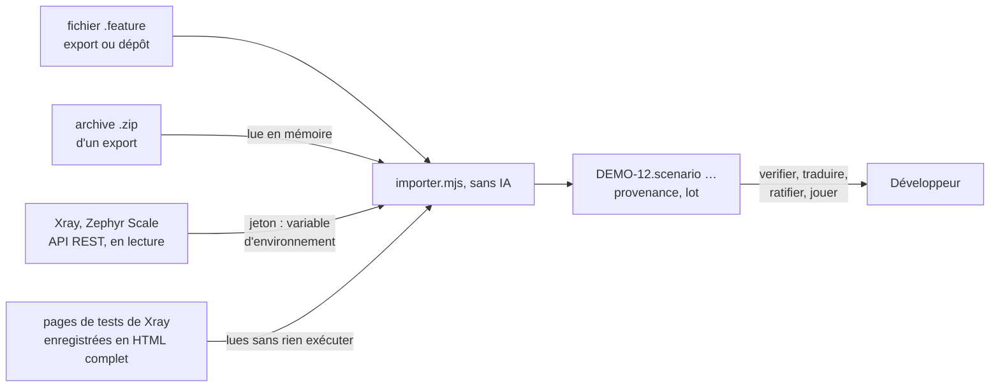

# Module `cas-de-test` (D17)

Phases 7E couvertes : Environnement et Éléments.

## 1. Principe

Un testeur part du cas de test. Dans Xray et dans Zephyr Scale, un test a une clé, un résumé, des étiquettes et des étapes : écrites en Gherkin pour un test Cucumber (Xray) ou BDD (Zephyr Scale), en pas « action, données, résultat attendu » pour un test manuel. `importer.mjs` en fait des textes de départ, sans IA, comme d'une demande Jira (module `jira`) : le développeur les vérifie, les fait traduire, ratifie et joue. Le texte reste la référence de sa traduction (D3.INV-2) ; l'outil de test reste la référence du texte importé. Sur un poste sans jeton d'API, d'où rien ne sort, les tests de Xray se lisent depuis leurs pages, que le développeur enregistre lui-même dans Chrome (§ 7).



Le skill n'écrit jamais dans Jira, Xray ni Zephyr Scale (D17.INV-2).

## 2. Sources (D17.INV-1)

| Source | Exemple | Ce qui est lu |
|---|---|---|
| fichier `.feature` | `importer.mjs features/clients.feature --adresse http://127.0.0.1:4200` | ses scénarios, par le lecteur de Gherkin du module `jira` (§ 4) |
| archive `.zip` | `importer.mjs FeatureBundle.zip --adresse …` | ses fichiers `.feature`, lus en mémoire, sans rien extraire sur le disque ; les autres fichiers sont signalés en limite |
| Xray Cloud | `importer.mjs xray:DEMO-12,DEMO-13 --adresse …` | chaque test, par l'API GraphQL de Xray Cloud |
| Xray Data Center | `importer.mjs xray-dc:DEMO-12 --api https://jira.exemple.fr --adresse …` | la demande par l'API de Jira (résumé, étiquettes), le test par l'API de Xray |
| Zephyr Scale Cloud | `importer.mjs zephyr:DEMO-T1 --adresse …` | le cas de test et son script, par l'API v2 |
| Zephyr Scale Data Center | `importer.mjs zephyr-dc:DEMO-T1 --api https://jira.exemple.fr --adresse …` | le cas de test et son script, par l'API de Zephyr Scale (`atm/1.0`) |
| page de test de Xray | `importer.mjs "pages/[DEMO-21] Créer un client - Jira.html" --adresse …` | la page enregistrée par Chrome en HTML complet, et ses cadres, dans le dossier de ses ressources (§ 7) ; ni API ni jeton |
| dossier de pages | `importer.mjs pages --adresse …` | chaque page `.html` ou `.htm` du dossier, un test par page (§ 7) |

- **Fichier** : en UTF-8 ; BOM, fins de ligne CRLF et tabulations sont ramenés ; `# language:` et les autres commentaires sont ignorés.
- **Archive** : méthodes « stockée » et « deflate » ; chaque fichier contrôlé par son CRC-32, une archive abîmée est refusée ; 5 000 fichiers, 5 Mo par fichier `.feature` et 50 Mo de fichiers `.feature` en tout au plus ; un fichier chiffré ou trop gros est signalé et non lu ; une archive ZIP64 est refusée ; les fichiers `__MACOSX/` sont ignorés.
- **Clés** : forme `ABC-123` pour Xray, `ABC-T123` pour Zephyr Scale, séparées par des virgules, sans doublon, 200 au plus par import.

## 3. API, en lecture seule (D17.INV-2)

| Outil | Adresse de l'API | Requêtes |
|---|---|---|
| Xray Cloud | `https://xray.cloud.getxray.app` ; `--api` pour une région, par exemple `https://eu.xray.cloud.getxray.app` | `POST /api/v2/authenticate`, avec l'identifiant et le secret du client, qui rend un jeton de session ; puis, par test, `POST /api/v2/graphql` : `getTests(jql: "key = \"<CLÉ>\"", limit: 1)`, une lecture (`query`), jamais une mutation |
| Xray Data Center | aucune par défaut : `--api <adresse de Jira>` | `GET /rest/api/2/issue/<CLÉ>?fields=summary,labels`, puis `GET /rest/raven/1.0/api/test?keys=<CLÉ>` |
| Zephyr Scale Cloud | `https://api.zephyrscale.smartbear.com/v2` ; `--api` pour une région, par exemple `https://eu.api.zephyrscale.smartbear.com/v2` | `GET /testcases/<CLÉ>`, puis le script par le lien qu'il donne : `…/teststeps`, page après page, ou `…/testscript` |
| Zephyr Scale Data Center | aucune par défaut : `--api <adresse de Jira>` | `GET /rest/atm/1.0/testcase/<CLÉ>` |

Toutes les lectures précèdent toute écriture : une requête qui échoue arrête l'import, avec le code 2, sans rien écrire, même après des lectures réussies. Un test absent, ou que le jeton ne permet pas de lire, est `introuvable` : non écrit, code 1, avec la réponse de l'API quand elle en donne une. Chaque requête attend 30 s au plus.

## 4. Jetons (D17.INV-3)

| Outil | Variables d'environnement |
|---|---|
| Xray Cloud | `XRAY_CLIENT_ID` et `XRAY_CLIENT_SECRET`, d'une clé d'API de Xray |
| Zephyr Scale Cloud | `ZEPHYR_TOKEN`, jeton d'API de Zephyr Scale |
| Xray Data Center, Zephyr Scale Data Center | `JIRA_TOKEN`, jeton d'accès personnel de Jira |

- Le développeur définit la variable lui-même, dans son terminal, pour sa session : sous bash, `read -rs ZEPHYR_TOKEN && export ZEPHYR_TOKEN`, la saisie restant masquée ; sous PowerShell 7, `$env:ZEPHYR_TOKEN = Read-Host -MaskInput 'Jeton'` ; jamais dans la commande d'import, ni dans un fichier du dépôt. Une variable absente arrête l'import avant toute requête, en la nommant.
- Le jeton ne passe ni en argument, ni dans une adresse, ni dans un message, ni dans un fichier : il ne sort que dans l'en-tête `Authorization: Bearer` des requêtes vers l'origine de l'API ; l'identifiant et le secret de Xray Cloud, dans le corps de la seule requête d'authentification.
- `--api` est en https, sauf sur le poste même (127.0.0.1, `localhost`, `[::1]`) ; une adresse avec identifiant, paramètre ou fragment est refusée, sans que le message la reprenne.
- Aucune redirection n'est suivie : une réponse 3xx arrête l'import avant que le jeton ne parte ailleurs ; aucune requête ne va vers une autre origine que celle de l'API, même par un lien qu'elle rend.
- Une réponse 401 ou 403 dit « accès refusé : jeton absent, expiré ou sans droit de lecture ».

## 5. Identité : la clé du test (D17.INV-4)

| Source | Identité du scénario |
|---|---|
| API | la clé demandée |
| fichier, archive | l'étiquette `@TestCaseKey=<CLÉ>` de Zephyr Scale ; sinon la première étiquette propre au scénario qui est une clé de Jira, `@DEMO-12` ou `@TEST_DEMO-12`, celle du test dans un export de Xray, sauf si un scénario d'un autre titre la porte aussi : c'est alors la clé d'une demande ; sinon une étiquette `@<CLÉ>-Snn` d'un import de Jira ; à défaut, l'étiquette `<fichier>-Snn`, du nom du fichier ou de l'archive, reprise par le titre ou attribuée comme pour Jira (module `jira`, § 5) |

L'identité nomme le texte, `<CLÉ>.scenario`. Le même test, lu d'un autre chemin d'import — un export, puis l'API ; Xray Cloud, puis Data Center — retrouve son texte importé : `identique`, ou `modifié`, remplacé avec `--remplacer`, jamais en `conflit`. Un texte écrit à la main du même nom n'est jamais remplacé. Un test présent dans deux fichiers d'une archive (Xray exporte un test dans le fichier de chacune de ses exigences) est un `doublon` la seconde fois.

Chaque texte importé appartient à un lot : sa demande pour Jira ; ici le fichier (`fichier <chemin>`) ou l'archive (`archive <chemin>`), chemin relatif au dossier des textes, ou le test (`xray <CLÉ>`, `zephyr <CLÉ>`). Les textes d'un lot servent au réimport : numéros attribués, reprises par le titre, textes `disparu`.

## 6. Tests convertis (D17.INV-5)

| Test | Texte importé |
|---|---|
| Cucumber (Xray), BDD (Zephyr Scale) | ses étapes, recopiées par le lecteur de Gherkin (module `jira`, § 4), sous un titre formé de son résumé quand elles n'en ont pas : `Scénario:`, ou `Plan du scénario:` avec un tableau d'exemples ; `Scenario:` et `Scenario Outline:` quand ses mots-clés sont anglais ; étiquettes : la clé, puis les étiquettes de Jira |
| manuel (Xray), pas à pas (Zephyr Scale) | chaque pas devient `Quand <action>`, avec ses données, `, avec « <données> »`, puis `Alors <résultat attendu>` ; une partie de plusieurs lignes tient sur une, ses lignes séparées par « ; » ; le HTML de Zephyr Scale est ramené au texte ; une partie vide est omise ; l'en-tête le dit dès sa première ligne |
| Generic (Xray), texte libre (Zephyr Scale) | refusé : pas d'étapes à recopier ; le test s'écrit en Cucumber, BDD ou pas à pas dans l'outil |
| pas qui appelle un autre cas (Zephyr Scale) | refusé : l'import ne le déplie pas |
| pas vide, sans action, données ni résultat attendu (dans Xray, l'appel d'un autre test) | refusé : rien n'est deviné |
| sans résumé, manuel sans pas | refusé |

La phrase d'un pas reste telle qu'écrite : « Quand » et « Alors » ne disent pas la langue du test. Un test manuel converti se relit avec le développeur avant sa traduction (module `agent`). Les préconditions sont signalées en tête du texte, non reprises : celles de Xray par leurs clés, celle de Zephyr Scale par son texte ; elles se jouent avant le scénario, ou le développeur les reporte dans le texte. Un export `.feature` de Xray, lui, reprend les préconditions Cucumber en `Background`, reporté en tête des étapes (module `jira`, § 4).

## 7. Pages de tests de Xray enregistrées (D17.INV-7)

Sur un poste sans jeton d'API, d'où rien ne doit sortir, un test de Xray se lit depuis sa page : le développeur l'ouvre dans Chrome, connecté lui-même, puis l'enregistre, « Enregistrer sous », type « Page Web, complète ». Chrome écrit un fichier `.html` et, à côté, le dossier de ses ressources, `<nom>_files`, où il range aussi les cadres de la page : Xray Cloud affiche les pas d'un test dans un cadre, Xray Data Center dans la page même. Le skill n'ouvre aucune page de Xray : il lit les fichiers enregistrés.

```text
node <skill>/scripts/importer.mjs "pages/[DEMO-21] Créer un client - Jira.html" --adresse http://127.0.0.1:4200
node <skill>/scripts/importer.mjs pages --adresse http://127.0.0.1:4200
node <skill>/scripts/importer.mjs pages --diagnostic
```

- **Une page ou un dossier** : un dossier donne ses fichiers `.html` et `.htm`, dans l'ordre de leur nom, 200 au plus ; les dossiers de ressources ne sont pas parcourus. Chaque page donne un test ; une seconde page du même test est refusée (« une page par test »). Une demande Jira, elle, s'enregistre en MHTML (module `jira`).
- **Lue sans rien exécuter** : la page et ses cadres se lisent comme du texte, en UTF-8, ou en Windows-1252 quand la page le déclare ; aucun script n'est exécuté, aucune adresse n'est suivie. Le texte des scripts, des styles, des menus de choix, des boutons, des dessins, de l'en-tête et des éléments masqués (`hidden`, `display: none`, `visibility: hidden`) n'est pas lu.
- **Cadres** : un cadre n'est lu que s'il est un fichier `.html` du dossier de la page ou de ses sous-dossiers, sans lien symbolique, sur deux niveaux au plus ; un cadre à une adresse distante, hors du dossier, absent ou trop gros n'est pas lu, et une `LIMITE` le compte. Bornes : 20 Mio par page ou par cadre, 20 cadres, 60 Mio pour une page et ses cadres.
- **Clé et résumé** : du titre de la page, `[DEMO-21] Créer un client - Jira`, le nom du site retiré ; sans clé dans le titre, la clé de l'adresse que Chrome note en tête de la page (`saved from url`), et le résumé du titre. Une page sans clé est refusée. La variante, Cloud ou Data Center, se reconnaît aux marqueurs de la page et de ses cadres ; elle n'est qu'indiquée.
- **Pas** : reconnus à leurs libellés visibles, en français ou en anglais, sans tenir compte de la casse, des accents, ni des deux-points : Action (`Action`, `Step`, `Étape`, `Pas`…), Données (`Data`, `Test Data`, `Données`…), Résultat attendu (`Expected Result`, `Résultat attendu`…). En tableau, une colonne par libellé, une ligne par pas, l'en-tête répété écarté. En mode formulaire, chaque libellé Action ouvre un pas, et chaque libellé prend les textes qui le suivent, jusqu'au libellé suivant ; un numéro de pas (`Étape 2`, ou `2` juste avant un libellé Action) ou le libellé d'un autre champ (`Statut`, `Commentaire`, `Preuves`, `Anomalies`, `Préconditions`…) termine la valeur sans y entrer. Le tableau l'emporte sur le formulaire ; des pas affichés deux fois ne se gardent qu'une fois ; des pas dans plusieurs documents de la page : ceux du document qui en a le plus, chaque fois signalé par une `LIMITE`.
- **Test Cucumber** : une page sans pas, dont un seul document porte un scénario Gherkin, donne ce scénario, recopié par le lecteur de Gherkin (module `jira`, § 4).
- **Rien de reconnu** : la page est refusée, avec son motif, et `--diagnostic` décrit sa structure.

Le test lu suit les règles des tests lus par l'API : conversion d'un test manuel (§ 6), identité par la clé et lot `xray <CLÉ>` (§ 5), préconditions affichées signalées en tête du texte. Le même test, lu par l'API puis par sa page enregistrée, donne le même texte et la même empreinte ; seule la ligne « Source » diffère : `page enregistrée <chemin> (sha256 …)`. Sortie, par page :

```text
Page DEMO-22.html : DEMO-22 (Xray Data Center), 2 pas, mode tableau
Page [DEMO-21] Créer un client - Jira.html : DEMO-21 (Xray Cloud), 2 pas, mode formulaire, dans le cadre 1
LIMITE [DEMO-21] Créer un client - Jira.html : 1 cadre non lu : adresse distante, hors du dossier de la page, absent ou trop gros
```

`--diagnostic` lit les pages et décrit leur structure, sans aucune de leurs valeurs : ni texte, ni clé, ni adresse, ni nom de fichier. Sa sortie peut donc se redire telle quelle, pour signaler une page que le skill ne lit pas, sans rien transmettre du contenu du poste. Rien n'est écrit ; code 0, ou 2 si aucune page n'est lisible ; il ne se combine ni avec `--comparer` ni avec `--remplacer`, et ne vaut que pour des pages.

```text
Diagnostic de 2 pages, sans aucune de leurs valeurs : il peut se redire tel quel.
page 2 : titre présent, clé reconnue, résumé présent, adresse d'enregistrement présente ; variante Cloud ; extension .html
  cadres : 1 lu, 1 non lu (adresse distante, hors du dossier, absent ou trop gros)
  document principal : 2 nœuds de texte, 0 tableau
    libellé fin de valeur « preconditions » dans html > body > p : 1
    reconnu : aucun pas ; scénarios Gherkin : 0
  cadre 1 : 15 nœuds de texte, 0 tableau
    libellé « Action » dans div.steps-form > div.step > label.lbl : 2
    libellé « Données » dans div.steps-form > div.step > label.lbl : 2
    libellé « Résultat attendu » dans div.steps-form > div.step > label.lbl : 2
    libellé fin de valeur « statut » dans div.steps-form > div.step > label : 2
    reconnu : 2 pas, mode formulaire ; champs remplis : action 2, données 1, résultat attendu 2 ; scénarios Gherkin : 0
```

Un élément s'y décrit par sa balise, deux de ses classes et son `data-testid`, s'ils ont une forme simple ; un libellé, par sa forme parmi les libellés connus du skill.

## 8. Le texte importé (D17.INV-6)

```text
# Importé de Xray par importer.mjs (scenario-playwright 1.6.0), sans IA : chaque pas du test manuel devient « Quand <action> », avec ses données, puis « Alors <résultat attendu> ».
# Lot : xray DEMO-13
# Scénario : @DEMO-13, test manuel DEMO-13
# Source : https://xray.cloud.getxray.app/api/v2/graphql, test DEMO-13
# Importé le : 2026-11-21T09:30:00Z
# Empreinte de la source : 5d2502…
# Empreinte du texte importé : 2ec024…
# Préconditions dans Xray, non reprises : DEMO-11 ; à jouer avant le scénario, ou à reporter dans le texte.

@DEMO-13
Scénario: Exporter les clients
  Adresse : http://127.0.0.1:4200

  Quand Ouvrir la page « Export »
  Alors La page « Export » s'affiche
  Quand Cliquer sur le lien « Exporter en CSV », avec « format CSV ; séparateur ; »
  Alors Le fichier « clients.csv » est téléchargé
```

- **Première ligne** : la source (`de Xray`, `de Zephyr Scale`, `d'un fichier .feature`, `d'une archive .zip`) et ce que l'import en fait : recopie telle qu'écrite, ou conversion d'un test manuel.
- **Lot**, puis **Scénario** : l'étiquette, et la provenance : le test et sa sorte (`test Cucumber DEMO-12`, `cas de test pas à pas DEMO-T2`), ou le fichier `.feature`, dans l'archive s'il y a lieu.
- **Source** : l'adresse de l'API qui a rendu le test, ou le chemin du fichier, de l'archive ou de la page enregistrée, relatif au dossier des textes, et son empreinte sha256.
- **Empreinte de la source** : comme l'empreinte Jira, le SHA-256 de ce que la source dit du scénario, fonctionnalité, étiquettes, titre, étapes, exemples ; un même test donne la même empreinte, et le même texte, par Xray Cloud ou Data Center, par sa page enregistrée, par Zephyr Scale Cloud ou Data Center.
- **Notes** : préconditions, étiquette attribuée, contexte reporté, colonnes d'exemples adaptées.

## 9. Sortie et codes

Sortie : `Fichier <nom> : n scénarios`, `Archive <nom> : n fichiers .feature, n scénarios (par fichier)`, `<Outil> <variante> (<adresse de l'API>) : n tests demandés, n lus (par sorte)`, ou une ligne `Page <nom> : …` par page ; les `LIMITE …` ; une ligne par scénario ; une ligne `introuvable` par test absent, `refusé` par page refusée ; `Bilan : …`. Les états, le réimport et les codes sont ceux du module `jira`, § 6 et § 7 : `introuvable` et une page refusée comptent comme un scénario non écrit, code 1 ; une archive abîmée, une page absente, un dossier sans page, une variable absente, une adresse d'API refusée, une redirection, un accès refusé ou une API injoignable arrêtent l'import avant toute écriture, code 2.

## 10. Contrôle de sortie

- Un fichier `.feature` et une archive d'export se lisent ; une archive abîmée est refusée (D17.INV-1).
- Seules des lectures partent vers les API ; aucune mutation ; rien n'est écrit dans Jira, Xray ni Zephyr Scale (D17.INV-2).
- Un jeton ne se lit que dans sa variable d'environnement ; il n'apparaît ni dans une adresse, ni dans une sortie, ni dans un texte ; aucune redirection n'est suivie ; une adresse en http hors du poste est refusée (D17.INV-3).
- Chaque texte se nomme par la clé de son test ; le même test, d'un autre chemin d'import, retrouve son texte (D17.INV-4).
- Un test manuel donne, pas à pas, « Quand » puis « Alors », et un texte que `verifier.mjs` accepte ; un test sans étapes est refusé avec son motif (D17.INV-5).
- Chaque texte porte sa provenance et son lot (D17.INV-6).
- Une page de test de Xray enregistrée en HTML complet, et ses cadres du dossier de la page, se lisent sans rien exécuter ni suivre d'adresse ; ses pas se reconnaissent en mode formulaire et en tableau, et donnent le texte que donne l'API ; `--diagnostic` ne dit aucune valeur de la page (D17.INV-7).

## 11. Source `scripts/cas.mjs`

Désignation de la source, lecteur d'archive, lignes d'un fichier, identité des scénarios, requêtes aux API en lecture seule, lecteurs de Xray et de Zephyr Scale, conversion des tests en scénarios.

<!-- fichier : scripts/cas.mjs -->
```javascript
// scenario-playwright 1.6.0 : cas de test de Xray et de Zephyr Scale, et fichiers .feature, lus sans IA.
//
// Sources (D17.INV-1) : fichier .feature, exporté de Xray ou de Zephyr Scale ou pris dans le dépôt ; archive
// .zip d'un export ; API REST de Xray (Cloud, Data Center) et de Zephyr Scale (Cloud, Data Center), en
// lecture seule : des GET, et pour Xray Cloud l'authentification et des requêtes GraphQL « query », jamais
// « mutation » (D17.INV-2). Un jeton ne vient que d'une variable d'environnement et ne sort que dans
// l'en-tête d'une requête vers l'API désignée, en https hors du poste, sans suivre de redirection
// (D17.INV-3). La clé d'un test est l'identité de son scénario (D17.INV-4). Un test Cucumber ou BDD est
// recopié tel qu'écrit ; un test manuel devient, pas à pas, « Quand <action> » puis « Alors <résultat
// attendu> » ; un test générique ou en texte libre est refusé avec son motif (D17.INV-5).
import { Buffer } from 'node:buffer';
import { URL } from 'node:url';
import { crc32, inflateRawSync } from 'node:zlib';
import { empreinteJira, extraireScenarios, htmlEnLignes } from './jira.mjs';
import { lireMotCle, lireTitre, normaliser, plat } from './texte.mjs';

const { fetch, AbortSignal } = globalThis;

export class ErreurCas extends Error {}

/** Texte sur une seule ligne, en NFC : caractères de contrôle et blancs regroupés en une espace. */
export const uneLigne = (s) => String(s ?? '').normalize('NFC').replace(/[\p{Cc}\s]+/gu, ' ').trim();
/** Texte de plusieurs lignes ramené à une seule : ses lignes non vides, séparées par « ; ». */
export const lignesJointes = (lignes) => lignes.map(uneLigne).filter(Boolean).join(' ; ');
const court = (s, n = 200) => (s.length > n ? `${s.slice(0, n - 1)}…` : s);

// --- Désignation de la source --------------------------------------------------------------------

const RE_CLE = /^[A-Z][A-Z0-9_]+-\d+$/;
const RE_CLE_ZEPHYR = /^[A-Z][A-Z0-9_]+-T\d+$/;
export const MAX_TESTS = 200;

/**
 * Outils lus par leur API : nom, variante, variables d'environnement des jetons, adresse par défaut de
 * l'API (Cloud), forme des clés, nom des lots de textes importés.
 */
export const OUTILS = {
  xray: { nom: 'Xray', variante: 'Cloud', variables: ['XRAY_CLIENT_ID', 'XRAY_CLIENT_SECRET'], base: 'https://xray.cloud.getxray.app', cle: RE_CLE, forme: 'ABC-123', lot: 'xray', test: 'test', tests: 'tests' },
  'xray-dc': { nom: 'Xray', variante: 'Data Center', variables: ['JIRA_TOKEN'], base: null, cle: RE_CLE, forme: 'ABC-123', lot: 'xray', test: 'test', tests: 'tests' },
  zephyr: { nom: 'Zephyr Scale', variante: 'Cloud', variables: ['ZEPHYR_TOKEN'], base: 'https://api.zephyrscale.smartbear.com/v2', cle: RE_CLE_ZEPHYR, forme: 'ABC-T123', lot: 'zephyr', test: 'cas de test', tests: 'cas de test' },
  'zephyr-dc': { nom: 'Zephyr Scale', variante: 'Data Center', variables: ['JIRA_TOKEN'], base: null, cle: RE_CLE_ZEPHYR, forme: 'ABC-T123', lot: 'zephyr', test: 'cas de test', tests: 'cas de test' },
  // Pages de tests de Xray enregistrées en HTML complet (D17.INV-7) : ni API ni jeton ; même lot que l'API.
  page: { nom: 'Xray', variante: 'page enregistrée', variables: [], base: null, cle: RE_CLE, forme: 'ABC-123', lot: 'xray', test: 'test', tests: 'tests' },
};

/**
 * Genre de la source donnée à importer.mjs (D17.INV-1) : api (outil:CLÉ,CLÉ…), feature, zip, page (page de
 * test de Xray enregistrée en HTML complet), ou jira (adresse d'une demande, ou page enregistrée en MHTML).
 * Un dossier de pages est reconnu par importer.mjs. Rend { genre, outil, cles, adresse } ou { erreur }.
 */
export function lireSource(source) {
  const m = /^(xray|xray-dc|zephyr|zephyr-dc):(.*)$/s.exec(source);
  if (m) {
    const outil = OUTILS[m[1]];
    const cles = [...new Set(m[2].split(',').map((x) => x.trim()).filter(Boolean))];
    if (cles.length === 0) return { erreur: `${m[1]}: attend les clés des tests, séparées par des virgules (forme ${outil.forme})` };
    const invalides = cles.filter((c) => !outil.cle.test(c));
    if (invalides.length) return { erreur: `clé de test invalide pour ${m[1]}: ${invalides.map((c) => `« ${court(c, 24)} »`).join(', ')} (forme ${outil.forme})` };
    if (cles.length > MAX_TESTS) return { erreur: `${cles.length} tests demandés : ${MAX_TESTS} au plus par import` };
    return { genre: 'api', outil: m[1], cles };
  }
  if (/^https?:\/\//i.test(source)) return { genre: 'jira', adresse: true };
  if (/\.feature$/i.test(source)) return { genre: 'feature' };
  if (/\.zip$/i.test(source)) return { genre: 'zip' };
  if (/\.html?$/i.test(source)) return { genre: 'page' };
  return { genre: 'jira', adresse: false };
}

// --- Fichiers .feature et archives .zip ----------------------------------------------------------

/** Lignes d'un texte Gherkin : sans BOM, en NFC, tabulations en espaces, blancs de bord retirés. */
export function lignesDe(texte) {
  return normaliser(String(texte ?? '')).split('\n').map((l) => l.replace(/\t/g, ' ').trim());
}

/** Préfixe des étiquettes attribuées aux scénarios d'un fichier : son nom sans extension, en lettres, chiffres, - et _. */
export function prefixeDe(chemin) {
  const nom = String(chemin).split(/[\\/]/).pop().replace(/\.[^.]*$/, '');
  return nom.normalize('NFD').replace(/\p{M}/gu, '').replace(/[^A-Za-z0-9_-]+/g, '-').replace(/^-+|-+$/g, '') || 'scenarios';
}

export const LIMITES_ZIP = { entrees: 5000, fichier: 5 * 1024 * 1024, total: 50 * 1024 * 1024 };

/**
 * Fichiers .feature d'une archive .zip, lus en mémoire, sans rien écrire sur le disque :
 * { entrees: [{ nom, octets }], ignorees: [noms], refusees: [{ nom, motif }] }. Méthodes « stockée » et
 * « deflate » ; contenu contrôlé par son CRC-32 ; tailles bornées. Lève ErreurCas pour une archive illisible.
 */
export function lireZip(octets, limites = LIMITES_ZIP) {
  const b = Buffer.from(octets);
  let fin = -1;
  for (let i = b.length - 22; i >= Math.max(0, b.length - 22 - 0xffff); i--) {
    if (b.readUInt32LE(i) === 0x06054b50) { fin = i; break; }
  }
  if (fin < 0) throw new ErreurCas('fin du répertoire ZIP introuvable : le fichier n\'est pas une archive .zip');
  const nombre = b.readUInt16LE(fin + 10);
  const taille = b.readUInt32LE(fin + 12);
  const debut = b.readUInt32LE(fin + 16);
  if (nombre === 0xffff || taille === 0xffffffff || debut === 0xffffffff) throw new ErreurCas('archive ZIP64, non prise en charge : exporter moins de tests à la fois');
  if (debut + taille > fin) throw new ErreurCas('répertoire ZIP hors du fichier : archive abîmée');
  if (nombre > limites.entrees) throw new ErreurCas(`${nombre} fichiers dans l'archive : ${limites.entrees} au plus`);
  const abimee = (detail) => new ErreurCas(`${detail} : archive abîmée`);
  const entrees = [];
  const ignorees = [];
  const refusees = [];
  let total = 0;
  let p = debut;
  for (let n = 0; n < nombre; n++) {
    if (p + 46 > fin || b.readUInt32LE(p) !== 0x02014b50) throw abimee('répertoire ZIP illisible');
    const drapeaux = b.readUInt16LE(p + 8);
    const methode = b.readUInt16LE(p + 10);
    const crc = b.readUInt32LE(p + 16);
    const comprime = b.readUInt32LE(p + 20);
    const longueur = b.readUInt32LE(p + 24);
    const lNom = b.readUInt16LE(p + 28);
    const lExtra = b.readUInt16LE(p + 30);
    const lCommentaire = b.readUInt16LE(p + 32);
    const local = b.readUInt32LE(p + 42);
    const nom = uneLigne(b.subarray(p + 46, p + 46 + lNom).toString(drapeaux & 0x800 ? 'utf8' : 'latin1'));
    p += 46 + lNom + lExtra + lCommentaire;
    if (nom.endsWith('/')) continue;
    const dernier = nom.split('/').pop();
    if (!/\.feature$/i.test(nom) || nom.startsWith('__MACOSX/') || dernier.startsWith('._')) { ignorees.push(nom); continue; }
    if (drapeaux & 0x1) { refusees.push({ nom, motif: 'chiffré, non lu' }); continue; }
    if (methode !== 0 && methode !== 8) { refusees.push({ nom, motif: `méthode de compression ${methode} non prise en charge (stockée ou deflate)` }); continue; }
    if (longueur > limites.fichier) { refusees.push({ nom, motif: `${longueur} octets : ${limites.fichier} au plus par fichier` }); continue; }
    total += longueur;
    if (total > limites.total) throw new ErreurCas(`plus de ${limites.total} octets de fichiers .feature dans l'archive`);
    if (local + 30 > b.length || b.readUInt32LE(local) !== 0x04034b50) throw abimee(`${nom} : en-tête local introuvable`);
    const donnees = local + 30 + b.readUInt16LE(local + 26) + b.readUInt16LE(local + 28);
    if (donnees + comprime > b.length) throw abimee(`${nom} : données hors du fichier`);
    const brut = b.subarray(donnees, donnees + comprime);
    let contenu;
    try {
      contenu = methode === 0 ? brut : inflateRawSync(brut, { maxOutputLength: Math.max(1, limites.fichier) });
    } catch {
      throw abimee(`${nom} : données compressées illisibles`);
    }
    if (contenu.length !== longueur || (crc32(contenu) >>> 0) !== crc) throw abimee(`${nom} : contenu altéré (CRC-32)`);
    entrees.push({ nom, octets: Buffer.from(contenu) });
  }
  return { entrees, ignorees, refusees };
}

// Étiquettes d'identité d'un scénario de fichier .feature (D17.INV-4).
const RE_TEST_ZEPHYR = /^TestCaseKey=([A-Z][A-Z0-9_]+-T\d+)$/;
const RE_TEST_XRAY = /^(?:TEST_)?([A-Z][A-Z0-9_]+-\d+)$/;
const RE_ETIQUETTE_JIRA = /^[A-Z][A-Z0-9_]+-\d+-S\d+$/;

/**
 * Identité des scénarios d'un fichier .feature (D17.INV-4) : la clé de l'étiquette @TestCaseKey=… de
 * Zephyr Scale ; sinon la première étiquette propre au scénario qui est une clé de Jira, préfixe TEST_
 * retiré, celle d'un test de Xray, sauf si un scénario d'un autre titre la porte aussi (c'est alors la
 * clé d'une demande) ; sinon une étiquette <CLÉ>-Snn d'un import de Jira. Rend la fonction sc → clé ou null.
 */
export function identitesGherkin(scenarios) {
  const candidats = (sc) => {
    const propres = sc.etiquettesPropres ?? [];
    return {
      zephyr: propres.map((e) => RE_TEST_ZEPHYR.exec(e)?.[1]).find(Boolean) ?? null,
      xray: propres.map((e) => RE_TEST_XRAY.exec(e)?.[1]).find(Boolean) ?? null,
      jira: propres.find((e) => RE_ETIQUETTE_JIRA.test(e)) ?? null,
    };
  };
  const titres = new Map();
  for (const sc of scenarios) {
    const { xray } = candidats(sc);
    if (xray) titres.set(xray, (titres.get(xray) ?? new Set()).add(sc.titre));
  }
  return (sc) => {
    const c = candidats(sc);
    return c.zephyr ?? (c.xray && titres.get(c.xray).size === 1 ? c.xray : null) ?? c.jira;
  };
}

// --- Requêtes aux API, en lecture seule ----------------------------------------------------------

/**
 * Adresse de l'API d'un outil : --api, sinon celle de l'outil en Cloud. En https, sauf sur le poste même,
 * sans identifiant, paramètre ni fragment (D17.INV-3). Lève ErreurCas ; le message ne reprend pas la valeur.
 */
export function adresseApi(cleOutil, api = null) {
  const outil = OUTILS[cleOutil];
  const brute = api ?? outil.base;
  if (!brute) throw new ErreurCas(`${cleOutil}: attend --api <adresse de votre Jira ${outil.variante}>, en https`);
  let u;
  try {
    u = new URL(brute);
  } catch {
    throw new ErreurCas('--api invalide : adresse http ou https attendue');
  }
  if (u.username || u.password || u.search || u.hash) throw new ErreurCas('--api : l\'adresse seule, sans identifiant, paramètre ni fragment ; le jeton passe par une variable d\'environnement');
  const poste = ['127.0.0.1', 'localhost', '[::1]'].includes(u.hostname);
  if (u.protocol !== 'https:' && !(u.protocol === 'http:' && poste)) throw new ErreurCas(`--api ${u.origin} : https attendu, un jeton ne passe jamais en clair hors du poste (D17.INV-3)`);
  return `${u.origin}${u.pathname.replace(/\/+$/, '')}`;
}

/**
 * Jetons d'un outil, lus dans les variables d'environnement seulement (D17.INV-3) : { valeurs } ou { erreur }.
 * Une valeur qui n'est pas faite de caractères ASCII visibles est refusée, sans que le message la reprenne.
 */
export function lireJetons(cleOutil, env) {
  const { variables } = OUTILS[cleOutil];
  const manquantes = variables.filter((v) => typeof env[v] !== 'string' || env[v].trim() === '');
  if (manquantes.length) {
    const s = manquantes.length > 1 ? 's' : '';
    return { erreur: `variable${s} d'environnement ${manquantes.join(' et ')} absente${s} : ${s ? 'les' : 'la'} définir vous-même dans votre terminal, pour cette session, jamais dans la commande ni dans un fichier du dépôt, puis relancer` };
  }
  const invalides = variables.filter((v) => !/^[\x21-\x7e]+$/.test(env[v].trim()));
  if (invalides.length) return { erreur: `variable d'environnement ${invalides.join(' et ')} : valeur invalide, espace ou caractère non imprimable ; la redéfinir vous-même, puis relancer` };
  return { valeurs: variables.map((v) => env[v].trim()) };
}

const DELAI_REQUETE = 30_000;
const TAILLE_REPONSE = 20 * 1024 * 1024;

/**
 * Requête à l'API désignée (D17.INV-2, D17.INV-3) : GET, ou POST pour l'authentification et les requêtes
 * GraphQL de Xray Cloud ; même origine que l'API ; aucune redirection suivie ; 30 s au plus. Le jeton ne va
 * que dans l'en-tête Authorization, et aucun message ne le reprend. Rend { statut, json } ; un statut 404
 * est rendu tel quel, les autres erreurs lèvent ErreurCas.
 */
export async function demander(base, adresse, { methode = 'GET', jeton = null, corps } = {}) {
  const secrets = [jeton, corps?.client_id, corps?.client_secret].filter((x) => typeof x === 'string' && x !== '');
  const sansSecret = (texte) => secrets.reduce((t, x) => t.split(x).join('***'), String(texte));
  const cible = new URL(adresse, `${base}/`);
  if (cible.origin !== new URL(base).origin) throw new ErreurCas(`adresse hors de l'API désignée, non demandée : ${cible.origin}`);
  if (methode !== 'GET' && methode !== 'POST') throw new ErreurCas(`méthode ${methode} refusée : lecture seule (D17.INV-2)`);
  const lieu = `${methode} ${cible.origin}${cible.pathname}`;
  const entetes = { accept: 'application/json' };
  if (jeton) entetes.authorization = `Bearer ${jeton}`;
  if (corps !== undefined) entetes['content-type'] = 'application/json';
  let r;
  try {
    r = await fetch(cible, { method: methode, headers: entetes, body: corps === undefined ? undefined : JSON.stringify(corps), redirect: 'manual', signal: AbortSignal.timeout(DELAI_REQUETE) });
  } catch (e) {
    if (e?.name === 'TimeoutError' || e?.name === 'AbortError') throw new ErreurCas(`${lieu} : pas de réponse en ${DELAI_REQUETE / 1000} s`);
    throw new ErreurCas(`${lieu} : injoignable (${court(sansSecret(uneLigne(e?.cause?.code ?? e?.cause?.message ?? e?.message)), 120)})`);
  }
  if ((r.status >= 300 && r.status < 400) || r.type === 'opaqueredirect') {
    let vers = '';
    try {
      vers = r.headers.get('location') ? ` vers ${new URL(r.headers.get('location'), cible).origin}` : '';
    } catch {
      vers = '';
    }
    throw new ErreurCas(`${lieu} : redirection${vers} refusée, le jeton ne suit pas une redirection (D17.INV-3)`);
  }
  if (r.status === 401 || r.status === 403) throw new ErreurCas(`${lieu} : accès refusé (${r.status}) : jeton absent, expiré ou sans droit de lecture`);
  if (r.status === 404) return { statut: 404, json: null };
  const texte = await r.text();
  if (texte.length > TAILLE_REPONSE) throw new ErreurCas(`${lieu} : réponse de plus de ${TAILLE_REPONSE} octets`);
  let json = null;
  try {
    json = texte === '' ? null : JSON.parse(texte);
  } catch {
    if (r.ok) throw new ErreurCas(`${lieu} : réponse qui n'est pas du JSON`);
  }
  if (!r.ok) {
    const detail = [json?.errorMessages?.[0], json?.message, json?.errors?.[0]?.message, json?.error].find((x) => typeof x === 'string');
    throw new ErreurCas(`${lieu} : réponse ${r.status}${r.status === 429 ? ', trop de requêtes : attendre, puis relancer' : ''}${detail ? ` (${court(sansSecret(uneLigne(detail)))})` : ''}`);
  }
  return { statut: r.status, json };
}

// Requête GraphQL de Xray Cloud : une lecture, jamais une mutation (D17.INV-2).
export const REQUETE_XRAY = `query Tests($jql: String!, $limit: Int!) {
  getTests(jql: $jql, limit: $limit) {
    total
    results {
      issueId
      testType { name kind }
      steps { action data result }
      gherkin
      preconditions(limit: 20) { total results { jira(fields: ["key"]) } }
      jira(fields: ["key", "summary", "labels"])
    }
  }
}`;

const texteHtml = (h) => lignesJointes(htmlEnLignes(String(h ?? '')));
const brutDe = (v) => (typeof v === 'string' ? v : typeof v?.raw === 'string' ? v.raw : '');
const etiquettesDe = (liste) => (Array.isArray(liste) ? liste.map(uneLigne).filter((e) => e && !/\s/.test(e)) : []);
const refusDe = (motif) => ({ genre: 'refus', motif });

/** Test de Xray Cloud lu par GraphQL, vers le modèle commun des cas de test. */
function testXrayCloud(t, cle, source) {
  const commun = { cle, titre: uneLigne(t.jira?.summary), etiquettes: etiquettesDe(t.jira?.labels), source, notes: [] };
  const preconditions = (t.preconditions?.results ?? []).map((p) => p?.jira?.key).filter((k) => RE_CLE.test(k ?? ''));
  if (preconditions.length) commun.notes.push(`Préconditions dans Xray, non reprises : ${preconditions.join(', ')} ; à jouer avant le scénario, ou à reporter dans le texte.`);
  const genre = t.testType?.kind;
  const nom = uneLigne(t.testType?.name) || genre || 'inconnu';
  if (genre === 'Gherkin') return { ...commun, genre: 'gherkin', sorte: nom, gherkin: String(t.gherkin ?? '') };
  if (genre === 'Steps') return { ...commun, genre: 'pas', sorte: 'manuel', pas: (t.steps ?? []).map((s) => ({ action: s?.action, donnees: s?.data, attendu: s?.result })) };
  if (genre === 'Unstructured') return { ...commun, sorte: nom, ...refusDe(`test ${nom} : définition en texte libre, sans étapes ; à écrire en Cucumber ou en pas à pas dans Xray`) };
  return { ...commun, sorte: nom, ...refusDe(`type de test « ${nom} » non pris en charge (Cucumber ou manuel)`) };
}

/** Xray Cloud : authentification par XRAY_CLIENT_ID et XRAY_CLIENT_SECRET, puis une requête GraphQL par test. */
async function lireXrayCloud(cles, { base, jetons: [identifiant, secret] }) {
  if (!/^query\b/.test(REQUETE_XRAY) || /\bmutation\b/i.test(REQUETE_XRAY)) throw new ErreurCas('requête GraphQL refusée : lecture seule (D17.INV-2)');
  const auth = await demander(base, `${base}/api/v2/authenticate`, { methode: 'POST', corps: { client_id: identifiant, client_secret: secret } });
  if (auth.statut === 404 || typeof auth.json !== 'string' || auth.json === '') throw new ErreurCas(`POST ${base}/api/v2/authenticate : aucun jeton rendu ; adresse de Xray Cloud à vérifier (--api)`);
  const jeton = auth.json;
  const tests = [];
  const introuvables = [];
  for (const cle of cles) {
    const r = await demander(base, `${base}/api/v2/graphql`, { methode: 'POST', jeton, corps: { query: REQUETE_XRAY, variables: { jql: `key = "${cle}"`, limit: 1 } } });
    if (r.statut === 404) throw new ErreurCas(`POST ${base}/api/v2/graphql : introuvable ; adresse de Xray Cloud à vérifier (--api)`);
    const t = (r.json?.data?.getTests?.results ?? []).find((x) => x?.jira?.key === cle);
    if (!t) {
      const erreur = r.json?.errors?.[0]?.message;
      introuvables.push({ cle, motif: typeof erreur === 'string' ? court(uneLigne(erreur)) : 'aucun test de cette clé dans Xray, ou pas de droit de lecture' });
      continue;
    }
    tests.push(testXrayCloud(t, cle, `${base}/api/v2/graphql, test ${cle}`));
  }
  return { tests, introuvables };
}

/** Xray Data Center : la demande par l'API de Jira (résumé, étiquettes), puis le test par l'API de Xray, avec JIRA_TOKEN. */
async function lireXrayDc(cles, { base, jetons: [jeton] }) {
  const tests = [];
  const introuvables = [];
  for (const cle of cles) {
    const demande = await demander(base, `${base}/rest/api/2/issue/${cle}?fields=summary,labels`, { jeton });
    if (demande.statut === 404) { introuvables.push({ cle, motif: 'demande absente de Jira, ou pas de droit de lecture' }); continue; }
    const source = `${base}/rest/raven/1.0/api/test?keys=${cle}`;
    const r = await demander(base, source, { jeton });
    const t = Array.isArray(r.json) ? r.json.find((x) => x?.key === cle) : null;
    if (!t) { introuvables.push({ cle, motif: 'la demande n\'est pas un test de Xray' }); continue; }
    const commun = { cle, titre: uneLigne(demande.json?.fields?.summary), etiquettes: etiquettesDe(demande.json?.fields?.labels), source, notes: [] };
    const preconditions = (Array.isArray(t.precondition) ? t.precondition : []).map((p) => (typeof p === 'string' ? p : p?.key)).filter((k) => RE_CLE.test(k ?? ''));
    if (preconditions.length) commun.notes.push(`Préconditions dans Xray, non reprises : ${preconditions.join(', ')} ; à jouer avant le scénario, ou à reporter dans le texte.`);
    const type = uneLigne(t.type);
    if (/cucumber/i.test(type)) tests.push({ ...commun, genre: 'gherkin', sorte: 'Cucumber', gherkin: typeof t.definition === 'string' ? t.definition : '' });
    else if (/manual/i.test(type)) {
      const pas = (Array.isArray(t.definition?.steps) ? t.definition.steps : []).slice().sort((a, b) => (a?.index ?? 0) - (b?.index ?? 0));
      tests.push({ ...commun, genre: 'pas', sorte: 'manuel', pas: pas.map((s) => ({ action: brutDe(s?.step), donnees: brutDe(s?.data), attendu: brutDe(s?.result) })) });
    } else if (/generic/i.test(type)) tests.push({ ...commun, sorte: 'Generic', ...refusDe('test Generic : définition en texte libre, sans étapes ; à écrire en Cucumber ou en pas à pas dans Xray') });
    else tests.push({ ...commun, sorte: type || 'inconnu', ...refusDe(`type de test « ${type || 'inconnu'} » non pris en charge (Cucumber ou manuel)`) });
  }
  return { tests, introuvables };
}

/** Précondition d'un cas de test de Zephyr Scale, signalée dans l'en-tête, non reprise. */
const noteZephyr = (precondition) => {
  const t = texteHtml(precondition);
  return t ? [`Précondition dans Zephyr Scale, non reprise : « ${court(t)} » ; à jouer avant le scénario, ou à reporter dans le texte.`] : [];
};

/** Script BDD de Zephyr Scale : texte Gherkin, ou HTML ramené à ses lignes. */
const lignesBdd = (texte) => (/<(p|br|div|pre)\b/i.test(String(texte ?? '')) ? htmlEnLignes(String(texte)) : String(texte ?? '').split(/\r?\n/)).join('\n');

/** Zephyr Scale Cloud : le cas de test, puis son script, par le lien qu'il donne, avec ZEPHYR_TOKEN. */
async function lireZephyrCloud(cles, { base, jetons: [jeton] }) {
  const tests = [];
  const introuvables = [];
  for (const cle of cles) {
    const source = `${base}/testcases/${cle}`;
    const r = await demander(base, source, { jeton });
    if (r.statut === 404) { introuvables.push({ cle, motif: 'aucun cas de test de cette clé dans Zephyr Scale, ou pas de droit de lecture' }); continue; }
    const tc = r.json ?? {};
    const commun = { cle, titre: uneLigne(tc.name), etiquettes: etiquettesDe(tc.labels), source, notes: noteZephyr(tc.precondition) };
    const lien = typeof tc.testScript?.self === 'string' ? new URL(tc.testScript.self, `${base}/`) : null;
    if (!lien) { tests.push({ ...commun, sorte: 'sans script', ...refusDe('cas de test sans script') }); continue; }
    if (/\/teststeps\/?$/.test(lien.pathname)) {
      const valeurs = [];
      for (let debut = 0, page = 0; page < 50; page++) {
        const u = new URL(lien);
        u.searchParams.set('maxResults', '100');
        u.searchParams.set('startAt', String(debut));
        const p = await demander(base, u.href, { jeton });
        const vals = Array.isArray(p.json?.values) ? p.json.values : [];
        valeurs.push(...vals);
        if (p.json?.isLast !== false || vals.length === 0) break;
        debut += vals.length;
      }
      const appel = valeurs.find((v) => v?.testCase);
      if (appel) { tests.push({ ...commun, sorte: 'pas à pas', ...refusDe(`pas qui appelle le cas de test ${uneLigne(appel.testCase.testCaseKey) || 'inconnu'}, que l'import ne déplie pas`) }); continue; }
      tests.push({ ...commun, genre: 'pas', sorte: 'pas à pas', pas: valeurs.map((v) => ({ action: texteHtml(v?.inline?.description), donnees: texteHtml(v?.inline?.testData), attendu: texteHtml(v?.inline?.expectedResult) })) });
      continue;
    }
    const s = await demander(base, lien.href, { jeton });
    const type = uneLigne(s.json?.type).toLowerCase();
    if (type === 'bdd') tests.push({ ...commun, genre: 'gherkin', sorte: 'BDD', gherkin: lignesBdd(s.json?.text) });
    else tests.push({ ...commun, sorte: 'texte libre', ...refusDe('script en texte libre, sans étapes ; à écrire en pas à pas ou en BDD dans Zephyr Scale') });
  }
  return { tests, introuvables };
}

/** Zephyr Scale Data Center : le cas de test et son script par l'API de Zephyr Scale, avec JIRA_TOKEN. */
async function lireZephyrDc(cles, { base, jetons: [jeton] }) {
  const tests = [];
  const introuvables = [];
  for (const cle of cles) {
    const source = `${base}/rest/atm/1.0/testcase/${cle}`;
    const r = await demander(base, source, { jeton });
    if (r.statut === 404) { introuvables.push({ cle, motif: 'aucun cas de test de cette clé dans Zephyr Scale, ou pas de droit de lecture' }); continue; }
    const tc = r.json ?? {};
    const commun = { cle, titre: uneLigne(tc.name), etiquettes: etiquettesDe(tc.labels), source, notes: noteZephyr(tc.precondition) };
    const script = tc.testScript ?? {};
    const type = uneLigne(script.type).toUpperCase();
    if (type === 'STEP_BY_STEP') {
      const pas = (Array.isArray(script.steps) ? script.steps : []).slice().sort((a, b) => (a?.index ?? 0) - (b?.index ?? 0));
      const appel = pas.find((s) => s?.testCaseKey);
      if (appel) tests.push({ ...commun, sorte: 'pas à pas', ...refusDe(`pas qui appelle le cas de test ${uneLigne(appel.testCaseKey)}, que l'import ne déplie pas`) });
      else tests.push({ ...commun, genre: 'pas', sorte: 'pas à pas', pas: pas.map((s) => ({ action: texteHtml(s?.description), donnees: texteHtml(s?.testData), attendu: texteHtml(s?.expectedResult) })) });
    } else if (type === 'BDD') tests.push({ ...commun, genre: 'gherkin', sorte: 'BDD', gherkin: lignesBdd(script.text) });
    else if (type === 'PLAIN_TEXT') tests.push({ ...commun, sorte: 'texte libre', ...refusDe('script en texte libre, sans étapes ; à écrire en pas à pas ou en BDD dans Zephyr Scale') });
    else tests.push({ ...commun, sorte: 'sans script', ...refusDe('cas de test sans script') });
  }
  return { tests, introuvables };
}

const LECTEURS = { xray: lireXrayCloud, 'xray-dc': lireXrayDc, zephyr: lireZephyrCloud, 'zephyr-dc': lireZephyrDc };

/**
 * Tests d'un outil lus par son API, en lecture seule : { tests, introuvables }. Chaque test suit le modèle
 * commun : { cle, titre, etiquettes, genre (gherkin, pas, refus), sorte, gherkin, pas, motif, source, notes }.
 * Lève ErreurCas avant tout résultat si une requête échoue.
 */
export function lireTests(cleOutil, cles, { base, jetons }) {
  return LECTEURS[cleOutil](cles, { base, jetons });
}

// --- Tests en scénarios --------------------------------------------------------------------------

/**
 * Étapes d'un test manuel (D17.INV-5) : chaque pas devient « Quand <action> », avec ses données, puis
 * « Alors <résultat attendu> » ; une partie de plusieurs lignes tient sur une, ses lignes séparées par « ; » ;
 * une partie vide est omise.
 */
export function pasEnEtapes(pas) {
  const etapes = [];
  for (const p of pas) {
    const action = lignesJointes(String(p.action ?? '').split(/\r?\n/));
    const donnees = lignesJointes(String(p.donnees ?? '').split(/\r?\n/));
    const attendu = lignesJointes(String(p.attendu ?? '').split(/\r?\n/));
    const quand = [action, donnees ? `avec « ${donnees} »` : ''].filter(Boolean).join(', ');
    if (quand) etapes.push({ motCle: 'Quand', phrase: quand });
    if (attendu) etapes.push({ motCle: 'Alors', phrase: attendu });
  }
  return etapes;
}

const MOTS_ANGLAIS = /^(given|when|then|and|but)$/;

/** Scénario d'un test Cucumber ou BDD : ses étapes, sous un titre formé de son résumé si elles n'en ont pas. */
function gherkinEnScenario(t, provenance, etiquettes) {
  const lignes = lignesDe(t.gherkin);
  const utiles = lignes.filter((l) => l !== '' && !l.startsWith('#'));
  const premiere = utiles.find((l) => !l.startsWith('@'));
  const genre = premiere ? lireTitre(premiere)?.genre : null;
  const tete = [etiquettes.map((e) => `@${e}`).join(' ')];
  if (genre !== 'scenario' && genre !== 'fonctionnalite') {
    const motCle = utiles.map(lireMotCle).find(Boolean)?.motCle ?? '';
    const anglais = MOTS_ANGLAIS.test(plat(motCle));
    const plan = utiles.some((l) => lireTitre(l)?.genre === 'exemples');
    tete.push(`${anglais ? (plan ? 'Scenario Outline' : 'Scenario') : (plan ? 'Plan du scénario' : 'Scénario')}: ${t.titre}`);
  }
  const { scenarios } = extraireScenarios([{ zone: 'test', libelle: provenance, lignes: [...tete, ...lignes] }]);
  if (scenarios.length === 1) return scenarios[0];
  return { ...scenarioVide(t, provenance, etiquettes), refus: scenarios.length === 0 ? 'aucun scénario lisible dans le test' : `${scenarios.length} scénarios dans un même test, quand un test en porte un` };
}

function scenarioVide(t, provenance, etiquettes) {
  return { zone: 'test', provenance, fonctionnalite: null, motTitre: 'Scénario', titre: t.titre, etiquettesJira: etiquettes, etiquettesPropres: etiquettes, etapes: [], contexte: 0, exemples: null, refus: null };
}

/**
 * Scénarios des tests lus par l'API, un par test, identifiés par la clé du test (D17.INV-4) : { ...scénario,
 * cleTest, lot, source, notes, manuel }. Un test sans résumé, un test manuel sans pas ou avec un pas vide
 * (dans Xray, l'appel d'un autre test), un test refusé par sa lecture gardent leur motif.
 */
export function scenariosDesTests(tests, cleOutil) {
  const outil = OUTILS[cleOutil];
  return tests.map((t) => {
    const etiquettes = [t.cle, ...t.etiquettes.filter((e) => e !== t.cle)];
    const provenance = `${outil.test} ${t.sorte} ${t.cle}`;
    let sc;
    if (!t.titre) sc = { ...scenarioVide(t, provenance, etiquettes), refus: `${outil.test} sans résumé` };
    else if (t.genre === 'gherkin') sc = gherkinEnScenario(t, provenance, etiquettes);
    else if (t.genre === 'pas') {
      const etapes = pasEnEtapes(t.pas);
      const vide = t.pas.findIndex((p) => [p.action, p.donnees, p.attendu].every((x) => lignesJointes(String(x ?? '').split(/\r?\n/)) === ''));
      const refus = vide >= 0 ? `pas ${vide + 1} vide, sans action, données ni résultat attendu, l'appel d'un autre test peut-être : rien n'est deviné` : etapes.length ? null : `${outil.test} manuel sans pas`;
      sc = { ...scenarioVide(t, provenance, etiquettes), etapes, manuel: true, refus };
    } else sc = { ...scenarioVide(t, provenance, etiquettes), refus: t.motif };
    if (!sc.empreinte) sc.empreinte = empreinteJira(sc);
    return Object.assign(sc, { cleTest: t.cle, lot: `${outil.lot} ${t.cle}`, source: t.source, notes: t.notes ?? [] });
  });
}
```

## 12. Source `scripts/pages.mjs`

Lecture d'une page enregistrée et de ses cadres, sans rien exécuter : nœuds de texte visibles, cellules des tableaux, libellés des pas, mode formulaire et mode tableau, clé et résumé, test lu, diagnostic sans aucune valeur.

<!-- fichier : scripts/pages.mjs -->
```javascript
// scenario-playwright 1.6.0 : pages de tests de Xray enregistrées en HTML complet, lues sans IA (D17).
//
// Chrome enregistre une page « complète » en un fichier .html et un dossier de ressources à côté, où il range
// aussi les cadres de la page : Xray Cloud affiche les pas d'un test dans un cadre. La page et ses cadres sont
// lus comme du texte : aucun script n'y est exécuté, aucune adresse n'est suivie, et un cadre n'est lu que
// s'il est un fichier du dossier de la page, sans lien symbolique (D17.INV-7). Les pas sont reconnus à leurs
// libellés visibles, Action, Données et Résultat attendu, en français ou en anglais, en mode formulaire
// (chaque libellé suivi de sa valeur) ou en tableau (une colonne par libellé) ; une page sans pas peut porter
// le scénario Gherkin d'un test Cucumber. La clé et le résumé du test viennent du titre de la page, ou de
// l'adresse notée par Chrome à l'enregistrement. diagnostic() décrit la structure d'une page sans aucune de
// ses valeurs : ni texte, ni adresse, ni clé, ni nom de fichier (D17.INV-7).
import { createHash } from 'node:crypto';
import { existsSync, lstatSync, readdirSync, readFileSync } from 'node:fs';
import { basename, dirname, extname, join, resolve, sep } from 'node:path';
import { TextDecoder } from 'node:util';
import { extraireScenarios, htmlEnLignes } from './jira.mjs';
import { decoderEntites } from './lecteurs.mjs';

export class ErreurPage extends Error {}

/** Limites de lecture : taille d'une page ou d'un cadre, nombre de cadres, total d'une page, pages d'un dossier. */
export const LIMITES_PAGES = { fichier: 20 * 1024 * 1024, cadres: 20, total: 60 * 1024 * 1024, pages: 200 };

const RE_CLE = /[A-Z][A-Z0-9_]+-\d+/;
const sha256 = (b) => createHash('sha256').update(b).digest('hex');
const ESPACES = /[\s  ​]+/g;
const propre = (s) => decoderEntites(String(s ?? '')).replace(ESPACES, ' ').trim().normalize('NFC');
/** Forme comparable d'un libellé : sans accents ni casse, sans deux-points ni astérisque final. */
export const formeLibelle = (s) => String(s).normalize('NFD').replace(/\p{M}/gu, '').toLowerCase().replace(/[’']/g, '\'').replace(/\s+/g, ' ').replace(/\s*[:*]+$/, '').trim();

/** Libellés connus des champs d'un pas de Xray, en anglais et en français ; et ceux qui terminent une valeur. */
export const LIBELLES = {
  action: ['action', 'actions', 'step', 'test step', 'step action', 'etape', 'pas', 'action de l\'etape'],
  donnees: ['data', 'test data', 'donnees', 'donnee', 'donnees de test', 'jeu de donnees'],
  attendu: ['expected result', 'expected results', 'expected', 'resultat attendu', 'resultats attendus', 'resultat escompte', 'attendu'],
  arret: ['actual result', 'actual results', 'resultat obtenu', 'resultat reel', 'resultat effectif', 'status', 'statut', 'comment', 'comments',
    'commentaire', 'commentaires', 'evidence', 'evidences', 'preuve', 'preuves', 'attachments', 'pieces jointes', 'defects', 'defauts', 'anomalies',
    'precondition', 'preconditions', 'pre-condition', 'pre-conditions', 'call test', 'appel de test', 'description', 'details', 'test details',
    'details du test', 'test type', 'type de test', 'labels', 'etiquettes'],
};
const ENSEMBLES = Object.fromEntries(Object.entries(LIBELLES).map(([k, v]) => [k, new Set(v)]));
const NOMS_CHAMPS = { action: 'Action', donnees: 'Données', attendu: 'Résultat attendu' };
const RE_NUMERO_ETAPE = /^(?:step|etape|pas)\s*#?\s*\d+$/;
const RE_NUMERO_SEUL = /^#?\s*\d+\.?$/;
const RE_PRECONDITION = /^pre-?conditions?$/;

/** Genre d'un libellé connu (action, donnees, attendu, arret), ou null. */
function genreLibelle(texte) {
  const f = formeLibelle(texte);
  for (const [genre, ensemble] of Object.entries(ENSEMBLES)) if (ensemble.has(f)) return genre;
  return null;
}

// --- Lecture du HTML, sans rien exécuter -----------------------------------------------------------

const VIDES = new Set(['area', 'base', 'br', 'col', 'embed', 'hr', 'img', 'input', 'link', 'meta', 'param', 'source', 'track', 'wbr', 'keygen']);
const TEXTE_BRUT = new Set(['script', 'style', 'xmp', 'title', 'textarea', 'noembed', 'noframes']);
/** Éléments dont le texte n'est pas un contenu de la page : scripts, styles, menus de choix, boutons, dessins. */
const ECARTES = new Set(['script', 'style', 'xmp', 'title', 'noembed', 'noframes', 'noscript', 'template', 'svg', 'math', 'select', 'button', 'head', 'iframe', 'frame', 'object', 'canvas']);
/** Fermetures implicites : ouvrir l'un de ces éléments ferme celui du même genre encore ouvert. */
const FERME = { td: ['td', 'th'], th: ['td', 'th'], tr: ['tr', 'td', 'th'], li: ['li'], p: ['p'], dt: ['dt', 'dd'], dd: ['dt', 'dd'], option: ['option'] };
const BORNES = new Set(['table', 'ul', 'ol', 'dl', 'body', 'html']);
const RE_BALISE = /<!--[\s\S]*?(?:-->|$)|<!\[CDATA\[[\s\S]*?(?:\]\]>|$)|<![^>]*>|<\?[^>]*>|<(\/?)([A-Za-z][A-Za-z0-9:_-]*)((?:[^>"']|"[^"]*"|'[^']*')*)>/g;

function attribut(attrs, nom) {
  const m = new RegExp(`(?:^|\\s)${nom}\\s*=\\s*(?:"([^"]*)"|'([^']*)'|([^\\s"'>]+))`, 'i').exec(attrs);
  return m ? decoderEntites(m[1] ?? m[2] ?? m[3] ?? '') : null;
}
const SUR = /^[A-Za-z_][\w-]{0,40}$/;
/** Description sûre d'un élément pour le diagnostic : balise, deux classes et data-testid de forme simple, rien d'autre. */
function decrireElement(el) {
  const classes = el.classes.filter((c) => SUR.test(c)).slice(0, 2).map((c) => `.${c}`).join('');
  const testid = el.testid && /^[A-Za-z_][\w.:-]{0,60}$/.test(el.testid) ? `[data-testid=${el.testid}]` : '';
  return `${el.balise}${classes}${testid}`;
}

/**
 * Nœuds de texte d'un document HTML, dans l'ordre de la page : { texte, chemin, cellule } ; `cellule` situe un
 * texte dans un tableau : { table, ligne, colonne, entete }. Le texte des éléments écartés n'est pas lu.
 */
export function noeudsDe(html) {
  const noeuds = [];
  const pile = [];
  const tables = [];
  let compteurTables = 0;
  let i = 0;
  const ecarte = () => pile.some((e) => e.ecarte);
  const ajouterTexte = (brut) => {
    if (ecarte()) return;
    const texte = propre(brut);
    if (!texte) return;
    const t = tables.at(-1);
    const cellule = t && t.cellule ? { table: t.id, ligne: t.ligne, colonne: t.cellule.colonne, entete: t.cellule.entete } : null;
    noeuds.push({ texte, chemin: pile.slice(-3).map(decrireElement), cellule });
  };
  const fermer = (balise) => {
    const k = pile.map((e) => e.balise).lastIndexOf(balise);
    if (k < 0) return;
    while (pile.length > k) {
      const e = pile.pop();
      if (e.balise === 'table') tables.pop();
      else if ((e.balise === 'td' || e.balise === 'th') && tables.at(-1)?.cellule === e.cellule) tables.at(-1).cellule = null;
    }
  };
  RE_BALISE.lastIndex = 0;
  let m;
  while ((m = RE_BALISE.exec(html))) {
    if (m.index > i) ajouterTexte(html.slice(i, m.index));
    i = RE_BALISE.lastIndex;
    if (!m[2]) continue;
    const balise = m[2].toLowerCase();
    if (m[1]) { fermer(balise); continue; }
    const attrs = m[3] ?? '';
    for (const a of FERME[balise] ?? []) {
      const k = pile.map((e) => e.balise).lastIndexOf(a);
      if (k >= 0 && !pile.slice(k + 1).some((e) => BORNES.has(e.balise))) fermer(a);
    }
    if (TEXTE_BRUT.has(balise)) {
      const fin = new RegExp(`</${balise}\\s*>`, 'ig');
      fin.lastIndex = i;
      const f = fin.exec(html);
      const contenu = html.slice(i, f ? f.index : html.length);
      i = f ? fin.lastIndex : html.length;
      RE_BALISE.lastIndex = i;
      if (balise === 'textarea' && !ecarte()) {
        pile.push({ balise, classes: (attribut(attrs, 'class') ?? '').split(/\s+/).filter(Boolean), testid: attribut(attrs, 'data-testid'), ecarte: false });
        ajouterTexte(contenu);
        pile.pop();
      }
      continue;
    }
    if (VIDES.has(balise) || /\/\s*$/.test(attrs)) continue;
    const nus = attrs.replace(/=\s*(?:"[^"]*"|'[^']*'|[^\s"'>]+)/g, '');
    const masque = /(?:^|\s)hidden(?:\s|$)/i.test(nus) || /display\s*:\s*none|visibility\s*:\s*hidden/i.test(attribut(attrs, 'style') ?? '');
    const el = { balise, classes: (attribut(attrs, 'class') ?? '').split(/\s+/).filter(Boolean), testid: attribut(attrs, 'data-testid'), ecarte: ECARTES.has(balise) || masque };
    pile.push(el);
    if (balise === 'table') tables.push({ id: ++compteurTables, ligne: -1, colonne: -1, cellule: null, dansEntete: false });
    else if (balise === 'thead') { if (tables.at(-1)) tables.at(-1).dansEntete = true; } else if (balise === 'tbody' || balise === 'tfoot') { if (tables.at(-1)) tables.at(-1).dansEntete = false; } else if (balise === 'tr' && tables.at(-1)) {
      const t = tables.at(-1);
      t.ligne++;
      t.colonne = -1;
      t.enteteLigne = t.dansEntete;
    } else if ((balise === 'td' || balise === 'th') && tables.at(-1)) {
      const t = tables.at(-1);
      const etendue = Math.max(1, Math.min(50, Number(attribut(attrs, 'colspan')) || 1));
      t.colonne++;
      el.cellule = { colonne: t.colonne, entete: balise === 'th' || Boolean(t.enteteLigne) };
      t.colonne += etendue - 1;
      t.cellule = el.cellule;
    }
  }
  if (i < html.length) ajouterTexte(html.slice(i));
  return noeuds;
}

// --- Reconnaissance des pas --------------------------------------------------------------------------

const joindre = (liste) => liste.join('\n');
const vide = (p) => !p.action && !p.donnees && !p.attendu;

/** Pas d'un tableau dont l'en-tête porte les libellés Action et Résultat attendu (ou Données). */
function pasEnTableau(noeuds) {
  const parTable = new Map();
  for (const n of noeuds) if (n.cellule) {
    if (!parTable.has(n.cellule.table)) parTable.set(n.cellule.table, []);
    parTable.get(n.cellule.table).push(n);
  }
  let meilleur = { pas: [], table: null, lignes: 0 };
  for (const [table, ns] of parTable) {
    const lignes = new Map();
    for (const n of ns) {
      if (!lignes.has(n.cellule.ligne)) lignes.set(n.cellule.ligne, new Map());
      const l = lignes.get(n.cellule.ligne);
      if (!l.has(n.cellule.colonne)) l.set(n.cellule.colonne, []);
      l.get(n.cellule.colonne).push(n.texte);
    }
    const ordre = [...lignes.keys()].sort((a, b) => a - b);
    let colonnes = null;
    let ligneEntete = null;
    for (const k of ordre) {
      const c = {};
      for (const [col, textes] of lignes.get(k)) {
        const g = textes.map(genreLibelle).find((x) => x && x !== 'arret');
        if (g && g !== 'arret' && c[g] === undefined) c[g] = col;
      }
      if (c.action !== undefined && (c.attendu !== undefined || c.donnees !== undefined)) { colonnes = c; ligneEntete = k; break; }
    }
    if (!colonnes) continue;
    const pas = [];
    for (const k of ordre.filter((x) => x > ligneEntete)) {
      const l = lignes.get(k);
      const p = { action: joindre(l.get(colonnes.action) ?? []), donnees: joindre(colonnes.donnees === undefined ? [] : l.get(colonnes.donnees) ?? []), attendu: joindre(colonnes.attendu === undefined ? [] : l.get(colonnes.attendu) ?? []) };
      if (vide(p)) continue;
      if (genreLibelle(p.action) === 'action') continue; // en-tête répété
      pas.push(p);
    }
    if (pas.length > meilleur.pas.length) meilleur = { pas, table, lignes: pas.length };
  }
  return meilleur.pas;
}

/**
 * Pas en mode formulaire : chaque libellé Action ouvre un pas ; Données et Résultat attendu prennent les
 * textes qui les suivent, jusqu'au libellé suivant. Un numéro de pas (« Étape 2 », ou « 2 » juste avant un
 * libellé Action) termine la valeur en cours sans y entrer.
 */
function pasEnFormulaire(noeuds) {
  const pas = [];
  let courant = null;
  let champ = null;
  for (let k = 0; k < noeuds.length; k++) {
    const n = noeuds[k];
    const g = genreLibelle(n.texte);
    const f = formeLibelle(n.texte);
    if (g === 'action') {
      if (courant && !vide(courant)) pas.push(courant);
      courant = { action: [], donnees: [], attendu: [] };
      champ = 'action';
      continue;
    }
    if ((g === 'donnees' || g === 'attendu') && courant) { champ = g; continue; }
    if (g === 'arret' || RE_NUMERO_ETAPE.test(f) || (RE_NUMERO_SEUL.test(f) && genreLibelle(noeuds[k + 1]?.texte ?? '') === 'action')) { champ = null; continue; }
    if (courant && champ) courant[champ].push(n.texte);
  }
  if (courant && !vide(courant)) pas.push(courant);
  return pas.map((p) => ({ action: joindre(p.action), donnees: joindre(p.donnees), attendu: joindre(p.attendu) })).filter((p) => !vide(p));
}

const memes = (a, b) => a.length === b.length && a.every((p, k) => p.action === b[k].action && p.donnees === b[k].donnees && p.attendu === b[k].attendu);

/** Pas d'un document : { pas, mode, doublon } ; le tableau d'abord, le formulaire à défaut. */
export function pasDuDocument(noeuds) {
  let pas = pasEnTableau(noeuds);
  let mode = pas.length ? 'tableau' : null;
  if (!pas.length) {
    pas = pasEnFormulaire(noeuds);
    mode = pas.length ? 'formulaire' : null;
  }
  let doublon = false;
  if (pas.length >= 2 && pas.length % 2 === 0 && memes(pas.slice(0, pas.length / 2), pas.slice(pas.length / 2))) {
    pas = pas.slice(0, pas.length / 2);
    doublon = true;
  }
  return { pas, mode, doublon };
}

// --- Page et cadres ----------------------------------------------------------------------------------

function decoder(octets) {
  try {
    return new TextDecoder('utf-8', { fatal: true }).decode(octets).replace(/^/, '');
  } catch {
    const tete = octets.subarray(0, 4096).toString('latin1');
    if (/charset\s*=\s*["']?(windows-1252|iso-8859-1|latin-?1)/i.test(tete)) return new TextDecoder('windows-1252').decode(octets);
    return new TextDecoder('utf-8').decode(octets);
  }
}

/** Fichier lu s'il est un fichier ordinaire, sans lien symbolique, sous la taille limite ; null sinon. */
function lireFichierSur(chemin, limite) {
  try {
    const s = lstatSync(chemin);
    if (!s.isFile() || s.size > limite) return null;
    return readFileSync(chemin);
  } catch {
    return null;
  }
}

const RE_CADRE = /<i?frame\b((?:[^>"']|"[^"]*"|'[^']*')*)>/gi;

/**
 * Cadres d'un document : les fichiers locaux qu'il cite, dans le dossier de la page seulement. Rend
 * { lus: [{ html, octets }], refuses } ; une adresse distante, un chemin qui sort du dossier, un fichier
 * absent ou trop gros est compté dans `refuses`, sans être lu.
 */
function cadresDe(html, base, racine, budget) {
  const lus = [];
  let refuses = 0;
  RE_CADRE.lastIndex = 0;
  let m;
  while ((m = RE_CADRE.exec(html))) {
    const src = attribut(m[1], 'src');
    if (!src) continue;
    if (/^(?:[a-z][a-z0-9+.-]*:|\/\/)/i.test(src) || src.startsWith('/')) { refuses++; continue; }
    let rel;
    try { rel = decodeURIComponent(src.replace(/[?#].*$/, '')); } catch { refuses++; continue; }
    const chemin = resolve(base, rel);
    if (!chemin.startsWith(racine + sep) || !/\.x?html?$/i.test(chemin)) { refuses++; continue; }
    if (budget.cadres >= LIMITES_PAGES.cadres) { refuses++; continue; }
    const octets = lireFichierSur(chemin, LIMITES_PAGES.fichier);
    if (!octets || budget.total + octets.length > LIMITES_PAGES.total) { refuses++; continue; }
    budget.cadres++;
    budget.total += octets.length;
    lus.push({ html: decoder(octets), base: dirname(chemin) });
  }
  return { lus, refuses };
}

/** Lignes de texte d'un document, sans son en-tête (titre, métadonnées). */
const lignesVisibles = (html) => htmlEnLignes(html.replace(/<head\b[\s\S]*?<\/head>/i, ''));

const resumeDe = (titre) => titre.replace(/\s+[-–|]\s+[^-–|]*$/, '').trim();

/**
 * Page de test enregistrée : { fichier, sha256, emplacement, titre, cle, resume, variante, documents,
 * cadresRefuses } ; chaque document (la page, puis ses cadres) a ses nœuds de texte et son HTML. Lève
 * ErreurPage si le fichier n'est pas lisible.
 */
export function lirePage(fichier) {
  const octets = lireFichierSur(fichier, LIMITES_PAGES.fichier);
  if (!octets) {
    if (!existsSync(fichier)) throw new ErreurPage('fichier introuvable');
    throw new ErreurPage(`fichier illisible, lien symbolique ou de plus de ${LIMITES_PAGES.fichier / 1024 / 1024} Mio`);
  }
  const html = decoder(octets);
  const racine = dirname(resolve(fichier));
  const emplacement = /<!--\s*saved from url=\(\d+\)(\S+?)\s*-->/i.exec(html.slice(0, 4096))?.[1] ?? null;
  const titre = propre(/<title[^>]*>([\s\S]*?)<\/title>/i.exec(html)?.[1] ?? '');
  const budget = { cadres: 0, total: octets.length };
  const documents = [{ nom: 'page', html, noeuds: noeudsDe(html) }];
  let cadresRefuses = 0;
  const aLire = [{ html, base: racine, profondeur: 0 }];
  while (aLire.length) {
    const d = aLire.shift();
    if (d.profondeur >= 2) continue;
    const { lus, refuses } = cadresDe(d.html, d.base, racine, budget);
    cadresRefuses += refuses;
    for (const c of lus) {
      documents.push({ nom: `cadre ${documents.length}`, html: c.html, noeuds: noeudsDe(c.html) });
      aLire.push({ html: c.html, base: c.base, profondeur: d.profondeur + 1 });
    }
  }
  const mt = new RegExp(`^\\[?(${RE_CLE.source})\\]?\\s*[-:–]?\\s*(.*)$`).exec(titre);
  const cle = mt?.[1] ?? /(?:\/browse\/|[?&]selectedIssue=)([A-Z][A-Z0-9_]+-\d+)/.exec(emplacement ?? '')?.[1] ?? null;
  // Sans clé dans le titre, le titre reste celui de la demande, suivi du nom du site : « Résumé - Jira ».
  let resume = mt ? resumeDe(mt[2]) : titre ? resumeDe(titre) || null : null;
  if (!resume) {
    const bloc = /data-testid="issue\.views\.issue-base\.foundation\.summary\.heading"[^>]*>([\s\S]*?)<\/h1>/.exec(html)?.[1] ?? /id="summary-val"[^>]*>([\s\S]*?)<\/(?:h1|h2|div|span)>/.exec(html)?.[1];
    resume = bloc ? propre(bloc.replace(/<[^>]+>/g, ' ')) || null : null;
  }
  const tout = documents.map((d) => d.html).join('\n');
  const variante = /data-testid="issue\.views\./.test(html) || /getxray\.app|xray\.cloud/i.test(tout) ? 'cloud' : /id="(summary-val|description-val)"|com\.xpandit\.plugins\.xray|\/rest\/raven\//.test(tout) ? 'datacenter' : null;
  return { fichier, sha256: sha256(octets), emplacement, titre, cle, resume, variante, documents, cadresRefuses };
}

/**
 * Test lu dans une page, au modèle commun des cas de test (D17) : les pas d'un test manuel, ou le scénario
 * d'un test Cucumber. Rend { test, limites } ; `test` porte un motif de refus quand rien n'est reconnu.
 */
export function testDePage(lu, source) {
  const limites = [];
  const commun = { cle: lu.cle, titre: lu.resume ?? '', etiquettes: [], source, notes: [] };
  if (lu.cadresRefuses) limites.push(`${lu.cadresRefuses} cadre${lu.cadresRefuses > 1 ? 's' : ''} non lu${lu.cadresRefuses > 1 ? 's' : ''} : adresse distante, hors du dossier de la page, absent ou trop gros`);
  if (lu.documents.some((d) => d.noeuds.some((n) => RE_PRECONDITION.test(formeLibelle(n.texte))))) commun.notes.push('Préconditions affichées dans la page, non reprises : à jouer avant le scénario, ou à reporter dans le texte.');
  const trouves = lu.documents.map((d) => ({ d, ...pasDuDocument(d.noeuds) })).filter((x) => x.pas.length);
  if (trouves.length) {
    trouves.sort((a, b) => b.pas.length - a.pas.length);
    const t = trouves[0];
    if (trouves.length > 1) limites.push(`pas trouvés dans ${trouves.length} documents de la page ; gardés ceux du document « ${t.d.nom} » (${t.pas.length} pas)`);
    if (t.doublon) limites.push('pas affichés deux fois dans la page : gardés une fois');
    return { test: { ...commun, genre: 'pas', sorte: 'manuel', pas: t.pas }, mode: t.mode, document: t.d.nom, limites };
  }
  const gherkin = [];
  for (const d of lu.documents) {
    const lignes = lignesVisibles(d.html);
    const { scenarios } = extraireScenarios([{ zone: 'page', libelle: d.nom, lignes }]);
    if (scenarios.length) gherkin.push({ d, lignes });
  }
  if (gherkin.length === 1) return { test: { ...commun, genre: 'gherkin', sorte: 'Cucumber', gherkin: gherkin[0].lignes.join('\n') }, mode: 'gherkin', document: gherkin[0].d.nom, limites };
  const motif = gherkin.length > 1
    ? `scénarios Gherkin dans ${gherkin.length} documents de la page : rien n'est deviné`
    : 'aucun pas reconnu (libellés Action, Données, Résultat attendu) ni scénario Gherkin dans la page ni dans ses cadres ; --diagnostic décrit sa structure, sans ses valeurs';
  return { test: { ...commun, genre: 'refus', sorte: 'inconnu', motif }, mode: null, document: null, limites };
}

/** Pages d'un dossier : ses fichiers .html et .htm, dans l'ordre de leur nom ; les dossiers de ressources ne sont pas parcourus. */
export function pagesDuDossier(dossier) {
  return readdirSync(dossier, { withFileTypes: true })
    .filter((f) => f.isFile() && /\.html?$/i.test(f.name))
    .map((f) => join(dossier, f.name))
    .sort((a, b) => (basename(a) < basename(b) ? -1 : basename(a) > basename(b) ? 1 : 0));
}

/**
 * Diagnostic d'une page, sans aucune de ses valeurs : présence du titre, d'une clé et d'un résumé, variante,
 * cadres, et pour chaque document les libellés connus trouvés, avec la forme des éléments qui les portent,
 * les tableaux, les numéros de pas, les lignes Gherkin, et ce qui est reconnu (D17.INV-7). Rend des lignes.
 */
export function diagnostic(lu, numero) {
  const l = [];
  const oui = (v, e = '') => (v ? `présent${e}` : `absent${e}`);
  const cadres = lu.documents.length - 1;
  l.push(`page ${numero} : titre ${oui(lu.titre)}, clé ${lu.cle ? 'reconnue' : 'non reconnue'}, résumé ${oui(lu.resume)}, adresse d'enregistrement ${oui(lu.emplacement, 'e')} ; variante ${lu.variante === 'cloud' ? 'Cloud' : lu.variante === 'datacenter' ? 'Data Center' : 'inconnue'} ; extension ${extname(lu.fichier).toLowerCase() || 'aucune'}`);
  l.push(`  cadres : ${cadres ? `${cadres} lu${cadres > 1 ? 's' : ''}` : 'aucun lu'}${lu.cadresRefuses ? `, ${lu.cadresRefuses} non lu${lu.cadresRefuses > 1 ? 's' : ''} (adresse distante, hors du dossier, absent ou trop gros)` : ''}`);
  for (const d of lu.documents) {
    const tables = new Set(d.noeuds.filter((n) => n.cellule).map((n) => n.cellule.table));
    l.push(`  ${d.nom === 'page' ? 'document principal' : d.nom} : ${d.noeuds.length} nœuds de texte, ${tables.size} tableau${tables.size > 1 ? 'x' : ''}`);
    const vus = new Map();
    let numeros = 0;
    for (const n of d.noeuds) {
      const f = formeLibelle(n.texte);
      if (RE_NUMERO_ETAPE.test(f)) numeros++;
      const g = genreLibelle(n.texte);
      if (!g) continue;
      const cle = `${g === 'arret' ? `fin de valeur « ${f} »` : `« ${NOMS_CHAMPS[g]} »`}${n.cellule ? ` en ${n.cellule.entete ? 'en-tête de ' : ''}cellule` : ''} dans ${n.chemin.join(' > ') || '(racine)'}`;
      vus.set(cle, (vus.get(cle) ?? 0) + 1);
    }
    for (const [cle, nb] of [...vus].sort((a, b) => b[1] - a[1]).slice(0, 15)) l.push(`    libellé ${cle} : ${nb}`);
    if (vus.size > 15) l.push(`    … ${vus.size - 15} autres formes de libellés`);
    if (numeros) l.push(`    numéros de pas (Étape n, Step n) : ${numeros}`);
    const { pas, mode, doublon } = pasDuDocument(d.noeuds);
    const gherkin = extraireScenarios([{ zone: 'page', libelle: d.nom, lignes: lignesVisibles(d.html) }]).scenarios.length;
    l.push(`    reconnu : ${pas.length ? `${pas.length} pas, mode ${mode}${doublon ? ', affichés deux fois' : ''} ; champs remplis : action ${pas.filter((p) => p.action).length}, données ${pas.filter((p) => p.donnees).length}, résultat attendu ${pas.filter((p) => p.attendu).length}` : 'aucun pas'} ; scénarios Gherkin : ${gherkin}`);
  }
  return l;
}
```
