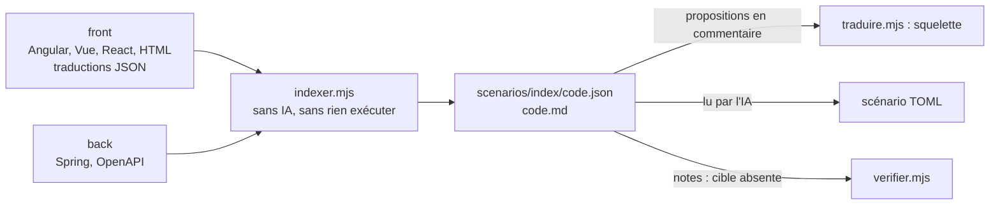

# Module `code` (D18)

Phases 7E couvertes : Éléments, Engendrent et Environnement.

## 1. Principe

Un testeur qui a accès au code sait ce que l'écran montrera avant de l'ouvrir : les pages et leurs adresses, les boutons et leurs libellés, les champs et leurs étiquettes, les appels que la page fait au back, et ce que le back refuse. L'index le relève sans IA, et sans rien exécuter : il lit le code front et back du projet comme un texte, et note chaque entrée avec sa source, `fichier:ligne`. L'IA le lit pour traduire ; `traduire.mjs` en tire des propositions, et `verifier.mjs` des notes. L'index ne décide de rien : un nom affiché peut dépendre des données, ou venir d'un composant hors du projet (D18.INV-4).



## 2. La commande

```text
node <skill>/scripts/indexer.mjs <dossier du projet> [--dossier scenarios] [--langue fr]
```

- `<dossier du projet>` : la racine du code, front et back ensemble, ou l'un des deux.
- `--dossier` : le dossier des scénarios, `scenarios` du dossier courant par défaut, comme pour `importer.mjs` ; l'index s'y écrit, dans `index/`, et ce dossier est écarté de la lecture. Il ne peut pas être le projet lui-même.
- `--langue` : la langue des libellés traduits, `fr` par défaut ; un code comme `en` ou `fr-ca`.

Sortie : une ligne de bilan, une ligne `LIMITE …` par borne atteinte ou fichier non lu, puis les deux fichiers écrits. Code 0 quand l'index est écrit, 2 quand une option est refusée ou que le projet est introuvable.

```text
index du code : 412 fichiers lus ; 38 routes, 640 éléments d'interface, 905 textes, 74 endpoints et appels, 51 contraintes de validation ; 3 fichiers de traduction (fr)
LIMITE fichier de plus de 1048576 octets, non lu : front/src/assets/donnees.json (2350112 octets)
écrit : /home/dev/boutique/scenarios/index/code.json
écrit : /home/dev/boutique/scenarios/index/code.md
```

## 3. Ce qui est lu (D18.INV-1, D18.INV-5)

| Fichiers | Ce qui en est tiré |
|---|---|
| `.html`, `.htm` | éléments et textes du gabarit : composant Angular, page HTML, gabarit Thymeleaf |
| `.vue` | le `<template>` de premier niveau ; les appels HTTP de ses `<script>` |
| `.jsx`, `.tsx`, et `.js` qui importe React | éléments et textes du JSX, routes `<Route>`, appels HTTP |
| `.ts`, `.js`, `.mjs`, `.cjs` | tableaux de routes, appels HTTP, gabarits en ligne des composants Angular (`template:`) |
| `.java`, `.kt` | contrôleurs Spring, contraintes de validation |
| `openapi*`, `swagger*`, `api-docs*` en `.json`, `.yaml` ou `.yml` | endpoints du contrat |
| `<langue>.json` sous un dossier `i18n`, `locales`, `lang`, `translations`, `messages` ou `l10n` | libellés traduits (§ 5) |
| `ValidationMessages*.properties` | messages des contraintes de validation |
| `application*.properties`, `application*.yml` | le chemin de contexte `server.servlet.context-path`, et rien d'autre |

Ne sont jamais lus : les liens symboliques, que l'index ne suit pas ; les fichiers et dossiers cachés (`.git`, `.env`, `.angular`…) ; les dossiers `node_modules`, `bower_components`, `jspm_packages`, `dist`, `build`, `target`, `out`, `coverage`, `vendor`, `__pycache__`, `venv`, `playwright-report`, `test-results`, `__tests__`, `__mocks__`, `e2e`, `cypress`, `storybook-static`, et `src/test` ; les fichiers `*.spec.*`, `*.test.*`, `*.stories.*`, `*.cy.*`, `*.e2e*`, `*.min.js`, `*.d.ts`, `*Test.java`, `*Tests.java`, `*IT.java` et leurs pendants Kotlin ; le dossier des scénarios. Le code du projet n'est ni exécuté, ni importé, ni construit : chaque fichier est lu comme un texte, en UTF-8, par les lecteurs de `scripts/lecteurs.mjs`, tolérants (un code qu'ils ne comprennent pas ne donne rien, sans erreur). De la configuration du back, seul le chemin de contexte est retenu, et seulement s'il a la forme d'un chemin : aucun mot de passe, jeton ni adresse de base de données n'entre dans l'index.

## 4. Ce que relève l'index

### 4.1 Routes

- **Angular** : les tableaux de routes (`Routes`), `path`, `component`, `loadComponent`, `children` ; `loadChildren` charge le fichier du module à la demande et préfixe ses routes, par `import('…').then((m) => m.ROUTES)` ou par le fichier de routage voisin ; `redirectTo`, `title`, et une garde (`canActivate`, `canMatch`…) notée `garde`. Les constantes de routes importées d'un autre fichier se suivent par leurs imports relatifs.
- **Vue Router** : les tableaux de routes, `path`, `name`, `component` (son fichier, s'il est chargé à la demande), `children`, `redirect`, `beforeEnter`.
- **React Router** : les objets de `createBrowserRouter`, et les éléments `<Route path>` du JSX, imbriqués, avec le composant de `element`.

Les routes d'un fichier qui n'est désigné par aucun autre sont des racines. Ne sont pas lues : les routes par fichiers (Next.js, Nuxt), les alias d'imports (`@app/…` de `tsconfig.json`).

### 4.2 Éléments d'interface

| Rôle | Éléments |
|---|---|
| `button` | `<button>`, `<input type="submit">` (`button`, `reset`, `image`), un composant dont le nom finit par `Button` ou `-button`, `-btn` |
| `link` | `<a href>`, `<a routerLink>`, `<router-link>`, `<nuxt-link>`, `<Link>`, `<NavLink>` |
| `textbox`, `searchbox`, `spinbutton`, `combobox`, `listbox`, `checkbox`, `radio`, `switch`, `slider`, `option` | les champs natifs selon leur type, `<select>`, `<option>` ; `mat-select`, `mat-checkbox`, `mat-radio-button`, `mat-slide-toggle`, `mat-option` ; un composant `…TextField`, `…Input`, `…Select`, `…Checkbox` |
| `heading` | `<h1>` à `<h6>`, avec leur niveau |
| `img`, `columnheader`, `rowheader`, `tab`, `dialog`, `navigation`, `status` | ``, `<th>`, `mat-tab`, `<dialog>`, `<nav>`, `<output>` |
| rôle explicite | tout élément qui porte `role="…"` |
| sans rôle | un champ sans rôle ARIA (`password`, `file`, `date`…), avec son libellé ; un message `mat-error` ou `mat-hint` ; tout élément qui porte un identifiant de test |

Un rôle déduit du nom d'un composant est noté `composant` : c'est une supposition. Le nom accessible se calcule comme le ferait le navigateur, dans la mesure où le gabarit le dit : `aria-label`, puis `aria-labelledby` ; pour un champ, l'étiquette (`<label for>`, `<label>` qui l'entoure, `mat-label` de son `mat-form-field`, propriété `label` d'un composant), puis `title`, puis `placeholder` ; pour un bouton, un lien, un titre, une option, un onglet, le texte qu'il contient, sans celui des icônes (`mat-icon`, `svg`, `i` d'une police d'icônes, composant `…Icon`, élément `aria-hidden`), avec le texte alternatif de ses images, puis `title`. Chaque élément garde aussi son libellé, son placeholder, son titre, son identifiant de test (`data-testid`, ou `data-test-id`, `data-test`, `data-cy`, `data-qa`, noté par son attribut), la destination d'un lien et le type d'un champ.

Une partie variable s'écrit `…` : `{{ c.nom }}`, `{nom}` du JSX, une liaison `[attr.data-testid]="'supprimer-' + c.nom"`, un paramètre de traduction (`{{nom}}`, `{nom}`, `{n, plural, …}`). L'élément est alors noté `dynamique`. Les blocs de contrôle d'Angular (`@if`, `@for`, `@switch`…) sont retirés du texte.

### 4.3 Textes

Les textes visibles des gabarits, hors des éléments masqués, traduits, et rassemblés quand un texte et une expression se suivent (`Total : {total} factures` donne `Total : … factures`) ; chacun une fois, avec sa première source.

### 4.4 Endpoints et appels

- **Spring**, en Java et en Kotlin : les méthodes annotées `@GetMapping`, `@PostMapping`, `@PutMapping`, `@DeleteMapping`, `@PatchMapping` ou `@RequestMapping(method = …)` ; le chemin du `@RequestMapping` de leur classe, s'il y en a un, puis celui de la méthode, une constante `static final String` ou `const val` du même fichier résolue ; le chemin de contexte en tête ; `{id:\d+}` réduit à `{id}` ; le corps (`@RequestBody`), les paramètres de requête (`@RequestParam`) et le statut (`@ResponseStatus`). Un client `@FeignClient` ou `@HttpExchange` n'est pas un endpoint du projet : il est écarté. Une propriété `${…}` dans un chemin (`@RequestMapping("${api.prefix}/clients")`) ne se résout pas, puisque seule la configuration du chemin de contexte se lit : elle reste telle quelle, et un chemin vérifié ne lui correspond pas, ce qui donne une note.
- **OpenAPI** 3 et Swagger 2, en JSON ou en YAML : chaque opération, son `operationId`, son résumé et ses statuts, préfixée du chemin du premier serveur ou de `basePath`.
- **Appels du front** : `http.get(…)`, `post`, `put`, `patch`, `delete`, `request(…)` d'un `HttpClient` ou d'un client comme axios, `fetch(…)` et sa méthode, `axios({ url, method })`, `$fetch`, `useFetch` ; l'adresse lue d'une chaîne, d'un gabarit ou d'une concaténation, sans son origine ni sa requête, ses parties variables en `…` : `` `${environment.api}/clients/${nom}` `` donne `…/clients/…`. Ils sont notés `js`.

### 4.5 Contraintes de validation

Les annotations de Bean Validation (`@NotNull`, `@NotBlank`, `@NotEmpty`, `@Size`, `@Min`, `@Max`, `@Email`, `@Pattern`, `@Positive`… et `@Length`, `@Range` de Hibernate Validator) des champs, des accesseurs et des paramètres d'un constructeur (record Java, `data class` Kotlin avec `@field:`), avec leurs paramètres et leur message : un message `{cle}` se résout dans `ValidationMessages_<langue>.properties`, sinon `ValidationMessages.properties`, ses `{min}`, `{max}`, `{value}` remplacés par les paramètres de la contrainte.

## 5. Libellés traduits

Une clé de traduction se résout dans la langue de `--langue` : `{{ 'clients.titre' | translate }}`, la directive `translate` ou `[translate]` de ngx-translate ; `transloco`, `t('…')` sous `*transloco="let t; read: '…'"` ; `$t('…')`, `v-t` de vue-i18n ; `t('…')`, `i18n.t('…')`, `<Trans i18nKey>`, `<FormattedMessage id>` et `intl.formatMessage({ id })`. Les fichiers retenus sont ceux de la langue générale (`fr.json`, `fr-FR.json`, `fr_FR.json` pour `fr`) : sur une même clé, le fichier de la langue demandée exactement l'emporte, `fr-ca.json` pour `--langue fr-ca`, `fr.json` pour `--langue fr`. Les clés imbriquées s'aplatissent avec des points ; un fichier sous un sous-dossier, `i18n/admin/fr.json`, préfixe ses clés de `admin.` (portée de Transloco) ; un fichier d'espace de noms, `locales/fr/common.json`, donne `common:cle` et `cle`. Une clé absente des fichiers reste la clé elle-même, comme l'affiche l'application, notée `cleNonResolue`. Une langue sans aucun fichier est dite en limite.

## 6. L'index

`<dossier>/index/code.json`, format `scenario-playwright.index/1`, une entrée par ligne :

| Champ | Contenu |
|---|---|
| `format`, `version` | `scenario-playwright.index/1`, version du skill |
| `projet` | chemin du projet, relatif au dossier des scénarios |
| `langue`, `traductions` | langue des libellés, fichiers de traduction lus |
| `empreinte` | SHA-256 des fichiers lus, chemins et contenus (§ 7) |
| `fichiers`, `partiel` | nombre de fichiers lus ; `true` si une borne a arrêté la lecture |
| `contexte` | chemin de contexte du back, ou `null` |
| `routes` | `{ chemin, composant, titre, nom, redirection, garde, source }` |
| `elements` | `{ role, niveau, nom, libelle, placeholder, titre, texte, testid, attributTest, vers, type, dynamique, cle, cleNonResolue, composant, source }` |
| `textes` | `{ texte, dynamique, cle, source }` |
| `endpoints` | `{ methode, chemin, classe, operation, resume, corps, parametres, statut, statuts, origine, source }` ; `origine` vaut `spring`, `openapi` ou `js` |
| `validations` | `{ classe, champ, contrainte, parametres, message, cle, cleNonResolue, source }` |
| `limites` | ce qui n'a pas été lu, et pourquoi |

Un champ sans valeur est omis. `code.md` donne le même index à lire : routes, éléments par fichier, endpoints et appels, contraintes, textes (mille au plus), limites, chaque entrée avec sa source :

```text
- `/clients/nouveau` → ClientFormComponent, garde — front/src/app/app.routes.ts:8
### front/src/app/clients/client-form.component.ts
- l.11 textbox « Nom » ; libellé « Nom » ; testid champ-nom ; clé client.nom
- l.19 button « Enregistrer »
- `POST /api/clients` ClientController.creer, corps ClientDto, statut 201 — back/src/main/java/demo/ClientController.java:17
- ClientDto.nom : NotBlank, « Le nom est obligatoire » — back/src/main/java/demo/ClientDto.java:4
```

Le même projet donne le même index, octet pour octet : rien n'y dépend de la date ni de l'ordre de lecture du disque. L'index ne contient que le nom, le texte, le chemin et la contrainte de ce que le code montre : il peut se garder avec les scénarios, et se régénère à tout moment.

## 7. Empreinte et index périmé (D18.INV-2)

L'empreinte de l'index est le SHA-256 de la liste des fichiers lus, chacun avec l'empreinte de son contenu (un fichier non lu pour sa taille, avec sa taille). `traduire.mjs` et `verifier.mjs` la recalculent, en relisant le projet à son chemin noté : un fichier ajouté, modifié ou retiré rend l'index périmé. Un index périmé, illisible, d'un autre format ou dont le projet est introuvable n'est pas employé, et le dit :

```text
note : index du code périmé, le code a changé depuis l'indexation : relancer indexer.mjs ; squelette sans propositions de l'index
note creer.toml : index du code périmé, le code a changé depuis l'indexation : relancer indexer.mjs ; cibles non comparées à l'index
```

Un index se cherche dans le dossier du texte ou du scénario, sous `index/code.json` ; sans index, rien ne change.

## 8. Bornes (D18.INV-3)

| Borne | Valeur | Au-delà |
|---|---|---|
| fichiers à lire | 20 000 | lecture arrêtée, index partiel |
| taille d'un fichier | 1 Mio | fichier non lu, noté avec sa taille |
| volume lu | 200 Mio | lecture arrêtée, index partiel |
| profondeur des dossiers | 40 | dossier non lu, index partiel |

Chaque borne atteinte est une ligne `LIMITE` et une entrée de `limites` ; un fichier qu'un lecteur ne peut lire jusqu'au bout est ignoré, de même.

## 9. À la traduction et au contrôle (D18.INV-4)

Avec un index à jour, `traduire.mjs` ajoute sous chaque étape du squelette, en commentaire, les éléments de l'index dont un nom (accessible, libellé, placeholder, texte, titre) correspond à un libellé entre guillemets de la phrase, « … », "…" ou “…” : d'abord ceux de nom égal, sinon ceux qui le contiennent ; le rôle qu'annonce la phrase (bouton, lien, champ, liste, case, titre, onglet…) les départage ; cinq au plus par libellé. Chaque proposition est une cible au format du scénario, avec sa source et ses autres désignations ; `exact = true` quand le nom est contenu dans celui d'un autre élément du même rôle ; un rôle seul quand le nom est variable. Un chemin cité par la phrase, `POST /api/clients` ou `/api/…`, propose les endpoints connus. Un libellé tout entier variable (`« <nom> »`) ne propose rien.

```toml
# ligne 8 : Et je clique sur le bouton « Enregistrer » (création)
[[etapes]]
ligne = 8
action = "à compléter"
mutation = "creation"
# index du code, pour « Enregistrer » (propositions à vérifier) :
#   cible = { role = "button", nom = "Enregistrer", exact = true }  # front/src/app/clients/client-form.component.ts:19
```

Les propositions restent des commentaires : chaque étape reste à compléter, et le scénario refusé tant qu'elle l'est (D3.INV-5). `traduire.mjs` dit combien d'étapes en ont reçu.

`verifier.mjs` compare ensuite chaque cible du scénario à l'index, comme Playwright compare les noms : sans `exact`, une partie du nom, sans tenir compte de la casse ; avec `exact`, le nom entier ; une partie variable, `…` dans l'index ou `${nom}` dans le scénario, s'accepte largement. Il compare de même le chemin d'une vérification `requete` ou `api` aux endpoints et aux appels de l'index. Une cible ou un chemin absent est une note, jamais une erreur : le code de sortie n'en dépend pas.

```text
note creer.toml : cibles absentes de l'index du code (texte variable, composant hors du projet, ou cible à revoir) : étape 6 getByRole('button', { name: 'Inexistant' })
note creer.toml : chemins absents de l'index du code : étape 7 GET /api/absent
```

Une cible `testid` ne correspond qu'à un `data-testid` : `getByTestId` ne lit pas `data-cy`, que l'index propose en `css`. Une cible `css` n'est pas comparée.

## 10. Contrôle de sortie

- Le projet est seulement lu : rien n'est créé ni modifié hors du dossier `index/` des scénarios ; un lien symbolique n'est pas suivi ; dépendances, sorties de construction, fichiers cachés et fichiers de test sont écartés (D18.INV-1).
- Chaque entrée cite sa source ; un code modifié rend l'index périmé, qui n'est plus employé (D18.INV-2).
- Un fichier trop gros n'est pas lu, une borne atteinte rend l'index partiel, chacun dit (D18.INV-3).
- Les propositions restent en commentaire ; une cible absente de l'index est une note, sans changer le code de sortie (D18.INV-4).
- Aucune valeur de la configuration n'entre dans l'index, hors du chemin de contexte (D18.INV-5).

## 11. Source `scripts/lecteurs.mjs`

Lecteurs sans dépendance : texte, `.properties`, YAML minimal ; jetons JavaScript et TypeScript, JSX compris ; littéraux, routes en objets, imports ; appels HTTP ; arbre HTML et gabarit Vue ; valeurs, clés de traduction, noms accessibles ; Java et Kotlin ; OpenAPI ; chemin de contexte.

<!-- fichier : scripts/lecteurs.mjs -->
```javascript
// scenario-playwright 1.3.0 : lecteurs du code du projet, pour l'index du code (D18).
//
// Chaque lecteur lit un texte sans jamais l'exécuter ni l'importer (D18.INV-1), et rend ce qu'un testeur
// humain voit ou peut observer : éléments d'interface et leurs noms accessibles possibles, textes,
// routes, appels du front, endpoints et contraintes de validation du back, chacun avec sa ligne
// (D18.INV-2). Les lecteurs sont tolérants : un code qu'ils ne comprennent pas ne donne rien, sans erreur.
// Un texte variable s'écrit … ; une clé de traduction se résout dans la langue choisie.

export const VARIABLE = '…';
const estTable = (v) => typeof v === 'object' && v !== null && !Array.isArray(v);

/** Texte comparé : espaces regroupés, bords retirés. */
export const normaliser = (s) => String(s ?? '').replace(/\s+/g, ' ').trim();

/** Débuts des lignes d'un texte, pour retrouver la ligne d'une position. */
export function debutsDeLignes(src) {
  const d = [0];
  for (let i = 0; i < src.length; i++) if (src.charCodeAt(i) === 10) d.push(i + 1);
  return d;
}

/** Ligne (à partir de 1) d'une position du texte. */
export function ligneDe(debuts, pos) {
  let a = 0;
  let b = debuts.length - 1;
  while (a < b) {
    const m = (a + b + 1) >> 1;
    if (debuts[m] <= pos) a = m; else b = m - 1;
  }
  return a + 1;
}

const ENTITES = { amp: '&', lt: '<', gt: '>', quot: '"', apos: "'", nbsp: ' ', eacute: 'é', egrave: 'è', ecirc: 'ê', agrave: 'à', acirc: 'â', ccedil: 'ç', ocirc: 'ô', ucirc: 'û', ugrave: 'ù', icirc: 'î', iuml: 'ï', euml: 'ë', laquo: '«', raquo: '»', rsquo: '’', lsquo: '‘', hellip: '…', ndash: '–', mdash: '—', euro: '€', copy: '©' };

/** Entités HTML décodées. */
export function decoderEntites(s) {
  return String(s).replace(/&(#x[0-9a-fA-F]+|#\d+|[a-zA-Z]+);/g, (e, n) => {
    if (n[0] === '#') {
      const code = n[1] === 'x' || n[1] === 'X' ? parseInt(n.slice(2), 16) : parseInt(n.slice(1), 10);
      return Number.isInteger(code) && code > 0 && code <= 0x10ffff ? String.fromCodePoint(code) : e;
    }
    return ENTITES[n] ?? e;
  });
}

/** Texte d'une traduction : ses paramètres ({{nom}}, {nom}, {n, plural, …}, %s) deviennent … */
export function texteTraduit(v) {
  return normaliser(String(v).replace(/\{\{[^{}]*\}\}/g, VARIABLE).replace(/\{[^{}]*(?:\{[^{}]*\}[^{}]*)*\}/g, VARIABLE).replace(/%\d*\$?[sd]/g, VARIABLE)).replace(/…(\s*…)+/g, VARIABLE);
}

/** Clés d'un fichier de traduction JSON, aplaties avec des points : { "a": { "b": "x" } } donne a.b. */
export function aplatir(objet, prefixe = '', sortie = new Map()) {
  if (typeof objet === 'string') sortie.set(prefixe, objet);
  else if (estTable(objet)) for (const [k, v] of Object.entries(objet)) aplatir(v, prefixe ? `${prefixe}.${k}` : k, sortie);
  return sortie;
}

/** Fichier .properties : Map clé → { valeur, ligne } ; échappements \uXXXX et lignes continuées. */
export function lireProprietes(src) {
  const sortie = new Map();
  const lignes = String(src).replace(/^\uFEFF/, '').replace(/\r\n?/g, '\n').split('\n');
  const dec = (s) => s.replace(/\\u([0-9a-fA-F]{4})|\\(.)/g, (x, u, c) => (u ? String.fromCharCode(parseInt(u, 16)) : ({ n: '\n', t: '\t', r: '\r', f: '\f' })[c] ?? c));
  for (let i = 0; i < lignes.length; i++) {
    let l = lignes[i].replace(/^\s+/, '');
    if (l === '' || l[0] === '#' || l[0] === '!') continue;
    const debut = i + 1;
    while (/(?:^|[^\\])(?:\\\\)*\\$/.test(l) && i + 1 < lignes.length) l = l.slice(0, -1) + lignes[++i].replace(/^\s+/, '');
    const m = /^((?:\\.|[^\s:=\\])*)\s*[:=]?\s*(.*)$/s.exec(l);
    if (m && m[1] !== '') sortie.set(dec(m[1]), { valeur: dec(m[2]), ligne: debut });
  }
  return sortie;
}

// --- YAML minimal : cartes, listes, scalaires, blocs | et >, collections en ligne ---------------------

function finGuillemet(t, k) {
  const q = t[k];
  for (let i = k + 1; i < t.length; i++) {
    if (q === '"' && t[i] === '\\') { i++; continue; }
    if (t[i] === q) {
      if (q === "'" && t[i + 1] === "'") { i++; continue; }
      return i;
    }
  }
  return -1;
}

function scalaireYaml(s) {
  s = s.trim().replace(/^(?:&\S+\s*|!\S*\s*)+/, '');
  if (s === '' || s === '~' || s === 'null' || s[0] === '*') return null;
  if (s[0] === "'") return s.slice(1, s.endsWith("'") ? -1 : undefined).replace(/''/g, "'");
  if (s[0] === '"') {
    try { return JSON.parse(s.endsWith('"') ? s : `${s}"`); } catch { return s.slice(1, -1); }
  }
  return s;
}

function sansCommentaireYaml(t) {
  let q = null;
  for (let k = 0; k < t.length; k++) {
    const c = t[k];
    if (q) {
      if (q === '"' && c === '\\') k++;
      else if (c === q) { if (q === "'" && t[k + 1] === "'") k++; else q = null; }
    } else if ((c === '"' || c === "'") && (k === 0 || /[\s:[{,-]/.test(t[k - 1]))) q = c;
    else if (c === '#' && (k === 0 || /\s/.test(t[k - 1]))) return t.slice(0, k);
  }
  return t;
}

function fluxYaml(t) {
  let k = 0;
  const espaces = () => { while (k < t.length && /\s/.test(t[k])) k++; };
  const valeur = () => {
    espaces();
    const c = t[k];
    if (c === '[' || c === '{') {
      const fin = c === '[' ? ']' : '}';
      const r = c === '[' ? [] : {};
      k++;
      for (;;) {
        espaces();
        if (k >= t.length) return r;
        if (t[k] === fin) { k++; return r; }
        const avant = k;
        if (Array.isArray(r)) r.push(valeur());
        else {
          const cle = valeur();
          espaces();
          let v = null;
          if (t[k] === ':') { k++; v = valeur(); }
          r[String(cle)] = v;
        }
        espaces();
        if (t[k] === ',') k++;
        else if (k === avant) k++;
      }
    }
    if (c === '"' || c === "'") {
      const f = finGuillemet(t, k);
      const fin = f < 0 ? t.length - 1 : f;
      const s = scalaireYaml(t.slice(k, fin + 1));
      k = fin + 1;
      return s;
    }
    const m = /^[^,\]}:]*(?::(?![\s,\]}]|$)[^,\]}:]*)*/.exec(t.slice(k));
    k += m[0].length;
    return scalaireYaml(m[0]);
  };
  return valeur();
}

/**
 * Lecture minimale d'un document YAML, assez pour un contrat OpenAPI et une configuration Spring : rend
 * { valeur, lignes } ; `lignes` associe à chaque table la ligne de chacune de ses clés.
 */
export function lireYaml(src) {
  const lignes = String(src).replace(/^\uFEFF/, '').replace(/\r\n?/g, '\n').split('\n');
  const positions = new WeakMap();
  let fin = lignes.length;
  let i = 0;
  let contenu = false;
  for (let k = 0; k < lignes.length; k++) {
    const l = lignes[k];
    if (/^\.\.\.\s*$/.test(l)) { fin = k; break; }
    if (/^---(?:\s|$)/.test(l)) {
      if (contenu) { fin = k; break; }
      lignes[k] = l.replace(/^---/, '   ');
    } else if (!contenu && /^%/.test(l)) lignes[k] = '';
    if (!/^\s*(?:#|$)/.test(lignes[k])) contenu = true;
  }
  const prochaine = () => {
    while (i < fin) {
      const t = sansCommentaireYaml(lignes[i]).replace(/\s+$/, '');
      if (t.trim() !== '') return { indent: t.length - t.trimStart().length, texte: t.trim(), numero: i + 1 };
      i++;
    }
    return null;
  };
  const estTiret = (t) => t === '-' || t.startsWith('- ');
  const separer = (t) => {
    let cle;
    let k;
    if (t[0] === '"' || t[0] === "'") {
      const f = finGuillemet(t, 0);
      if (f < 0 || t[f + 1] !== ':' || !(t[f + 2] === undefined || /\s/.test(t[f + 2]))) return null;
      cle = scalaireYaml(t.slice(0, f + 1));
      k = f + 1;
    } else {
      if (/^[[{|>]/.test(t) || estTiret(t) || t.startsWith('? ')) return null;
      const m = /^(.*?):(?:\s|$)/.exec(t);
      if (!m) return null;
      cle = m[1].trim();
      k = m[1].length;
    }
    return [String(cle), t.slice(k + 1).trim()];
  };
  const scalaire = (texte, indent) => {
    if (/^[|>][-+0-9]*$/.test(texte)) {
      const plie = texte[0] === '>';
      const morceaux = [];
      let marge = null;
      while (i < fin) {
        const brute = lignes[i];
        if (brute.trim() === '') { morceaux.push(''); i++; continue; }
        const ind = brute.length - brute.trimStart().length;
        if (ind <= indent) break;
        marge = marge === null ? ind : Math.min(marge, ind);
        morceaux.push(brute);
        i++;
      }
      const textes = morceaux.map((m) => m.slice(marge ?? 0));
      while (textes.length && textes.at(-1) === '') textes.pop();
      return plie ? textes.join(' ').replace(/\s+/g, ' ').trim() : textes.join('\n');
    }
    if (texte[0] === '[' || texte[0] === '{') {
      let t = texte;
      const solde = (s) => [...s].reduce((n, c) => n + ('[{'.includes(c) ? 1 : ']}'.includes(c) ? -1 : 0), 0);
      while (solde(t) > 0 && i < fin) t += ` ${sansCommentaireYaml(lignes[i++]).trim()}`;
      return fluxYaml(t);
    }
    let t = texte;
    for (;;) {
      const s = prochaine();
      if (!s || s.indent <= indent || separer(s.texte) || estTiret(s.texte)) break;
      t += ` ${s.texte}`;
      i++;
    }
    return scalaireYaml(t);
  };
  const bloc = (indentMin) => {
    const l = prochaine();
    if (!l || l.indent < indentMin) return null;
    return estTiret(l.texte) ? liste(l.indent) : carte(l.indent);
  };
  const liste = (indent) => {
    const r = [];
    for (;;) {
      const l = prochaine();
      if (!l || l.indent !== indent || !estTiret(l.texte)) break;
      const reste = l.texte.slice(1).trimStart();
      if (reste === '') { i++; r.push(bloc(indent + 1)); continue; }
      if (separer(reste) || estTiret(reste)) {
        const decalage = l.indent + (l.texte.length - reste.length);
        lignes[i] = ' '.repeat(decalage) + reste;
        r.push(estTiret(reste) ? liste(decalage) : carte(decalage));
      } else {
        i++;
        r.push(scalaire(reste, indent));
      }
    }
    return r;
  };
  const carte = (indent) => {
    const r = {};
    const pos = {};
    positions.set(r, pos);
    for (;;) {
      const l = prochaine();
      if (!l || l.indent !== indent) break;
      const kv = separer(l.texte);
      if (!kv) break;
      i++;
      const [cle, reste] = kv;
      pos[cle] = l.numero;
      if (reste === '' || /^&\S+$/.test(reste)) {
        const s = prochaine();
        r[cle] = s && (s.indent > indent || (s.indent === indent && estTiret(s.texte))) ? bloc(s.indent) : null;
      } else r[cle] = scalaire(reste, indent);
    }
    return r;
  };
  let valeur = null;
  try {
    valeur = bloc(0);
  } catch {
    valeur = null;
  }
  return { valeur, lignes: positions };
}

// --- JavaScript et TypeScript, JSX compris : jetons, sans exécuter ni évaluer ----------------------------

const PONCTUATIONS = ['>>>=', '...', '===', '!==', '**=', '<<=', '>>=', '>>>', '&&=', '||=', '??=', '=>', '==', '!=', '<=', '>=', '&&', '||', '??', '?.', '++', '--', '+=', '-=', '*=', '/=', '%=', '&=', '|=', '^=', '**', '<<', '>>'];
const MOTS_EXPRESSION = new Set(['return', 'typeof', 'instanceof', 'in', 'of', 'new', 'delete', 'void', 'throw', 'case', 'do', 'else', 'yield', 'await', 'default']);
const RE_ID_DEBUT = /[A-Za-z_$À-￿]/;
const RE_ID = /[\w$À-￿]/;
const ECHAPPEMENTS = { n: '\n', t: '\t', r: '\r', b: '\b', f: '\f', v: '\v', 0: '\0' };

class LecteurJs {
  constructor(src, jsx) {
    this.src = src;
    this.n = src.length;
    this.i = 0;
    this.jsx = jsx;
  }

  espaces() {
    const s = this.src;
    while (this.i < this.n) {
      const c = s[this.i];
      if (/\s/.test(c) || c === '') { this.i++; continue; }
      if (c === '/' && s[this.i + 1] === '/') { const f = s.indexOf('\n', this.i); this.i = f < 0 ? this.n : f; continue; }
      if (c === '/' && s[this.i + 1] === '*') { const f = s.indexOf('*/', this.i + 2); this.i = f < 0 ? this.n : f + 2; continue; }
      break;
    }
  }

  chaine(q) {
    const s = this.src;
    let v = '';
    this.i++;
    while (this.i < this.n) {
      const c = s[this.i];
      if (c === q) { this.i++; return v; }
      if (c === '\n') return v;
      if (c === '\\') {
        const d = s[this.i + 1] ?? '';
        const u = d === 'u' ? /^u(?:\{([0-9a-fA-F]{1,6})\}|([0-9a-fA-F]{4}))/.exec(s.slice(this.i + 1, this.i + 11)) : d === 'x' ? /^x([0-9a-fA-F]{2})/.exec(s.slice(this.i + 1, this.i + 4)) : null;
        if (u) { v += String.fromCodePoint(parseInt(u[1] ?? u[2], 16)); this.i += 1 + u[0].length; continue; }
        v += ECHAPPEMENTS[d] ?? (d === '\n' || d === '\r' ? '' : d);
        this.i += 2;
        continue;
      }
      v += c;
      this.i++;
    }
    return v;
  }

  gabarit() {
    const s = this.src;
    const debut = this.i;
    let v = '';
    this.i++;
    while (this.i < this.n) {
      const c = s[this.i];
      if (c === '`') { this.i++; return { v, brut: s.slice(debut + 1, this.i - 1) }; }
      if (c === '\\') { v += ECHAPPEMENTS[s[this.i + 1]] ?? s[this.i + 1] ?? ''; this.i += 2; continue; }
      if (c === '$' && s[this.i + 1] === '{') { this.i += 2; this.jetons(true); v += VARIABLE; continue; }
      v += c;
      this.i++;
    }
    return { v, brut: s.slice(debut + 1) };
  }

  regex() {
    const s = this.src;
    let classe = false;
    this.i++;
    while (this.i < this.n) {
      const c = s[this.i];
      if (c === '\n') break;
      if (c === '\\') { this.i += 2; continue; }
      if (c === '[') classe = true;
      else if (c === ']') classe = false;
      else if (c === '/' && !classe) { this.i++; break; }
      this.i++;
    }
    while (this.i < this.n && /[a-z]/i.test(s[this.i])) this.i++;
  }

  /** Jetons jusqu'à la fin du texte ou, avec `arret`, jusqu'à l'accolade fermante non appariée (rend null si absente). */
  jetons(arret) {
    const s = this.src;
    const liste = [];
    let prof = 0;
    let prev = null;
    const debutExpression = () => prev === null || (prev.t === 'p' && ![')', ']', '}', '++', '--'].includes(prev.v)) || (prev.t === 'id' && MOTS_EXPRESSION.has(prev.v));
    for (;;) {
      this.espaces();
      if (this.i >= this.n) return arret ? null : liste;
      const debut = this.i;
      const c = s[this.i];
      let j;
      if (RE_ID_DEBUT.test(c) || (c === '#' && RE_ID_DEBUT.test(s[this.i + 1] ?? ''))) {
        let k = this.i + 1;
        while (k < this.n && RE_ID.test(s[k])) k++;
        j = { t: 'id', v: s.slice(this.i, k), debut };
        this.i = k;
      } else if (/[0-9]/.test(c) || (c === '.' && /[0-9]/.test(s[this.i + 1] ?? ''))) {
        let k = this.i + 1;
        while (k < this.n && /[\w.]/.test(s[k])) k++;
        j = { t: 'nombre', v: s.slice(this.i, k), debut };
        this.i = k;
      } else if (c === '"' || c === "'") {
        j = { t: 'chaine', v: this.chaine(c), debut };
      } else if (c === '`') {
        const g = this.gabarit();
        j = { t: 'gabarit', v: g.v, brut: g.brut, debut };
      } else if (c === '/' && debutExpression()) {
        this.regex();
        j = { t: 'regex', v: s.slice(debut, this.i), debut };
      } else if (c === '<' && this.jsx && debutExpression() && /[A-Za-z_$>]/.test(s[this.i + 1] ?? '')) {
        const noeud = this.elementJsx();
        if (noeud) j = { t: 'jsx', noeud, debut };
        else { this.i = debut + 1; j = { t: 'p', v: '<', debut }; }
      } else {
        const p = PONCTUATIONS.find((x) => s.startsWith(x, this.i)) ?? c;
        this.i += p.length;
        j = { t: 'p', v: p, debut };
        if (p === '{') prof++;
        else if (p === '}') {
          if (arret && prof === 0) return liste;
          prof--;
        }
      }
      liste.push(j);
      prev = j;
    }
  }

  elementJsx() {
    const s = this.src;
    const debut = this.i;
    this.i++;
    this.espaces();
    if (s[this.i] === '>') {
      this.i++;
      const enfants = this.enfantsJsx('');
      return enfants ? { type: 'el', tag: '', attrs: [], enfants, debut, jsx: true } : null;
    }
    const m = /^[A-Za-z_$][\w$-]*(?:[.:][A-Za-z_$][\w$-]*)*/.exec(s.slice(this.i, this.i + 200));
    if (!m) return null;
    const tag = m[0];
    this.i += tag.length;
    const attrs = [];
    for (;;) {
      this.espaces();
      if (this.i >= this.n) return null;
      const c = s[this.i];
      if (c === '/' && s[this.i + 1] === '>') { this.i += 2; return { type: 'el', tag, attrs, enfants: [], debut, jsx: true }; }
      if (c === '>') {
        this.i++;
        const enfants = this.enfantsJsx(tag);
        return enfants ? { type: 'el', tag, attrs, enfants, debut, jsx: true } : null;
      }
      if (c === '{') {
        this.i++;
        if (this.jetons(true) === null) return null;
        continue;
      }
      const posA = this.i;
      const a = /^[A-Za-z_$][\w$:.-]*/.exec(s.slice(this.i, this.i + 200));
      if (!a) return null;
      this.i += a[0].length;
      this.espaces();
      if (s[this.i] !== '=') { attrs.push({ nom: a[0], valeur: null, debut: posA }); continue; }
      this.i++;
      this.espaces();
      const q = s[this.i];
      if (q === '"' || q === "'") {
        const f = s.indexOf(q, this.i + 1);
        if (f < 0) return null;
        attrs.push({ nom: a[0], valeur: s.slice(this.i + 1, f), debut: posA });
        this.i = f + 1;
      } else if (q === '{') {
        this.i++;
        const jetons = this.jetons(true);
        if (jetons === null) return null;
        attrs.push({ nom: a[0], jetons, debut: posA });
      } else if (q === '<') {
        const el = this.elementJsx();
        if (!el) return null;
        attrs.push({ nom: a[0], jetons: [{ t: 'jsx', noeud: el, debut: el.debut }], debut: posA });
      } else return null;
    }
  }

  enfantsJsx(tag) {
    const s = this.src;
    const enfants = [];
    let debutTexte = this.i;
    const texte = () => { if (this.i > debutTexte) enfants.push({ type: 'texte', brut: s.slice(debutTexte, this.i), debut: debutTexte, jsx: true }); };
    while (this.i < this.n) {
      const c = s[this.i];
      if (c === '<') {
        texte();
        if (s[this.i + 1] === '/') {
          const m = /^<\/\s*([A-Za-z_$][\w$.:-]*)?\s*>/.exec(s.slice(this.i, this.i + 200));
          if (!m || (m[1] ?? '') !== tag) return null;
          this.i += m[0].length;
          return enfants;
        }
        const el = this.elementJsx();
        if (!el) return null;
        enfants.push(el);
        debutTexte = this.i;
        continue;
      }
      if (c === '{') {
        texte();
        const debut = this.i;
        this.i++;
        const jetons = this.jetons(true);
        if (jetons === null) return null;
        enfants.push({ type: 'expr', jetons, debut });
        debutTexte = this.i;
        continue;
      }
      this.i++;
    }
    return null;
  }
}

/** Jetons d'un fichier JavaScript ou TypeScript ; avec jsx, chaque élément JSX est un jeton { t: 'jsx', noeud }. */
export function jetonsJs(src, { jsx = false } = {}) {
  return new LecteurJs(String(src), jsx).jetons(false);
}

const estP = (j, v) => j?.t === 'p' && j.v === v;

/** Indice du jeton qui ferme le groupe ouvert en k : (, [ ou {. */
function finGroupe(jetons, k) {
  let prof = 0;
  for (let m = k; m < jetons.length; m++) {
    const j = jetons[m];
    if (j.t !== 'p') continue;
    if (j.v === '(' || j.v === '[' || j.v === '{') prof++;
    else if (j.v === ')' || j.v === ']' || j.v === '}') { prof--; if (prof === 0) return m; }
  }
  return jetons.length - 1;
}

/** Arguments d'un appel, séparés aux virgules de premier niveau. */
function decouperArgs(jetons) {
  const args = [];
  let courant = [];
  let prof = 0;
  for (const j of jetons) {
    if (j.t === 'p') {
      if (j.v === '(' || j.v === '[' || j.v === '{') prof++;
      else if (j.v === ')' || j.v === ']' || j.v === '}') prof--;
      else if (j.v === ',' && prof === 0) { args.push(courant); courant = []; continue; }
    }
    courant.push(j);
  }
  if (courant.length) args.push(courant);
  return args;
}

/** Littéral à partir du jeton k : tableau, objet, chaîne, ou expression jusqu'à la virgule ; rend { noeud, suite }. */
function valeurLitterale(jetons, k) {
  const j = jetons[k];
  if (!j) return { noeud: null, suite: k + 1 };
  if (estP(j, '[')) {
    const elements = [];
    const fin = finGroupe(jetons, k);
    let m = k + 1;
    while (m < fin) {
      if (estP(jetons[m], ',')) { m++; continue; }
      const etale = estP(jetons[m], '...');
      const r = valeurLitterale(jetons, etale ? m + 1 : m);
      if (r.noeud) elements.push(etale ? { ...r.noeud, etale: true } : r.noeud);
      m = Math.max(r.suite, m + 1);
    }
    return { noeud: { type: 'tableau', elements, debut: j.debut }, suite: fin + 1 };
  }
  if (estP(j, '{')) {
    const props = new Map();
    const fin = finGroupe(jetons, k);
    let m = k + 1;
    while (m < fin) {
      const jc = jetons[m];
      if (estP(jc, ',')) { m++; continue; }
      if (estP(jc, '...')) { m = Math.max(valeurLitterale(jetons, m + 1).suite, m + 1); continue; }
      let cle = null;
      if (jc.t === 'id' || jc.t === 'chaine' || jc.t === 'nombre') { cle = jc.v; m++; } else if (estP(jc, '[')) { m = finGroupe(jetons, m) + 1; } else { m++; continue; }
      if (jetons[m]?.t === 'id' && ['async', 'get', 'set', 'static'].includes(cle)) { cle = jetons[m].v; m++; }
      if (estP(jetons[m], '?')) m++;
      if (estP(jetons[m], ':')) {
        const r = valeurLitterale(jetons, m + 1);
        if (cle !== null && r.noeud) props.set(cle, { ...r.noeud, debutCle: jc.debut });
        m = Math.max(r.suite, m + 2);
      } else if (estP(jetons[m], '(') || estP(jetons[m], '<')) {
        while (m < fin && !estP(jetons[m], '{')) { if (estP(jetons[m], '(')) m = finGroupe(jetons, m); m++; }
        if (estP(jetons[m], '{')) m = finGroupe(jetons, m) + 1;
      } else if (cle !== null) props.set(cle, { type: 'expr', jetons: [jc], debut: jc.debut, debutCle: jc.debut });
    }
    return { noeud: { type: 'objet', props, debut: j.debut }, suite: fin + 1 };
  }
  let m = k;
  let prof = 0;
  while (m < jetons.length) {
    const x = jetons[m];
    if (x.t === 'p') {
      if (x.v === '(' || x.v === '[' || x.v === '{') prof++;
      else if (x.v === ')' || x.v === ']' || x.v === '}') { if (prof === 0) break; prof--; } else if ((x.v === ',' || x.v === ';') && prof === 0) break;
    }
    m++;
  }
  const morceau = jetons.slice(k, m);
  if (morceau.length === 1 && (j.t === 'chaine' || j.t === 'gabarit')) return { noeud: { type: 'chaine', v: j.v, gabarit: j.t === 'gabarit', debut: j.debut }, suite: m };
  return { noeud: { type: 'expr', jetons: morceau, debut: j.debut }, suite: Math.max(m, k + 1) };
}

// --- Routes déclarées en objets : Angular, Vue Router, React Router ---------------------------------------

const CLES_ROUTE = new Set(['path', 'component', 'components', 'loadChildren', 'loadComponent', 'redirectTo', 'redirect', 'children', 'element', 'Component', 'lazy', 'index', 'name', 'meta', 'canActivate', 'canActivateChild', 'canMatch', 'canLoad', 'title', 'pathMatch', 'alias', 'props', 'beforeEnter', 'resolve', 'data', 'outlet', 'errorElement', 'loader', 'action', 'providers']);
const GARDES = ['canActivate', 'canActivateChild', 'canMatch', 'canLoad', 'beforeEnter'];

function estListeDeRoutes(t) {
  const objets = t.elements.filter((e) => e.type === 'objet');
  if (objets.length === 0 || !objets.every((o) => [...o.props.keys()].some((k) => CLES_ROUTE.has(k)))) return false;
  return objets.some((o) => o.props.get('path')?.type === 'chaine' && [...o.props.keys()].some((k) => k !== 'path' && CLES_ROUTE.has(k)));
}

function nomAssigne(jetons, k) {
  if (estP(jetons[k - 1], '=')) {
    for (let m = k - 2; m >= Math.max(1, k - 12); m--) if (jetons[m].t === 'id' && ['const', 'let', 'var'].includes(jetons[m - 1]?.v)) return jetons[m].v;
  }
  if (jetons[k - 1]?.v === 'default' && jetons[k - 2]?.v === 'export') return 'default';
  return null;
}

/** Imports d'un module : nom local → { module, exporte }. */
export function importsDe(jetons) {
  const imports = new Map();
  for (let k = 0; k < jetons.length; k++) {
    if (jetons[k].t !== 'id' || jetons[k].v !== 'import' || estP(jetons[k + 1], '(') || estP(jetons[k - 1], '.')) continue;
    let m = k + 1;
    const noms = [];
    if (jetons[m]?.v === 'type' && jetons[m + 1]?.t === 'id') m++;
    if (jetons[m]?.t === 'id' && jetons[m].v !== 'from') { noms.push({ local: jetons[m].v, exporte: 'default' }); m++; if (estP(jetons[m], ',')) m++; }
    if (estP(jetons[m], '*')) m += 3;
    if (estP(jetons[m], '{')) {
      const fin = finGroupe(jetons, m);
      for (let x = m + 1; x < fin; x++) {
        if (jetons[x].t !== 'id' || jetons[x].v === 'type') continue;
        if (jetons[x + 1]?.v === 'as' && jetons[x + 2]?.t === 'id') { noms.push({ local: jetons[x + 2].v, exporte: jetons[x].v }); x += 2; } else noms.push({ local: jetons[x].v, exporte: jetons[x].v });
      }
      m = fin + 1;
    }
    if (jetons[m]?.v === 'from' && jetons[m + 1]?.t === 'chaine') for (const n of noms) imports.set(n.local, { module: jetons[m + 1].v, exporte: n.exporte });
  }
  return imports;
}

function importParesseux(jetons) {
  for (let k = 0; k < jetons.length; k++) {
    if (jetons[k].t !== 'id' || jetons[k].v !== 'import' || !estP(jetons[k + 1], '(') || jetons[k + 2]?.t !== 'chaine') continue;
    let exporte = null;
    for (let m = k + 3; m < jetons.length - 1; m++) if (estP(jetons[m], '.') && jetons[m + 1].t === 'id' && jetons[m + 1].v !== 'then') exporte = jetons[m + 1].v;
    return { module: jetons[k + 2].v, exporte };
  }
  return null;
}

function nomComposant(noeud) {
  if (noeud?.type !== 'expr') return null;
  const jsx = noeud.jetons.find((j) => j.t === 'jsx');
  if (jsx) return jsx.noeud.tag || null;
  const imp = importParesseux(noeud.jetons);
  if (imp) return imp.exporte && imp.exporte !== 'default' ? imp.exporte : imp.module.split('/').pop().replace(/\.(?:vue|[cm]?[jt]sx?)$/, '');
  return noeud.jetons.length === 1 && noeud.jetons[0].t === 'id' ? noeud.jetons[0].v : null;
}

/** Chemin d'une route enfant, joint à celui de son parent ; un chemin qui commence par / est absolu. */
export function joindreRoute(prefixe, chemin) {
  if (chemin.startsWith('/')) return chemin.replace(/\/{2,}/g, '/');
  const p = prefixe.replace(/\/+$/, '');
  return chemin === '' ? p || '/' : `${p}/${chemin}`.replace(/\/{2,}/g, '/');
}

/** Tableaux de routes d'un fichier, avec le nom de la constante qui les porte. */
export function listesDeRoutes(jetons) {
  const listes = [];
  for (let k = 0; k < jetons.length; k++) {
    if (!estP(jetons[k], '[')) continue;
    const { noeud, suite } = valeurLitterale(jetons, k);
    if (noeud && estListeDeRoutes(noeud)) {
      listes.push({ nom: nomAssigne(jetons, k), noeud, indice: listes.length });
      k = suite - 1;
    }
  }
  return listes;
}

/**
 * Routes du projet. `parFichier` : Map fichier → { listes, imports, ligne(pos) } ; `resoudre(fichier,
 * module)` rend le fichier d'un import relatif, ou null. Les enfants, les constantes importées et les
 * modules chargés à la demande prennent le chemin de leur parent ; les autres tableaux sont des racines.
 */
export function routesDesListes(parFichier, resoudre) {
  const routes = [];
  const consommees = new Set();
  const listesVisees = (rel, exporte) => {
    const f = parFichier.get(rel);
    if (!f) return [];
    const nommees = exporte ? f.listes.filter((l) => l.nom === exporte) : [];
    if (nommees.length) return nommees.map((l) => [rel, l]);
    if (f.listes.length) return f.listes.map((l) => [rel, l]);
    const dossier = rel.includes('/') ? rel.slice(0, rel.lastIndexOf('/') + 1) : '';
    return [...parFichier.keys()].filter((x) => x.startsWith(dossier) && !x.slice(dossier.length).includes('/') && /(?:-routing\.module|\.routes?)\.[cm]?[jt]s$/.test(x)).flatMap((x) => parFichier.get(x).listes.map((l) => [x, l]));
  };
  const reference = (rel, noeud) => {
    if (noeud?.type !== 'expr' || noeud.jetons.length !== 1 || noeud.jetons[0].t !== 'id') return [];
    const nom = noeud.jetons[0].v;
    const f = parFichier.get(rel);
    if (f.listes.some((l) => l.nom === nom)) return f.listes.filter((l) => l.nom === nom).map((l) => [rel, l]);
    const imp = f.imports.get(nom);
    const cible = imp ? resoudre(rel, imp.module) : null;
    return cible ? listesVisees(cible, imp.exporte).filter(([, l]) => l.nom === imp.exporte || imp.exporte === 'default') : [];
  };
  const parcourir = (noter) => {
    const visiter = (rel, liste, prefixe, profondeur, vus, racine) => {
      const cle = `${rel}#${liste.indice}@${prefixe}`;
      if (vus.has(cle) || profondeur > 20) return;
      vus.add(cle);
      if (!racine) consommees.add(`${rel}#${liste.indice}`);
      for (const o of liste.noeud.elements) route(rel, o, prefixe, profondeur, vus);
    };
    const route = (rel, o, prefixe, profondeur, vus) => {
      if (o.type === 'expr' && o.etale) { for (const [r, l] of reference(rel, o)) visiter(r, l, prefixe, profondeur + 1, vus, false); return; }
      if (o.type !== 'objet') return;
      const p = o.props.get('path');
      const chemin = p?.type === 'chaine' ? p.v : null;
      const complet = chemin === null ? prefixe : joindreRoute(prefixe, chemin);
      if (chemin !== null && noter) {
        const r = { chemin: complet };
        const composant = nomComposant(o.props.get('component') ?? o.props.get('loadComponent') ?? o.props.get('element') ?? o.props.get('Component'));
        if (composant) r.composant = composant;
        const titre = o.props.get('title');
        if (titre?.type === 'chaine') r.titre = titre.v;
        const nom = o.props.get('name');
        if (nom?.type === 'chaine') r.nom = nom.v;
        const redirection = o.props.get('redirectTo') ?? o.props.get('redirect');
        if (redirection?.type === 'chaine') r.redirection = joindreRoute(prefixe, redirection.v);
        if (GARDES.some((k) => o.props.has(k))) r.garde = true;
        r.source = `${rel}:${parFichier.get(rel).ligne(o.debut)}`;
        routes.push(r);
      }
      const enfants = o.props.get('children');
      if (enfants?.type === 'tableau') for (const e of enfants.elements) route(rel, e, complet, profondeur + 1, vus);
      else for (const [r, l] of reference(rel, enfants)) visiter(r, l, complet, profondeur + 1, vus, false);
      const lc = o.props.get('loadChildren');
      const imp = lc?.type === 'expr' ? importParesseux(lc.jetons) : lc?.type === 'chaine' ? { module: lc.v.split('#')[0], exporte: null } : null;
      const cible = imp ? resoudre(rel, imp.module) : null;
      if (cible) for (const [r, l] of listesVisees(cible, imp.exporte)) visiter(r, l, complet, profondeur + 1, vus, false);
    };
    for (const [rel, f] of parFichier) {
      for (const l of f.listes) if (noter ? !consommees.has(`${rel}#${l.indice}`) : true) visiter(rel, l, '/', 0, new Set(), true);
    }
  };
  parcourir(false);
  parcourir(true);
  return routes;
}

// --- Appels du code JavaScript : HttpClient, fetch, axios -----------------------------------------------

const METHODES_HTTP = new Set(['get', 'post', 'put', 'patch', 'delete', 'head', 'options']);

function urlDe(jetons) {
  let u = '';
  let vu = false;
  for (const j of jetons) {
    if (j.t === 'chaine' || j.t === 'gabarit') { u += j.v; vu = true; } else if (estP(j, '+') || estP(j, '(') || estP(j, ')')) continue;
    else if (j.t === 'id' || j.t === 'nombre' || estP(j, '.') || estP(j, '?.') || estP(j, '[') || estP(j, ']')) { if (!u.endsWith(VARIABLE)) u += VARIABLE; } else return null;
  }
  return vu ? u : null;
}

/** Chemin d'une adresse lue dans le code : sans origine ni requête ; null si ce n'est pas un chemin. */
export function cheminDUrl(u) {
  if (typeof u !== 'string') return null;
  let c = u.replace(/…+/g, VARIABLE);
  const m = /^https?:\/\/[^/?#]+(\/[^?#]*)?/i.exec(c);
  if (m) c = m[1] ?? '/';
  c = c.replace(/[?#].*$/, '');
  if (!/^(?:\/|…\/)/.test(c)) return null;
  return c.replace(/\/{2,}/g, '/');
}

/** Jetons d'un fichier, y compris ceux des expressions des éléments JSX (attributs et enfants). */
function jetonsAplatis(jetons, sortie = []) {
  for (const j of jetons) {
    sortie.push(j);
    if (j.t !== 'jsx') continue;
    const pile = [j.noeud];
    while (pile.length) {
      const n = pile.pop();
      for (const a of n.attrs ?? []) if (a.jetons) jetonsAplatis(a.jetons, sortie);
      for (const e of n.enfants ?? []) {
        if (e.type === 'el') pile.push(e);
        else if (e.type === 'expr') jetonsAplatis(e.jetons, sortie);
      }
    }
  }
  return sortie;
}

/** Appels HTTP du code : méthode, chemin et position de l'appel. */
export function appelsHttp(tous) {
  const jetons = jetonsAplatis(tous);
  const appels = [];
  for (let k = 0; k < jetons.length; k++) {
    const j = jetons[k];
    if (j.t !== 'id') continue;
    let genre = null;
    const membre = estP(jetons[k - 1], '.') || estP(jetons[k - 1], '?.');
    if (membre && METHODES_HTTP.has(j.v)) genre = j.v.toUpperCase();
    else if (membre && j.v === 'request') genre = 'REQUEST';
    else if (['fetch', '$fetch', 'useFetch', 'axios', 'ofetch'].includes(j.v) && (!membre || ['window', 'globalThis', 'self'].includes(jetons[k - 2]?.v))) genre = 'FETCH';
    if (!genre) continue;
    let m = k + 1;
    if (estP(jetons[m], '<')) {
      let prof = 0;
      for (; m < jetons.length; m++) {
        if (estP(jetons[m], '<')) prof++;
        else if (estP(jetons[m], '>')) prof--;
        else if (estP(jetons[m], '>>')) prof -= 2;
        else if (estP(jetons[m], '>>>')) prof -= 3;
        if (prof <= 0) { m++; break; }
      }
    }
    if (!estP(jetons[m], '(')) continue;
    const fin = finGroupe(jetons, m);
    const args = decouperArgs(jetons.slice(m + 1, fin));
    if (args.length === 0) continue;
    let methode = genre;
    let url = args[0];
    if (genre === 'REQUEST') {
      if (!(args[0].length === 1 && args[0][0].t === 'chaine')) continue;
      methode = args[0][0].v.toUpperCase();
      url = args[1] ?? [];
    } else if (genre === 'FETCH') {
      methode = 'GET';
      let options = args[1];
      if (estP(args[0][0], '{')) { options = args[0]; url = null; }
      const o = options && estP(options[0], '{') ? valeurLitterale(options, 0).noeud : null;
      if (o?.props.get('method')?.type === 'chaine') methode = o.props.get('method').v.toUpperCase();
      if (url === null) {
        const u = o?.props.get('url');
        url = u?.type === 'chaine' ? [{ t: 'chaine', v: u.v }] : u?.type === 'expr' ? u.jetons : [];
      }
    }
    const chemin = cheminDUrl(urlDe(url));
    if (chemin && /^[A-Z]+$/.test(methode)) appels.push({ methode, chemin, debut: j.debut });
  }
  return appels;
}

/** Gabarits en ligne d'un composant Angular : template: `…` ; rend [{ brut, debut }]. */
export function gabaritsEnLigne(jetons) {
  const gabarits = [];
  for (let k = 0; k + 2 < jetons.length; k++) {
    if (jetons[k].t === 'id' && jetons[k].v === 'template' && estP(jetons[k + 1], ':') && (jetons[k + 2].t === 'gabarit' || jetons[k + 2].t === 'chaine')) {
      gabarits.push({ brut: jetons[k + 2].brut ?? jetons[k + 2].v, debut: jetons[k + 2].debut + 1 });
    }
  }
  return gabarits;
}

// --- Gabarits HTML : Angular, Vue, HTML, Thymeleaf -------------------------------------------------------

const VIDES = new Set(['area', 'base', 'br', 'col', 'embed', 'hr', 'img', 'input', 'link', 'meta', 'param', 'source', 'track', 'wbr']);
const BRUTS = new Set(['script', 'style', 'textarea']);

/** Arbre tolérant d'un gabarit HTML ; `decalage` est la position du gabarit dans son fichier. */
export function arbreHtml(src, decalage = 0) {
  const racine = { type: 'el', tag: '#racine', attrs: [], enfants: [], debut: decalage };
  const pile = [racine];
  const bas = src.toLowerCase();
  const n = src.length;
  let i = 0;
  let debutTexte = 0;
  const texte = (fin) => { if (fin > debutTexte) pile.at(-1).enfants.push({ type: 'texte', brut: src.slice(debutTexte, fin), debut: decalage + debutTexte }); };
  while (i < n) {
    const c = src[i];
    if (c === '{' && src[i + 1] === '{') { const f = src.indexOf('}}', i + 2); i = f < 0 ? n : f + 2; continue; }
    if (c !== '<') { i++; continue; }
    if (src.startsWith('<!--', i)) { texte(i); const f = src.indexOf('-->', i + 4); i = f < 0 ? n : f + 3; debutTexte = i; continue; }
    if (src[i + 1] === '!' || src[i + 1] === '?') { texte(i); const f = src.indexOf('>', i); i = f < 0 ? n : f + 1; debutTexte = i; continue; }
    if (src[i + 1] === '/') {
      const m = /^<\/([A-Za-z][\w:.-]*)\s*>/.exec(src.slice(i, i + 120));
      if (!m) { i++; continue; }
      texte(i);
      const nom = m[1].toLowerCase();
      const k = pile.findLastIndex((e) => e.tag.toLowerCase() === nom);
      if (k > 0) pile.length = k;
      i += m[0].length;
      debutTexte = i;
      continue;
    }
    const m = /^<([A-Za-z][\w:.-]*)/.exec(src.slice(i, i + 120));
    if (!m) { i++; continue; }
    texte(i);
    const el = { type: 'el', tag: m[1], attrs: [], enfants: [], debut: decalage + i };
    let k = i + m[0].length;
    let seul = false;
    for (;;) {
      while (k < n && /\s/.test(src[k])) k++;
      if (k >= n) break;
      if (src[k] === '>') { k++; break; }
      if (src[k] === '/' && src[k + 1] === '>') { k += 2; seul = true; break; }
      const a = /^[^\s=>/'"]+/.exec(src.slice(k, k + 200));
      if (!a) { k++; continue; }
      const posA = k;
      k += a[0].length;
      let j = k;
      while (j < n && /\s/.test(src[j])) j++;
      if (src[j] === '=') {
        j++;
        while (j < n && /\s/.test(src[j])) j++;
        let valeur;
        if (src[j] === '"' || src[j] === "'") {
          const f = src.indexOf(src[j], j + 1);
          const fin = f < 0 ? n : f;
          valeur = src.slice(j + 1, fin);
          k = fin + 1;
        } else {
          const v = /^[^\s>]*/.exec(src.slice(j, j + 2000))[0];
          valeur = v;
          k = j + v.length;
        }
        el.attrs.push({ nom: a[0], valeur, debut: decalage + posA });
      } else el.attrs.push({ nom: a[0], valeur: null, debut: decalage + posA });
    }
    i = k;
    pile.at(-1).enfants.push(el);
    const b = el.tag.toLowerCase();
    if (!seul && BRUTS.has(b)) {
      const f = bas.indexOf(`</${b}`, i);
      i = f < 0 ? n : f;
    } else if (!seul && !VIDES.has(b)) pile.push(el);
    debutTexte = i;
  }
  texte(n);
  return racine;
}

/** Gabarit d'un composant Vue : contenu de son <template> de premier niveau ; rend { debut, fin } ou null. */
export function gabaritVue(src) {
  const m = /^<template(\s[^>]*)?>/m.exec(src);
  if (!m) return null;
  if (/\blang\s*=\s*["']?(?:pug|jade)/i.test(m[1] ?? '')) return { pug: true };
  const debut = m.index + m[0].length;
  const re = /<template\b[^>]*?(\/?)>|<\/template\s*>/g;
  re.lastIndex = debut;
  let prof = 1;
  let x;
  while ((x = re.exec(src))) {
    if (x[0][1] === '/') { prof--; if (prof === 0) return { debut, fin: x.index }; } else if (!x[1]) prof++;
  }
  return { debut, fin: src.length };
}

// --- Valeurs : textes littéraux, clés de traduction, parties variables -----------------------------------

const RE_BLOCS = /@(?:if|else\s+if|else|for|switch|case|default|defer|placeholder|loading|error|empty)\b\s*(?:\((?:[^()]|\((?:[^()]|\([^()]*\))*\))*\))?|@let\s+[\w$]+\s*=[^;]*;/g;
const RE_CHAINE_SEULE = /^(['"])((?:\\.|(?!\1)[^\\])*)\1$/s;
const FONCTIONS_TRADUCTION = new Set(['t', '$t', '$tc', 'tc', 'translate', 'instant', 'formatMessage', 'i18n']);

function cleTraduite(cle, ctx) {
  const t = ctx.traduire(cle);
  return t === null ? { cle, texte: cle, nonResolue: true } : { cle, texte: t.texte, dyn: t.dyn };
}

/** Valeur d'une expression d'Angular ou de Vue : texte, clé de traduction, ou partie variable. */
export function evaluerExpression(expr, ctx, prefixe = '') {
  const s = String(expr).trim();
  let m;
  if ((m = /^(['"])((?:\\.|(?!\1)[^\\])*)\1\s*\|\s*(?:translate|transloco)\b/s.exec(s))) return cleTraduite(m[2], ctx);
  if ((m = /^(\$?tc?)\(\s*(['"])((?:\\.|(?!\2)[^\\])*)\2/s.exec(s))) return cleTraduite((m[1] === 't' ? prefixe : '') + m[3], ctx);
  if ((m = /^(?:this\.)?\w*(?:i18n|translate|translateService|transloco)\w*\.(?:instant|t|get|translate)\(\s*(['"])((?:\\.|(?!\1)[^\\])*)\1/is.exec(s))) return cleTraduite(m[2], ctx);
  if ((m = RE_CHAINE_SEULE.exec(s))) return { texte: m[2] };
  if ((m = /^`([^`]*)`$/s.exec(s))) {
    const v = m[1].replace(/\$\{[^}]*\}/g, VARIABLE);
    return v.includes(VARIABLE) && /\$\{/.test(m[1]) ? { texte: v, dyn: true } : { texte: v };
  }
  const parties = concatenation(s);
  if (parties && parties.some((x) => RE_CHAINE_SEULE.test(x))) return { texte: parties.map((x) => RE_CHAINE_SEULE.exec(x)?.[2] ?? VARIABLE).join(''), dyn: true };
  return { dyn: true };
}

/** Parties d'une concaténation par + de premier niveau, hors des chaînes ; null s'il n'y en a pas. */
function concatenation(s) {
  const parties = [];
  let courante = '';
  let q = null;
  let prof = 0;
  for (let i = 0; i < s.length; i++) {
    const c = s[i];
    if (q) { courante += c; if (c === '\\') { courante += s[++i] ?? ''; } else if (c === q) q = null; continue; }
    if (c === "'" || c === '"' || c === '`') { q = c; courante += c; continue; }
    if ('([{'.includes(c)) prof++;
    else if (')]}'.includes(c)) prof--;
    if (c === '+' && prof === 0 && s[i + 1] !== '+' && s[i - 1] !== '+') { parties.push(courante.trim()); courante = ''; continue; }
    courante += c;
  }
  parties.push(courante.trim());
  return parties.length > 1 ? parties : null;
}

/** Valeur d'une expression JSX entre accolades. */
export function evaluerJetons(jetons, ctx) {
  if (jetons.length === 0) return null;
  const j0 = jetons[0];
  if (jetons.length === 1 && (j0.t === 'chaine' || j0.t === 'gabarit')) return j0.t === 'gabarit' && j0.v.includes(VARIABLE) ? { texte: j0.v, dyn: true } : { texte: j0.v };
  const morceaux = [[]];
  let profondeur = 0;
  for (const j of jetons) {
    if (j.t === 'p' && '([{'.includes(j.v)) profondeur++;
    else if (j.t === 'p' && ')]}'.includes(j.v)) profondeur--;
    if (estP(j, '+') && profondeur === 0) morceaux.push([]); else morceaux.at(-1).push(j);
  }
  if (morceaux.length > 1 && morceaux.some((x) => x.length === 1 && (x[0].t === 'chaine' || x[0].t === 'gabarit'))) {
    return { texte: morceaux.map((x) => (x.length === 1 && (x[0].t === 'chaine' || x[0].t === 'gabarit') ? x[0].v : VARIABLE)).join(''), dyn: true };
  }
  let p = 0;
  while (p < jetons.length && (jetons[p].t === 'id' || estP(jetons[p], '.') || estP(jetons[p], '?.'))) p++;
  const fonction = jetons[p - 1];
  if (p > 0 && fonction.t === 'id' && FONCTIONS_TRADUCTION.has(fonction.v) && estP(jetons[p], '(') && finGroupe(jetons, p) === jetons.length - 1) {
    const a = jetons[p + 1];
    if (a?.t === 'chaine') return cleTraduite(a.v, ctx);
    if (estP(a, '{')) {
      const o = valeurLitterale(jetons, p + 1).noeud;
      const id = o?.props.get('id');
      if (id?.type === 'chaine') {
        const r = cleTraduite(id.v, ctx);
        const defaut = o.props.get('defaultMessage');
        return r.nonResolue && defaut?.type === 'chaine' ? { cle: id.v, texte: texteTraduit(defaut.v), dyn: texteTraduit(defaut.v) !== normaliser(defaut.v) } : r;
      }
    }
  }
  return { dyn: true };
}

/** Parties d'un texte de gabarit HTML : texte, interpolations {{ … }} et blocs de contrôle d'Angular retirés. */
function partiesHtml(brut, ctx, prefixe) {
  const parties = [];
  const statique = (s) => {
    let t = s;
    if (ctx.blocs) t = t.replace(RE_BLOCS, ' ').replace(/[{}]/g, ' ');
    if (t !== '') parties.push({ texte: decoderEntites(t) });
  };
  const re = /\{\{([\s\S]*?)\}\}/g;
  let dernier = 0;
  let m;
  while ((m = re.exec(brut))) {
    statique(brut.slice(dernier, m.index));
    parties.push(evaluerExpression(m[1], ctx, prefixe));
    dernier = re.lastIndex;
  }
  statique(brut.slice(dernier));
  return parties;
}

/** Parties assemblées en un texte : espaces regroupés, parties variables notées … */
function assembler(parties) {
  let t = '';
  let dyn = false;
  let nonResolue = false;
  const cles = [];
  for (const p of parties) {
    if (!p) continue;
    if (p.sep) { t += ' '; continue; }
    if (p.cle) { cles.push(p.cle); if (p.nonResolue) nonResolue = true; }
    if (typeof p.texte === 'string') { t += p.texte; if (p.dyn) dyn = true; } else if (p.dyn) { t += VARIABLE; dyn = true; }
  }
  const texte = normaliser(t).replace(/…(?:\s*…)+/g, VARIABLE);
  const r = { texte: texte === '' ? null : texte };
  if (dyn) r.dyn = true;
  if (cles.length === 1) r.cle = cles[0];
  if (nonResolue) r.nonResolue = true;
  return r;
}

function attributsDe(n) {
  if (n.attributs) return n.attributs;
  const carte = new Map();
  for (const a of n.attrs) {
    let nom = a.nom;
    let lie = false;
    let m;
    if (!n.jsx && (m = /^\[(?:attr\.)?([^\]]+)\]$/.exec(nom))) { nom = m[1]; lie = true; } else if (!n.jsx && (m = /^(?:v-bind)?:([\w.-]+)$/.exec(nom))) { nom = m[1]; lie = true; }
    nom = nom.toLowerCase();
    if (n.jsx && nom === 'htmlfor') nom = 'for';
    if (n.jsx && nom === 'classname') nom = 'class';
    if (!carte.has(nom) || lie) carte.set(nom, { ...a, lie });
  }
  n.attributs = carte;
  return carte;
}

function valeurAttribut(a, ctx, prefixe = '') {
  if (!a) return null;
  if (a.jetons) return evaluerJetons(a.jetons, ctx) ?? { dyn: true };
  if (a.valeur === null) return { texte: '' };
  if (a.lie) return evaluerExpression(a.valeur, ctx, prefixe);
  if (!a.jsx && !ctx.jsx && a.valeur.includes('{{')) return assembler(partiesHtml(a.valeur, ctx, prefixe));
  return { texte: decoderEntites(a.valeur) };
}

const statique = (a) => (a && !a.lie && !a.jetons && typeof a.valeur === 'string' ? a.valeur : null);

// --- Éléments d'interface : rôle, nom accessible possible, identifiant de test ---------------------------

const ROLES_ARIA = new Set(['alert', 'alertdialog', 'application', 'article', 'banner', 'blockquote', 'button', 'caption', 'cell', 'checkbox', 'code', 'columnheader', 'combobox', 'complementary', 'contentinfo', 'definition', 'deletion', 'dialog', 'directory', 'document', 'emphasis', 'feed', 'figure', 'form', 'generic', 'grid', 'gridcell', 'group', 'heading', 'img', 'insertion', 'link', 'list', 'listbox', 'listitem', 'log', 'main', 'marquee', 'math', 'meter', 'menu', 'menubar', 'menuitem', 'menuitemcheckbox', 'menuitemradio', 'navigation', 'none', 'note', 'option', 'paragraph', 'presentation', 'progressbar', 'radio', 'radiogroup', 'region', 'row', 'rowgroup', 'rowheader', 'scrollbar', 'search', 'searchbox', 'separator', 'slider', 'spinbutton', 'status', 'strong', 'subscript', 'superscript', 'switch', 'tab', 'table', 'tablist', 'tabpanel', 'term', 'textbox', 'time', 'timer', 'toolbar', 'tooltip', 'tree', 'treegrid', 'treeitem']);
const ROLES_RETENUS = new Set(['alert', 'alertdialog', 'button', 'checkbox', 'columnheader', 'combobox', 'dialog', 'heading', 'img', 'link', 'listbox', 'menuitem', 'menuitemcheckbox', 'menuitemradio', 'navigation', 'option', 'radio', 'rowheader', 'searchbox', 'slider', 'spinbutton', 'status', 'switch', 'tab', 'textbox', 'tooltip', 'treeitem']);
const NOM_PAR_CONTENU = new Set(['button', 'link', 'heading', 'option', 'tab', 'menuitem', 'menuitemcheckbox', 'menuitemradio', 'columnheader', 'rowheader', 'treeitem', 'tooltip', 'cell', 'gridcell']);
const ROLES_PAR_COMPOSANT = { 'mat-checkbox': 'checkbox', 'mat-radio-button': 'radio', 'mat-slide-toggle': 'switch', 'mat-select': 'combobox', 'mat-option': 'option', 'mat-tab': 'tab', 'mat-button-toggle': 'button', 'mat-chip-option': 'option', 'router-link': 'link', 'nuxt-link': 'link', RouterLink: 'link', NuxtLink: 'link', Link: 'link', NavLink: 'link' };
const ATTRIBUTS_TEST = ['data-testid', 'data-test-id', 'data-test', 'data-cy', 'data-qa'];
const INLINE = new Set(['', 'a', 'abbr', 'b', 'bdi', 'bdo', 'cite', 'code', 'data', 'dfn', 'em', 'i', 'kbd', 'mark', 'q', 's', 'samp', 'small', 'span', 'strong', 'sub', 'sup', 'time', 'u', 'var', 'wbr', 'ng-container', 'ng-template', 'template', 'label', 'fragment', 'react.fragment']);
const CHAMPS_NATIFS = new Set(['input', 'select', 'textarea']);
const MESSAGES = new Set(['mat-error', 'mat-hint']);
const RE_ICONE = /\b(?:fa[srlbdt]?|bi|pi|ti|ri|la[srb]?|glyphicon|icon|material-icons[\w-]*|material-symbols[\w-]*)\b|-icon\b|\bicon-/;

function roleDeComposant(tag) {
  if (Object.hasOwn(ROLES_PAR_COMPOSANT, tag)) return ROLES_PAR_COMPOSANT[tag];
  const kebab = tag.includes('-');
  if (!kebab && !/^[A-Z]/.test(tag)) return null;
  const t = kebab ? tag.toLowerCase() : tag.split('.').pop();
  const vers = (re1, re2) => (kebab ? re1.test(t) : re2.test(t));
  if (vers(/(?:^|-)(?:btn|button)$/, /Button$/)) return 'button';
  if (vers(/(?:^|-)checkbox$/, /Checkbox$/)) return 'checkbox';
  if (vers(/(?:^|-)radio(?:-button)?$/, /Radio(?:Button)?$/)) return 'radio';
  if (vers(/(?:^|-)(?:switch|slide-toggle)$/, /Switch$/)) return 'switch';
  if (vers(/(?:^|-)(?:select|autocomplete|combobox)$/, /(?:Select|Autocomplete|Combo[Bb]ox)$/)) return 'combobox';
  if (vers(/(?:^|-)(?:text-?field|input|textarea)$/, /(?:TextField|Input|TextArea|Textarea)$/)) return 'textbox';
  if (vers(/(?:^|-)tab$/, /^Tab$/)) return 'tab';
  if (vers(/(?:^|-)link$/, /Link$/)) return 'link';
  return null;
}

function estMasque(n, a) {
  const b = n.tag.toLowerCase();
  if (['svg', 'mat-icon', 'ion-icon', 'fa-icon', 'script', 'style', 'noscript', 'head', 'title', 'meta', 'link'].includes(b) && !(n.jsx && /^[A-Z]/.test(n.tag))) return true;
  const cache = a.get('hidden');
  if (statique(a.get('aria-hidden')) === 'true' || (cache && !cache.lie && !cache.jetons)) return true;
  const classe = statique(a.get('class')) ?? '';
  if (b === 'i' && RE_ICONE.test(classe)) return true;
  if (/\bmaterial-(?:icons|symbols)/.test(classe)) return true;
  return Boolean(n.jsx && /Icon$/.test(n.tag));
}

function enfantsStructure(n) {
  const r = [];
  for (const e of n.enfants) {
    if (e.type === 'el') r.push(e);
    else if (e.type === 'expr') for (const j of e.jetons) if (j.t === 'jsx') r.push(j.noeud);
  }
  return r;
}

function prefixeTransloco(a, prefixe) {
  const t = statique(a.get('*transloco'));
  const m = t ? /(?:read|prefix)\s*:\s*['"]([^'"]+)['"]/.exec(t) : null;
  return m ? `${m[1]}.` : prefixe;
}

function cleDeDirective(n, a, ctx, prefixe) {
  if (n.jsx && /^(?:FormattedMessage|Trans|Translate|T)$/.test(n.tag)) {
    const id = a.get('id') ?? a.get('i18nkey') ?? a.get('value');
    const v = id ? valeurAttribut(id, ctx) : null;
    if (v?.cle || v?.texte) {
      const r = v.cle ? v : cleTraduite(v.texte, ctx);
      const defaut = statique(a.get('defaultmessage'));
      return r.nonResolue && defaut ? { cle: r.cle, texte: texteTraduit(defaut) } : r;
    }
    return null;
  }
  const tr = a.get('translate');
  if (tr && !n.jsx) {
    if (tr.lie) { const v = evaluerExpression(tr.valeur, ctx); return v.texte ? cleTraduite(v.texte, ctx) : null; }
    const v = statique(tr);
    if (v && !/^(?:yes|no)$/i.test(v)) return cleTraduite(v, ctx);
    if (v === null || v === '') {
      const contenu = normaliser(n.enfants.filter((e) => e.type === 'texte').map((e) => e.brut).join(' '));
      if (contenu && !contenu.includes('{{')) return cleTraduite(contenu, ctx);
    }
  }
  const tl = a.get('transloco');
  if (tl && !n.jsx) {
    const v = tl.lie ? evaluerExpression(tl.valeur, ctx).texte : statique(tl);
    if (v) return cleTraduite(prefixe + v, ctx);
  }
  const vt = a.get('v-t');
  if (vt && !n.jsx && vt.valeur) {
    const s = vt.valeur.trim();
    const m = RE_CHAINE_SEULE.exec(s) ?? /path\s*:\s*(['"])([^'"]+)\1/.exec(s);
    if (m) return cleTraduite(m[2], ctx);
  }
  return null;
}

function partiesDe(n, ctx, prefixe, parties, sansChamps) {
  if (n.type === 'texte') {
    if (n.jsx) parties.push({ texte: decoderEntites(n.brut) });
    else parties.push(...partiesHtml(n.brut, ctx, prefixe));
    return parties;
  }
  if (n.type === 'expr') {
    const v = evaluerJetons(n.jetons, ctx);
    if (v) parties.push(v);
    return parties;
  }
  if (n.type !== 'el') return parties;
  const a = attributsDe(n);
  const b = n.tag.toLowerCase();
  if (estMasque(n, a)) return parties;
  if (sansChamps && (CHAMPS_NATIFS.has(b) || b === 'mat-select' || b === 'button')) return parties;
  const cle = cleDeDirective(n, a, ctx, prefixe);
  if (cle) { parties.push(cle); return parties; }
  if (b === 'img' || (b === 'input' && /^image$/i.test(statique(a.get('type')) ?? ''))) {
    const alt = valeurAttribut(a.get('alt'), ctx, prefixe);
    if (alt?.texte || alt?.dyn) parties.push(alt);
    return parties;
  }
  if (b === 'br') { parties.push({ sep: true }); return parties; }
  const bloc = !INLINE.has(b);
  if (bloc) parties.push({ sep: true });
  const p = prefixeTransloco(a, prefixe);
  for (const e of n.enfants) partiesDe(e, ctx, p, parties, sansChamps);
  if (bloc) parties.push({ sep: true });
  return parties;
}

const texteDe = (n, ctx, prefixe, sansChamps = false) => assembler(partiesDe(n, ctx, prefixe, [], sansChamps));

function roleNatif(b, a) {
  const type = (statique(a.get('type')) ?? 'text').toLowerCase();
  switch (b) {
    case 'button': return 'button';
    case 'a': case 'area': return a.has('href') || a.has('routerlink') || a.has('to') ? 'link' : null;
    case 'input':
      if (type === 'hidden') return 'ignorer';
      if (['button', 'submit', 'reset', 'image'].includes(type)) return 'button';
      if (type === 'checkbox') return 'checkbox';
      if (type === 'radio') return 'radio';
      if (type === 'number') return 'spinbutton';
      if (type === 'range') return 'slider';
      if (type === 'search') return a.has('list') ? 'combobox' : 'searchbox';
      if (['text', 'email', 'tel', 'url'].includes(type)) return a.has('list') ? 'combobox' : 'textbox';
      return 'champ';
    case 'textarea': return 'textbox';
    case 'select': return a.has('multiple') || Number(statique(a.get('size'))) > 1 ? 'listbox' : 'combobox';
    case 'option': return 'option';
    case 'h1': case 'h2': case 'h3': case 'h4': case 'h5': case 'h6': return 'heading';
    case 'img': { const alt = a.get('alt'); return alt && statique(alt) === '' ? null : 'img'; }
    case 'th': return statique(a.get('scope')) === 'row' ? 'rowheader' : 'columnheader';
    case 'dialog': return 'dialog';
    case 'nav': return 'navigation';
    case 'output': return 'status';
    default: return null;
  }
}

function libelleDe(n, a, ancetres, ctx, prefixe) {
  const id = statique(a.get('id'));
  if (id && ctx.labelsPour.has(id)) {
    const l = texteDe(ctx.labelsPour.get(id), ctx, prefixe, true);
    if (l.texte) return l;
  }
  for (let k = ancetres.length - 1; k >= 0; k--) {
    const b = ancetres[k].tag.toLowerCase();
    if (b === 'label') { const l = texteDe(ancetres[k], ctx, prefixe, true); if (l.texte) return l; break; }
    if (b === 'mat-form-field') {
      const trouver = (x) => (x.type === 'el' ? (x.tag.toLowerCase() === 'mat-label' ? x : enfantsStructure(x).map(trouver).find(Boolean)) : null);
      const ml = trouver(ancetres[k]);
      if (ml) { const l = texteDe(ml, ctx, prefixe); if (l.texte) return l; }
      break;
    }
  }
  return null;
}

function nomParIds(ids, ctx, prefixe) {
  const parties = String(ids).split(/\s+/).filter(Boolean).map((x) => ctx.parId.get(x)).filter(Boolean).map((x) => texteDe(x, ctx, prefixe));
  return parties.length ? assembler(parties.flatMap((p) => [p, { sep: true }])) : null;
}

/** Relève un élément d'interface, s'il a un rôle retenu, un identifiant de test ou un message. */
function releverElement(n, a, ancetres, ctx, prefixe) {
  const b = n.tag.toLowerCase();
  const natif = !(n.jsx && /^[A-Z]/.test(n.tag)) && !n.tag.includes('-');
  const explicite = statique(a.get('role'))?.split(/\s+/).find((r) => ROLES_ARIA.has(r)) ?? null;
  let composant = false;
  let role = explicite;
  if (!role) {
    role = natif ? roleNatif(b, a) : null;
    if (!role && !natif) { role = roleDeComposant(n.tag); composant = role !== null && !Object.hasOwn(ROLES_PAR_COMPOSANT, n.tag); }
  }
  if (role === 'ignorer') return;
  if (b === 'input' && role === 'checkbox' && a.has('switch')) role = 'switch';
  const testidAttr = ATTRIBUTS_TEST.find((x) => a.has(x));
  const testid = testidAttr ? valeurAttribut(a.get(testidAttr), ctx, prefixe) : null;
  const message = MESSAGES.has(b);
  if (!(role && (ROLES_RETENUS.has(role) || role === explicite || role === 'champ')) && !testid?.texte && !message) return;
  const champ = role === 'champ' || (CHAMPS_NATIFS.has(b) && natif) || (composant && ['textbox', 'combobox'].includes(role)) || b === 'mat-select';
  const r = { role: role === 'champ' ? null : role };
  const ajouter = (champNom, v) => {
    if (!v?.texte) return;
    r[champNom] = v.texte;
    if (v.dyn) r.dynamique = true;
    if (v.cle && !r.cle) r.cle = v.cle;
    if (v.nonResolue) r.cleNonResolue = true;
  };
  if (role === 'heading') r.niveau = Number(statique(a.get('aria-level'))) || (/^h[1-6]$/.test(b) ? Number(b[1]) : undefined);
  if (r.niveau === undefined) delete r.niveau;
  const aria = valeurAttribut(a.get('aria-label'), ctx, prefixe);
  const parIds = a.has('aria-labelledby') && statique(a.get('aria-labelledby')) ? nomParIds(statique(a.get('aria-labelledby')), ctx, prefixe) : null;
  const titre = valeurAttribut(a.get('title'), ctx, prefixe);
  const placeholder = valeurAttribut(a.get('placeholder'), ctx, prefixe);
  const labelProp = !natif ? valeurAttribut(a.get('label'), ctx, prefixe) : null;
  const type = (statique(a.get('type')) ?? '').toLowerCase();
  let nom = aria?.texte ? aria : parIds?.texte ? parIds : null;
  let libelle = null;
  if (champ) {
    libelle = libelleDe(n, a, ancetres, ctx, prefixe) ?? (labelProp?.texte ? labelProp : null);
    nom = nom ?? libelle ?? (titre?.texte ? titre : null) ?? (placeholder?.texte ? placeholder : null);
    if (!libelle && aria?.texte) libelle = aria;
  } else if (b === 'img' || (b === 'input' && type === 'image')) {
    nom = nom ?? valeurAttribut(a.get('alt'), ctx, prefixe) ?? titre;
  } else if (b === 'input' && ['submit', 'button', 'reset'].includes(type)) {
    nom = nom ?? valeurAttribut(a.get('value'), ctx, prefixe);
  } else if (b === 'input' && ['checkbox', 'radio'].includes(type)) {
    libelle = libelleDe(n, a, ancetres, ctx, prefixe);
    nom = nom ?? libelle ?? titre;
  } else if (role && (NOM_PAR_CONTENU.has(role) || composant || ['checkbox', 'radio', 'switch'].includes(role))) {
    if (!nom) {
      const contenu = texteDe(n, ctx, prefixe);
      nom = contenu.texte ? contenu : labelProp?.texte ? labelProp : titre?.texte ? titre : contenu;
    }
  }
  ajouter('nom', nom);
  ajouter('libelle', libelle);
  if (placeholder?.texte) ajouter('placeholder', placeholder);
  if (titre?.texte) ajouter('titre', titre);
  if (message || (role && ['alert', 'status'].includes(role) && !r.nom)) ajouter('texte', texteDe(n, ctx, prefixe));
  if (testid?.texte) {
    r.testid = testid.texte;
    if (testidAttr !== 'data-testid') r.attributTest = testidAttr;
    if (testid.dyn) r.testidDynamique = true;
  }
  const vers = valeurAttribut(a.get('href') ?? a.get('routerlink') ?? a.get('to'), ctx, prefixe);
  if (role === 'link' && vers?.texte && !vers.dyn) r.vers = vers.texte;
  if (b === 'input' && type) r.type = type;
  if (composant) r.composant = true;
  r.source = `${ctx.fichier}:${ctx.ligne(n.debut)}`;
  ctx.elements.push(r);
}

/**
 * Analyse un arbre de gabarit (HTML ou JSX) : éléments d'interface, textes visibles et routes JSX.
 * `ctx` : { fichier, ligne(pos), traduire(cle), blocs, jsx, elements, textes, routes }.
 */
export function analyserArbre(racine, ctx) {
  ctx.parId = new Map();
  ctx.labelsPour = new Map();
  const indexer = (n) => {
    const a = attributsDe(n);
    const id = statique(a.get('id'));
    if (id) ctx.parId.set(id, n);
    if (n.tag.toLowerCase() === 'label') { const f = statique(a.get('for')); if (f) ctx.labelsPour.set(f, n); }
    for (const e of enfantsStructure(n)) indexer(e);
  };
  indexer(racine);
  const ancetres = [];
  const visiter = (n, prefixeRoute, prefixe) => {
    const a = attributsDe(n);
    if (n.tag !== '#racine' && estMasque(n, a)) return;
    const p = prefixeTransloco(a, prefixe);
    let routeEnfants = prefixeRoute;
    if (n.jsx && (n.tag === 'Route' || n.tag.endsWith('.Route'))) {
      const chemin = valeurAttribut(a.get('path'), ctx);
      if (chemin?.texte || a.has('index')) {
        routeEnfants = chemin?.texte ? joindreRoute(prefixeRoute, chemin.texte) : prefixeRoute;
        const r = { chemin: routeEnfants };
        const el = a.get('element');
        const composant = el?.jetons?.find((j) => j.t === 'jsx')?.noeud.tag ?? (a.get('component')?.jetons?.length === 1 ? a.get('component').jetons[0].v : null);
        if (composant) r.composant = composant;
        r.source = `${ctx.fichier}:${ctx.ligne(n.debut)}`;
        ctx.routes.push(r);
      }
    } else if (n.tag !== '#racine' && n.tag !== '') releverElement(n, a, ancetres, ctx, p);
    const directive = n.tag === '#racine' ? null : cleDeDirective(n, a, ctx, p);
    if (!directive) {
      // Les textes et les expressions qui se suivent forment un seul texte : « Total : {n} factures ».
      let suite = [];
      let debut = null;
      const vider = () => {
        const t = assembler(suite);
        if (t.texte && /\p{L}/u.test(t.texte.replace(/…/g, '')) && t.texte.length >= 2) ctx.textes.push({ texte: t.texte, ...(t.dyn ? { dynamique: true } : {}), ...(t.cle ? { cle: t.cle } : {}), source: `${ctx.fichier}:${ctx.ligne(debut)}` });
        suite = [];
        debut = null;
      };
      for (const e of n.enfants) {
        if (e.type !== 'texte' && e.type !== 'expr') { vider(); continue; }
        if (debut === null && (e.type === 'expr' || e.brut.trim() !== '')) debut = e.debut + (e.brut ? e.brut.length - e.brut.trimStart().length : 0);
        suite.push(...partiesDe(e, ctx, p, [], false));
      }
      vider();
    } else if (directive.texte) ctx.textes.push({ texte: directive.texte, ...(directive.dyn ? { dynamique: true } : {}), cle: directive.cle, source: `${ctx.fichier}:${ctx.ligne(n.debut)}` });
    ancetres.push(n);
    for (const e of enfantsStructure(n)) visiter(e, routeEnfants, p);
    ancetres.pop();
  };
  visiter(racine, '/', '');
}

// --- Java et Kotlin : contrôleurs Spring et contraintes de validation ------------------------------------

const MAPPINGS = { GetMapping: ['GET'], PostMapping: ['POST'], PutMapping: ['PUT'], DeleteMapping: ['DELETE'], PatchMapping: ['PATCH'], RequestMapping: null };
const VALIDATIONS = new Set(['NotNull', 'NotBlank', 'NotEmpty', 'Size', 'Min', 'Max', 'DecimalMin', 'DecimalMax', 'Email', 'Pattern', 'Positive', 'PositiveOrZero', 'Negative', 'NegativeOrZero', 'Past', 'PastOrPresent', 'Future', 'FutureOrPresent', 'Digits', 'AssertTrue', 'AssertFalse', 'Length', 'Range', 'URL']);
const STATUTS = { OK: 200, CREATED: 201, ACCEPTED: 202, NO_CONTENT: 204, MOVED_PERMANENTLY: 301, FOUND: 302, SEE_OTHER: 303, NOT_MODIFIED: 304, TEMPORARY_REDIRECT: 307, PERMANENT_REDIRECT: 308, BAD_REQUEST: 400, UNAUTHORIZED: 401, FORBIDDEN: 403, NOT_FOUND: 404, METHOD_NOT_ALLOWED: 405, CONFLICT: 409, GONE: 410, PRECONDITION_FAILED: 412, UNSUPPORTED_MEDIA_TYPE: 415, UNPROCESSABLE_ENTITY: 422, UNPROCESSABLE_CONTENT: 422, TOO_MANY_REQUESTS: 429, INTERNAL_SERVER_ERROR: 500, NOT_IMPLEMENTED: 501, SERVICE_UNAVAILABLE: 503 };
const CIBLES_KOTLIN = new Set(['field', 'get', 'set', 'param', 'property', 'setparam', 'delegate', 'file', 'receiver']);
const PARAMETRES_VALIDATION = ['min', 'max', 'value', 'regexp', 'integer', 'fraction', 'inclusive'];

function jetonsJava(src) {
  const s = String(src);
  const n = s.length;
  const jetons = [];
  let i = 0;
  while (i < n) {
    const c = s[i];
    if (/\s/.test(c) || c === '\ufeff') { i++; continue; }
    if (c === '/' && s[i + 1] === '/') { const f = s.indexOf('\n', i); i = f < 0 ? n : f; continue; }
    if (c === '/' && s[i + 1] === '*') { const f = s.indexOf('*/', i + 2); i = f < 0 ? n : f + 2; continue; }
    const debut = i;
    if (s.startsWith('"""', i)) {
      const f = s.indexOf('"""', i + 3);
      jetons.push({ t: 'chaine', v: normaliser(s.slice(i + 3, f < 0 ? n : f)), debut });
      i = f < 0 ? n : f + 3;
      continue;
    }
    if (c === '"') {
      let v = '';
      i++;
      while (i < n && s[i] !== '"' && s[i] !== '\n') {
        if (s[i] === '\\') {
          const u = s[i + 1] === 'u' ? /^u+([0-9a-fA-F]{4})/.exec(s.slice(i + 1, i + 12)) : null;
          if (u) { v += String.fromCharCode(parseInt(u[1], 16)); i += 1 + u[0].length; continue; }
          v += ECHAPPEMENTS[s[i + 1]] ?? s[i + 1] ?? '';
          i += 2;
          continue;
        }
        v += s[i];
        i++;
      }
      i++;
      jetons.push({ t: 'chaine', v, debut });
      continue;
    }
    if (c === "'") {
      const m = /^'(?:\\u+[0-9a-fA-F]{4}|\\.|[^'\\])'/.exec(s.slice(i, i + 12));
      i += m ? m[0].length : 1;
      jetons.push({ t: 'car', v: "'", debut });
      continue;
    }
    if (c === '`') { const f = s.indexOf('`', i + 1); jetons.push({ t: 'id', v: s.slice(i + 1, f < 0 ? n : f), debut }); i = f < 0 ? n : f + 1; continue; }
    if (/[A-Za-z_$]/.test(c)) { let k = i + 1; while (k < n && /[\w$]/.test(s[k])) k++; jetons.push({ t: 'id', v: s.slice(i, k), debut }); i = k; continue; }
    if (/[0-9]/.test(c)) { let k = i + 1; while (k < n && /[\w.]/.test(s[k])) k++; jetons.push({ t: 'nombre', v: s.slice(i, k), debut }); i = k; continue; }
    if (c === '@') { jetons.push({ t: '@', v: '@', debut }); i++; continue; }
    const p = s.startsWith('::', i) ? '::' : s.startsWith('->', i) ? '->' : c;
    jetons.push({ t: 'p', v: p, debut });
    i += p.length;
  }
  return jetons;
}

function lireAnnotation(jetons, k) {
  let m = k + 1;
  let nom = jetons[m]?.v ?? '';
  if (estP(jetons[m + 1], ':') && jetons[m + 2]?.t === 'id' && CIBLES_KOTLIN.has(nom)) { m += 2; nom = jetons[m].v; }
  while (estP(jetons[m + 1], '.') && jetons[m + 2]?.t === 'id') { m += 2; nom = jetons[m].v; }
  let args = [];
  if (estP(jetons[m + 1], '(')) { const f = finGroupe(jetons, m + 1); args = jetons.slice(m + 2, f); m = f; }
  return { annotation: { nom, args, debut: jetons[k].debut }, suite: m };
}

function argumentsAnnotation(args) {
  const positionnels = [];
  const nommes = new Map();
  for (const p of decouperArgs(args)) {
    if (p[0]?.t === 'id' && estP(p[1], '=')) nommes.set(p[0].v, p.slice(2));
    else positionnels.push(p);
  }
  return { positionnels, nommes };
}

function textesJava(jets, constantes) {
  if (!jets?.length) return [];
  if (estP(jets[0], '{') || estP(jets[0], '[')) return decouperArgs(jets.slice(1, -1)).flatMap((p) => textesJava(p, constantes));
  if (jets[0].t === 'id' && jets[0].v === 'arrayOf' && estP(jets[1], '(')) return decouperArgs(jets.slice(2, -1)).flatMap((p) => textesJava(p, constantes));
  const segments = [[]];
  for (const j of jets) { if (estP(j, '+')) segments.push([]); else segments.at(-1).push(j); }
  return [segments.map((seg) => (seg.length === 1 && seg[0].t === 'chaine' ? seg[0].v : constantes.get(seg.filter((x) => x.t === 'id').pop()?.v) ?? VARIABLE)).join('')];
}

/** Chemin d'endpoint : parties jointes par /, {id:regex} réduit à {id}. */
export function joindreChemin(...parties) {
  const c = parties.map((p) => String(p ?? '').replace(/\{(\w+):[^}]*\}/g, '{$1}')).join('/').replace(/\/{2,}/g, '/').replace(/(.)\/$/, '$1');
  return c.startsWith('/') ? c : `/${c}`;
}

function parametresMethode(jets, constantes) {
  const r = { corps: null, requete: [] };
  for (const p of decouperArgs(jets)) {
    const annotations = [];
    let k = 0;
    while (k < p.length && p[k].t === '@') { const { annotation, suite } = lireAnnotation(p, k); annotations.push(annotation); k = suite + 1; }
    const reste = p.slice(k).filter((j) => !(j.t === 'id' && ['final', 'val', 'var'].includes(j.v)));
    const dp = reste.findIndex((j) => estP(j, ':'));
    const nom = dp > 0 ? reste[dp - 1]?.v : reste.filter((j) => j.t === 'id').pop()?.v;
    const type = (dp > 0 ? reste.slice(dp + 1) : reste.slice(0, -1)).filter((j) => !estP(j, '=')).map((j) => j.v).join('');
    for (const a of annotations) {
      if (a.nom === 'RequestBody' && type) r.corps = type;
      if (a.nom === 'RequestParam') {
        const { positionnels, nommes } = argumentsAnnotation(a.args);
        const n = textesJava(nommes.get('value') ?? nommes.get('name') ?? positionnels[0], constantes)[0] ?? nom;
        if (n) r.requete.push(n);
      }
    }
  }
  return r;
}

/** Endpoints des contrôleurs Spring et contraintes de validation d'un fichier Java ou Kotlin. */
export function lireJava(src, fichier, ligne) {
  const jetons = jetonsJava(src);
  const endpoints = [];
  const validations = [];
  const constantes = new Map();
  for (let k = 0; k + 2 < jetons.length; k++) {
    if (jetons[k].t !== 'id') continue;
    let m = k + 1;
    if (estP(jetons[m], ':') && jetons[m + 1]?.t === 'id') m += 2;
    if (estP(jetons[m], '=') && jetons[m + 1]?.t === 'chaine' && !estP(jetons[m + 2], '+') && !estP(jetons[m + 2], '.')) {
      const avant = jetons.slice(Math.max(0, k - 4), k).map((x) => x.v);
      if (avant.includes('final') || avant.includes('val') || avant.includes('const')) constantes.set(jetons[k].v, jetons[m + 1].v);
    }
  }
  const champ = (classe, nom, annotations) => {
    for (const a of annotations) {
      if (!VALIDATIONS.has(a.nom)) continue;
      const { positionnels, nommes } = argumentsAnnotation(a.args);
      const parametres = {};
      for (const k of PARAMETRES_VALIDATION) {
        const jets = nommes.get(k) ?? (k === 'value' && positionnels.length ? positionnels[0] : null);
        if (!jets?.length) continue;
        const nombre = jets.length === 1 && jets[0].t === 'nombre' ? jets[0].v : jets.length === 2 && estP(jets[0], '-') && jets[1].t === 'nombre' ? `-${jets[1].v}` : null;
        if (nombre !== null && Number.isFinite(Number(nombre.replace(/[lLfFdD]$/, '').replace(/_/g, '')))) parametres[k] = Number(nombre.replace(/[lLfFdD]$/, '').replace(/_/g, ''));
        else if (jets.length === 1 && jets[0].t === 'id' && /^(?:true|false)$/.test(jets[0].v)) parametres[k] = jets[0].v === 'true';
        else if (jets.some((x) => x.t === 'chaine')) parametres[k] = textesJava(jets, constantes)[0];
      }
      const message = nommes.has('message') ? textesJava(nommes.get('message'), constantes)[0] : null;
      validations.push({ classe, champ: nom, contrainte: a.nom, ...(Object.keys(parametres).length ? { parametres } : {}), ...(message ? { message } : {}), source: `${fichier}:${ligne(a.debut)}` });
    }
  };
  const parametresDeConstructeur = (jets, classe) => {
    for (const p of decouperArgs(jets)) {
      const annotations = [];
      let k = 0;
      while (k < p.length && (p[k].t === '@' || (p[k].t === 'id' && ['private', 'public', 'protected', 'internal', 'override', 'open', 'final'].includes(p[k].v)))) {
        if (p[k].t === '@') { const { annotation, suite } = lireAnnotation(p, k); annotations.push(annotation); k = suite + 1; } else k++;
      }
      if (!annotations.length) continue;
      const reste = p.slice(k);
      const vv = reste.findIndex((j) => j.t === 'id' && (j.v === 'val' || j.v === 'var'));
      const dp = reste.findIndex((j) => estP(j, ':'));
      const nom = vv >= 0 ? reste[vv + 1]?.v : dp > 0 ? reste[dp - 1]?.v : reste.filter((j) => j.t === 'id').pop()?.v;
      if (nom) champ(classe, nom, annotations);
    }
  };
  let attente = [];
  const classes = [];
  let declaree = null;
  let prof = 0;
  for (let k = 0; k < jetons.length; k++) {
    const j = jetons[k];
    if (j.t === '@') {
      if (jetons[k + 1]?.v === 'interface') { attente = []; k++; continue; }
      const { annotation, suite } = lireAnnotation(jetons, k);
      attente.push(annotation);
      k = suite;
      continue;
    }
    if (estP(j, '{')) { prof++; if (declaree) { classes.push({ ...declaree, prof }); declaree = null; } attente = []; continue; }
    if (estP(j, '}')) { if (classes.length && classes.at(-1).prof === prof) classes.pop(); prof--; attente = []; continue; }
    if (estP(j, ';')) { attente = []; continue; }
    if (j.t !== 'id') continue;
    if (['class', 'interface', 'enum', 'record', 'object'].includes(j.v) && !estP(jetons[k - 1], '.') && !estP(jetons[k - 1], '::') && jetons[k + 1]?.t === 'id') {
      const nom = jetons[k + 1].v;
      const mapping = attente.find((a) => a.nom === 'RequestMapping');
      let prefixes = [''];
      if (mapping) {
        const { positionnels, nommes } = argumentsAnnotation(mapping.args);
        const t = textesJava(nommes.get('value') ?? nommes.get('path') ?? positionnels[0], constantes);
        if (t.length) prefixes = t;
      }
      declaree = { nom, prefixes, ignoree: attente.some((a) => ['FeignClient', 'HttpExchange'].includes(a.nom)) };
      let m = k + 2;
      if (estP(jetons[m], '<')) {
        let p = 0;
        for (; m < jetons.length; m++) { if (estP(jetons[m], '<')) p++; else if (estP(jetons[m], '>')) { p--; if (p === 0) { m++; break; } } }
      }
      if (estP(jetons[m], '(')) { const fin = finGroupe(jetons, m); parametresDeConstructeur(jetons.slice(m + 1, fin), nom); k = fin; } else k++;
      attente = [];
      continue;
    }
    const classe = classes.at(-1);
    if (!classe || prof !== classe.prof || attente.length === 0) continue;
    if (estP(jetons[k + 1], '(') && !estP(jetons[k - 1], '.') && !['if', 'for', 'while', 'switch', 'catch', 'return', 'new', 'synchronized', 'super', 'this', 'when'].includes(j.v)) {
      const fin = finGroupe(jetons, k + 1);
      const mapping = attente.find((a) => Object.hasOwn(MAPPINGS, a.nom));
      if (!mapping) {
        if (/^(?:get|is)[A-Z]/.test(j.v)) champ(classe.nom, j.v.replace(/^(?:get|is)(.)/, (x, c) => c.toLowerCase()), attente);
      } else if (!classe.ignoree) {
        const { positionnels, nommes } = argumentsAnnotation(mapping.args);
        let chemins = textesJava(nommes.get('value') ?? nommes.get('path') ?? positionnels[0], constantes);
        if (!chemins.length) chemins = [''];
        let methodes = MAPPINGS[mapping.nom];
        if (!methodes) {
          methodes = (nommes.get('method') ?? []).filter((x) => x.t === 'id' && /^[A-Z]+$/.test(x.v)).map((x) => x.v);
          if (!methodes.length) methodes = ['*'];
        }
        const statutAnn = attente.find((a) => a.nom === 'ResponseStatus');
        let statut = null;
        if (statutAnn) {
          const { positionnels: ps, nommes: ns } = argumentsAnnotation(statutAnn.args);
          statut = STATUTS[(ns.get('code') ?? ns.get('value') ?? ps[0] ?? []).filter((x) => x.t === 'id').pop()?.v] ?? null;
        }
        const { corps, requete } = parametresMethode(jetons.slice(k + 2, fin), constantes);
        for (const prefixe of classe.prefixes) {
          for (const chemin of chemins) {
            for (const methode of methodes) {
              const e = { methode, chemin: joindreChemin(prefixe, chemin), classe: classe.nom, operation: j.v };
              if (corps) e.corps = corps;
              if (requete.length) e.parametres = requete;
              if (statut) e.statut = statut;
              e.origine = 'spring';
              e.source = `${fichier}:${ligne(mapping.debut)}`;
              endpoints.push(e);
            }
          }
        }
      }
      attente = [];
      k = fin;
      continue;
    }
    if ((j.v === 'val' || j.v === 'var') && jetons[k + 1]?.t === 'id') { champ(classe.nom, jetons[k + 1].v, attente); attente = []; k++; continue; }
    if (estP(jetons[k + 1], ';') || estP(jetons[k + 1], '=')) { champ(classe.nom, j.v, attente); attente = []; }
  }
  return { endpoints, validations };
}

// --- Contrat OpenAPI, configuration Spring --------------------------------------------------------------

/** Endpoints d'un contrat OpenAPI (3) ou Swagger (2), en JSON ou en YAML. */
export function lireOpenApi(src, fichier, json) {
  let doc;
  let lignes = null;
  if (json) {
    try { doc = JSON.parse(String(src).replace(/^\uFEFF/, '')); } catch { return []; }
  } else {
    const y = lireYaml(src);
    doc = y.valeur;
    lignes = y.lignes;
  }
  if (!estTable(doc) || !estTable(doc.paths) || !(doc.openapi || doc.swagger)) return [];
  const serveur = Array.isArray(doc.servers) && estTable(doc.servers[0]) && typeof doc.servers[0].url === 'string' ? doc.servers[0].url : null;
  let prefixe = typeof doc.basePath === 'string' ? doc.basePath : '';
  if (serveur) {
    const c = /^[a-z{][\w{}+.-]*:\/\/[^/]+(\/.*)?$/i.exec(serveur);
    prefixe = c ? c[1] ?? '' : serveur.startsWith('/') ? serveur : '';
  }
  const debuts = json ? debutsDeLignes(src) : null;
  const endpoints = [];
  for (const [chemin, item] of Object.entries(doc.paths)) {
    if (!estTable(item)) continue;
    for (const m of ['get', 'post', 'put', 'patch', 'delete', 'head', 'options']) {
      const op = item[m];
      if (!estTable(op)) continue;
      const e = { methode: m.toUpperCase(), chemin: joindreChemin(prefixe, chemin) };
      if (typeof op.operationId === 'string') e.operation = op.operationId;
      if (typeof op.summary === 'string') e.resume = normaliser(op.summary);
      if (estTable(op.responses)) {
        const s = Object.keys(op.responses).filter((x) => /^\d{3}$/.test(x)).map(Number);
        if (s.length) e.statuts = s;
      }
      e.origine = 'openapi';
      const ligne = json ? (() => { const k = src.indexOf(JSON.stringify(chemin)); return k < 0 ? 1 : ligneDe(debuts, k); })() : lignes.get(item)?.[m] ?? lignes.get(doc.paths)?.[chemin] ?? 1;
      e.source = `${fichier}:${ligne}`;
      endpoints.push(e);
    }
  }
  return endpoints;
}

/**
 * Chemin de contexte d'une application Spring (server.servlet.context-path), seule valeur lue dans sa
 * configuration (D18.INV-5) ; null s'il est absent ou n'a pas la forme d'un chemin.
 */
export function cheminDeContexte(fichier, src) {
  let v = null;
  if (/\.properties$/i.test(fichier)) {
    const p = lireProprietes(src);
    v = p.get('server.servlet.context-path')?.valeur ?? p.get('server.context-path')?.valeur ?? null;
  } else {
    const y = lireYaml(src).valeur;
    const g = (o, ...cles) => cles.reduce((x, c) => (estTable(x) ? x[c] : undefined), o);
    v = g(y, 'server', 'servlet', 'context-path') ?? g(y, 'server', 'servlet.context-path') ?? g(y, 'server.servlet.context-path') ?? g(y, 'server', 'servlet', 'contextPath') ?? null;
  }
  if (typeof v !== 'string') return null;
  const m = /^\$\{[^:}]+:([^}]*)\}$/.exec(v.trim());
  const c = (m ? m[1] : v).trim();
  return /^\/[\w\-./]*$/.test(c) ? c.replace(/(.)\/+$/, '$1') : null;
}
```

## 12. Source `scripts/code.mjs`

Parcours du projet, nature des fichiers, empreinte, construction et écriture de l'index, lecture d'un index et péremption, correspondances avec une cible ou un chemin, propositions du squelette.

<!-- fichier : scripts/code.mjs -->
```javascript
// scenario-playwright 1.3.0 : index du code du projet, produit sans IA et sans exécuter le code (D18).
//
// L'index relève dans le code front et back du projet ce qu'un testeur humain voit et ce que la page
// échange : routes, éléments d'interface et leurs noms accessibles possibles, identifiants de test,
// textes, appels du front, endpoints, contraintes de validation et messages du back. Le projet n'est
// que lu (D18.INV-1) ; chaque entrée cite sa source, et l'index porte l'empreinte des fichiers lus : un
// code modifié depuis rend l'index périmé, qui n'est plus employé (D18.INV-2). Des bornes limitent la
// lecture (D18.INV-3). La traduction n'en tire que des propositions en commentaire, et le contrôle des
// avertissements (D18.INV-4). De la configuration, seul le chemin de contexte est lu (D18.INV-5).
import { createHash } from 'node:crypto';
import { existsSync, mkdirSync, readdirSync, readFileSync, statSync, writeFileSync } from 'node:fs';
import { basename, isAbsolute, join, relative, resolve } from 'node:path';
import { cibleToml, strategie } from './cibles.mjs';
import * as L from './lecteurs.mjs';

export const FORMAT_INDEX = 'scenario-playwright.index/1';
export const VERSION = '1.3.0';
export const DOSSIER_INDEX = 'index';
export const LIMITES_INDEX = { fichiers: 20000, octets: 1048576, total: 209715200, profondeur: 40 };
export const RE_LANGUE = /^[a-z]{2}(?:-[a-z]{2,4})?$/;
const DOSSIERS_EXCLUS = new Set(['node_modules', 'bower_components', 'jspm_packages', 'dist', 'build', 'target', 'out', 'coverage', 'vendor', '__pycache__', 'venv', 'playwright-report', 'test-results', '__tests__', '__mocks__', 'e2e', 'cypress', 'storybook-static']);
const RE_DOSSIER_TRADUCTION = /^(?:i18n|locales?|lang|langs|languages|translations?|messages|l10n)$/i;
const RE_NOM_LANGUE = /^[a-z]{2}(?:[-_][A-Za-z]{2,4})?$/;
const sha256 = (x) => createHash('sha256').update(x).digest('hex');
const langueNormale = (s) => s.replace('_', '-').toLowerCase();

/** Langue et portée d'un fichier de traduction JSON : …/i18n/fr.json, …/i18n/admin/fr.json, …/locales/fr/common.json. */
export function traductionDe(rel) {
  const parties = rel.split('/');
  const nom = parties.pop().replace(/\.json$/i, '');
  const k = parties.findLastIndex((p) => RE_DOSSIER_TRADUCTION.test(p));
  if (k < 0) return null;
  const sous = parties.slice(k + 1);
  if (RE_NOM_LANGUE.test(nom)) return { langue: langueNormale(nom), portee: sous.join('.') };
  if (sous.length && RE_NOM_LANGUE.test(sous.at(-1))) return { langue: langueNormale(sous.at(-1)), espace: nom, portee: sous.slice(0, -1).join('.') };
  return null;
}

/** Nature d'un fichier du projet pour l'index, ou null s'il n'est pas lu. */
export function natureFichier(rel) {
  const nom = rel.split('/').pop();
  const ext = nom.includes('.') ? nom.slice(nom.lastIndexOf('.') + 1).toLowerCase() : '';
  if (/\.min\.[cm]?js$/i.test(nom) || /\.(?:spec|test|stories|story|e2e|e2e-spec|cy)\.[cm]?[jt]sx?$/i.test(nom) || /(?:Test|Tests|IT)\.(?:java|kt)$/.test(nom) || /\.d\.[cm]?ts$/i.test(nom)) return null;
  if (/^(?:openapi|swagger|api-docs?)(?:[._-][\w.-]*)?\.(?:json|ya?ml)$/i.test(nom)) return 'openapi';
  if (/^application(?:-[\w-]+)?\.(?:properties|ya?ml)$/i.test(nom)) return 'config';
  if (/^ValidationMessages(?:_[A-Za-z]{2,3}(?:_[A-Za-z]{2,4})?)?\.properties$/.test(nom)) return 'messages';
  if (ext === 'json') return traductionDe(rel) ? 'traduction' : null;
  return { html: 'html', htm: 'html', vue: 'vue', jsx: 'jsx', tsx: 'jsx', js: 'js', mjs: 'js', cjs: 'js', ts: 'ts', mts: 'ts', cts: 'ts', java: 'java', kt: 'java' }[ext] ?? null;
}

/**
 * Parcourt le projet en lecture seule (D18.INV-1) : fichiers à lire, dans l'ordre de leurs chemins, leur
 * texte, l'empreinte de l'ensemble et les limites atteintes (D18.INV-3). Les liens symboliques ne sont
 * pas suivis ; les dossiers cachés, de dépendances, de construction et de tests sont écartés, comme les
 * dossiers `exclus` (celui des scénarios).
 */
export function parcourirProjet(racine, { exclus = [] } = {}) {
  const candidats = [];
  const limites = [];
  let partiel = false;
  let arret = false;
  const exclusAbs = new Set(exclus.map((e) => resolve(e)));
  const visiter = (abs, rel, prof) => {
    let entrees;
    try { entrees = readdirSync(abs, { withFileTypes: true }); } catch { return; }
    entrees.sort((a, b) => (a.name < b.name ? -1 : a.name > b.name ? 1 : 0));
    for (const e of entrees) {
      if (arret) return;
      const nom = e.name;
      const absE = join(abs, nom);
      const relE = rel ? `${rel}/${nom}` : nom;
      if (e.isSymbolicLink() || nom.startsWith('.')) continue;
      if (e.isDirectory()) {
        if (DOSSIERS_EXCLUS.has(nom) || (nom === 'test' && /(?:^|\/)src$/.test(rel)) || exclusAbs.has(absE)) continue;
        if (prof + 1 > LIMITES_INDEX.profondeur) {
          limites.push(`dossier au-delà de ${LIMITES_INDEX.profondeur} niveaux, non lu : ${relE}`);
          partiel = true;
          continue;
        }
        visiter(absE, relE, prof + 1);
        continue;
      }
      if (!e.isFile()) continue;
      const genre = natureFichier(relE);
      if (!genre) continue;
      if (candidats.length >= LIMITES_INDEX.fichiers) {
        limites.push(`plus de ${LIMITES_INDEX.fichiers} fichiers à lire : index partiel, arrêté à ${relE}`);
        partiel = true;
        arret = true;
        return;
      }
      candidats.push({ abs: absE, rel: relE, genre });
    }
  };
  visiter(resolve(racine), '', 0);
  const fichiers = [];
  const empreintes = [];
  let total = 0;
  for (const c of candidats) {
    let taille;
    try { taille = statSync(c.abs).size; } catch { continue; }
    if (taille > LIMITES_INDEX.octets) {
      limites.push(`fichier de plus de ${LIMITES_INDEX.octets} octets, non lu : ${c.rel} (${taille} octets)`);
      empreintes.push(`${c.rel}\0taille:${taille}`);
      continue;
    }
    if (total + taille > LIMITES_INDEX.total) {
      limites.push(`plus de ${LIMITES_INDEX.total} octets à lire : index partiel, arrêté à ${c.rel}`);
      partiel = true;
      break;
    }
    let tampon;
    try { tampon = readFileSync(c.abs); } catch { continue; }
    total += tampon.length;
    empreintes.push(`${c.rel}\0${sha256(tampon)}`);
    let texte = tampon.toString('utf8');
    if (c.genre === 'messages' && texte.includes('\uFFFD')) texte = tampon.toString('latin1');
    fichiers.push({ rel: c.rel, genre: c.genre, texte: texte.replace(/^\uFEFF/, '') });
  }
  return { fichiers, empreinte: sha256(empreintes.join('\n')), limites, partiel };
}

function normaliserRel(chemin) {
  const sortie = [];
  for (const p of chemin.split('/')) {
    if (p === '' || p === '.') continue;
    if (p === '..') sortie.pop(); else sortie.push(p);
  }
  return sortie.join('/');
}

const cleSource = (s) => {
  const k = s.lastIndexOf(':');
  return [s.slice(0, k), Number(s.slice(k + 1))];
};
const parSource = (a, b) => {
  const [fa, la] = cleSource(a.source);
  const [fb, lb] = cleSource(b.source);
  return fa < fb ? -1 : fa > fb ? 1 : la - lb;
};

/**
 * Index du projet, sans IA et sans exécuter son code. Options : { dossierScenarios (écarté de la lecture),
 * langue (des libellés traduits, fr par défaut) }. Rend l'index ; `index.limites` dit ce qui n'a pas été lu.
 */
export function indexerProjet(racine, { dossierScenarios = null, langue = 'fr' } = {}) {
  const lu = parcourirProjet(racine, { exclus: dossierScenarios ? [dossierScenarios] : [] });
  const limites = [...lu.limites];
  const base = langue.split('-')[0];
  const rang = (l) => (l === langue ? 2 : l === base ? 0 : 1);
  const traductions = lu.fichiers.filter((f) => f.genre === 'traduction').map((f) => ({ ...f, ...traductionDe(f.rel) }));
  const retenues = traductions.filter((f) => f.langue.split('-')[0] === base).sort((a, b) => rang(a.langue) - rang(b.langue) || (a.rel < b.rel ? -1 : 1));
  const dico = new Map();
  const fichiersTraduction = [];
  for (const f of retenues) {
    let objet;
    try { objet = JSON.parse(f.texte); } catch { limites.push(`fichier de traduction illisible : ${f.rel}`); continue; }
    for (const [k, v] of L.aplatir(objet)) {
      dico.set(f.portee ? `${f.portee}.${k}` : k, v);
      if (f.espace) { dico.set(`${f.espace}:${k}`, v); if (!dico.has(k)) dico.set(k, v); }
    }
    fichiersTraduction.push(f.rel);
  }
  if (traductions.length && !retenues.length) limites.push(`aucun fichier de traduction pour la langue ${langue} (langues trouvées : ${[...new Set(traductions.map((f) => f.langue))].sort().join(', ')}) : clés non résolues`);
  const traduire = (cle) => {
    const v = dico.get(cle);
    return typeof v === 'string' ? { texte: L.texteTraduit(v), dyn: /\{[^}]*\}|%\d*\$?[sd]/.test(v) } : null;
  };
  const messages = new Map();
  const fichiersMessages = lu.fichiers.filter((f) => f.genre === 'messages').map((f) => ({ ...f, langue: langueNormale(/^ValidationMessages(?:_(.+))?\.properties$/.exec(f.rel.split('/').pop())[1] ?? '') }));
  for (const f of fichiersMessages.filter((x) => x.langue === '' || x.langue.split('-')[0] === base).sort((a, b) => (a.langue === '' ? -1 : rang(a.langue)) - (b.langue === '' ? -1 : rang(b.langue)))) {
    for (const [k, v] of L.lireProprietes(f.texte)) messages.set(k, v.valeur);
  }
  let contexte = null;
  const sansProfil = (f) => Number(/^application\.\w+$/.test(f.rel.split('/').pop()));
  for (const f of lu.fichiers.filter((x) => x.genre === 'config').sort((a, b) => sansProfil(b) - sansProfil(a))) {
    contexte = contexte ?? L.cheminDeContexte(f.rel, f.texte);
  }
  const elements = [];
  const textes = [];
  const routesJsx = [];
  const endpoints = [];
  const validations = [];
  const parFichier = new Map();
  for (const f of lu.fichiers) {
    const debuts = L.debutsDeLignes(f.texte);
    const ligne = (pos) => L.ligneDe(debuts, pos);
    const ctx = { fichier: f.rel, ligne, traduire, elements, textes, routes: routesJsx, blocs: false, jsx: false };
    const gabarit = (src, decalage) => {
      ctx.jsx = false;
      ctx.blocs = /@(?:if|for|switch|defer)\s*[({]/.test(src);
      L.analyserArbre(L.arbreHtml(src, decalage), ctx);
    };
    const appels = (jetons, decalage = 0) => {
      for (const a of L.appelsHttp(jetons)) endpoints.push({ methode: a.methode, chemin: a.chemin, origine: 'js', source: `${f.rel}:${ligne(a.debut + decalage)}` });
    };
    try {
      switch (f.genre) {
        case 'html': gabarit(f.texte, 0); break;
        case 'vue': {
          const g = L.gabaritVue(f.texte);
          if (g?.pug) limites.push(`gabarit pug non lu : ${f.rel}`);
          else if (g) gabarit(f.texte.slice(g.debut, g.fin), g.debut);
          for (const m of f.texte.matchAll(/<script\b[^>]*>([\s\S]*?)<\/script>/g)) appels(L.jetonsJs(m[1]), m.index + m[0].indexOf('>') + 1);
          break;
        }
        case 'jsx': case 'js': case 'ts': {
          const jsx = f.genre === 'jsx' || (f.genre === 'js' && /from\s+['"](?:react|preact)['"]|require\(\s*['"]react['"]\s*\)|@jsx\b/.test(f.texte));
          const jetons = L.jetonsJs(f.texte, { jsx });
          const listes = L.listesDeRoutes(jetons);
          parFichier.set(f.rel, { listes, imports: listes.length ? L.importsDe(jetons) : new Map(), ligne });
          appels(jetons);
          if (jsx) {
            ctx.jsx = true;
            L.analyserArbre({ type: 'el', tag: '#racine', attrs: [], enfants: jetons.filter((j) => j.t === 'jsx').map((j) => j.noeud), debut: 0 }, ctx);
          }
          if (/@Component\s*\(/.test(f.texte)) for (const g of L.gabaritsEnLigne(jetons)) gabarit(g.brut, g.debut);
          break;
        }
        case 'java': {
          const r = L.lireJava(f.texte, f.rel, ligne);
          for (const e of r.endpoints) endpoints.push(contexte ? { ...e, chemin: L.joindreChemin(contexte, e.chemin) } : e);
          validations.push(...r.validations);
          break;
        }
        case 'openapi': endpoints.push(...L.lireOpenApi(f.texte, f.rel, /\.json$/i.test(f.rel))); break;
        default:
      }
    } catch (e) {
      limites.push(`lecture interrompue, fichier ignoré : ${f.rel} (${String(e?.message ?? e).slice(0, 160)})`);
    }
  }
  const ensemble = new Set(lu.fichiers.map((f) => f.rel));
  const resoudre = (depuis, module) => {
    if (!module.startsWith('.')) return null;
    const dossier = depuis.includes('/') ? depuis.slice(0, depuis.lastIndexOf('/')) : '';
    const cible = normaliserRel(`${dossier}/${module}`);
    for (const ext of ['', '.ts', '.tsx', '.js', '.jsx', '.mjs', '.cjs', '/index.ts', '/index.js', '/index.tsx', '/index.jsx']) if (ensemble.has(cible + ext)) return cible + ext;
    return null;
  };
  let routes = [];
  try { routes = [...L.routesDesListes(parFichier, resoudre), ...routesJsx]; } catch (e) { limites.push(`routes non lues : ${String(e?.message ?? e).slice(0, 160)}`); }
  for (const v of validations) {
    if (!v.message) continue;
    const m = /^\{([^{}]+)\}$/.exec(v.message.trim());
    let texte = v.message;
    if (m) {
      v.cle = m[1];
      if (!messages.has(m[1])) { v.cleNonResolue = true; delete v.message; continue; }
      texte = messages.get(m[1]);
    }
    v.message = L.normaliser(texte.replace(/\{(\w+)\}/g, (x, k) => (v.parametres && Object.hasOwn(v.parametres, k) ? String(v.parametres[k]) : x)).replace(/\$\{[^}]*\}/g, L.VARIABLE));
  }
  const unique = (liste, cle) => { const vus = new Set(); return liste.filter((x) => { const k = cle(x); if (vus.has(k)) return false; vus.add(k); return true; }); };
  routes = unique(routes.sort((a, b) => (a.chemin < b.chemin ? -1 : a.chemin > b.chemin ? 1 : parSource(a, b))), (r) => `${r.chemin}\0${r.source}`);
  const index = {
    format: FORMAT_INDEX,
    version: VERSION,
    projet: '.',
    langue,
    empreinte: lu.empreinte,
    fichiers: lu.fichiers.length,
    partiel: lu.partiel,
    traductions: fichiersTraduction,
    contexte,
    routes,
    elements: elements.sort(parSource),
    textes: unique(textes.sort(parSource), (t) => t.texte),
    endpoints: unique(endpoints.sort((a, b) => (a.chemin < b.chemin ? -1 : a.chemin > b.chemin ? 1 : a.methode < b.methode ? -1 : a.methode > b.methode ? 1 : parSource(a, b))), (e) => `${e.methode} ${e.chemin}\0${e.origine}\0${e.source}`),
    validations: validations.sort(parSource),
    limites,
  };
  return index;
}

function enJson(index) {
  const cles = Object.keys(index);
  const lignes = ['{'];
  cles.forEach((k, i) => {
    const v = index[k];
    const fin = i < cles.length - 1 ? ',' : '';
    if (Array.isArray(v) && v.length && typeof v[0] === 'object') lignes.push(`  ${JSON.stringify(k)}: [`, ...v.map((x, j) => `    ${JSON.stringify(x)}${j < v.length - 1 ? ',' : ''}`), `  ]${fin}`);
    else lignes.push(`  ${JSON.stringify(k)}: ${JSON.stringify(v)}${fin}`);
  });
  lignes.push('}');
  return `${lignes.join('\n')}\n`;
}

const MAX_TEXTES_MD = 1000;

/** L'index en Markdown, à lire par l'IA et par le développeur. */
export function indexEnMarkdown(index, nomProjet) {
  const l = [`# Index du code : ${nomProjet}`, ''];
  l.push(`Produit par indexer.mjs (scenario-playwright ${index.version}), sans IA et sans exécuter le code. Langue des libellés : ${index.langue}. ${index.fichiers} fichier${index.fichiers > 1 ? 's' : ''} lu${index.fichiers > 1 ? 's' : ''}${index.partiel ? ', index partiel' : ''}. Empreinte : ${index.empreinte.slice(0, 12)}…`);
  l.push('');
  l.push('Ce sont des pistes pour traduire : un nom affiché peut dépendre des données ou d\'un composant hors du projet ; « … » marque une partie variable. Chaque entrée cite sa source, fichier:ligne.');
  if (index.contexte) l.push('', `Chemin de contexte du back : ${index.contexte}`);
  if (index.traductions.length) l.push('', `Traductions lues : ${index.traductions.join(', ')}`);
  l.push('', `## Routes (${index.routes.length})`, '');
  for (const r of index.routes) {
    const d = [r.composant ? `→ ${r.composant}` : null, r.redirection ? `redirection vers ${r.redirection}` : null, r.titre ? `titre « ${r.titre} »` : null, r.nom ? `nom ${r.nom}` : null, r.garde ? 'garde' : null].filter(Boolean).join(', ');
    l.push(`- \`${r.chemin}\`${d ? ` ${d}` : ''} — ${r.source}`);
  }
  l.push('', `## Éléments d'interface (${index.elements.length})`);
  let fichier = null;
  for (const e of index.elements) {
    const [f, ligne] = cleSource(e.source);
    if (f !== fichier) { l.push('', `### ${f}`, ''); fichier = f; }
    const d = [];
    const genre = e.role ?? (e.texte && !e.libelle ? 'message' : e.libelle || e.type || e.nom ? 'champ' : 'élément');
    d.push(`${genre}${e.niveau ? ` ${e.niveau}` : ''}${e.nom ? ` « ${e.nom} »` : e.role || genre === 'champ' ? ' (sans nom)' : ''}`);
    if (e.libelle) d.push(`libellé « ${e.libelle} »`);
    if (e.placeholder) d.push(`placeholder « ${e.placeholder} »`);
    if (e.titre) d.push(`titre « ${e.titre} »`);
    if (e.texte) d.push(`texte « ${e.texte} »`);
    if (e.testid) d.push(`${e.attributTest ?? 'testid'} ${e.testid}`);
    if (e.vers) d.push(`vers ${e.vers}`);
    if (e.type) d.push(`type ${e.type}`);
    if (e.cle) d.push(`clé ${e.cle}${e.cleNonResolue ? ' (non résolue)' : ''}`);
    if (e.dynamique) d.push('nom variable');
    if (e.composant) d.push('rôle déduit du nom du composant');
    l.push(`- l.${ligne} ${d.join(' ; ')}`);
  }
  l.push('', `## Endpoints et appels (${index.endpoints.length})`, '');
  for (const e of index.endpoints) {
    const d = [];
    if (e.origine === 'js') d.push('appel du code JavaScript');
    if (e.classe) d.push(`${e.classe}.${e.operation}`);
    else if (e.operation) d.push(e.operation);
    if (e.resume) d.push(`« ${e.resume} »`);
    if (e.corps) d.push(`corps ${e.corps}`);
    if (e.parametres) d.push(`paramètres ${e.parametres.join(', ')}`);
    if (e.statut) d.push(`statut ${e.statut}`);
    if (e.statuts) d.push(`statuts ${e.statuts.join(', ')}`);
    l.push(`- \`${e.methode} ${e.chemin}\`${d.length ? ` ${d.join(', ')}` : ''} — ${e.source}`);
  }
  l.push('', `## Contraintes de validation (${index.validations.length})`, '');
  for (const v of index.validations) {
    const p = v.parametres ? ` (${Object.entries(v.parametres).map(([k, x]) => `${k} ${x}`).join(', ')})` : '';
    const m = v.message ? `, « ${v.message} »` : v.cle ? `, clé ${v.cle}${v.cleNonResolue ? ' (non résolue)' : ''}` : '';
    l.push(`- ${v.classe}.${v.champ} : ${v.contrainte}${p}${m} — ${v.source}`);
  }
  l.push('', `## Textes (${index.textes.length})`, '');
  for (const t of index.textes.slice(0, MAX_TEXTES_MD)) l.push(`- « ${t.texte} »${t.cle ? ` (clé ${t.cle})` : ''} — ${t.source}`);
  if (index.textes.length > MAX_TEXTES_MD) l.push(`- … ${index.textes.length - MAX_TEXTES_MD} autres textes dans code.json`);
  if (index.limites.length) {
    l.push('', '## Limites', '');
    for (const x of index.limites) l.push(`- ${x}`);
  }
  return `${l.join('\n')}\n`;
}

/**
 * Écrit l'index dans <dossier des scénarios>/index/ : code.json et code.md. Le chemin du projet y est
 * noté relativement à ce dossier. Rend les deux chemins écrits.
 */
export function ecrireIndex(dossierScenarios, racine, index) {
  const d = join(dossierScenarios, DOSSIER_INDEX);
  mkdirSync(d, { recursive: true });
  const rel = relative(resolve(dossierScenarios), resolve(racine));
  const projet = rel === '' ? '.' : isAbsolute(rel) ? resolve(racine) : rel.split('\\').join('/');
  const complet = { ...index, projet };
  const json = join(d, 'code.json');
  const md = join(d, 'code.md');
  writeFileSync(json, enJson(complet));
  writeFileSync(md, indexEnMarkdown(complet, basename(resolve(racine))));
  return { json, md };
}

/**
 * Index du code d'un dossier de scénarios, s'il existe : { etat, index, raison }. etat vaut absent,
 * illisible, format, projet (projet introuvable), perime (le code a changé depuis : index non employé,
 * D18.INV-2) ou frais.
 */
export function lireIndex(dossier) {
  const chemin = join(dossier, DOSSIER_INDEX, 'code.json');
  if (!existsSync(chemin)) return { etat: 'absent', index: null, raison: null };
  let index;
  try { index = JSON.parse(readFileSync(chemin, 'utf8')); } catch { return { etat: 'illisible', index: null, raison: `${DOSSIER_INDEX}/code.json illisible : relancer indexer.mjs` }; }
  if (index?.format !== FORMAT_INDEX || !Array.isArray(index.elements)) return { etat: 'format', index: null, raison: `${DOSSIER_INDEX}/code.json n'est pas au format ${FORMAT_INDEX} : relancer indexer.mjs` };
  const racine = resolve(dossier, String(index.projet ?? '.'));
  if (!existsSync(racine)) return { etat: 'projet', index: null, raison: `projet de l'index introuvable (${index.projet}) : relancer indexer.mjs` };
  const { empreinte } = parcourirProjet(racine, { exclus: [dossier] });
  if (empreinte !== index.empreinte) return { etat: 'perime', index: null, raison: 'index du code périmé, le code a changé depuis l\'indexation : relancer indexer.mjs' };
  return { etat: 'frais', index, raison: null };
}

// --- Correspondances avec l'index ---------------------------------------------------------------------

const RE_VARIABLE_SCENARIO = /\$\{[^}]*\}/g;
const minuscules = (s) => L.normaliser(s).toLowerCase();
const echapper = (s) => s.replace(/[.*+?^${}()|[\]\\]/g, '\\$&');

/**
 * Un texte de l'index peut-il être celui que vise une cible ? Comme Playwright : sans exact, une partie
 * du texte, sans tenir compte de la casse ; avec exact, le texte entier. Les parties variables (… dans
 * l'index, ${nom} dans le scénario) s'acceptent largement : le contrôle n'avertit que d'un vrai écart.
 */
export function correspond(valeurIndex, voulu, exact = false, dynamique = false) {
  if (typeof valeurIndex !== 'string' || typeof voulu !== 'string') return false;
  const v = L.normaliser(voulu);
  const variable = RE_VARIABLE_SCENARIO.test(v);
  RE_VARIABLE_SCENARIO.lastIndex = 0;
  const vi = L.normaliser(valeurIndex);
  if (!dynamique && !variable) return exact ? vi === v : vi.toLowerCase().includes(v.toLowerCase());
  const fixes = v.toLowerCase().split(RE_VARIABLE_SCENARIO).map((x) => x.trim()).filter((x) => x.length >= 2);
  const statique = vi.toLowerCase();
  if (fixes.length && fixes.every((f) => statique.includes(f))) return true;
  if (dynamique) {
    const motif = new RegExp(`${exact ? '^' : ''}${vi.toLowerCase().split(L.VARIABLE).map((p) => echapper(p.trim())).join('.*')}${exact ? '$' : ''}`, 's');
    if (motif.test(v.toLowerCase().replace(RE_VARIABLE_SCENARIO, 'x'))) return true;
    return vi.toLowerCase().split(L.VARIABLE).map((x) => x.trim()).some((f) => f.length >= 3 && v.toLowerCase().includes(f));
  }
  return fixes.length === 0;
}

/** Vrai si une cible d'un scénario désigne un élément connu de l'index (css et rôles sans nom : toujours). */
export function cibleDansIndex(index, cible) {
  const s = strategie(cible);
  if (!s || s === 'css') return true;
  const exact = cible.exact === true;
  const els = index.elements;
  const voulu = cible[s];
  switch (s) {
    case 'role': return els.some((e) => e.role === cible.role && (cible.nom === undefined || correspond(e.nom, cible.nom, exact, e.dynamique)));
    case 'libelle': return els.some((e) => correspond(e.libelle, voulu, exact, e.dynamique) || (e.role !== 'img' && correspond(e.nom, voulu, exact, e.dynamique) && (e.libelle !== undefined || e.role === null)));
    case 'texte': return els.some((e) => correspond(e.nom, voulu, exact, e.dynamique) || correspond(e.texte, voulu, exact, e.dynamique)) || index.textes.some((t) => correspond(t.texte, voulu, exact, t.dynamique));
    case 'placeholder': return els.some((e) => correspond(e.placeholder, voulu, exact, e.dynamique));
    case 'testid': return els.some((e) => e.testid !== undefined && !e.attributTest && correspond(e.testid, voulu, true, e.testidDynamique));
    case 'alt': return els.some((e) => e.role === 'img' && correspond(e.nom, voulu, exact, e.dynamique));
    case 'titre': return els.some((e) => correspond(e.titre, voulu, exact, e.dynamique));
    default: return true;
  }
}

function motifChemin(chemin) {
  const corps = chemin.split(/(\{[^}]+\}|:[A-Za-z_]\w*(?:\([^)]*\))?[?*+]?|…|\*\*?)/).map((p) => {
    if (/^\{[^}]+\}$/.test(p) || /^:[A-Za-z_]/.test(p)) return '[^/]+';
    if (p === L.VARIABLE || p === '*' || p === '**') return '.*';
    return echapper(p);
  }).join('');
  return new RegExp(`^${corps}/?$`);
}

/** Chemin d'une adresse : sans origine, sans requête ni ancre. */
function cheminDe(adresse) {
  const m = /^https?:\/\/[^/?#]+(\/[^?#]*)?/i.exec(adresse);
  return (m ? m[1] ?? '/' : adresse).replace(/[?#].*$/, '');
}

/**
 * Vrai si un chemin vérifié (requete, api) correspond à un endpoint ou un appel de l'index ; `{nom}` et
 * ${nom} y sont des segments variables, une étoile finale un préfixe. Toujours vrai sans endpoint indexé.
 */
export function cheminDansIndex(index, methode, chemin) {
  if (!index.endpoints.length) return true;
  const prefixe = chemin.endsWith('*');
  const c = cheminDe(chemin.replace(/\*$/, '')).replace(RE_VARIABLE_SCENARIO, 'x').replace(/\{[^}]+\}/g, 'x');
  return index.endpoints.some((e) => {
    if (methode && e.methode !== '*' && e.methode !== methode) return false;
    if (prefixe) return e.chemin.replace(/\{[^}]+\}|:\w+/g, 'x').startsWith(c) || c.startsWith(e.chemin.split(/[{…:*]/)[0]);
    return motifChemin(e.chemin).test(c) || (e.chemin.startsWith(L.VARIABLE) && motifChemin(e.chemin).test(c));
  });
}

// --- Candidats du squelette (D18.INV-4) -------------------------------------------------------------------

const INDICES_ROLE = [
  [/\b(?:boutons? radio|radio(?:s|-button)?)\b/i, ['radio']],
  [/\b(?:bouton|button)s?\b/i, ['button']],
  [/\b(?:lien|link)s?\b/i, ['link']],
  [/\b(?:champ|zone de (?:saisie|texte)|field|textbox|input)s?\b/i, ['textbox', 'searchbox', 'spinbutton', null]],
  [/\b(?:liste|sélecteur|menu déroulant|select|dropdown|combo(?:box)?)s?\b/i, ['combobox', 'listbox']],
  [/\b(?:case|checkbox|interrupteur|switch)s?\b/i, ['checkbox', 'switch']],
  [/\b(?:titre|heading|title)s?\b/i, ['heading']],
  [/\b(?:onglet|tab)s?\b/i, ['tab']],
  [/\boptions?\b/i, ['option']],
  [/\b(?:colonne|column)s?\b/i, ['columnheader']],
  [/\b(?:image|icône|icon|logo)s?\b/i, ['img']],
  [/\bmenus?\b/i, ['menuitem']],
  [/\b(?:message|alerte|alert|notification)s?\b/i, ['alert', 'status', null]],
];
export const MAX_CANDIDATS = 5;

/** Libellés entre guillemets d'une phrase du texte : « … », "…" ou “…” ; <variable> devient ${variable}. */
export function libellesDe(phrase) {
  return [...String(phrase).matchAll(/«\s*([^»]+?)\s*»|"([^"]+)"|“([^”]+)”/g)].map((m) => (m[1] ?? m[2] ?? m[3]).replace(/<([a-z][a-z0-9_]*)>/g, '${$1}')).filter((x) => x.trim() !== '');
}

function ciblePrincipale(e, autres) {
  if (e.role && e.nom && !e.dynamique) {
    const ambigu = autres.some((x) => x !== e && x.role === e.role && x.nom && x.nom !== e.nom && minuscules(x.nom).includes(minuscules(e.nom)));
    return { role: e.role, nom: e.nom, ...(ambigu ? { exact: true } : {}) };
  }
  if (e.libelle && !e.dynamique) return { libelle: e.libelle };
  if (e.texte && !e.dynamique) return { texte: e.texte };
  if (e.placeholder && !e.dynamique) return { placeholder: e.placeholder };
  if (e.testid && !e.testidDynamique) return e.attributTest ? { css: `[${e.attributTest}="${e.testid}"]` } : { testid: e.testid };
  return null;
}

function alternatives(e, principale) {
  const r = [];
  const vu = JSON.stringify(principale);
  const ajouter = (c) => { if (JSON.stringify(c) !== vu) r.push(c); };
  if (e.libelle && !e.dynamique && e.role) ajouter({ libelle: e.libelle });
  if (e.placeholder && !e.dynamique && (e.role === null || ['textbox', 'searchbox', 'spinbutton', 'combobox'].includes(e.role))) ajouter({ placeholder: e.placeholder });
  if (e.testid && !e.testidDynamique) ajouter(e.attributTest ? { css: `[${e.attributTest}="${e.testid}"]` } : { testid: e.testid });
  return r;
}

/**
 * Lignes de commentaire du squelette : les éléments de l'index dont un nom correspond à un libellé entre
 * guillemets de la phrase, au plus MAX_CANDIDATS par libellé, et les endpoints qu'elle cite. Ce ne sont
 * que des propositions : le squelette reste à compléter (D18.INV-4).
 */
export function candidats(index, phrase) {
  const lignes = [];
  const roles = INDICES_ROLE.find(([re]) => re.test(phrase))?.[1] ?? null;
  for (const libelle of libellesDe(phrase)) {
    if (libelle.replace(RE_VARIABLE_SCENARIO, '').replace(/[\s\p{P}]/gu, '').length < 2) continue;
    const evalue = index.elements.map((e) => {
      const valeurs = [e.nom, e.libelle, e.placeholder, e.texte, e.titre].filter((x) => typeof x === 'string');
      let score = 0;
      for (const v of valeurs) {
        if (!e.dynamique && !libelle.includes('${') && minuscules(v) === minuscules(libelle)) score = Math.max(score, 3);
        else if (correspond(v, libelle, false, e.dynamique)) score = Math.max(score, e.dynamique || libelle.includes('${') ? 1 : 2);
      }
      return { e, score };
    }).filter((x) => x.score > 0);
    let retenus = evalue;
    if (roles) {
      const filtres = evalue.filter((x) => roles.includes(x.e.role ?? null));
      if (filtres.length) retenus = filtres;
    }
    retenus.sort((a, b) => b.score - a.score || parSource(a.e, b.e));
    if (retenus.length) retenus = retenus.filter((x) => x.score === retenus[0].score);
    const textes = retenus.length ? [] : index.textes.filter((t) => correspond(t.texte, libelle, false, t.dynamique)).slice(0, 2);
    if (!retenus.length && !textes.length) continue;
    lignes.push(`# index du code, pour « ${libelle} » (propositions à vérifier) :`);
    for (const { e } of retenus.slice(0, MAX_CANDIDATS)) {
      const p = ciblePrincipale(e, index.elements);
      const alt = p ? alternatives(e, p) : [];
      if (p) lignes.push(`#   cible = ${cibleToml(p)}  # ${e.source}${alt.length ? ` ; aussi ${alt.map(cibleToml).join(', ')}` : ''}`);
      else if (e.role) lignes.push(`#   cible = ${cibleToml({ role: e.role })}  # ${e.source}, nom variable « ${e.nom ?? e.texte ?? '…'} »`);
      else lignes.push(`#   élément au texte variable « ${e.texte ?? e.nom ?? '…'} »  # ${e.source}`);
    }
    if (retenus.length > MAX_CANDIDATS) lignes.push(`#   … ${retenus.length - MAX_CANDIDATS} autres dans index/code.md`);
    for (const t of textes) lignes.push(`#   texte « ${t.texte} »  # ${t.source}`);
  }
  const vus = new Set();
  const requetes = [];
  for (const m of String(phrase).matchAll(/\b(GET|POST|PUT|PATCH|DELETE)\s+(\/[^\s»"”]*)|(?:^|[\s«"“(])(\/api\/[^\s»"”)]*)/g)) {
    const methode = m[1] ?? null;
    const chemin = (m[2] ?? m[3]).replace(/[.,;:]+$/, '');
    for (const e of index.endpoints.filter((x) => (!methode || x.methode === methode || x.methode === '*') && motifChemin(x.chemin).test(chemin.replace(/<[^>]+>/g, 'x')))) {
      const cle = `${e.methode} ${e.chemin}`;
      if (vus.has(cle) || vus.size >= MAX_CANDIDATS) continue;
      vus.add(cle);
      requetes.push(`#   methode = "${e.methode}", chemin = "${e.chemin}"  # ${e.source}${e.statut ? `, statut ${e.statut}` : ''}`);
    }
  }
  if (requetes.length) lignes.push('# index du code, requêtes connues pour ce chemin (propositions à vérifier) :', ...requetes);
  return lignes;
}
```

## 13. Source `scripts/indexer.mjs`

<!-- fichier : scripts/indexer.mjs -->
```javascript
#!/usr/bin/env node
// scenario-playwright 1.3.0 : index du code du projet, sans IA et sans exécuter le code (D18).
//
// Usage : node <dossier du skill>/scripts/indexer.mjs <dossier du projet> [--dossier scenarios] [--langue fr]
// Lit le code front et back du projet sans rien y écrire ni rien exécuter (D18.INV-1), et écrit
// <dossier>/index/code.json et code.md : routes, éléments d'interface et leurs noms accessibles
// possibles, identifiants de test, textes, endpoints et appels, contraintes de validation, chacun avec
// sa source (D18.INV-2). Le dossier des scénarios est écarté de la lecture. traduire.mjs et
// verifier.mjs emploient l'index tant que le code n'a pas changé. Code 0 si l'index est écrit, 2 sinon.
import { existsSync, statSync } from 'node:fs';
import { resolve } from 'node:path';
import { pathToFileURL } from 'node:url';
import { ecrireIndex, indexerProjet, RE_LANGUE } from './code.mjs';

const USAGE = 'Usage : node scripts/indexer.mjs <dossier du projet> [--dossier scenarios] [--langue fr]';

export function main(args) {
  const o = { projet: null, dossier: 'scenarios', langue: 'fr' };
  for (let i = 0; i < args.length; i++) {
    const a = args[i];
    if (a === '--dossier' || a === '--langue') {
      const v = args[i + 1];
      if (v === undefined || v.startsWith('--') || v === '') { console.error(`ERREUR ${a} attend une valeur\n${USAGE}`); return 2; }
      o[a.slice(2)] = v;
      i++;
    } else if (a.startsWith('-')) { console.error(`ERREUR option inconnue : ${a}\n${USAGE}`); return 2; } else if (o.projet === null) o.projet = a;
    else { console.error(`ERREUR un seul dossier de projet\n${USAGE}`); return 2; }
  }
  if (o.projet === null) { console.error(`ERREUR dossier du projet manquant\n${USAGE}`); return 2; }
  if (!existsSync(o.projet) || !statSync(o.projet).isDirectory()) { console.error(`ERREUR ${o.projet} : dossier introuvable`); return 2; }
  const langue = o.langue.replace('_', '-').toLowerCase();
  if (!RE_LANGUE.test(langue)) { console.error(`ERREUR --langue ${o.langue} : un code de langue comme fr, en ou fr-ca attendu`); return 2; }
  const dossier = resolve(o.dossier);
  if (dossier === resolve(o.projet)) { console.error('ERREUR le dossier des scénarios est le projet lui-même : --dossier désigne le dossier des scénarios'); return 2; }
  const index = indexerProjet(o.projet, { dossierScenarios: dossier, langue });
  const { json, md } = ecrireIndex(dossier, o.projet, index);
  const n = (x, un, plusieurs = `${un}s`) => `${x} ${x > 1 ? plusieurs : un}`;
  console.log(`index du code : ${n(index.fichiers, 'fichier lu', 'fichiers lus')} ; ${n(index.routes.length, 'route')}, ${n(index.elements.length, 'élément d\'interface', 'éléments d\'interface')}, ${n(index.textes.length, 'texte')}, ${n(index.endpoints.length, 'endpoint ou appel', 'endpoints et appels')}, ${n(index.validations.length, 'contrainte de validation', 'contraintes de validation')}${index.traductions.length ? ` ; ${n(index.traductions.length, 'fichier de traduction', 'fichiers de traduction')} (${langue})` : ''}${index.partiel ? ' ; index partiel' : ''}`);
  for (const l of index.limites) console.log(`LIMITE ${l}`);
  console.log(`écrit : ${json}`);
  console.log(`écrit : ${md}`);
  return 0;
}

if (process.argv[1] && import.meta.url === pathToFileURL(process.argv[1]).href) process.exitCode = main(process.argv.slice(2));
```
