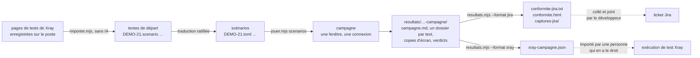

# Module `conformite` (D22)

Phases 7E couvertes : État et Expression.

## 1. Principe

Un testeur qui recette un lot de tests joue chacun d'eux, puis rend un rapport de conformité : pour chaque test, conforme ou non, l'étape en cause, et ses copies d'écran, qu'il colle dans Jira et joint au ticket, ou qu'il verse dans Xray. Le skill fait de même sur le poste. `jouer.mjs` joue une campagne, plusieurs scénarios l'un après l'autre, dans la même fenêtre, avec une seule connexion ; chaque vérification a sa copie d'écran, chaque test son verdict ; puis `resultats.mjs` écrit le rapport de conformité, prêt à coller dans Jira, et le fichier d'import des résultats de Xray, prêt à importer. Rien n'est envoyé : le développeur colle, joint et importe lui-même, avec ses droits (D22.INV-4).



## 2. La campagne (D22.INV-1)

```text
node <skill>/scripts/jouer.mjs <dossier de scénarios | scénario.toml>... [--param nom=valeur]... [--resultats dossier] [--sans-tete] [--ralenti ms] [--autoriser-mutations]
```

Deux scénarios ou plus font une campagne : un dossier donne ses scénarios `.toml`, dans l'ordre de leur nom, ses sous-dossiers non parcourus ; des fichiers se jouent dans l'ordre donné ; un dossier d'un seul scénario le joue seul, comme une exécution ordinaire. Un scénario de préparation (module `donnees`) se range donc hors du dossier de la campagne, dans un sous-dossier par exemple, pour n'être joué que par le scénario qui le nomme.

- **Tout est contrôlé avant la première action** : chaque scénario est lu, validé et contrôlé comme pour une exécution seule, sa traduction comprise, avec la garde des mutations hors du poste ; un seul refus refuse la campagne, avec le code 2, sans ouvrir le navigateur ni créer de dossier de résultats. Un scénario désigné deux fois, un dossier sans scénario, `--jeu` et `--trace` sont refusés de même.
- **Un profil** : les scénarios d'une campagne partagent leur profil, celui où se fait la connexion ; des profils mêlés sont refusés, à jouer en campagnes distinctes.
- **Une fenêtre, une connexion** : la campagne s'ouvre dans un seul contexte du navigateur, sur ce profil ; une étape à la main n'y demande la connexion qu'une fois, la session restant ouverte pour les scénarios suivants tant que l'application la garde, même une session sans cookie persistant.
- **La garde de chaque scénario** : avant chaque scénario, la garde des origines prend ses origines déclarées, et son journal repart à zéro : une origine que l'un déclare reste bloquée pour l'autre (D7.INV-1). `--autoriser-mutations` vaut pour la campagne entière ; l'agent ne le passe qu'avec l'accord explicite du développeur (D10.INV-2).
- **Un test en échec n'arrête pas les suivants** : chaque scénario joue ses jeux, sa préparation et son nettoyage comme seul (modules `actions` et `donnees`), et le suivant commence après son nettoyage.
- **Code de sortie** : 0 si chaque scénario a réussi, 1 sinon, 2 si la campagne est refusée (D1.INV-4).

Sortie, au fil de l'eau, puis le bilan :

```text
Campagne : 4 scénarios, profil defaut ; chrome 158.0.8127.65
[1/4] Connexion : 1 jeu, 3 étapes (a-connexion.toml)
À VOUS : Connectez-vous — la suite reprend dès que l'adresse /accueil-connecte est atteinte (20 s au plus).
  ok   1. naviguer /connexion
  …
Verdict : conforme
[2/4] …
  conforme      Connexion (a-connexion.toml)
  conforme      Session (b-session.toml)
  NON CONFORME  Liste (c-liste.toml) : étape 2 : attendu : 2 éléments ; obtenu : 1 élément
  BLOQUÉ        Bloqué (d-bloque.toml) : étape 2 : délai de 2 s dépassé
Campagne : 4 tests, 2 conformes, 1 non conforme, 1 bloqué
Rapport de campagne : …/scenarios/resultats/20261123-141503-campagne/campagne.md
```

Ce que la campagne écrit, dans le dossier de résultats (`resultats/` à côté du premier scénario, ou `--resultats`) :

```text
resultats/20261123-141503-campagne/
  campagne.json                      format scenario-playwright.campagne/1
  campagne.md                        une ligne par test : verdict, cause, rapport
  20261123-141503-a-connexion/       le dossier de résultats de chaque test, comme seul (module preuves)
    rapport.json, rapport.md, captures/…
  20261123-141506-c-liste/
  …
```

`campagne.json` porte `format`, `skill`, `version`, `debut`, `fin`, `duree_ms`, `profil`, `navigateur`, `tests`, `bilan` (`tests`, `conformes`, `non_conformes`, `bloques`) et `verdict` ; chaque test, son `scenario`, chemin relatif au dossier de la campagne, son `fichier`, son `titre`, ses `etiquettes`, son `dossier` de résultats, son `statut`, son `verdict`, sa `cause` et le `jeu` qu'elle concerne, sa `duree_ms` et son `bilan`.

## 3. Copies d'écran (D22.INV-2)

Chaque test rend ses copies d'écran dans le dossier `captures/` de ses résultats (module `preuves`) :

| Moment | Fichier, dans `captures/` | Champ du rapport |
|---|---|---|
| chaque vérification à l'écran, réussie ou non | `06-verifier.png`, ou `j2-06-verifier.png` pour le jeu 2 | `capture` de l'étape |
| chaque vérification hors de l'écran (`requete`, `api`, `fichier`) : la page à ce moment | `07-verifier.png` | `capture` de l'étape, à côté de son relevé `hors_ecran` |
| chaque étape `capturer` | le nom demandé | `capture` de l'étape |
| chaque échec, d'une étape, d'une préparation ou d'un nettoyage | `04-cliquer-echec.png`, `p1-preparation-echec.png`, `n1-nettoyage-echec.png` | `capture` de l'étape ou de l'entrée, avec l'instantané ARIA |
| la fin des étapes de chaque jeu, avant le nettoyage, réussite ou échec | `fin.png`, ou `j2-fin.png` | `capture_fin` du jeu |

Une copie qui ne peut se faire, la page fermée ou absente, laisse son champ à `null`, sans changer le résultat de l'étape.

## 4. Verdict (D22.INV-3)

Chaque jeu reçoit un verdict, qui dit ce que le test établit :

| Verdict | Règle | Xray Cloud | Xray Data Center | Zephyr Scale |
|---|---|---|---|---|
| conforme | toutes les étapes et toutes les préparations ont réussi | `PASSED` | `PASS` | `Passed` |
| non conforme | la première étape en échec est une vérification : l'application ne fait pas ce que le test attend | `FAILED` | `FAIL` | `Failed` |
| bloqué | une préparation, ou une étape qui n'est pas une vérification (navigation, action, attente, étape à la main), a échoué la première : le test n'a pu aller jusqu'à ses vérifications | `ABORTED` | `ABORTED` | `Blocked` |

Le nettoyage n'entre pas dans le verdict : un nettoyage en échec reste signalé, sans le changer (D20.INV-4). Le verdict d'un test à plusieurs jeux, et celui d'une campagne, sont non conformes si l'un l'est, sinon bloqués si l'un l'est, sinon conformes. Le statut, `reussi` ou `echec`, et le code de sortie ne changent pas : le verdict s'y ajoute. La cause d'un verdict est la première entrée ou étape en échec, avec sa ligne du texte et son message : `étape 2, ligne 12 : attendu : 2 éléments ; obtenu : 1 élément`. `rapport.json` porte le `verdict` de l'exécution et, pour chaque jeu, `verdict` et `cause` ; `rapport.md` l'écrit en tête, et la sortie après le bilan. `resultats.mjs` recalcule les verdicts depuis les étapes du rapport.

## 5. Rapport de conformité à coller dans Jira (D22.INV-4)

```text
node <skill>/scripts/resultats.mjs <dossier de campagne | dossier de résultats>... --format jira [--preuves] [--cle CLÉ] [--sortie <dossier>]
```

| Fichier | Contenu | Pour |
|---|---|---|
| `conformite-jira.txt` | le rapport en balisage wiki de Jira : bilan, une ligne par test avec son verdict et sa cause, puis chaque test, ses jeux et ses étapes, statut et message, et, avec `--preuves`, chaque copie d'écran citée par son nom, `!DEMO-21-02.png\|thumbnail!` | Jira Data Center, et Jira Cloud dans un champ en texte wiki |
| `conformite.html` | le même rapport, en page HTML autonome, les copies d'écran incluses dans la page avec `--preuves` | Jira Cloud : la page s'ouvre dans le navigateur, se sélectionne entière (Ctrl+A), se copie et se colle dans l'éditeur de Jira, avec sa mise en forme et ses tableaux |
| `captures-jira/` | avec `--preuves` seulement : chaque copie d'écran, sous son nom stable ; les anciennes copies du dossier sont retirées | à joindre au ticket avant de coller le balisage, qui les cite |

- **Noms stables** : `<clé>-<n° de l'étape sur deux chiffres>.png`, `<clé>-fin.png`, `<clé>-p1.png` pour une préparation, `<clé>-p1-02.png` pour l'étape d'un scénario de préparation, `<clé>-n1.png` pour un nettoyage, et `<clé>-j2-03.png` pour le jeu 2 d'un test à plusieurs jeux ; la clé est celle du test, retenue à l'import (module `export`, § 8), ou celle de `--cle` pour un seul rapport ; à défaut, le nom du scénario. Deux tests qui donneraient les mêmes noms sont refusés.
- **Texte sûr** : dans le balisage, chaque caractère de mise en forme du wiki d'un titre, d'une étape ou d'un message est échappé (`\ | * _ + ^ ~ { } [ ] ! #`, et un tiret en bord de mot) ; dans la page, le HTML est échappé. Les messages viennent des rapports, où les secrets sont déjà masqués (D19.INV-2, D20.INV-2).
- **Même rapport, même texte** : les mêmes rapports donnent, octet pour octet, le même balisage et la même page.
- **Où** : à côté d'un seul rapport, dans le dossier d'une campagne, sinon dans le dossier de `--sortie` ou le dossier courant.

Coller dans Jira : en Data Center, joindre d'abord au ticket les fichiers de `captures-jira/`, puis coller le contenu de `conformite-jira.txt` dans un commentaire ou un champ de texte, en mode texte ; en Cloud, ouvrir `conformite.html` dans le navigateur du poste, tout sélectionner, copier, puis coller dans le commentaire ou la description ; une copie d'écran que l'éditeur ne reprend pas au collage se joint depuis `captures-jira/`, sous le nom que la page affiche sous elle. Le skill ne fait ni l'un ni l'autre : il n'écrit jamais dans Jira (D17.INV-2).

## 6. Résultats de la campagne pour Xray

`resultats.mjs <dossier de campagne> --format xray` écrit `xray-campagne.json`, dans le dossier de la campagne, au format JSON d'import des résultats d'exécution de Xray Cloud ; `--format xray-dc` celui de Xray Data Center (module `export`, § 8) :

- un test par scénario de la campagne, sous la clé retenue à l'import, avec le statut de son verdict (§ 4) et un commentaire, chaque jeu avec son verdict et son étape en échec ;
- pour un test manuel converti dont le texte n'a changé ni depuis l'import ni depuis l'exécution, le statut de chacun de ses pas, et, sur `--preuves`, ses copies d'écran sur ce pas, l'écran final et les autres copies sur le test (`evidence` en Cloud, `evidences` en Data Center) ;
- `--execution DEMO-100` verse les résultats dans une exécution de test existante (`testExecutionKey`) ; sans elle, Xray crée une exécution à l'import.

Le fichier s'importe dans Xray par une personne qui en a le droit, « Import Execution Results » ; il contient les copies d'écran en base64 avec `--preuves`, et sert aussi à les joindre. Rien n'est envoyé.

## 7. Sur un poste fermé, de bout en bout

Sur un poste Windows dont rien ne sort, sans jeton d'API, en CMD :

1. Dans Chrome, le développeur ouvre chaque test de Xray, connecté lui-même, et l'enregistre en « Page Web, complète » dans un dossier, `C:\recette\pages`.
2. `node <skill>\scripts\importer.mjs C:\recette\pages --adresse https://recette.exemple.fr --dossier C:\recette\scenarios` écrit un texte par test (module `cas-de-test`, § 7) ; une page refusée se décrit par `--diagnostic`, sans aucune de ses valeurs.
3. Chaque texte se traduit, se vérifie et se ratifie (modules `scenario` et `agent`).
4. `node <skill>\scripts\jouer.mjs C:\recette\scenarios` joue la campagne ; le développeur se connecte une fois, à la main, quand le skill le lui demande.
5. `node <skill>\scripts\resultats.mjs C:\recette\scenarios\resultats\<horodatage>-campagne --format jira --preuves` écrit le rapport de conformité et les copies d'écran ; `--format xray --preuves`, ou `xray-dc`, le fichier d'import des résultats.

Les pages enregistrées, les scénarios, les résultats et les rapports restent sur le poste (D1.INV-2).

## 8. Contrôle de sortie

- Une campagne contrôle tous ses scénarios avant la première action, se joue dans une seule fenêtre avec une seule connexion, garde les origines de chaque scénario, et ne s'arrête pas à un test en échec ; elle écrit `campagne.json`, `campagne.md` et le dossier de chaque test (D22.INV-1).
- Chaque vérification, chaque échec et la fin des étapes de chaque jeu ont leur copie d'écran (D22.INV-2).
- Chaque jeu, chaque test et la campagne ont leur verdict, conforme, non conforme ou bloqué, et sa cause (D22.INV-3).
- Le rapport de conformité s'écrit en balisage wiki et en page HTML, mêmes contenus, texte échappé, copies d'écran sous leur nom stable avec `--preuves` seulement ; les mêmes rapports donnent le même texte ; rien n'est envoyé (D22.INV-4).
- Joués contre l'application de démonstration, une campagne, ses verdicts, ses copies d'écran, son rapport de conformité et ses résultats pour Xray se vérifient (module `recette`, R40 à R43).

## 9. Source `scripts/conformite.mjs`

Copies d'écran d'un rapport et leurs noms stables, rapport de conformité en balisage wiki de Jira et en page HTML autonome. La campagne est dans `scripts/jouer.mjs` (module `execution`), les verdicts et le rapport de campagne dans `scripts/rapport.mjs` (module `preuves`), les copies d'écran dans `scripts/moteur.mjs` (module `actions`), la commande dans `scripts/resultats.mjs` (module `export`).

<!-- fichier : scripts/conformite.mjs -->
```javascript
// scenario-playwright 1.6.8 : rapport de conformité à coller dans Jira, écrit depuis les rapports d'exécution (D22).
//
// Pour chaque test : son verdict (conforme, non conforme, bloqué), l'étape en cause et son message, le statut
// de chaque étape, et ses copies d'écran, sous un nom stable : <clé>-<n° de l'étape>.png, <clé>-fin.png,
// <clé>-p1.png pour une préparation, <clé>-j2-03.png pour le jeu 2. Deux formes : le balisage wiki de Jira
// Data Center, qui cite les copies d'écran jointes au ticket, et une page HTML autonome, à ouvrir dans le
// navigateur puis à copier-coller dans l'éditeur de Jira Cloud, les images y étant incluses. Même rapport,
// même texte (D22.INV-4). Rien n'est envoyé : ce module écrit du texte, que le développeur colle lui-même.
import { causeLisible as cause, LIBELLES_VERDICT } from './rapport.mjs';

const deux = (n) => String(n).padStart(2, '0');

/**
 * Copies d'écran d'un rapport, dans l'ordre du rapport : [{ chemin, nom, ou }] ; `chemin` est relatif au
 * dossier du rapport, `nom` le nom stable, `ou` situe la copie : { jeu, genre (etape, entree, sous, fin),
 * numero, entree?, etape }. Le préfixe de jeu n'apparaît que si le rapport a plusieurs jeux.
 */
export function capturesDuRapport(rapport, base) {
  const sortie = [];
  const plusieurs = rapport.jeux.length > 1;
  for (const j of rapport.jeux) {
    const pj = plusieurs ? `j${j.numero}-` : '';
    const entree = (x, marque) => {
      if (x.capture) sortie.push({ chemin: x.capture, nom: `${base}-${pj}${marque}${x.numero}.png`, ou: { jeu: j.numero, genre: 'entree', numero: x.numero, marque, ref: x } });
      for (const e of x.etapes ?? []) if (e.capture) sortie.push({ chemin: e.capture, nom: `${base}-${pj}${marque}${x.numero}-${deux(e.numero)}.png`, ou: { jeu: j.numero, genre: 'sous', numero: e.numero, marque, entree: x.numero, ref: e } });
    };
    for (const x of j.preparation ?? []) entree(x, 'p');
    for (const e of j.etapes) if (e.capture) sortie.push({ chemin: e.capture, nom: `${base}-${pj}${deux(e.numero)}.png`, ou: { jeu: j.numero, genre: 'etape', numero: e.numero, ref: e } });
    for (const x of j.nettoyage ?? []) entree(x, 'n');
    if (j.capture_fin) sortie.push({ chemin: j.capture_fin, nom: `${base}-${pj}fin.png`, ou: { jeu: j.numero, genre: 'fin' } });
  }
  return sortie;
}

const STATUTS_ETAPE = { reussie: 'réussie', echec: 'en échec', non_jouee: 'non jouée' };
const ICONES_ETAPE = { reussie: '(/)', echec: '(x)', non_jouee: '(-)' };
const ICONES_VERDICT = { conforme: '(/)', non_conforme: '(x)', bloque: '(!)' };
const majuscule = (s) => s.charAt(0).toUpperCase() + s.slice(1);
const pluriel = (n, un, plusieurs = `${un}s`) => `${n} ${n > 1 ? plusieurs : un}`;
const secondes = (ms) => `${String(Math.round(ms / 100) / 10).replace('.', ',')} s`;

/** Bilan d'un ensemble de tests : décompte des verdicts. */
export function bilanDes(tests) {
  const n = (v) => tests.filter((t) => t.verdict === v).length;
  return { tests: tests.length, conformes: n('conforme'), non_conformes: n('non_conforme'), bloques: n('bloque') };
}
const phraseBilan = (b) => `${pluriel(b.tests, 'test')}, ${pluriel(b.conformes, 'conforme')}, ${b.non_conformes} non conforme${b.non_conformes > 1 ? 's' : ''}, ${pluriel(b.bloques, 'bloqué')}`;

/** Lignes d'un jeu : ses entrées de préparation, ses étapes, ses entrées de nettoyage, chacune avec sa copie d'écran. */
function lignesDuJeu(j, captures) {
  const capture = (ref) => captures.find((c) => c.ou.ref === ref)?.nom ?? null;
  const l = [];
  const entree = (x, marque) => {
    l.push({ numero: `${marque}${x.numero}`, ligne: x.ligne ?? null, resume: `${marque === 'p' ? 'préparation' : 'nettoyage'} : ${x.resume}`, statut: x.statut, detail: x.statut === 'echec' ? x.message : '', capture: capture(x) });
    for (const e of x.etapes ?? []) l.push({ numero: `${marque}${x.numero}.${e.numero}`, ligne: e.ligne ?? null, resume: e.resume, statut: e.statut, detail: e.statut === 'echec' ? e.message : '', capture: capture(e) });
  };
  for (const x of j.preparation ?? []) entree(x, 'p');
  for (const e of j.etapes) l.push({ numero: String(e.numero), ligne: e.ligne ?? null, resume: e.resume, statut: e.statut, detail: e.statut === 'echec' ? e.message : '', capture: capture(e) });
  for (const x of j.nettoyage ?? []) entree(x, 'n');
  return l;
}

const jeuEnTitre = (j) => `Jeu ${j.numero}${Object.keys(j.valeurs ?? {}).length ? ` : ${Object.entries(j.valeurs).filter(([k]) => k !== 'unique').map(([k, v]) => `${k} = ${v}`).join(', ')}` : ''}`;

// --- Balisage wiki de Jira (Data Center) ----------------------------------------------------------------

/**
 * Texte sûr dans le balisage wiki : sur une ligne, chaque caractère de mise en forme échappé ; un tiret ne
 * l'est qu'en bord de mot, où il barrerait le texte (« Jean-Pierre » reste tel quel).
 */
export const echapperWiki = (s) => String(s ?? '').replace(/[\r\n]+/g, ' ').replace(/[\\|*_+^~{}[\]!#]/g, (c) => `\\${c}`).replace(/(^|\s)-|-(?=\s|$)/g, (m) => m.replace('-', '\\-')).trim() || ' ';

/**
 * Rapport de conformité en balisage wiki de Jira : le bilan, une ligne par test, puis chaque test, son
 * verdict et ses étapes. Avec preuves, chaque copie d'écran est citée par son nom (!nom|thumbnail!), à joindre
 * au ticket avant de coller le texte. `tests` : [{ cle, base, rapport, captures }].
 */
export function rapportWiki(tests, { preuves }) {
  const b = bilanDes(tests);
  const l = [`h2. Conformité : ${echapperWiki(phraseBilan(b))}`];
  const premier = tests.map((t) => t.rapport.debut).sort()[0];
  const nav = tests[0]?.rapport.navigateur;
  l.push(`Exécuté par scenario-playwright ${echapperWiki(tests[0]?.rapport.version ?? '')} le ${echapperWiki(premier?.slice(0, 16).replace('T', ' à ') ?? '')} (UTC)${nav ? `, ${echapperWiki(`${nav.canal} ${nav.version}`)}` : ''}. ${preuves ? 'Copies d\'écran : à joindre au ticket depuis le dossier captures\\-jira, avant de coller ce texte.' : 'Copies d\'écran non jointes : resultats.mjs \\-\\-preuves les ajoute.'}`, '');
  if (tests.length > 1) {
    l.push('||#||Test||Titre||Verdict||Cause||');
    tests.forEach((t, k) => l.push(`|${k + 1}|${echapperWiki(t.cle ?? t.base)}|${echapperWiki(t.rapport.scenario.titre)}|${ICONES_VERDICT[t.verdict]} ${majuscule(LIBELLES_VERDICT[t.verdict])}|${echapperWiki(t.cause ? `${t.jeu ? `jeu ${t.jeu}, ` : ''}${cause(t.cause)}` : '')}|`));
    l.push('');
  }
  for (const t of tests) {
    const r = t.rapport;
    l.push(`h3. ${echapperWiki(`${t.cle ? `${t.cle} : ` : ''}${r.scenario.titre}`)} ${ICONES_VERDICT[t.verdict]} ${majuscule(LIBELLES_VERDICT[t.verdict])}`);
    l.push(`Exécution : ${echapperWiki(r.debut)}, ${echapperWiki(secondes(r.duree_ms))} ; ${pluriel(r.bilan.etapes, 'étape')}, ${r.bilan.reussies} réussie${r.bilan.reussies > 1 ? 's' : ''}, ${r.bilan.echecs} en échec, ${r.bilan.non_jouees} non jouée${r.bilan.non_jouees > 1 ? 's' : ''}${t.cause ? ` ; cause : ${echapperWiki(cause(t.cause))}` : ''}.`);
    for (const j of t.jeux) {
      if (t.jeux.length > 1) l.push(`h4. ${echapperWiki(jeuEnTitre(j))} ${ICONES_VERDICT[j.verdict]} ${majuscule(LIBELLES_VERDICT[j.verdict])}`);
      l.push(preuves ? '||#||Ligne||Étape||Statut||Détail||Copie d\'écran||' : '||#||Ligne||Étape||Statut||Détail||');
      for (const x of lignesDuJeu(j, t.captures)) {
        const cellules = [echapperWiki(x.numero), echapperWiki(x.ligne ?? ''), echapperWiki(x.resume), `${ICONES_ETAPE[x.statut]} ${STATUTS_ETAPE[x.statut]}`, echapperWiki(x.detail)];
        if (preuves) cellules.push(x.capture ? `!${x.capture}|thumbnail!` : ' ');
        l.push(`|${cellules.join('|')}|`);
      }
      const fin = t.captures.find((c) => c.ou.genre === 'fin' && c.ou.jeu === j.numero);
      if (preuves && fin) l.push(`Écran à la fin des étapes : !${fin.nom}|thumbnail!`);
    }
    if ((r.bilan.nettoyages_en_echec ?? 0) > 0) l.push(`(!) Nettoyage en échec : des données créées par l'exécution peuvent rester.`);
    l.push('');
  }
  return `${l.join('\n').replace(/\n+$/, '')}\n`;
}

// --- Page HTML (Jira Cloud) --------------------------------------------------------------------------

const echapperHtml = (s) => String(s ?? '').replace(/[&<>"']/g, (c) => ({ '&': '&amp;', '<': '&lt;', '>': '&gt;', '"': '&quot;', "'": '&#39;' }[c]));
const STYLE = `body{font-family:system-ui,-apple-system,"Segoe UI",sans-serif;margin:2rem auto;max-width:72rem;padding:0 1rem;color:#1f2328;background:#fff;line-height:1.45}
h1{font-size:1.5rem}h2{font-size:1.2rem;margin-top:2.2rem}h3{font-size:1.05rem}
table{border-collapse:collapse;width:100%;margin:.6rem 0 1rem}th,td{border:1px solid #d0d7de;padding:.35rem .5rem;text-align:left;vertical-align:top}th{background:#f6f8fa}
.v{display:inline-block;padding:.05rem .5rem;border-radius:.6rem;font-size:.85rem;font-weight:600;white-space:nowrap}.conforme{background:#dafbe1;color:#116329}.non_conforme{background:#ffebe9;color:#a40e26}.bloque{background:#fff8c5;color:#7d4e00}
.reussie{color:#116329}.echec{color:#a40e26;font-weight:600}.non_jouee{color:#57606a}
img{max-width:100%;border:1px solid #d0d7de}td img{max-width:16rem}figure img{max-width:48rem}figure{margin:.5rem 0}figcaption{font-size:.85rem;color:#57606a}`;

/**
 * Rapport de conformité en page HTML autonome : mêmes contenus que le balisage wiki ; avec preuves, chaque
 * copie d'écran est incluse dans la page (data:), sous son nom stable. `image(t, chemin)` rend le PNG en
 * base64, ou null s'il manque.
 */
export function rapportHtml(tests, { preuves, image }) {
  const b = bilanDes(tests);
  const titre = `Conformité : ${phraseBilan(b)}`;
  const premier = tests.map((t) => t.rapport.debut).sort()[0];
  const nav = tests[0]?.rapport.navigateur;
  const img = (t, c, classe = '') => {
    const data = c ? image(t, c.chemin) : null;
    return data ? `` : '';
  };
  const h = [`<!doctype html>\n<html lang="fr"><head><meta charset="utf-8"><title>${echapperHtml(titre)}</title><style>${STYLE}</style></head><body>`];
  h.push(`<h1>${echapperHtml(titre)}</h1>`);
  h.push(`<p>Exécuté par scenario-playwright ${echapperHtml(tests[0]?.rapport.version ?? '')} le ${echapperHtml(premier?.slice(0, 16).replace('T', ' à ') ?? '')} (UTC)${nav ? `, ${echapperHtml(`${nav.canal} ${nav.version}`)}` : ''}. ${preuves ? 'Les copies d\'écran sont aussi dans le dossier captures-jira, à joindre au ticket.' : 'Copies d\'écran non jointes : resultats.mjs --preuves les ajoute.'}</p>`);
  if (tests.length > 1) {
    h.push('<table><thead><tr><th>#</th><th>Test</th><th>Titre</th><th>Verdict</th><th>Cause</th></tr></thead><tbody>');
    tests.forEach((t, k) => h.push(`<tr><td>${k + 1}</td><td>${echapperHtml(t.cle ?? t.base)}</td><td>${echapperHtml(t.rapport.scenario.titre)}</td><td><span class="v ${t.verdict}">${majuscule(LIBELLES_VERDICT[t.verdict])}</span></td><td>${echapperHtml(t.cause ? `${t.jeu ? `jeu ${t.jeu}, ` : ''}${cause(t.cause)}` : '')}</td></tr>`));
    h.push('</tbody></table>');
  }
  for (const t of tests) {
    const r = t.rapport;
    h.push(`<section><h2>${echapperHtml(`${t.cle ? `${t.cle} : ` : ''}${r.scenario.titre}`)} <span class="v ${t.verdict}">${majuscule(LIBELLES_VERDICT[t.verdict])}</span></h2>`);
    h.push(`<p>Exécution : ${echapperHtml(r.debut)}, ${echapperHtml(secondes(r.duree_ms))} ; ${pluriel(r.bilan.etapes, 'étape')}, ${r.bilan.reussies} réussie${r.bilan.reussies > 1 ? 's' : ''}, ${r.bilan.echecs} en échec, ${r.bilan.non_jouees} non jouée${r.bilan.non_jouees > 1 ? 's' : ''}${t.cause ? ` ; cause : ${echapperHtml(cause(t.cause))}` : ''}.</p>`);
    for (const j of t.jeux) {
      if (t.jeux.length > 1) h.push(`<h3>${echapperHtml(jeuEnTitre(j))} <span class="v ${j.verdict}">${majuscule(LIBELLES_VERDICT[j.verdict])}</span></h3>`);
      h.push(`<table><thead><tr><th>#</th><th>Ligne</th><th>Étape</th><th>Statut</th><th>Détail</th>${preuves ? '<th>Copie d\'écran</th>' : ''}</tr></thead><tbody>`);
      for (const x of lignesDuJeu(j, t.captures)) {
        const c = x.capture ? t.captures.find((y) => y.nom === x.capture) : null;
        h.push(`<tr><td>${echapperHtml(x.numero)}</td><td>${echapperHtml(x.ligne ?? '')}</td><td>${echapperHtml(x.resume)}</td><td class="${x.statut}">${STATUTS_ETAPE[x.statut]}</td><td>${echapperHtml(x.detail)}</td>${preuves ? `<td>${img(t, c)}${c ? `<br>${echapperHtml(c.nom)}` : ''}</td>` : ''}</tr>`);
      }
      h.push('</tbody></table>');
      const fin = t.captures.find((c) => c.ou.genre === 'fin' && c.ou.jeu === j.numero);
      if (preuves && fin) h.push(`<figure>${img(t, fin)}<figcaption>${echapperHtml(fin.nom)} : écran à la fin des étapes</figcaption></figure>`);
    }
    if ((r.bilan.nettoyages_en_echec ?? 0) > 0) h.push('<p><strong>Nettoyage en échec</strong> : des données créées par l\'exécution peuvent rester.</p>');
    h.push('</section>');
  }
  h.push('</body></html>');
  return `${h.join('\n')}\n`;
}
```
