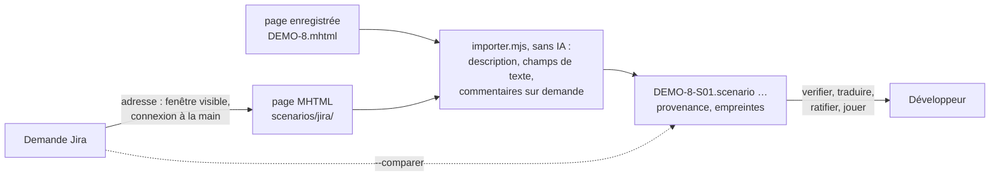

# Module `jira` (D16)

Phases 7E couvertes : Environnement et Éléments.

## 1. Principe

Les scénarios d'une US s'écrivent souvent dans Jira, par le PO ou par agent-tdd-jira. `scripts/importer.mjs` les recopie, sans IA, en textes de départ : un fichier `.scenario` par scénario, que le développeur vérifie, fait traduire, ratifie et joue comme un texte écrit à la main (modules `texte` et `scenario`). Le texte reste la référence de sa traduction (D3.INV-2) ; Jira reste la référence du texte importé : un réimport, ou `--comparer`, dit ce qui a changé dans Jira depuis l'import.

`importer.mjs` lit aussi des fichiers `.feature`, des archives d'export et les tests de Xray et de Zephyr Scale (module `cas-de-test`, D17). Le lecteur de Gherkin (§ 4), le texte importé (§ 5), le réimport (§ 6) et la ligne de commande (§ 7) de ce module valent pour toutes les sources ; ce qui leur est propre est dans `cas-de-test`.



Le skill n'écrit jamais dans Jira. Une page enregistrée n'est jamais modifiée.

## 2. Deux sources, un lecteur (D16.INV-1)

| Source | Commande | Ce qui se passe |
|---|---|---|
| page enregistrée | `node <skill>/scripts/importer.mjs DEMO-8.mhtml --adresse http://127.0.0.1:4200` | lue sans navigateur ; son empreinte sha256 est notée dans chaque texte importé |
| adresse de la demande | `node <skill>/scripts/importer.mjs https://jira.exemple.fr/browse/DEMO-8 --adresse http://127.0.0.1:4200` | la demande s'ouvre dans le navigateur du poste, fenêtre visible, sur le profil `jira` ; la page est enregistrée en MHTML dans `<dossier>/jira/DEMO-8-<horodatage>.mhtml`, puis lue comme une page enregistrée |

Une page enregistrée vient de « Enregistrer sous… », « Page Web, un seul fichier », dans Chrome ou Edge, de capture-sprint-jira (`capture-sprint-jira:D4.INV-3`), ou c'est la page remise à agent-tdd-jira, lue elle aussi en lecture seule (`agent-tdd-jira:D1.INV-1`). Le MHTML se décode comme Chrome l'écrit : quoted-printable ou base64, jeu de caractères de la partie HTML.

Par l'adresse :

1. Le skill navigue vers l'adresse donnée, et rien d'autre : il ne clique, ne saisit, ne fait défiler et n'envoie rien dans la page.
2. Si la demande ne s'affiche pas en 3 s, il écrit `À VOUS : connectez-vous à Jira dans la fenêtre…` et attend qu'elle s'affiche, `--delai-connexion` secondes au plus (300 par défaut, de 1 à 900). Le développeur se connecte lui-même, et revient sur la demande si Jira ne l'y ramène pas. Passé le délai, l'import est refusé, avec le code 2, sans rien écrire.
3. La page est enregistrée quand elle ne change plus : deux relevés identiques, à 500 ms d'intervalle, 10 s au plus.
4. Le profil dédié, `jira` par défaut (`--profil-jira`), garde la session : un SSO aux cookies persistants ne redemande pas la connexion. Il vit dans le dossier des profils (module `execution`, § 3) et ne sert à aucune application : `jira` ne se donne pas comme `Profil :` d'un texte.

La garde des origines (module `garde`) protège l'exécution d'un scénario ; la fenêtre de Jira n'en joue aucun, et la connexion peut passer par le fournisseur d'identité de l'entreprise : elle n'est pas gardée, d'où la règle du point 1.

## 3. Ce qui est lu (D16.INV-2)

| | Jira Cloud | Jira Data Center |
|---|---|---|
| reconnu à | `data-testid="issue.views.…"` | `id="summary-val"` ou `id="description-val"` |
| clé | titre de la page (`[DEMO-8] …`), sinon adresse (`…/browse/DEMO-8`, `…?selectedIssue=DEMO-8`) | idem |
| résumé | `issue.views.issue-base.foundation.summary.heading` | `summary-val` |
| description | `issue.views.field.rich-text.description` | `description-val` |
| champs de texte | `issue.views.field.rich-text.customfield_<n>`, nommés « champ customfield_<n> » | `customfield_<n>-val`, nommés par leur libellé |
| commentaires, avec `--commentaires` | `issue-comment-base.ui.comment.ak-comment.<n>`, avec auteur et date | `comment-<n>` et son `action-body`, avec auteur et date |

Une page qui n'est ni de l'une ni de l'autre est refusée, comme un fichier qui n'est pas un MHTML. Le HTML de chaque zone devient des lignes, comme la page les affiche : un saut de ligne par bloc et par `<br>`, ceux des blocs de code gardés, chaque ligne de tableau réécrite `| a | b |` ; scripts, styles et boutons sont écartés. Le reste de la page (navigation, historique, liens) n'est pas lu.

Chaque limite s'écrit `LIMITE …` : description introuvable par les marqueurs, lien « afficher plus » parmi les commentaires (les déplier avant d'enregistrer la page), lignes d'étape hors d'un titre de scénario, par exemple sous un titre « Scénario 1 : » que Gherkin ne reconnaît pas. Les scénarios se relisent le plus fidèlement écrits dans un bloc de code (`{code:gherkin}` en Data Center, bloc de code en Cloud).

## 4. Scénarios recopiés (D16.INV-3)

Les mots-clés de Gherkin se lisent en français ou en anglais, sans tenir compte de la casse ni des accents (module `texte`, § 3, D2.INV-4), et se recopient tels qu'écrits. Dans chaque zone :

| Ligne de Jira | Effet dans les textes importés |
|---|---|
| `Fonctionnalité:` (`Feature:`) et ses étiquettes | recopiée, avec ses étiquettes, dans chaque scénario qui la suit dans la zone |
| `Règle:` (`Rule:`) et ses étiquettes | ses étiquettes rejoignent ses scénarios |
| `Contexte:` (`Background:`) | ses étapes se placent en tête des étapes de chaque scénario de sa fonctionnalité, ou de sa règle ; l'en-tête le signale |
| titre de scénario | `Scénario:`, `Exemple:`, `Plan du scénario:`, `Scenario:`, `Example:`, `Scenario Outline:`… ; les lignes de description qui le suivent, avant la première étape, sont ignorées |
| étape | recopiée telle quelle, mot-clé compris ; une ligne de prose après les étapes clôt le scénario |
| `Exemples:` (`Examples:`, `Scénarios:`) | un seul tableau ; ses étiquettes rejoignent le scénario |

Les colonnes d'exemples que le format texte refuse s'adaptent, sans accents, en minuscules, `_` entre les mots : « Nom du client » devient `nom_du_client`, et `<Nom du client>` devient `<nom_du_client>` dans les étapes ; l'en-tête le signale. Rien d'autre n'est réécrit.

Un scénario que le format texte n'exprime pas n'est pas écrit, et l'import dit pourquoi : table de données ou texte multiligne (`"""`) d'étape, ou dans le contexte ; plusieurs tableaux d'exemples ; étape après le tableau ; scénario sans étape ; tableau sans ligne de valeurs ; deux colonnes confondues une fois adaptées ; texte que refuse le lecteur du module `texte`, par exemple une variable non déclarée, l'erreur citant la ligne. Il se corrige dans Jira, puis se réimporte.

## 5. Le texte importé (D16.INV-4)

```text
# Importé de Jira par importer.mjs (scenario-playwright 1.6.4), sans IA : le scénario est recopié tel qu'écrit dans Jira.
# Demande : DEMO-8, « Créer un client depuis Jira »
# Scénario : @DEMO-8-S03, description
# Source : https://jira.exemple.fr/browse/DEMO-8
# Page enregistrée : jira/DEMO-8-20261120-181500.mhtml (sha256 82112e…)
# Importé le : 2026-11-20T17:15:00Z
# Empreinte Jira : 4dc9c9…
# Empreinte du texte importé : 066f18…
# Étiquette @DEMO-8-S03 attribuée par l'import, Jira n'en donnant pas : l'écrire dans Jira, avant le titre du scénario, la fixe.
# Contexte de Jira reporté en tête des étapes : 1 étape.
# Colonnes d'exemples adaptées au format texte : « Nom du client » en <nom_du_client>.

Fonctionnalité: Clients
@DEMO-8-S03 @DEMO-8
Plan du scénario: Créer plusieurs clients
  Adresse : http://127.0.0.1:4200
  Profil : crm

  Étant donné que je suis sur la page des clients
  Quand je clique sur le lien « Nouveau client »
  Et je saisis « <nom_du_client> » dans le champ « Nom »
  Et je choisis « <ville> » dans la liste « Ville »
  Et je clique sur le bouton « Enregistrer »
  Alors je vois le message « Client <nom_du_client> créé »

  Exemples:
    | nom_du_client | ville |
    | Leroy | Lyon |
    | Morel | Paris |
```

- **Nom** : `<ÉTIQUETTE>.scenario`, dans le dossier de `--dossier` (`scenarios` par défaut, relatif au dossier courant).
- **Étiquette** : celle que Jira donne au scénario, `@<CLÉ>-Snn` (`agent-tdd-jira:D2.INV-3`) ; sinon celle qu'un import précédent a attribuée au scénario de même titre ; sinon le plus petit numéro libre, dans l'ordre de la page, hors des numéros déjà portés par un texte importé de la demande. Le second scénario d'une même étiquette est un doublon : il n'est pas écrit.
- **Provenance** : les commentaires de tête, toujours dans cet ordre ; le lecteur de textes les ignore. L'empreinte Jira est le SHA-256 de ce que Jira dit du scénario : fonctionnalité, étiquettes, titre, étapes, exemples ; la prose autour n'y entre pas. L'empreinte du texte importé est celle du corps du texte, tel que l'import l'a écrit : elle dit si le texte a été retouché depuis.
- **Réglages** : `--adresse`, et s'il y a lieu `--origines` et `--profil`, donnés à l'import, s'écrivent sous le titre ; la ligne « Adresse : » est obligatoire (D2.INV-1).
- **Lot** : la demande est le lot de ses textes ; la première ligne de l'en-tête dit la source, `de Jira` ici, et la ligne « Demande : » le lot. Les textes des autres sources ont une ligne « Lot : » à la place (module `cas-de-test`, § 7).

## 6. Réimport et comparaison (D16.INV-5)

Les textes du dossier dont la provenance désigne la même demande sont comparés aux scénarios de la page, par leur étiquette ; un scénario dont Jira donne l'étiquette retrouve aussi le texte qu'une autre source a importé sous la même étiquette (module `cas-de-test`, D17.INV-4). Les mêmes états valent pour toute source, « changé dans » et « disparu de » la nommant :

| État | `--comparer` | import | import avec `--remplacer` |
|---|---|---|---|
| identique | `identique` | `inchangé` : le texte n'est pas réécrit | idem |
| modifié dans Jira | `modifié` | non remplacé ; code 1 | `remplacé` ; un texte retouché depuis l'import est d'abord gardé dans `<texte>.avant-<horodatage>` |
| nouveau | `nouveau` | `écrit` | `écrit` |
| disparu de Jira | `disparu` | signalé ; le texte reste | idem |
| conflit : un texte du même nom ne vient pas d'un import de ce scénario, écrit à la main par exemple | `conflit` | jamais remplacé ; code 1 | idem |
| refusé, doublon | `refusé`, `doublon`, avec le motif | non écrit ; code 1 | idem |

`--comparer` n'écrit aucun texte. Un texte remplacé rend sa traduction périmée, par l'empreinte (D3.INV-2) : elle se refait et se ratifie. Les marques `(création)`, `(modification)`, `(suppression)` et `(à la main)` manquent souvent aux scénarios de Jira : elles s'ajoutent de préférence dans Jira, où un réimport les retrouve ; ajoutées dans le texte, elles font un texte retouché, gardé à côté avant tout remplacement.

## 7. Ligne de commande et codes de sortie (D16.INV-6)

`importer.mjs <page.mhtml | adresse de la demande | fichier.feature | export.zip | xray:CLÉ,… | xray-dc:CLÉ,… | zephyr:CLÉ,… | zephyr-dc:CLÉ,…>` ; une source dont le nom ne finit ni par `.feature` ni par `.zip`, et qui n'est ni une adresse ni une désignation d'outil, se lit comme une page enregistrée :

| Option | Effet |
|---|---|
| `--adresse <url>` | adresse de l'application, ligne « Adresse : » des textes ; obligatoire, sauf avec `--comparer` |
| `--origines o1,o2` | ligne « Origines : » ; doit contenir l'origine de `--adresse` |
| `--profil <nom>` | ligne « Profil : » |
| `--dossier <dossier>` | dossier des textes, `scenarios` par défaut ; la page enregistrée par l'adresse va dans son sous-dossier `jira/` |
| `--commentaires` | lit aussi les commentaires (D16.INV-2) ; pour une demande Jira seulement |
| `--remplacer` | remplace les textes des scénarios modifiés dans Jira (§ 6) |
| `--comparer` | compare sans rien écrire ; exclut `--remplacer` |
| `--profil-jira <nom>` | profil du navigateur pour Jira, `jira` par défaut ; pour une demande Jira seulement |
| `--delai-connexion <s>` | attente de la demande par l'adresse, de 1 à 900 s, 300 par défaut ; pour une demande Jira seulement |
| `--api <url>` | adresse de l'API de Xray ou de Zephyr Scale (module `cas-de-test`, § 3) ; pour `xray:`, `xray-dc:`, `zephyr:` et `zephyr-dc:` seulement |

Sortie : `page enregistrée : …` par l'adresse, une ligne `Demande <CLÉ> (Jira Cloud ou Data Center), « résumé » : n scénarios (par zone)`, les `LIMITE …`, une ligne par scénario (état, étiquette, titre, fichier ou motif), puis `Bilan : …`. Les autres sources ont leur propre première ligne, et une ligne `introuvable` par test absent (module `cas-de-test`, § 8).

| Code | import | `--comparer` |
|---|---|---|
| 0 | chaque scénario est écrit, remplacé ou inchangé | chaque scénario est identique, aucun n'a disparu |
| 1 | un scénario n'est pas écrit : modifié sans `--remplacer`, conflit, refus, doublon, test introuvable ; ou aucun scénario | une différence, un refus, un test introuvable, ou aucun scénario |
| 2 | option, réglage, page, fichier, archive, variable d'environnement, requête à une API ou navigateur refusé, demande non affichée dans le délai, avant toute écriture de texte | idem |

## 8. Contrôle de sortie

- Une page enregistrée de Jira Cloud ou de Jira Data Center se lit, quoted-printable ou base64 ; une autre page est refusée (D16.INV-2).
- Les commentaires ne sont lus qu'avec `--commentaires` (D16.INV-2).
- Chaque scénario importable donne un texte que `verifier.mjs` accepte, mots-clés recopiés tels qu'écrits ; un scénario non importable est refusé avec son motif (D16.INV-3).
- Chaque texte porte sa provenance et son étiquette (D16.INV-4).
- Un réimport sans changement ne réécrit rien ; `--comparer` n'écrit rien ; un texte retouché est gardé avant d'être remplacé ; un texte écrit à la main n'est jamais remplacé (D16.INV-5).
- Par l'adresse, le skill ne fait que naviguer ; la connexion se fait à la main ; la page enregistrée est relisible (D16.INV-1).

## 9. Source `scripts/jira.mjs`

Le lecteur, sans navigateur : MHTML, demande, lignes du HTML, scénarios, étiquettes, texte importé et sources de son en-tête, provenance et lots, comparaison, identité d'une source à l'autre.

<!-- fichier : scripts/jira.mjs -->
```javascript
// scenario-playwright 1.6.4 : scénarios Gherkin d'une demande Jira enregistrée en MHTML, lus sans IA.
//
// Le décodage du MHTML (en-têtes, frontière, quoted-printable, base64, jeu de caractères) et les
// marqueurs de Jira Cloud et de Jira Data Center sont repris d'agent-tdd-jira 1.3.4 (module
// ingestion-jira). Seuls la description et les champs de texte de la demande sont lus, les commentaires
// sur demande (D16.INV-2). Chaque scénario est recopié tel qu'écrit dans Jira, en français ou en
// anglais, dans un texte de départ qui porte sa provenance (D16.INV-3, D16.INV-4).
import { Buffer } from 'node:buffer';
import { createHash } from 'node:crypto';
import { analyserTexte, estOrigine, lireMotCle, lireTitre, normaliser, origineDe, plat, RE_PROFIL } from './texte.mjs';

export class ErreurJira extends Error {}

const sha256 = (donnees) => createHash('sha256').update(donnees).digest('hex');

// --- MHTML ---------------------------------------------------------------------------------------

function lireEntetes(bloc) {
  const entetes = {};
  for (const ligne of bloc.replace(/\r?\n[ \t]+/g, ' ').split(/\r?\n/)) {
    const m = /^([\w-]+):\s*(.*)$/.exec(ligne);
    if (m) entetes[m[1].toLowerCase()] = m[2].trim();
  }
  return entetes;
}

function separerEntetes(texte) {
  const m = /\r?\n\r?\n/.exec(texte);
  return m ? [texte.slice(0, m.index), texte.slice(m.index + m[0].length)] : [texte, ''];
}

function decoderQuotedPrintable(texte) {
  const brut = texte.replace(/=\r?\n/g, '');
  const octets = [];
  for (let i = 0; i < brut.length; i++) {
    if (brut[i] === '=' && /^[0-9A-Fa-f]{2}$/.test(brut.slice(i + 1, i + 3))) {
      octets.push(parseInt(brut.slice(i + 1, i + 3), 16));
      i += 2;
    } else {
      octets.push(brut.charCodeAt(i) & 0xff);
    }
  }
  return Buffer.from(octets);
}

function decoderCorps(corps, encodage) {
  switch ((encodage ?? '').toLowerCase()) {
    case 'quoted-printable': return decoderQuotedPrintable(corps);
    case 'base64': return Buffer.from(corps.replace(/\s+/g, ''), 'base64');
    default: return Buffer.from(corps, 'latin1');
  }
}

/**
 * Page HTML d'un fichier MHTML : { html, emplacement, sha256 }. La première partie text/html est la
 * page ; son jeu de caractères vient de ses en-têtes. Lève ErreurJira si le fichier n'est pas un MHTML.
 */
export function lireMhtml(octets) {
  const brut = Buffer.from(octets).toString('latin1');
  const [blocEntetes] = separerEntetes(brut);
  const frontiere = /boundary="?([^";\r\n]+)"?/i.exec(lireEntetes(blocEntetes)['content-type'] ?? '')?.[1];
  if (!frontiere) throw new ErreurJira('frontière MIME introuvable : le fichier n\'est pas une page enregistrée en MHTML');
  const parties = brut.split(`--${frontiere}`).slice(1).filter((p) => !p.startsWith('--')).map((p) => {
    const [bloc, corps] = separerEntetes(p.replace(/^\r?\n/, ''));
    const entetes = lireEntetes(bloc);
    return {
      type: (entetes['content-type'] ?? '').split(';')[0].trim().toLowerCase(),
      charset: /charset="?([^";]+)"?/i.exec(entetes['content-type'] ?? '')?.[1]?.toLowerCase() ?? 'utf-8',
      emplacement: entetes['content-location'] ?? '',
      octets: decoderCorps(corps.replace(/\r?\n$/, ''), entetes['content-transfer-encoding']),
    };
  });
  const page = parties.find((p) => p.type === 'text/html');
  if (!page) throw new ErreurJira('aucune page HTML dans le fichier MHTML');
  const html = page.octets.toString(/8859|latin|windows-1252/.test(page.charset) ? 'latin1' : 'utf8');
  return { html, emplacement: page.emplacement, sha256: sha256(Buffer.from(octets)) };
}

// --- HTML ----------------------------------------------------------------------------------------

/** Bloc équilibré qui commence à la balise ouvrante contenant la position `index`. */
function blocDepuis(html, index) {
  const debut = html.lastIndexOf('<', index);
  const nom = /^<([a-zA-Z0-9]+)/.exec(html.slice(debut))?.[1]?.toLowerCase();
  if (!nom) return '';
  const motif = new RegExp(`<(/?)${nom}\\b[^>]*?(/?)>`, 'gi');
  motif.lastIndex = debut;
  let profondeur = 0;
  let m;
  while ((m = motif.exec(html))) {
    if (m[2] === '/') continue;
    profondeur += m[1] === '/' ? -1 : 1;
    if (profondeur === 0) return html.slice(debut, m.index + m[0].length);
  }
  return html.slice(debut);
}

/** Blocs portant un attribut, dans l'ordre de la page, sans les blocs imbriqués dans un bloc déjà pris. */
function blocsParAttribut(html, motifAttribut) {
  const blocs = [];
  const re = new RegExp(motifAttribut, 'g');
  let fin = -1;
  let m;
  while ((m = re.exec(html))) {
    if (m.index < fin) continue;
    const bloc = blocDepuis(html, m.index);
    blocs.push({ bloc, correspondance: m, index: m.index });
    fin = html.lastIndexOf('<', m.index) + bloc.length;
  }
  return blocs;
}

const ENTITES = {
  amp: '&', lt: '<', gt: '>', quot: '"', apos: "'", nbsp: ' ', eacute: 'é', egrave: 'è', ecirc: 'ê', euml: 'ë', agrave: 'à',
  acirc: 'â', ccedil: 'ç', ocirc: 'ô', ucirc: 'û', ugrave: 'ù', icirc: 'î', iuml: 'ï', Eacute: 'É', Egrave: 'È', Agrave: 'À',
  Ccedil: 'Ç', rsquo: '’', lsquo: '‘', laquo: '«', raquo: '»', ldquo: '“', rdquo: '”', hellip: '…', ndash: '–', mdash: '—',
};
const decoderEntites = (s) => s
  .replace(/&#(\d+);/g, (_, n) => String.fromCodePoint(Number(n)))
  .replace(/&#x([0-9a-f]+);/gi, (_, n) => String.fromCodePoint(parseInt(n, 16)))
  .replace(/&([a-zA-Z]+);/g, (e, n) => ENTITES[n] ?? e);

const ESPACES = /[\s\u00a0\u202f]+/g;
const sansBalises = (s) => decoderEntites(s.replace(/<[^>]+>/g, ' ')).replace(ESPACES, ' ').trim();

/**
 * Lignes de texte d'un fragment HTML, comme la page les affiche : un saut de ligne par bloc et par
 * <br>, les sauts de ligne gardés dans <pre>, chaque ligne de tableau réécrite « | a | b | ». Les
 * lignes sont en NFC, espaces regroupés ; les lignes vides restent.
 */
export function htmlEnLignes(fragment) {
  let html = fragment
    .replace(/<(script|style|svg|noscript|button)\b[\s\S]*?<\/\1>/gi, '')
    .replace(/<span\b[^>]*class="[^"]*linenumber[^"]*"[^>]*>\s*\d*\s*<\/span>/gi, '');
  // Lignes de tableau : cellules aplaties, barres verticales des cellules protégées.
  html = html.replace(/<tr\b[^>]*>([\s\S]*?)<\/tr>/gi, (_, ligne) => {
    const cellules = [...ligne.matchAll(/<t([dh])\b[^>]*>([\s\S]*?)<\/t\1>/gi)].map((c) => sansBalises(c[2]).replace(/\|/g, '\\|'));
    return `<br>| ${cellules.join(' | ')} |<br>`;
  });
  // Texte préformaté (<pre>, <code>) : ses sauts de ligne deviennent des <br>, les autres blancs du HTML des espaces.
  const morceaux = html.split(/(<pre\b[^>]*>[\s\S]*?<\/pre>|<code\b[^>]*>[\s\S]*?<\/code>)/i);
  html = morceaux.map((m, i) => (i % 2 === 1 ? m.replace(/\r?\n/g, '<br>') : m.replace(/\s+/g, ' '))).join('');
  const texte = html
    .replace(/<br\s*\/?>/gi, '\n')
    .replace(/<\/?(p|div|h[1-6]|li|pre|blockquote|table|thead|tbody|ul|ol|dt|dd|section|article|header|footer)\b[^>]*>/gi, '\n')
    .replace(/<[^>]+>/g, '');
  return decoderEntites(texte).split('\n').map((l) => l.replace(ESPACES, ' ').trim().normalize('NFC'));
}

// --- Demande Jira --------------------------------------------------------------------------------

/**
 * Demande lue dans la page : { variante, cle, resume, url, zones, limites }. Chaque zone a son genre
 * (description, champ, commentaire), son libellé de provenance et ses lignes. Une page qui n'est ni de
 * Jira Cloud ni de Jira Data Center est refusée (D16.INV-2).
 */
export function lireDemande(html, emplacement = '', { commentaires = false } = {}) {
  const titrePage = sansBalises(/<title[^>]*>([\s\S]*?)<\/title>/i.exec(html)?.[1] ?? '');
  const cloud = /data-testid="issue\.views\./.test(html);
  const datacenter = /id="(summary-val|description-val)"/.test(html);
  if (!cloud && !datacenter) throw new ErreurJira('page non reconnue comme une demande de Jira Cloud ou de Jira Data Center (D16.INV-2)');
  const cle = /\b([A-Z][A-Z0-9_]+-\d+)\b/.exec(titrePage)?.[1] ?? /(?:\/browse\/|[?&]selectedIssue=)([A-Z][A-Z0-9_]+-\d+)/.exec(emplacement)?.[1] ?? null;
  if (!cle) throw new ErreurJira('clé de la demande introuvable, ni dans le titre de la page, ni dans son adresse');
  const premier = (motif) => blocsParAttribut(html, motif)[0]?.bloc ?? null;
  const zones = [];
  const limites = [];
  let resume;
  const commentaire = (bloc, auteur, corps) => {
    const date = /<time[^>]*datetime="([^"]+)"/.exec(bloc)?.[1] ?? '';
    zones.push({ zone: 'commentaire', libelle: `commentaire de ${auteur || 'auteur inconnu'}${date ? ` du ${date.slice(0, 10)}` : ''}`, lignes: htmlEnLignes(corps) });
  };
  if (cloud) {
    resume = premier('data-testid="issue\\.views\\.issue-base\\.foundation\\.summary\\.heading"');
    const description = premier('data-testid="issue\\.views\\.field\\.rich-text\\.description"');
    if (description) zones.push({ zone: 'description', libelle: 'description', lignes: htmlEnLignes(description) });
    for (const { bloc, correspondance } of blocsParAttribut(html, 'data-testid="issue\\.views\\.field\\.rich-text\\.(customfield_\\d+)"')) {
      zones.push({ zone: 'champ', libelle: `champ ${correspondance[1]}`, lignes: htmlEnLignes(bloc) });
    }
    if (commentaires) {
      for (const { bloc } of blocsParAttribut(html, 'data-testid="issue-comment-base\\.ui\\.comment\\.ak-comment\\.(\\d+)"')) {
        const auteur = sansBalises(/data-testid="[^"]*author[^"]*"[^>]*>([\s\S]*?)<\//.exec(bloc)?.[1] ?? '');
        commentaire(bloc, auteur, bloc.replace(/<([a-z0-9]+)\b[^>]*data-testid="[^"]*author[^"]*"[^>]*>[\s\S]*?<\/\1>/i, '').replace(/<time\b[\s\S]*?<\/time>/gi, ''));
      }
    }
  } else {
    resume = premier('id="summary-val"');
    const description = premier('id="description-val"');
    if (description) zones.push({ zone: 'description', libelle: 'description', lignes: htmlEnLignes(description) });
    for (const { bloc, correspondance, index } of blocsParAttribut(html, 'id="(customfield_\\d+)-val"')) {
      const nom = [...html.slice(Math.max(0, index - 800), index).matchAll(/<strong[^>]*title="([^"]+)"/g)].pop()?.[1];
      zones.push({ zone: 'champ', libelle: nom ? `champ « ${decoderEntites(nom)} »` : `champ ${correspondance[1]}`, lignes: htmlEnLignes(bloc) });
    }
    if (commentaires) {
      for (const { bloc } of blocsParAttribut(html, 'id="comment-(\\d+)"')) {
        const auteur = sansBalises(/class="[^"]*user-hover[^"]*"[^>]*>([\s\S]*?)<\/a>/.exec(bloc)?.[1] ?? '');
        const i = bloc.search(/class="[^"]*action-body/);
        commentaire(bloc, auteur, i >= 0 ? blocDepuis(bloc, i) : bloc);
      }
    }
  }
  if (!zones.some((z) => z.zone === 'description')) limites.push('description non trouvée par les marqueurs connus de Jira');
  if (commentaires && /(Show more|Afficher plus|more comments|autres commentaires|commentaires plus anciens)/i.test(sansBalises(html))) {
    limites.push('la page contient un lien « afficher plus » : des commentaires repliés peuvent manquer ; les déplier avant d\'enregistrer la page');
  }
  return { variante: cloud ? 'cloud' : 'datacenter', cle, resume: resume ? sansBalises(resume) : null, url: emplacement || null, zones, limites };
}

// --- Scénarios Gherkin ---------------------------------------------------------------------------

const estEtiquettes = (l) => /^@\S+(\s+@\S+)*$/.test(l);
const estBlocTexte = (l) => /^("""|```)/.test(l);

/** Empreinte Jira d'un scénario : ce que Jira en dit, fonctionnalité, étiquettes, titre, étapes, exemples. */
export function empreinteJira(sc) {
  return sha256(JSON.stringify({
    f: sc.fonctionnalite, e: sc.etiquettesJira, t: `${sc.motTitre}: ${sc.titre}`,
    s: sc.etapes.map((x) => `${x.motCle} ${x.phrase}`), x: sc.exemples ? [sc.exemples.motCle, ...sc.exemples.lignes] : null,
  }));
}

/**
 * Scénarios de chaque zone, dans l'ordre de la page : { scenarios, horsScenario }. Un scénario reprend
 * les étiquettes de sa fonctionnalité, de sa règle et de son tableau d'exemples, et le contexte de sa
 * fonctionnalité et de sa règle en tête de ses étapes. Un scénario que le format texte n'exprime pas
 * garde le motif de son refus. `horsScenario` compte, par zone, les lignes d'étape hors d'un scénario.
 */
export function extraireScenarios(zones) {
  const scenarios = [];
  const horsScenario = [];
  for (const z of zones) {
    let fonctionnalite = null;
    let tagsFonctionnalite = [];
    let tagsRegle = [];
    let dansRegle = false;
    let ctxFonctionnalite = { etapes: [], refus: null };
    let ctxRegle = { etapes: [], refus: null };
    let ctx = null;
    let enAttente = [];
    let courant = null;
    let mode = 'hors'; // hors, contexte, scenario, exemples
    let blocTexte = false;
    let perdues = 0;
    const fermer = () => {
      if (courant) scenarios.push(courant);
      courant = null;
      mode = 'hors';
    };
    for (const ligne of z.lignes) {
      if (blocTexte) {
        if (estBlocTexte(ligne)) blocTexte = false;
        continue;
      }
      if (ligne === '' || ligne.startsWith('#')) continue;
      if (estEtiquettes(ligne)) {
        enAttente.push(...ligne.split(/\s+/).map((t) => t.slice(1)));
        continue;
      }
      const titre = lireTitre(ligne);
      if (titre) {
        if (titre.genre === 'exemples' && courant) {
          if (courant.exemples) courant.refus ??= 'plusieurs tableaux d\'exemples, quand le format texte n\'en prend qu\'un';
          else courant.exemples = { motCle: titre.motCle, lignes: [] };
          courant.etiquettesJira = [...new Set([...courant.etiquettesJira, ...enAttente])];
          courant.etiquettesPropres = [...new Set([...courant.etiquettesPropres, ...enAttente])];
          enAttente = [];
          mode = 'exemples';
          continue;
        }
        fermer();
        if (titre.genre === 'fonctionnalite') {
          fonctionnalite = `${titre.motCle}: ${titre.valeur}`;
          tagsFonctionnalite = enAttente;
          tagsRegle = [];
          dansRegle = false;
          ctxFonctionnalite = { etapes: [], refus: null };
          ctxRegle = { etapes: [], refus: null };
        } else if (titre.genre === 'regle') {
          tagsRegle = enAttente;
          dansRegle = true;
          ctxRegle = { etapes: [], refus: null };
        } else if (titre.genre === 'contexte') {
          ctx = { etapes: [], refus: null };
          if (dansRegle) ctxRegle = ctx; else ctxFonctionnalite = ctx;
          mode = 'contexte';
        } else if (titre.genre === 'scenario') {
          const contexte = [...ctxFonctionnalite.etapes, ...ctxRegle.etapes];
          courant = {
            zone: z.zone, provenance: z.libelle, fonctionnalite, motTitre: titre.motCle, titre: titre.valeur,
            etiquettesJira: [...new Set([...tagsFonctionnalite, ...tagsRegle, ...enAttente])], etiquettesPropres: [...new Set(enAttente)],
            etapes: contexte.map((e) => ({ ...e })), contexte: contexte.length, exemples: null,
            refus: ctxFonctionnalite.refus ?? ctxRegle.refus ?? null,
          };
          mode = 'scenario';
        }
        enAttente = [];
        continue;
      }
      const etape = lireMotCle(ligne);
      if (etape) {
        enAttente = [];
        if (mode === 'contexte') ctx.etapes.push(etape);
        else if (mode === 'scenario') courant.etapes.push(etape);
        else if (mode === 'exemples') courant.refus ??= 'étape après le tableau d\'exemples';
        else perdues++;
        continue;
      }
      if (ligne.startsWith('|')) {
        if (mode === 'exemples') courant.exemples.lignes.push(ligne);
        else if (mode === 'scenario') courant.refus ??= 'table de données d\'étape, que le format texte ne prend pas';
        else if (mode === 'contexte') ctx.refus ??= 'table de données dans le contexte, que le format texte ne prend pas';
        continue;
      }
      if (estBlocTexte(ligne) && (mode === 'scenario' || mode === 'contexte')) {
        const motif = 'texte multiligne d\'étape, que le format texte ne prend pas';
        if (mode === 'scenario') courant.refus ??= motif; else ctx.refus ??= motif;
        blocTexte = true;
        continue;
      }
      // Ligne de prose : description d'un titre tant qu'aucune étape ne l'a suivi, sinon fin du bloc.
      enAttente = [];
      if (mode === 'scenario' && courant.etapes.length === courant.contexte) continue;
      if (mode === 'contexte' && ctx.etapes.length === 0) continue;
      fermer();
    }
    fermer();
    if (perdues > 0) horsScenario.push({ zone: z.libelle, lignes: perdues });
  }
  for (const sc of scenarios) {
    if (!sc.refus && sc.etapes.length === 0) sc.refus = 'scénario sans étape';
    if (!sc.refus && sc.exemples && sc.exemples.lignes.length < 2) sc.refus = 'tableau d\'exemples sans ligne de valeurs';
    sc.empreinte = empreinteJira(sc);
  }
  return { scenarios, horsScenario };
}

/**
 * Étiquette @<CLÉ>-Snn de chaque scénario (D16.INV-4) : celle que Jira lui donne ; sinon celle qu'un
 * import précédent a attribuée au scénario de même titre ; sinon le plus petit numéro libre, dans
 * l'ordre de la page, hors des numéros déjà portés par un texte importé de la demande. Le second
 * scénario d'une même étiquette est un doublon. `importes` : textes importés de la demande (textesImportes).
 * `identite(sc)` rend l'étiquette qu'une source donne d'elle-même à un scénario, la clé d'un test (D17.INV-4).
 */
export function attribuerEtiquettes(scenarios, cle, importes = [], identite = () => null) {
  const re = new RegExp(`^${cle}-S(\\d+)$`);
  const deJira = new Set(scenarios.flatMap((sc) => sc.etiquettesJira.filter((e) => re.test(e))));
  const pris = new Set([...deJira, ...importes.map((t) => t.etiquette)].filter((e) => re.test(e)).map((e) => Number(re.exec(e)[1])));
  const parTitre = new Map();
  for (const t of importes) if (t.attribuee && t.titre !== null && !deJira.has(t.etiquette)) parTitre.set(t.titre, [...(parTitre.get(t.titre) ?? []), t.etiquette]);
  const vues = new Map();
  let n = 1;
  for (const sc of scenarios) {
    const propre = identite(sc) ?? sc.etiquettesJira.find((e) => re.test(e));
    if (propre) {
      sc.etiquette = propre;
      sc.attribuee = false;
    } else {
      const reprise = (parTitre.get(sc.titre) ?? []).shift();
      if (reprise) sc.etiquette = reprise;
      else {
        while (pris.has(n)) n++;
        pris.add(n);
        sc.etiquette = `${cle}-S${String(n).padStart(2, '0')}`;
      }
      sc.attribuee = true;
    }
    sc.doublonDe = vues.get(sc.etiquette) ?? null;
    if (!vues.has(sc.etiquette)) vues.set(sc.etiquette, sc.titre);
  }
  return scenarios;
}

/** Nom de variable du format texte tiré d'un nom de colonne : sans accents, minuscules, _ entre les mots. */
export function nomDeVariable(brut) {
  const n = plat(brut).replace(/[^a-z0-9]+/g, '_').replace(/^_+|_+$/g, '');
  if (n === '') return null;
  return /^[0-9]/.test(n) ? `v_${n}` : n;
}

const cellulesDe = (ligne) => ligne.trim().replace(/^\|/, '').replace(/\|$/, '').split(/(?<!\\)\|/).map((c) => c.trim());

/**
 * Colonnes d'exemples adaptées au format texte, et chaque <colonne> des étapes avec elles : rend
 * { etapes, exemples, renommees, erreur }. Le reste du scénario n'est pas touché.
 */
export function adapterVariables(sc) {
  if (!sc.exemples) return { etapes: sc.etapes, exemples: null, renommees: [], erreur: null };
  const [entetes, ...valeurs] = sc.exemples.lignes.map(cellulesDe);
  const noms = entetes.map(nomDeVariable);
  const renommees = [];
  for (let i = 0; i < entetes.length; i++) {
    if (noms[i] === null) return { erreur: `colonne d'exemples « ${entetes[i]} » sans lettre ni chiffre` };
    const j = noms.indexOf(noms[i]);
    if (j !== i) return { erreur: `colonnes d'exemples « ${entetes[j]} » et « ${entetes[i]} » confondues une fois adaptées en <${noms[i]}>` };
    if (noms[i] !== entetes[i]) renommees.push([entetes[i], noms[i]]);
  }
  const parNom = new Map(entetes.map((e, i) => [e, noms[i]]));
  const etapes = sc.etapes.map((e) => ({ ...e, phrase: e.phrase.replace(/<([^<>]+)>/g, (tout, v) => (parNom.has(v.trim()) ? `<${parNom.get(v.trim())}>` : tout)) }));
  const ligne = (c) => `| ${c.join(' | ')} |`;
  return { etapes, exemples: { motCle: sc.exemples.motCle, lignes: [ligne(noms), ...valeurs.map(ligne)] }, renommees, erreur: null };
}

export const ENTETE_IMPORT = '# Importé de Jira par importer.mjs';
/** Première ligne de tout texte importé : de Jira, de Xray, de Zephyr Scale, d'un fichier .feature ou d'une archive .zip. */
const RE_ENTETE_IMPORT = /^# Importé (?:de |d')(.+?) par importer\.mjs\b/;
/** Sources des textes importés, et ce que l'en-tête et les messages en disent. */
export const ORIGINES = {
  jira: { nom: 'Jira', de: 'de Jira', dans: 'dans Jira', fixer: 'dans Jira' },
  xray: { nom: 'Xray', de: 'de Xray', dans: 'dans Xray', fixer: 'dans Xray' },
  zephyr: { nom: 'Zephyr Scale', de: 'de Zephyr Scale', dans: 'dans Zephyr Scale', fixer: 'dans Zephyr Scale' },
  feature: { nom: 'fichier .feature', de: 'd\'un fichier .feature', dans: 'dans le fichier', fixer: 'dans le fichier' },
  zip: { nom: 'archive .zip', de: 'd\'une archive .zip', dans: 'dans l\'archive', fixer: 'dans le fichier .feature' },
};

/** En-tête de provenance et corps d'un texte : l'en-tête est la suite de commentaires qui l'ouvre. */
function separerProvenance(texte) {
  const lignes = normaliser(texte).split('\n');
  let i = 0;
  while (i < lignes.length && lignes[i].startsWith('#')) i++;
  return { entete: lignes.slice(0, i), corps: lignes.slice(i).join('\n') };
}

/**
 * Texte de départ d'un scénario importé (D16.INV-3, D16.INV-4, D17.INV-5) : en-tête de provenance en
 * commentaires, puis le scénario tel qu'écrit dans sa source, avec les réglages donnés à l'import. Rend
 * { texte, erreurs } ; chaque erreur du lecteur de textes est rendue avec la ligne qu'elle concerne.
 * `origine` dit la source, Jira par défaut ; `lot` regroupe les textes d'une même importation hors de Jira ;
 * `notes` s'ajoutent à l'en-tête.
 */
export function texteImporte(sc, { cle, resume, source, page = null, date, adresse, origines = [], profil = null, origine = ORIGINES.jira, lot = null, notes = [] }) {
  const adapte = adapterVariables(sc);
  if (adapte.erreur) return { texte: null, erreurs: [adapte.erreur] };
  const corps = [''];
  if (sc.fonctionnalite) corps.push(sc.fonctionnalite);
  corps.push([sc.etiquette, ...sc.etiquettesJira.filter((e) => e !== sc.etiquette)].map((e) => `@${e}`).join(' '));
  corps.push(`${sc.motTitre}: ${sc.titre}`);
  corps.push(`  Adresse : ${adresse}`);
  if (origines.length) corps.push(`  Origines : ${origines.join(', ')}`);
  if (profil) corps.push(`  Profil : ${profil}`);
  corps.push('');
  for (const e of adapte.etapes) corps.push(`  ${e.motCle} ${e.phrase}`);
  if (adapte.exemples) {
    corps.push('', `  ${adapte.exemples.motCle}:`);
    for (const r of adapte.exemples.lignes) corps.push(`    ${r}`);
  }
  const corpsTexte = `${corps.join('\n')}\n`;
  const jira = origine.nom === 'Jira';
  const facon = sc.manuel ? 'chaque pas du test manuel devient « Quand <action> », avec ses données, puis « Alors <résultat attendu> »' : `le scénario est recopié tel qu'écrit ${origine.dans}`;
  const entete = [
    `# Importé ${origine.de} par importer.mjs (scenario-playwright 1.6.4), sans IA : ${facon}.`,
    jira ? `# Demande : ${cle}${resume ? `, « ${resume} »` : ''}` : `# Lot : ${lot}`,
    `# Scénario : @${sc.etiquette}, ${sc.provenance}`,
    `# Source : ${source}`,
  ];
  if (page) entete.push(`# Page enregistrée : ${page.chemin} (sha256 ${page.sha256})`);
  entete.push(`# Importé le : ${date}`, `# Empreinte ${jira ? 'Jira' : 'de la source'} : ${sc.empreinte}`, `# Empreinte du texte importé : ${sha256(normaliser(corpsTexte))}`);
  if (sc.attribuee) entete.push(`# Étiquette @${sc.etiquette} attribuée par l'import, ${jira ? 'Jira' : 'la source'} n'en donnant pas : l'écrire ${origine.fixer}, avant le titre du scénario, la fixe.`);
  if (sc.contexte > 0) entete.push(`# Contexte ${jira ? 'de Jira ' : ''}reporté en tête des étapes : ${sc.contexte} étape${sc.contexte > 1 ? 's' : ''}.`);
  for (const n of notes) entete.push(`# ${n}`);
  if (adapte.renommees.length) entete.push(`# Colonnes d'exemples adaptées au format texte : ${adapte.renommees.map(([a, b]) => `« ${a} » en <${b}>`).join(', ')}.`);
  const texte = `${entete.join('\n')}\n${corpsTexte}`;
  const lignes = texte.split('\n');
  const erreurs = analyserTexte(texte).erreurs.map((e) => (e.ligne > 0 ? `« ${lignes[e.ligne - 1].trim()} » : ${e.message}` : e.message));
  return { texte: erreurs.length ? null : texte, erreurs };
}

/**
 * Provenance d'un texte importé : { source, cle, lot, etiquette, attribuee, empreinte, retouche }, ou null
 * pour un texte écrit à la main. Le lot d'un texte de Jira est sa demande. `retouche` dit si le corps du
 * texte a changé depuis l'import.
 */
export function lireProvenance(texte) {
  const { entete, corps } = separerProvenance(texte);
  const source = RE_ENTETE_IMPORT.exec(entete[0] ?? '')?.[1];
  if (!source) return null;
  const champ = (re) => entete.map((l) => re.exec(l)?.[1]).find(Boolean) ?? null;
  const importe = champ(/^# Empreinte du texte importé : ([0-9a-f]{64})$/);
  const cle = champ(/^# Demande : ([A-Z][A-Z0-9_]+-\d+)\b/);
  return {
    source,
    cle,
    lot: cle ?? champ(/^# Lot : (.+)$/),
    etiquette: champ(/^# Scénario : @([^\s,]+)/),
    attribuee: entete.some((l) => /^# Étiquette @\S+ attribuée par l'import/.test(l)),
    empreinte: champ(/^# Empreinte (?:Jira|de la source) : ([0-9a-f]{64})$/),
    retouche: importe === null ? null : importe !== sha256(corps),
  };
}

/**
 * Textes du dossier importés d'un lot, la demande pour Jira : [{ fichier, etiquette, attribuee, titre,
 * empreinte, retouche }], le premier texte d'une étiquette seulement. `lots` : un lot, un ensemble de lots,
 * ou null pour tous les textes importés. `existants` : [{ fichier, texte }].
 */
export function textesImportes(existants, lots) {
  const garde = lots === null ? () => true : typeof lots === 'string' ? (l) => l === lots : (l) => lots.has(l);
  const vus = new Set();
  const importes = [];
  for (const f of existants) {
    const p = lireProvenance(f.texte);
    if (!p?.lot || !garde(p.lot) || !p.etiquette || vus.has(p.etiquette)) continue;
    vus.add(p.etiquette);
    importes.push({ fichier: f.fichier, ...p, titre: analyserTexte(f.texte).scenario.titre });
  }
  return importes;
}

/**
 * État de chaque scénario lu face aux textes du dossier (D16.INV-5, D17.INV-4) : nouveau, identique,
 * modifie, conflit (un autre texte porte déjà son nom), refuse, doublon ; et disparu pour un texte
 * importé du lot dont l'étiquette n'est plus dans la source. Un scénario dont la source donne l'étiquette
 * retrouve son texte importé d'un autre lot, `ailleurs` (la même clé de test, d'un autre chemin d'import).
 * `importes` : textes du lot ; `fichiers` : noms des textes du dossier.
 */
export function comparer(scenarios, importes, fichiers, ailleurs = []) {
  const parEtiquette = new Map(importes.map((t) => [t.etiquette, t]));
  const autres = new Map();
  for (const t of ailleurs) if (!autres.has(t.etiquette)) autres.set(t.etiquette, t);
  const etats = [];
  for (const sc of scenarios) {
    if (sc.refus) { etats.push({ etat: 'refuse', sc, motif: sc.refus }); continue; }
    if (sc.doublonDe !== null) { etats.push({ etat: 'doublon', sc, motif: `même étiquette que « ${sc.doublonDe} »` }); continue; }
    const t = parEtiquette.get(sc.etiquette) ?? (sc.attribuee ? undefined : autres.get(sc.etiquette));
    if (t) {
      etats.push({ etat: t.empreinte === sc.empreinte ? 'identique' : 'modifie', sc, fichier: t.fichier, retouche: t.retouche });
      continue;
    }
    const fichier = `${sc.etiquette}.scenario`;
    const homonyme = fichiers.find((x) => x.toLowerCase() === fichier.toLowerCase());
    if (homonyme) etats.push({ etat: 'conflit', sc, fichier: homonyme });
    else etats.push({ etat: 'nouveau', sc, fichier });
  }
  const presentes = new Set(scenarios.map((sc) => sc.etiquette));
  for (const t of importes) if (!presentes.has(t.etiquette)) etats.push({ etat: 'disparu', etiquette: t.etiquette, fichier: t.fichier, retouche: t.retouche });
  return etats;
}

/** Réglages donnés à l'import, contrôlés avant toute écriture : rend la liste des erreurs. */
export function verifierReglages({ adresse, origines = [], profil = null }) {
  const erreurs = [];
  if (!adresse || origineDe(adresse) === null) erreurs.push('--adresse attend l\'adresse http ou https de l\'application, celle de la ligne « Adresse : » des textes');
  for (const o of origines) if (!estOrigine(o)) erreurs.push(`--origines : origine invalide « ${o} » (schéma, hôte et port, sans chemin)`);
  if (adresse && origineDe(adresse) && origines.length && !origines.map((o) => o.replace(/\/$/, '')).includes(origineDe(adresse))) erreurs.push(`--origines doit contenir l'origine de --adresse, ${origineDe(adresse)}`);
  if (profil !== null && !RE_PROFIL.test(profil)) erreurs.push(`--profil invalide : « ${profil} » (minuscules, chiffres, - et _)`);
  return erreurs;
}
```

## 10. Source `scripts/importer.mjs`

La ligne de commande : options, genre de la source, page par l'adresse (capture) ou par le fichier, fichier `.feature`, archive, API (module `cas-de-test`), lecture, comparaison aux textes du dossier, écriture.

<!-- fichier : scripts/importer.mjs -->
```javascript
#!/usr/bin/env node
// scenario-playwright 1.6.4 : importe en textes de départ, sans IA, les scénarios Gherkin d'une demande Jira,
// d'un fichier .feature ou d'une archive .zip d'un export, les tests de Xray et de Zephyr Scale lus par leur
// API, et les pages de tests de Xray enregistrées en HTML complet.
//
// Usage, depuis n'importe quel dossier :
//   node <dossier du skill>/scripts/importer.mjs <source> --adresse <url> [--origines o1,o2] [--profil nom]
//     [--dossier dossier] [--remplacer] [options de la source]
//   node <dossier du skill>/scripts/importer.mjs <source> --comparer [--dossier dossier] [options de la source]
//   node <dossier du skill>/scripts/importer.mjs <page.html | dossier de pages> --diagnostic
// Sources :
//   page.mhtml | adresse de la demande  demande Jira (D16) ; options --commentaires, --profil-jira nom, --delai-connexion s
//   fichier.feature | export.zip        scénarios d'un fichier .feature, ou des fichiers .feature d'une archive (D17)
//   page.html | dossier de pages        pages de tests de Xray enregistrées en HTML complet, avec leurs cadres (D17.INV-7) ;
//                                       --diagnostic en décrit la structure, sans aucune de leurs valeurs, et n'écrit rien
//   xray:CLÉ[,CLÉ…]                     tests de Xray Cloud, avec XRAY_CLIENT_ID et XRAY_CLIENT_SECRET ; --api pour une autre région
//   xray-dc:CLÉ[,CLÉ…]                  tests de Xray Data Center, avec JIRA_TOKEN ; --api <adresse de Jira>
//   zephyr:CLÉ[,CLÉ…]                   cas de test de Zephyr Scale Cloud, avec ZEPHYR_TOKEN ; --api pour une autre région
//   zephyr-dc:CLÉ[,CLÉ…]                cas de test de Zephyr Scale Data Center, avec JIRA_TOKEN ; --api <adresse de Jira>
// Un jeton ne passe que par sa variable d'environnement, que le développeur définit lui-même ; les API ne
// sont que lues (D17.INV-2, D17.INV-3). Avec l'adresse d'une demande, la demande s'ouvre dans le navigateur
// du poste, sur le profil dédié à Jira : la connexion se fait par le développeur, dans la fenêtre ; le skill
// n'y clique ni n'y saisit rien, et enregistre la page en MHTML dans <dossier>/jira/ (D16.INV-1). Chaque
// scénario devient <ÉTIQUETTE>.scenario dans le dossier. Codes de sortie : 0 tout est écrit ou inchangé
// (avec --comparer : aucune différence), 1 un scénario n'est pas écrit (avec --comparer : une différence),
// 2 refus avant toute écriture de texte.
import { Buffer } from 'node:buffer';
import { createHash } from 'node:crypto';
import { copyFileSync, existsSync, mkdirSync, readdirSync, readFileSync, statSync, writeFileSync } from 'node:fs';
import { basename, join, relative, resolve } from 'node:path';
import { setTimeout as attendre } from 'node:timers/promises';
import { pathToFileURL } from 'node:url';
import { adresseApi, ErreurCas, identitesGherkin, lignesDe, lireJetons, lireSource, lireTests, lireZip, OUTILS, prefixeDe, scenariosDesTests } from './cas.mjs';
import { attribuerEtiquettes, comparer, ErreurJira, extraireScenarios, lireDemande, lireMhtml, ORIGINES, texteImporte, textesImportes, verifierReglages } from './jira.mjs';
import { diagnostic, ErreurPage, LIMITES_PAGES, lirePage, pagesDuDossier, testDePage } from './pages.mjs';
import { dossierProfil, lireReglages, ouvrirNavigateur } from './session.mjs';
import { origineDe, RE_PROFIL } from './texte.mjs';

const USAGE = 'Usage : node scripts/importer.mjs <page.mhtml | adresse de la demande | fichier.feature | export.zip | page.html | dossier de pages | xray:CLÉ,… | xray-dc:CLÉ,… | zephyr:CLÉ,… | zephyr-dc:CLÉ,…> --adresse <url> [--origines o1,o2] [--profil nom] [--dossier dossier] [--remplacer | --comparer | --diagnostic] [--api url] [--commentaires] [--profil-jira nom] [--delai-connexion s]';
export const PROFIL_JIRA = 'jira';
export const DELAI_CONNEXION = 300;
const MARQUEURS = '[data-testid^="issue.views."], #summary-val, #description-val';

/** Lit la ligne de commande ; rend { options } ou { erreur }. */
export function lireArguments(args) {
  const o = { source: null, adresse: null, origines: [], profil: null, dossier: 'scenarios', commentaires: false, remplacer: false, comparer: false, diagnostic: false, profilJira: PROFIL_JIRA, delaiConnexion: DELAI_CONNEXION, api: null, optionsJira: [] };
  for (let i = 0; i < args.length; i++) {
    const a = args[i];
    const suivant = () => {
      if (i + 1 >= args.length) throw new Error(`${a} attend une valeur`);
      return args[++i];
    };
    try {
      if (a === '--adresse') o.adresse = suivant();
      else if (a === '--origines') o.origines = suivant().split(',').map((x) => x.trim()).filter(Boolean);
      else if (a === '--profil') o.profil = suivant();
      else if (a === '--dossier') o.dossier = suivant();
      else if (a === '--api') o.api = suivant();
      else if (a === '--profil-jira') {
        o.optionsJira.push(a);
        o.profilJira = suivant();
        if (!RE_PROFIL.test(o.profilJira)) throw new Error(`--profil-jira invalide : « ${o.profilJira} » (minuscules, chiffres, - et _)`);
      } else if (a === '--delai-connexion') {
        o.optionsJira.push(a);
        const v = Number(suivant());
        if (!Number.isInteger(v) || v < 1 || v > 900) throw new Error('--delai-connexion attend un nombre de secondes, de 1 à 900');
        o.delaiConnexion = v;
      } else if (a === '--commentaires') {
        o.optionsJira.push(a);
        o.commentaires = true;
      } else if (a === '--remplacer') o.remplacer = true;
      else if (a === '--comparer') o.comparer = true;
      else if (a === '--diagnostic') o.diagnostic = true;
      else if (a.startsWith('-')) throw new Error(`option inconnue : ${a}`);
      else if (o.source !== null) throw new Error('une seule source à la fois');
      else o.source = a;
    } catch (e) {
      return { erreur: e.message };
    }
  }
  if (o.source === null) return { erreur: 'source manquante : page MHTML ou adresse d\'une demande Jira, fichier .feature, archive .zip, page .html de Xray ou dossier de pages, ou xray:, xray-dc:, zephyr:, zephyr-dc: suivi des clés des tests' };
  if (o.remplacer && o.comparer) return { erreur: '--comparer n\'écrit rien : sans --remplacer' };
  if (o.diagnostic && (o.remplacer || o.comparer)) return { erreur: '--diagnostic n\'écrit rien : sans --remplacer ni --comparer' };
  return { options: o };
}

const deux = (n) => String(n).padStart(2, '0');
const horodatage = (d = new Date()) => `${d.getFullYear()}${deux(d.getMonth() + 1)}${deux(d.getDate())}-${deux(d.getHours())}${deux(d.getMinutes())}${deux(d.getSeconds())}`;
const compte = (n, un, plusieurs) => `${n} ${n > 1 ? plusieurs : un}`;
const chemin = (de, vers) => relative(de, vers).split('\\').join('/');
const sha256 = (octets) => createHash('sha256').update(octets).digest('hex');
const refus = (lignes) => {
  for (const l of [].concat(lignes)) console.error(`ERREUR ${l}`);
  return 2;
};

/** Attend que la page ne change plus : deux relevés identiques de suite, 10 s au plus. */
async function stabiliser(page) {
  const fin = Date.now() + 10_000;
  let avant = -1;
  let stables = 0;
  while (Date.now() < fin && stables < 2) {
    await attendre(500);
    const n = (await page.content().catch(() => '')).length;
    stables = n === avant ? stables + 1 : 0;
    avant = n;
  }
}

/**
 * Ouvre la demande dans le navigateur du poste, sur le profil dédié à Jira, et rend la page en MHTML
 * (D16.INV-1) : { octets } ou { erreur }. Le skill navigue vers l'adresse donnée, et rien d'autre ; la
 * connexion, s'il en faut une, se fait par le développeur dans la fenêtre.
 */
export async function capturer(adresse, { reglages, profilJira, delaiConnexion }) {
  let contexte;
  try {
    contexte = await ouvrirNavigateur({ canal: reglages.canal, profil: dossierProfil(reglages, profilJira) });
  } catch (e) {
    const texte = String(e.message);
    if (/ProcessSingleton|profile.*in use|SingletonLock/i.test(texte)) return { erreur: `le profil ${profilJira} est déjà ouvert dans une autre fenêtre : la fermer, puis relancer` };
    return { erreur: `navigateur ${reglages.canal} introuvable ou impossible à lancer : ${texte.split('\n')[0]}` };
  }
  try {
    const page = contexte.pages()[0] ?? await contexte.newPage();
    await page.goto(adresse, { waitUntil: 'domcontentloaded', timeout: 60_000 }).catch(() => {});
    const marqueurs = page.locator(MARQUEURS).first();
    const affichee = (delai) => marqueurs.waitFor({ state: 'attached', timeout: delai }).then(() => true, () => false);
    if (!(await affichee(3000))) {
      console.log(`À VOUS : connectez-vous à Jira dans la fenêtre, et revenez sur la demande si Jira ne l'affiche pas — l'import reprend dès qu'elle s'affiche (${delaiConnexion} s au plus).`);
      if (!(await affichee(delaiConnexion * 1000))) return { erreur: `la demande ne s'est pas affichée en ${delaiConnexion} s : connexion non faite, ou adresse qui n'est pas celle d'une demande Jira` };
    }
    await stabiliser(page);
    const cdp = await contexte.newCDPSession(page);
    const { data } = await cdp.send('Page.captureSnapshot', { format: 'mhtml' });
    return { octets: Buffer.from(data, 'utf8') };
  } finally {
    await contexte.close().catch(() => {});
  }
}

const lignesHors = (horsScenario) => {
  for (const h of horsScenario) console.log(`LIMITE ${compte(h.lignes, 'ligne d\'étape', 'lignes d\'étape')} hors d'un titre « Scénario: » ignorée${h.lignes > 1 ? 's' : ''} (${h.zone})`);
};
const parZone = (scenarios) => [...new Set(scenarios.map((s) => s.provenance))].map((z) => `${z} : ${scenarios.filter((s) => s.provenance === z).length}`);

/**
 * Demande Jira, par sa page enregistrée ou par son adresse (D16) : { scenarios, lots, prefixe, origine,
 * nomLot, contexte }, ou { code } quand l'import s'arrête.
 */
async function lireJira(o, source, { reglages, dossier }) {
  let octets;
  if (source.adresse) {
    if (origineDe(o.source) === null) return { code: refus(`adresse de la demande invalide : ${o.source}`) };
    const capture = await capturer(o.source, { reglages, profilJira: o.profilJira, delaiConnexion: o.delaiConnexion });
    if (capture.erreur) return { code: refus(capture.erreur) };
    octets = capture.octets;
  } else {
    try {
      octets = readFileSync(o.source);
    } catch {
      return { code: refus(`${o.source} : fichier introuvable`) };
    }
  }
  let page;
  let demande;
  let erreurPage = null;
  try {
    page = lireMhtml(octets);
    demande = lireDemande(page.html, page.emplacement, { commentaires: o.commentaires });
  } catch (e) {
    if (!(e instanceof ErreurJira)) throw e;
    erreurPage = e.message;
  }
  let fichierPage = source.adresse ? null : resolve(o.source);
  if (source.adresse) {
    fichierPage = join(dossier, 'jira', `${demande?.cle ?? 'page'}-${horodatage()}.mhtml`);
    mkdirSync(join(dossier, 'jira'), { recursive: true });
    writeFileSync(fichierPage, octets);
    console.log(`page enregistrée : ${fichierPage} (elle reste sur le poste : l'écarter du dépôt du projet)`);
  }
  if (erreurPage) return { code: refus(`${o.source} : ${erreurPage}`) };
  const { scenarios, horsScenario } = extraireScenarios(demande.zones);
  const zones = parZone(scenarios);
  console.log(`Demande ${demande.cle} (Jira ${demande.variante === 'cloud' ? 'Cloud' : 'Data Center'})${demande.resume ? `, « ${demande.resume} »` : ''} : ${compte(scenarios.length, 'scénario', 'scénarios')}${zones.length ? ` (${zones.join(', ')})` : ''}${o.commentaires ? ', commentaires lus' : ''}`);
  for (const l of demande.limites) console.log(`LIMITE ${l}`);
  lignesHors(horsScenario);
  if (scenarios.length === 0) {
    console.log(`Bilan : aucun scénario Gherkin trouvé dans la description ni dans les champs de texte${o.commentaires ? ', ni dans les commentaires' : ' (les commentaires se lisent avec --commentaires)'}`);
    return { code: 1 };
  }
  return {
    scenarios, lots: demande.cle, prefixe: demande.cle, origine: ORIGINES.jira, nomLot: demande.cle,
    contexte: { cle: demande.cle, resume: demande.resume, source: demande.url ?? (source.adresse ? o.source : 'page enregistrée'), page: { chemin: chemin(dossier, fichierPage), sha256: page.sha256 } },
  };
}

/** Fichier .feature, ou fichiers .feature d'une archive .zip (D17.INV-1), lus sans IA. */
function lireFichier(o, source, dossier) {
  const fichier = resolve(o.source);
  let octets;
  try {
    octets = readFileSync(fichier);
  } catch {
    return { code: refus(`${o.source} : fichier introuvable`) };
  }
  const nom = basename(fichier);
  const archive = source.genre === 'zip';
  let fichiers;
  const limites = [];
  if (archive) {
    let zip;
    try {
      zip = lireZip(octets);
    } catch (e) {
      if (!(e instanceof ErreurCas)) throw e;
      return { code: refus(`${o.source} : ${e.message}`) };
    }
    fichiers = zip.entrees.map((e) => ({ nom: e.nom, texte: e.octets.toString('utf8') }));
    if (zip.ignorees.length) limites.push(`${compte(zip.ignorees.length, 'fichier de l\'archive ignoré', 'fichiers de l\'archive ignorés')} : ${zip.ignorees.slice(0, 3).join(', ')}${zip.ignorees.length > 3 ? ', …' : ''} (seuls les .feature sont lus)`);
    for (const r of zip.refusees) limites.push(`${r.nom} : ${r.motif}`);
  } else {
    fichiers = [{ nom, texte: octets.toString('utf8') }];
  }
  const { scenarios, horsScenario } = extraireScenarios(fichiers.map((f) => ({ zone: 'fichier', libelle: f.nom, lignes: lignesDe(f.texte) })));
  const zones = parZone(scenarios);
  if (archive) console.log(`Archive ${nom} : ${compte(fichiers.length, 'fichier .feature', 'fichiers .feature')}, ${compte(scenarios.length, 'scénario', 'scénarios')}${zones.length ? ` (${zones.join(', ')})` : ''}`);
  else console.log(`Fichier ${nom} : ${compte(scenarios.length, 'scénario', 'scénarios')}`);
  for (const l of limites) console.log(`LIMITE ${l}`);
  lignesHors(horsScenario);
  if (scenarios.length === 0) {
    console.log(`Bilan : aucun scénario Gherkin trouvé ${archive ? 'dans l\'archive' : 'dans le fichier'}`);
    return { code: 1 };
  }
  const lot = `${archive ? 'archive' : 'fichier'} ${chemin(dossier, fichier)}`;
  return {
    scenarios, lots: lot, prefixe: prefixeDe(fichier), identite: identitesGherkin(scenarios), origine: archive ? ORIGINES.zip : ORIGINES.feature, nomLot: 'ce scénario',
    contexte: { lot, source: `${lot} (sha256 ${sha256(octets)})` },
  };
}

/**
 * Pages de tests de Xray enregistrées en HTML complet, une page ou un dossier de pages (D17.INV-7) : lues sans
 * rien exécuter, ni suivre d'adresse ; chaque page donne un test, identifié par sa clé comme par l'API.
 * Avec --diagnostic, décrit la structure de chaque page sans aucune de ses valeurs et n'écrit rien.
 */
function lirePages(o, source, dossier) {
  const cible = resolve(o.source);
  let fichiers = [cible];
  if (source.dossier) {
    fichiers = pagesDuDossier(cible);
    if (!fichiers.length) return { code: refus(`${o.source} : aucune page .html ni .htm dans le dossier`) };
    if (fichiers.length > LIMITES_PAGES.pages) return { code: refus(`${o.source} : ${fichiers.length} pages, ${LIMITES_PAGES.pages} au plus par import`) };
  }
  if (o.diagnostic) {
    console.log(`Diagnostic de ${compte(fichiers.length, 'page', 'pages')}, sans aucune de ${fichiers.length > 1 ? 'leurs' : 'ses'} valeurs : il peut se redire tel quel.`);
    let lues = 0;
    fichiers.forEach((f, k) => {
      try {
        for (const l of diagnostic(lirePage(f), k + 1)) console.log(l);
        lues++;
      } catch (e) {
        if (!(e instanceof ErreurPage)) throw e;
        console.log(`page ${k + 1} : ${e.message}`);
      }
    });
    return { code: lues ? 0 : 2 };
  }
  const tests = [];
  const refusees = [];
  const vues = new Map();
  for (const f of fichiers) {
    const nom = basename(f);
    let lu;
    try {
      lu = lirePage(f);
    } catch (e) {
      if (!(e instanceof ErreurPage)) throw e;
      refusees.push({ nom, motif: e.message });
      continue;
    }
    if (!lu.cle) { refusees.push({ nom, motif: 'clé du test introuvable, ni dans le titre de la page, ni dans l\'adresse notée à son enregistrement ; --diagnostic décrit sa structure' }); continue; }
    if (vues.has(lu.cle)) { refusees.push({ nom, motif: `même test, ${lu.cle}, que la page ${vues.get(lu.cle)} : une page par test` }); continue; }
    vues.set(lu.cle, nom);
    const r = testDePage(lu, `page enregistrée ${chemin(dossier, f)} (sha256 ${lu.sha256})`);
    const detail = r.test.genre === 'pas' ? `${compte(r.test.pas.length, 'pas', 'pas')}, mode ${r.mode}${r.document !== 'page' ? `, dans le ${r.document}` : ''}` : r.test.genre === 'gherkin' ? `scénario Gherkin${r.document !== 'page' ? `, dans le ${r.document}` : ''}` : 'rien de reconnu';
    console.log(`Page ${nom} : ${lu.cle}${lu.variante ? ` (Xray ${lu.variante === 'cloud' ? 'Cloud' : 'Data Center'})` : ''}, ${detail}`);
    for (const l of r.limites) console.log(`LIMITE ${nom} : ${l}`);
    tests.push(r.test);
  }
  if (!tests.length && !refusees.length) return { code: refus(`${o.source} : aucune page lue`) };
  return {
    scenarios: scenariosDesTests(tests, 'page'), lots: new Set(tests.map((t) => `${OUTILS.page.lot} ${t.cle}`)), prefixe: OUTILS.page.lot, identite: (sc) => sc.cleTest ?? null,
    origine: ORIGINES.xray, nomLot: 'ce scénario', contexte: {}, introuvables: [], refusees,
  };
}

/** Tests de Xray ou de Zephyr Scale, lus par leur API, en lecture seule, avec le jeton de l'environnement (D17). */
async function lireApi(o, source, env) {
  const outil = OUTILS[source.outil];
  let base;
  try {
    base = adresseApi(source.outil, o.api);
  } catch (e) {
    if (!(e instanceof ErreurCas)) throw e;
    return { code: refus(e.message) };
  }
  const jetons = lireJetons(source.outil, env);
  if (jetons.erreur) return { code: refus(jetons.erreur) };
  let lu;
  try {
    lu = await lireTests(source.outil, source.cles, { base, jetons: jetons.valeurs });
  } catch (e) {
    if (!(e instanceof ErreurCas)) throw e;
    return { code: refus(e.message) };
  }
  const scenarios = scenariosDesTests(lu.tests, source.outil);
  const sortes = [...new Set(lu.tests.map((t) => t.sorte))].map((s) => `${lu.tests.filter((t) => t.sorte === s).length} ${s}`);
  console.log(`${outil.nom} ${outil.variante} (${base}) : ${compte(source.cles.length, `${outil.test} demandé`, `${outil.tests} demandés`)}, ${compte(lu.tests.length, 'lu', 'lus')}${sortes.length ? ` (${sortes.join(', ')})` : ''}`);
  return {
    scenarios, lots: new Set(source.cles.map((c) => `${outil.lot} ${c}`)), prefixe: outil.lot, identite: (sc) => sc.cleTest ?? null,
    origine: ORIGINES[outil.lot], nomLot: 'ce scénario', contexte: {}, introuvables: lu.introuvables,
  };
}

const LIBELLES = { ecrit: 'écrit', inchange: 'inchangé', remplace: 'remplacé', modifie: 'modifié', refuse: 'refusé', doublon: 'doublon', conflit: 'conflit', disparu: 'disparu', identique: 'identique', nouveau: 'nouveau', introuvable: 'introuvable' };
const ligne = (etat, etiquette, reste) => console.log(`  ${LIBELLES[etat].padEnd(10)} ${etiquette ? `@${etiquette}` : ''}  ${reste}`);

/**
 * Compare les scénarios lus aux textes du dossier, puis écrit ceux qui sont nouveaux, et ceux qui ont
 * changé avec --remplacer (D16.INV-5) ; avec --comparer, n'écrit rien. Rend le code de sortie.
 */
function ecrireTextes(o, lecture, dossier) {
  const existants = existsSync(dossier)
    ? readdirSync(dossier, { withFileTypes: true }).filter((f) => f.isFile() && /\.scenario$/i.test(f.name)).map((f) => ({ fichier: f.name, texte: readFileSync(join(dossier, f.name), 'utf8') }))
    : [];
  const importes = textesImportes(existants, lecture.lots);
  attribuerEtiquettes(lecture.scenarios, lecture.prefixe, importes, lecture.identite);
  const etats = comparer(lecture.scenarios, importes, existants.map((f) => f.fichier), textesImportes(existants, null));
  const introuvables = lecture.introuvables ?? [];
  const refusees = lecture.refusees ?? [];
  const { dans } = lecture.origine;
  const titre = (e) => (e.sc ? e.sc.titre : '');

  if (o.comparer) {
    const n = { identique: 0, modifie: 0, nouveau: 0, disparu: 0, autre: 0 };
    for (const e of etats) {
      if (e.etat === 'identique') ligne('identique', e.sc.etiquette, `${titre(e)} (${e.fichier})${e.retouche ? ' ; texte retouché depuis l\'import' : ''}`);
      else if (e.etat === 'modifie') ligne('modifie', e.sc.etiquette, `${titre(e)} (${e.fichier}) : changé ${dans} depuis l'import${e.retouche ? ' ; texte retouché depuis l\'import' : ''}`);
      else if (e.etat === 'nouveau') ligne('nouveau', e.sc.etiquette, `${titre(e)} : pas encore importé`);
      else if (e.etat === 'disparu') ligne('disparu', e.etiquette, `${e.fichier} : le scénario n'est plus ${dans}`);
      else ligne(e.etat, e.sc.etiquette, `${titre(e)} : ${e.etat === 'conflit' ? `${e.fichier} existe et ne vient pas d'un import de ${lecture.nomLot}` : e.motif}`);
      if (e.etat in n) n[e.etat]++; else n.autre++;
    }
    for (const i of introuvables) ligne('introuvable', i.cle, i.motif);
    for (const p of refusees) ligne('refuse', null, `${p.nom} : ${p.motif}`);
    n.autre += introuvables.length + refusees.length;
    console.log(`Bilan : ${compte(n.identique, 'identique', 'identiques')}, ${compte(n.modifie, 'modifié', 'modifiés')}, ${compte(n.nouveau, 'nouveau', 'nouveaux')}, ${compte(n.disparu, 'disparu', 'disparus')}, ${compte(n.autre, 'non importable', 'non importables')}`);
    return n.modifie + n.nouveau + n.disparu + n.autre === 0 ? 0 : 1;
  }

  const contexte = { ...lecture.contexte, date: `${new Date().toISOString().slice(0, 19)}Z`, adresse: o.adresse, origines: o.origines.map((x) => x.replace(/\/$/, '')), profil: o.profil, origine: lecture.origine };
  const n = { ecrit: 0, remplace: 0, inchange: 0, nonEcrit: 0, disparu: 0 };
  const quand = horodatage();
  for (const e of etats) {
    if (e.etat === 'identique') {
      ligne('inchange', e.sc.etiquette, `${titre(e)} (${e.fichier})`);
      n.inchange++;
    } else if (e.etat === 'disparu') {
      ligne('disparu', e.etiquette, `${e.fichier} : le scénario n'est plus ${dans} ; le texte reste, à supprimer par vous s'il le faut`);
      n.disparu++;
    } else if (e.etat === 'refuse' || e.etat === 'doublon') {
      ligne(e.etat, e.sc.etiquette, `${titre(e)} : ${e.motif}`);
      n.nonEcrit++;
    } else if (e.etat === 'conflit') {
      ligne('conflit', e.sc.etiquette, `${titre(e)} : ${e.fichier} existe et ne vient pas d'un import de ${lecture.nomLot} ; jamais remplacé`);
      n.nonEcrit++;
    } else if (e.etat === 'modifie' && !o.remplacer) {
      ligne('modifie', e.sc.etiquette, `${titre(e)} (${e.fichier}) : changé ${dans} depuis l'import ; --remplacer pour remplacer le texte${e.retouche ? ', retouché depuis l\'import' : ''}`);
      n.nonEcrit++;
    } else {
      const { texte, erreurs } = texteImporte(e.sc, { ...contexte, lot: e.sc.lot ?? contexte.lot ?? null, source: e.sc.source ?? contexte.source, notes: e.sc.notes ?? [] });
      if (!texte) {
        ligne('refuse', e.sc.etiquette, `${titre(e)} : ${erreurs.join(' ; ')}`);
        n.nonEcrit++;
        continue;
      }
      mkdirSync(dossier, { recursive: true });
      const cible = join(dossier, e.fichier);
      let garde = '';
      if (e.etat === 'modifie' && e.retouche !== false) {
        const copie = `${cible}.avant-${quand}`;
        copyFileSync(cible, copie);
        garde = ` ; texte retouché depuis l'import, gardé dans ${chemin(dossier, copie)}`;
      }
      writeFileSync(cible, texte);
      if (e.etat === 'modifie') {
        ligne('remplace', e.sc.etiquette, `${titre(e)} → ${e.fichier}${garde}`);
        n.remplace++;
      } else {
        ligne('ecrit', e.sc.etiquette, `${titre(e)} → ${e.fichier}`);
        n.ecrit++;
      }
    }
  }
  for (const i of introuvables) ligne('introuvable', i.cle, i.motif);
  for (const p of refusees) ligne('refuse', null, `${p.nom} : ${p.motif}`);
  n.nonEcrit += introuvables.length + refusees.length;
  console.log(`Bilan : ${compte(n.ecrit, 'écrit', 'écrits')}, ${compte(n.remplace, 'remplacé', 'remplacés')}, ${compte(n.inchange, 'inchangé', 'inchangés')}, ${compte(n.nonEcrit, 'non écrit', 'non écrits')}, ${compte(n.disparu, 'disparu', 'disparus')}`);
  if (n.ecrit + n.remplace > 0) console.log(`Dossier : ${dossier} ; ensuite, pour chaque texte écrit : verifier.mjs, puis la traduction et sa ratification.`);
  return n.nonEcrit === 0 ? 0 : 1;
}

export async function main(args, env = process.env) {
  const lu = lireArguments(args);
  if (lu.erreur) return refus([lu.erreur, USAGE]);
  const o = lu.options;
  const estDossier = existsSync(o.source) && statSync(o.source).isDirectory();
  const source = estDossier ? { genre: 'page', dossier: true } : lireSource(o.source);
  if (source.erreur) return refus([source.erreur, USAGE]);
  if (o.diagnostic && source.genre !== 'page') return refus('--diagnostic : pour une page .html de Xray ou un dossier de pages seulement');
  if (source.genre === 'page' && !source.dossier && !existsSync(resolve(o.source))) return refus(`${o.source} : fichier introuvable`);
  if (source.genre !== 'jira' && o.optionsJira.length) return refus(`${[...new Set(o.optionsJira)].join(', ')} : pour une demande Jira seulement`);
  if (source.genre !== 'api' && o.api !== null) return refus('--api : pour xray:, xray-dc:, zephyr: et zephyr-dc: seulement');
  if (!o.comparer && !o.diagnostic) {
    const erreurs = verifierReglages(o);
    if (erreurs.length) return refus(erreurs);
  }
  const { reglages, erreurs: erreursEnv } = lireReglages(env);
  if (erreursEnv.length) return refus(erreursEnv);
  const dossier = resolve(o.dossier);
  let lecture;
  if (source.genre === 'jira') lecture = await lireJira(o, source, { reglages, dossier });
  else if (source.genre === 'api') lecture = await lireApi(o, source, env);
  else if (source.genre === 'page') lecture = lirePages(o, source, dossier);
  else lecture = lireFichier(o, source, dossier);
  if (lecture.code !== undefined) return lecture.code;
  return ecrireTextes(o, lecture, dossier);
}

if (process.argv[1] && import.meta.url === pathToFileURL(process.argv[1]).href) {
  main(process.argv.slice(2)).then((code) => { process.exitCode = code; }, (e) => { console.error(`ERREUR interne : ${e.stack ?? e}`); process.exitCode = 2; });
}
```
