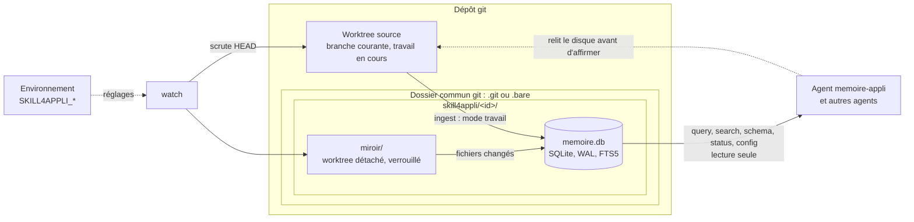
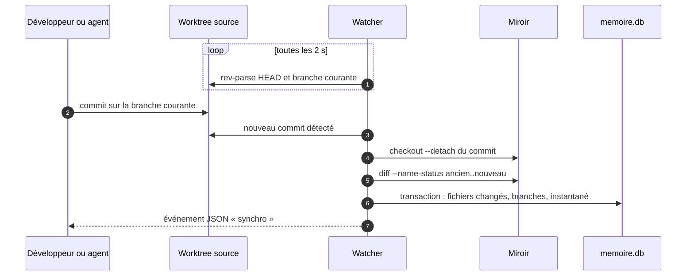

# Skill4Appli, mémoire d'application et watcher de branche, version 1.1.0

Ce document est le point d'entrée du skill. Le skill tient, dans un fichier SQLite, la structure et le contenu d'une application locale et l'état de ses branches git, pour qu'un agent localise du code par requête au lieu de parcourir le disque à chaque question. Un script Node sans dépendance, `scripts/app_db.mjs`, est le seul à écrire dans la base ; l'agent `memoire-appli` en est le premier lecteur. Les règles détaillées sont dans `modules/`.

## 1. Ordre de lecture

1. Ce document, en entier.
2. `manifest.json` : modules, versions de Node et de git visées, plateformes.
3. Les modules actifs, dans cet ordre : `execution`, `configuration`, `parite`, `ingestion`, `branches`, `interrogation`, `fraicheur`, `watcher`, `agent`, `recette`.
4. `modules/local/SKILL.md`, `modules/symboles/SKILL.md` et `modules/service-mcp/SKILL.md` : seulement pour comprendre les points d'extension. Ne pas les appliquer en 1.x.

## 2. Ce que fait le skill

| Commande | Rôle | Écrit la base | Module |
|---|---|---|---|
| `init` | crée ou migre la base | oui | `execution` |
| `ingest` | indexe le worktree source tel qu'il est sur le disque (mode `travail`) | oui | `ingestion` |
| `git-scan` | branches locales et distantes, fichiers modifiés par branche | oui | `branches` |
| `query` | requête SQL en lecture seule, réponse bornée | non | `interrogation` |
| `search` | emplacements `chemin:ligne` d'un terme | non | `interrogation` |
| `schema` | tables et colonnes commentées | non | `interrogation` |
| `status` | écart entre la base et le worktree source | non | `fraicheur` |
| `config` | réglages effectifs et leur source, emplacements, plateforme | non | `configuration` |
| `watch` | charge la branche courante dans un worktree dédié et le suit (mode `miroir`) | oui | `watcher` |
| `watch-stop` | arrête proprement le watcher, sur toutes les plateformes | non | `watcher` |
| `mirror-remove` | retire ce worktree dédié | métadonnées | `watcher` |

## 3. Deux modes d'indexation

| Mode | Racine indexée | Contenu de la base | Usage |
|---|---|---|---|
| `travail` | le worktree source | les fichiers tels qu'ils sont sur le disque, modifications non commitées comprises | indexation ponctuelle, projet hors git, agent qui veut voir son propre travail en cours |
| `miroir` | un worktree dédié, en HEAD détachée sur le dernier commit de la branche courante | l'état commité de la branche courante, tenu à jour par le watcher | mémoire durable pendant une session ; plusieurs agents qui lisent un état cohérent |

Une base par worktree source. La dernière indexation fixe le mode ; un changement de mode réindexe tout ; chaque réponse déclare le mode et le commit indexés (D4.INV-3).

## 4. Cycle 7E

| Phase | Ce qu'elle désigne ici | Modules |
|---|---|---|
| Éléments | fichiers, contenus, branches, commits | `ingestion`, `branches` |
| Espace | le worktree source, le dossier commun git où vivent la base et le miroir | `execution`, `watcher` |
| Engendrent | les relations : fichiers changés entre deux commits, fichiers modifiés par branche depuis l'ancêtre commun | `branches`, `watcher` |
| État | l'instantané indexé (mode, commit, branche, date) et son écart avec la source | `fraicheur` |
| Expression | les réponses JSON bornées, un objet par commande, et les événements du watcher | `interrogation`, `watcher` |
| Évolutif | migrations numérotées, synchronisation incrémentale, dimensions réservées D8, D9 et D11 | `execution`, `watcher`, `local`, `symboles`, `service-mcp` |
| Environnement | les plateformes qui exécutent le skill, les réglages qu'elles lui donnent, l'agent mémoire, les autres agents, le développeur | `configuration`, `parite`, `agent` |

Clause de second ordre : une mémoire de code n'est pas neutre. Ce que contient la base oriente ce que l'agent croit du projet, donc ce qu'il y fait, et une base périmée répond faux avec assurance. Le skill rend donc l'écart mesurable (`status`), chaque réponse déclare son instantané, et l'agent relit le disque avant d'affirmer : la base localise, le disque fait foi (D7.INV-2). L'observateur fait partie du système qu'il observe : le git qui lit le dépôt détermine ce que la mémoire en voit, d'où la règle de parité qui fait tourner le skill du côté du git qui possède le worktree (D12.INV-5).

## 5. Lecture 12 facteurs × 7E

Chaque facteur de la méthode Twelve-Factor App est rattaché à une phase du cycle 7E et prouvé par un invariant et ses tests, ou déclaré non couvert. La lecture mesure la viabilité du skill, pas une conformité déclarée.

| Facteur | Phase 7E | Ce que fait le skill | Preuve |
|---|---|---|---|
| I. Base de code | Espace | une spécification versionnée dans Agent2Prompt, matérialisée à l'identique dans chaque projet, hors de l'arbre suivi | table d'intégrité de la transmission ; empreintes du module `execution`, § 9 |
| II. Dépendances | Éléments | Node 22.13 et git 2.38 déclarés dans le manifeste ; aucun paquet | D1.INV-5 : T7 |
| III. Configuration | Environnement | réglages de déploiement par variables `SKILL4APPLI_*`, options en surcharge, aucun fichier de configuration | D10.INV-1 à D10.INV-3 : T25 à T27 |
| IV. Services externes | Espace | la base SQLite est une ressource attachée par `SKILL4APPLI_DB`, jetable, reconstruite depuis le dépôt ; la base de données de l'application reste hors du skill | D1.INV-4 : T5 ; module `parite`, § 2 |
| V. Build, release, run | Évolutif | la spécification se fige en transmission à empreintes ; ses fichiers s'extraient et s'exécutent sans modification | vérificateur du dépôt ; commande d'extraction du module `execution`, § 9 |
| VI. Processus | État | chaque commande est un processus sans état ; l'état vit dans la base et dans le dépôt | D4.INV-1, D5.INV-1 : T14, T17 |
| VII. Liaison de port | Expression | aucun port en 1.1.0 : l'interface est la ligne de commande ; un service MCP en stdio, sans port, est réservé | non couvert : D11 réservée ; E4 : T33 |
| VIII. Concurrence | Engendrent | un watcher par worktree, autant de lecteurs que d'agents, un seul écrivain par base | D6.INV-3 : T21 |
| IX. Jetabilité | État | démarrage sans préparation, arrêt propre sur toutes les plateformes, verrou orphelin repris, miroir et base recréables | D6.INV-3, D12.INV-3 : T21, T23, T30 |
| X. Parité | Environnement | même comportement et même recette sous Linux, WSL2 et Windows | D12.INV-1 à D12.INV-5 : T28 à T32 ; CI `ubuntu-latest` et `windows-latest` |
| XI. Journaux | Expression | les événements du watcher forment un flux JSON sur la sortie standard ; le skill ne gère aucun fichier de journal | E3 : T20, T30 |
| XII. Processus d'administration | Évolutif | `init`, migrations, `mirror-remove`, `watch-stop` : des commandes ponctuelles du même script, sur la même base | D1.INV-4, D6.INV-5 : T5, T6, T23 |

Poste type visé : back Java sur Tomcat et front Angular sous Windows, avec Git for Windows ; PostgreSQL, en image Docker, dans WSL2 ; agents dans WSL2 ou sous Windows. Le skill tourne sous Windows, à côté du code et de son git ; un agent de WSL2 l'appelle par `node.exe`, avec des chemins Windows (module `parite`, § 2 et § 3). PostgreSQL est un service externe de l'application (facteur IV) : le skill n'y accède pas ; le schéma entre dans la mémoire par les changelogs Liquibase ou les migrations Flyway du dépôt.

## 6. Registre des dimensions

| ID | Dimension | Introduite | Statut 1.1.0 | Dépend de | Module |
|---|---|---|---|---|---|
| D1 | Exécution : commandes, emplacement de la base, sorties et codes, migrations | 1.0 | active | | `execution`, `recette` |
| D2 | Inventaire et ingestion | 1.0 | active | D1 | `ingestion`, `recette` |
| D3 | Branches git et fichiers par branche | 1.0 | active | D1 | `branches`, `recette` |
| D4 | Interrogation en lecture seule | 1.0 | active | D2, D3 | `interrogation`, `recette` |
| D5 | Fraîcheur de la base | 1.0 | active | D2 | `fraicheur`, `recette` |
| D6 | Watcher de la branche courante dans un worktree dédié | 1.0 | active | D2, D3, D5 | `watcher`, `recette` |
| D7 | Agent mémoire | 1.0 | active | D4, D5, D6 | `agent` |
| D8 | Modifications locales non commitées, superposées au miroir | 1.0 | reserved | D5, D6 | `local` |
| D9 | Symboles par langue : classes, méthodes, routes | 1.0 | reserved | D2 | `symboles` |
| D10 | Configuration par l'environnement | 1.1 | active | D1 | `configuration`, `recette` |
| D11 | Service MCP en stdio, en lecture seule | 1.1 | reserved | D4, D5, D10 | `service-mcp` |
| D12 | Parité Linux, WSL2 et Windows | 1.1 | active | D1, D6, D10 | `parite`, `recette` |

## 7. Contrat de version et points d'extension

Le skill suit le contrat de version de `EVOLUTION.md` du dépôt Agent2Prompt. Le schéma de la base évolue uniquement par migrations numérotées (`PRAGMA user_version`) : la migration 1 est celle de la version 1.0.0 et ne sera jamais modifiée. La version 1.1.0 n'ajoute aucune migration.

Points d'extension, actifs depuis la version indiquée :

- **E1** (1.0.0) : en mode `miroir`, `status` liste déjà les modifications non commitées du worktree source (`modifications_locales`). D8 les indexera dans une couche superposée au miroir, sans toucher ni au miroir ni au worktree source.
- **E2** (1.0.0) : chaque fichier porte sa langue (`app_structure.lang`), déduite de son extension. D9 en tirera les symboles, langue par langue.
- **E3** (1.0.0) : les événements du watcher sont des lignes JSON aux champs stables (`t`, `evenement`, `branche`, `de`, `a`, bilans, `raison`). Un consommateur, par exemple le tableau de bord de `tension-dashboard-gitlab-agent` ou un relais, pourra s'y abonner sans modifier le watcher.
- **E4** (1.1.0) : chaque commande de lecture construit un seul objet, écrit en une ligne par la ligne de commande ; importé, le script exporte `executer(commande, options, positionnels)`, qui rend ce même objet sans rien écrire. D11 exposera ces objets comme résultats d'outils MCP.

## 8. Règles globales

- **Aucun shell** : git est lancé avec une liste d'arguments ; un nom de branche, un chemin ou un message lu n'est jamais interprété comme une commande (D1.INV-1).
- **Un seul écrivain** : `ingest`, `git-scan`, `watch` et `mirror-remove` écrivent ; un watcher actif exclut tous les autres (D6.INV-3). Les commandes de lecture ouvrent la base en lecture seule (D4.INV-1).
- **La base est un cache** : elle se reconstruit à partir du dépôt et ne fait jamais foi contre le disque (D7.INV-2).
- **Rien n'est forcé** : le watcher n'écrase ni ne nettoie un miroir modifié à la main (D6.INV-4), et ne touche ni au worktree source, ni à son index, ni à ses branches (D6.INV-1).
- **Configuration par l'environnement** : chaque réglage de déploiement a sa variable `SKILL4APPLI_*`, l'option l'emporte, aucun fichier de configuration (D10.INV-1).
- **Côté du git qui possède le worktree** : le skill tourne sur la plateforme dont le git tient le worktree source ; lancé de l'autre côté, il le signale (D12.INV-5).
- **Sortie pour un agent** : un JSON sur une ligne par défaut, les erreurs en JSON sur la sortie d'erreur, des codes de sortie documentés (D1.INV-3), des réponses bornées (D4.INV-2).
- **Sans dépendance** : Node 22.13 ou plus récent, modules natifs, aucun `npm install` (D1.INV-5).
- **Langue** : messages et documentation en français ; commandes, options, tables et colonnes en anglais, comme dans la version d'origine, pour que les requêtes écrites contre elle restent valides.

## 9. Critères d'acceptation

- La recette du module `recette` passe en entier : `node --test tests/app_db.test.mjs`, 34 tests sous Linux et WSL2, 33 tests et 1 sauté sous Windows, avec Node 22.13 ou plus récent et git 2.38 ou plus récent.
- La recette passe en intégration continue sur `ubuntu-latest` et `windows-latest`, avec Node 22 et Node 24, après extraction par la commande du module `execution`, § 9, sous bash et sous CMD.
- Les trois fichiers tirés des modules (`scripts/app_db.mjs`, `tests/app_db.test.mjs`, `agent/memoire-appli.md`) ont exactement les empreintes de la table du module `execution`, § 9.
- Les scénarios A1 à A6 du module `agent` sont rejoués avec le développeur avant que l'agent serve d'autres agents.

## 10. Invariants

**D1 : exécution**

- **D1.INV-1** : aucune commande externe ne passe par un shell : git est lancé avec une liste d'arguments, et aucune donnée lue (nom de branche, chemin, message de commit) n'est jamais interprétée comme une commande.
- **D1.INV-2** : l'emplacement de la base se déduit du worktree source, jamais du dossier courant ; dans un dépôt git, elle vit dans le dossier commun git (`<commun>/skill4appli/<id>/memoire.db`), hors de tout arbre suivi ; aucune commande de lecture ne crée de base.
- **D1.INV-3** : une réussite sort avec le code 0 et un JSON sur la sortie standard ; un échec sort avec un code non nul documenté (1 à 5, 7) et un JSON `{"ok": false, ...}` sur la sortie d'erreur ; `status` sort avec le code 6, réponse sur la sortie standard, quand la base n'est pas à jour.
- **D1.INV-4** : le schéma n'évolue que par migrations numérotées (`PRAGMA user_version`) ; une base créée par une version plus récente est refusée ; une base de la version d'origine, sans numéro de schéma, est reconstruite.
- **D1.INV-5** : le script et sa recette n'utilisent que les modules natifs de Node 22.13 ou plus récent ; aucune installation de paquet n'est nécessaire.

**D2 : inventaire et ingestion**

- **D2.INV-1** : dans un dépôt git, l'inventaire est celui de git (fichiers suivis, et non suivis non ignorés) : un fichier ignoré par `.gitignore` ou par l'exclusion du dépôt n'est jamais indexé.
- **D2.INV-2** : après une ingestion, la base contient exactement les fichiers de l'inventaire : un fichier disparu du disque disparaît de la base, index plein texte compris.
- **D2.INV-3** : un fichier binaire, de verrouillage, minifié, une carte de source ou un fichier plus gros que la limite est inventorié sans contenu, avec son type ; aucun contenu n'est altéré : un texte qui n'est pas en UTF-8 est lu en latin1 et marqué comme tel.
- **D2.INV-4** : une ingestion ne relit que les fichiers dont la taille ou la date a changé, et ne réécrit que ceux dont le contenu a changé.

**D3 : branches**

- **D3.INV-1** : `git_branches` donne toutes les branches locales et distantes, hors références symboliques, chacune sous son nom exact, avec la branche courante du worktree source, l'amont, l'avance et le retard, et le worktree où elle est extraite.
- **D3.INV-2** : `branch_files` donne, pour chaque branche locale, les fichiers modifiés depuis l'ancêtre commun avec la base, avec leur statut et leurs lignes ajoutées et retirées.

**D4 : interrogation**

- **D4.INV-1** : `query`, `search`, `schema` et `status` ouvrent la base en lecture seule : aucune requête, même d'écriture, ne la modifie.
- **D4.INV-2** : une réponse est bornée (nombre de lignes ou de fichiers, longueur des valeurs) et chaque troncature est signalée dans la réponse.
- **D4.INV-3** : chaque réponse de `query` et de `search` porte l'instantané indexé : mode, commit, branche et date d'indexation.
- **D4.INV-4** : `search` rend des emplacements `chemin:ligne` avec leur extrait, sans que la casse ni les accents fassent manquer une occurrence, les fichiers classés par pertinence.

**D5 : fraîcheur**

- **D5.INV-1** : chaque indexation enregistre son mode, sa racine, le commit et la branche indexés et sa date.
- **D5.INV-2** : `status` compare la base au worktree source sans rien écrire ; il ne rend `a_jour`, avec le code 0, que si la base reflète exactement ce worktree ; sinon il nomme l'écart (commits en retard, fichiers modifiés, nouveaux ou disparus, modifications locales) et sort avec le code 6.

**D6 : watcher**

- **D6.INV-1** : le watcher charge la branche courante du worktree source dans un worktree dédié, créé détaché et verrouillé dans le dossier commun git ; il ne modifie jamais le worktree source, son index ni ses branches.
- **D6.INV-2** : à chaque nouveau commit ou changement de branche courante, le miroir est amené sur le commit de la source, seuls les fichiers changés entre l'ancien et le nouveau commit sont relus, et la base désigne alors ce commit et cette branche.
- **D6.INV-3** : un seul écrivain par base : tant qu'un watcher est actif, `ingest`, `git-scan`, `mirror-remove` et un second `watch` sont refusés avec le code 4 ; le verrou d'un watcher arrêté brutalement est repris.
- **D6.INV-4** : le watcher ne force jamais : un miroir modifié à la main n'est ni écrasé ni nettoyé ; le watcher s'arrête avec le code 7 et nomme les fichiers en cause.
- **D6.INV-5** : le seul worktree que le skill retire est son propre miroir, sur commande explicite (`mirror-remove`), watcher arrêté ; un miroir modifié à la main n'est retiré qu'avec `--force`.

**D7 : agent mémoire**

- **D7.INV-1** : avant de s'appuyer sur la base, l'agent lance `status` et déclare dans sa réponse l'instantané utilisé et tout écart connu.
- **D7.INV-2** : la base localise, le disque fait foi : avant d'affirmer le contenu d'un fichier ou de citer une ligne, l'agent relit ce fichier dans le worktree source.
- **D7.INV-3** : l'agent ne modifie ni le code du projet ni le miroir ; il n'écrit dans la base que par `ingest` et `watch`, et ne lance `watch` ni `mirror-remove` sans l'accord du développeur.
- **D7.INV-4** : l'agent ne charge jamais de contenu non borné : aucune lecture de `content` sans filtre sur le chemin et sans limite de longueur.

**D10 : configuration**

- **D10.INV-1** : chaque réglage de déploiement se lit d'abord dans l'option de la ligne de commande, puis dans sa variable d'environnement `SKILL4APPLI_*`, puis prend son défaut ; aucun réglage n'est lu dans un fichier.
- **D10.INV-2** : une valeur invalide, d'option ou de variable, arrête la commande avec le code 1 et un message qui nomme sa source ; une variable vide vaut absente.
- **D10.INV-3** : `config` rend la valeur effective de chaque réglage, sa source (option, environnement, défaut) et les emplacements qui en découlent, sans rien écrire ni créer.

**D12 : parité des plateformes**

- **D12.INV-1** : le worktree source est désigné par son chemin réel, comparé sans casse sous Windows : un même worktree a une seule base et un seul miroir, quel que soit le chemin qui y mène (lien, casse, nom court).
- **D12.INV-2** : les chemins absolus enregistrés et rendus sont au format de la plateforme qui exécute le skill ; les chemins de fichiers du dépôt sont toujours relatifs et en `/`.
- **D12.INV-3** : le watcher s'arrête proprement de la même façon sur toutes les plateformes, par `watch-stop`, qui attend sa confirmation ; une demande d'arrêt antérieure au watcher, ou qui vise un autre processus, ne l'arrête pas.
- **D12.INV-4** : les fins de ligne de la plateforme (CRLF de `core.autocrlf`) ne faussent ni le compte et les numéros de ligne, ni les extraits de `search`, ni le verdict de `status`.
- **D12.INV-5** : lancé dans WSL sur un worktree du système de fichiers Windows, le skill le signale par l'avertissement `depot_windows_depuis_wsl` dans `status` et `config`, sans refuser la commande.

## 11. Filiation

Le skill reprend `skill4appli-fr`, remis par le développeur le 23 octobre 2026 : un `SKILL.md` et le script `scripts/app_db.mjs`, quatre commandes (`init`, `ingest`, `git-scan`, `query`) et trois tables. Restent identiques : les noms de ces commandes, des tables `app_structure`, `git_branches`, `app_metadata` et de leurs colonnes d'origine (`path`, `type`, `content`, `metadata`, `branch_name`, `is_current`, `last_commit`, `updated_at`) ; les deux requêtes d'exemple de la version d'origine restent donc valides.

Défauts constatés en rejouant la version d'origine sur un dépôt d'essai (Node 22.22, git 2.43), et invariant qui les interdit désormais :

| Constat sur la version d'origine | Invariant |
|---|---|
| Une branche nommée `x;touch${IFS}PWNED`, que git accepte, crée le fichier `PWNED` pendant `git-scan` : les noms de branche passent par un shell. | D1.INV-1 |
| Une branche extraite dans un autre worktree est enregistrée sous le nom `+ feature/wt`, avec le commit `N/A`. | D3.INV-1 |
| La base est créée dans le dossier courant : lancée d'ailleurs, une requête crée une base vide et répond `no such table` ; lancée à la racine du projet, `app_memory.db` apparaît dans `git status` ; le guide d'usage, `ingest .` depuis le dossier du skill, indexe le skill lui-même. | D1.INV-2 |
| Toute erreur sort avec le code 0. | D1.INV-3 |
| `.gitignore` n'est pas lu : `target/`, `vendor/` et `.venv/` sont indexés, comme un `package-lock.json` de 380 Ko. | D2.INV-1, D2.INV-3 |
| Un fichier supprimé reste en base après une nouvelle ingestion. | D2.INV-2 |
| Les binaires et un `.properties` en ISO-8859-1 sont stockés corrompus : la lecture en UTF-8 ne lève jamais d'erreur. | D2.INV-3 |
| Chaque fichier est relu et réécrit à chaque ingestion, une transaction par fichier : 3 000 fichiers en 5,4 s. | D2.INV-4 (module `ingestion`, § 5 : 0,6 s, et 67 ms sans changement) |
| `query` peut écrire : `DELETE FROM app_structure` vide la base. | D4.INV-1 |
| Le contenu complet des fichiers sort par `console.table`, sans limite. | D4.INV-2 |
| Rien ne signale à l'agent que la base a divergé du disque. | D5.INV-2, D7.INV-1 |

Ajouts demandés par le développeur : en 1.0.0, le watcher de la branche courante, chargée dans un dossier dédié par git worktree (D6), et l'agent qui accompagne le skill (D7) ; en 1.1.0, l'inscription du skill dans le cycle 7E et les douze facteurs (section 5), pour un poste où Java et Angular tournent sous Windows et PostgreSQL dans WSL2 : configuration par l'environnement (D10), service MCP réservé (D11), parité des plateformes (D12).

## 12. Journal de révision

**1.0.0** (2026-10-23) : première version. Dimensions D1 à D7 actives, D8 et D9 réservées. Points d'extension E1 à E3. Script `scripts/app_db.mjs` (Node 22.13, sans dépendance), recette de 25 tests et agent `memoire-appli`, écrits en entier dans les modules `execution`, `recette` et `agent`. Tirée de `skill4appli-fr` (section 10). Archive : `archives/SKILL-v1.0.0.md`.

**1.1.0** (2026-10-24) : lecture 12 facteurs × 7E (section 5). Dimensions D10 (configuration par l'environnement : variables `SKILL4APPLI_*`, commande `config`) et D12 (parité Linux, WSL2 et Windows : identité canonique du worktree, chemins natifs, arrêt commun par `watch-stop`, fins de ligne CRLF, avertissement d'un worktree Windows lu depuis WSL) actives ; D11 (service MCP en stdio) réservée. Point d'extension E4 : un objet par commande de lecture, `executer()` exporté. Recette de 34 tests, rejouée en CI sous Linux et Windows ; commande d'extraction valable sous bash, CMD et PowerShell ; agent `memoire-appli` qui relaie les avertissements et appelle `node.exe` depuis WSL. Aucune migration, aucun invariant de 1.0.0 modifié ; une base 1.0.0 est lue telle quelle.
