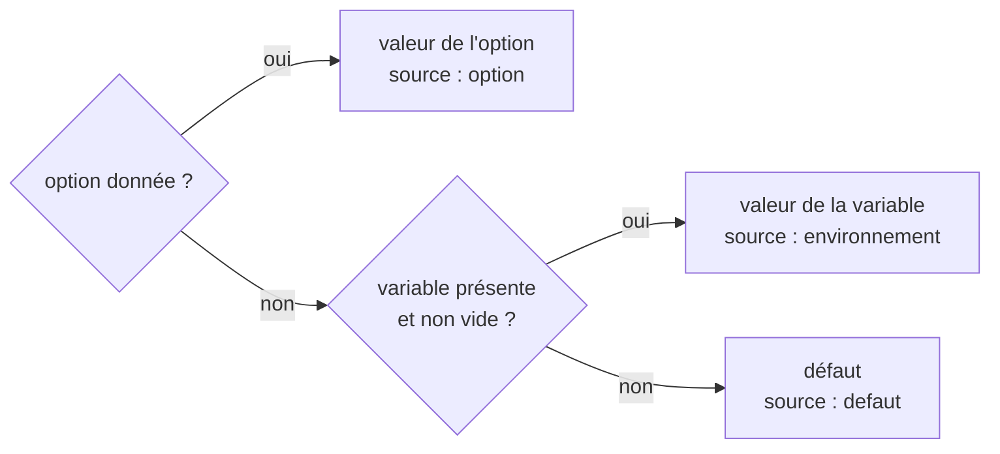

# Module `configuration` (D10)

Phase 7E couverte : Environnement. Facteur III des douze facteurs : la configuration, ce qui varie d'un déploiement à l'autre, vit dans l'environnement, jamais dans le code ni dans un fichier du skill.

## 1. Réglages

| Réglage | Option | Variable | Valeur | Défaut |
|---|---|---|---|---|
| `repo` | `--repo` | `SKILL4APPLI_REPO` | dossier du worktree source | dossier courant |
| `db` | `--db` | `SKILL4APPLI_DB` | fichier de la base | `<commun>/skill4appli/<id>/memoire.db` |
| `format` | `--format` | `SKILL4APPLI_FORMAT` | `json`, `pretty`, `table`, `text` | `json` |
| `max_size` | `--max-size` | `SKILL4APPLI_MAX_SIZE` | entier, 1 à 1 073 741 824 octets | 1048576 |
| `interval` | `--interval` | `SKILL4APPLI_INTERVAL` | entier, 500 à 3 600 000 ms | 2000 |
| `base` | `--base` | `SKILL4APPLI_BASE` | référence git | `origin/HEAD`, puis `main`, `master`, `develop` |
| `git` | | `SKILL4APPLI_GIT` | exécutable git | `git`, cherché dans le `PATH` |

Les options de requête (`--limit`, `--max-chars`, `--param`, `--file`, `--path`, `--lang`, `--lines`, `--once`, `--force`) n'ont pas de variable : elles sont les paramètres d'une question, pas un réglage du déploiement.

## 2. Ordre de résolution (D10.INV-1)



Aucun réglage n'est lu dans un fichier : ni `.env`, ni fichier du skill. Un agent ou un poste règle le skill par l'environnement de son processus ; une option ponctuelle l'emporte sans le modifier.

## 3. Validation (D10.INV-2)

- Un entier s'écrit en chiffres, sans unité ni exposant : `SKILL4APPLI_INTERVAL=1e3` est refusé. Hors bornes ou invalide : code 1, et le message commence par la source fautive, `SKILL4APPLI_INTERVAL : entier entre 500 et 3600000 attendu (reçu : vite)` ou `--interval : …`.
- Un format inconnu : code 1, même forme de message.
- Une variable vide vaut absente : `SKILL4APPLI_FORMAT=` laisse le défaut. Une variable héritée par erreur ne fausse pas une valeur ; elle se lit dans `config`.
- Un exécutable git introuvable (`SKILL4APPLI_GIT` ou `PATH`) : code 3, `git introuvable : <exécutable>`.

## 4. `config` (D10.INV-3)

`config` rend, sans rien écrire ni créer, chaque réglage avec sa valeur, sa source et sa variable, les emplacements qui en découlent, la plateforme et ses avertissements (module `parite`) :

```json
{"ok":true,"commande":"config","version":"1.1.0",
 "reglages":{"repo":{"valeur":"C:\\dev\\acme","source":"environnement","variable":"SKILL4APPLI_REPO"},
             "interval":{"valeur":2000,"source":"defaut","variable":"SKILL4APPLI_INTERVAL"}},
 "emplacements":{"source":"C:\\dev\\acme","commun":"C:\\dev\\acme\\.git",
                 "db":"C:\\dev\\acme\\.git\\skill4appli\\acme-1a2b3c4d\\memoire.db"},
 "plateforme":{"os":"win32","wsl":false,"depot_windows_depuis_wsl":false,"node":"22.22.0","sqlite":"3.50.4","git":"2.51.0"},
 "avertissements":[]}
```

L'exemple est abrégé : `reglages` contient les sept réglages, `emplacements` aussi `base`, `miroir`, `verrou` et `arret`.

## 5. Exemples

Linux et WSL2 :

```bash
export SKILL4APPLI_REPO="$HOME/dev/acme"
export SKILL4APPLI_INTERVAL=5000
node ~/dev/acme/.skills/skill4appli/scripts/app_db.mjs config --format pretty
```

Windows, dans CMD ou un fichier `.bat` (ASCII pur) :

```bat
set SKILL4APPLI_REPO=C:\dev\acme
set SKILL4APPLI_INTERVAL=5000
node C:\dev\acme\.skills\skill4appli\scripts\app_db.mjs config --format pretty
```

`setx SKILL4APPLI_REPO C:\dev\acme` rend la variable permanente pour les consoles ouvertes ensuite. Pour un agent, la variable se pose dans l'environnement de son processus ; elle dispense alors l'agent de connaître `--repo`.

## 6. Contrôle de sortie

- Option, puis variable, puis défaut ; variable de dépôt, de taille, de format et de base (D10.INV-1) : T25.
- Variables invalides nommées, variables vides absentes, exécutable git introuvable (D10.INV-2) : T26.
- `config` : valeur, source et variable de chaque réglage, emplacements, plateforme, rien d'écrit (D10.INV-3) : T27.
