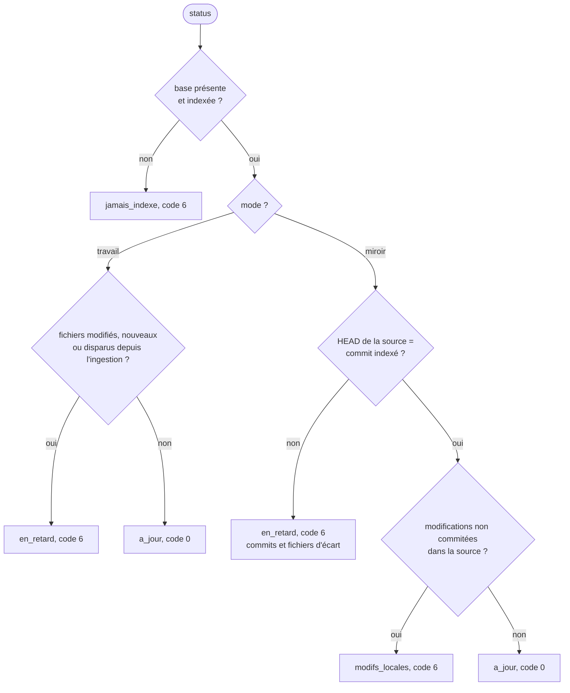

# Module `fraicheur` (D5)

Phase 7E couverte : État.

## 1. Instantané (D5.INV-1)

Chaque indexation écrit dans `app_metadata`, dans la même transaction que les fichiers :

| Clé | Contenu |
|---|---|
| `mode` | `travail` ou `miroir` |
| `root` | racine indexée : le worktree source, ou le miroir |
| `source` | le worktree source |
| `mirror_path` | le miroir, ou vide |
| `indexed_commit`, `indexed_branch` | commit et branche du worktree source au moment de l'indexation ; `(détachée)` en HEAD détachée |
| `indexed_at` | date ISO de l'indexation |
| `tool_version`, `max_size` | version du script, limite de taille appliquée |

`query` et `search` joignent `mode`, `indexed_commit`, `indexed_branch` et `indexed_at` à chaque réponse, sous `snapshot` (D4.INV-3).

## 2. `status` (D5.INV-2)

`status` ouvre la base en lecture seule, lit le worktree source sans le modifier (git avec `GIT_OPTIONAL_LOCKS=0`), et rend un verdict :

| Mode | Écart rendu |
|---|---|
| `travail` | `fichiers_modifies`, `fichiers_nouveaux`, `fichiers_disparus`, comparés par taille et date à l'inventaire courant, sans lire les contenus ; `commit_change` indique un commit depuis l'ingestion, sans effet sur le verdict si les fichiers sont identiques |
| `miroir` | `commits_en_retard` (`rev-list --count`), `fichiers_changes` (`diff --name-only`), `historique_reecrit` si le commit indexé n'est plus joignable ; `modifications_locales` : les fichiers non commités du worktree source (E1) |

Chaque liste est rendue sous la forme `{"total", "premiers"}`, 50 chemins au plus. `watcher` indique si un watcher est actif, avec son PID.

## 3. Que faire d'un verdict

| Verdict | Action |
|---|---|
| `a_jour` | interroger |
| `jamais_indexe` | `ingest`, ou `watch` avec l'accord du développeur |
| `en_retard`, mode `travail` | `ingest` (incrémental) |
| `en_retard`, mode `miroir`, watcher actif | attendre la synchronisation, puis relancer `status` |
| `en_retard`, mode `miroir`, sans watcher | `watch --once` ou un watcher continu, avec l'accord du développeur |
| `modifs_locales` | interroger, et relire sur le disque chaque fichier listé avant d'en affirmer le contenu |

## 4. Pièges connus

- `status` compare des tailles et des dates, pas des contenus : un fichier seulement touché (`touch`) paraît modifié ; `ingest` le reconnaît ensuite comme inchangé.
- En mode `miroir`, un fichier non suivi et non ignoré du worktree source compte comme modification locale : il n'est pas dans le miroir.

## 5. Contrôle de sortie

- Instantané enregistré et rendu ; écart nommé ; code 0 seulement à jour ; aucune écriture (D5.INV-1, D5.INV-2) : T17.
- Verdict `modifs_locales` en mode `miroir` : T18 ; `a_jour` après synchronisation : T19.
